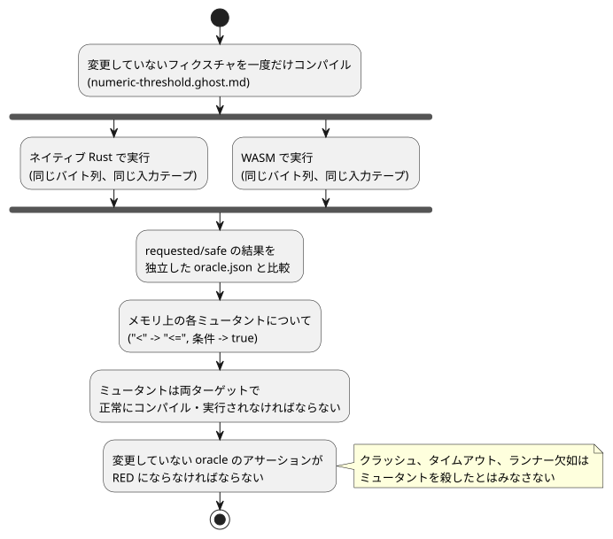

<!-- translation-source: docs/AI-CONTRIBUTION-PACKAGE.md -->
[英語の原文](AI-CONTRIBUTION-PACKAGE.md)

# 範囲を限定した AI コントリビューションパッケージ

[English](AI-CONTRIBUTION-PACKAGE.md) | [한국어](AI-CONTRIBUTION-PACKAGE.ko.md) | 日本語

このパッケージは issue [#134](https://github.com/callin2/ghostflow-language/issues/134) を支援するものです。コントリビューター（人間でも AI でも）が、会話履歴を一切持ち込まずに、**1 つの**境界リグレッションを調査するのに十分な証拠を提供します。

このパッケージが**行わない**こと：

- 言語規則の変更を承認しません。
- デバイスでの実行を承認しません。

リポジトリ全体のゲートについては、[CONTRIBUTING](../CONTRIBUTING.ja.md) と[ワークフロー](DEVELOPMENT-WORKFLOW.ja.md)に従ってください。

## 正確なベースラインとタスク

このパッケージは dev `5f87876a170a9e4c7da9d15f4c99a70c502e7b1a` 上で準備されました。各コントリビューションでは、実際のベースとキャンディデートの SHA、およびクリーンな作業ツリーの状態を記録してください。この過去のベースラインは、古い実行結果が新しい head を検証することを意味しません。このパッケージは証拠を追加するだけであり、コンパイラや Rust の振る舞いは変更しません。

**タスク：** 禁止された境界で意図が許可されてしまうリグレッションを調査します。

- 固定されたケースでは、数値の水分量が 42.5 以上のとき `pump=false` が要求されます。
- 変更案は、独立に規定された *oracle*（実装の外で固定された期待結果）を維持しなければなりません。
- この例を、設備全体の安全ポリシーへ一般化しないでください。

最低限読むべきものと契約：

- `GF-REQ-cf3758241cf74c21`：要求意図と安全意図は別物です。[カタログ](../contracts/requirements/catalog.json)、リファレンス [§4.7](reference/04-sensors-constraints-control.ja.md#47-requestedsafeappliedconfirmed)。
- `GF-REQ-fe719c3299fc1258`：状態と意図のアトミックな確定。[リファレンス §2.8](reference/02-types-expressions-state.ja.md)、[要件バリデータ](../contracts/requirements/validate.mjs)。
- [ランタイム適合性テスト](../tests/runtime-conformance.test.mjs)内のテストセレクタ `GF-TEST-contribution-field-boundary`。
- 正確な正準入力 [numeric-threshold.ghost.md](../tests/fixtures/contribution-134/numeric-threshold.ghost.md) と、独立した [oracle.json](../tests/fixtures/contribution-134/oracle.json)。

**ケースの出どころ。** 現場由来のソースと oracle は、Device #43 のソフトウェア入力・仮想出力ケース（不変のリビジョン [`618e45046f1c8be748eeec6767d5ffe0ea997a11`](https://github.com/callin2/farm-device/tree/618e45046f1c8be748eeec6767d5ffe0ea997a11/tools/hil/cases/numeric-threshold-virtual-ro1)）から来ています。選択されたボードは `waveshare-esp32-s3-eth-8di-8ro-r8n16` です。これらの同一性は来歴を記録するものであり、この言語コントリビューションがそのボードを検証したことを意味しません。

oracle は次のとおりです。

| ステップ | 水分量 | 期待される `pump` |
|---|---|---|
| 1 | 42.4 | true |
| 2 | 42.5 | false |
| 3 | 42.6 | false |
| 4 | 42.4 | true |

（要約すると、42.4→true、42.5→false、42.6→false、42.4→true です。）期待値は、コンパイラの出力やネイティブ/WASM の一致から生成されたものではありません。

## 再現と感度の実証

固定された依存関係とネイティブ/WASM のターゲットが揃ったら、次を実行します。

```sh
npm ci --ignore-scripts
cargo build --locked --offline -p ghostflow-core --release --example run
npm run build:wasm
node --test --test-name-pattern GF-TEST-contribution-field-boundary tests/runtime-conformance.test.mjs
node --test tests/runtime-conformance.test.mjs tests/requirement-catalog.test.mjs
```

既存のコンパクトなラッパーがインストールされていれば、それを使ってください。依存関係のセットアップでは、まずリポジトリの通常のロック済み Cargo fetch が必要になる場合があります。インフラの失敗は別に報告してください。`npm test` と CI が、引き続き完全なリグレッションゲートです。

**焦点を絞ったテストが検査するもの。** このテストは変更していないフィクスチャを一度だけコンパイルし、同一のバイト列と同じ入力テープをネイティブ Rust と WASM に与えます。そして、要求（requested）と安全（safe）の結果を現場の oracle と照合します。

**入力欠落の否定ケース（WASM のみ）。** WASM ABI の明示的な入力クリアによる否定ケースは、次のように動作します。

1. `missing input moisture` でスキャンを拒否します。
2. 確定済みの出力を保持します。
3. 次の明示的な入力で復旧します。

CSV のネイティブランナーは完全な空行を読み飛ばすため、この唯一の入力の省略をネイティブとの比較としては主張しません。これは*言語*の否定ケースであり、Device の品質縮退のテストではありません。固定された Device アダプタは Number 入力をゼロで初期化し、部分的な更新では以前の値を保持し、品質チャネルを持っていませんでした。

**ミューテーション感度。** このテストは、実際のリグレッションを検出できることも証明します。一時的なメモリ上の 2 つのミューテーションでルールを弱めます。

- `<` を `<=` に変える
- 条件を `true` に置き換える

各ミュータントは両方のターゲットで正常にコンパイルされ実行されなければならず、そのうえで初めて、変更していない oracle のアサーションが失敗しなければなりません。グリーンのテストは、これらのアサーションが RED になることを検査します。したがって、コンパイラのクラッシュ、タイムアウト、ランナーの欠如は、ミュータントを殺したことにはなりません。この実証は製品のソースを一切変更しません。

次の図は、焦点を絞ったテストをまとめたものです。同じコンパイル済みバイト列が両ターゲットで実行されて独立した oracle と照合され、弱められた各ミュータントは問題なく実行されたうえで、同じ oracle で失敗しなければなりません。



## 許可される変更とレビューの証拠

コントリビューションは次の範囲に限定してください。

- 実証された、所有するコンパイラ/コアのパス
- この焦点を絞ったリグレッション
- 関連する二言語の規則ドキュメントと変更履歴（振る舞いが変わる**場合に限り**）

Device のファームウェア、バインディング、ドライバ、デプロイ、UI ポリシー、過去のベンチマークハッシュは変更しないでください。現在のパッケージは証拠だけを変更します。実際のリグレッション修正には、それ自体の修正前/修正後の再現が必要です。

issue と PR のテンプレートは、正確な同一性、終了ステータス付きのコマンド、修正前/修正後の結果、独立した期待値、範囲、残っているギャップを求めます。次の差分カテゴリは、それぞれが弱められた検査を隠し得るため、**個別に**レビューしてください。

1. 保護式の削除や弱体化（境界演算子を含む）。
2. `oracle.json` とテスト内の独立した定数における期待値の編集。
3. テストの削除、`.skip`/`.todo`、セレクタやランナー一覧からの削除、アサーションの欠落。
4. 要件の `status`、`testIds`、ロケータのダイジェスト、`pendingReason` の変更。

`git diff BASE_SHA...HEAD -- tests/fixtures/contribution-134 tests/runtime-conformance.test.mjs tools/verify-language.mjs contracts/requirements/catalog.json` を使い、実装の差分は別に確認してください。

カタログの検証は、壊れた参照やステータスの契約を検出します。しかし、弱められた oracle が正しいかどうかは判断できません。正当な仕様変更には、引用された権威ある証拠と、その意味についての別個の独立したレビューが必要です。実装と期待値の両方を変更したからといって、それだけで正しさが証明されるわけではありません。

**この証拠が証明すること、証明しないこと。**

- ネイティブ/WASM の一致は、この入力テープに対する移植性を証明します。両ターゲットは Rust を共有しているため、同じ誤解を共有している可能性があります。
- 現場の oracle は、独立した境界の期待値を追加します。これは普遍的な正しさや物理的な保護の証明ではありません。
- ここでは、接点、負荷、品質チャネルの欠如、ドライバ/レンダラーの障害、リブート、ライブ設定、電源断、HIL の信頼境界のいずれも検証しません。これらの所有者とギャップは Device #43/#45 に残ります。

完了を報告するときは、正確な CI、レポート、成果物の同一性と、マージ後の新しい証拠を保持してください。
