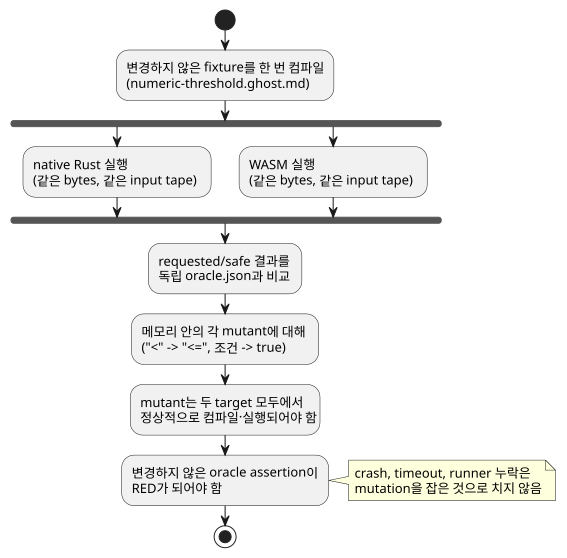

<!-- translation-source: docs/AI-CONTRIBUTION-PACKAGE.md -->
[영문 원문](AI-CONTRIBUTION-PACKAGE.md)

# 범위를 제한한 AI 기여 패키지

[English](AI-CONTRIBUTION-PACKAGE.md) | 한국어

이 패키지는 issue
[#134](https://github.com/callin2/ghostflow-language/issues/134)를 지원합니다.
기여자(사람이든 AI든)가 대화 기록을 전혀 가져오지 않고도 경계 회귀 **하나**를 조사할
수 있을 만큼의 증거를 제공합니다.

이 패키지가 하지 **않는** 일:

- 언어 규칙 변경을 승인하지 않습니다.
- 장치 실행을 승인하지 않습니다.

저장소 전체의 검증 절차는 [CONTRIBUTING](../CONTRIBUTING.ko.md)과
[개발 절차](DEVELOPMENT-WORKFLOW.ko.md)를 따르십시오.

## 정확한 baseline과 작업

이 패키지는 dev `5f87876a170a9e4c7da9d15f4c99a70c502e7b1a`에서 준비했습니다.
기여할 때마다 실제 base SHA와 candidate SHA, 깨끗한 작업 트리 상태를 기록하십시오.
이 과거 baseline은 오래된 실행이 새 head를 검증한다는 뜻이 아닙니다. 이 패키지는
증거만 추가하며, 컴파일러나 Rust 동작을 바꾸지 않습니다.

**작업:** 금지된 경계에서 의도(intent)가 허용되는 회귀를 조사합니다.

- 고정 사례는 숫자 moisture가 42.5 이상이면 `pump=false`를 요구합니다.
- 제안하는 변경은 독립적으로 정한 *oracle*(구현 밖에서 고정한 기대 결과)을 반드시
  유지해야 합니다.
- 이 예시를 설비 전체의 안전 정책으로 일반화하지 마십시오.

최소한 읽어야 할 자료와 계약:

- `GF-REQ-cf3758241cf74c21`: 요청 의도(requested)와 안전 의도(safe)는 서로 다릅니다.
  [catalog](../contracts/requirements/catalog.json), Reference
  [§4.7](reference/04-sensors-constraints-control.md#47-requested-safe-applied-confirmed).
- `GF-REQ-fe719c3299fc1258`: 상태/의도의 원자적 확정.
  [Reference §2.8](reference/02-types-expressions-state.md),
  [요구사항 validator](../contracts/requirements/validate.mjs).
- [runtime conformance](../tests/runtime-conformance.test.mjs)의 테스트 selector
  `GF-TEST-contribution-field-boundary`.
- 정확한 정본 입력 [numeric-threshold.ghost.md](../tests/fixtures/contribution-134/numeric-threshold.ghost.md)와
  독립적인 [oracle.json](../tests/fixtures/contribution-134/oracle.json).

**사례의 출처.** 현장에서 파생한 소스와 oracle은 Device #43의 software-input,
virtual-output 사례에서 가져왔으며, 불변 revision은
[`618e45046f1c8be748eeec6767d5ffe0ea997a11`](https://github.com/callin2/farm-device/tree/618e45046f1c8be748eeec6767d5ffe0ea997a11/tools/hil/cases/numeric-threshold-virtual-ro1)입니다.
선택된 board는 `waveshare-esp32-s3-eth-8di-8ro-r8n16`입니다. 이 identity들은
provenance(출처)를 기록할 뿐이며, 이번 언어 기여가 그 board를 검증했다는 뜻이
아닙니다.

oracle은 다음과 같습니다.

| 단계 | Moisture | 기대 `pump` |
|---|---|---|
| 1 | 42.4 | true |
| 2 | 42.5 | false |
| 3 | 42.6 | false |
| 4 | 42.4 | true |

(요약: 42.4→true, 42.5→false, 42.6→false, 42.4→true.) 어떤 기대값도 컴파일러 출력이나
native/WASM 일치로부터 생성하지 않습니다.

## 재현과 민감도 시연

고정된 의존성과 native/WASM target이 준비되면 다음을 실행합니다.

```sh
npm ci --ignore-scripts
cargo build --locked --offline -p ghostflow-core --release --example run
npm run build:wasm
node --test --test-name-pattern GF-TEST-contribution-field-boundary tests/runtime-conformance.test.mjs
node --test tests/runtime-conformance.test.mjs tests/requirement-catalog.test.mjs
```

기존 compact wrapper가 설치되어 있으면 그것을 사용하십시오. 의존성 준비에는 먼저
저장소의 일반적인 locked Cargo fetch가 필요할 수 있습니다. 인프라 실패는 따로
보고하십시오. `npm test`와 CI가 여전히 전체 회귀 검증 gate입니다.

**focused test가 검사하는 것.** 변경하지 않은 fixture를 한 번 컴파일하고, 동일한
bytes와 같은 input tape를 native Rust와 WASM에 공급합니다. 요청(requested) 결과와
안전(safe) 결과를 현장 oracle과 비교합니다.

**입력 누락 negative case(WASM 전용).** WASM ABI의 명시적 input-clear negative case는
다음과 같이 동작합니다.

1. `missing input moisture`로 스캔을 거부합니다.
2. 확정된 출력을 보존합니다.
3. 다음 명시적 입력에서 복구합니다.

CSV native runner는 완전히 빈 줄을 건너뛰므로, 이 단일 입력 누락은 native 비교로
주장하지 않습니다. 이것은 *언어*의 negative case이며 Device의 품질 저하(degraded
quality) 시험이 아닙니다. 고정된 Device 어댑터는 Number 입력을 0으로 초기화했고, 부분
갱신 시 이전 값을 유지했으며, 품질 채널이 없었습니다.

**mutation 민감도.** 이 테스트는 실제 회귀를 잡아낼 수 있다는 점도 증명합니다. 메모리
안의 임시 mutation 두 개가 규칙을 약화시킵니다.

- `<`를 `<=`로 바꿉니다.
- 조건을 `true`로 대체합니다.

각 mutant는 두 target 모두에서 정상적으로 컴파일·실행되어야 하며, 그런 다음에만 변경하지
않은 oracle assertion이 실패해야 합니다. green test는 이 assertion들이 RED가 되는지
검사합니다. 따라서 컴파일러 crash, timeout, runner 누락은 mutation을 잡아낸 것으로
계산될 수 없습니다. 이 시연은 제품 소스를 전혀 수정하지 않습니다.

아래 다이어그램은 focused test를 요약합니다. 같은 컴파일 bytes가 두 target에서 실행되어
독립 oracle과 비교되며, 약화된 각 mutant는 정상적으로 실행된 다음 같은 oracle에서
실패해야 합니다.



## 허용되는 변경과 검토 증거

기여 범위는 다음으로 제한하십시오.

- 시연된, 결함을 소유하는 컴파일러/core 경로
- 이 focused regression
- 관련된 양언어 규칙 문서와 changelog(동작이 바뀌는 **경우에만**)

Device firmware, 바인딩, 드라이버, 배포, UI 정책, 과거 benchmark hash는 변경하지
마십시오. 현재 패키지는 증거만 변경합니다. 실제 회귀 수정에는 자체적인 before/after
재현이 필요합니다.

issue/PR template은 정확한 identity, exit status를 포함한 명령, before/after 결과,
독립적인 기대값, 범위, 남은 공백을 요구합니다. 다음 diff 항목은 각각 약화된 검사를
숨길 수 있으므로 **따로** 검토하십시오.

1. 경계 연산자를 포함한 보호 식의 제거 또는 약화.
2. `oracle.json`과 테스트의 독립 상수에 있는 기대값 수정.
3. 테스트 삭제, `.skip`/`.todo`, selector/runner 목록 제거, assertion 손실.
4. 요구사항의 `status`, `testIds`, locator digest, `pendingReason` 변경.

`git diff BASE_SHA...HEAD -- tests/fixtures/contribution-134 tests/runtime-conformance.test.mjs tools/verify-language.mjs contracts/requirements/catalog.json`을
사용하고, 구현 diff는 별도로 살펴보십시오.

catalog 검증은 깨진 참조와 status 계약을 잡아냅니다. 그러나 약화된 oracle이 올바른지는
판단할 수 없습니다. 정당한 명세 변경에는 권위 있는 근거의 인용과, 그 의미에 대한
별도의 독립 검토가 필요합니다. 구현과 기대값을 함께 바꿨다는 사실만으로는 정확성이
증명되지 않습니다.

**이 증거가 증명하는 것과 증명하지 않는 것.**

- native/WASM 일치는 이 input tape에 대한 이식성을 증명합니다. 두 target은 Rust를
  공유하므로 같은 오해도 공유할 수 있습니다.
- 현장 oracle은 독립적인 경계 기대를 추가합니다. 보편적인 정확성이나 물리적 보호를
  증명하지는 않습니다.
- 여기서는 접점, 부하, 품질 채널 누락, 드라이버/렌더러 고장, 재부팅, live 설정, 전원
  차단, HIL 신뢰 경계를 전혀 검증하지 않습니다. Device #43/#45가 그 담당과 공백을
  계속 유지합니다.

완료를 보고할 때는 정확한 CI, 보고서, artifact identity와 병합 후의 새로운 증거를
남기십시오.
