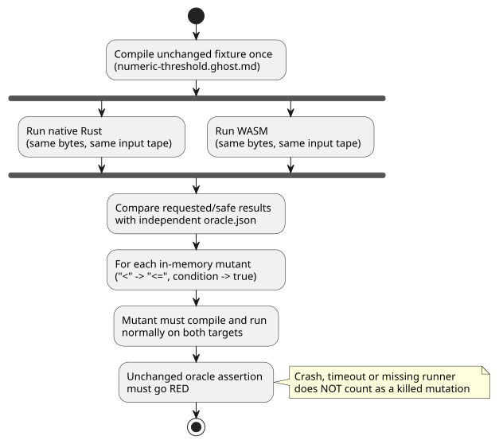

# Bounded AI contribution package

English | [한국어](AI-CONTRIBUTION-PACKAGE.ko.md)

This package supports issue
[#134](https://github.com/callin2/ghostflow-language/issues/134). It gives a
contributor (human or AI) enough evidence to investigate **one** boundary
regression without importing any conversation history.

What the package does **not** do:

- It does not authorize a language-rule change.
- It does not authorize device execution.

For the complete repository gates, follow [CONTRIBUTING](../CONTRIBUTING.md) and
[the workflow](DEVELOPMENT-WORKFLOW.md).

## Exact baseline and task

The package was prepared on dev
`5f87876a170a9e4c7da9d15f4c99a70c502e7b1a`. For each contribution, record the
actual base and candidate SHAs and a clean working-tree status. This historical
baseline does not mean that an old run verifies a new head. The package adds
evidence only; it does not change compiler or Rust behavior.

**Task:** investigate a regression where an intent is allowed at a forbidden
boundary.

- The fixed case requires `pump=false` when numeric moisture is 42.5 or higher.
- A proposed change must keep the independently specified *oracle* (the expected
  results that were fixed outside the implementation).
- Do not generalize this example into an installation-wide safety policy.

Minimum reading and contracts:

- `GF-REQ-cf3758241cf74c21`: requested intent and safe intent are distinct;
  [catalog](../contracts/requirements/catalog.json), Reference
  [§4.7](reference/04-sensors-constraints-control.md#47-requested-safe-applied-confirmed).
- `GF-REQ-fe719c3299fc1258`: atomic state/intent commit;
  [Reference §2.8](reference/02-types-expressions-state.en.md),
  [requirements validator](../contracts/requirements/validate.mjs).
- Test selector `GF-TEST-contribution-field-boundary` in
  [runtime conformance](../tests/runtime-conformance.test.mjs).
- Exact canonical input [numeric-threshold.ghost.md](../tests/fixtures/contribution-134/numeric-threshold.ghost.md)
  and independent [oracle.json](../tests/fixtures/contribution-134/oracle.json).

**Where the case comes from.** The field-derived source and oracle come from
Device #43's software-input, virtual-output case at immutable revision
[`618e45046f1c8be748eeec6767d5ffe0ea997a11`](https://github.com/callin2/farm-device/tree/618e45046f1c8be748eeec6767d5ffe0ea997a11/tools/hil/cases/numeric-threshold-virtual-ro1).
The selected board is `waveshare-esp32-s3-eth-8di-8ro-r8n16`. These identities
record provenance; they do not mean this language contribution validated that
board.

The oracle is:

| Step | Moisture | Expected `pump` |
|---|---|---|
| 1 | 42.4 | true |
| 2 | 42.5 | false |
| 3 | 42.6 | false |
| 4 | 42.4 | true |

(In short: 42.4→true, 42.5→false, 42.6→false, 42.4→true.) No expected value is
generated from compiler output or from native/WASM agreement.

## Reproduce and demonstrate sensitivity

Once the pinned dependencies and the native/WASM targets are available, run:

```sh
npm ci --ignore-scripts
cargo build --locked --offline -p ghostflow-core --release --example run
npm run build:wasm
node --test --test-name-pattern GF-TEST-contribution-field-boundary tests/runtime-conformance.test.mjs
node --test tests/runtime-conformance.test.mjs tests/requirement-catalog.test.mjs
```

Use the existing compact wrapper if it is installed. Dependency setup may first
need the repository's normal locked Cargo fetch; report infrastructure failures
separately. `npm test` and CI remain the complete regression gates.

**What the focused test checks.** It compiles the unchanged fixture once and
feeds identical bytes and the same input tape to native Rust and to WASM. It
checks the requested and safe results against the field oracle.

**Missing-input negative case (WASM only).** The WASM ABI's explicit input-clear
negative case:

1. rejects the scan with `missing input moisture`;
2. preserves the committed outputs;
3. recovers on the next explicit input.

The CSV native runner skips wholly blank lines, so this sole-input omission is
not claimed as a native comparison. This is a *language* negative case, not a
test of Device degraded quality: the pinned Device adapter initialized Number
inputs to zero, retained earlier values on partial updates, and had no quality
channel.

**Mutation sensitivity.** The test also proves that it would catch a real
regression. Two temporary, in-memory mutations weaken the rule:

- change `<` to `<=`;
- replace the condition with `true`.

Each mutant must compile and execute normally on both targets; only then must the
unchanged oracle assertion fail. The green test checks that these assertions go
RED. A compiler crash, a timeout or a missing runner therefore cannot count as a
killed mutation. This demonstration modifies no product source.

The diagram below summarizes the focused test: the same compiled bytes run on
both targets and are checked against the independent oracle, and each weakened
mutant must run cleanly and then fail that same oracle.



## Allowed changes and review evidence

Keep a contribution limited to:

- the demonstrated owning compiler/core path;
- this focused regression;
- the relevant bilingual rule documentation and changelog, **only if** behavior
  changes.

Do not alter Device firmware, bindings, drivers, deployment, UI policy, or
historical benchmark hashes. The current package changes evidence only; an actual
regression fix needs its own before/after reproduction.

The issue and PR templates ask for exact identities, commands with exit status,
before/after results, independent expected values, bounds, and remaining gaps.
Review these diff categories **separately**, because each can hide a weakened
check:

1. Protection expression removal or weakening, including boundary operators.
2. Expected-value edits in `oracle.json` and the test's independent constant.
3. Test deletion, `.skip`/`.todo`, selector/runner-list removal or assertion loss.
4. Requirement `status`, `testIds`, locator digest and `pendingReason` changes.

Use `git diff BASE_SHA...HEAD -- tests/fixtures/contribution-134 tests/runtime-conformance.test.mjs tools/verify-language.mjs contracts/requirements/catalog.json`
and inspect the implementation diff separately.

Catalog validation catches broken references and status contracts. It cannot
tell whether a weakened oracle is correct. A legitimate specification change
needs cited authoritative evidence and a separate, independent review of its
meaning. Changing both the implementation and the expected values does not, by
itself, prove correctness.

**What this evidence does and does not prove.**

- Native/WASM agreement proves portability for this input tape. Both targets
  share Rust, so they can share the same misunderstanding.
- The field oracle adds an independent boundary expectation. It is not proof of
  universal correctness or of physical protection.
- Nothing here validates contacts, loads, a missing-quality channel,
  driver/renderer failure, reboot, live settings, power interruption, or the HIL
  trust boundary. Device #43/#45 keep those owners and gaps.

When reporting completion, keep exact CI, report and artifact identities, and
fresh post-merge evidence.
