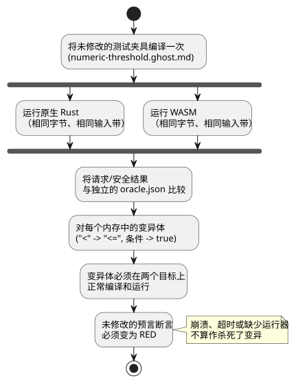

<!-- translation-source: docs/AI-CONTRIBUTION-PACKAGE.md -->
[英文原文](AI-CONTRIBUTION-PACKAGE.md)

# 有界 AI 贡献包

[English](AI-CONTRIBUTION-PACKAGE.md) | [한국어](AI-CONTRIBUTION-PACKAGE.ko.md)

本贡献包服务于 issue
[#134](https://github.com/callin2/ghostflow-language/issues/134)。它为贡献者（人或 AI）提供足够的证据，使其无需导入任何对话历史，就能调查**一个**边界回归问题。

本贡献包**不**做的事：

- 不授权修改语言规则。
- 不授权在设备上执行。

关于完整的仓库关卡，请遵循 [CONTRIBUTING](../CONTRIBUTING.zh.md) 和
[工作流程](DEVELOPMENT-WORKFLOW.zh.md)。

## 精确基线与任务

本贡献包基于 dev
`5f87876a170a9e4c7da9d15f4c99a70c502e7b1a` 准备。对于每次贡献，都要记录实际的基线 SHA 和候选 SHA，以及干净的工作区状态。这个历史基线并不意味着旧的运行可以验证新的 head。本贡献包只增加证据；它不改变编译器或 Rust 的行为。

**任务：**调查一个回归问题：某个意图在被禁止的边界上被允许了。

- 固定用例要求：当数值湿度为 42.5 或更高时，`pump=false`。
- 提议的变更必须保持独立指定的*预言*（oracle，即在实现之外固定下来的预期结果）。
- 不要把这个例子泛化为整个设施范围的安全策略。

最低限度的阅读材料与契约：

- `GF-REQ-cf3758241cf74c21`：请求意图与安全意图是不同的；
  [目录](../contracts/requirements/catalog.json)、Reference
  [§4.7](reference/04-sensors-constraints-control.zh.md)。
- `GF-REQ-fe719c3299fc1258`：状态/意图的原子提交；
  [Reference §2.8](reference/02-types-expressions-state.zh.md)、
  [需求校验器](../contracts/requirements/validate.mjs)。
- [运行时一致性测试](../tests/runtime-conformance.test.mjs) 中的测试选择器 `GF-TEST-contribution-field-boundary`。
- 精确的规范输入 [numeric-threshold.ghost.md](../tests/fixtures/contribution-134/numeric-threshold.ghost.md)
  以及独立的 [oracle.json](../tests/fixtures/contribution-134/oracle.json)。

**用例的出处。** 这份来自现场的源和预言，来自 Device #43 在不可变修订版
[`618e45046f1c8be748eeec6767d5ffe0ea997a11`](https://github.com/callin2/farm-device/tree/618e45046f1c8be748eeec6767d5ffe0ea997a11/tools/hil/cases/numeric-threshold-virtual-ro1)
上的“软件输入、虚拟输出”用例。所选的板卡是 `waveshare-esp32-s3-eth-8di-8ro-r8n16`。这些身份标识记录的是来源（provenance）；它们并不意味着本次语言贡献验证了该板卡。

预言如下：

| 步骤 | 湿度 | 预期 `pump` |
|---|---|---|
| 1 | 42.4 | true |
| 2 | 42.5 | false |
| 3 | 42.6 | false |
| 4 | 42.4 | true |

（简而言之：42.4→true，42.5→false，42.6→false，42.4→true。）任何预期值都不是根据编译器输出或原生/WASM 的一致性生成的。

## 复现并证明敏感性

当固定版本的依赖以及原生/WASM 目标都可用后，运行：

```sh
npm ci --ignore-scripts
cargo build --locked --offline -p ghostflow-core --release --example run
npm run build:wasm
node --test --test-name-pattern GF-TEST-contribution-field-boundary tests/runtime-conformance.test.mjs
node --test tests/runtime-conformance.test.mjs tests/requirement-catalog.test.mjs
```

如果已安装现有的精简包装脚本，可以使用它。依赖准备可能需要先执行仓库常规的锁定版本 Cargo fetch；请将基础设施故障单独报告。`npm test` 和 CI 仍然是完整的回归关卡。

**聚焦测试检查什么。** 它将未修改的测试夹具编译一次，然后把完全相同的字节和同一条输入带分别送入原生 Rust 和 WASM。它根据现场预言检查请求结果和安全结果。

**缺失输入的反例（仅 WASM）。** WASM ABI 中显式清除输入的反例：

1. 以 `missing input moisture` 拒绝该次扫描；
2. 保留已提交的输出；
3. 在下一次显式输入时恢复。

CSV 原生运行器会跳过完全空白的行，因此这种唯一输入被省略的情况不作为原生对比的声明。这是一个*语言层面*的反例，而不是对设备降级质量的测试：固定版本的 Device 适配器会把 Number 输入初始化为零，在部分更新时保留先前的值，并且没有质量通道。

**变异敏感性。** 该测试还证明它确实能捕获真正的回归。两个临时的内存中变异会削弱该规则：

- 把 `<` 改为 `<=`；
- 把条件替换为 `true`。

每个变异体都必须在两个目标上正常编译和执行；只有这样，未修改的预言断言才必须失败。绿色的测试会检查这些断言是否变为 RED。因此，编译器崩溃、超时或缺少运行器都不能算作“杀死”了变异。此演示不修改任何产品源码。

下图概括了这个聚焦测试：同一份编译后的字节在两个目标上运行并与独立预言进行比对，而每个被削弱的变异体都必须先干净地运行，然后在同一预言上失败。



## 允许的变更与评审证据

将一次贡献限制在以下范围内：

- 已证明的、负责该行为的编译器/核心路径；
- 这个聚焦的回归测试；
- 相关的双语规则文档和变更日志，**仅当**行为发生变化时。

不要修改 Device 固件、绑定、驱动程序、部署、UI 策略或历史基准哈希。当前的贡献包只改变证据；真正的回归修复需要有自己的前后对比复现。

issue 和 PR 模板要求提供：精确的身份标识、带退出状态的命令、前后对比结果、独立的预期值、边界以及剩余的缺口。请**分别**评审以下几类 diff，因为每一类都可能隐藏被削弱的检查：

1. 保护表达式被删除或削弱，包括边界运算符。
2. `oracle.json` 中以及测试中独立常量的预期值被修改。
3. 测试被删除、`.skip`/`.todo`、选择器/运行器列表被移除或断言丢失。
4. 需求的 `status`、`testIds`、定位器摘要和 `pendingReason` 的变化。

使用 `git diff BASE_SHA...HEAD -- tests/fixtures/contribution-134 tests/runtime-conformance.test.mjs tools/verify-language.mjs contracts/requirements/catalog.json`
并单独检查实现部分的 diff。

目录校验能发现失效的引用和状态契约问题，但它无法判断一个被削弱的预言是否正确。合理的规格变更需要引用权威证据，并对其含义进行单独、独立的评审。同时修改实现和预期值，本身并不能证明正确性。

**这些证据能证明什么、不能证明什么。**

- 原生/WASM 一致性证明了对这条输入带的可移植性。两个目标共享 Rust，因此可能共享同一个误解。
- 现场预言增加了一个独立的边界预期。它不能证明普遍的正确性，也不能证明物理保护。
- 这里没有验证触点、负载、缺失的质量通道、驱动程序/渲染器故障、重启、实时设置、断电或 HIL 信任边界。这些仍由 Device #43/#45 负责，相应缺口也保留在那里。

报告完成时，请保留精确的 CI、报告和产物身份标识，以及合并后的最新证据。
