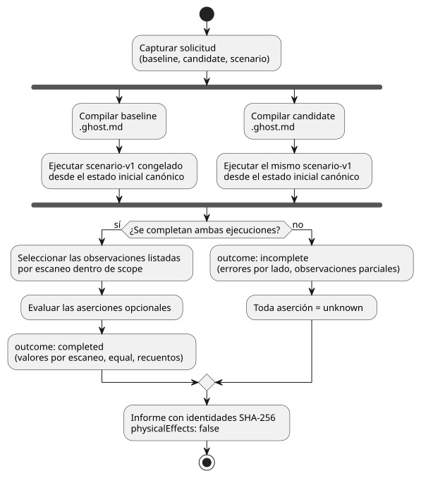
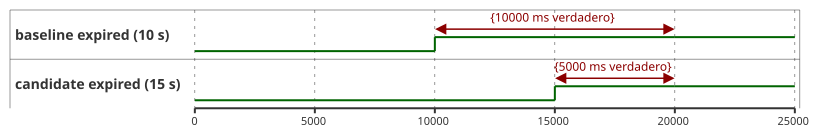

<!-- translation-source: docs/BEHAVIOR-COMPARISON.md -->
[Original en inglés](BEHAVIOR-COMPARISON.md)

# Comparación acotada de comportamientos

[한국어](BEHAVIOR-COMPARISON.ko.md) · [Contrato de responsabilidad de la intención](INTENT-CONSISTENCY-CONTRACT.es.md) · [#560](https://github.com/callin2/ghostflow-language/issues/560)

`compareBehavior(request)` en `tools/behavior-comparison.mjs` responde a una sola pregunta: *con las mismas entradas, ¿en qué se diferencia el comportamiento de un programa candidato respecto de un programa de línea base?*

Funciona así:

1. Compila dos fuentes canónicas `.ghost.md`: la **línea base** (baseline) y el **candidato** (candidate).
2. Ejecuta el mismo `GhostFlow/scenario-v1` congelado una vez desde el estado inicial canónico de cada fuente, usando el ejecutor `ghostsim` existente, nativo en Rust o WASM.
3. Informa de las intenciones virtuales solicitadas/seguras reales, del estado y de los fallos dentro de un alcance que usted elige.

Usted, como llamador, elige las observaciones, el alcance exacto de escaneos/tiempo y, opcionalmente, los cambios que espera.

Lo que **no** hace: no infiere la intención del agricultor, no opera un dispositivo en vivo ni establece efectos físicos.

El diagrama siguiente muestra la canalización: ambos programas ejecutan de forma independiente el mismo escenario capturado, y una ejecución incompleta convierte cada aserción en `unknown`.



## Solicitud y API

La solicitud pública es un objeto compatible con JSON:

| Campo | Contrato |
|---|---|
| `format` | `GhostFlow/behavior-comparison-request-v1` |
| `baseline`, `candidate` | `{ filename, source }`, donde `filename` termina en `.ghost.md`, con `sourceClosure` del compilador e `intentEvidence` opcionales de la [evidencia de intención](INTENT-EVIDENCE.es.md). Ambas fuentes se capturan antes de cualquier trabajo asíncrono. |
| `scenario` | Un objeto `GhostFlow/scenario-v1` completo, incluidas las entradas iniciales y las acciones ordenadas. El mismo escenario capturado se valida contra ambos manifiestos y se ejecuta de forma independiente. `plant` se rechaza porque la retroalimentación dependiente de las salidas puede producir entradas siguientes distintas. Los cambios en el acondicionamiento de sensores con muestras suministradas idénticas siguen siendo comportamiento observable. |
| `observations` | Lista no vacía (como máximo 32) de `{ field, name }` para `requested`, `safe`, `stateBefore` o `stateAfter`; `{ field: 'faults' }` selecciona la lista completa de fallos. Los campos con nombre deben existir en los manifiestos de salida o en las vinculaciones de la traza de estado de ambos programas compilados. Solo las observaciones listadas aparecen en la comparación. |
| `scope` | `{ from: { scanId, logicalTimeMs }, to: { scanId, logicalTimeMs } }`. Ambos extremos deben coincidir exactamente con escaneos ejecutados. Las observaciones incluyen ambos extremos. |
| `assertions` | Lista opcional (como máximo 64) de los predicados suministrados por el llamador que se describen más abajo. Si se omite, se devuelve una comparación observada sin juicio sobre el cambio esperado. |

Llámela como `const report = await compareBehavior(request)`. Hay tres tipos de resultado:

| Situación | Resultado |
|---|---|
| Forma no válida de la fuente, los metadatos, el escenario, la observación o la solicitud | La API **lanza una excepción**. |
| Una ejecución comienza pero no puede completarse | `outcome: 'incomplete'`, errores específicos de cada lado y las observaciones parciales disponibles. **Toda aserción es `unknown`.** |
| La comparación se completa | Valores por escaneo y `equal`, más recuentos de cambios/sin cambios calculados solo dentro del alcance seleccionado. |

Ninguna salida se trata como un comando de instalación. El campo `physicalEffects` del resultado es siempre `false`.

**Identidades.** El resultado vincula, mediante SHA-256, la solicitud completa, el escenario, los documentos fuente canónicos, los bytes GFB, los manifiestos y los cierres de fuentes y la evidencia de intención opcionales. También registra las rutas y los hashes del runtime/host seleccionados, y la versión de Node cuando se usa el host WASM. Son identidades de ejecución, no firmas.

**Estado inicial.** Cada ejecución parte del estado declarado en su propia fuente canónica. Por tanto, un cambio del estado inicial forma parte de la diferencia entre programas.

### Predicados opcionales

Cada aserción tiene un `id` único, un `kind` y una `observation` que ya figura en `observations`:

| Kind | Campos adicionales | Evaluación |
|---|---|---|
| `unchanged` | ninguno | El valor seleccionado es igual entre ambos programas en cada escaneo dentro de `scope`. |
| `equals` | `side: 'baseline'\|'candidate'`, `at: { scanId, logicalTimeMs }` exacto, valor JSON `expected` | El valor real del lado indicado en ese escaneo es igual al valor suministrado. |
| `bool-on-duration-delta` | entero seguro `expectedDeltaMs` | `candidateMs - baselineMs` es igual al delta suministrado. Cuenta solo los segmentos Bool verdaderos `[scan_i, scan_(i+1))` entre los extremos exactos del alcance. El último escaneo es un extremo y nunca se extrapola. |

**Vincular una aserción a la evidencia de intención.** Una aserción puede añadir `evidence: { side, condition: { id, revision, sha256 } }`.

- La referencia debe coincidir con la condición de `intentEvidence` suministrada para ese lado, incluido `intentConditionDigest(condition)`.
- El informe conserva el alcance de confirmación de la condición y `authority: 'not-authenticated'`.
- Sin este vínculo, el informe indica `evidenceBinding: 'unlinked'`.

**Qué significa `satisfied`.** Significa únicamente que el predicado suministrado se cumplió en el alcance de escaneos observado. **No** significa que se haya confirmado la interpretación, que la condición fuera un oráculo independiente ni que el cambio se ajuste a la intención del usuario. La especificación completa de la aserción y su resumen (digest) permanecen en el informe, de modo que el valor esperado no puede desaparecer de una afirmación de éxito.

## Ejemplo ejecutable

Ejecute esto desde la raíz del repositorio una vez que estén disponibles los artefactos del ejecutor de escenarios existente:

```js
import { compareBehavior } from './tools/behavior-comparison.mjs';

const program = seconds => `\`\`\`ghost
control Timer {
  state active: Bool = true;
  timer age = elapsed(active);
  output expired: Bool;
  output drive: Percent;
  expired <- age >= ${seconds}s;
  drive <- 0%;
}
\`\`\`\n`;
const at = (scanId, logicalTimeMs) => ({ scanId, logicalTimeMs });
const request = {
  format: 'GhostFlow/behavior-comparison-request-v1',
  baseline: { filename: 'timer-10.ghost.md', source: program(10) },
  candidate: { filename: 'timer-15.ghost.md', source: program(15) },
  scenario: {
    format: 'GhostFlow/scenario-v1', id: 'timer', initialInputs: [], keyBindings: [],
    actuatorBindings: [{ actuator: 'drive', output: 'drive', type: 'Percent', min: 0, max: 100 }],
    actions: [0, 10000, 15000, 20000].map(atMs => ({ kind: 'scan', atMs })),
  },
  observations: [{ field: 'safe', name: 'expired' }],
  scope: { from: at(0, 0), to: at(3, 20000) },
  assertions: [
    { id: 'delay', kind: 'bool-on-duration-delta',
      observation: { field: 'safe', name: 'expired' }, expectedDeltaMs: -5000 },
  ],
};
const report = await compareBehavior(request);
console.log(report.outcome, report.assertions);
```

El ejemplo compara un temporizador de 10 segundos (línea base) con uno de 15 segundos (candidato) a lo largo de cuatro escaneos en 0, 10000, 15000 y 20000 ms. La línea de tiempo siguiente muestra cuándo `expired` es verdadero en cada programa; el recuento se detiene en el extremo del alcance (escaneo 3, 20000 ms), por lo que la línea base es verdadera durante 10000 ms, el candidato durante 5000 ms, y el delta es 5000 − 10000 = −5000 ms.



La vinculación `drive` del ejemplo selecciona el host de escenarios WASM existente. Sus valores son virtuales y no implican ninguna afirmación sobre actuadores físicos. El delta esperado lo suministra este ejemplo de forma independiente; no se genera a partir de ninguno de los dos programas.

**Línea de comandos.** Serialice la misma solicitud como JSON o TOON y ejecute `node tools/ghostcompare.mjs --request comparison.json --format json`.

- La salida predeterminada es TOON; también se acepta `--format toon`.
- Código de salida: 0 para una comparación completada, 1 para resultados rechazados o incompletos.
- Límites: la CLI lee como máximo 3 MiB de bytes de solicitud, y el escenario capturado está limitado a 256 KiB. El resultado tiene un tope de 1 MiB; superarlo produce un resultado incompleto con aserciones `unknown`.
- Ni la API ni la CLI aceptan callbacks de JavaScript en la solicitud.
