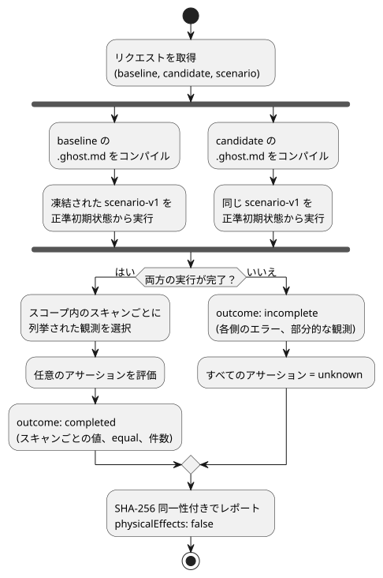
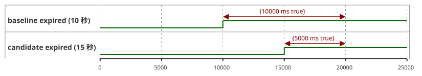

<!-- translation-source: docs/BEHAVIOR-COMPARISON.md -->
[英語の原文](BEHAVIOR-COMPARISON.md)

# 範囲を限定した振る舞いの比較

[한국어](BEHAVIOR-COMPARISON.ko.md) · [意図責任契約](INTENT-CONSISTENCY-CONTRACT.ja.md) · [#560](https://github.com/callin2/ghostflow-language/issues/560)

`tools/behavior-comparison.mjs` の `compareBehavior(request)` は、*同じ入力が与えられたとき、キャンディデート（candidate）のプログラムはベースライン（baseline）のプログラムとどう振る舞いが異なるか？* という 1 つの問いに答えます。

動作は次のとおりです。

1. 2 つの正準 `.ghost.md` ソース、つまり**ベースライン**と**キャンディデート**をコンパイルします。
2. 既存の `ghostsim` の Rust ネイティブまたは WASM ランナーを使い、同じ凍結された `GhostFlow/scenario-v1` を、各ソースの正準初期状態から 1 回ずつ実行します。
3. 呼び出し側が選んだスコープ内で、実際の仮想的な要求意図/安全意図、状態、故障を報告します。

呼び出し側であるあなたが、観測対象、正確なスキャン/時刻のスコープ、そして任意で期待する変化を選びます。

これが**行わない**こと：農家の意図を推測すること、実機を操作すること、物理的な効果を確定することは行いません。

次の図はパイプラインを示します。両方のプログラムは、取得された同一のシナリオを互いに独立して実行し、不完全な実行があるとすべてのアサーションが `unknown` になります。



## リクエストと API

公開リクエストは JSON 互換のオブジェクトです。

| フィールド | 契約 |
|---|---|
| `format` | `GhostFlow/behavior-comparison-request-v1` |
| `baseline`, `candidate` | `{ filename, source }`。`filename` は `.ghost.md` で終わり、任意でコンパイラの `sourceClosure` と、[意図の証拠](INTENT-EVIDENCE.ja.md)の `intentEvidence` を持ちます。両方のソースは、非同期処理が始まる前に取得されます。 |
| `scenario` | 初期入力と順序付きアクションを含む、完全な `GhostFlow/scenario-v1` オブジェクト 1 つ。取得された同一のシナリオが両方のマニフェストに対して検証され、それぞれ独立に実行されます。出力に依存するフィードバックによって次の入力が変わり得るため、`plant` は拒否されます。同一のサンプルを与えた場合のセンサの前処理（コンディショニング）の変化は、観測可能な振る舞いとして残ります。 |
| `observations` | `requested`、`safe`、`stateBefore`、`stateAfter` のいずれかに対する `{ field, name }` の空でないリスト（最大 32 個）。`{ field: 'faults' }` は故障リスト全体を選択します。名前付きのフィールドは、コンパイルされた両プログラムの出力マニフェストまたは状態トレースのバインディングに存在しなければなりません。比較に現れるのは、列挙された観測だけです。 |
| `scope` | `{ from: { scanId, logicalTimeMs }, to: { scanId, logicalTimeMs } }`。両端は実行されたスキャンと正確に一致しなければなりません。観測には両端が含まれます。 |
| `assertions` | 後述の、呼び出し側が与える述語の任意のリスト（最大 64 個）。省略すると、期待される変化の判定を伴わない観測比較が返ります。 |

`const report = await compareBehavior(request)` のように呼び出します。結果は 3 種類です。

| 状況 | 結果 |
|---|---|
| ソース、メタデータ、シナリオ、観測、リクエストの形が無効 | API が**例外を投げます**。 |
| 実行は始まったが完了できない | `outcome: 'incomplete'`、各側のエラー、および利用可能な部分的な観測。**すべてのアサーションは `unknown` です。** |
| 比較が完了した | スキャンごとの値と `equal`、および選択されたスコープ内だけで計算された変化あり/変化なしの件数。 |

どの出力も設備へのコマンドとしては扱われません。結果の `physicalEffects` は常に `false` です。

**同一性。** 結果は、リクエスト全体、シナリオ、正準ソース文書、GFB のバイト列、マニフェスト、任意のソースクロージャと意図の証拠を SHA-256 で結び付けます。また、選択されたランタイム/ホストのパスとハッシュ、そして WASM ホストを使う場合は Node のバージョンも記録します。これらは実行の同一性であり、署名ではありません。

**初期状態。** 各実行は、それぞれの正準ソースで宣言された状態から始まります。したがって、初期状態の変更はプログラムの差分の一部です。

### 任意の述語

すべてのアサーションは、一意の `id`、`kind`、そして `observations` にすでに列挙されている `observation` を持ちます。

| 種類 | 追加フィールド | 評価 |
|---|---|---|
| `unchanged` | なし | 選択された値が、`scope` 内のすべてのスキャンで両プログラム間で等しいこと。 |
| `equals` | `side: 'baseline'\|'candidate'`、正確な `at: { scanId, logicalTimeMs }`、`expected` の JSON 値 | 指定された側のそのスキャンでの実際の値が、与えられた値と等しいこと。 |
| `bool-on-duration-delta` | 安全な整数の `expectedDeltaMs` | `candidateMs - baselineMs` が与えられた差分と等しいこと。スコープの正確な両端の間にある、true の Bool 区間 `[scan_i, scan_(i+1))` だけを数えます。最後のスキャンは端点であり、外挿されることはありません。 |

**アサーションを意図の証拠に結び付ける。** アサーションには `evidence: { side, condition: { id, revision, sha256 } }` を追加できます。

- この参照は、その側で与えられた `intentEvidence` の条件（`intentConditionDigest(condition)` を含む）と一致しなければなりません。
- レポートは、その条件の確認範囲と `authority: 'not-authenticated'` を保持します。
- この結び付けがない場合、レポートは `evidenceBinding: 'unlinked'` と示します。

**`satisfied` の意味。** 与えられた述語が、観測されたスキャンのスコープにわたって成り立ったことだけを意味します。解釈が確認されたこと、条件が独立した oracle であったこと、変更がユーザーの意図に合っていることは意味**しません**。アサーションの完全な仕様とそのダイジェストはレポートに残るため、期待値が成功の主張から消えることはありません。

## 実行可能な例

既存のシナリオランナーの成果物が利用可能になったら、リポジトリのルートから次を実行します。

```js
import { compareBehavior } from './tools/behavior-comparison.mjs';

const program = seconds => `\`\`\`ghost
control Timer {
  state active: Bool = true;
  timer age = elapsed(active);
  output expired: Bool;
  output drive: Percent;
  expired <- age >= ${seconds}s;
  drive <- 0%;
}
\`\`\`\n`;
const at = (scanId, logicalTimeMs) => ({ scanId, logicalTimeMs });
const request = {
  format: 'GhostFlow/behavior-comparison-request-v1',
  baseline: { filename: 'timer-10.ghost.md', source: program(10) },
  candidate: { filename: 'timer-15.ghost.md', source: program(15) },
  scenario: {
    format: 'GhostFlow/scenario-v1', id: 'timer', initialInputs: [], keyBindings: [],
    actuatorBindings: [{ actuator: 'drive', output: 'drive', type: 'Percent', min: 0, max: 100 }],
    actions: [0, 10000, 15000, 20000].map(atMs => ({ kind: 'scan', atMs })),
  },
  observations: [{ field: 'safe', name: 'expired' }],
  scope: { from: at(0, 0), to: at(3, 20000) },
  assertions: [
    { id: 'delay', kind: 'bool-on-duration-delta',
      observation: { field: 'safe', name: 'expired' }, expectedDeltaMs: -5000 },
  ],
};
const report = await compareBehavior(request);
console.log(report.outcome, report.assertions);
```

この例は、10 秒タイマー（ベースライン）と 15 秒タイマー（キャンディデート）を、0、10000、15000、20000 ms の 4 回のスキャンで比較します。次のタイムラインは、各プログラムで `expired` が true になる時間帯を示します。計数はスコープの端点（スキャン 3、20000 ms）で止まるため、ベースラインが true の時間は 10000 ms、キャンディデートは 5000 ms で、差分は 5000 − 10000 = −5000 ms になります。



この例の `drive` バインディングによって、既存の WASM シナリオホストが選択されます。その値は仮想的なものであり、物理アクチュエータについては何も主張しません。期待される差分はこの例が独立に与えたものであり、どちらのプログラムから生成されたものでもありません。

**コマンドライン。** 同じリクエストを JSON または TOON にシリアライズし、`node tools/ghostcompare.mjs --request comparison.json --format json` を実行します。

- 既定の出力は TOON です。`--format toon` も受け付けます。
- 終了コード：比較が完了した場合は 0、拒否または不完全な結果の場合は 1。
- 上限：CLI が読み込むリクエストは最大 3 MiB で、取得されるシナリオは 256 KiB に制限されます。結果の上限は 1 MiB で、上限を超えると、アサーションが unknown の不完全な結果になります。
- API と CLI は、リクエスト内の JavaScript コールバックを受け付けません。
