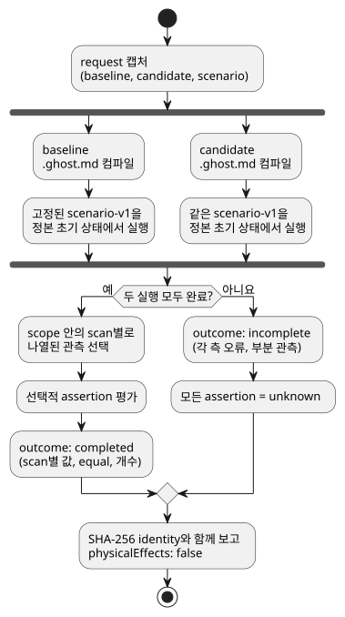
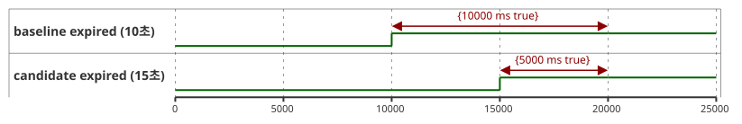

<!-- translation-source: docs/BEHAVIOR-COMPARISON.md -->
[영문 원문](BEHAVIOR-COMPARISON.md)

# 제한된 동작 비교

[English](BEHAVIOR-COMPARISON.md) · [의도 책임 계약](INTENT-CONSISTENCY-CONTRACT.md) · [#560](https://github.com/callin2/ghostflow-language/issues/560)

`tools/behavior-comparison.mjs`의 `compareBehavior(request)`는 한 가지 질문에 답합니다. *같은 입력이 주어졌을 때, candidate 프로그램은 baseline 프로그램과 어떻게 다르게 동작하는가?*

동작 방식은 다음과 같습니다.

1. 정본 `.ghost.md` 소스 두 개, 즉 **baseline**과 **candidate**를 컴파일합니다.
2. 기존 `ghostsim` Rust native 또는 WASM runner를 사용해, 동일한 고정 `GhostFlow/scenario-v1`을 각 소스의 정본 초기 상태에서 한 번씩 실행합니다.
3. 호출자가 선택한 범위 안에서 실제로 계산된 가상 요청 의도/안전 의도(requested/safe), 상태, fault를 보고합니다.

호출자인 여러분이 관측 항목, 정확한 scan/시간 범위, 그리고 선택적으로 기대하는 변화를 정합니다.

이 도구가 하지 **않는** 일: 농부의 의도를 추론하지 않고, 실제 장치를 작동하지 않으며, 물리적 효과를 확립하지 않습니다.

아래 다이어그램은 처리 흐름을 보여 줍니다. 두 프로그램은 동일하게 캡처된 scenario를 독립적으로 실행하며, 실행이 완료되지 않으면 모든 assertion이 `unknown`이 됩니다.



## 요청과 API

공개 요청은 JSON 호환 object입니다.

| 필드 | 계약 |
|---|---|
| `format` | `GhostFlow/behavior-comparison-request-v1` |
| `baseline`, `candidate` | `{ filename, source }`. `filename`은 `.ghost.md`로 끝나야 하며, 선택적으로 컴파일러의 `sourceClosure`와 [intent evidence](INTENT-EVIDENCE.ko.md)의 `intentEvidence`를 포함할 수 있습니다. 두 소스 모두 비동기 작업 전에 캡처됩니다. |
| `scenario` | 초기 입력과 순서가 있는 action을 포함하는 완전한 `GhostFlow/scenario-v1` object 하나. 동일하게 캡처된 scenario를 두 manifest 각각에 대해 검증하고 독립적으로 실행합니다. 출력에 의존하는 피드백은 다음 입력을 다르게 만들 수 있으므로 `plant`는 거부됩니다. 동일하게 제공된 샘플에서 센서 conditioning 결과가 달라지는 것은 관측 가능한 동작으로 남습니다. |
| `observations` | `{ field, name }`의 비어 있지 않은 목록(최대 32개)으로, `requested`, `safe`, `stateBefore`, `stateAfter`를 대상으로 합니다. `{ field: 'faults' }`는 전체 fault 목록을 선택합니다. 이름이 지정된 필드는 두 컴파일 결과의 출력 manifest 또는 상태 trace 바인딩 모두에 있어야 합니다. 목록에 지정된 관측만 비교 결과에 나타납니다. |
| `scope` | `{ from: { scanId, logicalTimeMs }, to: { scanId, logicalTimeMs } }`. 두 끝점 모두 실행된 scan과 정확히 일치해야 합니다. 관측에는 두 끝점이 모두 포함됩니다. |
| `assertions` | 아래에 설명한, 호출자가 제공하는 predicate의 선택적 목록(최대 64개). 생략하면 기대 변화 판단 없이 관측된 비교 결과만 반환합니다. |

`const report = await compareBehavior(request)`로 호출합니다. 결과는 세 가지입니다.

| 상황 | 결과 |
|---|---|
| 유효하지 않은 source, metadata, scenario, observation 또는 request 형식 | API가 **예외를 던집니다**. |
| 실행이 시작됐지만 완료할 수 없음 | `outcome: 'incomplete'`, 각 측의 오류, 사용 가능한 부분 관측. **모든 assertion은 `unknown`입니다.** |
| 비교가 완료됨 | scan별 값과 `equal`, 그리고 선택한 범위 안에서만 계산한 changed/unchanged 개수. |

어떤 출력도 설비 명령으로 취급되지 않습니다. 결과의 `physicalEffects`는 항상 `false`입니다.

**identity.** 결과는 전체 request, scenario, 정본 소스 문서, GFB bytes, manifest, 그리고 선택적인 source closure와 intent evidence를 SHA-256으로 결속합니다. 선택된 runtime/host 경로와 hash, WASM host를 사용한 경우 Node 버전도 기록합니다. 이것들은 실행 identity이며 서명이 아닙니다.

**초기 상태.** 각 실행은 자신의 정본 소스에 선언된 상태에서 시작합니다. 따라서 초기 상태의 변경도 프로그램 차이의 일부입니다.

### 선택적 predicate

모든 assertion은 고유한 `id`, `kind`, 그리고 이미 `observations`에 나열된 `observation`을 가집니다.

| Kind | 추가 필드 | 평가 |
|---|---|---|
| `unchanged` | 없음 | `scope` 안의 모든 scan에서 선택한 값이 두 프로그램 사이에 같습니다. |
| `equals` | `side: 'baseline'\|'candidate'`, 정확한 `at: { scanId, logicalTimeMs }`, `expected` JSON 값 | 지정한 쪽의 해당 scan 실제 값이 제공된 값과 같습니다. |
| `bool-on-duration-delta` | 안전 정수 `expectedDeltaMs` | `candidateMs - baselineMs`가 제공된 delta와 같습니다. 정확한 scope 끝점 사이의 true Bool 구간 `[scan_i, scan_(i+1))`만 셉니다. 마지막 scan은 끝점이며, 그 이후로 외삽하지 않습니다. |

**assertion을 intent evidence에 연결하기.** assertion은 `evidence: { side, condition: { id, revision, sha256 } }`를 추가할 수 있습니다.

- 이 참조는 해당 쪽에서 제공된 `intentEvidence` condition과 `intentConditionDigest(condition)`까지 포함해 일치해야 합니다.
- 보고서는 condition의 확인 범위와 `authority: 'not-authenticated'`를 유지합니다.
- 이 연결이 없으면 보고서에 `evidenceBinding: 'unlinked'`로 표시됩니다.

**`satisfied`의 의미.** 제공된 predicate가 관측된 scan 범위에서 성립했다는 뜻일 뿐입니다. 해석이 확인되었다거나, condition이 독립 oracle이라거나, 변경이 사용자의 의도에 부합한다는 뜻이 **아닙니다**. 전체 assertion 명세와 그 digest가 보고서에 남으므로, 성공 주장에서 기대값이 사라질 수 없습니다.

## 실행 가능한 예제

기존 scenario runner artifact를 사용할 수 있게 된 뒤 저장소 루트에서 실행합니다.

```js
import { compareBehavior } from './tools/behavior-comparison.mjs';

const program = seconds => `\`\`\`ghost
control Timer {
  state active: Bool = true;
  timer age = elapsed(active);
  output expired: Bool;
  output drive: Percent;
  expired <- age >= ${seconds}s;
  drive <- 0%;
}
\`\`\`\n`;
const at = (scanId, logicalTimeMs) => ({ scanId, logicalTimeMs });
const request = {
  format: 'GhostFlow/behavior-comparison-request-v1',
  baseline: { filename: 'timer-10.ghost.md', source: program(10) },
  candidate: { filename: 'timer-15.ghost.md', source: program(15) },
  scenario: {
    format: 'GhostFlow/scenario-v1', id: 'timer', initialInputs: [], keyBindings: [],
    actuatorBindings: [{ actuator: 'drive', output: 'drive', type: 'Percent', min: 0, max: 100 }],
    actions: [0, 10000, 15000, 20000].map(atMs => ({ kind: 'scan', atMs })),
  },
  observations: [{ field: 'safe', name: 'expired' }],
  scope: { from: at(0, 0), to: at(3, 20000) },
  assertions: [
    { id: 'delay', kind: 'bool-on-duration-delta',
      observation: { field: 'safe', name: 'expired' }, expectedDeltaMs: -5000 },
  ],
};
const report = await compareBehavior(request);
console.log(report.outcome, report.assertions);
```

이 예제는 10초 타이머(baseline)와 15초 타이머(candidate)를 0, 10000, 15000, 20000 ms의 네 scan에 걸쳐 비교합니다. 아래 타임라인은 각 프로그램에서 `expired`가 true인 구간을 보여 줍니다. 계산은 scope 끝점(scan 3, 20000 ms)에서 멈추므로 baseline은 10000 ms, candidate는 5000 ms 동안 true이고, delta는 5000 − 10000 = −5000 ms입니다.



예제의 `drive` 바인딩은 기존 WASM scenario host를 선택합니다. 그 값은 가상이며 물리 액추에이터에 관한 어떤 주장도 담지 않습니다. 기대 delta는 이 예제가 독립적으로 제공한 값이며, 어느 프로그램에서도 생성되지 않습니다.

**명령줄.** 같은 request를 JSON 또는 TOON으로 직렬화한 뒤 `node tools/ghostcompare.mjs --request comparison.json --format json`을 실행합니다.

- 기본 출력은 TOON이며, `--format toon`도 허용됩니다.
- 종료 코드: 비교가 완료되면 0, 거부되거나 미완료인 결과는 1입니다.
- 한도: CLI는 최대 3 MiB의 request bytes를 읽고, 캡처된 scenario는 256 KiB로 제한됩니다. 결과는 1 MiB로 제한되며, 이를 넘으면 assertion이 모두 unknown인 미완료 결과가 됩니다.
- API와 CLI는 request 안의 JavaScript callback을 받아들이지 않습니다.
