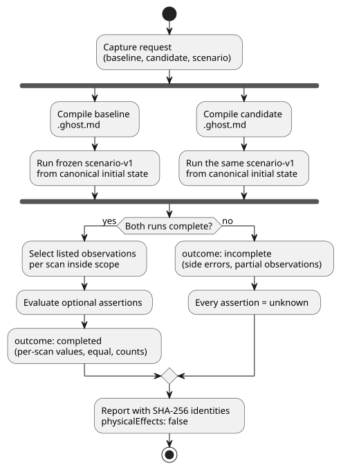
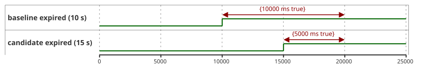

# Bounded behavior comparison

[한국어](BEHAVIOR-COMPARISON.ko.md) · [Intent responsibility contract](INTENT-CONSISTENCY-CONTRACT.en.md) · [#560](https://github.com/callin2/ghostflow-language/issues/560)

`compareBehavior(request)` in `tools/behavior-comparison.mjs` answers one question: *given the same inputs, how does a candidate program behave differently from a baseline program?*

It works like this:

1. It compiles two canonical `.ghost.md` sources: the **baseline** and the **candidate**.
2. It runs the same frozen `GhostFlow/scenario-v1` once from each source's canonical initial state, using the existing `ghostsim` Rust native or WASM runner.
3. It reports the actual virtual requested/safe intents, state and faults inside a scope that you choose.

You, the caller, choose the observations, the exact scan/time scope and, optionally, the changes you expect.

What it does **not** do: it does not infer farmer intent, operate a live device, or establish physical effects.

The diagram below shows the pipeline: both programs run the identical captured scenario independently, and an incomplete run turns every assertion into `unknown`.



## Request and API

The public request is a JSON-compatible object:

| Field | Contract |
|---|---|
| `format` | `GhostFlow/behavior-comparison-request-v1` |
| `baseline`, `candidate` | `{ filename, source }` where `filename` ends in `.ghost.md`, with optional compiler `sourceClosure` and `intentEvidence` from [intent evidence](INTENT-EVIDENCE.md). Both sources are captured before any asynchronous work. |
| `scenario` | One complete `GhostFlow/scenario-v1` object, including initial inputs and ordered actions. The identical captured scenario is validated against both manifests and executed independently. `plant` is rejected because output-dependent feedback can produce different next inputs. Sensor conditioning changes under identical supplied samples remain observable behavior. |
| `observations` | Nonempty list (at most 32) of `{ field, name }` for `requested`, `safe`, `stateBefore`, or `stateAfter`; `{ field: 'faults' }` selects the complete fault list. Named fields must exist in both compiled programs' output manifests or state trace bindings. Only listed observations appear in the comparison. |
| `scope` | `{ from: { scanId, logicalTimeMs }, to: { scanId, logicalTimeMs } }`. Both endpoints must match executed scans exactly. Observations include both endpoints. |
| `assertions` | Optional list (at most 64) of caller-supplied predicates below. Omitting it returns an observed comparison without an expected-change judgment. |

Call it as `const report = await compareBehavior(request)`. There are three kinds of result:

| Situation | Result |
|---|---|
| Invalid source, metadata, scenario, observation or request shape | The API **throws**. |
| A run starts but cannot complete | `outcome: 'incomplete'`, side-specific errors and any available partial observations. **Every assertion is `unknown`.** |
| The comparison completes | Per-scan values and `equal`, plus changed/unchanged counts computed only inside the selected scope. |

No output is treated as an installation command. The result's `physicalEffects` is always `false`.

**Identities.** The result binds, by SHA-256, the full request, the scenario, the canonical source documents, the GFB bytes, the manifests, and the optional source closures and intent evidence. It also records the selected runtime/host paths and hashes, and the Node version when the WASM host is used. These are execution identities, not signatures.

**Initial state.** Each run starts from the state declared in its own canonical source. A change to the initial state is therefore part of the program difference.

### Optional predicates

Every assertion has a unique `id`, a `kind`, and an `observation` that is already listed in `observations`:

| Kind | Additional fields | Evaluation |
|---|---|---|
| `unchanged` | none | The selected value equals across programs at every scan inside `scope`. |
| `equals` | `side: 'baseline'\|'candidate'`, exact `at: { scanId, logicalTimeMs }`, `expected` JSON value | The named side's actual value at that scan equals the supplied value. |
| `bool-on-duration-delta` | `expectedDeltaMs` safe integer | `candidateMs - baselineMs` equals the supplied delta. Counts only true Bool segments `[scan_i, scan_(i+1))` between the exact scope endpoints. The final scan is an endpoint, never extrapolated. |

**Linking an assertion to intent evidence.** An assertion may add `evidence: { side, condition: { id, revision, sha256 } }`.

- The reference must match that side's supplied `intentEvidence` condition, including `intentConditionDigest(condition)`.
- The report keeps the condition's confirmation scope and `authority: 'not-authenticated'`.
- Without this link, the report says `evidenceBinding: 'unlinked'`.

**What `satisfied` means.** It means only that the supplied predicate held over the observed scan scope. It does **not** mean that the interpretation was confirmed, that the condition was an independent oracle, or that the change fits the user's intent. The complete assertion specification and its digest stay in the report, so the expected value cannot disappear from a success claim.

## Runnable example

Run this from the repository root once the existing scenario runner artifacts are available:

```js
import { compareBehavior } from './tools/behavior-comparison.mjs';

const program = seconds => `\`\`\`ghost
control Timer {
  state active: Bool = true;
  timer age = elapsed(active);
  output expired: Bool;
  output drive: Percent;
  expired <- age >= ${seconds}s;
  drive <- 0%;
}
\`\`\`\n`;
const at = (scanId, logicalTimeMs) => ({ scanId, logicalTimeMs });
const request = {
  format: 'GhostFlow/behavior-comparison-request-v1',
  baseline: { filename: 'timer-10.ghost.md', source: program(10) },
  candidate: { filename: 'timer-15.ghost.md', source: program(15) },
  scenario: {
    format: 'GhostFlow/scenario-v1', id: 'timer', initialInputs: [], keyBindings: [],
    actuatorBindings: [{ actuator: 'drive', output: 'drive', type: 'Percent', min: 0, max: 100 }],
    actions: [0, 10000, 15000, 20000].map(atMs => ({ kind: 'scan', atMs })),
  },
  observations: [{ field: 'safe', name: 'expired' }],
  scope: { from: at(0, 0), to: at(3, 20000) },
  assertions: [
    { id: 'delay', kind: 'bool-on-duration-delta',
      observation: { field: 'safe', name: 'expired' }, expectedDeltaMs: -5000 },
  ],
};
const report = await compareBehavior(request);
console.log(report.outcome, report.assertions);
```

The example compares a 10-second timer (baseline) with a 15-second timer (candidate) over four scans at 0, 10000, 15000 and 20000 ms. The timeline below shows when `expired` is true in each program; counting stops at the scope endpoint (scan 3, 20000 ms), so the baseline is true for 10000 ms, the candidate for 5000 ms, and the delta is 5000 − 10000 = −5000 ms.



The example's `drive` binding selects the existing WASM scenario host. Its values are virtual and carry no physical actuator claim. The expected delta is supplied independently by this example; it is not generated from either program.

**Command line.** Serialize the same request as JSON or TOON, then run `node tools/ghostcompare.mjs --request comparison.json --format json`.

- Default output is TOON; `--format toon` is also accepted.
- Exit code: 0 for a completed comparison, 1 for rejected or incomplete results.
- Limits: the CLI reads at most 3 MiB of request bytes, and the captured scenario is limited to 256 KiB. The result is capped at 1 MiB; exceeding the cap yields an incomplete result with unknown assertions.
- The API and the CLI do not accept JavaScript callbacks in the request.
