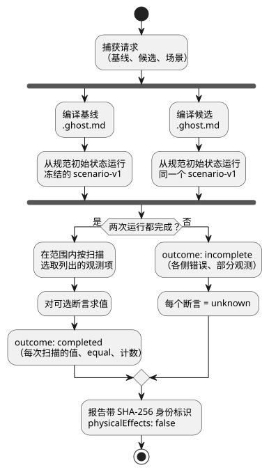
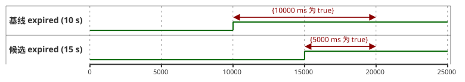

<!-- translation-source: docs/BEHAVIOR-COMPARISON.md -->
[英文原文](BEHAVIOR-COMPARISON.md)

# 有界行为比较

[한국어](BEHAVIOR-COMPARISON.ko.md) · [意图责任契约](INTENT-CONSISTENCY-CONTRACT.zh.md) · [#560](https://github.com/callin2/ghostflow-language/issues/560)

`tools/behavior-comparison.mjs` 中的 `compareBehavior(request)` 回答一个问题：*在相同输入下，候选程序的行为与基线程序有何不同？*

它的工作方式如下：

1. 编译两个规范的 `.ghost.md` 源：**基线**（baseline）和**候选**（candidate）。
2. 使用现有的 `ghostsim` Rust 原生或 WASM 运行器，从每个源各自的规范初始状态出发，分别运行同一个冻结的 `GhostFlow/scenario-v1` 一次。
3. 在你选定的范围内，报告实际的虚拟请求意图/安全意图、状态和故障。

由你（调用方）选择观测项、精确的扫描/时间范围，以及（可选的）你预期的变化。

它**不**做的事：不推断农户的意图，不操作真实设备，也不确立物理效果。

下图展示了这条流水线：两个程序各自独立地运行完全相同的已捕获场景，而任何一次未完成的运行都会使每个断言变为 `unknown`。



## 请求与 API

公开的请求是一个与 JSON 兼容的对象：

| 字段 | 契约 |
|---|---|
| `format` | `GhostFlow/behavior-comparison-request-v1` |
| `baseline`、`candidate` | `{ filename, source }`，其中 `filename` 以 `.ghost.md` 结尾，可选附带编译器的 `sourceClosure` 以及来自[意图证据](INTENT-EVIDENCE.zh.md)的 `intentEvidence`。两个源都会在任何异步工作开始之前被捕获。 |
| `scenario` | 一个完整的 `GhostFlow/scenario-v1` 对象，包括初始输入和有序的动作。同一个已捕获的场景会分别针对两份清单进行校验，并独立执行。`plant` 会被拒绝，因为依赖输出的反馈可能产生不同的下一步输入。在提供完全相同样本的情况下，传感器调理方面的变化仍然属于可观测的行为。 |
| `observations` | 非空列表（最多 32 项），元素为 `{ field, name }`，field 取 `requested`、`safe`、`stateBefore` 或 `stateAfter`；`{ field: 'faults' }` 选择完整的故障列表。具名字段必须同时存在于两个已编译程序的输出清单或状态追踪绑定中。比较结果中只出现列出的观测项。 |
| `scope` | `{ from: { scanId, logicalTimeMs }, to: { scanId, logicalTimeMs } }`。两个端点都必须与已执行的扫描精确匹配。观测包含两个端点。 |
| `assertions` | 可选列表（最多 64 项），元素为下文所述的调用方提供的谓词。省略时返回一份观测性的比较结果，不做预期变化的判断。 |

以 `const report = await compareBehavior(request)` 的方式调用。结果有三种：

| 情况 | 结果 |
|---|---|
| 源、元数据、场景、观测项或请求结构无效 | API **抛出异常**。 |
| 运行已开始但无法完成 | `outcome: 'incomplete'`、各侧的错误以及所有可用的部分观测。**每个断言都是 `unknown`。** |
| 比较完成 | 每次扫描的值和 `equal`，以及仅在所选范围内计算的变化/未变化计数。 |

任何输出都不会被当作设施命令。结果中的 `physicalEffects` 始终为 `false`。

**身份标识。** 结果通过 SHA-256 绑定完整的请求、场景、规范源文档、GFB 字节、清单，以及可选的源闭包和意图证据。它还记录所选的运行时/宿主路径及其哈希；使用 WASM 宿主时还记录 Node 版本。这些是执行身份标识，不是签名。

**初始状态。** 每次运行都从其自身规范源中声明的状态开始。因此，初始状态的变化也是程序差异的一部分。

### 可选谓词

每个断言都有唯一的 `id`、一个 `kind`，以及一个已在 `observations` 中列出的 `observation`：

| 种类 | 附加字段 | 求值 |
|---|---|---|
| `unchanged` | 无 | 在 `scope` 内的每次扫描中，所选值在两个程序之间都相等。 |
| `equals` | `side: 'baseline'\|'candidate'`、精确的 `at: { scanId, logicalTimeMs }`、`expected` JSON 值 | 指定一侧在该次扫描时的实际值等于所提供的值。 |
| `bool-on-duration-delta` | `expectedDeltaMs` 安全整数 | `candidateMs - baselineMs` 等于所提供的差值。只统计精确范围端点之间为 true 的 Bool 区段 `[scan_i, scan_(i+1))`。最后一次扫描是端点，绝不外推。 |

**把断言关联到意图证据。** 断言可以添加 `evidence: { side, condition: { id, revision, sha256 } }`。

- 该引用必须与对应一侧所提供的 `intentEvidence` 条件匹配，包括 `intentConditionDigest(condition)`。
- 报告会保留该条件的确认范围以及 `authority: 'not-authenticated'`。
- 没有这种关联时，报告显示 `evidenceBinding: 'unlinked'`。

**`satisfied` 的含义。** 它仅表示所提供的谓词在观测到的扫描范围内成立。它**不**表示该解释已被确认，不表示该条件是一个独立的预言（oracle），也不表示该变化符合用户的意图。完整的断言规格及其摘要会保留在报告中，因此预期值不会从成功声明中消失。

## 可运行示例

在现有场景运行器产物可用后，从仓库根目录运行：

```js
import { compareBehavior } from './tools/behavior-comparison.mjs';

const program = seconds => `\`\`\`ghost
control Timer {
  state active: Bool = true;
  timer age = elapsed(active);
  output expired: Bool;
  output drive: Percent;
  expired <- age >= ${seconds}s;
  drive <- 0%;
}
\`\`\`\n`;
const at = (scanId, logicalTimeMs) => ({ scanId, logicalTimeMs });
const request = {
  format: 'GhostFlow/behavior-comparison-request-v1',
  baseline: { filename: 'timer-10.ghost.md', source: program(10) },
  candidate: { filename: 'timer-15.ghost.md', source: program(15) },
  scenario: {
    format: 'GhostFlow/scenario-v1', id: 'timer', initialInputs: [], keyBindings: [],
    actuatorBindings: [{ actuator: 'drive', output: 'drive', type: 'Percent', min: 0, max: 100 }],
    actions: [0, 10000, 15000, 20000].map(atMs => ({ kind: 'scan', atMs })),
  },
  observations: [{ field: 'safe', name: 'expired' }],
  scope: { from: at(0, 0), to: at(3, 20000) },
  assertions: [
    { id: 'delay', kind: 'bool-on-duration-delta',
      observation: { field: 'safe', name: 'expired' }, expectedDeltaMs: -5000 },
  ],
};
const report = await compareBehavior(request);
console.log(report.outcome, report.assertions);
```

该示例在 0、10000、15000 和 20000 ms 的四次扫描上，比较 10 秒定时器（基线）与 15 秒定时器（候选）。下面的时间线显示了每个程序中 `expired` 何时为 true；计数在范围端点（扫描 3，20000 ms）处停止，因此基线为 true 的时长为 10000 ms，候选为 5000 ms，差值为 5000 − 10000 = −5000 ms。



示例中的 `drive` 绑定会选择现有的 WASM 场景宿主。其值是虚拟的，不涉及任何物理执行器。预期差值由本示例独立提供，并不是从任一程序生成的。

**命令行。** 将同一请求序列化为 JSON 或 TOON，然后运行 `node tools/ghostcompare.mjs --request comparison.json --format json`。

- 默认输出为 TOON；也接受 `--format toon`。
- 退出码：比较完成为 0，被拒绝或未完成的结果为 1。
- 限制：CLI 最多读取 3 MiB 的请求字节，已捕获的场景限制为 256 KiB。结果上限为 1 MiB；超过上限会产生一个断言为 unknown 的未完成结果。
- API 和 CLI 都不接受请求中的 JavaScript 回调。
