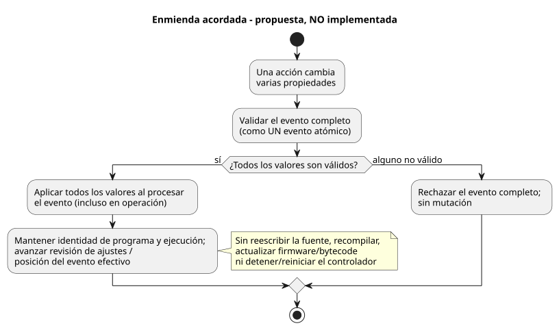
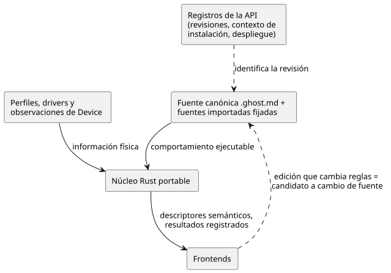
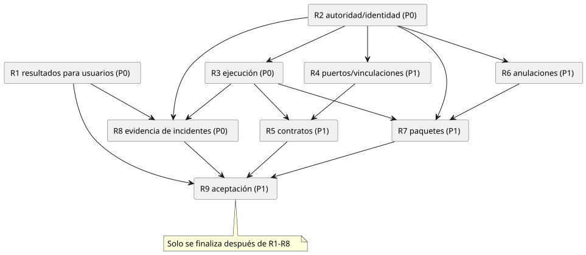

<!-- translation-source: docs/BEHAVIOR-COMPOSITION-RESEARCH.md -->
[Original en inglés](BEHAVIOR-COMPOSITION-RESEARCH.md)

# Composición de comportamientos: investigación y revisión de arquitectura

Fecha: 2026-09-20. Incidencia padre: [GF-COMPOSE #99](https://github.com/callin2/ghostflow-language/issues/99).
Revisión del lenguaje inspeccionada: `ffdbc96461eca67908252507fb851fa4dabd9a2c`.
Estado: resumen de investigación y dirección de diseño propuesta. Este documento no
implementa la composición. Las incidencias hijas producen evidencia de diseño
acotada antes de que comience cualquier implementación.

La *composición de comportamientos* consiste en combinar varios comportamientos
reutilizables (por ejemplo, riego y ventilación) en un único controlador
instalado. Este documento registra lo que encontró la investigación, qué reglas ya
están fijadas y qué decisiones de diseño siguen abiertas.

En este documento:

- **Registro de correcciones**: qué es una regla establecida, qué es una enmienda
  acordada y qué sigue abierto.
- **Objetivo del producto** e **investigación delegada completada**: por qué existe
  este trabajo y qué cubren los nueve resultados de investigación (R1–R9).
- **Hallazgos de la investigación** y **recomendaciones de arquitectura (A1–A8)**:
  la evidencia y la dirección propuesta.
- **Descomposición**, **secuencia de investigación**, **escenarios de aceptación**,
  **reglas de traspaso** y **puntos de revisión**: cómo se divide y se comprueba
  el trabajo.

## Registro de correcciones (2026-09-20)

Este registro separa tres tipos de afirmación:

| Tipo | Significado |
| --- | --- |
| Regla existente | Ya forma parte del lenguaje o de sus límites. No está abierta a debate aquí. |
| Enmienda de diseño acordada | Dirección decidida, pero **todavía no** normativa ni implementada. |
| Decisión abierta | Mecanismo, ABI, verificación o alineación con la especificación aún por decidir. |

El registro es solo evidencia de diseño. No modifica los documentos normativos del
lenguaje ni afirma ninguna implementación o verificación.

- **Invariantes de ejecución existentes (reglas fijas):**
  - `x` lee el estado anterior; `x'` define un valor siguiente candidato.
  - Toda transición usa la misma instantánea de entradas/estado anterior.
  - Una referencia al estado siguiente solo se permite en expresiones de salida,
    no en otra transición ni en un `let`.
  - El estado y los resultados lógicos de las salidas se consolidan juntos.
  - Los ciclos combinacionales y las definiciones de salida duplicadas no son
    válidos.

  Preserve estas reglas en cualquier composición; no son cuestiones abiertas.
  Cada canal de salida tiene una única definición directa autorizada. Los
  escritores directos en competencia deben hacer fallar la compilación y nunca
  deben desplegarse. Esto no elimina el gestor de recursos de escritor único de
  la estación existente: las solicitudes de la estación no son escrituras
  directas en competencia. Las comprobaciones de alias de extremos físicos siguen
  siendo una validación de vinculación aparte.
- **Límite existente entre el driver de entrada y el renderizador de salida:**
  GhostFlow define Sources e Intents tipados. Un Driver puede estar respaldado por
  software, por hardware especializado o por ambos. La división entre la
  medición de precisión, el protocolo o el manejo de ISR en bruto y el manejo del
  escaneo pertenece a ese límite. A la lógica del núcleo entran eventos o
  mediciones tipados con significado; la política agrícola no se oculta en el
  Driver. El instante de captura, el instante de recepción/evaluación y la
  calidad son tres cosas distintas. Un acuse de recibo de un comando no es prueba
  de operación física.
- **Enmienda de diseño acordada, no implementación actual:** los cambios de las
  propiedades ajustables en tiempo de ejecución son *eventos en vivo*.
  - Una acción que cambia varias propiedades es **un único evento atómico**.
  - Valide el evento completo. Si algún valor no es válido, rechácelo entero sin
    mutación.
  - Al aceptarse, la lógica activa usa los nuevos valores cuando se procesa el
    evento, incluso durante la operación activa. La aplicación no se aplaza a
    otro ciclo de riego, a una nueva ejecución ni al modo detenido.
  - No reescriba la fuente, no recompile, no actualice firmware/bytecode ni
    detenga/reinicie todo el controlador por este evento.
  - Preserve la identidad del programa y de la ejecución (run); avance la
    revisión de ajustes/posición del evento efectivo.
  - En consecuencia, las reglas existentes pueden cambiar una salida. No hay
    reinicio implícito ni reinterpretación automática de uniones de programa
    obsoletas.
  - Los ajustes persisten tras un reinicio real del ESP; ese reinicio físico sigue
    iniciando una nueva identidad de ejecución.

  El diagrama siguiente esboza esta ruta acordada (aún no implementada) para un
  evento con varias propiedades.

  
- **Conflicto con la especificación actual:** [`CONSTRAINTS.md`](CONSTRAINTS.md),
  líneas 179–204; [`LANGUAGE-SURFACE.md`](LANGUAGE-SURFACE.md), líneas 66–69; y
  [`LANGUAGE.md`](LANGUAGE.md), líneas 460–461, exigen actualmente que los cambios
  de Configure se hagan con el sistema detenido. #89 también contiene la
  propuesta anterior de detención/nueva ejecución. Trátelos como comportamiento
  documentado más antiguo que debe conciliarse con la enmienda acordada de
  propiedades en vivo. No afirme silenciosamente que la enmienda ya es normativa o
  está implementada. El asistente actual de edición de la fuente es comportamiento
  admitido: edita la fuente y recompila. No es una implementación de la ruta
  acordada de propiedades en vivo. #89/#90 siguen siendo los titulares de esta
  línea de trabajo. El trabajo pendiente se refiere al mecanismo, la ABI, la
  verificación y la alineación con la especificación, no a si el usuario quiere
  ajustes en vivo.
- **Reinicio y entradas:**
  - El reinicio es un evento normal; la lógica de GhostFlow define la reacción
    ante él. No imponga una política global de reanudación/manual.
  - Device/Driver conserva las obligaciones eléctricas de arranque, desconexión y
    fallo previas al runtime.
  - La entrega de entradas debe, por defecto y dentro de la capacidad admitida,
    preservar las ocurrencias y las observaciones de valores, ya se capturen por
    interrupción o por escaneo.
  - Sustituir un valor pendiente por el más reciente solo se permite con una
    activación explícita por entrada.
  - El desbordamiento o la pérdida deben rechazarse o notificarse, nunca aceptarse
    en silencio.

  Esto no es un historial de eventos persistente ilimitado ni un nuevo almacén de
  incidentes. El orden, la correspondencia entre eventos y ticks, el agrupamiento
  por fuente, los límites y la mecánica de recuperación siguen abiertos. No se ha
  especificado ningún plazo estricto ni planificador por prioridades.
- **Límite operativo:** en el uso normal, los comportamientos funcionan de forma
  independiente. La actualización de un programa ejecutable o del firmware del
  ESP usa una parada de mantenimiento de todo el controlador para ese ESP; los
  eventos de propiedades no lo detienen. Las dependencias eléctricas compartidas
  pertenecen al contexto de la instalación. Esto no es evidencia de que Device
  implemente o verifique el límite.

La composición estática sigue siendo una hipótesis preferida, no una reducción
(lowering) ni una ABI seleccionadas. Las comprobaciones de conformidad
nativo/WASM que siguen son propuestas, no ejecutadas de nuevo. Este trabajo no
introduce un segundo programa JSON canónico, ni un solucionador automático, ni un
marco de almacenamiento.

## Objetivo del producto

Reducir el esfuerzo. Aumentar la explicabilidad. Aumentar la trazabilidad.

- Un agricultor debería poder aplicar un comportamiento preparado, añadir otro
  comportamiento y entender un resultado inesperado, todo ello con pocas
  decisiones técnicas.
- Los ingenieros de software y de hardware deberían poder investigar el mismo
  resultado sin reconstruir su historia a partir de registros no relacionados.
- Cada funcionalidad debe nombrar el problema del usuario que resuelve y mostrar
  qué esfuerzo elimina o qué explicación/evidencia pone a disposición.

| Participante | Pregunta | Resultado requerido |
| --- | --- | --- |
| Agricultor | ¿Puedo aplicar este comportamiento aquí? | Requisitos, bloqueos y decisiones específicas de la explotación necesarias, de forma comprensible. |
| Agricultor | ¿Por qué no empezó el riego? | Un motivo fundamentado, su efecto operativo y una siguiente acción útil. |
| Ingeniero de software / autor de comportamientos | ¿Qué lógica produjo el resultado? | Definición/instancia exacta, revisión de la fuente, ajustes, entradas, estado y decisión de las restricciones. |
| Ingeniero de hardware / instalador | ¿Qué llegó al equipo? | Vinculación exacta de la instalación, resultado de la aplicación y observaciones físicas disponibles. |

Qué medir: pasos de configuración, decisiones técnicas, correcciones, solicitudes
de asistencia y esfuerzo de diagnóstico. Mida también si los usuarios pueden
explicar una acción bloqueada y si los ingenieros pueden llegar a la evidencia que
la respalda.

Las líneas base y los objetivos numéricos de mejora necesitan un recorrido
registrado seguido de la validación de los participantes. Ninguno de los dos se
ha medido en esta investigación. Un recorrido heurístico no es un estudio de
usuarios.

## Investigación delegada completada

Los nueve resultados de investigación acotados están completos y han sido
revisados de forma independiente por un revisor Luna. Todos los autores usaron
`gpt-5.6-luna` con esfuerzo bajo. Esto es evidencia de investigación y una
dirección de diseño propuesta, no una composición implementada ni una aceptación
medida por usuarios, por Device o física.

- [R1 resultados para los usuarios](research/GF-COMPOSE-R1-USER-OUTCOMES.es.md)
- [R2 autoridad e identidad](research/GF-COMPOSE-R2-AUTHORITY-IDENTITY.es.md)
- [R3 ejecución](research/GF-COMPOSE-R3-EXECUTION.es.md)
- [R4 puertos y vinculaciones](research/GF-COMPOSE-R4-PORTS-BINDINGS.es.md)
- [R5 contratos](research/GF-COMPOSE-R5-CONTRACTS.es.md)
- [R6 anulaciones](research/GF-COMPOSE-R6-OVERRIDES.es.md)
- [R7 paquetes](research/GF-COMPOSE-R7-PACKAGES.es.md)
- [R8 evidencia de incidentes](research/GF-COMPOSE-R8-INCIDENT-EVIDENCE.es.md)
- [R9 aceptación y traspaso](research/GF-COMPOSE-R9-ACCEPTANCE.es.md)

R9 deja abiertas estas decisiones de arquitectura:

- ejecución y ABI del compilador/runtime;
- cierre de paquetes/importaciones y su verificación;
- autoridad sobre las restricciones de la instalación;
- identidad de instancia y de despliegue;
- contratos de vinculación/evidencia de aplicación;
- evidencia del historial de incidentes/aplicación/Device.

Cada decisión abierta bloquea las porciones de trabajo que dependen de ella.
La publicación de los resultados en las incidencias la gestiona el coordinador;
este registro no afirma el cierre de incidencias en GitHub.

## Hallazgos de la investigación

La auditoría de fuentes e incidencias respalda los hechos siguientes. Las
descripciones de incidencias abiertas son requisitos o propuestas, no evidencia de
que sus funcionalidades estén implementadas.

| Evidencia | Hecho actual | Consecuencia para la composición |
| --- | --- | --- |
| [Entrada del compilador](../tools/compile-source.mjs) | `compileSource` toma un único documento literario (literate) canónico y conserva su identidad de fuente. | Varias fuentes importadas necesitan un diseño explícito de procedencia. |
| [Tick del núcleo](../crates/ghostflow-core/src/lib.rs), `Runtime::tick` | Las transiciones leen el estado previo; las intenciones usan la vista de estado definida; la seguridad resuelve las salidas solicitadas. | Preservar las reglas establecidas de instantánea/consolidación simultáneas al componer instancias; el rechazo de ciclos dentro de un control está fijado. Solo la codificación y validación de referencias entre instancias/importaciones son posibles decisiones abiertas. |
| [Núcleo de estación](../crates/ghostflow-core/src/station.rs), [contrato de restricciones](CONSTRAINTS.es.md) | Ya existen un árbitro acotado de estación de bombeo y una ruta separada de compilación canónica de restricciones. | Auditar su reutilización; esos mecanismos no establecen la composición general de comportamientos ni un arbitraje arbitrario. |
| [Anclas de intención](INTENT-ANCHOR-MAP.es.md) | La procedencia generada no es un segundo programa editable. Los supuestos inferidos son distintos de la intención/premisas confirmadas. | Las vistas y las afirmaciones extraídas no pueden cambiar la ejecución en silencio. |
| [Contrato de integración](../contracts/integration-v1/README.md) | Las vinculaciones asocian nombres lógicos tipados con extremos. El aliasing de extremos se rechaza en v1. Las entradas por software no tienen por qué consumir DI físicas. | Las salidas compartidas y la contabilización de recursos necesitan decisiones de compatibilidad explícitas. |
| [Paquete portable](PORTABLE-PACKAGE.es.md) | Una revisión de la fuente, los bytes GFB, el manifiesto, el mapa, la identidad del runtime y la revisión de vinculación se firman juntos. | Un comportamiento reutilizable y un despliegue instalado tienen ciclos de vida de vinculación distintos. |
| [Contrato de interacción](../contracts/interaction-v0/README.md) | Los descriptores estáticos y las observaciones completadas se unen mediante identidades exactas de esquema/fuente/módulo/ejecución. | Extender la cadena de identidades existente para las instancias compuestas. |
| [Ajustes #89](https://github.com/callin2/ghostflow-language/issues/89) | La propuesta anterior de detención/nueva ejecución entra en conflicto con la enmienda acordada de propiedades en vivo en tiempo de ejecución; el asistente de edición de fuente/recompilación es comportamiento actual admitido, pero no la ruta en vivo. | Conciliar el texto normativo y definir mecanismo/ABI/verificación. La especialización en la importación sigue siendo distinta. |
| [Explicación #88](https://github.com/callin2/ghostflow-language/issues/88), [eventos #74](https://github.com/callin2/ghostflow-language/issues/74) | La explicación y la semántica de eventos/comandos ya tienen titulares. | Investigar las uniones y brechas específicas de la composición en lugar de sistemas duplicados. |
| [Instalación #62](https://github.com/callin2/farm_studio_system/issues/62) | Propone restricciones de instalación aplicadas de forma independiente y que no se pueden debilitar. | Resolver la representación y la aplicación frente al límite de fuente canónica de este repositorio. |

Los precedentes externos informan las recomendaciones en lugar de definir la
semántica de GhostFlow:

- [Observable imports](https://old.observablehq.com/documentation/notebooks/imports)
  demuestra el bloqueo de versiones y la sustitución de dependencias. La
  evaluación importada puede ser perezosa. La ejecución de GhostFlow no debe
  depender de si una pantalla observa un valor.
- [W3C PROV-DM](https://www.w3.org/TR/prov-dm/) separa entidades, actividades y
  agentes responsables. Es un control de vocabulario útil para la procedencia de
  fuentes/artefactos/eventos, no un requisito para adoptar RDF, una base de datos
  de grafos ni la ontología completa.

## Recomendaciones de arquitectura

### A1. Autoridad explícita con identidades vinculadas

Cada tipo de información tiene exactamente un titular:

| Titular | Es titular de |
| --- | --- |
| Fuente canónica `.ghost.md` y fuentes importadas fijadas | El comportamiento ejecutable. |
| Registros cuyo titular es la API | Las revisiones, el contexto de la instalación y la identidad del despliegue. |
| Perfiles, drivers y observaciones cuyo titular es Device | La información física. |
| Núcleo Rust portable | La ejecución. |
| Frontends | Nada con autoridad; consumen descriptores semánticos y resultados registrados. |

Una edición conversacional o visual se convierte en un candidato a cambio de la
fuente cuando cambia reglas ejecutables.

El diagrama siguiente muestra estos límites de titularidad y los vínculos de
identidad entre ellos.

La incidencia de instalación del sistema #62 introduce un límite real sin
resolver: las restricciones de instalación ejecutables no pueden convertirse en un
segundo programa JSON informal. Investigue dos opciones:

1. El contrato de instalación hace referencia a una fuente canónica de
   restricciones compilada por separado, usando la ruta de restricciones
   existente.
2. Se requiere una revisión explícita del límite entre proyectos.

No dé por aceptada ninguna de las dos.

### A2. Relaciones tipadas y proyecciones de grafo específicas

Mantenga un vocabulario semántico compartido y vínculos de identidad. No exija que
todas las relaciones de la explotación, de las fuentes y del historial encajen en
un único DAG universal. Identifique por separado los tipos de arista y las reglas
de ciclos para las importaciones, las dependencias dentro de un escaneo, los
grafos de explicación, las relaciones entre equipos y las observaciones a lo largo
del tiempo.

La identidad de la definición, la revisión inmutable de la definición, la
identidad de la instancia, el puerto lógico, el equipo físico y la ocurrencia en
tiempo de ejecución son conceptos distintos. Los nombres visibles y las
ubicaciones en los documentos no deben sustituir a esas identidades.

### A3. Investigar primero la composición estática

Compare la composición por el compilador en un único programa ejecutable con
varias VM coordinadas. La composición estática es la hipótesis preferida porque
puede reutilizar el núcleo de ejecución actual. Todavía no es una decisión probada
de reducción (lowering) ni de ABI.

La comparación debe mostrar el muestreo de entradas y el tiempo lógico
preservando el contrato fijo de estado anterior/siguiente:

- todas las transiciones leen la misma instantánea de estado anterior/entradas;
- las referencias al estado siguiente aparecen solo en expresiones de salida;
- la consolidación lógica de estado/salidas es simultánea.

Esta semántica no es una decisión de composición. La comparación también debe
mostrar:

- el aislamiento de los temporizadores;
- la inicialización/reinicio;
- el alcance de los fallos;
- la resolución de las salidas.

Dos instancias de una misma definición deben tener estado aislado. Reordenar las
declaraciones para las mismas identidades de instancia no debe cambiar el
comportamiento. La retroalimentación entre escaneos necesita una semántica
explícita; un ciclo de dependencia instantáneo no se resuelve implícitamente.

Conserve en el análisis los límites de recursos existentes. La capacidad de DI/RO
por sí sola no dice nada sobre el estado del programa completo, el bytecode, el
coste de las expresiones, la memoria ni la temporización del destino.

### A4. Preservar las vinculaciones de instalación existentes

Una propuesta de canales sin usar debe conservar las vinculaciones explícitas
existentes. La asignación determinista por sí sola no garantiza que añadir un
comportamiento preserve el cableado anterior. Mantenga diferenciados la propuesta,
la correspondencia confirmada por el usuario y la instalación observada.

Cuente las entradas físicas solo cuando la entrada elegida realmente requiera una
DI física. El resultado DI 2 / RO 7 de la incidencia general supone dos entradas
digitales cableadas. Un comando de arranque manual por software es un caso de
recursos distinto. Represente la falta de evidencia de idoneidad como
desconocida, no como compatible.

### A5. Acotar el primer perfil de contratos

Empiece con la compatibilidad explícita de puertos, la presencia de dependencias,
los límites de parámetros y una única definición directa autorizada de salida por
canal. Un escritor directo en competencia es un error de compilación y no se
puede desplegar. Esto no prohíbe el arbitraje explícito de recursos que el gestor
de estación existente hace de las solicitudes de la estación; ahí el gestor de
estación sigue siendo el escritor directo. Las comprobaciones de alias de
extremos físicos siguen siendo una validación de vinculación aparte. Audite ese
gestor antes de proponer nueva maquinaria. El perfil de composición no debe
redefinir el comportamiento existente de la estación.

Distinga entre un supuesto declarado, una propiedad probada, una propiedad
establecida estáticamente y una restricción aplicada en tiempo de ejecución. Toda
afirmación de compatibilidad o verificación necesita un alcance. Las salidas
separadas pueden seguir afectando al agua, la energía u otros recursos físicos
compartidos; la independencia eléctrica de los canales no demuestra la
independencia física. La demostración temporal/de seguridad general queda fuera
del primer perfil.

### A6. Mantener separados los ciclos de vida de las anulaciones

Registre por separado estos cuatro elementos: los parámetros en tiempo de
importación, los ajustes del operador en tiempo de ejecución, la selección de
dependencias y las vinculaciones físicas. Para la ruta acordada de propiedades en
vivo, preserve la identidad del programa/ejecución, avance la revisión de
ajustes/posición del evento efectivo y conserve los valores tras un reinicio del
ESP, asignando al runtime reiniciado una nueva identidad de ejecución. Concilie el
texto anterior de detención/nueva ejecución con #89; use #90 para las
programaciones parametrizadas. Esta enmienda todavía no es normativa ni está
implementada.

### A7. Reutilizar la verificación de paquetes con una decisión de extensión explícita

Fije las dependencias transitivas exactas antes de la compilación. Compare una
extensión del paquete de fuentes con un sobre de composición alrededor de los
artefactos existentes. Determine cómo se vinculan al artefacto compuesto el cierre
completo de fuentes, la reproducción del compilador, los descriptores de
contratos y los mapas. No aplane eliminando la procedencia de las fuentes
importadas.

Preserve los requisitos existentes de confianza/revocación y de compatibilidad
con los consumidores. Un emisor de paquetes de confianza no establece la
autorización del despliegue ni la aceptación física. Las exportaciones
reutilizables excluyen las vinculaciones del sitio, los secretos del sitio y los
registros de conversación. La composición no debería reimplementar la maquinaria
de firma.

### A8. Un evento, explicaciones para distintos participantes

Una declaración dirigida al agricultor y la vista detallada de un ingeniero deben
hacer referencia al mismo incidente y al mismo contexto exacto de ejecución.
Mantenga diferenciados la salida solicitada, la salida segura resuelta, la
aplicación por el host/renderizador y la retroalimentación física disponible.

En el ejemplo de nivel bajo de agua, informe de que la señal de nivel bajo de agua
bloqueó el riego. No convierta esa señal en una afirmación no fundamentada de que
el depósito está físicamente vacío. Tras un reinicio, un número de escaneo
repetido no puede identificar el evento antiguo. La retroalimentación ausente, una
brecha en el registro (journal) o un artefacto no disponible deben seguir siendo
visibles.

Reutilice #88, #74, el contrato de interacción y el
[historiador de Device #28](https://github.com/callin2/farm-device/issues/28).
El lenguaje aporta semántica acotada y procedencia; la retención, los transportes,
las pantallas y la observación física siguen correspondiendo a sus titulares
existentes.

## Descomposición de la incidencia general

| Sección de #99 | Tratamiento | Tarea de investigación |
| --- | --- | --- |
| 1, 9, 11: visión y experiencia de autoría | Convertir en problemas de los participantes y resultados medibles. | R1 |
| 2: un único DAG semántico | Refinar en autoridad, identidad y proyecciones de grafo explícitas. | R2 |
| 3: comportamiento reutilizable | Conservar; definir la ejecución y el aislamiento de instancias. | R2, R3 |
| 4: riego más ventilación | Conservar como fixture; añadir casos de rechazo y de incidentes. | R4, R9 |
| 5: puertos lógicos y E/S física | Conservar; preservar las vinculaciones existentes y la evidencia desconocida. | R4 |
| 6: parámetros, vinculaciones, dependencias | Conservar la separación y hacer explícitos los efectos de las revisiones. | R6 |
| 7: contratos | Acotar el primer perfil y reutilizar la titularidad del arbitraje. | R5 |
| 8: canalización de composición/enlace | Separar el trabajo puro del compilador de la instalación y el despliegue. | R2–R7 |
| 10: esbozo de fuente/paquete | Mantener la sintaxis como ilustrativa; investigar la procedencia y la compatibilidad de paquetes. | R7 |
| 12: preguntas abiertas | Asignar a un entregable de investigación con nombre. | R1–R8 |
| 13: no objetivos | Conservar; no añadir una plataforma de grafos genérica ni un nuevo motor de almacenamiento de diagnósticos. | Todas |
| 14: entregables propuestos | Reordenar en torno a los recorridos de usuario y las dependencias de arquitectura. | R9 |
| Explicación/traza transversal a las secciones | Establecer un requisito inicial, incluidos los resultados negativos. | R8, R9 |

La referencia original a Device Query #27 sin calificar es incorrecta en este
repositorio: el #27 del lenguaje es trabajo sobre DateTime. La fuente pertinente
verificada es [system #74, Track D](https://github.com/callin2/farm_studio_system/issues/74),
junto con [installation #62](https://github.com/callin2/farm_studio_system/issues/62).

## Secuencia de investigación e índice de incidencias

P0 significa una cuestión de producto o de arquitectura de alto riesgo que debe
resolverse pronto. P1 significa un detalle de diseño necesario para la primera
porción acotada de composición. Son prioridades de investigación, no una
declaración de que la implementación o la validación del producto estén
completas.

<!-- compose-issue-index:start -->
| Tarea | Prioridad | Entregable acotado | Dependencias estrictas |
| --- | --- | --- | --- |
| [R1 #100](https://github.com/callin2/ghostflow-language/issues/100) | P0 | Recorridos de los participantes y protocolo de medición | Ninguna |
| [R2 #101](https://github.com/callin2/ghostflow-language/issues/101) | P0 | Matriz de autoridad/identidad y límites de los grafos | Ninguna |
| [R3 #102](https://github.com/callin2/ghostflow-language/issues/102) | P0 | Comparación de la ejecución y tablas de escaneo explícitas | R2 |
| [R4 #103](https://github.com/callin2/ghostflow-language/issues/103) | P1 | Tablas de decisión de puertos/recursos y de vinculación estable | R2 |
| [R5 #104](https://github.com/callin2/ghostflow-language/issues/104) | P1 | Primer perfil de contratos y diagnósticos de rechazo | R3, R4 |
| [R6 #105](https://github.com/callin2/ghostflow-language/issues/105) | P1 | Ciclo de vida de las anulaciones y matriz de cambios de revisión | R2 |
| [R7 #106](https://github.com/callin2/ghostflow-language/issues/106) | P1 | Comparación de diseños de paquete reutilizable/cierre de importaciones | R2, R3, R6 |
| [R8 #107](https://github.com/callin2/ghostflow-language/issues/107) | P0 | Recorrido de la evidencia de incidentes del agricultor al ingeniero | R1, R2, R3 |
| [R9 #108](https://github.com/callin2/ghostflow-language/issues/108) | P1 | Matriz de aceptación y orden de traspaso a la implementación | R1–R8 |
<!-- compose-issue-index:end -->

Las tareas se siguen en GitHub, no en una lista local de casillas duplicada.
[El índice del plan](../tasks/plan.md) apunta a este resumen y al gestor de
incidencias.

Las dependencias estrictas forman el orden que se muestra a continuación:

- R1 y R2 pueden empezar a la vez.
- Después de R2, R3, R4 y R6 pueden avanzar de forma independiente.
- Después de R3, la investigación de explicaciones R8 y la de paquetes R7 pueden
  avanzar en cuanto existan sus otras entradas.
- R9 puede redactarse pronto, pero no puede finalizarse antes de R1–R8.

Las incidencias relacionadas son referencias de interfaz. Su finalización completa
no es una dependencia estricta de estos documentos de investigación. Una
implementación que necesite una capacidad no terminada deberá declarar más
adelante esa dependencia concreta. Conserve los padres y la titularidad
existentes; no mueva #89, #95, #88 ni otro trabajo existente bajo #99.

## Escenarios de aceptación representativos

Son especificaciones propuestas de pruebas o recorridos, no resultados ejecutados.

| Escenario | Evidencia esperada |
| --- | --- |
| Aplicar riego y luego añadir ventilación con cuatro ventiladores | Con dos entradas cableadas: DI 2 / RO 7. La vinculación de riego existente no cambia. |
| Usar un comando de arranque manual por software | Explicar por qué esa entrada no consume una DI física; sin un total de DI fijado en el código. |
| Instanciar el riego dos veces | Identidades distintas de instancia/estado/temporizador/procedencia; se permite una revisión de definición idéntica. |
| Reordenar las mismas instancias con nombre | Mismas salidas semánticas y vinculaciones estables bajo la traza de entradas/tiempo indicada. |
| Vincular dos titulares exclusivos a una misma bomba | Rechazar indicando las identidades de ambas instancias/puertos y un motivo comprensible. |
| Definir dos escritores directos en competencia para un canal de salida | Rechazo en compilación; ningún artefacto desplegable. Esto no rechaza las solicitudes explícitas de la estación arbitradas por el gestor de escritor único existente. |
| Tipo de puerto incorrecto, dependencia ausente o idoneidad desconocida | Error/resultado desconocido específico; ninguna afirmación de despliegue exitoso. |
| El nivel bajo de agua bloquea el riego | La explicación para el agricultor enlaza con la entrada exacta, la regla, la salida solicitada/segura y la ejecución. |
| Falla la aplicación del renderizador o falta la retroalimentación | Preservar la distinción entre el comando y el resultado observado. |
| Reinicio, caída o brecha en el registro (journal) | Preservar el límite de arranque/ejecución y la última evidencia disponible; identificar explícitamente la evidencia que falta. |
| Cambiar un parámetro, un ajuste o una vinculación | Aplicar la matriz de cambios de revisión; rechazar uniones de evidencia obsoletas. |
| Cambiar varias propiedades en vivo en una acción durante la operación activa | Un evento; al aceptarse, aplicar todo sin cambiar la identidad del programa/ejecución ni detener el controlador. Si algún valor no es válido, rechazar el evento completo sin mutación. |
| Reiniciar tras aceptar propiedades | Los valores de las propiedades persisten; la reacción al reinicio la define GhostFlow e inicia una nueva ejecución. Las obligaciones eléctricas de arranque de Device siguen siendo independientes. |
| Entregar ocurrencias y valores observados bajo carga | Preservar por defecto dentro de la capacidad; sustitución por el último valor solo para entradas con activación explícita. El desbordamiento/pérdida se rechaza o se notifica. No se implica un historial ilimitado. |
| Actualizar una definición importada | Cambio explícito de revisión fijada e impacto en las instancias/contratos/procedencia afectados. Ninguna actualización flotante de dependencias. |
| Reproducción (replay) nativo/WASM | Comparar artefactos fijados, ajustes, cinta de entrada, tiempo lógico, salidas e identidades de traza admitidas idénticos. |

La regla de estado existente está fijada en todos los escenarios: cada transición
lee la misma instantánea de estado anterior/entradas; las referencias `next` se
limitan a expresiones de salida; el estado y los resultados lógicos de las
salidas se consolidan juntos. No es una cuestión de reducción (lowering) ni de
ABI. El mecanismo concreto por el que la composición preserva la regla sigue
abierto.

La conformidad nativo/WASM propuesta debería cubrir el efecto de las propiedades
durante la operación activa, el rechazo todo o nada de un evento de varias
propiedades no válido, el hash de fuente/programa y la identidad de ejecución sin
cambios, la persistencia tras el reinicio con una nueva identidad de ejecución y
una reacción al reinicio definida por GhostFlow, los casos explícitos de
fusión (coalescing) y desbordamiento, y la preservación de la conformidad
existente de prime y del escritor único de la estación. Estas comprobaciones son
propuestas, no ejecutadas. La conformidad del host, la integración con la API, la
ejecución en Device, la puesta en marcha física y la usabilidad para
agricultores/ingenieros son clases de evidencia distintas. Un fixture de host que
pasa no completa las demás clases. Las futuras pruebas ejecutables deben
registrarse explícitamente en `tools/verify-language.mjs` y seguir
`docs/VERIFICATION.md`.

## Reglas de traspaso para modelos más pequeños

Cada incidencia es autocontenida. Contiene un artefacto de documentación, las
fuentes de partida exactas, las restricciones fijadas, pasos numerados, ejemplos,
las columnas de tabla esperadas, las dependencias y tres comprobaciones de
finalización. No requiere historial de chat. El alcance esperado es una pasada de
investigación focalizada, normalmente un archivo de salida de unas 80–160 líneas.

Use la revisión inspeccionada como línea base de la evidencia; registre cualquier
diferencia pertinente en la revisión realmente examinada. Lea definiciones
concretas en lugar de módulos grandes completos. Distinga entre el código actual,
una propuesta abierta y una recomendación.

No seleccione en silencio un nuevo runtime, ABI, autoridad de fuentes, motor de
almacenamiento ni titular entre proyectos. Presente alternativas y contraejemplos
concretos en la salida especificada. Si falta evidencia, escriba `unresolved`,
nombre la evidencia que falta y su titular, y termine la parte que sí está
respaldada. La aceptación arquitectónica sigue siendo un punto de revisión, no una
tarea delegada implícitamente a un modelo más pequeño.

## Puntos de revisión y alcance aplazado

- Después de R1–R3: revisar los resultados para los usuarios, la autoridad y las
  alternativas de ejecución.
- Después de R4–R8: revisar conjuntamente la vinculación, los contratos, el ciclo
  de vida, la compatibilidad de paquetes y la cadena de evidencia.

R9 registra las decisiones resueltas y los bloqueos exactos de implementación sin
resolver. Completar la investigación hija no autoriza automáticamente la
implementación.

Se aplazan las consultas arbitrarias de grafos, una ontología universal, un
mercado (marketplace), nuevos renderizadores de interfaz, la orquestación
distribuida, la demostración general de teoremas temporales y las políticas de
actuadores compartidos más allá del trabajo existente de #95. Requieren un
problema concreto del usuario. La extracción de lenguaje natural y la memoria
conversacional siguen siendo trabajo de la API/producto;
[system memory #68](https://github.com/callin2/farm_studio_system/issues/68) ya es
titular de su ciclo de vida de procedencia más amplio.
