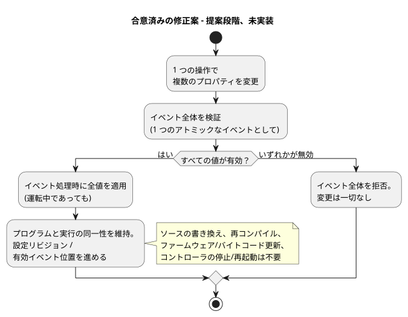
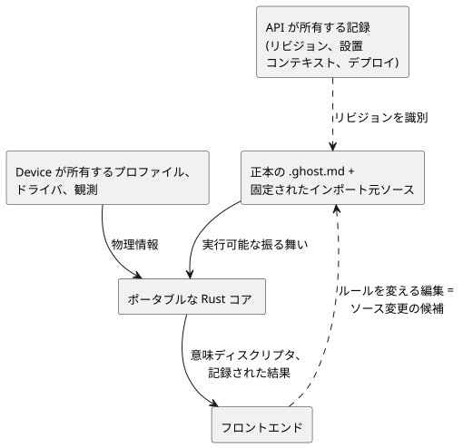
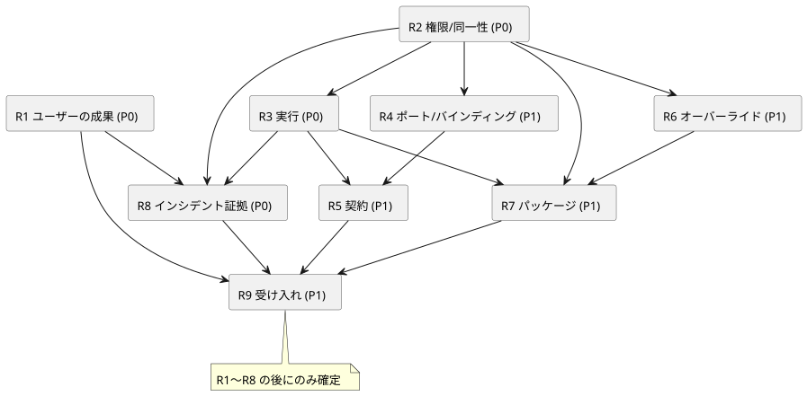

<!-- translation-source: docs/BEHAVIOR-COMPOSITION-RESEARCH.md -->
[英語の原文](BEHAVIOR-COMPOSITION-RESEARCH.md)

# 振る舞いの合成：調査とアーキテクチャレビュー

日付：2026-09-20。親 issue：[GF-COMPOSE #99](https://github.com/callin2/ghostflow-language/issues/99)。
調査対象の言語リビジョン：`ffdbc96461eca67908252507fb851fa4dabd9a2c`。
ステータス：調査の要約と、提案する設計の方向性です。この文書は合成を実装しません。子 issue は、実装を始める前に、範囲を限定した設計上の証拠を作成します。

*振る舞いの合成（behavior composition）*とは、再利用可能な複数の振る舞い（たとえば灌水と換気）を、設置される 1 台のコントローラにまとめることを指します。この文書は、調査で分かったこと、すでに確定している規則、まだ未決の設計上の選択を記録します。

この文書の内容：

- **訂正記録** — 確立された規則、合意済みの修正案、まだ未決の事項の区別。
- **製品の目的**と**完了した委任調査** — この作業が存在する理由と、9 つの調査成果（R1〜R9）が扱う範囲。
- **調査結果**と**アーキテクチャ上の推奨事項（A1〜A8）** — 証拠と提案する方向性。
- **分解**、**調査の順序**、**受け入れシナリオ**、**引き継ぎの規則**、**レビューのチェックポイント** — 作業の分け方と確認の方法。

## 訂正記録（2026-09-20）

この記録は、3 種類の記述を区別します。

| 種類 | 意味 |
| --- | --- |
| 既存の規則 | すでに言語またはその境界の一部であるもの。ここでの議論の対象ではありません。 |
| 合意済みの設計修正案 | 方向性は決まっているが、まだ規範にも実装にも**なっていない**もの。 |
| 未決の選択 | メカニズム、ABI、検証、仕様の整合がまだ決まっていないもの。 |

この記録は設計上の証拠にすぎません。規範的な言語文書を変更するものではなく、実装や検証を主張するものでもありません。

- **既存の実行不変条件（確定した規則）：**
  - `x` は古い状態を読み、`x'` は候補となる次の値を定義します。
  - すべての遷移は、同じ入力/古い状態のスナップショットを使います。
  - 次状態の参照が許されるのは出力式の中だけで、別の遷移や `let` の中では許されません。
  - 状態と論理出力の結果は一緒に確定されます。
  - 組み合わせ回路的な循環と、出力の重複定義は無効です。

  どのような合成でも、これらの規則を守ってください。これらは未決の問題ではありません。各出力チャネルには、権威ある直接定義が 1 つだけあります。競合する直接の書き込み元はコンパイルに失敗しなければならず、決してデプロイされてはなりません。これは既存のステーション単一書き込みリソースマネージャを廃止するものではありません。ステーションへのリクエストは、競合する直接の書き込みではないからです。物理エンドポイントのエイリアス検査は、引き続き別のバインディング検証です。
- **既存の入力ドライバ/出力レンダラーの境界：** GhostFlow は型付きの Source と Intent を定義します。Driver はソフトウェア、専用ハードウェア、またはその両方で実装できます。高精度の測定/プロトコル/生の ISR 処理とスキャン処理との分担は、この境界に属します。意味のある型付きイベントや測定値がコアロジックに入り、農場のポリシーが Driver の中に隠されることはありません。取得時刻、受信/評価時刻、品質は、それぞれ別のものです。コマンドの確認応答は、物理的に動作したことの証明ではありません。
- **合意済みの設計修正案（現在の実装ではない）：** 実行時に調整可能なプロパティの変更は*ライブイベント*です。
  - 複数のプロパティを変更する 1 つの操作は、**1 つのアトミックなイベント**です。
  - イベント全体を検証します。いずれかの値が無効なら、何も変更せずにすべてを拒否します。
  - 受け入れられると、動作中のロジックは、イベントが処理された時点で新しい値を使います。運転中であっても同様です。適用が次の灌水サイクル、新しい実行、停止モードまで延期されることはありません。
  - このイベントのために、ソースの書き換え、再コンパイル、ファームウェア/バイトコードの更新、コントローラ全体の停止/再起動を行ってはなりません。
  - プログラムと実行（run）の同一性を維持し、設定リビジョン/有効イベント位置を進めます。
  - その結果として、既存の規則が出力を変えることはあり得ます。暗黙のリセットや、古いプログラム結合の自動的な再解釈はありません。
  - 設定は実際の ESP の再起動をまたいで保持されます。ただし、その物理的な再起動は、やはり新しい実行同一性を開始します。

  次の図は、複数プロパティのイベント 1 つについて、この合意済み（まだ未実装）の経路を描いたものです。

  
- **現行仕様との矛盾：** [`CONSTRAINTS.md`](CONSTRAINTS.ja.md) の 179〜204 行目、[`LANGUAGE-SURFACE.md`](LANGUAGE-SURFACE.ja.md) の 66〜69 行目、[`LANGUAGE.md`](LANGUAGE.ja.md) の 460〜461 行目（行番号は英語版のもの）は、現在、Configure の変更を停止状態で行うことを要求しています。#89 にも、以前の停止/新規実行の提案が含まれています。これらは、合意済みのライブプロパティ修正案と整合させなければならない、古い文書化済みの振る舞いとして扱ってください。修正案がすでに規範になっている、あるいは実装済みであると黙って主張してはなりません。現在のソース編集ヘルパーはサポートされた振る舞いであり、ソースを編集して再コンパイルします。これは合意済みのライブプロパティ経路の実装ではありません。#89/#90 が引き続きこの作業の担当です。残っている作業は、メカニズム、ABI、検証、仕様の整合に関するものであり、ユーザーがライブ設定を望むかどうかではありません。
- **再起動と入力：**
  - 再起動は通常のイベントであり、それへの反応は GhostFlow のロジックが記述します。全体的な再開/手動のポリシーを押し付けてはなりません。
  - Device/Driver は、ランタイム開始前の電気的な起動、切断、障害に関する責務を引き続き負います。
  - 入力の配送は、既定で、かつサポートされる容量の範囲内で、割り込みで取得されたかスキャンで取得されたかにかかわらず、発生と値の観測を保持しなければなりません。
  - 保留中の値を最新の値で置き換えることは、入力ごとの明示的なオプトインがある場合にのみ許されます。
  - あふれや欠落は拒否または報告されなければならず、黙って受け入れられることは決してありません。

  これは、無制限の永続イベント履歴や新しいインシデントストアではありません。順序付け、イベントから tick への対応付け、ソースのバッチ化、上限、復旧の仕組みは未決のままです。厳格なデッドラインや優先度スケジューラは規定されていません。
- **運用上の境界：** 振る舞いは、通常の使用では互いに独立して動作します。実行可能プログラムや ESP ファームウェアの更新では、その ESP についてコントローラ全体のメンテナンス停止を行います。プロパティイベントでは停止しません。共有される電気的な依存関係は、設置コンテキストに属します。これは、Device がこの境界を実装または検証していることの証拠ではありません。

静的な合成は引き続き有力な仮説であり、選定された下ろし方（lowering）や ABI ではありません。後述のネイティブ/WASM の適合性検査は提案であり、新たに実行されたものではありません。この作業は、2 つ目の正準 JSON プログラム、自動ソルバ、ストレージフレームワークのいずれも導入しません。

## 製品の目的

手間を減らす。説明可能性を高める。追跡可能性を高める。

- 農家は、準備済みの振る舞いを適用し、別の振る舞いを追加し、予期しない結果を理解することを、わずかな技術的判断だけで行えるべきです。
- ソフトウェアとハードウェアのエンジニアは、無関係なログから経緯を再構築することなく、同じ結果を調査できるべきです。
- すべての機能は、解決するユーザーの問題を明示し、どの手間をなくすのか、あるいはどの説明/証拠を利用可能にするのかを示さなければなりません。

| 参加者 | 問い | 必要な成果 |
| --- | --- | --- |
| 農家 | この振る舞いをここに適用できるか？ | 理解できる要件、阻害要因、必要な農場固有の判断。 |
| 農家 | なぜ灌水が始まらなかったのか？ | 根拠のある理由、その運用上の影響、役に立つ次の行動。 |
| ソフトウェアエンジニア / 振る舞いの作成者 | どのロジックがこの結果を生んだのか？ | 正確な定義/インスタンス、ソースリビジョン、設定、入力、状態、制約の判断。 |
| ハードウェアエンジニア / 設置担当者 | 何が機器に届いたのか？ | 正確な設置バインディング、適用結果、利用可能な物理的観測。 |

測定するもの：セットアップの手順数、技術的判断、修正、支援の依頼、診断の手間。さらに、ユーザーがブロックされた動作を説明できるか、エンジニアがそれを裏付ける証拠にたどり着けるかも測定します。

ベースラインと数値的な改善目標には、記録されたウォークスルーと、それに続く参加者による検証が必要です。この調査では、どちらもまだ測定されていません。ヒューリスティックなウォークスルーはユーザー調査ではありません。

## 完了した委任調査

範囲を限定した 9 つの調査成果は完了しており、Luna のレビュアーによって独立にレビューされています。すべての作成者は `gpt-5.6-luna` を low effort で使用しました。これは調査上の証拠と提案する設計の方向性であり、実装された合成でも、測定されたユーザー・Device・物理的な受け入れでもありません。

- [R1 ユーザーの成果](research/GF-COMPOSE-R1-USER-OUTCOMES.ja.md)
- [R2 権限と同一性](research/GF-COMPOSE-R2-AUTHORITY-IDENTITY.ja.md)
- [R3 実行](research/GF-COMPOSE-R3-EXECUTION.ja.md)
- [R4 ポートとバインディング](research/GF-COMPOSE-R4-PORTS-BINDINGS.ja.md)
- [R5 契約](research/GF-COMPOSE-R5-CONTRACTS.ja.md)
- [R6 オーバーライド](research/GF-COMPOSE-R6-OVERRIDES.ja.md)
- [R7 パッケージ](research/GF-COMPOSE-R7-PACKAGES.ja.md)
- [R8 インシデントの証拠](research/GF-COMPOSE-R8-INCIDENT-EVIDENCE.ja.md)
- [R9 受け入れと引き継ぎ](research/GF-COMPOSE-R9-ACCEPTANCE.ja.md)

R9 は、次のアーキテクチャ上の決定を未決のまま残しています。

- コンパイラ/ランタイムの実行と ABI
- パッケージ/インポートのクロージャと検証
- 設置制約の権限
- インスタンスとデプロイの同一性
- バインディング/適用証拠の契約
- インシデント/適用/Device 履歴の証拠

未決の決定のそれぞれが、それに依存するスライスをブロックします。issue の結果の公開はコーディネーターが扱います。この記録は GitHub の issue のクローズを主張するものではありません。

## 調査結果

ソースと issue の監査は、次の事実を裏付けています。オープンな issue の記述は要件または提案であり、その機能が実装済みであることの証拠ではありません。

| 証拠 | 現在の事実 | 合成への影響 |
| --- | --- | --- |
| [コンパイラの入口](../tools/compile-source.mjs) | `compileSource` は 1 つの正準 literate 文書を受け取り、そのソース同一性を保持します。 | 複数のインポート元ソースには、明示的な来歴の設計が必要です。 |
| [コアの tick](../crates/ghostflow-core/src/lib.rs)、`Runtime::tick` | 遷移は前の状態を読み、意図は定義された状態ビューを使い、安全処理が要求出力を解決します。 | インスタンスを合成する際も、確立された同時スナップショット/確定の規則を守ります。制御内の循環の拒否は確定しています。インスタンス間/インポート間の参照のエンコーディングと検証だけが、未決になり得る決定です。 |
| [ステーションコア](../crates/ghostflow-core/src/station.rs)、[制約の契約](CONSTRAINTS.ja.md) | 範囲を限定したポンプステーションの調停器と、別個の正準制約コンパイル経路がすでに存在します。 | 再利用を監査します。一般的な振る舞いの合成や任意の調停は、これらの仕組みによって確立されたわけではありません。 |
| [意図アンカー](INTENT-ANCHOR-MAP.ja.md) | 生成された来歴は、編集可能な 2 つ目のプログラムではありません。推測された仮定は、確認された意図/前提とは区別されます。 | ビューや抽出された主張が、黙って実行を変えることはできません。 |
| [統合契約](../contracts/integration-v1/README.md) | バインディングは、型付きの論理名をエンドポイントに対応付けます。v1 ではエンドポイントのエイリアスは拒否されます。ソフトウェア入力は物理 DI を消費する必要がありません。 | 共有出力とリソースの計上には、明示的な互換性の決定が必要です。 |
| [ポータブルパッケージ](PORTABLE-PACKAGE.ja.md) | 1 つのソースリビジョン、GFB のバイト列、マニフェスト、マップ、ランタイム同一性、バインディングリビジョンが一緒に署名されます。 | 再利用可能な振る舞いと設置済みのデプロイとでは、バインディングのライフサイクルが異なります。 |
| [インタラクション契約](../contracts/interaction-v0/README.md) | 静的なディスクリプタと完了した観測は、正確なスキーマ/ソース/モジュール/実行の同一性を通じて結合されます。 | 合成されたインスタンスのために、既存の同一性の連鎖を拡張します。 |
| [設定 #89](https://github.com/callin2/ghostflow-language/issues/89) | 以前の停止/新規実行の提案は、合意済みのライブ実行時プロパティ修正案と矛盾します。ソース編集/再コンパイルのヘルパーはサポートされた現在の振る舞いですが、ライブ経路ではありません。 | 規範テキストを整合させ、メカニズム/ABI/検証を定義します。インポート時の特殊化は別物のままです。 |
| [説明 #88](https://github.com/callin2/ghostflow-language/issues/88)、[イベント #74](https://github.com/callin2/ghostflow-language/issues/74) | 説明とイベント/コマンドのセマンティクスには、すでに担当があります。 | 重複したシステムを作るのではなく、合成に固有の結合とギャップを調査します。 |
| [設置 #62](https://github.com/callin2/farm_studio_system/issues/62) | 独立に強制され、弱められない設置制約を提案しています。 | このリポジトリの正本ソースの境界に照らして、表現と強制の方法を決めます。 |

外部の先行事例は推奨事項の参考になるものであり、GhostFlow のセマンティクスを定義するものではありません。

- [Observable のインポート](https://old.observablehq.com/documentation/notebooks/imports)は、バージョンの固定と依存関係の置き換えを示しています。インポートされたものの評価は遅延され得ます。GhostFlow の実行は、表示が値を観測しているかどうかに依存してはなりません。
- [W3C PROV-DM](https://www.w3.org/TR/prov-dm/) は、エンティティ、アクティビティ、責任を持つエージェントを区別します。これはソース/成果物/イベントの来歴に対する語彙のチェックとして有用ですが、RDF、グラフデータベース、オントロジー全体を採用するという要件ではありません。

## アーキテクチャ上の推奨事項

### A1. 同一性を結び付けた明示的な権限

情報の種類ごとに、所有者はちょうど 1 つです。

| 所有者 | 所有するもの |
| --- | --- |
| 正本の `.ghost.md` ソースと固定されたインポート元ソース | 実行可能な振る舞い。 |
| API が所有する記録 | リビジョン、設置コンテキスト、デプロイの同一性。 |
| Device が所有するプロファイル、ドライバ、観測 | 物理情報。 |
| ポータブルな Rust コア | 実行。 |
| フロントエンド | 権威あるものは何も所有しません。意味ディスクリプタと記録された結果を利用します。 |

会話的な編集や視覚的な編集は、実行可能な規則を変える場合、ソース変更の候補になります。

次の図は、これらの所有権の境界と、それらの間の同一性のつながりを示しています。

システムの設置に関する issue #62 は、実際に未解決の境界をもたらします。実行可能な設置制約が、2 つ目の非公式な JSON プログラムになってはなりません。次の 2 つの選択肢を調査してください。

1. 設置契約が、既存の制約経路を使って、別途コンパイルされた正準制約ソースを参照する。
2. 明示的なプロジェクト横断の境界リビジョンを必須とする。

どちらかが受け入れられたと仮定してはなりません。

### A2. 型付きの関係と個別のグラフ射影

共有の意味語彙と同一性のつながりを保ちます。農場、ソース、履歴のすべての関係を 1 つの普遍的な DAG に収めることを要求してはなりません。インポート、スキャン内の依存関係、説明グラフ、機器の関係、時間をまたぐ観測のそれぞれについて、辺の種類と循環の規則を別々に特定してください。

定義の同一性、不変の定義リビジョン、インスタンスの同一性、論理ポート、物理機器、実行時の発生は、それぞれ異なる概念です。表示名や文書内の位置が、これらの同一性の代わりになってはなりません。

### A3. まず静的な合成を調査する

1 つの実行可能プログラムへのコンパイラによる合成と、協調する複数の VM とを比較します。静的な合成は、現在の実行コアを再利用できるため、有力な仮説です。まだ、実証された下ろし方や ABI の決定ではありません。

比較では、確定済みの古い状態/次状態の契約を守りながら、入力のサンプリングと論理時間を示さなければなりません。

- すべての遷移は、同じ古い状態/入力のスナップショットを読みます。
- 次状態の参照は出力式の中にだけ現れます。
- 論理的な状態/出力の確定は同時に行われます。

これらのセマンティクスは合成の決定事項ではありません。比較では、さらに次も示さなければなりません。

- タイマーの分離
- 初期化/リセット
- 故障の範囲
- 出力の解決

1 つの定義から作られた 2 つのインスタンスは、分離された状態を持たなければなりません。同じインスタンス同一性について宣言の順序を入れ替えても、振る舞いが変わってはなりません。スキャンをまたぐフィードバックには明示的なセマンティクスが必要です。瞬時の依存関係の循環が暗黙に解決されることはありません。

分析では既存のリソース制限を考慮に入れてください。DI/RO の容量だけでは、プログラム全体の状態、バイトコード、式のコスト、メモリ、ターゲットのタイミングについては何も分かりません。

### A4. 既存の設置バインディングを保持する

未使用チャネルについての提案は、既存の明示的なバインディングを保持しなければなりません。決定的な割り当てだけでは、振る舞いを追加しても古い配線が保たれることは保証されません。提案、ユーザーが確認した対応付け、観測された設置状態を区別してください。

物理入力を数えるのは、選択された入力が実際に物理 DI を必要とする場合だけです。上位 issue の DI 2 / RO 7 という結果は、配線されたデジタル入力が 2 つあることを前提としています。ソフトウェアの手動開始コマンドは、別のリソースのケースです。適合性の証拠が欠けている場合は、互換ではなく不明として表現してください。

### A5. 最初の契約プロファイルの範囲を限定する

明示的なポート互換性、依存関係の存在、パラメータの範囲、チャネルごとに 1 つの権威ある直接出力定義から始めます。競合する直接の書き込み元はコンパイルエラーであり、デプロイできません。これは、既存のステーションマネージャによるステーションリクエストの明示的なリソース調停を禁止するものではありません。そこでは、ステーションマネージャが引き続き直接の書き込み元です。物理エンドポイントのエイリアス検査は、引き続き別のバインディング検証です。新しい仕組みを提案する前に、そのマネージャを監査してください。合成プロファイルが既存のステーションの振る舞いを再定義してはなりません。

宣言された仮定、テストされた性質、静的に確立された性質、実行時に強制される制約を区別してください。互換性や検証についてのすべての主張には範囲が必要です。出力が別々でも、共有の水、電力、その他の物理リソースには影響し得ます。電気的なチャネルの独立性は、物理的な独立性の証明ではありません。一般的な時間/安全性の証明は、最初のプロファイルの範囲外です。

### A6. オーバーライドのライフサイクルを分けておく

インポート時のパラメータ、実行時のオペレーター設定、依存関係の選択、物理バインディングの 4 つを別々に記録します。合意済みのライブプロパティ経路では、プログラム/実行の同一性を保持し、設定リビジョン/有効イベント位置を進め、値を ESP の再起動をまたいで保持しつつ、再起動したランタイムには新しい実行同一性を割り当てます。古い停止/新規実行の記述は #89 と整合させ、パラメータ化されたスケジュールには #90 を使ってください。この修正案は、まだ規範にも実装にもなっていません。

### A7. 明示的な拡張の決定のもとでパッケージ検証を再利用する

コンパイルの前に、推移的な依存関係を正確に固定します。ソースバンドルの拡張と、既存の成果物を包む合成エンベロープとを比較してください。完全なソースクロージャ、コンパイラのリプレイ、契約ディスクリプタ、マップを、合成された成果物にどう結び付けるかを決めます。インポート元ソースの来歴を平坦化して失ってはなりません。

既存の信頼/失効と利用側の互換性の要件を保持してください。信頼されたパッケージ発行者であっても、デプロイの承認や物理的な受け入れが確立されるわけではありません。再利用可能なエクスポートには、現場のバインディング、現場の秘密情報、会話の記録を含めません。署名の仕組みを合成のために再実装すべきではありません。

### A8. 1 つのイベント、参加者ごとに異なる説明

農家向けの記述とエンジニア向けの詳細なビューは、同じインシデントと正確な実行コンテキストを参照しなければなりません。要求出力、解決された安全出力、ホスト/レンダラーによる適用、利用可能な物理フィードバックを区別しておいてください。

低水位の例では、低水位信号が灌水をブロックしたと報告します。その信号を、タンクが物理的に空であるという根拠のない主張に変えてはなりません。再起動の後では、繰り返されたスキャン番号によって古いイベントを特定することはできません。フィードバックの欠落、ジャーナルのギャップ、利用できない成果物は、見える状態のままにしなければなりません。

#88、#74、インタラクション契約、[Device historian #28](https://github.com/callin2/farm-device/issues/28) を再利用してください。言語は範囲を限定したセマンティクスと来歴を提供します。保持、トランスポート、画面、物理的な観測は、既存の担当のもとに残ります。

## 上位 issue の分解

| #99 のセクション | 扱い | 調査タスク |
| --- | --- | --- |
| 1、9、11：ビジョンとオーサリング体験 | 参加者の問題と測定可能な成果に変換します。 | R1 |
| 2：1 つの Semantic DAG | 権限、同一性、明示的なグラフ射影へと精緻化します。 | R2 |
| 3：再利用可能な振る舞い | 維持します。インスタンスの実行と分離を定義します。 | R2、R3 |
| 4：灌水と換気 | フィクスチャとして維持します。拒否とインシデントのケースを追加します。 | R4、R9 |
| 5：論理ポートと物理 IO | 維持します。既存のバインディングと不明な証拠を保持します。 | R4 |
| 6：パラメータ、バインディング、依存関係 | 分離を維持し、リビジョンの影響を明示します。 | R6 |
| 7：契約 | 最初のプロファイルの範囲を限定し、調停の所有権を再利用します。 | R5 |
| 8：合成/リンクのパイプライン | 純粋なコンパイラの作業を、設置とデプロイから分離します。 | R2〜R7 |
| 10：ソース/パッケージのスケッチ | 構文は例示にとどめます。来歴とパッケージの互換性を調査します。 | R7 |
| 12：未決の問い | 名前の付いた調査成果物に割り当てます。 | R1〜R8 |
| 13：非目標 | 維持します。汎用グラフプラットフォームや新しい診断ストレージエンジンは追加しません。 | すべて |
| 14：提案された成果物 | ユーザーの道筋とアーキテクチャの依存関係に沿って並べ替えます。 | R9 |
| セクション横断の説明/トレース | 否定的な結果を含めて、初期の要件にします。 | R8、R9 |

元の、番号だけの Device Query への参照 #27 は、このリポジトリでは誤りです。言語リポジトリの #27 は DateTime の作業です。検証済みの関連ソースは [system #74, Track D](https://github.com/callin2/farm_studio_system/issues/74) と [installation #62](https://github.com/callin2/farm_studio_system/issues/62) です。

## 調査の順序と issue インデックス

P0 は、早期に解決すべき高リスクの製品またはアーキテクチャ上の問いを意味します。P1 は、最初の範囲を限定した合成スライスに必要な設計の詳細を意味します。これらは調査の優先度であり、実装や製品の検証が完了したという宣言ではありません。

<!-- compose-issue-index:start -->
| タスク | 優先度 | 範囲を限定した成果物 | 厳格な依存関係 |
| --- | --- | --- | --- |
| [R1 #100](https://github.com/callin2/ghostflow-language/issues/100) | P0 | 参加者の道筋と測定プロトコル | なし |
| [R2 #101](https://github.com/callin2/ghostflow-language/issues/101) | P0 | 権限/同一性のマトリクスとグラフの境界 | なし |
| [R3 #102](https://github.com/callin2/ghostflow-language/issues/102) | P0 | 実行方式の比較と明示的なスキャン表 | R2 |
| [R4 #103](https://github.com/callin2/ghostflow-language/issues/103) | P1 | ポート/リソースと安定したバインディングの決定表 | R2 |
| [R5 #104](https://github.com/callin2/ghostflow-language/issues/104) | P1 | 最初の契約プロファイルと拒否時の診断 | R3、R4 |
| [R6 #105](https://github.com/callin2/ghostflow-language/issues/105) | P1 | オーバーライドのライフサイクルとリビジョン変更のマトリクス | R2 |
| [R7 #106](https://github.com/callin2/ghostflow-language/issues/106) | P1 | 再利用可能なパッケージ/インポートクロージャの設計比較 | R2、R3、R6 |
| [R8 #107](https://github.com/callin2/ghostflow-language/issues/107) | P0 | 農家からエンジニアまでのインシデント証拠のウォークスルー | R1、R2、R3 |
| [R9 #108](https://github.com/callin2/ghostflow-language/issues/108) | P1 | 受け入れマトリクスと実装の引き継ぎ順序 | R1〜R8 |
<!-- compose-issue-index:end -->

タスクは GitHub で管理しており、重複したローカルのチェックボックス式バックログでは管理しません。[計画のインデックス](../tasks/plan.md)は、この要約とトラッカーを指しています。

厳格な依存関係により、次の順序になります。

- R1 と R2 は同時に開始できます。
- R2 の後、R3、R4、R6 はそれぞれ独立に進められます。
- R3 の後、説明の調査 R8 とパッケージの調査 R7 は、その他の入力が揃いしだい進められます。
- R9 は早い段階で草案を書けますが、R1〜R8 の前に確定することはできません。

関連する issue はインターフェースの参照先です。それらが完全に完了することは、これらの調査文書の厳格な依存関係ではありません。未完成の機能を必要とする実装は、後でその具体的な依存関係を宣言しなければなりません。既存の親 issue と所有権は維持し、#89、#95、#88 やその他の既存の作業を #99 の下に移してはなりません。

## 代表的な受け入れシナリオ

これらは提案されたテストまたはウォークスルーの仕様であり、実行された結果ではありません。

| シナリオ | 期待される証拠 |
| --- | --- |
| 灌水を適用し、次に 4 台のファンによる換気を追加する | 配線された入力が 2 つの場合：DI 2 / RO 7。既存の灌水のバインディングは変わらない。 |
| ソフトウェアの手動開始コマンドを使う | その入力が物理 DI を消費しない理由を説明する。DI の合計をハードコードしない。 |
| 灌水を 2 回インスタンス化する | インスタンス/状態/タイマー/来歴の同一性がそれぞれ異なる。定義リビジョンは同一でもよい。 |
| 同じ名前のインスタンスの順序を入れ替える | 示された入力/時刻のトレースのもとで、意味的な出力が同じで、バインディングが安定している。 |
| 1 台のポンプに排他的な所有者を 2 つバインドする | 両方のインスタンス/ポートの同一性と、理解できる理由を示して拒否する。 |
| 1 つの出力チャネルに、競合する直接の書き込み元を 2 つ定義する | コンパイル時に拒否し、デプロイ可能な成果物は作らない。既存の単一書き込みマネージャによって調停される明示的なステーションリクエストは拒否しない。 |
| ポートの型の誤り、依存関係の欠如、適合性が不明 | 具体的なエラー/不明の結果。デプロイ成功の主張はしない。 |
| 低水位が灌水をブロックする | 農家向けの説明が、正確な入力、規則、要求/安全出力、実行に結び付いている。 |
| レンダラーの適用が失敗する、またはフィードバックがない | コマンドと観測された結果の区別を保持する。 |
| 再起動、クラッシュ、ジャーナルのギャップ | ブート/実行の境界と最後に利用可能な証拠を保持し、欠けている証拠を明示的に特定する。 |
| パラメータ、設定、バインディングを変更する | リビジョン変更のマトリクスを適用し、古い証拠の結合を拒否する。 |
| 運転中に 1 回の操作で複数のライブプロパティを変更する | 1 つのイベント。受け入れ時に、プログラム/実行の同一性を変えずに、コントローラを止めずに、すべてを適用する。いずれかの値が無効なら、何も変更せずにイベント全体を拒否する。 |
| プロパティが受け入れられた後に再起動する | プロパティの値は保持される。再起動への反応は GhostFlow が記述し、新しい実行が始まる。Device の起動時の電気的な責務は別のまま。 |
| 負荷のもとで発生と観測値を配送する | 既定で容量の範囲内で保持する。最新値による置き換えは、明示的にオプトインした入力に限る。あふれ/欠落は拒否または報告する。無制限の履歴を意味するものではない。 |
| インポートした定義をアップグレードする | 固定リビジョンの明示的な変更と、影響を受けるインスタンス/契約/来歴への影響。浮動的な依存関係の更新はしない。 |
| ネイティブ/WASM のリプレイ | 固定された同一の成果物、設定、入力テープ、論理時間、出力、サポートされるトレース同一性を比較する。 |

既存の状態の規則は、すべてのシナリオで確定しています。各遷移は同じ古い状態/入力のスナップショットを読み、`next` の参照は出力式に限られ、状態と論理出力の結果は一緒に確定されます。これは下ろし方や ABI の問いではありません。合成がこの規則を保持するための具体的なメカニズムは未決のままです。

提案するネイティブ/WASM の適合性テストでは、運転中のプロパティの効果、無効な複数プロパティイベントの全か無かの拒否、ソース/プログラムのハッシュと実行同一性が変わらないこと、新しい実行同一性と GhostFlow が記述した再起動反応を伴う再起動をまたいだ保持、明示的な合体（coalescing）とあふれのケース、そして既存の prime とステーション単一書き込みの適合性の維持を扱うべきです。これらの検査は提案であり、実行されたものではありません。ホストの適合性、API の統合、Device での実行、物理的な試運転、農家/エンジニアの使いやすさは、それぞれ別の証拠の分類です。ホストのフィクスチャが合格しても、他の分類が完了するわけではありません。将来の実行可能なテストは、`tools/verify-language.mjs` に明示的に登録し、`docs/VERIFICATION.md` に従わなければなりません。

## 小さなモデルへの引き継ぎの規則

各 issue は自己完結しています。1 つの文書成果物、正確な出発点となるソース、確定した制約、番号付きの手順、例、期待される表の列、依存関係、3 つの完了チェックを含みます。チャット履歴は必要ありません。想定される範囲は、焦点を絞った 1 回の調査で、通常は 80〜160 行程度の出力ファイル 1 つです。

調査対象のリビジョンを証拠のベースラインとして使い、実際に調べたリビジョンとの関連する差分があれば記録してください。大きなモジュール全体ではなく、対象となる定義を読みます。現在のコード、オープンな提案、推奨事項を区別してください。

新しいランタイム、ABI、ソースの権限、ストレージエンジン、プロジェクト横断の担当を、黙って選択してはなりません。指定された出力の中で、代替案と具体的な反例を示してください。証拠が欠けている場合は `unresolved` と書き、欠けている証拠とその担当を明記し、裏付けのある部分を完成させてください。アーキテクチャ上の受け入れは引き続きレビューのチェックポイントであり、暗黙のうちに小さなモデルへ委任されるタスクではありません。

## レビューのチェックポイントと先送りする範囲

- R1〜R3 の後：ユーザーの成果、権限、実行の代替案をレビューします。
- R4〜R8 の後：バインディング、契約、ライフサイクル、パッケージの互換性、証拠の連鎖をまとめてレビューします。

R9 は、解決された決定と、未解決の実装上の阻害要因を正確に記録します。子の調査が完了しても、それだけで実装が承認されるわけではありません。

任意のグラフクエリ、普遍的なオントロジー、マーケットプレイス、新しい UI レンダラー、分散オーケストレーション、一般的な時間的定理証明、既存の #95 の作業を超える共有アクチュエータのポリシーは先送りします。これらには具体的なユーザーの問題が必要です。自然言語からの抽出と会話の記憶は、引き続き API/製品側の作業です。それらのより広い来歴のライフサイクルは、[system memory #68](https://github.com/callin2/farm_studio_system/issues/68) がすでに担当しています。
