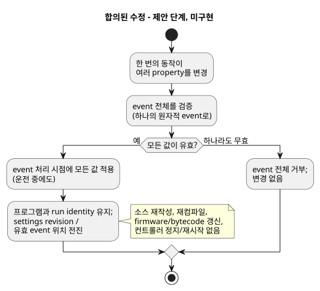
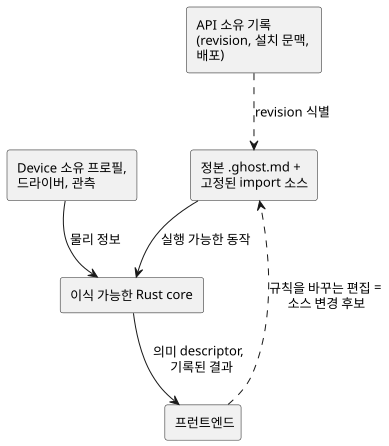
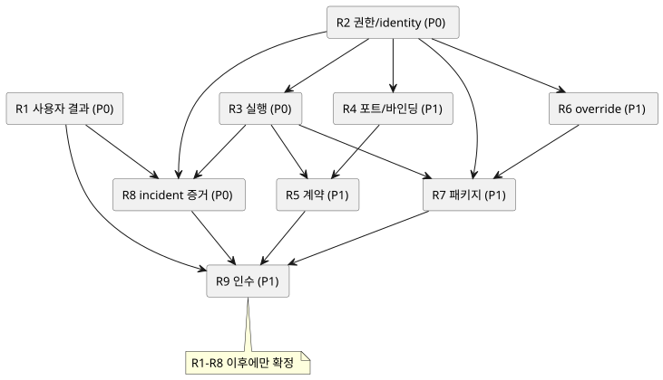

<!-- translation-source: docs/BEHAVIOR-COMPOSITION-RESEARCH.md -->
[영문 원문](BEHAVIOR-COMPOSITION-RESEARCH.md)

# 동작 조합: 연구와 아키텍처 검토

날짜: 2026-09-20. 상위 항목: [GF-COMPOSE #99](https://github.com/callin2/ghostflow-language/issues/99).
검토한 언어 revision: `ffdbc96461eca67908252507fb851fa4dabd9a2c`.
상태: 연구 요약과 제안된 설계 방향. 이 문서는 조합을 구현하지 않습니다. 하위 이슈들이
구현을 시작하기 전에 범위가 한정된 설계 증거를 만듭니다.

*동작 조합(behavior composition)*은 재사용 가능한 여러 동작(예: 관수와 환기)을
설치된 컨트롤러 하나로 결합하는 것을 뜻합니다. 이 문서는 연구에서 발견한 내용, 이미
고정된 규칙, 아직 열려 있는 설계 선택을 기록합니다.

이 문서의 내용:

- **정정 기록** — 무엇이 확립된 규칙이고, 무엇이 합의된 수정이며, 무엇이 아직 열려
  있는지.
- **제품 목표**와 **완료된 위임 연구** — 이 작업이 존재하는 이유와 아홉 개의 연구
  산출물(R1–R9)이 다루는 범위.
- **연구 결과**와 **아키텍처 권고(A1–A8)** — 증거와 제안된 방향.
- **분해**, **연구 순서**, **인수 시나리오**, **인계 규칙**, **검토 체크포인트** —
  작업을 나누고 점검하는 방법.

## 정정 기록 (2026-09-20)

이 기록은 세 종류의 진술을 구분합니다.

| 종류 | 의미 |
| --- | --- |
| 기존 규칙 | 이미 언어 또는 그 경계의 일부입니다. 여기서 논의 대상이 아닙니다. |
| 합의된 설계 수정 | 방향은 결정됐지만 아직 규범이 **아니며** 구현되지도 않았습니다. |
| 열린 선택 | mechanism, ABI, 검증, 명세 정합성이 아직 결정되지 않았습니다. |

이 기록은 설계 증거일 뿐입니다. 규범 언어 문서를 변경하지 않으며, 구현이나 검증을
주장하지 않습니다.

- **기존 실행 불변 조건(고정 규칙):**
  - `x`는 이전 상태를 읽고, `x'`는 후보 다음 값을 정의합니다.
  - 모든 전이는 같은 입력/이전 상태 snapshot을 사용합니다.
  - 다음 상태 참조는 출력 식에서만 허용되며, 다른 전이나 `let`에서는 허용되지
    않습니다.
  - 상태와 논리 출력 결과는 함께 확정됩니다.
  - 조합 순환(combinational cycle)과 중복 출력 정의는 유효하지 않습니다.

  어떤 조합에서도 이 규칙을 보존해야 합니다. 이는 열린 질문이 아닙니다. 각 출력
  채널에는 권위 있는 직접 정의가 하나만 있습니다. 경쟁하는 직접 작성자는 컴파일에
  실패해야 하며, 절대로 배포되어서는 안 됩니다. 이것이 기존 station의 단일 작성자 자원
  관리자를 없애지는 않습니다. station 요청은 경쟁하는 직접 쓰기가 아니기 때문입니다.
  물리 endpoint alias 검사는 별도의 바인딩 검증으로 남습니다.
- **기존 입력 드라이버/출력 렌더러 경계:** GhostFlow는 타입이 지정된 Source와 Intent를
  정의합니다. Driver의 기반은 소프트웨어, 특수 하드웨어, 또는 둘 다일 수 있습니다.
  정밀 측정/프로토콜/raw-ISR 처리와 스캔 처리의 구분은 이 경계에 속합니다. 의미 있는
  타입 지정 event나 측정이 core 논리로 들어가며, 농장 정책을 Driver 안에 숨기지
  않습니다. 포착 시각, 수신/평가 시각, 품질은 서로 다른 세 가지입니다. 명령
  acknowledgement는 물리 동작의 증거가 아닙니다.
- **합의된 설계 수정이며 현재 구현은 아님:** 런타임에서 조정 가능한 property의 변경은
  *live event*입니다.
  - 여러 property를 바꾸는 한 번의 동작은 **하나의 원자적 event**입니다.
  - event 전체를 검증합니다. 값 하나라도 유효하지 않으면 아무것도 변경하지 않고 모두
    거부합니다.
  - 승인되면 활성 논리는 운전 중이라도 event가 처리되는 시점부터 새 값을 사용합니다.
    적용을 다음 관수 주기, 새 run, 정지 모드로 미루지 않습니다.
  - 이 event 때문에 소스를 다시 쓰거나, 재컴파일하거나, firmware/bytecode를 갱신하거나,
    컨트롤러 전체를 정지/재시작하지 않습니다.
  - 프로그램과 run identity를 보존하고, settings revision/유효 event 위치를
    전진시킵니다.
  - 그 결과 기존 규칙이 출력을 바꿀 수 있습니다. 암묵적인 reset도, 오래된 프로그램
    join의 자동 재해석도 없습니다.
  - 설정은 실제 ESP 재시작 후에도 유지됩니다. 그래도 그 물리적 재시작은 새 run
    identity를 시작합니다.

  아래 다이어그램은 여러 property를 바꾸는 event 하나에 대해 이 합의된(아직 구현되지
  않은) 경로를 개략적으로 보여 줍니다.

  
- **현재 명세와의 충돌:** [`CONSTRAINTS.md`](CONSTRAINTS.md) 179–204행,
  [`LANGUAGE-SURFACE.md`](LANGUAGE-SURFACE.md) 66–69행,
  [`LANGUAGE.md`](LANGUAGE.md) 460–461행은 현재 정지 상태에서의 Configure 변경을
  요구합니다. #89에도 이전의 정지/새 run 제안이 있습니다. 이들은 합의된 live property
  수정과 조정해야 하는 이전의 문서화된 동작으로 취급하십시오. 수정이 이미 규범이거나
  구현됐다고 조용히 주장하지 마십시오. 현재의 source-edit helper는 지원되는 동작으로,
  소스를 편집하고 재컴파일합니다. 이는 합의된 live property 경로의 구현이 아닙니다.
  #89/#90이 계속 해당 workstream의 담당입니다. 남은 작업은 mechanism, ABI, 검증, 명세
  정합성에 관한 것이며, 사용자가 live 설정을 원하는지 여부에 관한 것이 아닙니다.
- **재시작과 입력:**
  - 재시작은 일반적인 event이며, 그에 대한 반응은 GhostFlow 논리가 작성합니다. 전역
    resume/manual 정책을 강요하지 마십시오.
  - 런타임 이전의 전기적 startup, disconnect, 고장 관련 의무는 Device/Driver가
    유지합니다.
  - 입력 전달은 interrupt로 포착되든 스캔으로 포착되든, 기본적으로 그리고 지원 용량
    안에서 발생(occurrence)과 값 관측을 보존해야 합니다.
  - 대기 중인 값을 최신 값으로 교체하는 것은 입력별로 명시적으로 opt-in한 경우에만
    허용됩니다.
  - overflow나 손실은 거부하거나 보고해야 하며, 절대 조용히 받아들여서는 안 됩니다.

  이것은 무제한 영속 event 이력이나 새로운 incident 저장소가 아닙니다. 순서,
  event-to-tick 대응, 소스 batching, 상한, 복구 mechanism은 아직 열려 있습니다. hard
  deadline이나 priority scheduler는 명세되지 않았습니다.
- **운영 경계:** 일반 사용에서 동작들은 독립적으로 운전합니다. 실행 프로그램이나 ESP
  firmware 갱신은 해당 ESP의 컨트롤러 전체 maintenance stop을 사용합니다. property
  event는 컨트롤러를 정지시키지 않습니다. 공유 전기 의존성은 설치 문맥에 속합니다.
  이는 Device가 그 경계를 구현하거나 검증했다는 증거가 아닙니다.

정적 조합은 선호되는 가설이며, 선택된 lowering이나 ABI가 아닙니다. 아래의
native/WASM 적합성 검사는 제안이며, 새로 실행한 결과가 아닙니다. 이 작업은 두 번째
정본 JSON 프로그램, 자동 solver, 저장 framework를 도입하지 않습니다.

## 제품 목표

노력을 줄입니다. 설명 가능성을 높입니다. 추적 가능성을 높입니다.

- 농부는 적은 기술적 결정만으로 준비된 동작을 적용하고, 다른 동작을 추가하고, 예상치
  못한 결과를 이해할 수 있어야 합니다.
- 소프트웨어와 하드웨어 엔지니어는 관련 없는 로그에서 이력을 재구성하지 않고도 같은
  결과를 조사할 수 있어야 합니다.
- 모든 기능은 자신이 해결하는 사용자 문제를 밝히고, 어떤 노력을 없애는지 또는 어떤
  설명/증거를 제공하는지 보여야 합니다.

| 참여자 | 질문 | 필요한 결과 |
| --- | --- | --- |
| 농부 | 이 동작을 여기에 적용할 수 있는가? | 이해 가능한 요구사항, 차단 사유, 필요한 농장별 결정. |
| 농부 | 왜 관수가 시작되지 않았는가? | 근거 있는 이유, 그 운영상 영향, 유용한 다음 행동. |
| 소프트웨어 엔지니어 / 동작 작성자 | 어떤 논리가 결과를 만들었는가? | 정확한 definition/인스턴스, source revision, 설정, 입력, 상태, 제약 판단. |
| 하드웨어 엔지니어 / 설치자 | 설비에 무엇이 전달됐는가? | 정확한 설치 바인딩, 적용 결과, 이용 가능한 물리 관측. |

측정할 항목: 설정 단계 수, 기술적 결정 수, 수정 횟수, 지원 요청, 진단 노력. 사용자가
차단된 동작을 설명할 수 있는지, 엔지니어가 이를 뒷받침하는 증거에 도달할 수 있는지도
측정합니다.

기준선과 수치 개선 목표에는 기록된 walkthrough와 그에 이은 참여자 검증이 필요합니다.
이 연구에서는 둘 다 측정하지 않았습니다. 휴리스틱 walkthrough는 사용자 연구가
아닙니다.

## 완료된 위임 연구

범위가 한정된 아홉 개의 연구 산출물이 완료되었고, Luna 검토자가 독립적으로
검토했습니다. 모든 작성자는 낮은 effort의 `gpt-5.6-luna`를 사용했습니다. 이는 연구
증거이자 제안된 설계 방향이며, 구현된 조합이나 측정된 사용자·Device·물리 인수가
아닙니다.

- [R1 사용자 결과](research/GF-COMPOSE-R1-USER-OUTCOMES.ko.md)
- [R2 권한과 identity](research/GF-COMPOSE-R2-AUTHORITY-IDENTITY.ko.md)
- [R3 실행](research/GF-COMPOSE-R3-EXECUTION.ko.md)
- [R4 포트와 바인딩](research/GF-COMPOSE-R4-PORTS-BINDINGS.ko.md)
- [R5 계약](research/GF-COMPOSE-R5-CONTRACTS.ko.md)
- [R6 override](research/GF-COMPOSE-R6-OVERRIDES.ko.md)
- [R7 패키지](research/GF-COMPOSE-R7-PACKAGES.ko.md)
- [R8 incident 증거](research/GF-COMPOSE-R8-INCIDENT-EVIDENCE.ko.md)
- [R9 인수와 인계](research/GF-COMPOSE-R9-ACCEPTANCE.ko.md)

R9는 다음 아키텍처 결정을 열어 둡니다.

- 컴파일러/런타임 실행과 ABI
- 패키지/import closure와 검증
- 설치 제약의 권한
- 인스턴스와 배포 identity
- 바인딩/적용 증거 계약
- incident/적용/Device 이력 증거

열린 결정 각각은 그에 의존하는 slice를 차단합니다. 이슈 결과의 게시는 coordinator가
담당하며, 이 기록은 GitHub 이슈 종료를 주장하지 않습니다.

## 연구 결과

소스와 이슈 감사는 다음 사실을 뒷받침합니다. 열린 이슈의 설명은 요구사항이나
제안이며, 그 기능이 구현됐다는 증거가 아닙니다.

| 증거 | 현재 사실 | 조합에 대한 결과 |
| --- | --- | --- |
| [컴파일러 진입점](../tools/compile-source.mjs) | `compileSource`는 정본 문서형 소스 하나를 받아 그 소스 identity를 보존합니다. | 여러 import 소스에는 명시적인 provenance 설계가 필요합니다. |
| [Core tick](../crates/ghostflow-core/src/lib.rs), `Runtime::tick` | 전이는 이전 상태를 읽고, 의도는 정의된 상태 뷰를 사용하며, 안전 처리가 요청 출력을 해소합니다. | 인스턴스를 조합할 때 확립된 동시 snapshot/확정 규칙을 보존합니다. control 내부 순환 거부는 고정되어 있습니다. 인스턴스 간/import 참조의 인코딩과 검증만이 잠재적인 열린 결정입니다. |
| [Station core](../crates/ghostflow-core/src/station.rs), [제약 계약](CONSTRAINTS.md) | 범위가 한정된 펌프 station 중재기와 별도의 정본 제약 컴파일 경로가 이미 존재합니다. | 재사용 가능성을 감사합니다. 일반적인 동작 조합과 임의의 중재는 이 mechanism으로 확립되지 않습니다. |
| [의도 앵커](INTENT-ANCHOR-MAP.ko.md) | 생성된 provenance는 편집 가능한 두 번째 프로그램이 아닙니다. 추론된 가정은 확인된 의도/전제와 구별됩니다. | 뷰와 추출된 주장은 실행을 조용히 바꿀 수 없습니다. |
| [Integration 계약](../contracts/integration-v1/README.ko.md) | 바인딩은 타입이 지정된 논리 이름을 endpoint에 대응시킵니다. v1에서 endpoint aliasing은 거부됩니다. 소프트웨어 입력은 물리 DI를 소비하지 않아도 됩니다. | 공유 출력과 자원 집계에는 명시적인 호환성 결정이 필요합니다. |
| [Portable package](PORTABLE-PACKAGE.ko.md) | 하나의 source revision, GFB bytes, manifest, map, runtime identity, binding revision이 함께 서명됩니다. | 재사용 가능한 동작과 설치된 배포는 서로 다른 바인딩 수명 주기를 가집니다. |
| [Interaction 계약](../contracts/interaction-v0/README.ko.md) | 정적 descriptor와 완료된 관측은 정확한 schema/source/module/run identity를 통해 연결됩니다. | 조합된 인스턴스에 대해 기존 identity 사슬을 확장합니다. |
| [Settings #89](https://github.com/callin2/ghostflow-language/issues/89) | 이전의 정지/새 run 제안은 합의된 live 런타임 property 수정과 충돌합니다. source-edit/재컴파일 helper는 지원되는 현재 동작이지만 live 경로는 아닙니다. | 규범 문구를 조정하고 mechanism/ABI/검증을 정의합니다. import 특수화(specialization)는 별개로 남습니다. |
| [Explanation #88](https://github.com/callin2/ghostflow-language/issues/88), [events #74](https://github.com/callin2/ghostflow-language/issues/74) | 설명과 event/명령 의미론에는 이미 담당이 있습니다. | 중복 시스템을 만들지 말고 조합에 특화된 join과 공백을 연구합니다. |
| [Installation #62](https://github.com/callin2/farm_studio_system/issues/62) | 독립적으로 강제되며 약화할 수 없는 설치 제약을 제안합니다. | 이 저장소의 정본 소스 경계에 비추어 표현과 강제 방식을 해결합니다. |

외부 선례는 GhostFlow 의미론을 정의하지 않고 권고에 참고가 될 뿐입니다.

- [Observable imports](https://old.observablehq.com/documentation/notebooks/imports)는
  버전 고정과 의존성 교체를 보여 줍니다. import된 평가는 지연(lazy)될 수 있습니다.
  GhostFlow 실행은 화면이 값을 관찰하는지 여부에 의존해서는 안 됩니다.
- [W3C PROV-DM](https://www.w3.org/TR/prov-dm/)은 entity, activity, 책임 agent를
  구분합니다. 이는 소스/artifact/event provenance를 위한 유용한 어휘 점검이며, RDF나
  그래프 데이터베이스, 전체 온톨로지를 채택하라는 요구가 아닙니다.

## 아키텍처 권고

### A1. 연결된 identity를 갖는 명시적 권한

정보의 종류마다 소유자는 정확히 하나입니다.

| 소유자 | 소유 대상 |
| --- | --- |
| 정본 `.ghost.md` 소스와 고정된 import 소스 | 실행 가능한 동작. |
| API 소유 기록 | revision, 설치 문맥, 배포 identity. |
| Device 소유 프로필, 드라이버, 관측 | 물리 정보. |
| 이식 가능한 Rust core | 실행. |
| 프런트엔드 | 권위 있는 것은 없음. 의미 descriptor와 기록된 결과를 소비합니다. |

대화형 편집이나 시각적 편집이 실행 규칙을 바꾸면 소스 변경 후보가 됩니다.

아래 다이어그램은 이 소유권 경계와 그 사이의 identity 연결을 보여 줍니다.

시스템 설치 이슈 #62는 실제로 해결되지 않은 경계를 제기합니다. 실행 가능한 설치
제약이 두 번째 비공식 JSON 프로그램이 되어서는 안 됩니다. 두 가지 선택지를
연구합니다.

1. 설치 계약이 기존 제약 경로를 사용해 별도로 컴파일된 정본 제약 소스를 참조합니다.
2. 명시적인 프로젝트 간 경계 revision을 요구합니다.

어느 쪽도 수용됐다고 가정하지 마십시오.

### A2. 타입이 지정된 관계와 특정 그래프 투영

공유 의미 어휘와 identity 연결을 유지합니다. 모든 농장·소스·이력 관계를 하나의
보편 DAG에 맞추라고 요구하지 마십시오. import, 스캔 내부 의존성, 설명 그래프, 설비
관계, 시간에 걸친 관측 각각에 대해 edge 종류와 순환 규칙을 따로 식별합니다.

definition identity, 불변 definition revision, 인스턴스 identity, 논리 포트, 물리 설비,
런타임 발생(occurrence)은 서로 다른 개념입니다. 표시 이름과 문서 위치가 이 identity를
대신해서는 안 됩니다.

### A3. 정적 조합을 먼저 조사

하나의 실행 프로그램으로 합치는 컴파일러 조합과, 여러 VM을 조율하는 방식을
비교합니다. 정적 조합은 현재 실행 core를 재사용할 수 있으므로 선호되는 가설입니다.
그러나 아직 입증된 lowering이나 ABI 결정은 아닙니다.

비교는 고정된 이전/다음 상태 계약을 보존하면서 입력 샘플링과 논리 시간을 보여야
합니다.

- 모든 전이는 같은 이전 상태/입력 snapshot을 읽습니다.
- 다음 상태 참조는 출력 식에서만 나타납니다.
- 논리 상태/출력 확정은 동시에 일어납니다.

이 의미론은 조합에서 결정할 사항이 아닙니다. 비교는 다음도 보여야 합니다.

- 타이머 격리
- 초기화/reset
- 고장 범위
- 출력 해소

한 definition의 두 인스턴스는 격리된 상태를 가져야 합니다. 같은 인스턴스 identity에
대한 선언 순서를 바꿔도 동작이 바뀌어서는 안 됩니다. 스캔을 넘나드는 피드백에는
명시적인 의미론이 필요하며, 즉시 의존 순환을 암묵적으로 해결하지 않습니다.

분석에서 기존 자원 한도를 유지합니다. DI/RO 용량만으로는 프로그램 전체의 상태,
bytecode, 식 비용, 메모리, target 타이밍에 대해 아무것도 말할 수 없습니다.

### A4. 기존 설치 바인딩 보존

사용하지 않는 채널에 대한 제안은 명시적인 기존 바인딩을 유지해야 합니다. 결정적
할당만으로는 동작을 추가할 때 기존 배선이 보존된다고 보장할 수 없습니다. 제안,
사용자가 확인한 매핑, 관측된 설치를 서로 구별해 유지합니다.

선택한 입력이 실제로 물리 DI를 요구할 때에만 물리 입력으로 셉니다. 상위 이슈의
DI 2 / RO 7 결과는 배선된 디지털 입력 두 개를 가정합니다. 소프트웨어 수동 시작
명령은 별개의 자원 사례입니다. 적합성 증거가 없으면 호환이 아니라 알 수 없음으로
표현합니다.

### A5. 첫 번째 계약 profile의 범위 한정

명시적인 포트 호환성, 의존성 존재 여부, 파라미터 범위, 그리고 채널마다 권위 있는
직접 출력 정의가 하나뿐이라는 조건부터 시작합니다. 경쟁하는 직접 작성자는 컴파일
오류이며 배포될 수 없습니다. 이는 기존 station 관리자가 station 요청을 명시적으로
자원 중재하는 것을 금지하지 않습니다. 그 경우 station 관리자가 여전히 직접 작성자입니다.
물리 endpoint alias 검사는 별도의 바인딩 검증으로 남습니다. 새로운 mechanism을 제안하기 전에
그 관리자를 감사하십시오. 조합 profile이 기존 station 동작을 재정의해서는 안 됩니다.

선언된 가정, 시험된 속성, 정적으로 확립된 속성, 런타임에 강제되는 제약을 구별합니다.
모든 호환성이나 검증 주장에는 범위가 필요합니다. 분리된 출력도 공유된 물, 전력,
기타 물리 자원에 영향을 줄 수 있습니다. 전기 채널의 독립성은 물리적 독립성을 증명하지
않습니다. 일반적인 시간/안전 증명은 첫 번째 profile의 범위 밖입니다.

### A6. override 수명 주기를 분리 유지

다음 네 가지를 따로 기록합니다. import 시점 파라미터, 런타임 운영자 설정, 의존성 선택,
물리 바인딩. 합의된 live property 경로에서는 프로그램/run identity를 보존하고,
settings revision/유효 event 위치를 전진시키며, 값을 ESP 재시작 후에도 유지하되
재시작된 런타임에는 새 run identity를 부여합니다. 이전의 정지/새 run 문구는 #89와
조정하고, 파라미터화된 예약에는 #90을 사용합니다. 이 수정은 아직 규범이 아니며
구현되지도 않았습니다.

### A7. 명시적인 확장 결정과 함께 패키지 검증 재사용

컴파일 전에 정확한 전이적 의존성을 고정합니다. 소스 묶음 확장과, 기존 artifact를
감싸는 조합 envelope을 비교합니다. 완전한 source closure, 컴파일러 replay, 계약
descriptor, map이 조합된 artifact에 어떻게 결속되는지 결정합니다. import된 소스의
provenance를 평탄화해서 잃어버리지 마십시오.

기존의 신뢰/폐기(revocation)와 소비자 호환성 요구사항을 보존합니다. 신뢰할 수 있는
패키지 발행자가 배포 승인이나 물리적 인수를 확립하지는 않습니다. 재사용 가능한
export에는 현장 바인딩, 현장 비밀, 대화 기록이 포함되지 않습니다. 서명 mechanism을 조합에서
다시 구현해서는 안 됩니다.

### A8. 하나의 event, 참여자별 설명

농부용 문장과 엔지니어용 상세 뷰는 같은 incident와 정확한 실행 문맥을 참조해야 합니다.
요청 출력, 해소된 안전 출력, 호스트/렌더러 적용, 이용 가능한 물리 피드백을 서로
구별해 유지합니다.

저수위 예시에서는 저수위 신호가 관수를 차단했다고 보고합니다. 그 신호를 탱크가
물리적으로 비었다는 근거 없는 주장으로 바꾸지 마십시오. 재시작 후에는 반복된 스캔
번호로 이전 event를 식별할 수 없습니다. 누락된 피드백, journal 공백, 사용할 수 없는
artifact는 계속 드러나 있어야 합니다.

#88, #74, Interaction 계약,
[Device historian #28](https://github.com/callin2/farm-device/issues/28)을 재사용합니다.
언어는 범위가 한정된 의미론과 provenance를 제공하며, 보존 기간, 전송, 화면, 물리 관측은
기존 담당에게 남습니다.

## 상위 이슈의 분해

| #99 섹션 | 처리 | 연구 작업 |
| --- | --- | --- |
| 1, 9, 11: 비전과 작성 경험 | 참여자 문제와 측정 가능한 결과로 전환합니다. | R1 |
| 2: 하나의 Semantic DAG | 권한, identity, 명시적 그래프 투영으로 구체화합니다. | R2 |
| 3: 재사용 가능한 동작 | 유지합니다. 인스턴스 실행과 격리를 정의합니다. | R2, R3 |
| 4: 관수와 환기 | fixture로 유지합니다. 거부 사례와 incident 사례를 추가합니다. | R4, R9 |
| 5: 논리 포트와 물리 IO | 유지합니다. 기존 바인딩과 알 수 없음 증거를 보존합니다. | R4 |
| 6: 파라미터, 바인딩, 의존성 | 분리를 유지하고 revision의 영향을 명시합니다. | R6 |
| 7: 계약 | 첫 번째 profile의 범위를 한정하고 중재 소유권을 재사용합니다. | R5 |
| 8: 조합/link 파이프라인 | 순수 컴파일러 작업을 설치·배포와 분리합니다. | R2–R7 |
| 10: 소스/패키지 스케치 | 구문은 예시로만 둡니다. provenance와 패키지 호환성을 연구합니다. | R7 |
| 12: 열린 질문 | 이름이 붙은 연구 산출물에 배정합니다. | R1–R8 |
| 13: 비목표 | 유지합니다. 범용 그래프 플랫폼이나 새 진단 저장 엔진을 추가하지 않습니다. | 전체 |
| 14: 제안된 산출물 | 사용자 여정과 아키텍처 의존성을 중심으로 재정렬합니다. | R9 |
| 섹션 전반의 설명/trace | 부정적 결과를 포함해 초기 요구사항으로 만듭니다. | R8, R9 |

원래 적혀 있던 Device Query 참조 #27은 이 저장소에서는 잘못된 참조입니다. 언어
저장소의 #27은 DateTime 작업입니다. 확인된 관련 출처는
[system #74, Track D](https://github.com/callin2/farm_studio_system/issues/74)와
[installation #62](https://github.com/callin2/farm_studio_system/issues/62)입니다.

## 연구 순서와 이슈 색인

P0은 일찍 해결해야 할 위험도 높은 제품 또는 아키텍처 질문을 뜻합니다. P1은 첫 번째
범위 한정 조합 slice에 필요한 설계 세부 사항을 뜻합니다. 이는 연구 우선순위이며,
구현이나 제품 검증이 완료됐다는 선언이 아닙니다.

<!-- compose-issue-index:start -->
| 작업 | 우선순위 | 범위가 한정된 산출물 | 필수 의존성 |
| --- | --- | --- | --- |
| [R1 #100](https://github.com/callin2/ghostflow-language/issues/100) | P0 | 참여자 여정과 측정 protocol | 없음 |
| [R2 #101](https://github.com/callin2/ghostflow-language/issues/101) | P0 | 권한/identity matrix와 그래프 경계 | 없음 |
| [R3 #102](https://github.com/callin2/ghostflow-language/issues/102) | P0 | 실행 방식 비교와 명시적 스캔 표 | R2 |
| [R4 #103](https://github.com/callin2/ghostflow-language/issues/103) | P1 | 포트/자원 및 안정적 바인딩 결정 표 | R2 |
| [R5 #104](https://github.com/callin2/ghostflow-language/issues/104) | P1 | 첫 번째 계약 profile과 거부 진단 | R3, R4 |
| [R6 #105](https://github.com/callin2/ghostflow-language/issues/105) | P1 | override 수명 주기와 revision 변경 matrix | R2 |
| [R7 #106](https://github.com/callin2/ghostflow-language/issues/106) | P1 | 재사용 가능한 패키지/import closure 설계 비교 | R2, R3, R6 |
| [R8 #107](https://github.com/callin2/ghostflow-language/issues/107) | P0 | 농부에서 엔지니어까지의 incident 증거 walkthrough | R1, R2, R3 |
| [R9 #108](https://github.com/callin2/ghostflow-language/issues/108) | P1 | 인수 matrix와 구현 인계 순서 | R1–R8 |
<!-- compose-issue-index:end -->

작업은 중복된 로컬 체크박스 backlog가 아니라 GitHub에서 추적합니다.
[계획 색인](../tasks/plan.ko.md)이 이 요약과 tracker를 가리킵니다.

필수 의존성은 아래와 같은 순서를 이룹니다.

- R1과 R2는 함께 시작할 수 있습니다.
- R2 이후에는 R3, R4, R6을 독립적으로 진행할 수 있습니다.
- R3 이후에는 설명 연구 R8과 패키지 연구 R7이 다른 입력이 갖춰지는 대로 진행할 수
  있습니다.
- R9는 일찍 초안을 쓸 수 있지만 R1–R8 전에는 확정할 수 없습니다.

관련 이슈는 인터페이스 참조입니다. 그 이슈 전체의 완료가 이 연구 문서들의 필수
의존성은 아닙니다. 완료되지 않은 기능이 필요한 구현은 나중에 그 특정 의존성을
명시해야 합니다. 기존 상위 항목과 소유권을 유지하십시오. #89, #95, #88 및 기타 기존
작업을 #99 아래로 옮기지 마십시오.

## 대표 인수 시나리오

다음은 제안된 시험 또는 walkthrough 명세이며, 실행 결과가 아닙니다.

| 시나리오 | 기대 증거 |
| --- | --- |
| 관수를 적용한 뒤 팬 4개짜리 환기 추가 | 배선된 입력 2개 기준: DI 2 / RO 7. 기존 관수 바인딩은 변경 없음. |
| 소프트웨어 수동 시작 명령 사용 | 그 입력이 물리 DI를 소비하지 않는 이유를 설명. 하드코딩된 DI 총계 없음. |
| 관수를 두 번 인스턴스화 | 서로 다른 인스턴스/상태/타이머/provenance identity. 같은 definition revision은 허용. |
| 같은 이름의 인스턴스 순서 변경 | 명시된 입력/시간 trace에서 같은 의미 출력과 안정적인 바인딩. |
| 배타적 소유자 두 개를 펌프 하나에 바인딩 | 두 인스턴스/포트 identity와 이해 가능한 이유를 담아 거부. |
| 한 출력 채널에 경쟁하는 직접 작성자 두 개를 정의 | 컴파일 거부. 배포 가능한 artifact 없음. 기존 단일 작성자 관리자가 중재하는 명시적 station 요청은 거부하지 않음. |
| 잘못된 포트 타입, 누락된 의존성, 알 수 없는 적합성 | 구체적인 오류/알 수 없음 결과. 배포 성공 주장 없음. |
| 저수위가 관수를 차단 | 농부용 설명이 정확한 입력, 규칙, 요청/안전 출력, run에 연결됨. |
| 렌더러 적용 실패 또는 피드백 부재 | 명령과 관측된 결과의 구별을 보존. |
| 재시작, crash, journal 공백 | 부팅/run 경계와 마지막으로 이용 가능한 증거를 보존. 누락된 증거를 명시적으로 식별. |
| 파라미터, 설정, 바인딩 변경 | revision 변경 matrix를 적용. 오래된 증거 join은 거부. |
| 운전 중 한 번의 동작으로 여러 live property 변경 | 하나의 event. 승인되면 프로그램/run identity를 바꾸거나 컨트롤러를 정지하지 않고 모두 적용. 값 하나라도 유효하지 않으면 아무것도 변경하지 않고 event 전체를 거부. |
| property 승인 후 재시작 | property 값은 유지됨. 재시작 반응은 GhostFlow가 작성하며 새 run을 시작. Device 시작 시 전기적 의무는 별개로 유지. |
| 부하 상황에서 발생과 관측값 전달 | 용량 안에서 기본적으로 보존. 최신 값 교체는 명시적으로 opt-in한 입력에만. overflow/손실은 거부 또는 보고. 무제한 이력을 뜻하지 않음. |
| import한 definition 업그레이드 | 명시적인 고정 revision 변경과, 영향받는 인스턴스/계약/provenance의 영향. 유동적 의존성 갱신 없음. |
| native/WASM replay | 동일하게 고정된 artifact, 설정, input tape, 논리 시간, 출력, 지원되는 trace identity를 비교. |

기존 상태 규칙은 모든 시나리오에서 고정입니다. 각 전이는 같은 이전 상태/입력
snapshot을 읽고, `next` 참조는 출력 식에만 한정되며, 상태와 논리 출력 결과는 함께
확정됩니다. 이는 lowering이나 ABI의 질문이 아닙니다. 조합이 이 규칙을 보존하는 구체적인
mechanism만 아직 열려 있습니다.

제안된 native/WASM 적합성 검사는 다음을 다뤄야 합니다. 운전 중 property 효과, 유효하지
않은 다중 property event의 전부 아니면 전무(all-or-none) 거부, 변경되지 않은
source/program hash와 run identity, 새 run identity와 GhostFlow가 작성한 재시작 반응을
동반한 재시작 후 유지, 명시적 병합(coalescing)과 overflow 사례, 기존 prime 및 station
단일 작성자 적합성의 보존. 이 검사들은 제안이며 실행되지 않았습니다. 호스트 적합성,
API 통합, Device 실행, 물리 시운전, 농부/엔지니어 사용성은 서로 다른 증거 부류입니다.
호스트 fixture가 통과해도 다른 부류가 완료되는 것은 아닙니다. 앞으로의 실행 가능한
테스트는 `tools/verify-language.mjs`에 명시적으로 등록하고 `docs/VERIFICATION.md`를
따라야 합니다.

## 더 작은 모델을 위한 인계 규칙

각 이슈는 자기 완결적입니다. 문서 artifact 하나, 정확한 시작 소스, 고정된 제약, 번호가
매겨진 단계, 예시, 기대하는 표 열, 의존성, 완료 검사 세 가지를 담고 있습니다. 대화
기록이 필요하지 않습니다. 기대 범위는 한 번의 집중된 연구 작업이며, 보통 약 80–160줄의
출력 파일 하나입니다.

검토한 revision을 증거 기준선으로 사용하고, 실제로 검토한 revision과의 관련 차이를
기록하십시오. 큰 모듈 전체가 아니라 필요한 정의만 골라 읽으십시오. 현재 코드, 열린
제안, 권고를 구별하십시오.

새로운 런타임, ABI, 소스 권한, 저장 엔진, 프로젝트 간 담당을 조용히 선택하지 마십시오.
지정된 출력에 대안과 구체적인 반례를 제시하십시오. 증거가 없으면 `unresolved`라고 쓰고,
누락된 증거와 담당을 밝힌 뒤, 뒷받침되는 부분을 마무리하십시오. 아키텍처 수용은 검토
체크포인트로 남으며, 암묵적으로 더 작은 모델에 위임되는 작업이 아닙니다.

## 검토 체크포인트와 연기된 범위

- R1–R3 이후: 사용자 결과, 권한, 실행 대안을 검토합니다.
- R4–R8 이후: 바인딩, 계약, 수명 주기, 패키지 호환성, 증거 사슬을 함께 검토합니다.

R9는 해결된 결정과 정확한 미해결 구현 차단 요인을 기록합니다. 하위 연구를 완료한다고
해서 구현이 자동으로 승인되지는 않습니다.

임의 그래프 질의, 보편 온톨로지, marketplace, 새 UI 렌더러, 분산 orchestration, 일반
시간 정리 증명, 기존 #95 작업을 넘어서는 공유 액추에이터 정책은 연기합니다. 이들에는
구체적인 사용자 문제가 필요합니다. 자연어 추출과 대화 기억은 API/제품 작업으로 남으며,
[system memory #68](https://github.com/callin2/farm_studio_system/issues/68)이 이미 그
더 넓은 provenance 수명 주기를 담당합니다.
