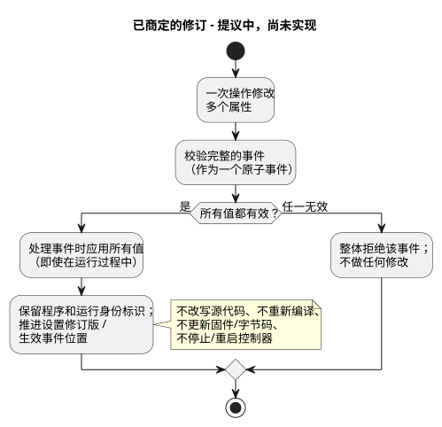
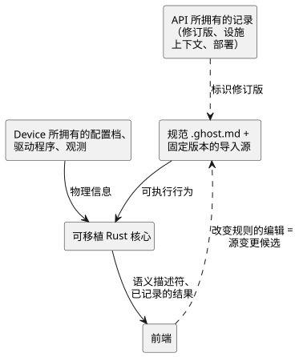
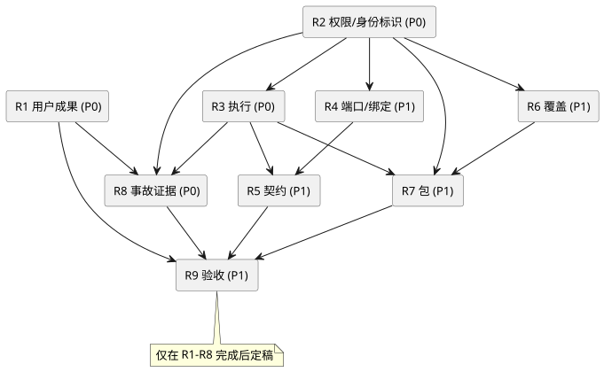

<!-- translation-source: docs/BEHAVIOR-COMPOSITION-RESEARCH.md -->
[英文原文](BEHAVIOR-COMPOSITION-RESEARCH.md)

# 行为组合：研究与架构评审

日期：2026-09-20。父 issue：[GF-COMPOSE #99](https://github.com/callin2/ghostflow-language/issues/99)。
所检查的语言修订版：`ffdbc96461eca67908252507fb851fa4dabd9a2c`。
状态：研究总结和提议的设计方向。本文档并不实现组合。在任何实现开始之前，各子 issue 先产出有界的设计证据。

*行为组合*（behavior composition）是指把多个可复用的行为（例如灌溉和通风）组合成一个已安装的控制器。本文档记录研究发现了什么、哪些规则已经固定，以及哪些设计选择仍然开放。

本文内容：

- **更正记录**——哪些是既定规则，哪些是已商定的修订，哪些仍然开放。
- **产品目标**和**已完成的委托研究**——这项工作为何存在，以及九项研究产出（R1–R9）涵盖什么。
- **研究发现**和**架构建议（A1–A8）**——证据和提议的方向。
- **分解**、**研究顺序**、**验收场景**、**交接规则**和**评审检查点**——工作如何拆分和检查。

## 更正记录（2026-09-20）

本记录区分三类陈述：

| 类别 | 含义 |
| --- | --- |
| 既有规则 | 已经是语言或其边界的一部分。此处不作讨论。 |
| 已商定的设计修订 | 已决定的方向，但**尚未**成为规范，也尚未实现。 |
| 开放选择 | 机制、ABI、验证或规格对齐仍有待决定。 |

本记录仅为设计证据。它不修改规范性语言文档，也不声称已实现或已验证。

- **既有执行不变式（固定规则）：**
  - `x` 读取旧状态；`x'` 定义一个候选的下一值。
  - 每个状态转移都使用同一个输入/旧状态快照。
  - 下一状态引用只允许出现在输出表达式中，不能出现在另一个转移或 `let` 中。
  - 状态与逻辑输出结果一起提交。
  - 组合环路和重复的输出定义是无效的。

  任何组合都必须保留这些规则；它们不是开放问题。每个输出通道都只有一个权威的直接定义。相互竞争的直接写入者必须导致编译失败，并且绝不能被部署。这并不取消现有的泵站单写入者资源管理器：泵站请求不是相互竞争的直接写入。物理端点别名检查仍属于单独的绑定校验。
- **既有的输入驱动程序/输出渲染器边界：** GhostFlow 定义带类型的
  Source 和 Intent。Driver（驱动程序）可以由软件、专用硬件或二者共同实现。精密测量/协议/原始 ISR 处理与扫描处理之间的划分属于这一边界。进入核心逻辑的是有意义的带类型事件或测量值；农场策略不会隐藏在 Driver 中。采集时间、接收/求值时间和质量是三件不同的事。命令确认并不能证明发生了物理动作。
- **已商定的设计修订，而非当前实现：** 对运行时可调属性的修改是*实时事件*（live event）。
  - 一次修改多个属性的操作是**一个原子事件**。
  - 校验完整的事件。只要有任何值无效，就整体拒绝且不做任何修改。
  - 一旦接受，活动中的逻辑会在处理该事件时使用新值，包括在运行过程中。应用不会推迟到下一个浇水周期、新的运行或停止模式。
  - 不会为此事件改写源代码、重新编译、更新固件/字节码，也不会停止/重启整个控制器。
  - 保留程序身份标识和运行身份标识；推进设置修订版/生效事件位置。
  - 现有规则可能因此改变某个输出。不存在隐式重置，也不会自动重新解释陈旧的程序关联。
  - 设置在真实的 ESP 重启后依然保留；但该物理重启仍会开始一个新的运行身份标识。

  下图勾勒了一次多属性事件在这条已商定（尚未实现）路径上的处理过程。

  
- **与当前规格的冲突：** [`CONSTRAINTS.md`](CONSTRAINTS.zh.md) 第 179–204 行、
  [`LANGUAGE-SURFACE.md`](LANGUAGE-SURFACE.zh.md) 第 66–69 行，以及
  [`LANGUAGE.md`](LANGUAGE.zh.md) 第 460–461 行目前要求在停止状态下进行 Configure 修改。#89 也包含此前“停止/新运行”的提案。应把这些视为较旧的文档化行为，必须与已商定的实时属性修订进行协调。不要悄悄声称该修订已经成为规范或已经实现。当前的源编辑辅助工具是受支持的行为：它编辑源代码并重新编译。它并不是已商定的实时属性路径的实现。#89/#90 仍是这些工作流的负责方。待完成的工作涉及机制、ABI、验证和规格对齐，而不是用户是否需要实时设置。
- **重启与输入：**
  - 重启是一个普通事件；对它的反应由 GhostFlow 逻辑编写。不要强加全局的恢复/手动策略。
  - Device/Driver 保留运行时启动之前的电气启动、断开和故障方面的义务。
  - 输入投递在默认情况下、在受支持的容量之内，必须保留发生实例和值观测，无论它们是由中断捕获还是由扫描捕获。
  - 只有在对每个输入显式选择启用时，才允许用最新值替换待处理的值。
  - 溢出或丢失必须被拒绝或报告，绝不能被静默接受。

  这并不是无限的持久事件历史，也不是新的事故存储。排序、事件到 tick 的映射、源批处理、边界以及恢复机制仍然开放。尚未规定任何硬截止时间或优先级调度器。
- **运行边界：** 在正常使用中，各行为独立运行。
  可执行程序或 ESP 固件的更新会对该 ESP 使用控制器范围的维护停止；属性事件不会使其停止。共享的电气依赖属于设施上下文。这并不是 Device 已实现或已验证该边界的证据。

静态组合仍然是首选的假设，而不是已选定的 lowering 或 ABI。下文的原生/WASM 一致性检查是提议，而不是新运行过的检查。这项工作不引入第二个规范 JSON 程序，不引入自动求解器，也不引入存储框架。

## 产品目标

减少工作量。提高可解释性。提高可追溯性。

- 农户应当能够只做很少的技术决策，就能应用一个预先准备好的行为、再添加另一个行为，并理解意外的结果。
- 软件和硬件工程师应当能够调查同一个结果，而无需从不相关的日志中重建其历史。
- 每项功能都必须说明它解决的用户问题，并展示它消除了哪些工作量，或提供了哪些解释/证据。

| 参与者 | 问题 | 所需结果 |
| --- | --- | --- |
| 农户 | 我能在这里应用这个行为吗？ | 可理解的要求、阻碍因素以及必要的农场特定决策。 |
| 农户 | 为什么没有开始浇水？ | 有依据的原因、其运行影响以及有用的下一步行动。 |
| 软件工程师 / 行为作者 | 是哪段逻辑产生了这个结果？ | 精确的定义/实例、源修订版、设置、输入、状态和约束判定。 |
| 硬件工程师 / 安装人员 | 什么到达了设备？ | 精确的设施绑定、应用结果以及可用的物理观测。 |

需要衡量的内容：设置步骤、技术决策、更正、求助请求和诊断工作量。还要衡量用户能否解释一个被阻止的动作，以及工程师能否找到其支持证据。

基线和数值化的改进目标需要先进行有记录的走查，再由参与者验证。本研究中二者都尚未测量。启发式走查并不是用户研究。

## 已完成的委托研究

九项有界的研究产出均已完成，并由一名 Luna 评审者独立评审。每位作者都以低强度（low effort）使用了 `gpt-5.6-luna`。这是研究证据和提议的设计方向，而不是已实现的组合，也不是经过测量的用户、Device 或物理验收。

- [R1 用户成果](research/GF-COMPOSE-R1-USER-OUTCOMES.zh.md)
- [R2 权限与身份标识](research/GF-COMPOSE-R2-AUTHORITY-IDENTITY.zh.md)
- [R3 执行](research/GF-COMPOSE-R3-EXECUTION.zh.md)
- [R4 端口与绑定](research/GF-COMPOSE-R4-PORTS-BINDINGS.zh.md)
- [R5 契约](research/GF-COMPOSE-R5-CONTRACTS.zh.md)
- [R6 覆盖](research/GF-COMPOSE-R6-OVERRIDES.zh.md)
- [R7 包](research/GF-COMPOSE-R7-PACKAGES.zh.md)
- [R8 事故证据](research/GF-COMPOSE-R8-INCIDENT-EVIDENCE.zh.md)
- [R9 验收与交接](research/GF-COMPOSE-R9-ACCEPTANCE.zh.md)

R9 将以下架构决策保留为开放：

- 编译器/运行时执行与 ABI；
- 包/导入闭包及其验证；
- 设施约束的权限归属；
- 实例与部署身份标识；
- 绑定/已应用证据的契约；
- 事故/应用/Device 历史证据。

每个开放决策都会阻塞依赖它的切片。
issue 结果的发布由协调者处理；本记录不声称 GitHub issue 已关闭。

## 研究发现

源代码和 issue 审计支持以下事实。开放 issue 的描述是需求或提案，并不是其功能已实现的证据。

| 证据 | 当前事实 | 对组合的影响 |
| --- | --- | --- |
| [编译器入口](../tools/compile-source.mjs) | `compileSource` 接受一个规范的文学式文档，并保留其源身份标识。 | 多个导入的源需要显式的来源（provenance）设计。 |
| [核心 tick](../crates/ghostflow-core/src/lib.rs)，`Runtime::tick` | 状态转移读取先前状态；意图使用已定义的状态视图；安全机制对请求的输出进行裁决。 | 组合实例时保留既定的同时快照/提交规则；控制块内部的环路拒绝是固定的。只有跨实例/导入引用的编码与校验是潜在的开放决策。 |
| [泵站核心](../crates/ghostflow-core/src/station.rs)、[约束契约](CONSTRAINTS.zh.md) | 已存在一个有界的泵站仲裁器，以及一条独立的规范约束编译路径。 | 审计其复用；这些机制并不能确立通用的行为组合和任意仲裁。 |
| [意图锚点](INTENT-ANCHOR-MAP.zh.md) | 生成的来源信息不是可编辑的第二个程序。推断出的假设与已确认的意图/前提是不同的。 | 视图和提取出的声明不能悄悄改变执行。 |
| [集成契约](../contracts/integration-v1/README.zh.md) | 绑定把带类型的逻辑名称匹配到端点。v1 拒绝端点别名。软件输入不必占用物理 DI。 | 共享输出和资源核算需要显式的兼容性决策。 |
| [可移植包](PORTABLE-PACKAGE.zh.md) | 一个源修订版、GFB 字节、清单、映射、运行时身份标识和绑定修订版被一起签名。 | 可复用的行为与已安装的部署具有不同的绑定生命周期。 |
| [交互契约](../contracts/interaction-v0/README.zh.md) | 静态描述符与已完成的观测通过精确的 schema/源/模块/运行身份标识关联。 | 为组合后的实例扩展现有的身份标识链。 |
| [设置 #89](https://github.com/callin2/ghostflow-language/issues/89) | 较旧的“停止/新运行”提案与已商定的实时运行时属性修订相冲突；源编辑/重新编译辅助工具是受支持的当前行为，但不是实时路径。 | 协调规范性文本，并定义机制/ABI/验证。导入特化仍是另一回事。 |
| [解释 #88](https://github.com/callin2/ghostflow-language/issues/88)、[事件 #74](https://github.com/callin2/ghostflow-language/issues/74) | 解释以及事件/命令语义已有负责方。 | 研究组合特有的关联和缺口，而不是建立重复的系统。 |
| [设施 #62](https://github.com/callin2/farm_studio_system/issues/62) | 提议独立执行、不可削弱的设施约束。 | 根据本仓库的规范源边界，确定其表示方式与执行方式。 |

外部先例为建议提供参考，但并不定义 GhostFlow 语义：

- [Observable imports](https://old.observablehq.com/documentation/notebooks/imports)
  展示了版本锁定和依赖替换。导入的求值可以是惰性的。GhostFlow 的执行不得依赖于显示界面是否观测某个值。
- [W3C PROV-DM](https://www.w3.org/TR/prov-dm/) 区分实体、活动和负责的代理。对于源/产物/事件的来源信息，它是一个有用的词汇对照，但并不要求采用 RDF、图数据库或完整的本体。

## 架构建议

### A1. 显式权限与相互关联的身份标识

每一类信息都恰好有一个所有者：

| 所有者 | 拥有的内容 |
| --- | --- |
| 规范 `.ghost.md` 源以及固定版本的导入源 | 可执行行为。 |
| API 所拥有的记录 | 修订版、设施上下文和部署身份标识。 |
| Device 所拥有的配置档、驱动程序和观测 | 物理信息。 |
| 可移植 Rust 核心 | 执行。 |
| 前端 | 不拥有任何权威内容；它们消费语义描述符和已记录的结果。 |

当一次对话式或可视化编辑改变了可执行规则时，它就成为一个源变更候选。

下图展示了这些所有权边界以及它们之间的身份标识关联。

系统设施 issue #62 引入了一个真实存在的未决边界：可执行的设施约束不能变成第二个非正式的 JSON 程序。研究以下两个选项：

1. 设施契约引用单独编译的规范约束源，使用现有的约束路径。
2. 需要一次显式的跨项目边界修订。

不要假定其中任何一个已被接受。

### A2. 带类型的关系与特定的图投影

保持共享的语义词汇和身份标识关联。不要求每一个农场、源和历史关系都纳入一个通用 DAG。分别确定导入、扫描内依赖、解释图、设备关系以及跨时间观测各自的边类型和环路规则。

定义身份标识、不可变的定义修订版、实例身份标识、逻辑端口、物理设备和运行时发生实例是不同的概念。显示名称和文档位置不得替代这些身份标识。

### A3. 优先研究静态组合

比较两种方案：由编译器把各行为组合成一个可执行程序，以及多个协调运行的 VM。静态组合是首选假设，因为它可以复用当前的执行核心。但它尚不是经过证明的 lowering 或 ABI 决策。

比较必须展示输入采样和逻辑时间，同时保留固定的旧状态/下一状态契约：

- 所有状态转移读取同一个旧状态/输入快照；
- 下一状态引用只出现在输出表达式中；
- 逻辑状态/输出同时提交。

这些语义不是组合的决策项。比较还必须展示：

- 定时器隔离；
- 初始化/重置；
- 故障范围；
- 输出裁决。

同一定义的两个实例必须拥有相互隔离的状态。对相同实例身份标识的声明重新排序不得改变行为。跨扫描的反馈需要显式语义；瞬时的依赖环路不会被隐式求解。

在分析中保留现有的资源限制。DI/RO 容量本身并不能说明整个程序的状态、字节码、表达式开销、内存或目标时序。

### A4. 保留现有的设施绑定

针对未使用通道的提案必须保留显式的现有绑定。仅靠确定性的分配并不能保证添加行为时保留原有接线。要把提案、用户确认的映射和观测到的设施状态区分开。

只有当所选输入确实需要物理 DI 时，才计入物理输入。总 issue（umbrella）中 DI 2 / RO 7 的结果假定有两个已接线的数字输入。软件手动启动命令是另一种资源情形。缺少适用性证据时应表示为未知，而不是兼容。

### A5. 限定第一个契约配置的范围

从显式的端口兼容性、依赖存在性、参数边界，以及每个通道只有一个权威直接输出定义开始。相互竞争的直接写入者是编译错误，不能被部署。这并不禁止现有泵站管理器对泵站请求进行显式的资源仲裁；在那里，泵站管理器仍是直接写入者。物理端点别名检查仍是单独的绑定校验。在提出新机制之前，先审计该管理器。组合配置不得重新定义现有的泵站行为。

区分已声明的假设、经过测试的性质、静态确立的性质和运行时强制执行的约束。每个兼容性或验证声明都需要说明范围。彼此独立的输出仍可能影响共享的水、电或其他物理资源；电气通道的独立并不能证明物理上的独立。通用的时序/安全证明不在第一个配置的范围之内。

### A6. 保持各覆盖生命周期相互独立

分别记录以下四项：导入时参数、运行时操作员设置、依赖选择和物理绑定。对于已商定的实时属性路径，要保留程序/运行身份标识，推进设置修订版/生效事件位置，并在 ESP 重启后保留值，同时为重启后的运行时分配新的运行身份标识。将较旧的“停止/新运行”文本与 #89 进行协调；参数化调度计划使用 #90。该修订尚未成为规范，也尚未实现。

### A7. 在显式扩展决策的前提下复用包验证

在编译之前固定精确的传递依赖。比较两种方案：扩展源包，以及在现有产物外加一层组合封装。确定完整的源闭包、编译器重放、契约描述符和映射如何绑定到组合后的产物。不要把导入源的来源信息扁平化丢掉。

保留现有的信任/吊销以及使用方兼容性要求。可信的包发布者并不能确立部署授权或物理验收。可复用的导出内容不包括现场绑定、现场密钥和对话记录。组合不应重新实现签名机制。

### A8. 一个事件，面向不同参与者的解释

面向农户的陈述与工程师的详细视图必须引用同一个事故和精确的执行上下文。要区分请求输出、裁决后的安全输出、宿主/渲染器的应用以及可用的物理反馈。

对于低水位的例子，应报告低水位信号阻止了浇水。不要把该信号变成“水箱在物理上已空”这种没有依据的说法。重启之后，重复的扫描编号无法识别旧事件。缺失的反馈、日志（journal）缺口或不可用的产物都必须保持可见。

复用 #88、#74、交互契约以及
[Device historian #28](https://github.com/callin2/farm-device/issues/28)。
语言提供有界的语义和来源信息；保留、传输、界面和物理观测仍由其现有负责方承担。

## 总 issue 的分解

| #99 章节 | 处理方式 | 研究任务 |
| --- | --- | --- |
| 1、9、11：愿景与编写体验 | 转化为参与者问题和可衡量的成果。 | R1 |
| 2：一个语义 DAG | 细化为权限、身份标识和显式的图投影。 | R2 |
| 3：可复用行为 | 保留；定义实例的执行与隔离。 | R2、R3 |
| 4：灌溉加通风 | 作为测试夹具保留；增加拒绝和事故用例。 | R4、R9 |
| 5：逻辑端口与物理 IO | 保留；保留现有绑定和未知证据。 | R4 |
| 6：参数、绑定、依赖 | 保留其分离，并使修订版的影响显式化。 | R6 |
| 7：契约 | 限定第一个配置的范围，并复用仲裁的所有权。 | R5 |
| 8：组合/链接流水线 | 将纯编译器工作与设施安装和部署分开。 | R2–R7 |
| 10：源/包草图 | 语法仅作示意；研究来源信息和包兼容性。 | R7 |
| 12：开放问题 | 分配给一个具名的研究交付物。 | R1–R8 |
| 13：非目标 | 保留；不增加通用图平台或新的诊断存储引擎。 | 全部 |
| 14：提议的交付物 | 围绕用户旅程和架构依赖重新排序。 | R9 |
| 跨章节的解释/追踪 | 设为初始需求，包括否定结果。 | R8、R9 |

原先对 Device Query 的裸引用 #27 在本仓库中是错误的：语言仓库的 #27 是 DateTime 工作。经核实的相关来源是
[system #74，Track D](https://github.com/callin2/farm_studio_system/issues/74)，以及
[installation #62](https://github.com/callin2/farm_studio_system/issues/62)。

## 研究顺序与 issue 索引

P0 表示需要尽早解决的高风险产品或架构问题。P1 表示第一个有界组合切片所需的设计细节。这些是研究优先级，并不表示实现或产品验证已经完成。

<!-- compose-issue-index:start -->
| 任务 | 优先级 | 有界交付物 | 硬依赖 |
| --- | --- | --- | --- |
| [R1 #100](https://github.com/callin2/ghostflow-language/issues/100) | P0 | 参与者旅程与衡量协议 | 无 |
| [R2 #101](https://github.com/callin2/ghostflow-language/issues/101) | P0 | 权限/身份标识矩阵与图边界 | 无 |
| [R3 #102](https://github.com/callin2/ghostflow-language/issues/102) | P0 | 执行方案比较与显式扫描表 | R2 |
| [R4 #103](https://github.com/callin2/ghostflow-language/issues/103) | P1 | 端口/资源与稳定绑定决策表 | R2 |
| [R5 #104](https://github.com/callin2/ghostflow-language/issues/104) | P1 | 第一个契约配置与拒绝诊断 | R3、R4 |
| [R6 #105](https://github.com/callin2/ghostflow-language/issues/105) | P1 | 覆盖生命周期与修订版变更矩阵 | R2 |
| [R7 #106](https://github.com/callin2/ghostflow-language/issues/106) | P1 | 可复用包/导入闭包的设计比较 | R2、R3、R6 |
| [R8 #107](https://github.com/callin2/ghostflow-language/issues/107) | P0 | 从农户到工程师的事故证据走查 | R1、R2、R3 |
| [R9 #108](https://github.com/callin2/ghostflow-language/issues/108) | P1 | 验收矩阵与实现交接顺序 | R1–R8 |
<!-- compose-issue-index:end -->

任务在 GitHub 中跟踪，而不是在重复的本地复选框待办列表中跟踪。
[计划索引](../tasks/plan.zh.md)指向本总结和跟踪器。

硬依赖形成如下顺序：

- R1 和 R2 可以同时开始。
- R2 完成后，R3、R4 和 R6 可以各自独立推进。
- R3 完成后，一旦其他输入具备，解释研究 R8 和包研究 R7 就可以推进。
- R9 可以提前起草，但在 R1–R8 完成之前不能定稿。

相关 issue 是接口参考。它们的全部完成并不是这些研究文档的硬依赖。需要某项未完成能力的实现，必须在以后声明该特定依赖。保留现有的父 issue 和所有权；不要把 #89、#95、#88 或其他现有工作移到 #99 之下。

## 代表性验收场景

这些是提议的测试或走查规格，而不是已执行的结果。

| 场景 | 预期证据 |
| --- | --- |
| 应用灌溉，然后添加四风机通风 | 在两个已接线输入的情况下：DI 2 / RO 7。现有灌溉绑定保持不变。 |
| 使用软件手动启动命令 | 解释为什么该输入不占用物理 DI；不硬编码 DI 总数。 |
| 将灌溉实例化两次 | 不同的实例/状态/定时器/来源身份标识；允许使用相同的定义修订版。 |
| 对相同的具名实例重新排序 | 在给定的输入/时间轨迹下，语义输出相同、绑定稳定。 |
| 将两个互斥的所有者绑定到同一个泵 | 拒绝，并给出两个实例/端口身份标识以及可理解的原因。 |
| 为一个输出通道定义两个相互竞争的直接写入者 | 编译拒绝；不产生可部署产物。这并不拒绝由现有单写入者管理器仲裁的显式泵站请求。 |
| 端口类型错误、缺少依赖或适用性未知 | 具体的错误/未知结果；不声称部署成功。 |
| 低水位阻止浇水 | 面向农户的解释关联到精确的输入、规则、请求/安全输出和运行。 |
| 渲染器应用失败或缺少反馈 | 保留命令与观测结果之间的区别。 |
| 重启、崩溃或日志缺口 | 保留启动/运行边界和最后可用的证据；显式标识缺失的证据。 |
| 修改参数、设置或绑定 | 应用修订版变更矩阵；拒绝陈旧的证据关联。 |
| 在运行过程中通过一次操作修改多个实时属性 | 一个事件；接受后全部应用，不改变程序/运行身份标识，也不停止控制器。只要有任何值无效，就整体拒绝该事件且不做任何修改。 |
| 在属性被接受后重启 | 属性值得以保留；重启反应由 GhostFlow 编写，并开始新的运行。Device 的启动电气义务仍是另一回事。 |
| 在负载下投递发生实例和观测值 | 默认在容量之内保留；只有显式选择启用的输入才允许用最新值替换。溢出/丢失会被拒绝或报告。并不意味着无限的历史。 |
| 升级导入的定义 | 显式的固定修订版变更，以及对受影响实例/契约/来源信息的影响。没有浮动的依赖更新。 |
| 原生/WASM 重放 | 比较完全相同的固定产物、设置、输入带、逻辑时间、输出以及受支持的追踪身份标识。 |

现有的状态规则在每个场景中都是固定的：每个状态转移都读取同一个旧状态/输入快照；`next` 引用仅限于输出表达式；状态与逻辑输出结果一起提交。这不是 lowering 或 ABI 问题。组合通过何种具体机制保留该规则，仍然开放。

提议的原生/WASM 一致性测试应覆盖：运行过程中属性的生效、对无效多属性事件的全有或全无式拒绝、源/程序哈希和运行身份标识保持不变、重启后保留且具有新的运行身份标识和由 GhostFlow 编写的重启反应、显式合并与溢出情形，以及保留现有 prime 和泵站单写入者的一致性。这些检查是提议，而不是已执行的。宿主一致性、API 集成、Device 执行、物理调试投运以及农户/工程师可用性属于不同的证据类别。通过宿主测试夹具并不能完成其他类别。未来的可执行测试必须在 `tools/verify-language.mjs` 中显式注册，并遵循 `docs/VERIFICATION.md`。

## 面向较小模型的交接规则

每个 issue 都是自包含的。它包含一个文档产物、精确的起始源、固定的约束、编号的步骤、示例、预期的表格列、依赖以及三项完成检查。它不需要对话历史。预期范围是一次聚焦的研究过程，通常产出一个约 80–160 行的文件。

以所检查的修订版作为证据基线；记录实际检查的修订版中任何相关的差异。阅读有针对性的定义，而不是整个大型模块。区分当前代码、开放提案和建议。

不要悄悄选定新的运行时、ABI、源权限、存储引擎或跨项目负责方。在指定的输出中给出备选方案和具体的反例。如果缺少证据，就写 `unresolved`，指明缺失的证据及其负责方，并完成有依据支撑的部分。架构验收仍然是一个评审检查点，而不是默认委托给较小模型的任务。

## 评审检查点与推迟的范围

- R1–R3 完成后：评审用户成果、权限和执行方案。
- R4–R8 完成后：一并评审绑定、契约、生命周期、包兼容性和证据链。

R9 记录已解决的决策以及确切的未解决实现阻碍。完成子研究并不会自动授权实现。

推迟以下内容：任意图查询、通用本体、市场、新的 UI 渲染器、分布式编排、通用时序定理证明，以及超出现有 #95 工作范围的共享执行器策略。它们需要一个具体的用户问题。自然语言提取和对话记忆仍属于 API/产品工作；
[system memory #68](https://github.com/callin2/farm_studio_system/issues/68) 已经负责其更广泛的来源信息生命周期。
