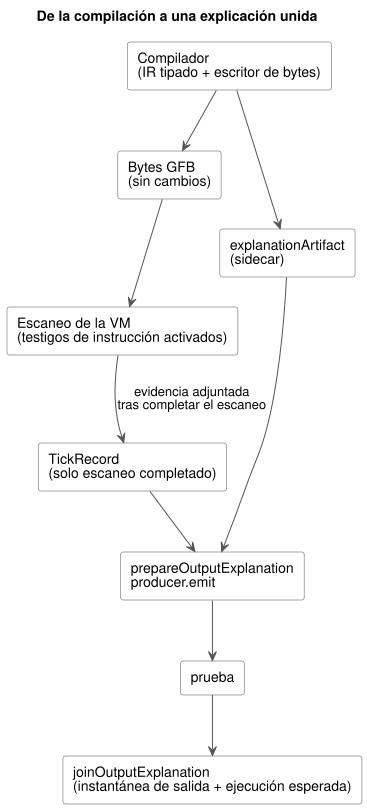
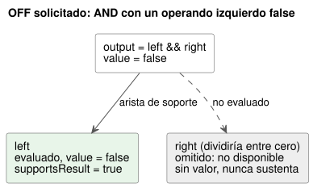

<!-- translation-source: docs/BOOLEAN-OUTPUT-EXPLANATION.md -->
[Original en inglés](BOOLEAN-OUTPUT-EXPLANATION.md)

# Explicación de salidas booleanas solicitadas

Este documento es el corte de aceptación acotado de
[issue283](https://github.com/callin2/ghostflow-language/issues/283), que forma
parte de [issue88](https://github.com/callin2/ghostflow-language/issues/88).
Implementa el contrato de soporte por rutas evaluadas de la Referencia 5.3.

Una *explicación* responde a una sola pregunta: ¿qué partes del programa,
efectivamente evaluadas, sustentan el valor de una salida booleana solicitada en
un escaneo completado? Explica únicamente el resultado **solicitado** (requested).
No afirma que la salida segura (safe), aplicada (applied) o confirmada
físicamente (confirmed) tenga el mismo valor.

En este documento:

- [Artefacto del compilador y ejecución](#artefacto-del-compilador-y-ejecución): qué emite el compilador y cómo captura la VM la evidencia.
- [Proyección pública y uniones](#proyección-pública-y-uniones): la API de JavaScript, las reglas de soporte y las comprobaciones de identidad.
- [Controles compuestos y el propietario de los ajustes](#controles-compuestos-y-el-propietario-de-los-ajustes): explicaciones para programas compuestos detrás de `TemporarySettingsHost`.
- [Límites y alcance pendiente](#límites-y-alcance-pendiente): límites de tamaño, expresiones admitidas y trabajo abierto.

El diagrama siguiente muestra la ruta completa desde la compilación hasta una
explicación unida.



## Artefacto del compilador y ejecución

La compilación canónica emite un `explanationArtifact` (un *sidecar*, archivo
complementario) junto a los bytes GFB. Los bytes GFB no cambian. El sidecar
vincula:

- el SHA-256 de la fuente y el SHA-256 del bytecode;
- identificadores opacos de nodos semánticos;
- los nodos de fuente, los rangos (spans) y los enlaces de intención existentes;
- las salidas de finalización de las instrucciones.

Las salidas de finalización provienen del mismo IR tipado y del mismo escritor de
bytes que el compilador usa para el bytecode. Las salidas dentro de una rama se
reubican cuando la rama se incrusta. Un nodo AND/OR tiene salidas para sus rutas
reales. Los literales implícitos de cortocircuito no son hijos en la fuente. Un
nodo semántico compartido tiene un único descriptor, pero cada padre/salida que lo
usa obtiene una *ocurrencia de ejecución* distinta.

La captura de instrucciones (*testigos de instrucción*, instruction witnesses) es
opcional y está desactivada de forma predeterminada. Actívela antes de una nueva
ejecución:

| Host | Cómo activarla |
|---|---|
| Runtime de Rust | `Runtime::enable_instruction_witnesses()` antes de una nueva ejecución |
| Adaptador WASM con tramas | `enableInstructionWitnesses()` entre `load()` y `activate()` |
| Ejecutor de pruebas nativo | un argumento final `--instruction-witnesses` |

Después de ejecutar una instrucción, la VM registra su inicio real, su final
secuencial, el siguiente PC y el resultado en la pila. Llegar simplemente al final
de una expresión omitida no constituye evidencia. No hay ningún opcode de
expresión nuevo ni un segundo evaluador. La ejecución ordinaria mantiene la
captura desactivada.

La evidencia se adjunta al TickRecord solo después de que el escaneo se completa:

- Los pasos parciales se descartan cuando una evaluación falla.
- Un intento con tramas rechazado conserva el resultado anterior como historial,
  con `accepted=false`, y no puede producir una nueva prueba.
- La instalación borra la configuración de captura.
- La observación nunca ejecuta un tick, nunca lee el estado en vivo y nunca evalúa
  ramas omitidas.

## Proyección pública y uniones

```js
import { prepareOutputExplanation, joinOutputExplanation } from '../tools/toolchain.mjs';
const producer = prepareOutputExplanation({ compilation, runId });
const proof = producer.emit({ runId, result: { accepted: true, outcome }, outputId: 'output.pump' });
const join = joinOutputExplanation(compilation.interactionSchema, proof, snapshot, producer.expected, producer.descriptor, { accepted: true, outcome });
```

**Preparación.** `prepareOutputExplanation` recompila la fuente canónica para
verificar cada correspondencia y cada límite. El productor es dueño de su artefacto
inmutable. Esta reproducción de la procedencia del programa también acepta una
fuente de perfil compacto ya admitida sin sus perfiles de hardware externos.
Reconstruye el sidecar y los metadatos de la fuente a partir de los bytes exactos.
No admite una instalación de hardware. La compilación pública sigue exigiendo los
perfiles fijados.

**Evaluaciones.** Cada entrada pública de `evaluations` identifica tanto el nodo
semántico como la ocurrencia de ejecución. Estos campos son independientes:

| Campo | Significado |
|---|---|
| `evaluated` | si esta ocurrencia se ejecutó realmente |
| `value` | el valor real, cuando se evaluó |
| `status` | el estado de la ocurrencia |
| `supportsResult` | si se encuentra en la ruta de soporte de la salida |

Una ocurrencia omitida no está disponible. No tiene valor real y nunca sustenta el
resultado, incluso cuando otra salida evaluó el mismo nodo semántico. Las `edges`
transportan el soporte relativo a cada padre.

**Reglas de soporte.**

- AND sustenta a sus hijos evaluados cuyo valor es igual al valor booleano del
  padre. OR hace lo mismo.
- NOT sustenta a su operando evaluado.
- Los predicados y las operaciones numéricas conservan sus operandos evaluados,
  incluido el cero.
- Los nodos condicionales conservan la condición evaluada y la rama seleccionada.
- El soporte de la ruta de salida sigue únicamente las aristas de soporte desde la
  raíz. Es una prueba estructural, no una afirmación de causalidad contrafáctica.

Un fallo en tiempo de ejecución rechaza el escaneo. Nunca se convierte en un
false booleano ni en una prueba de error completada. La captura desactivada y los
tipos de nodo no admitidos producen resultados explícitos de *no disponible*.
Estos son independientes del valor false real de la salida solicitada.

El ejemplo siguiente coincide con el fixture de aceptación canónico: la salida
solicitada está en OFF porque el operando izquierdo de AND es false, de modo que el
operando derecho (que dividiría entre cero) nunca se evalúa.



**Identidad y uniones.** La prueba reutiliza el esquema de Interaction, el módulo,
la fuente y la identidad de la ejecución, además del escaneo completado y los
campos de tiempo. Los consumidores unen esos campos con la instantánea de la salida
y con su ejecución esperada:

- Un escaneo cero de una ejecución antigua es obsoleto (stale).
- La unión exige una muestra de salida aceptada y reciente en la frontera del
  consumidor. La biblioteca del lenguaje comprueba toda la carga útil de la prueba
  contra los testigos de instrucción reales de esa muestra.
- Los productores aceptan solo una ejecución con tramas reciente
  (`trace.tick = scanId + 1`) y un resultado aceptado.
- El adaptador de host de confianza proporciona la época de la ejecución y el
  tiempo lógico del escaneo. Esto no autentica JSON arbitrario creado por el
  llamador ni permite reetiquetar resultados históricos.
- El llamador debe descartar el productor cuando su ejecución se reinicia.

## Controles compuestos y el propietario de los ajustes

`TemporarySettingsHost.instantiate(wasm, compilation, { runId, grants, context,
outputExplanations: true })` activa la captura antes de la activación con tramas.
De forma predeterminada, la captura permanece desactivada. La activación opcional
se rechaza antes de que empiece una ejecución si se cumple cualquiera de estas
condiciones:

- el host es un host heredado;
- falta el Interaction Schema;
- el ABI de testigos de WASM no se admite;
- el presupuesto de captura se desbordaría.

Los hosts que gestionan su propia proyección de pruebas pueden pasar en su lugar
`instructionWitnesses: true` a `ControlRuntime.instantiateFramed`.

**Qué devuelve el propietario de los ajustes.** Después de consolidar el escaneo y
el evento de ajustes, el propietario de los ajustes proyecta sus `outcome.vm` y
`outcome.frame` reales y aceptados. Cada `result.explanation` devuelto contiene
`proofs` y `error`. Pase ese mismo resultado a `joinOutputExplanation`; no es
necesario envolver un resultado retenido. `explanationSnapshot()` devuelve una
copia propia de la proyección más reciente. `explanationDescriptor` devuelve una
copia propia de su descriptor verificado del compilador. Estas consultas no
ejecutan ningún tick del runtime.

**Etiquetas de estado y registros de fuente.** Las expresiones de estado Bool
compuestas siguen las mismas reglas de rutas evaluadas. Las etiquetas de estado
usan rutas de instancia escritas por el autor, como `east.running` y
`west.running`. El compilador resuelve estas rutas mediante `instance` y
`definitionNodeId` del mapa de fuente, y luego mediante la declaración en el
cierre canónico. Nunca decodifica nombres de almacenamiento generados. El registro
de fuente del estado incluye:

- la instancia;
- el ID del nodo expandido y el ID del nodo de definición original;
- el nombre de archivo importado, la revisión y el SHA-256;
- el rango (span) de la declaración.

Las definiciones importadas idénticas siguen teniendo evidencia distinta por
instancia. Cuando no está disponible el rango importado exacto de una expresión
compuesta o de un literal, se conserva un rol de fuente explícito
`output-connection`. Ese rol apunta a la conexión de salida raíz y no afirma tener
un rango de expresión importado. Cada ocurrencia y evaluación compuesta conserva su
propio registro de fuente. Literales idénticos pueden compartir un nodo semántico
sin tomar prestada la procedencia de otra salida.

**Vinculación de revisiones y fallos.** Las pruebas llevan la composición exacta
de la instantánea y la `settingsRevision` consolidada. El productor verifica la
ejecución del host, la finalización, el resultado consolidado retenido y las
observaciones de la revisión de ajustes de Rust. Los consumidores rechazan un
cierre, una ejecución, un escaneo completado, una revisión de ajustes o una ruta
de instrucciones diferentes.

- Un escaneo intentado borra la explicación más reciente antes de la admisión.
- Un intento fallido no deja ninguna prueba nueva, incluso cuando el runtime
  conserva su resultado completado anterior.
- Si la proyección falla después de la consolidación, el resultado lleva
  `completed-scan-explanation-failed` con una lista de pruebas vacía, mientras que
  el resultado del control sigue aceptado. El evento de ajustes consolidado no se
  puede reintentar.
- El siguiente escaneo exitoso puede publicar una nueva explicación.

`tests/composed-explanation.test.mjs` ejercita el propietario de ajustes WASM real.
Cubre estados east/west con valores diferentes, omisión por cortocircuito,
ediciones de ajustes, identidades rechazadas, mutación por parte del llamador y
fallos posteriores a la consolidación.

## Límites y alcance pendiente

**Límites de tamaño.**

| Límite | Valor máximo |
|---|---|
| Nodos semánticos/de ocurrencia en el sidecar | como máximo 512 |
| Aristas en el sidecar | como máximo 1024 |
| Profundidad | como máximo 64 |
| Suma de las longitudes en bytes de la expresión de intención de cada estrategia (captura en tiempo de ejecución) | debe caber en 8192 |

Las salidas no admitidas o demasiado grandes informan explícitamente que no están
disponibles. El límite de 8192 bytes acota de forma conservadora el número de
instrucciones; si la activación de la captura no cabe, se rechaza antes de la
ejecución. La captura reserva como máximo esa cantidad de registros de instrucción
por escaneo, y la capacidad configurada existente del journal acota la retención.
Este modo de diagnóstico opcional no es un perfil de despliegue para MCU. El modo
desactivado no asigna registros de instrucción. Los hosts deben aprovisionar
memoria de journal para la captura activada.

**Expresiones admitidas:** literales Bool e instantáneas de estado, NOT, AND, OR,
predicados, aritmética y conversiones, y condicionales. Un estado candidato es un
escalar observado; la explicación no explica su transición.

**Alcance explícitamente no admitido:**

- los tipos de prueba de temporizador, programación horaria, seguridad,
  Result/recuperación y transición;
- en particular, las entradas públicas con calidad no reciben pruebas Result
  fabricadas;
- las expresiones compuestas de config y de temporizador que dependen de rieles
  generados siguen sin estar disponibles de forma explícita.

Issue88 sigue abierto para esas integraciones, una procedencia más rica y el
manejo completo del ciclo de vida del paquete público y del host.
[Issue290](https://github.com/callin2/ghostflow-language/issues/290) e
[issue302](https://github.com/callin2/ghostflow-language/issues/302) cubren la
identidad de instalación/vinculación y el perfil más amplio de expresiones
compuestas.

**Selector de aceptación.** El selector exacto de aceptación nativo/WASM está
registrado en el catálogo de funcionalidades:
`REF-05-023 native/WASM requested OFF explanation keeps the false left support and the skipped faulting right unevaluated`
en `tests/explanation-path.test.mjs`. El fixture canónico es
`tests/fixtures/explanation-short-circuit.ghost.md`. Su divisor cero es un estado,
no una constante, por lo que el compilador lo acepta y la VM real decide si se
evalúa.
