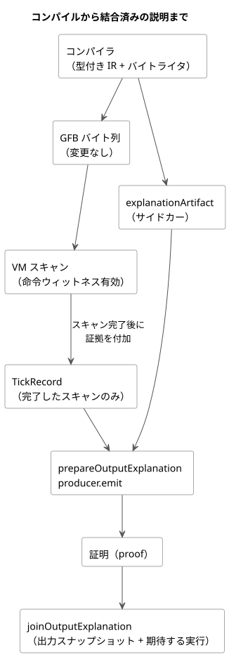
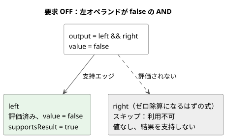

<!-- translation-source: docs/BOOLEAN-OUTPUT-EXPLANATION.md -->
[英語の原文](BOOLEAN-OUTPUT-EXPLANATION.md)

# Bool 要求出力の説明

この文書は、[issue88](https://github.com/callin2/ghostflow-language/issues/88)の一部である[issue283](https://github.com/callin2/ghostflow-language/issues/283)の、範囲を限定した受け入れスライスです。Reference 5.3の評価済みパス支持契約を実装します。

*説明*（explanation）は、1つの問いに答えます。完了した1回のスキャンにおいて、プログラムのうち実際に評価されたどの部分が、Bool要求出力の値を支持しているか、という問いです。説明が扱うのは**要求**（requested）結果だけです。安全（safe）、適用済み（applied）、または物理的に確認済み（confirmed）の出力が同じ値であるとは主張しません。

この文書の内容：

- [コンパイラ成果物と実行](#コンパイラ成果物と実行)：コンパイラが何を出力し、VMがどのように証拠を取得するか。
- [公開プロジェクションと結合](#公開プロジェクションと結合)：JavaScript API、支持規則、同一性チェック。
- [合成された制御と設定オーナー](#合成された制御と設定オーナー)：`TemporarySettingsHost`の背後にある合成プログラムの説明。
- [上限と残りのスコープ](#上限と残りのスコープ)：サイズ上限、サポートされる式、未完了の作業。

次の図は、コンパイルから結合済みの説明までの全体の経路を示します。



## コンパイラ成果物と実行

正準コンパイルは、GFBバイト列の横に`explanationArtifact`（*サイドカー*）を出力します。GFBバイト列は変わりません。サイドカーは次のものを結び付けます。

- ソースのSHA-256とバイトコードのSHA-256
- 不透明な意味ノードID
- 既存のソースノード、スパン、意図リンク
- 命令の完了出口

完了出口は、コンパイラがバイトコードに使うのと同じ型付きIRとバイトライタから得られます。分岐内の出口は、その分岐が埋め込まれるときに再配置されます。AND/ORノードは、実際のパスに対応する出口を持ちます。暗黙の短絡リテラルはソース上の子ではありません。共有される意味ノードはディスクリプタを1つだけ持ちますが、それを使う親/出力ごとに別々の*実行オカレンス*（execution occurrence）が割り当てられます。

命令の取得（*命令ウィットネス*、instruction witnesses）は任意で、既定では無効です。新しい実行（run）の前に有効化します。

| ホスト | 有効化の方法 |
|---|---|
| Rust ランタイム | 新しい実行の前に`Runtime::enable_instruction_witnesses()` |
| フレーム方式 WASM アダプタ | `load()`と`activate()`の間に`enableInstructionWitnesses()` |
| ネイティブテストランナー | 最後の引数に`--instruction-witnesses` |

命令を実行した後、VMはその実際の開始位置、逐次的な終了位置、次のPC、スタック結果を記録します。スキップされた式の終端に到達しただけでは証拠になりません。新しい式オペコードも、2つ目の評価器もありません。通常の実行では取得は無効のままです。

証拠は、スキャンが完了した後にのみTickRecordに付加されます。

- 評価が失敗した場合、途中のステップは破棄されます。
- 拒否されたフレーム方式の試行は、以前の結果を履歴として`accepted=false`で保持し、新しい証明を生成できません。
- インストールは取得設定をクリアします。
- 観測はtickを進めず、ライブ状態を読まず、スキップされた分岐を評価しません。

## 公開プロジェクションと結合

```js
import { prepareOutputExplanation, joinOutputExplanation } from '../tools/toolchain.mjs';
const producer = prepareOutputExplanation({ compilation, runId });
const proof = producer.emit({ runId, result: { accepted: true, outcome }, outputId: 'output.pump' });
const join = joinOutputExplanation(compilation.interactionSchema, proof, snapshot, producer.expected, producer.descriptor, { accepted: true, outcome });
```

**準備。** `prepareOutputExplanation`は正準ソースを再コンパイルして、すべてのマッピングと上限を検証します。プロデューサは自身の不変な成果物を所有します。このプログラム来歴のリプレイは、すでに受け入れ済みのコンパクトプロファイルのソースを、その外部ハードウェアプロファイルなしでも受け付けます。正確なバイト列からサイドカーとソースメタデータを再構築します。ハードウェアの設置を受け入れるものではありません。公開コンパイルでは、引き続き固定されたプロファイルが必要です。

**評価。** 公開される`evaluations`の各エントリは、意味ノードと実行オカレンスの両方を識別します。次のフィールドは互いに独立しています。

| フィールド | 意味 |
|---|---|
| `evaluated` | このオカレンスが実際に実行されたかどうか |
| `value` | 評価された場合の実際の値 |
| `status` | オカレンスの状態 |
| `supportsResult` | 出力の支持パス上にあるかどうか |

スキップされたオカレンスは利用不可です。実際の値を持たず、別の出力が同じ意味ノードを評価していても、結果を支持することは決してありません。`edges`は、各親に対する支持を表します。

**支持規則。**

- ANDは、評価済みの子のうち、値が親のBool値と等しいものを支持します。ORも同様です。
- NOTは、評価済みのオペランドを支持します。
- 述語と数値演算は、ゼロを含め、評価済みのオペランドを保持します。
- 条件ノードは、評価済みの条件と選択された分岐を保持します。
- 出力パスの支持は、ルートから支持エッジだけをたどります。これは構造的な証明であり、反実仮想的な因果関係の主張ではありません。

ランタイム故障はスキャンを拒否します。決してBoolのfalseや、完了したエラー証明にはなりません。取得が無効な場合や、サポートされていないノード種別の場合は、明示的な*利用不可*（unavailable）の結果になります。これらは、要求出力の実際のfalse値とは無関係です。

次の例は正準の受け入れフィクスチャに対応します。ANDの左オペランドがfalseなので要求出力はOFFとなり、右オペランド（評価すればゼロ除算になる）は一度も評価されません。



**同一性と結合。** 証明は、Interactionスキーマ、モジュール、ソース、実行の同一性に加え、完了したスキャンと時刻のフィールドを再利用します。コンシューマは、これらのフィールドを出力スナップショットおよび期待する実行と結合します。

- 古い実行のスキャン0は古い（stale）ものです。
- 結合には、コンシューマの境界で新しく受け入れられた出力サンプルが必要です。Languageライブラリは、証明ペイロード全体を、そのサンプルの実際の命令ウィットネスと照合します。
- プロデューサは、新しいフレーム方式の実行（`trace.tick = scanId + 1`）と、受け入れられた結果だけを受け付けます。
- 信頼されたホストアダプタが、実行エポックとスキャンの論理時刻を供給します。これは、呼び出し側が作った任意のJSONを認証するものではなく、過去の結果のラベル付け直しを許すものでもありません。
- 実行が再始動したときは、呼び出し側がプロデューサを破棄しなければなりません。

## 合成された制御と設定オーナー

`TemporarySettingsHost.instantiate(wasm, compilation, { runId, grants, context,
outputExplanations: true })`は、フレーム方式のアクティベーションの前に取得を有効にします。既定では取得は無効のままです。次のいずれかに当てはまる場合、このオプトインは実行開始前に拒否されます。

- ホストがレガシーホストである。
- Interaction Schemaがない。
- WASMのウィットネスABIがサポートされていない。
- 取得の予算があふれる。

独自に証明のプロジェクションを持つホストは、代わりに`ControlRuntime.instantiateFramed`に`instructionWitnesses: true`を渡すことができます。

**設定オーナーが返すもの。** スキャンと設定イベントを確定した後、設定オーナーは実際に受け入れられた`outcome.vm`と`outcome.frame`を投影します。返される各`result.explanation`には`proofs`と`error`が含まれます。その同じresultを`joinOutputExplanation`に渡してください。保持された結果をラップする必要はありません。`explanationSnapshot()`は最新のプロジェクションの所有コピーを返します。`explanationDescriptor`は、検証済みのコンパイラディスクリプタの所有コピーを返します。これらの問い合わせはランタイムのtickを進めません。

**状態ラベルとソースレコード。** 合成されたBool状態の式も、同じ評価済みパスの規則に従います。状態ラベルには、`east.running`や`west.running`のような、作者が記述したインスタンスパスを使います。コンパイラはこれらのパスを、ソースマップの`instance`と`definitionNodeId`を通じて解決し、さらに正準クロージャ内の宣言を通じて解決します。生成されたストレージ名を解読することは決してありません。状態のソースレコードには次のものが含まれます。

- インスタンス
- 展開後のノードIDと元の定義ノードID
- インポートされたファイル名、リビジョン、SHA-256
- 宣言のスパン

同一のインポート済み定義でも、インスタンスごとの証拠は区別されます。複合式やリテラルの正確なインポート元スパンが得られない場合は、明示的な`output-connection`ソースロールを保持します。このロールはルートの出力接続を指し、インポートされた式のスパンを主張しません。合成された各オカレンスと各評価は、それぞれ独自のソースレコードを保持します。同一のリテラルは、別の出力の来歴を借りることなく、意味ノードを共有できます。

**リビジョンの結び付けと失敗。** 証明は、スナップショットの正確な合成と、確定された`settingsRevision`を保持します。プロデューサは、ホストの実行、完了、保持された確定済みの結果、そしてRustの設定リビジョンの観測を検証します。コンシューマは、異なるクロージャ、実行、完了スキャン、設定リビジョン、命令パスを拒否します。

- 試行されたスキャンは、受け入れの前に最新の説明をクリアします。
- 失敗した試行は、ランタイムが以前の完了結果を保持していても、新しい証明を残しません。
- 確定後にプロジェクションが失敗した場合、結果は空の証明リストとともに`completed-scan-explanation-failed`を持ちますが、制御の結果は受け入れられたままです。確定済みの設定イベントは再試行できません。
- 次に成功したスキャンで、新しい説明を公開できます。

`tests/composed-explanation.test.mjs`は、実際のWASM設定オーナーを動かします。値の異なるeast/westの状態、短絡による省略、設定の編集、拒否される同一性、呼び出し側による変更、確定後の失敗を扱います。

## 上限と残りのスコープ

**サイズの上限。**

| 上限 | 制限 |
|---|---|
| サイドカー内の意味/オカレンスノード | 最大 512 |
| サイドカー内のエッジ | 最大 1024 |
| 深さ | 最大 64 |
| 各戦略の意図式のバイト長の合計（ランタイム取得） | 8192 に収まらなければならない |

サポートされていない出力や大きすぎる出力は、明示的に利用不可を報告します。8192バイトの制限は、命令数を保守的に抑えるものです。取得を有効にしても収まらない場合は、実行前に拒否されます。取得はスキャンあたり最大でその数の命令レコードを予約し、保持量は既存の設定済みジャーナル容量で制限されます。この任意の診断モードはMCU配備プロファイルではありません。無効モードでは命令レコードを一切割り当てません。ホストは、取得を有効にする場合のジャーナルメモリを用意しなければなりません。

**サポートされる式：** Boolリテラルと状態スナップショット、NOT、AND、OR、述語、算術と変換、条件式。候補状態は観測されたスカラーとして扱われ、説明はその遷移を説明しません。

**明示的にサポート外のスコープ：**

- タイマー、スケジュール、安全、Result/復旧、遷移の証明種別
- 特に、品質を持つ公開入力に対して、Result証明を捏造することはありません。
- 生成されたレールに依存する合成のconfig式とタイマー式は、引き続き明示的に利用不可です。

これらの統合、より豊かな来歴、公開パッケージ/ホストのライフサイクルの完全な扱いについて、Issue88は引き続きオープンです。[Issue290](https://github.com/callin2/ghostflow-language/issues/290)と[issue302](https://github.com/callin2/ghostflow-language/issues/302)は、設置/バインディングの同一性と、より広い合成式プロファイルを扱います。

**受け入れセレクタ。** ネイティブ/WASMの正確な受け入れセレクタは、機能カタログに登録されています。`tests/explanation-path.test.mjs`内の
`REF-05-023 native/WASM requested OFF explanation keeps the false left support and the skipped faulting right unevaluated`
です。正準フィクスチャは`tests/fixtures/explanation-short-circuit.ghost.md`です。そのゼロ除数は定数ではなく状態なので、コンパイラはこれを受け入れ、評価されるかどうかは実際のVMが決めます。
