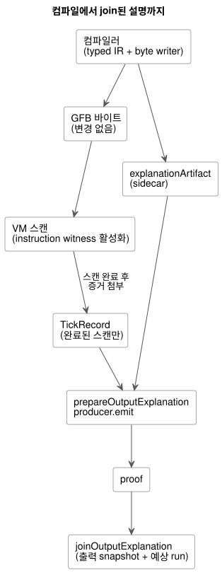
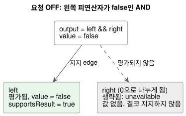

<!-- translation-source: docs/BOOLEAN-OUTPUT-EXPLANATION.md -->
[영문 원문](BOOLEAN-OUTPUT-EXPLANATION.md)

# Boolean 요청 출력 설명

이 문서는 [issue88](https://github.com/callin2/ghostflow-language/issues/88)의 일부인
[issue283](https://github.com/callin2/ghostflow-language/issues/283)의 제한된 인수(acceptance)
범위입니다. Reference 5.3의 실제 평가 경로 지원 계약을 구현합니다.

*설명(explanation)*은 한 가지 질문에 답합니다. 완료된 한 번의 스캔에서 요청된 Boolean 출력의
값을 프로그램의 어떤 부분이, 실제로 평가되어 뒷받침하는가? 설명은 **요청(requested)** 결과만
다룹니다. 안전 의도(safe), 적용됨(applied), 물리적으로 확인됨(confirmed) 출력이 같은 값을
가진다고 주장하지 않습니다.

이 문서의 내용:

- [컴파일러 artifact와 실행](#컴파일러-artifact와-실행): 컴파일러가 생성하는 것과 VM이 증거를 수집하는 방식.
- [공개 projection과 join](#공개-projection과-join): JavaScript API, 지지(support) 규칙, identity 검사.
- [합성 제어와 settings owner](#합성-제어와-settings-owner): `TemporarySettingsHost` 뒤에 있는 합성 프로그램의 설명.
- [크기 제한과 남은 범위](#크기-제한과-남은-범위): 크기 제한, 지원하는 식, 남은 작업.

아래 다이어그램은 컴파일부터 join된 설명까지의 전체 경로를 보여 줍니다.



## 컴파일러 artifact와 실행

정본 컴파일은 GFB 바이트 옆에 `explanationArtifact`(*sidecar*)를 생성합니다. GFB 바이트는
바뀌지 않습니다. sidecar는 다음을 서로 연결합니다.

- 소스 SHA-256과 바이트코드 SHA-256
- 불투명한 semantic node ID
- 기존 source node, span, 의도 링크(intent link)
- instruction 완료 지점(completion exit)

완료 지점은 컴파일러가 바이트코드에 사용하는 것과 같은 typed IR과 byte writer에서 나옵니다.
branch 내부의 지점은 branch가 삽입될 때 위치가 보정됩니다. AND/OR node는 실제 각 경로에 대한
완료 지점을 가집니다. short-circuit용 암묵 리터럴은 source child가 아닙니다. 공유되는 semantic
node는 descriptor를 하나만 가지지만, 그것을 사용하는 parent/output마다 서로 다른 *실행
occurrence*를 얻습니다.

instruction 수집(*instruction witness*)은 선택 사항이며 기본적으로 꺼져 있습니다. 새 run을
시작하기 전에 활성화합니다.

| 호스트 | 활성화 방법 |
|---|---|
| Rust 런타임 | 새 run 전에 `Runtime::enable_instruction_witnesses()` |
| Framed WASM adapter | `load()`와 `activate()` 사이에서 `enableInstructionWitnesses()` |
| Native 테스트 runner | 마지막 인수로 `--instruction-witnesses` |

VM은 instruction을 실행한 뒤 실제 시작 위치, 순차 끝 위치, 다음 PC, stack 결과를 기록합니다.
생략된 식의 끝에 도착한 것만으로는 증거가 되지 않습니다. 새로운 식 opcode나 두 번째 평가기는
없습니다. 일반 실행에서는 수집이 꺼진 상태로 유지됩니다.

증거는 스캔이 완료된 뒤에만 TickRecord에 붙습니다.

- 평가가 실패하면 부분 기록은 폐기됩니다.
- 거부된 framed 시도는 이전 outcome을 이력(history)으로 유지하되 `accepted=false`이며, 새
  proof를 만들 수 없습니다.
- install은 수집 설정을 초기화합니다.
- 관찰은 절대 tick하지 않고, live state를 읽지 않으며, 생략된 branch를 평가하지 않습니다.

## 공개 projection과 join

```js
import { prepareOutputExplanation, joinOutputExplanation } from '../tools/toolchain.mjs';
const producer = prepareOutputExplanation({ compilation, runId });
const proof = producer.emit({ runId, result: { accepted: true, outcome }, outputId: 'output.pump' });
const join = joinOutputExplanation(compilation.interactionSchema, proof, snapshot, producer.expected, producer.descriptor, { accepted: true, outcome });
```

**준비.** `prepareOutputExplanation`은 정본 소스를 재컴파일하여 모든 mapping과 bound를
검증합니다. producer는 자신의 불변 artifact를 소유합니다. 이 프로그램 provenance(출처) 재생은
이미 승인된 compact-profile 소스를 외부 하드웨어 프로필 없이도 받아들입니다. 정확한 바이트에서
sidecar와 소스 메타데이터를 재구성합니다. 하드웨어 설치를 승인하지는 않습니다. 공개 컴파일은
여전히 고정된(pinned) 프로필을 요구합니다.

**평가(evaluations).** 공개 `evaluations`의 각 항목은 semantic node와 실행 occurrence를 함께
식별합니다. 다음 필드는 서로 독립적입니다.

| 필드 | 의미 |
|---|---|
| `evaluated` | 이 occurrence가 실제로 실행되었는지 |
| `value` | 평가되었을 때의 실제 값 |
| `status` | occurrence 상태 |
| `supportsResult` | 출력의 지지 경로에 있는지 |

생략된 occurrence는 unavailable입니다. 실제 값이 없고, 다른 출력이 같은 semantic node를
평가했더라도 결코 결과를 지지하지 않습니다. `edges`는 각 parent에 대한 지지 관계를 담습니다.

**지지 규칙.**

- AND는 평가된 child 중 값이 parent의 Boolean 값과 같은 것을 지지합니다. OR도 마찬가지입니다.
- NOT은 평가된 피연산자를 지지합니다.
- predicate와 수치 연산은 0을 포함하여 평가된 피연산자를 유지합니다.
- 조건부 node는 평가된 조건과 선택된 arm을 유지합니다.
- 출력 경로 지지는 root에서 지지 edge만 따라갑니다. 이는 구조적 proof이며, 반사실적 인과
  주장이 아닙니다.

런타임 fault는 스캔을 거부합니다. 결코 Boolean false나 완료된 error proof가 되지 않습니다.
수집 비활성화와 미지원 node 종류는 명시적인 *unavailable* 결과를 줍니다. 이는 요청 출력의 실제
false 값과 무관합니다.

아래 예는 정본 인수 fixture와 같습니다. AND의 왼쪽 피연산자가 false이므로 요청 출력은 OFF이고,
(0으로 나누게 될) 오른쪽 피연산자는 결코 평가되지 않습니다.



**identity와 join.** proof는 Interaction schema, module, source, run identity와 함께 완료된
스캔 및 시간 필드를 재사용합니다. 소비자는 이 필드를 출력 snapshot과 예상 run에 join합니다.

- 이전 run의 scan zero는 stale입니다.
- join은 소비자 경계에서 새로운 accepted 출력 샘플을 요구합니다. Language 라이브러리는 전체
  proof payload를 그 샘플의 실제 instruction witness와 대조합니다.
- producer는 새 framed run(`trace.tick = scanId + 1`)과 accepted outcome만 받아들입니다.
- 신뢰된 호스트 adapter가 run epoch와 스캔 논리 시간을 제공합니다. 이는 호출자가 임의로 만든
  JSON을 인증하지 않으며, 과거 outcome의 라벨을 바꾸는 것도 허용하지 않습니다.
- 호출자는 run이 재시작되면 producer를 폐기해야 합니다.

## 합성 제어와 settings owner

`TemporarySettingsHost.instantiate(wasm, compilation, { runId, grants, context,
outputExplanations: true })`는 framed 활성화 전에 수집을 켭니다. 기본적으로 수집은 꺼져
있습니다. 다음 중 하나라도 해당하면 run이 시작되기 전에 opt-in이 거부됩니다.

- 호스트가 legacy 호스트인 경우
- Interaction Schema가 없는 경우
- WASM witness ABI를 지원하지 않는 경우
- 수집 예산(budget)이 넘치는 경우

proof projection을 직접 소유하는 호스트는 대신 `ControlRuntime.instantiateFramed`에
`instructionWitnesses: true`를 전달할 수 있습니다.

**settings owner가 반환하는 것.** settings owner는 스캔과 설정 이벤트를 확정(commit)한 뒤,
실제 accepted `outcome.vm`과 `outcome.frame`을 projection합니다. 반환되는 각
`result.explanation`에는 `proofs`와 `error`가 있습니다. 같은 result를 그대로
`joinOutputExplanation`에 전달합니다. 보존된 outcome을 따로 감쌀 필요가 없습니다.
`explanationSnapshot()`은 최신 projection의 소유 복사본을 반환합니다. `explanationDescriptor`는
검증된 컴파일러 descriptor의 소유 복사본을 반환합니다. 이 조회는 런타임을 tick하지 않습니다.

**상태 라벨과 소스 레코드.** 합성된 Bool 상태 식도 같은 실제 평가 경로 규칙을 따릅니다. 상태
라벨은 `east.running`, `west.running`처럼 작성된 인스턴스 경로를 사용합니다. 컴파일러는 이
경로를 source map의 `instance`와 `definitionNodeId`를 거쳐, 정본 closure 안의 선언으로
해석합니다. 생성된 저장소 이름을 해독하는 일은 결코 없습니다. 상태 소스 레코드에는 다음이
포함됩니다.

- 인스턴스
- 확장된 node ID와 원래 definition node ID
- 가져온(import) 파일 이름, revision, SHA-256
- 선언 span

같은 import 정의라도 인스턴스별 증거는 서로 구별됩니다. compound 식이나 리터럴의 정확한 import
span을 알 수 없으면, 명시적인 `output-connection` source role을 유지합니다. 이 role은 root 출력
연결을 가리키며, import된 식의 span을 주장하지 않습니다. 각 합성 occurrence와 evaluation은
자신의 소스 레코드를 유지합니다. 같은 리터럴이 semantic node를 공유하더라도 다른 출력의
provenance를 빌려 오지 않습니다.

**revision 바인딩과 실패.** proof는 snapshot의 정확한 composition과 확정된
`settingsRevision`을 가집니다. producer는 호스트의 run, 완료 정보, 보존된 확정 outcome, Rust
settings revision 관측을 검증합니다. 소비자는 다른 closure, run, 완료 스캔, settings revision,
instruction 경로를 거부합니다.

- 스캔을 시도하면 admission(수용) 전에 최신 설명을 비웁니다.
- 실패한 시도는 런타임이 이전 완료 outcome을 보존하더라도 새 proof를 남기지 않습니다.
- 확정 후 projection이 실패하면 결과는 빈 proof 목록과 함께
  `completed-scan-explanation-failed`를 담고, 제어 결과는 accepted로 유지됩니다. 확정된 설정
  이벤트는 재시도할 수 없습니다.
- 다음에 성공한 스캔은 새 설명을 공개할 수 있습니다.

`tests/composed-explanation.test.mjs`는 실제 WASM settings owner를 실행합니다. 서로 다른 값을
가진 east/west 상태, short-circuit 생략, 설정 변경, identity 거부, 호출자 mutation, 확정 후
실패를 다룹니다.

## 크기 제한과 남은 범위

**크기 제한.**

| 제한 항목 | 한도 |
|---|---|
| sidecar의 semantic/occurrence node | 최대 512개 |
| sidecar의 edge | 최대 1024개 |
| 깊이 | 최대 64 |
| strategy별 intent 식 바이트 길이의 합(런타임 수집) | 8192 이내여야 함 |

미지원이거나 크기를 초과한 출력은 명시적으로 unavailable을 보고합니다. 8192바이트 한도는
instruction 수를 보수적으로 제한합니다. 수집을 활성화했을 때 이 한도에 맞지 않으면 실행 전에
거부됩니다. 수집은 스캔마다 최대 그만큼의 instruction 레코드를 예약하며, 기존에 설정된 journal
용량이 보존 상한을 정합니다. 이 선택적 진단 모드는 MCU 배포 프로필이 아닙니다. 비활성화 모드는
instruction 레코드를 할당하지 않습니다. 호스트는 수집을 활성화할 때 journal 메모리를 확보해야
합니다.

**지원하는 식:** Bool 리터럴과 상태 snapshot, NOT, AND, OR, predicate, 산술과 변환, 조건식.
후보 상태는 관측된 스칼라 값이며, 설명은 그 전이를 설명하지 않습니다.

**명시적으로 지원하지 않는 범위:**

- timer, schedule, safety, Result/recovery, transition proof 종류
- 특히 품질 정보를 가진 공개 입력에 대해 Result proof를 꾸며내지 않습니다.
- 생성된 rail에 의존하는 합성 config 식과 timer 식은 계속 명시적으로 unavailable입니다.

이러한 통합, 더 풍부한 provenance, 전체 공개 package/호스트 수명 주기 처리를 위해 Issue88은
열린 상태로 남아 있습니다.
[Issue290](https://github.com/callin2/ghostflow-language/issues/290)과
[issue302](https://github.com/callin2/ghostflow-language/issues/302)는 설치/바인딩 identity와
더 넓은 합성 식 프로필을 다룹니다.

**인수 selector.** 정확한 native/WASM 인수 selector는 feature catalog에 등록되어 있습니다.
`tests/explanation-path.test.mjs`의
`REF-05-023 native/WASM requested OFF explanation keeps the false left support and the skipped faulting right unevaluated`
입니다. 정본 fixture는 `tests/fixtures/explanation-short-circuit.ghost.md`입니다. 이 fixture의
0인 제수는 상수가 아니라 state이므로, 컴파일러는 이를 허용하고 실제 VM이 평가 여부를 결정합니다.
