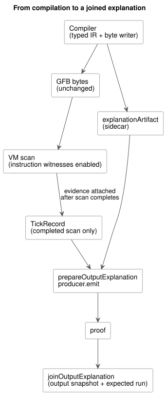
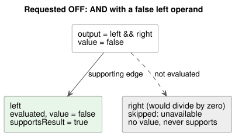

# Boolean requested-output explanation

This document is the bounded acceptance slice of
[issue283](https://github.com/callin2/ghostflow-language/issues/283), which is
part of [issue88](https://github.com/callin2/ghostflow-language/issues/88). It
implements the evaluated-path support contract of Reference 5.3.

An *explanation* answers one question: which actually evaluated parts of the
program support a requested Boolean output's value in one completed scan? It
explains the **requested** result only. It does not claim that the safe, applied
or physically confirmed output has the same value.

In this document:

- [Compiler artifact and execution](#compiler-artifact-and-execution): what the compiler emits and how the VM captures evidence.
- [Public projection and joins](#public-projection-and-joins): the JavaScript API, support rules and identity checks.
- [Composed controls and the settings owner](#composed-controls-and-the-settings-owner): explanations for composed programs behind `TemporarySettingsHost`.
- [Bounds and remaining scope](#bounds-and-remaining-scope): size limits, supported expressions and open work.

The diagram below shows the overall path from compilation to a joined
explanation.



## Compiler artifact and execution

Canonical compilation emits an `explanationArtifact` (a *sidecar*) beside the
GFB bytes. The GFB bytes do not change. The sidecar binds:

- the source SHA-256 and the bytecode SHA-256;
- opaque semantic node IDs;
- existing source nodes, spans and intent links;
- instruction completion exits.

The completion exits come from the same typed IR and byte writer that the
compiler uses for the bytecode. Exits inside a branch are relocated when the
branch is embedded. An AND/OR node has exits for its actual paths. Implicit
short-circuit literals are not source children. A shared semantic node has one
descriptor, but each parent/output that uses it gets a distinct *execution
occurrence*.

Instruction capture (*instruction witnesses*) is optional and off by default.
Enable it before a new run:

| Host | How to enable |
|---|---|
| Rust runtime | `Runtime::enable_instruction_witnesses()` before a new run |
| Framed WASM adapter | `enableInstructionWitnesses()` between `load()` and `activate()` |
| Native test runner | a final `--instruction-witnesses` argument |

After executing an instruction, the VM records its actual start, sequential end,
next PC and stack result. Merely landing at the end of a skipped expression is
not evidence. There is no new expression opcode and no second evaluator.
Ordinary execution keeps capture disabled.

Evidence is attached to the TickRecord only after the scan completes:

- Partial steps are discarded when an evaluation fails.
- A rejected framed attempt keeps the previous outcome as history, with
  `accepted=false`, and cannot produce a new proof.
- Install clears the capture configuration.
- Observation never ticks, never reads live state and never evaluates skipped
  branches.

## Public projection and joins

```js
import { prepareOutputExplanation, joinOutputExplanation } from '../tools/toolchain.mjs';
const producer = prepareOutputExplanation({ compilation, runId });
const proof = producer.emit({ runId, result: { accepted: true, outcome }, outputId: 'output.pump' });
const join = joinOutputExplanation(compilation.interactionSchema, proof, snapshot, producer.expected, producer.descriptor, { accepted: true, outcome });
```

**Preparation.** `prepareOutputExplanation` recompiles the canonical source to
verify every mapping and bound. The producer owns its immutable artifact. This
program-provenance replay also accepts an already admitted compact-profile source
without its external hardware profiles. It reconstructs the sidecar and source
metadata from the exact bytes. It does not admit a hardware installation. Public
compilation still requires the pinned profiles.

**Evaluations.** Each public `evaluations` entry identifies both the semantic node
and the execution occurrence. These fields are independent:

| Field | Meaning |
|---|---|
| `evaluated` | whether this occurrence actually ran |
| `value` | the actual value, when evaluated |
| `status` | the occurrence status |
| `supportsResult` | whether it lies on the output's support path |

A skipped occurrence is unavailable. It has no actual value and never supports
the result, even when another output evaluated the same semantic node. `edges`
carry support relative to each parent.

**Support rules.**

- AND supports its evaluated children whose value equals the parent's Boolean
  value. OR does the same.
- NOT supports its evaluated operand.
- Predicates and numeric operations retain their evaluated operands, including
  zero.
- Conditional nodes retain the evaluated condition and the selected arm.
- Output-path support follows only supporting edges from the root. This is a
  structural proof, not a counterfactual causality claim.

A runtime fault rejects the scan. It never becomes Boolean false or a completed
error proof. Disabled capture and unsupported node kinds give explicit
*unavailable* results. These are independent of the requested output's actual
false value.

The example below matches the canonical acceptance fixture: the requested output
is OFF because the left operand of AND is false, so the right operand (which
would divide by zero) is never evaluated.



**Identity and joins.** The proof reuses the Interaction schema, module, source
and run identity, plus the completed scan and time fields. Consumers join those
fields against the output snapshot and their expected run:

- A scan zero from an old run is stale.
- The join requires a fresh accepted output sample at the consumer boundary. The
  Language library checks the entire proof payload against that sample's actual
  instruction witnesses.
- Producers accept only a fresh framed run (`trace.tick = scanId + 1`) and an
  accepted outcome.
- The trusted host adapter supplies the run epoch and scan logical time. This
  does not authenticate arbitrary caller-created JSON and does not permit
  relabeling historical outcomes.
- The caller must discard the producer when its run restarts.

## Composed controls and the settings owner

`TemporarySettingsHost.instantiate(wasm, compilation, { runId, grants, context,
outputExplanations: true })` enables capture before framed activation. By default,
capture stays disabled. The opt-in is rejected before a run starts when any of
these holds:

- the host is a legacy host;
- the Interaction Schema is missing;
- the WASM witness ABI is unsupported;
- the capture budget would overflow.

Hosts that own their own proof projection can instead pass
`instructionWitnesses: true` to `ControlRuntime.instantiateFramed`.

**What the settings owner returns.** After committing the scan and the settings
event, the settings owner projects its actual accepted `outcome.vm` and
`outcome.frame`. Each returned `result.explanation` contains `proofs` and
`error`. Pass that same result to `joinOutputExplanation`; you do not need to wrap
a retained outcome. `explanationSnapshot()` returns an owned copy of the latest
projection. `explanationDescriptor` returns an owned copy of its verified compiler
descriptor. These queries do not tick the runtime.

**State labels and source records.** Composed Bool state expressions follow the
same evaluated-path rules. State labels use authored instance paths such as
`east.running` and `west.running`. The compiler resolves these paths through the
source map's `instance` and `definitionNodeId`, then through the declaration in
the canonical closure. It never decodes generated storage names. The state source
record includes:

- the instance;
- the expanded node ID and the original definition node ID;
- the imported filename, revision and SHA-256;
- the declaration span.

Identical imported definitions still have distinct per-instance evidence. When
the exact imported span of a compound expression or literal is unavailable, it
keeps an explicit `output-connection` source role. That role points to the root
output connection and does not claim an imported expression span. Each composed
occurrence and evaluation keeps its own source record. Identical literals can
share a semantic node without borrowing another output's provenance.

**Revision binding and failures.** Proofs carry the snapshot's exact composition
and the committed `settingsRevision`. The producer verifies the host's run,
completion, retained committed outcome and Rust settings-revision observations.
Consumers reject a different closure, run, completed scan, settings revision or
instruction path.

- An attempted scan clears the latest explanation before admission.
- A failed attempt leaves no new proof, even when the runtime retains its prior
  completed outcome.
- If projection fails after commit, the result carries
  `completed-scan-explanation-failed` with an empty proof list, while the control
  result stays accepted. The committed settings event cannot be retried.
- The next successful scan can publish a new explanation.

`tests/composed-explanation.test.mjs` exercises the actual WASM settings owner. It
covers east/west states with different values, short-circuit omission, settings
edits, rejected identities, caller mutation and post-commit failure.

## Bounds and remaining scope

**Size bounds.**

| Bound | Limit |
|---|---|
| Semantic/occurrence nodes in the sidecar | at most 512 |
| Edges in the sidecar | at most 1024 |
| Depth | at most 64 |
| Sum of each strategy's intent expression byte lengths (runtime capture) | must fit 8192 |

Unsupported or oversized outputs explicitly report unavailable. The 8192-byte
limit conservatively bounds the number of instructions; if enabling capture cannot
fit, it is rejected before execution. Capture reserves at most that many
instruction records per scan, and the existing configured journal capacity bounds
retention. This optional diagnostic mode is not an MCU deployment profile.
Disabled mode allocates no instruction records. Hosts must provision journal
memory for enabled capture.

**Supported expressions:** Bool literals and state snapshots, NOT, AND, OR,
predicates, arithmetic and conversions, and conditionals. A candidate state is an
observed scalar; the explanation does not explain its transition.

**Explicitly unsupported scope:**

- timer, schedule, safety, Result/recovery and transition proof kinds;
- in particular, quality-bearing public inputs do not get fabricated Result
  proofs;
- composed config and timer expressions that depend on generated rails remain
  explicitly unavailable.

Issue88 remains open for those integrations, richer provenance and full public
package/host lifecycle handling.
[Issue290](https://github.com/callin2/ghostflow-language/issues/290) and
[issue302](https://github.com/callin2/ghostflow-language/issues/302) cover
installation/binding identity and the broader composed expression profile.

**Acceptance selector.** The exact native/WASM acceptance selector is registered
in the feature catalog:
`REF-05-023 native/WASM requested OFF explanation keeps the false left support and the skipped faulting right unevaluated`
in `tests/explanation-path.test.mjs`. The canonical fixture is
`tests/fixtures/explanation-short-circuit.ghost.md`. Its zero divisor is state,
not a constant, so the compiler accepts it and the real VM decides whether it is
evaluated.
