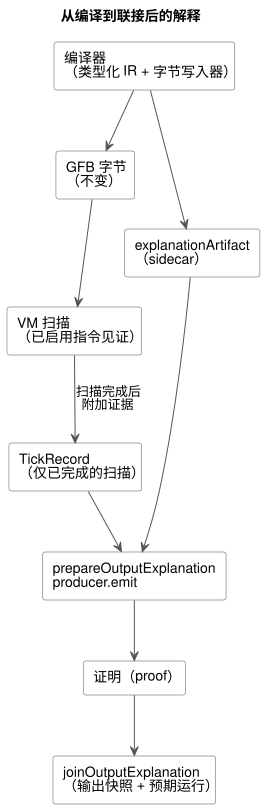
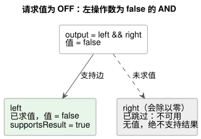

<!-- translation-source: docs/BOOLEAN-OUTPUT-EXPLANATION.md -->
[英文原文](BOOLEAN-OUTPUT-EXPLANATION.md)

# Bool 请求输出的解释

本文档是 [issue283](https://github.com/callin2/ghostflow-language/issues/283) 的有界验收切片，该 issue 属于 [issue88](https://github.com/callin2/ghostflow-language/issues/88)。它实现了 Reference 5.3 的“已求值路径支持”契约。

*解释*（explanation）只回答一个问题：在一次已完成的扫描中，程序里哪些实际被求值的部分支持某个 Bool 请求输出的值？它只解释**请求**（requested）结果，并不声称安全（safe）、已应用（applied）或经物理确认（confirmed）的输出具有相同的值。

本文档内容：

- [编译器产物与执行](#编译器产物与执行)：编译器输出什么，以及 VM 如何采集证据。
- [公开投影与联接](#公开投影与联接)：JavaScript API、支持规则和身份标识检查。
- [组合控制与设置所有者](#组合控制与设置所有者)：位于 `TemporarySettingsHost` 之后的组合程序如何获得解释。
- [边界与剩余范围](#边界与剩余范围)：大小限制、支持的表达式以及尚未完成的工作。

下图展示了从编译到联接后的解释的整体路径。



## 编译器产物与执行

规范编译会在 GFB 字节旁边输出一个 `explanationArtifact`（即 *sidecar*）。GFB 字节本身不变。sidecar 绑定以下内容：

- 源的 SHA-256 和字节码的 SHA-256；
- 不透明的语义节点 ID；
- 现有的源节点、范围（span）和意图链接；
- 指令完成出口。

完成出口来自编译器生成字节码时所用的同一个类型化 IR 和字节写入器。分支被嵌入时，分支内部的出口会被重定位。AND/OR 节点拥有对应其实际路径的出口。隐式短路字面量不是源的子节点。共享的语义节点只有一个描述符，但使用它的每个父节点/输出都会得到一个不同的*执行实例*（execution occurrence）。

指令采集（*指令见证*，instruction witnesses）是可选的，默认关闭。请在新的运行开始之前启用它：

| 宿主 | 启用方式 |
|---|---|
| Rust 运行时 | 在新的运行之前调用 `Runtime::enable_instruction_witnesses()` |
| 帧式 WASM 适配器 | 在 `load()` 与 `activate()` 之间调用 `enableInstructionWitnesses()` |
| 原生测试运行器 | 最后一个参数为 `--instruction-witnesses` |

执行一条指令后，VM 记录它的实际起点、顺序终点、下一个 PC 和栈结果。仅仅落到被跳过表达式的末尾并不构成证据。不存在新的表达式操作码，也不存在第二个求值器。普通执行保持采集关闭。

只有在扫描完成后，证据才会附加到 TickRecord：

- 求值失败时，部分步骤会被丢弃。
- 被拒绝的帧式尝试会以 `accepted=false` 将之前的结果保留为历史，且不能产生新的证明。
- 安装会清除采集配置。
- 观测从不执行 tick，从不读取实时状态，也从不对被跳过的分支求值。

## 公开投影与联接

```js
import { prepareOutputExplanation, joinOutputExplanation } from '../tools/toolchain.mjs';
const producer = prepareOutputExplanation({ compilation, runId });
const proof = producer.emit({ runId, result: { accepted: true, outcome }, outputId: 'output.pump' });
const join = joinOutputExplanation(compilation.interactionSchema, proof, snapshot, producer.expected, producer.descriptor, { accepted: true, outcome });
```

**准备。** `prepareOutputExplanation` 会重新编译规范源，以验证每个映射和边界。生产者（producer）拥有其不可变的产物。这种程序来源重放也接受已被准入的紧凑 profile 源，而不需要其外部硬件 profile。它从确切的字节重建 sidecar 和源元数据。它不会准入硬件安装。公开编译仍然需要固定的 profile。

**求值记录。** 每个公开的 `evaluations` 条目同时标识语义节点和执行实例。以下字段相互独立：

| 字段 | 含义 |
|---|---|
| `evaluated` | 该实例是否实际运行 |
| `value` | 已求值时的实际值 |
| `status` | 该实例的状态 |
| `supportsResult` | 它是否位于该输出的支持路径上 |

被跳过的实例是不可用的。它没有实际值，也绝不支持结果，即使另一个输出对同一语义节点求了值也是如此。`edges` 携带相对于每个父节点的支持关系。

**支持规则。**

- AND 支持其已求值、且值等于父节点 Bool 值的子节点。OR 同理。
- NOT 支持其已求值的操作数。
- 谓词和数值运算保留其已求值的操作数，包括零。
- 条件节点保留已求值的条件和被选中的分支。
- 输出路径的支持只沿着从根出发的支持边延伸。这是结构性证明，而不是反事实因果关系的断言。

运行时故障会拒绝本次扫描。它绝不会变成 Bool false，也不会变成一个已完成的错误证明。采集被禁用以及不支持的节点种类会给出明确的*不可用*结果。这些结果与请求输出实际为 false 的值无关。

下面的示例与规范验收夹具（fixture）一致：请求输出为 OFF，因为 AND 的左操作数为 false，所以右操作数（它会除以零）从未被求值。



**身份标识与联接。** 证明复用 Interaction schema、模块、源和运行的身份标识，以及已完成扫描和时间字段。消费者将这些字段与输出快照及其预期运行进行联接：

- 来自旧运行的扫描零是陈旧的。
- 联接要求在消费者边界处有一个新鲜的、已接受的输出样本。Language 库会根据该样本的实际指令见证检查整个证明载荷。
- 生产者只接受新鲜的帧式运行（`trace.tick = scanId + 1`）和已接受的结果。
- 受信任的宿主适配器提供运行纪元（run epoch）和扫描逻辑时间。这并不对任意调用方创建的 JSON 进行认证，也不允许重新标注历史结果。
- 运行重启时，调用方必须丢弃该生产者。

## 组合控制与设置所有者

`TemporarySettingsHost.instantiate(wasm, compilation, { runId, grants, context,
outputExplanations: true })` 会在帧式激活之前启用采集。默认情况下，采集保持禁用。在运行开始之前，只要满足以下任一条件，该选择启用就会被拒绝：

- 宿主是旧版宿主；
- 缺少 Interaction Schema；
- 不支持 WASM 见证 ABI；
- 采集预算会溢出。

自行负责证明投影的宿主可以改为向 `ControlRuntime.instantiateFramed` 传入 `instructionWitnesses: true`。

**设置所有者返回什么。** 在提交扫描和设置事件之后，设置所有者会投影其实际被接受的 `outcome.vm` 和 `outcome.frame`。每个返回的 `result.explanation` 包含 `proofs` 和 `error`。将同一个 result 传给 `joinOutputExplanation` 即可，无需包装保留的结果。`explanationSnapshot()` 返回最新投影的一份自有副本。`explanationDescriptor` 返回其已验证编译器描述符的一份自有副本。这些查询不会让运行时执行 tick。

**状态标签与源记录。** 组合的 Bool 状态表达式遵循相同的已求值路径规则。状态标签使用编写时的实例路径，例如 `east.running` 和 `west.running`。编译器先通过源映射的 `instance` 和 `definitionNodeId`，再通过规范闭包中的声明来解析这些路径。它从不解码生成的存储名称。状态源记录包括：

- 实例；
- 展开后的节点 ID 和原始定义节点 ID；
- 导入的文件名、修订版和 SHA-256；
- 声明范围。

相同的导入定义仍然拥有各自独立的逐实例证据。当复合表达式或字面量的确切导入范围不可用时，它会保留一个明确的 `output-connection` 源角色。该角色指向根输出连接，并不声称拥有导入表达式的范围。每个组合实例和求值都保留自己的源记录。相同的字面量可以共享一个语义节点，而不会借用另一个输出的来源。

**修订版绑定与失败。** 证明携带快照的确切组合以及已提交的 `settingsRevision`。生产者会验证宿主的运行、完成状态、保留的已提交结果以及 Rust 设置修订版观测。消费者会拒绝不同的闭包、运行、已完成扫描、设置修订版或指令路径。

- 一次扫描尝试会在准入之前清除最新的解释。
- 失败的尝试不会留下新的证明，即使运行时保留了之前已完成的结果。
- 如果在提交之后投影失败，result 会携带 `completed-scan-explanation-failed` 和一个空的证明列表，而控制结果仍保持已接受。已提交的设置事件不能重试。
- 下一次成功的扫描可以发布新的解释。

`tests/composed-explanation.test.mjs` 使用实际的 WASM 设置所有者进行测试。它覆盖了取值不同的 east/west 状态、短路省略、设置编辑、被拒绝的身份标识、调用方修改以及提交后失败。

## 边界与剩余范围

**大小边界。**

| 边界 | 限制 |
|---|---|
| sidecar 中的语义/实例节点 | 最多 512 |
| sidecar 中的边 | 最多 1024 |
| 深度 | 最多 64 |
| 每个策略的意图表达式字节长度之和（运行时采集） | 必须在 8192 以内 |

不支持或超出大小的输出会明确报告为不可用。8192 字节的限制保守地约束了指令数量；如果启用采集后无法容纳，它会在执行之前被拒绝。采集在每次扫描中最多预留这么多条指令记录，而现有已配置的 journal 容量约束了保留量。这种可选的诊断模式不是 MCU 部署 profile。禁用模式不分配任何指令记录。启用采集时，宿主必须为 journal 预留内存。

**支持的表达式：** Bool 字面量和状态快照、NOT、AND、OR、谓词、算术与转换，以及条件表达式。候选状态是一个被观测的标量；解释并不说明它的转换过程。

**明确不支持的范围：**

- 定时器、调度计划、安全、Result/恢复以及状态转换等证明种类；
- 特别是，带质量信息的公开输入不会得到伪造的 Result 证明；
- 依赖生成轨道（rail）的组合 config 和定时器表达式仍然明确不可用。

Issue88 仍为这些集成、更丰富的来源以及完整的公开包/宿主生命周期处理保持开放。[Issue290](https://github.com/callin2/ghostflow-language/issues/290) 和 [issue302](https://github.com/callin2/ghostflow-language/issues/302) 涵盖安装/绑定身份标识以及更广泛的组合表达式 profile。

**验收选择器。** 确切的原生/WASM 验收选择器已在功能目录中登记：位于 `tests/explanation-path.test.mjs` 中的
`REF-05-023 native/WASM requested OFF explanation keeps the false left support and the skipped faulting right unevaluated`。规范夹具是 `tests/fixtures/explanation-short-circuit.ghost.md`。其中的零除数是状态而不是常量，因此编译器会接受它，并由真实的 VM 决定它是否被求值。
