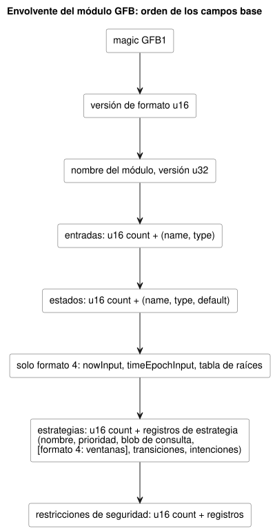
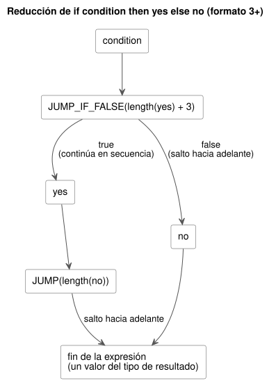

<!-- translation-source: docs/BYTECODE.md -->
[Original en inglés](BYTECODE.md)

# Bytecode GFB

GFB es el formato binario que emite el compilador de GhostFlow y que cargan los
runtimes nativo y WASM. Este documento especifica su envolvente, las versiones de
formato, los opcodes de expresión y de consulta, los registros de seguridad y los
registros de diagnóstico.

Reglas generales de codificación, salvo que una sección indique lo contrario:

- Todos los enteros son little-endian.
- Las cadenas son un `u16 length` seguido de bytes UTF-8.
- Los valores usan una pila postfija acotada; las expresiones condicionales usan
  solo saltos hacia adelante.
- La compilación pública acepta un documento `.ghost.md` canónico completo. La
  representación en expresiones S de `tools/gfb1.mjs` es IR interno del
  compilador, no una entrada pública.

En este documento:

- Extensiones de perfil, de la más reciente a la más antigua: [recursos Percent continuos GFB25](#envolvente-de-recursos-percent-continuos-gfb25),
  [encuadre provisional del ciclo de vida y fronteras de calendario GFB18](#encuadre-provisional-del-ciclo-de-vida),
  [políticas naturales acotadas GFB13](#políticas-naturales-acotadas-gfb13).
- Formato central: [envolvente del módulo y decisión de formato](#envolvente-del-módulo-y-decisión-de-formato),
  [opcodes de expresión](#opcodes-de-expresión),
  [registros de ventana temporal del formato 4](#registros-de-ventana-temporal-del-formato-4),
  [opcodes de consulta](#opcodes-de-consulta),
  [registros de seguridad y manifiesto del host](#registros-de-seguridad-y-manifiesto-del-host).
- Verificación y diagnóstico: [artefactos de conformidad](#artefactos-de-conformidad),
  [diagnósticos de consumo de Result](#diagnósticos-de-consumo-de-result),
  [frontera de etapas del compilador](#frontera-de-etapas-del-compilador).
- [Range UTC inmutable (formato 12)](#range-utc-inmutable-formato-12).

## Envolvente de recursos Percent continuos (GFB25)

GFB25 codifica el perfil de recursos continuos escalares de la Referencia §4.9.

- Envuelve una base GFB1/2/3/4 con exactamente una estrategia.
- No permite ningún perfil temporal, de programación horaria, de objetivo, de
  restricción Bool ni de ciclo de vida.
- Las transiciones ordinarias de la VM siguen usando el estado anterior.
- El *plan de recursos* evalúa bytecode de expresión dedicado contra las mismas
  entradas y el mismo estado anterior. Después es dueño de cada salida Number
  final.
- Las solicitudes y los techos nunca se exponen como salidas de actuador.

**Codificación.** Todos los enteros son little-endian. El texto es una longitud
UTF-8 `u16` seguida de bytes. Las identidades contienen de 1 a 128 bytes. Los
hashes son 64 caracteres hexadecimales en minúscula. Un blob es un `u32 length`
seguido de bytes. La envolvente contiene estos campos, en orden:

1. `GFB1`, formato `25:u16`, blob base.
2. SHA-256 de la fuente canónica, SHA-256 del descriptor comprobado, blob de
   activación.
3. Número de políticas `u16`, como máximo ocho.
4. Cada política: ID del nodo de fuente `u32`, nombre, alias del recurso, nombre de
   la salida, selección `u8` (`0=min`, `1=max`), Percent seguro escrito por el autor
   `f64`, lista de solicitudes y lista de techos.
5. Cada lista: `u16 count` y, después, por cada entrada un ID de nodo de fuente
   `u32`, un nombre y cuatro blobs de expresión:
   - etiqueta Bool de conocido;
   - valor Number Percent;
   - código Number de SensorFault: 0=Disconnected, 1=Stale, 2=Invalid, 3=NotReady;
   - etiqueta Number de origen.

   El propietario evalúa el valor solo cuando la entrada es conocida, y el motivo
   y el origen solo en caso de fallo. No se permite ninguna expresión de estado
   siguiente.

**Límites.**

| Elemento | Límite |
|---|---|
| Solicitudes por política | 1..16 |
| Techos por política | 0..16 |
| Entradas de solicitud + techo por módulo | como máximo 32 |
| Valores Percent finitos | dentro de 0..100 |
| Tamaño del módulo | como máximo 1 MiB |
| Tamaño de la activación | como máximo 64 KiB |

Los IDs de nodo de fuente son distintos de cero y únicos globalmente entre estas
políticas y entradas. Las identidades en tiempo de ejecución son
`sourceHash:nodeId`. Cada salida y cada recurso vinculado tiene exactamente una
política.

**Activación y vinculación del escaneo.**

- La *activación GFRB2* contiene `GFRB`, la versión `2:u16`, la revisión de la
  instalación, el ID de ejecución, el SHA-256 de la vinculación, el SHA-256 de la
  fuente, un número de recursos `u16` y los registros de recursos. Cada registro
  contiene un alias, un ID de recurso estable, un nombre de salida y la etiqueta
  de valor tipada `2:u8` para Percent.
- La *vinculación de escaneo GFRS2* contiene `GFRS`, la versión `2:u16`, el SHA-256
  de la vinculación, el ID de ejecución y el SHA-256 de la fuente.

La activación debe coincidir exactamente con el paquete compilado. Cada escaneo
debe coincidir con la identidad activada. El compilador deriva el resumen de la
vinculación a partir del JSON canónico de instalación. El JSON de instalación
aporta identidades y correspondencias, nunca expresiones ni reglas de política.

**Compatibilidad.** Las exportaciones existentes de puntero/longitud para la
activación de recursos y el escaneo aceptan estas nuevas versiones de paquete.
GFB17 y GFRB1/GFRS1 conservan su significado exclusivamente Bool. El
`ResourceBindingRegistry` compartido de Rust reserva IDs de recurso estables en
ambos perfiles. Los hosts que abarcan varias instancias o workers de WASM deben
compartir el registro del escritor de instalación; el adaptador vinculado de
referencia cubre solo su propio realm de JavaScript.

**Traza.** `continuousResourceTrace` contiene decisiones propiedad de Rust que se
consolidan con el tick:

- todas las entradas conocidas/con fallo;
- el valor seleccionado y los IDs empatados;
- el respaldo (fallback) escrito por el autor;
- el recorte por los techos conocidos;
- el valor final;
- las identidades de fuente, vinculación, ejecución y tick.

`conditionsKnown=false` se conserva a través del respaldo. Este registro es
evidencia de ejecución lógica. No afirma la aplicación física ni la confirmación.

**Verificación para desarrolladores.** Estos comandos específicos compilan el
propietario compartido sin asignar una identidad de versión oficial:

```sh
cargo build --locked --offline --release -p ghostflow-core --example resource_tape
cargo build --locked --offline --release -p ghostflow-wasm --target wasm32-unknown-unknown
node --test tests/continuous-resource-control.test.mjs
```

Los selectores de prueba son `GF-TEST-continuous-resource-compile`,
`GF-TEST-continuous-resource-parity`, `GF-TEST-continuous-resource-dynamic`,
`GF-TEST-continuous-resource-atomic`, `GF-TEST-continuous-resource-ceilings` y
`GF-TEST-continuous-resource-malformed`.
La verificación oficial y la identidad del paquete siguen siendo controles
separados.

## Encuadre provisional del ciclo de vida

**Candidato de ciclo de vida GFB22.** El candidato local GFB22 envuelve bytes GFB
internos sin cambios y el descriptor de reinicio comprobado; consulte
[Scan frame WASM](SCAN-FRAME-WASM.es.md) (sección de la extensión del ciclo de
vida de reinicio).

Los números de formato en esta área son fáciles de confundir:

| Formato | Significado |
|---|---|
| GFB19 | inicio de Range en vivo (significado actual) |
| GFB20 | Range de TimeSlots con clave |
| 21 | Range IANA inmutable |
| GFB22 | candidato local de envoltura de ciclo de vida |

El `ghostflow-runtime-99ca1a3` publicado usó GFB19 para una envoltura de ciclo de
vida. Eso colisiona con la asignación actual de Range, por lo que el cargador
combinado lo rechaza, sin traducción ni respaldo. Sus bytes históricos y los
pines de los consumidores permanecen fijos. Recompile la fuente revisada para
obtener un candidato de propietario distinto; el formato 22 separa esta envoltura
de ciclo de vida del formato 21 de Range IANA inmutable. El candidato no
publicado lifecycle21 se rechaza. Nada de esto publica una versión ni verifica la
ejecución física.

**Fronteras de calendario GFB18.** GFB18 añade el perfil adoptado de fronteras de
calendario `GhostFlow/control-v18`:

- La etiqueta de preludio 17 es un Range diario UTC inmutable filtrado por
  calendario.
- La etiqueta de preludio 18 es un Result de calendario tipado con entradas
  protegidas Bool/Bool/código de fallo.

Sus disposiciones exactas y los hechos GFSF5 sin cambios están en
[Context execution ABI](CONTEXT-EXECUTION-ABI.es.md) (sección de fronteras de
calendario GFB18). Range rechaza intervalos de trabajo que cruzan la medianoche.
Permite rangos separados explícitos, uno que termina a medianoche y otro que
empieza en la fecha siguiente. El Range ordinario existente y las disposiciones
binarias más antiguas conservan su semántica. Estas etiquetas requieren una
cabecera GFB18; los cargadores más antiguos la rechazan. Estos identificadores no
certifican una versión de Device ni la ejecución física.

## Políticas naturales acotadas (GFB13)

Solo las políticas Solar/Tide extendidas seleccionan GFB13 y
`GhostFlow/control-v12`. Los bytes de perfiles heredados permanecen sin cambios.

- **La etiqueta Solar 1** conserva su disposición y añade, después de la expresión
  `when`, `holdMs:u64` (0 significa ninguno) y `fallbackAtMs:u64` (86400000
  significa omitir).
- **Los registros de contexto** añaden `holdMs:u64` después de la expresión de
  cancelación.
- **Las políticas del manifiesto** son objetos: el reloj
  `{kind: 'hold_trusted', durationMs, terminal: 'skip'}` y el respaldo
  `{kind: 'fixed_time', atMs, terminal: 'skip'}`.

Los hechos Solar extendidos usan GFSF6. GFSF6 conserva la disposición de filas de
Solar v1 y añade, después de las cadenas de proveedor/contexto, un
`fallbackWallMs` opcional y `unavailableReason:u8` (255 significa ninguno; 0–5 son
códigos de motivo del contexto natural). Los paquetes v1 heredados y los nombres
de funciones WASM permanecen sin cambios. Los runtimes más antiguos fijados
rechazan GFB13 antes de la activación. El perfil GFB11 firmado de paquete portátil
solo de configuración sigue siendo restringido. Este formato no es evidencia
física de Device.

## Envolvente del módulo y decisión de formato

Un módulo tiene estos campos, en orden. El diagrama posterior a la lista muestra
el mismo orden.

- magic: `GFB1` (el magic de la envolvente no cambia entre formatos)
- versión de formato: `u16`
- nombre del módulo: cadena
- versión del módulo: `u32`
- entradas: `u16 count` y, después, registros `(name, type)`
- estados: `u16 count` y, después, registros `(name, type, default value)`
- estrategias: `u16 count` y, después, registros de estrategia
- restricciones de seguridad: `u16 count` y, después, registros de restricción
- cabecera temporal del formato 4: después de los estados, `nowInput`, `timeEpochInput` y la tabla de raíces
- tabla de estrategias temporales del formato 4: después de cada consulta, los descriptores de ventana preceden a las transiciones/intenciones



El compilador selecciona el formato según las funcionalidades que usa el
programa:

| Formato | Selección del compilador | Tipos de valor |
|---|---|---|
| 1 | Expresiones lineales sin Int | `1=Bool`, `2=Number` |
| 2 | Expresiones lineales con declaraciones u operaciones Int | También `3=Int` |
| 3 | Ramas, conversiones dinámicas Int/Number o guardas de valor nominal (de tiempo) | Bool, Number e Int |
| 4 | Módulos de ventana temporal con raíces físicas y entradas de reloj temporal | Tipos existentes del formato 3 más descriptores de ventana acotados |
| 5 | Preludio de programación horaria Solar | Tipos del formato 4 más descriptores de programación horaria etiquetados |
| 6 | Preludio continuo `true_for` | Tipos temporales más descriptores true-for |
| 7 | Objetivo PID | Bool, Number e Int más registro de objetivo |
| 8 | Preludio de programación horaria Daily | Tipos temporales más descriptores Daily |
| 9 | Preludio de programación horaria DailySlots | Tipos temporales más descriptores DailySlots |
| 11 | Flujos de configuración tipados y ejecución de contexto | Preludios de contexto y objetivo PID opcional; sustituye al perfil de contexto anterior del formato 10 |
| 12 | Range UTC inmutable | Disposición de contexto GFB11 más la etiqueta 13 de Range UTC |

Estos son perfiles de salida del compilador. No son una promesa de que cada host
admita todos los perfiles. Consulte los documentos de ABI específicos de cada
funcionalidad para las disposiciones de los registros y la activación. Los
números de perfil posteriores (13, 18, 22, 25 y otros) se describen en las
secciones anteriores y en esos documentos de ABI.

**La decisión de formato del 2026-09-22.**

- Introduce el formato 3 para la evaluación de la Referencia §2.6.
- Los formatos 1 y 2 siguen siendo los perfiles compactos actuales para programas
  lineales.
- Los opcodes de expresión ansiosa sustituidos `11`, `12` y `18` se rechazan en
  **todos** los perfiles. Recompile las fuentes que contengan esas operaciones;
  los cargadores nunca las traducen ni recurren a la ejecución ansiosa.
- Los números de formato no admitidos fallan antes de la activación.
- Los vectores de referencia (golden) lineales existentes conservan exactamente sus
  bytes y hashes.

El formato 2 requiere una declaración o instrucción Int. Los bytes inmediatos Int
no cuentan como opcodes. El formato 3 permite ramas que usan solo Bool y Number.
Sus instrucciones enteras y las etiquetas de tipo de las consultas de capacidad
significan lo mismo que en el formato 2.

**Estrategias y valores predeterminados.** Cada estrategia contiene un nombre, una
prioridad con signo, un blob de consulta, transiciones e intenciones. Un blob
tiene un prefijo de longitud en bytes `u32`. Una transición nombra un estado por
su índice `u16`. Una intención tiene un nombre y un tipo de resultado. Los valores
predeterminados codifican Bool como `u8`, Number como un `f64` finito e Int como un
`i32` con signo.

## Opcodes de expresión

| Opcode | Operandos | Significado |
|---:|---|---|
| 1 | `u8` | Constante Bool, 0 o 1 |
| 2 | `f64` | Constante Number finita |
| 3 | `u16` | Índice de entrada |
| 4 | `u16` | Índice de estado anterior |
| 5 | `u16` | Índice de estado siguiente; solo intenciones |
| 10 | — | NOT booleano |
| 13 | — | Igualdad de valores del mismo tipo |
| 14–17 | — | LT, LTE, GT, GTE numéricos |
| 19–22 | — | ADD, SUB, MUL, DIV de Number |
| 23 | `i32` | Constante Int; formatos 2 y 3 |
| 24 | — | Negación Int comprobada |
| 25–29 | — | ADD, SUB, MUL, DIV, REM de Int comprobados |
| 30 | `u16 displacement` | Extrae un Bool; salta si es false; formato 3 |
| 31 | `u16 displacement` | Salto incondicional; formato 3 |
| 32–47 | — | Constante Number `opcode - 32` (de 0 a 15); formato 3 |
| 48 | — | Int a Number exacto; formatos 3 y 4 |
| 49–53 | — | Number a Int: exact, floor, ceil, trunc, nearest-even; formatos 3 y 4 |
| 54 | — | Comprueba milisegundos de Duration, Number → Number; formatos 3 y 4 |
| 55 | — | Comprueba milisegundos de época UTC de DateTime, Number → Number; formatos 3 y 4 |
| 56 | `u32 site` | Traza el consumo de Result; `[payload:T, choice:Number, origin:Number] → [payload:T]`; formatos 3 y 4 |
| 57 | `u16 slot, u8 field` | Proyección de ventana temporal: `0=ok`, `1=value`, `2=fault`, `3=origin`, `4=admissionRevision`, `5=newestTimestamp`, `6=count`, `7=quality`; formatos temporales con ventanas |
| 58 | `u16 slot, u8 field` | Proyección de programación horaria: `0=due`, `1=missed`, `2=active` (`active` solo en perfiles de contexto); formatos 5, 6, 8, 9 y 11 con programaciones horarias |
| 59 | `u16 slot, u8 field` | Proyección continua `true_for`: `0=ok`, `1=value`, `2=fault`, `3=origin`, `4=start`, `5=end`, `6=covered`; formato 6 |
| 60 | — | Comprueba Percent finito en `0..100`, Number → Number; perfiles existentes con guardas de tiempo |

**Constantes Number compactas (32–47).** El compilador las usa en expresiones con
ramas para que los programas de control con enumeraciones finitas quepan en el
mismo presupuesto de expresión de 4096 bytes. Siguen teniendo identidad Number y no
tienen relación con el opcode 23 ni con la etiqueta de tipo 3 de Int. El cero
negativo conserva la codificación ordinaria `NUMBER_CONST f64` y su signo, al igual
que todos los demás valores Number. Los formatos 1 y 2 rechazan los opcodes
compactos y conservan sus bytes lineales actuales.

**Conversiones dinámicas (48–53).** Cada conversión consume un operando tipado y
produce un resultado tipado.

- Las operaciones de Number a Int redondean según su política explícita. Después
  rechazan los valores fuera de `-2147483648..2147483647` con
  `integer-conversion-out-of-range`.
- Para `int_exact`, un valor fraccionario finito produce
  `integer-conversion-fractional` antes de la comprobación de rango, incluido
  `2147483648.5`.
- Una entrada no finita sigue siendo inválida en la frontera existente de entradas
  Number.
- Un fallo de conversión rechaza el tick completo.
- Las conversiones en una rama no seleccionada no se ejecutan.
- Las conversiones de constantes conservan los diagnósticos en tiempo de
  compilación y la reducción a literales; sus programas lineales todavía pueden
  seleccionar el formato 1 o 2.

**La guarda de Percent (60) y `percent-range-v1`.** La aritmética dinámica de
Percent usa el opcode aditivo `60` en los perfiles que admiten las guardas de
tiempo existentes. Las disposiciones de los módulos y
la selección de formato no cambian.

- El manifiesto del compilador declara
  `requiredRuntimeFeatures: ["percent-range-v1"]`. Los hosts validan ese
  requisito, pero el cargador ejecutable sigue siendo la autoridad sobre el
  conjunto real de instrucciones.
- Los núcleos más antiguos rechazan el opcode desconocido durante la carga, antes
  de la activación. Un número de formato GFB coincidente por sí solo no establece
  la compatibilidad con esta instrucción.
- Los programas existentes sin la guarda conservan sus bytes y omiten el
  requisito.
- Los consumidores deben usar una revisión del núcleo que contenga la guarda de
  Percent antes de instalar programas con guarda. Este cambio no publica ni
  actualiza el firmware de Device.

Los verificadores de paquetes exigen que el destino permita explícitamente
`percent-range-v1`. La opción de JS es `supportedRuntimeFeatures`; el perfil de
verificación de Rust usa `supported_runtime_features`. La declaración debe
coincidir con el programa compilado. El host de referencia comprueba el módulo
cargado antes de la activación. El entorno de ejecución y los verificadores de paquetes rechazan el GFB10 histórico (`control-v9`). Vuelve a compilar el código fuente canónico para generar un artefacto actual.

**Guardas de rango (54, 55, 60).** Cada guarda deja sin cambios un Number válido y,
en caso contrario, rechaza el tick:

| Guarda | Valores aceptados | Rechazo del tick |
|---|---|---|
| `CHECK_PERCENT` | Number finito en el rango inclusivo `0..100`, incluidas fracciones | `percent-out-of-range` |
| `CHECK_DURATION` | entero finito en `0..9007199254740991` | `duration-out-of-range` |
| `CHECK_DATETIME` | entero finito de milisegundos de época UTC en `0..253402300799999` | `datetime-out-of-range` |

`CHECK_PERCENT`: el compilador la emite inmediatamente después de cada operación
aritmética dinámica con resultado Percent, incluido el menos unario. También
comprueba expresiones intermedias y cuerpos de funciones insertados en línea. Las
ramas no seleccionadas no ejecutan sus guardas. Una razón de Percent que devuelve
Number no necesita guarda. El fallo usa la ruta existente de reversión aritmética:
no recorta las salidas ni añade un fallo de restricción, y el último estado y las
últimas intenciones consolidados permanecen sin cambios.

`CHECK_DURATION`: el compilador de la fuente emite la guarda inmediatamente después
de cada operación aritmética dinámica de Duration, incluido el menos unario. Por
tanto, una aritmética posterior no puede ocultar un resultado intermedio inválido.
Los errores de Duration constantes siguen siendo diagnósticos de compilación. Una
rama no seleccionada no ejecuta su guarda. El opcode conserva la representación
Number de máquina; no colapsa el tipo nominal Duration del manifiesto.

`CHECK_DATETIME`: los desplazamientos de DateTime usan aritmética Number ordinaria
seguida inmediatamente de esta guarda, de modo que un desplazamiento inverso
posterior no puede ocultar un instante intermedio inválido. La instrucción no
define aritmética para Date ni para TimeOfDay.

**Semántica aritmética.**

- La aritmética consume el operando izquierdo y después el derecho.
- La división de Number entre cero y los resultados no finitos rechazan el tick.
- La aritmética Int rechaza el desbordamiento y los divisores cero.
- La división Int trunca hacia cero; el resto tiene el signo del dividendo.
- `MIN div -1` desborda; `MIN % -1` es exactamente cero.

## Registros de ventana temporal del formato 4

El formato 4 usa la envolvente `GFB1` existente con la versión de formato `u16`
`4`. El compilador lo selecciona solo para módulos que contienen al menos una
ventana temporal. Los módulos sin ventanas conservan su selección de formato
existente. El formato 4 incluye todas las operaciones de expresión del formato 3.

**Cabecera temporal.** Después de la tabla de estados escalares, el módulo
almacena `u16 nowInput`, `u16 timeEpochInput` y, después, `u16 rootCount`. Estos
índices vinculan las entradas Number reservadas `__gf_now_ms` y `__gf_time_epoch`.
Cada *raíz* (una fuente de entrada física) almacena:

- una `u32 tag` positiva y estrictamente creciente;
- un nombre;
- cuatro índices de entrada `u16`: present (`Bool`) y epoch, id y timestamp
  (`Number`).

Las vinculaciones de entrada del reloj y de las raíces deben ser distintas.

**Registros de ventana.** Cada estrategia almacena `u16 windowCount` antes de sus
transiciones e intenciones. Un registro de ventana contiene, en orden:

1. `u32 site` y el nombre;
2. la operación (`0=average`, `1=min`, `2=max`, `3=rate`) y el tipo de la carga
   útil;
3. `u64 overMs` y `u64 maxAgeMs`;
4. `u16 rootRefCount` y los índices de raíz `u16` ordenados;
5. seis expresiones de fuente con prefijo de longitud: `ok` (Bool), `payload` (tipo
   de la carga útil) y `fault`, `origin`, `quality`, `sourceTag` (Number).

Las duraciones están en `1..2^53-1`. El promedio y la tasa usan cargas útiles
Number; el mínimo y el máximo pueden usar Number o Int. El número de estados
escalares más el número de ventanas de cada estrategia está limitado a 128.

**Lectura de ventanas (opcode 57).** El opcode 57 lee un slot y un campo de una
ventana. Los campos 0 y 1 tienen tipo Bool y tipo de la carga útil,
respectivamente; los campos 2 a 7 tienen tipo Number. La calidad de un agregado
exitoso es `3`; la calidad no disponible es `0`. Los formatos 1 a 3 y las consultas
de dispositivos rechazan el opcode 57. Las expresiones de fuente solo pueden leer
slots de ventana anteriores; las transiciones y las intenciones pueden leer todos
los slots de su estrategia.

El verificador rechaza lo siguiente antes de la activación:

- sitios de raíz/ventana inválidos;
- nombres duplicados;
- un orden de raíces no canónico;
- duraciones inválidas;
- discrepancias de tipo en las expresiones de fuente.

**Referencias de evidencia.** La sexta expresión de fuente (`sourceTag`) es una
referencia de evidencia que se interpreta según la calidad:

- la calidad `1` selecciona una etiqueta de raíz física;
- la calidad `3` selecciona un sitio de ventana anterior.

Son espacios de nombres de identidad distintos. Las lecturas del campo 7 con el
opcode 57 en la expresión de calidad declaran las dependencias de evidencia de
ventanas anteriores. Sus raíces físicas deben incluirse en las referencias de raíz
del consumidor. Otras lecturas de ventanas usadas solo en condiciones de control no
declaran evidencia. Una calidad constante `3` por sí sola no puede autorizar una
ventana arbitraria aguas arriba. Tanto el codificador como el cargador nativo
validan estas vinculaciones antes de la activación; no se usa ningún opcode ni
campo de transmisión adicional.

**Descriptores del manifiesto.** Los descriptores del manifiesto de ventanas
anidadas incluyen un arreglo no vacío `upstreamWindows` de `{name, site, slot}`,
ordenado por slot anterior. Los descriptores solo físicos lo omiten. El arreglo
`sources` contiene todas las raíces físicas transitivas. La reproducción canónica
del paquete fija estos campos; el verificador nativo de paquetes también los
comprueba contra las dependencias de ventanas anteriores decodificadas.

El manifiesto `GhostFlow/control-v4` vincula las entradas generadas `__gf_now_ms`
y `__gf_time_epoch` y los descriptores de señal de las ventanas. Los hechos de
densidad, los presupuestos de memoria del destino y la época de ejecución son
entradas de la activación. La carga no los inventa y no se codifican como ajustes
del manifiesto escritos por el autor.

**Reglas de ramas.** Los desplazamientos de rama cuentan bytes desde el final del
inmediato de desplazamiento.

- Un desplazamiento debe ser positivo y caer en una frontera de instrucción o en
  el final de la expresión.
- Las aristas hacia atrás, los bucles, los destinos fuera de la expresión y los
  bytes de instrucción inalcanzables son inválidos.
- Se verifican ambas rutas salientes, incluidas las no seleccionadas.
- Cada punto de unión exige altura de pila y tipos idénticos.
- Cada ruta debe terminar con un valor del tipo de resultado declarado.
- La capacidad de la pila es de 128 valores.

Para `if condition then yes else no`, la reducción es:

```text
condition
JUMP_IF_FALSE(length(yes) + 3)
yes
JUMP(length(no))
no
```

El `+ 3` salta la instrucción `JUMP` de 3 bytes (opcode más desplazamiento `u16`).
El diagrama siguiente muestra las dos rutas hacia adelante.



`left && right` se reduce como `if left then right else false`.
`left || right` se reduce como `if left then true else right`. Las condiciones y
las ramas seleccionadas se ejecutan de izquierda a derecha en Rust, tanto en nativo
como en WASM. Las ramas no seleccionadas no pueden producir fallos en tiempo de
ejecución. Los errores de tipo y de nombre en tiempo de compilación siguen
haciendo fallar la compilación.

Para el índice de entrada 0, `if guard then true else false` tiene exactamente
estos bytes:

```text
03 00 00  1e 05 00  01 01  1f 02 00  01 00
INPUT(0)  JFALSE(5) TRUE   JUMP(2)   FALSE
```

Aquí `1e` es el opcode 30 y `1f` es el opcode 31. `JFALSE(5)` salta `TRUE` (2
bytes) y `JUMP(2)` (3 bytes); `JUMP(2)` salta `FALSE` (2 bytes).

## Opcodes de consulta

Las consultas (predicados de capacidad de las estrategias) tienen un espacio de
nombres de instrucciones separado:

- `1 HAS kind-string name-string type-u8`
- `2 ALL u16-child-count`
- `3 ANY u16-child-count`
- `4 NOT`
- `5 BOOL_CONST u8` (0 o 1)

Estos predicados de capacidad sin efectos conservan la evaluación postfija. La
retirada de los opcodes de expresión ansiosa no cambia ALL/ANY de las consultas. El
verificador comprueba todos los operandos de las consultas, los tipos de
capacidad, los límites de la pila y el único resultado booleano.

## Registros de seguridad y manifiesto del host

**Registros de restricción.** Un registro de restricción es `kind:u8`,
`arity:u16` y, después, esa cantidad de nombres distintos de intenciones booleanas.

| Tipo | Nombre | Nombres |
|---|---|---|
| 1 | `requires` | exactamente dos |
| 2 | `mutex` | 2–32 |
| 3 | `requires-any` | un destino y, después, 1–31 alternativas |

Cada ronda lee una instantánea candidata y aplica juntos todos los bloqueos que
solo pasan a false. Las rondas se repiten hasta alcanzar un punto fijo.

**Límites del módulo.**

| Elemento | Límite |
|---|---|
| Tamaño del módulo | 1 MiB |
| Nombre | 128 bytes UTF-8 |
| Entradas, estados, intenciones, restricciones | 128 cada uno |
| Estrategias | 32 |
| Blob | 4096 bytes |
| Formato 4: estados escalares + ventanas por estrategia | 128 |

Los fallos en tiempo de ejecución rechazan el tick antes de consolidar el estado,
las intenciones o el journal. Los opcodes de expresión/consulta y los tipos de
restricción desconocidos se rechazan antes de la activación.

**Manifiesto frente a bytecode.** El esquema del manifiesto y el formato del
bytecode son contratos distintos.

- Un manifiesto `GhostFlow/control-v4` puede vincular el formato GFB 2 o 3 con
  capacidad Int, y los manifiestos de ventanas se emparejan con el formato GFB 4.
- Una rama por sí sola no requiere el esquema de manifiesto Int.
- `.gfb.manifest.json` conserva los tipos nominales y las entradas generadas;
  `.gfb.map.json` conserva la correspondencia con la fuente.
- El `bytecodeSha256` del manifiesto vincula los bytes exactos del bytecode. No es
  una autenticación.
- Una entrada generada que falta es un error en tiempo de ejecución.

Consulte [IMPLEMENTATION.md](IMPLEMENTATION.es.md).

## Artefactos de conformidad

`tests/fixtures/gfb1-golden-v1.ghost.md` y
`tests/fixtures/gfb2-int-golden-v1.ghost.md` son las fuentes literate
autoritativas de los archivos `.gfb` versionados correspondientes y de los
archivos `.json` de metadatos de resúmenes.

- La compilación en Node y en el navegador conserva los vectores lineales.
- Los cargadores nativo y WASM rechazan versiones inválidas, bytecode mal formado
  e instrucciones ansiosas retiradas.
- `tests/gfb2-int.test.mjs` también fija los bytes de las ramas del formato 3 y
  ejercita fallos en tiempo de ejecución seleccionados/no seleccionados a través
  de ambos hosts.
- Las pruebas de Rust del núcleo cubren la ejecución de ramas anidadas, las uniones
  de ramas, los índices inválidos y los límites de la pila.

## Diagnósticos de consumo de Result

`TRACE_RESULT` (56) registra cómo se consumió un valor Result (Ok o qué fallo), sin
cambiar el valor. Requiere un sitio `u32` positivo. La forma interna del compilador
es `(trace-result site payload choice origin)`.

- La evaluación calcula payload, después choice, después origin y solo entonces
  registra un evento. El valor y el tipo de la carga útil no cambian.
- *Choice* es un entero Number exacto en `0..65535`. Cero significa Ok; un fallo
  usa el ordinal de su enumeración de errores más uno.
- *Origin* es un entero Number exacto en `0..4294967295`, con cero como valor
  predeterminado.
- Los metadatos inválidos rechazan el tick con `result-trace-out-of-range`.
- Los metadatos de la fuente vinculan los identificadores de sitio y de origen con
  la revisión exacta de la fuente y con la enumeración de errores. La VM no infiere
  esos nombres.

**A dónde van los eventos.** Cada JSON de TickRecord consolidado tiene un arreglo
dedicado `resultTrace` de eventos `{site, choice, origin}`.

- Los eventos siguen el orden de ejecución, incluidos los sitios repetidos.
- Un marcador no ejecutado no produce ningún evento.
- Los diagnósticos nunca entran en las intenciones de actuador solicitadas ni
  seguras.
- Un fallo posterior descarta todo el búfer de diagnóstico del tick, junto con su
  estado candidato y sus intenciones.
- El rebobinado conserva el registro seleccionado del journal; la reproducción
  ghost regenera los diagnósticos a partir de las entradas registradas.
- No hay un estado de punto de control (checkpoint) de diagnóstico mutable
  separado ni un nuevo C ABI nativo/WASM.

**Límites.** El cargador cuenta las instrucciones marcadoras en cada expresión de
transición, de intención y de fuente de ventana del formato 4. El flujo de control
solo hacia adelante ejecuta cada instrucción como máximo una vez por expresión, por
lo que los bytes de expresión del módulo acotan todos los eventos de un tick. Las
expresiones copiadas cuentan por separado. Con el límite de módulo de 1 MiB y cinco
bytes por marcador, una cota superior conservadora es
`floor(1,048,576 / 5) = 209715` marcadores, antes de que las cabeceras y otros
registros la reduzcan aún más. A 12 bytes por evento, eso supone como máximo
2516580 bytes antes de la sobrecarga de la colección. Los diagnósticos retenidos
también respetan la capacidad acotada existente del journal.

Los [paquetes GFB portátiles](PORTABLE-PACKAGE.es.md) conservan el bytecode exacto
y vinculan su fuente, su manifiesto, su mapa de fuente, la identidad del
compilador/runtime y la vinculación de la instalación. El empaquetado nunca
reescribe el bytecode.

## Frontera de etapas del compilador

La compilación se ejecuta por etapas:

1. El AST de superficie con información de ubicación pasa por la reducción
   comprobada de la fuente.
2. La reducción produce un Core IR tipado en memoria. Contiene referencias
   resueltas a entradas/estados, tipos y operadores de expresión semánticos,
   intenciones solicitadas, restricciones Bool y descriptores de extensión
   explícitos para el comportamiento temporal, de configuración, de calidad y de
   objetivo. La forma en expresiones S mencionada antes es la entrada interna de
   reducción de esta etapa.
3. Solo el emisor GFB asigna el Core IR a opcodes numéricos, selecciona un formato
   y escribe los bytes.

Esta separación no cambia ninguna versión de transmisión de GFB ni ningún contrato
del runtime.

## Range UTC inmutable (formato 12)

GFB12 requiere al menos un preludio de Range UTC. Por lo demás, usa la disposición
de contexto de GFB11 y el bloque final opcional de objetivo.

**Codificación.** El preludio etiquetado `13` codifica, en orden: `site:u32`, la
cadena del nombre, `gapMs:u64`, la cadena de zona horaria (solo `UTC`),
`durationMs:u64`, `startCount:u16`, después los valores `startMs:u64` ordenados y
únicos, y los blobs de las expresiones `when` y `cancel_when`.

**Restricciones.**

- Hay de 1 a 96 inicios en `[0,86400000)`.
- La duración está en `[1,86400000]`.
- La separación diaria circular entre inicios debe ser al menos igual a la
  duración.
- El decodificador nativo valida de forma independiente estos límites y la
  ausencia de solapamiento.

**Compatibilidad.** Los bytes de formatos antiguos permanecen sin cambios. Los
consumidores más antiguos rechazan el formato 12 antes de la activación. Rebajar la
cabecera no puede convertir la etiqueta 13 en un preludio GFB11.

**Manifiesto y runtime.** El manifiesto sigue siendo `GhostFlow/control-v10` y usa
el ABI existente de hechos de contexto.

- Cada sitio de Range requiere filas de ocurrencias vacías y ningún
  calendario/proveedor; el runtime deriva los planes UTC a partir de la hora de
  pared de confianza.
- La identidad de la ocurrencia usa el sitio, el día de origen en UTC y una clave
  de slot ordenada y estable.
- Los puntos de control del motor de Range usan GFES2 con libros mayores (ledgers)
  de claves consumidas GFRG1; los motores anteriores conservan GFES1.
- Un nuevo arranque conserva la deduplicación, pero nunca reanuda un temporizador
  activo.
- El agotamiento de la capacidad y los puntos de control mal formados fallan de
  forma explícita y atómica.
- Los perfiles de configuración firmados de paquetes portátiles siguen siendo
  GFB11 y no aceptan GFB12.
