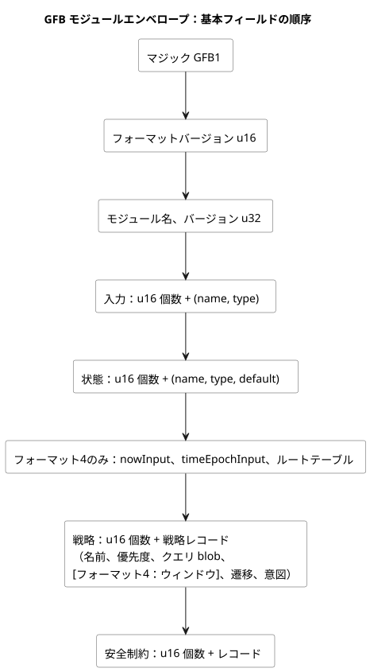
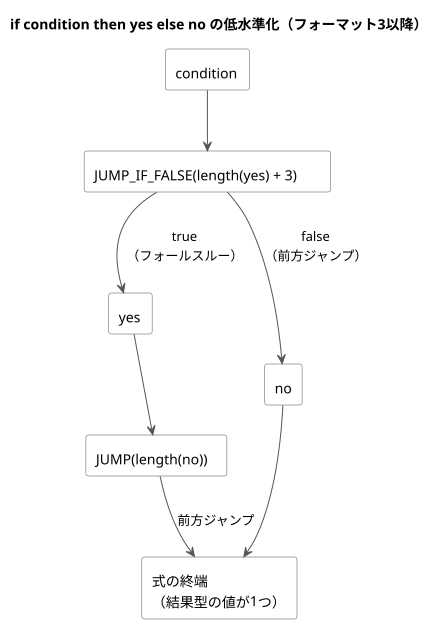

<!-- translation-source: docs/BYTECODE.md -->
[英語の原文](BYTECODE.md)

# GFBバイトコード

GFBは、GhostFlowコンパイラが出力し、ネイティブランタイムとWASMランタイムが読み込むバイナリフォーマットです。この文書では、そのエンベロープ、フォーマットバージョン、式オペコードとクエリオペコード、安全レコード、診断レコードを規定します。

各節で特に断りがない限り、エンコードの一般規則は次のとおりです。

- すべての整数はリトルエンディアンです。
- 文字列は`u16 length`の後にUTF-8バイト列が続く形式です。
- 値は有界な後置記法スタックを使い、条件式は前方分岐だけを使います。
- 公開コンパイルは、完全な正準`.ghost.md`文書を受け付けます。`tools/gfb1.mjs`内のS式表現はコンパイラ内部のIRであり、公開入力ではありません。

この文書の内容：

- プロファイル拡張（新しい順）：[GFB25 連続Percentリソース](#連続percentリソースエンベロープgfb25)、[暫定ライフサイクルフレーミングとGFB18のカレンダー境界](#暫定ライフサイクルフレーミング)、[GFB13 有界な自然ポリシー](#有界な自然ポリシーgfb13)。
- コアフォーマット：[モジュールエンベロープとフォーマットの決定](#モジュールエンベロープとフォーマットの決定)、[式オペコード](#式オペコード)、[フォーマット4の時間ウィンドウレコード](#フォーマット4の時間ウィンドウレコード)、[クエリオペコード](#クエリオペコード)、[安全レコードとホストマニフェスト](#安全レコードとホストマニフェスト)。
- 検証と診断：[適合性成果物](#適合性成果物)、[Result消費の診断](#result消費の診断)、[コンパイラのステージ境界](#コンパイラのステージ境界)。
- [不変のUTC Range（フォーマット12）](#不変のutc-rangeフォーマット12)。

## 連続Percentリソースエンベロープ（GFB25）

GFB25は、Reference §4.9のスカラー連続リソースプロファイルをエンコードします。

- GFB1/2/3/4のベースを、ちょうど1つの戦略とともにラップします。
- 時間、スケジュール、目標、Bool制約、ライフサイクルのプロファイルは一切許可しません。
- 通常のVM遷移は引き続き前状態を使います。
- *リソースプラン*は、専用の式バイトコードを同じ入力と前状態に対して評価します。そのうえで、最終的なNumber出力をすべて所有します。
- 要求と上限は、アクチュエータ出力として公開されることは決してありません。

**エンコード。** すべての整数はリトルエンディアンです。テキストは`u16`のUTF-8長の後にバイト列が続きます。識別子は1..128バイトです。ハッシュは64文字の小文字16進数です。blobは`u32 length`の後にバイト列が続きます。エンベロープには次のフィールドがこの順序で含まれます。

1. `GFB1`、フォーマット`25:u16`、ベースblob。
2. 正準ソースのSHA-256、検査済みディスクリプタのSHA-256、アクティベーションblob。
3. ポリシー数`u16`（最大8）。
4. 各ポリシー：ソースノードID `u32`、名前、リソース別名、出力名、選択`u8`（`0=min`、`1=max`）、作者が指定した安全Percent `f64`、要求リスト、上限リスト。
5. 各リスト：`u16 count`、続いてエントリごとにソースノードID `u32`、名前、4つの式blob：
   - Bool既知タグ
   - Number Percent値
   - Number SensorFaultコード：0=Disconnected、1=Stale、2=Invalid、3=NotReady
   - Number起源タグ

   オーナーは、エントリが既知の場合にのみ値を評価し、故障時にのみ理由と起源を評価します。次状態の式は許可されません。

**上限。**

| 項目 | 上限 |
|---|---|
| ポリシーあたりの要求 | 1..16 |
| ポリシーあたりの上限 | 0..16 |
| モジュールあたりの要求 + 上限エントリ | 最大 32 |
| 有限 Percent 値 | 0..100 の範囲内 |
| モジュールサイズ | 最大 1 MiB |
| アクティベーションサイズ | 最大 64 KiB |

ソースノードIDは0以外であり、これらのポリシーとエントリ全体で一意です。ランタイム上の識別子は`sourceHash:nodeId`です。すべての出力と、バインドされたすべてのリソースは、ちょうど1つのポリシーを持ちます。

**アクティベーションとスキャンのバインディング。**

- *GFRB2アクティベーション*には、`GFRB`、バージョン`2:u16`、設置リビジョン、実行ID、バインディングSHA-256、ソースSHA-256、`u16`のリソース数、リソースレコードが含まれます。各レコードは、別名、安定したリソースID、出力名、Percentを表す型付き値タグ`2:u8`を持ちます。
- *GFRS2スキャンバインディング*には、`GFRS`、バージョン`2:u16`、バインディングSHA-256、実行ID、ソースSHA-256が含まれます。

アクティベーションはコンパイル済みパケットと正確に一致しなければなりません。各スキャンはアクティベートされた同一性と一致しなければなりません。コンパイラは、正準の設置JSONからバインディングダイジェストを導出します。設置JSONが供給するのは識別子とマッピングであり、式やポリシー規則を供給することは決してありません。

**互換性。** 既存のリソースアクティベーションとスキャンのポインタ/長さエクスポートは、これらの新しいパケットバージョンを受け付けます。GFB17とGFRB1/GFRS1は、Boolのみという従来の意味を保ちます。共有のRust `ResourceBindingRegistry`は、両方のプロファイルにまたがって安定したリソースIDを予約します。複数のWASMインスタンスやワーカーにまたがるホストは、設置ライターのレジストリを共有しなければなりません。リファレンスのバインド済みアダプタが扱うのは、自身のJavaScriptレルムだけです。

**トレース。** `continuousResourceTrace`には、tickとともに確定された、Rustが所有する判断が含まれます。

- すべての既知/故障エントリ
- 選択された値と同点のID
- 作者が指定したフォールバック
- 既知の上限によるクランプ
- 最終値
- ソース、バインディング、実行、tickの同一性

`conditionsKnown=false`はフォールバック後も残ります。このレコードは論理的な実行の証拠です。物理的な適用や確認については何も主張しません。

**開発者による検証。** 次の限定的なコマンドは、公式リリースの識別子を割り当てずに共有オーナーをビルドします。

```sh
cargo build --locked --offline --release -p ghostflow-core --example resource_tape
cargo build --locked --offline --release -p ghostflow-wasm --target wasm32-unknown-unknown
node --test tests/continuous-resource-control.test.mjs
```

テストセレクタは、`GF-TEST-continuous-resource-compile`、`GF-TEST-continuous-resource-parity`、`GF-TEST-continuous-resource-dynamic`、`GF-TEST-continuous-resource-atomic`、`GF-TEST-continuous-resource-ceilings`、`GF-TEST-continuous-resource-malformed`です。公式の検証とパッケージの同一性は、引き続き別のゲートです。

## 暫定ライフサイクルフレーミング

**GFB22ライフサイクル候補。** ローカルのGFB22候補は、変更されていない内側のGFBバイト列と、検査済みの再始動ディスクリプタをラップします。[Scan frame WASM](SCAN-FRAME-WASM.ja.md)を参照してください。

この領域のフォーマット番号は混同しやすいので注意してください。

| フォーマット | 意味 |
|---|---|
| GFB19 | ライブ Range の開始（現在の意味） |
| GFB20 | キー付き TimeSlots Range |
| 21 | 不変の IANA Range |
| GFB22 | ローカルのライフサイクルラッパー候補 |

公開済みの`ghostflow-runtime-99ca1a3`は、ライフサイクルラッパーにGFB19を使っていました。これは現在のRangeの割り当てと衝突するため、統合ローダーは変換もフォールバックもせずにこれを拒否します。その過去のバイト列とコンシューマ側の固定（pin）は変わりません。別のオーナー候補を得るには、レビュー済みのソースを再コンパイルしてください。フォーマット22は、このライフサイクルラッパーを不変のIANA Rangeフォーマット21から分離します。未公開のlifecycle21候補は拒否されます。これらはいずれも、リリースを公開するものでも、物理的な実行を検証するものでもありません。

**GFB18のカレンダー境界。** GFB18は、採用されたカレンダー境界プロファイル`GhostFlow/control-v18`を追加します。

- プレリュードタグ17は、カレンダーでフィルタされた不変のUTC Daily Rangeです。
- プレリュードタグ18は、保護されたBool/Bool/故障コードの入力を持つ、型付きのカレンダーResultです。

正確なレイアウトと、変更のないGFSF5の事実については、[Context execution ABI](CONTEXT-EXECUTION-ABI.ja.md)にあります。Rangeは、深夜0時をまたぐ作業区間を拒否します。0時に終わる範囲と、翌日の0時に始まる範囲を、明示的に別々に指定することは許可されます。既存の通常のRangeと古いバイナリレイアウトは、その意味を保ちます。これらのタグにはGFB18ヘッダが必要で、古いローダーはこれを拒否します。これらの識別子は、Deviceのリリースや物理的な実行を認証するものではありません。

## 有界な自然ポリシー（GFB13）

GFB13と`GhostFlow/control-v12`を選択するのは、拡張されたSolar/Tideポリシーだけです。レガシープロファイルのバイト列は変わりません。

- **Solarタグ1**はレイアウトを保ったまま、`when`式の後に`holdMs:u64`（0はなし）と`fallbackAtMs:u64`（86400000はスキップ）を追加します。
- **Contextレコード**は、キャンセル式の後に`holdMs:u64`を追加します。
- **マニフェストのポリシー**はオブジェクトです。クロックは`{kind: 'hold_trusted', durationMs, terminal: 'skip'}`、フォールバックは`{kind: 'fixed_time', atMs, terminal: 'skip'}`です。

拡張されたSolarの事実はGFSF6を使います。GFSF6はSolar v1の行レイアウトを保ち、provider/contextの文字列の後に、任意の`fallbackWallMs`と`unavailableReason:u8`（255はなし、0〜5は自然コンテキストの理由コード）を追加します。レガシーのv1パケットとWASM関数名は変わりません。固定された古いランタイムは、アクティベーションの前にGFB13を拒否します。署名付きポータブルパッケージのconfig専用GFB11プロファイルは、引き続き限定的なままです。このフォーマットは、物理的なDeviceの証拠ではありません。

## モジュールエンベロープとフォーマットの決定

モジュールは次のフィールドをこの順序で持ちます。リストの後の図も同じ順序を示しています。

- マジック：`GFB1`（エンベロープのマジックはフォーマットが変わっても同じです）
- フォーマットバージョン：`u16`
- モジュール名：文字列
- モジュールバージョン：`u32`
- 入力：`u16 count`、続いて`(name, type)`レコード
- 状態：`u16 count`、続いて`(name, type, default value)`レコード
- 戦略：`u16 count`、続いて戦略レコード
- 安全制約：`u16 count`、続いて制約レコード
- フォーマット4の時間ヘッダ：状態の後に、`nowInput`、`timeEpochInput`、ルートテーブル
- フォーマット4の時間戦略テーブル：各クエリの後、遷移/意図の前にウィンドウディスクリプタ



コンパイラは、プログラムが使う機能からフォーマットを選択します。

| フォーマット | コンパイラの選択条件 | 値の型 |
|---|---|---|
| 1 | Int を含まない直線的な式 | `1=Bool`、`2=Number` |
| 2 | Int の宣言または演算を含む直線的な式 | `3=Int` も追加 |
| 3 | 分岐、動的な Int/Number 変換、または名目的な（時間）値ガード | Bool、Number、Int |
| 4 | 物理ルートと時間クロック入力を持つ時間ウィンドウモジュール | 既存のフォーマット3の型 + 有界なウィンドウディスクリプタ |
| 5 | Solar スケジュールのプレリュード | フォーマット4の型 + タグ付きスケジュールディスクリプタ |
| 6 | 連続 `true_for` のプレリュード | 時間の型 + true-for ディスクリプタ |
| 7 | PID 目標 | Bool、Number、Int + 目標レコード |
| 8 | Daily スケジュールのプレリュード | 時間の型 + Daily ディスクリプタ |
| 9 | DailySlots スケジュールのプレリュード | 時間の型 + DailySlots ディスクリプタ |
| 11 | 型付き設定ストリームとコンテキスト実行 | コンテキストプレリュードと任意の PID 目標。以前のフォーマット10のコンテキストプロファイルを置き換える |
| 12 | 不変の UTC Range | GFB11 のコンテキストレイアウト + UTC Range タグ13 |

これらはコンパイラの出力プロファイルです。すべてのホストがすべてのプロファイルをサポートすることを約束するものではありません。レコードのレイアウトとアクティベーションについては、機能ごとのABI文書を参照してください。より後のプロファイル番号（13、18、22、25など）は、上の各節とそれらのABI文書で説明しています。

**2026-09-22のフォーマット決定。**

- Reference §2.6の評価のためにフォーマット3を導入します。
- フォーマット1と2は、直線的なプログラム向けの現行のコンパクトプロファイルのままです。
- 置き換えられた即時評価の式オペコード`11`、`12`、`18`は、**すべての**プロファイルで拒否されます。これらの演算を含むソースは再コンパイルしてください。ローダーがそれらを変換したり、即時評価にフォールバックしたりすることは決してありません。
- サポートされていないフォーマット番号は、アクティベーションの前に失敗します。
- 既存の直線的なゴールデンベクタは、正確なバイト列とハッシュを保ちます。

フォーマット2には、Intの宣言または命令が必要です。Intの即値バイトはオペコードとして数えません。フォーマット3は、BoolとNumberだけを使う分岐を許可します。その整数命令とケイパビリティクエリの型タグは、フォーマット2と同じ意味です。

**戦略と既定値。** 各戦略は、名前、符号付き優先度、クエリblob、遷移、意図を持ちます。blobには`u32`のバイト長の接頭辞が付きます。遷移は状態を`u16`インデックスで指定します。意図は名前と結果型を持ちます。既定値は、Boolを`u8`、Numberを有限の`f64`、Intを符号付き`i32`としてエンコードします。

## 式オペコード

| オペコード | オペランド | 意味 |
|---:|---|---|
| 1 | `u8` | Bool 定数、0 または 1 |
| 2 | `f64` | 有限の Number 定数 |
| 3 | `u16` | 入力インデックス |
| 4 | `u16` | 前状態インデックス |
| 5 | `u16` | 次状態インデックス。意図でのみ使用 |
| 10 | — | Bool の NOT |
| 13 | — | 同じ型の値が等しい |
| 14–17 | — | 数値の LT、LTE、GT、GTE |
| 19–22 | — | Number の ADD、SUB、MUL、DIV |
| 23 | `i32` | Int 定数。フォーマット2と3 |
| 24 | — | 検査付き Int 符号反転 |
| 25–29 | — | 検査付き Int の ADD、SUB、MUL、DIV、REM |
| 30 | `u16 displacement` | Bool をポップし、false ならジャンプ。フォーマット3 |
| 31 | `u16 displacement` | 無条件ジャンプ。フォーマット3 |
| 32–47 | — | Number 定数 `opcode - 32`（0〜15）。フォーマット3 |
| 48 | — | Int から厳密な Number へ。フォーマット3と4 |
| 49–53 | — | Number から Int へ：exact、floor、ceil、trunc、nearest-even。フォーマット3と4 |
| 54 | — | Duration ミリ秒の検査、Number → Number。フォーマット3と4 |
| 55 | — | DateTime UTC エポックミリ秒の検査、Number → Number。フォーマット3と4 |
| 56 | `u32 site` | Result 消費のトレース。`[payload:T, choice:Number, origin:Number] → [payload:T]`。フォーマット3と4 |
| 57 | `u16 slot, u8 field` | 時間ウィンドウのプロジェクション：`0=ok`、`1=value`、`2=fault`、`3=origin`、`4=admissionRevision`、`5=newestTimestamp`、`6=count`、`7=quality`。ウィンドウを持つ時間フォーマット |
| 58 | `u16 slot, u8 field` | スケジュールのプロジェクション：`0=due`、`1=missed`、`2=active`（`active` はコンテキストプロファイルのみ）。スケジュールを持つフォーマット5、6、8、9、11 |
| 59 | `u16 slot, u8 field` | 連続 `true_for` のプロジェクション：`0=ok`、`1=value`、`2=fault`、`3=origin`、`4=start`、`5=end`、`6=covered`。フォーマット6 |
| 60 | — | `0..100` の有限 Percent の検査、Number → Number。既存の時間ガードプロファイル |

**コンパクトなNumber定数（32–47）。** コンパイラは、有限のenum制御プログラムが同じ4096バイトの式予算に収まるよう、分岐を含む式でこれらを使います。これらは依然としてNumberとしての同一性を持ち、Intのオペコード23や型タグ3とは無関係です。負のゼロは、他のすべてのNumber値と同様に、通常の`NUMBER_CONST f64`エンコードと符号を保ちます。フォーマット1と2はコンパクトオペコードを拒否し、現行の直線的なバイト列を保ちます。

**動的変換（48–53）。** 各変換は、型付きオペランドを1つ消費し、型付き結果を1つ生成します。

- NumberからIntへの演算は、明示されたポリシーに従って丸めます。その後、`-2147483648..2147483647`の外にある値を`integer-conversion-out-of-range`で拒否します。
- `int_exact`では、有限の小数値は範囲チェックの前に`integer-conversion-fractional`を生成します。`2147483648.5`も同様です。
- 非有限の入力は、既存のNumber入力境界で引き続き無効です。
- 変換の故障はtick全体を拒否します。
- 選択されなかった分岐内の変換は実行されません。
- 定数の変換は、コンパイル時診断とリテラルへの低水準化を保ちます。その直線的なプログラムは、引き続きフォーマット1または2を選択できます。

**Percentガード（60）と`percent-range-v1`。** 動的なPercent算術は、既存の時間ガードを受け入れるプロファイルで追加のオペコード`60`を使います。モジュールのレイアウトとフォーマットの選択は変わりません。

- コンパイラのマニフェストは`requiredRuntimeFeatures: ["percent-range-v1"]`を宣言します。ホストはその要求を検証しますが、実際の命令セットについては実行可能ローダーが引き続き最終的な権限を持ちます。
- 古いコアは、読み込み時、アクティベーションの前に未知のオペコードを拒否します。GFBフォーマット番号が一致するだけでは、この命令のサポートは成立しません。
- ガードを持たない既存のプログラムは、バイト列を保ち、この要求を省略します。
- コンシューマは、ガード付きプログラムをインストールする前に、Percentガードを含むコアリビジョンを使わなければなりません。この変更はDeviceファームウェアをリリースも更新もしません。

パッケージ検証器は、ターゲットが`percent-range-v1`を明示的に許可していることを要求します。JSのオプションは`supportedRuntimeFeatures`、Rustの検証プロファイルは`supported_runtime_features`を使います。宣言はコンパイル済みプログラムと一致しなければなりません。リファレンスホストは、アクティベーションの前に読み込んだモジュールを検査します。ランタイムとパッケージ検証器は旧 GFB10（`control-v9`）を拒否します。正準ソースを再コンパイルすると現行の成果物が得られます。

**範囲ガード（54、55、60）。** 各ガードは、有効なNumberはそのまま残し、それ以外ではtickを拒否します。

| ガード | 受け入れる値 | tick 拒否 |
|---|---|---|
| `CHECK_PERCENT` | 閉区間 `0..100` の有限 Number（小数を含む） | `percent-out-of-range` |
| `CHECK_DURATION` | `0..9007199254740991` の有限整数 | `duration-out-of-range` |
| `CHECK_DATETIME` | `0..253402300799999` の有限整数 UTC エポックミリ秒 | `datetime-out-of-range` |

`CHECK_PERCENT`：コンパイラは、結果がPercentである各動的算術演算（単項マイナスを含む）の直後にこれを出力します。中間式やインライン展開された関数本体も検査します。選択されなかった分岐は、そのガードを実行しません。Numberを返すPercentの比率にはガードは不要です。失敗時は既存の算術ロールバックの経路を使います。出力をクランプしたり制約故障を追加したりせず、最後に確定した状態と意図は変わりません。

`CHECK_DURATION`：ソースコンパイラは、各動的Duration算術演算（単項マイナスを含む）の直後にガードを出力します。したがって、後続の算術が無効な中間結果を隠すことはできません。定数のDurationエラーは、引き続きコンパイル診断です。選択されなかった分岐は、そのガードを実行しません。このオペコードはマシン上のNumber表現を保ちます。マニフェストの名目的なDuration型を潰すことはありません。

`CHECK_DATETIME`：DateTimeのシフトは、通常のNumber算術の直後にこのガードを置きます。そのため、後続の逆シフトが無効な中間時点を隠すことはできません。この命令は、DateやTimeOfDayの算術を定義しません。

**算術の意味論。**

- 算術は左オペランドを、次に右オペランドを消費します。
- Numberのゼロ除算と非有限の結果はtickを拒否します。
- Int算術は、オーバーフローとゼロ除数を拒否します。
- Intの除算はゼロ方向に切り捨て、剰余は被除数の符号を持ちます。
- `MIN div -1`はオーバーフローし、`MIN % -1`はちょうどゼロです。

## フォーマット4の時間ウィンドウレコード

フォーマット4は、既存の`GFB1`エンベロープを`u16`フォーマットバージョン`4`で使います。コンパイラがこれを選択するのは、時間ウィンドウを少なくとも1つ含むモジュールに限ります。ウィンドウのないモジュールは既存のフォーマット選択を保ちます。フォーマット4はフォーマット3のすべての式演算を含みます。

**時間ヘッダ。** スカラー状態テーブルの後に、モジュールは`u16 nowInput`、`u16 timeEpochInput`、続いて`u16 rootCount`を格納します。これらのインデックスは、予約されたNumber入力`__gf_now_ms`と`__gf_time_epoch`をバインドします。各*ルート*（物理入力源）は次のものを格納します。

- 厳密に増加する正の`u32 tag`
- 名前
- 4つの`u16`入力インデックス：present（`Bool`）、epoch、id、timestamp（`Number`）

クロックとルートの入力バインディングは互いに異ならなければなりません。

**ウィンドウレコード。** 各戦略は、遷移と意図の前に`u16 windowCount`を格納します。ウィンドウレコードは次のものをこの順序で含みます。

1. `u32 site`と名前
2. 演算（`0=average`、`1=min`、`2=max`、`3=rate`）とペイロード型
3. `u64 overMs`と`u64 maxAgeMs`
4. `u16 rootRefCount`とソート済みの`u16`ルートインデックス
5. 長さ接頭辞付きの6つのソース式：`ok`（Bool）、`payload`（ペイロード型）、および`fault`、`origin`、`quality`、`sourceTag`（Number）

継続時間は`1..2^53-1`の範囲です。averageとrateはNumberのペイロードを使い、minimumとmaximumはNumberまたはIntを使えます。各戦略のスカラー状態数とウィンドウ数の合計は128に制限されます。

**ウィンドウの読み取り（オペコード57）。** オペコード57はウィンドウのスロットとフィールドを読みます。フィールド0と1はそれぞれBool型とペイロード型、フィールド2〜7はNumber型です。集計に成功した場合の品質は`3`、利用不可の場合の品質は`0`です。フォーマット1〜3とデバイスクエリはオペコード57を拒否します。ソース式は先行するウィンドウスロットだけを読めます。遷移と意図は、その戦略内のすべてのスロットを読めます。

検証器は、次のものをアクティベーションの前に拒否します。

- 無効なルート/ウィンドウのsite
- 重複した名前
- 正準でないルートの順序
- 無効な継続時間
- ソース式の型の不一致

**証拠の参照。** 6番目のソース式（`sourceTag`）は、品質に応じて解釈される証拠の参照です。

- 品質`1`は物理ルートのタグを選択します。
- 品質`3`は先行するウィンドウのsiteを選択します。

これらは別々の識別子の名前空間です。品質式内でのフィールド7のオペコード57読み取りが、先行ウィンドウの証拠の依存関係を宣言します。その物理ルートは、コンシューマのルート参照に含まれていなければなりません。制御条件だけで使われる他のウィンドウ読み取りは、証拠を宣言しません。定数の品質`3`だけでは、任意の上流ウィンドウを承認できません。エンコーダとネイティブローダーの両方が、アクティベーションの前にこれらのバインディングを検証します。追加のオペコードやワイヤフィールドは使いません。

**マニフェストのディスクリプタ。** 入れ子ウィンドウのマニフェストディスクリプタには、先行スロット順にソートされた`{name, site, slot}`の空でない配列`upstreamWindows`が含まれます。物理ルートのみのディスクリプタではこれを省略します。`sources`配列には、推移的なすべての物理ルートが含まれます。正準パッケージのリプレイはこれらのフィールドを固定し、ネイティブのパッケージ検証器も、デコードした先行ウィンドウの依存関係とこれらを照合します。

`GhostFlow/control-v4`マニフェストは、生成された`__gf_now_ms`と`__gf_time_epoch`の入力、およびウィンドウ信号のディスクリプタをバインドします。密度の事実、ターゲットのメモリ予算、実行エポックはアクティベーションの入力です。読み込み時にこれらがでっち上げられることはなく、作者が記述するマニフェスト設定としてエンコードされることもありません。

**分岐の規則。** 分岐の変位は、変位即値の終端からのバイト数で数えます。

- 変位は正でなければならず、命令境界または式の終端に着地しなければなりません。
- 後方エッジ、ループ、式の外側のターゲット、到達不能な命令バイトは無効です。
- 選択されないパスを含め、両方の出力パスが検証されます。
- すべての合流点では、スタックの高さと型が同一でなければなりません。
- すべてのパスは、宣言された結果型の値を1つ持って終わらなければなりません。
- スタック容量は128値です。

`if condition then yes else no`の低水準化は次のとおりです。

```text
condition
JUMP_IF_FALSE(length(yes) + 3)
yes
JUMP(length(no))
no
```

`+ 3`は、3バイトの`JUMP`命令（オペコードと`u16`の変位）を飛ばすためのものです。次の図は2つの前方パスを示します。



`left && right`は`if left then right else false`として低水準化されます。`left || right`は`if left then true else right`として低水準化されます。条件と選択された分岐は、ネイティブとWASMのどちらでも、Rust内で左から右へ実行されます。選択されなかった分岐がランタイム故障を生むことはありません。コンパイル時の型エラーと名前エラーは、引き続きコンパイルを失敗させます。

入力インデックス0の場合、`if guard then true else false`は正確に次のバイト列になります。

```text
03 00 00  1e 05 00  01 01  1f 02 00  01 00
INPUT(0)  JFALSE(5) TRUE   JUMP(2)   FALSE
```

ここで`1e`はオペコード30、`1f`はオペコード31です。`JFALSE(5)`は`TRUE`（2バイト）と`JUMP(2)`（3バイト）を飛ばし、`JUMP(2)`は`FALSE`（2バイト）を飛ばします。

## クエリオペコード

クエリ（戦略のケイパビリティ述語）は、別の命令名前空間を持ちます。

- `1 HAS kind-string name-string type-u8`
- `2 ALL u16-child-count`
- `3 ANY u16-child-count`
- `4 NOT`
- `5 BOOL_CONST u8`（0または1）

これらの副作用のないケイパビリティ述語は、後置記法の評価を保ちます。即時評価の式オペコードの廃止は、クエリのALL/ANYを変えません。検証器は、すべてのクエリオペランド、ケイパビリティの型、スタックの上限、単一のBool結果を検査します。

## 安全レコードとホストマニフェスト

**制約レコード。** 制約レコードは、`kind:u8`、`arity:u16`、続いてその数だけの互いに異なるBool意図名です。

| 種別 | 名前 | 名前の数 |
|---|---|---|
| 1 | `requires` | ちょうど2つ |
| 2 | `mutex` | 2–32 |
| 3 | `requires-any` | ターゲット1つ、続いて代替1–31個 |

各ラウンドは1つの候補スナップショットを読み、false方向のみのブロックをすべてまとめて適用します。ラウンドは不動点に達するまで繰り返されます。

**モジュールの上限。**

| 項目 | 上限 |
|---|---|
| モジュールサイズ | 1 MiB |
| 名前 | 128 UTF-8 バイト |
| 入力、状態、意図、制約 | それぞれ 128 |
| 戦略 | 32 |
| blob | 4096 バイト |
| フォーマット4：戦略あたりのスカラー状態 + ウィンドウ | 128 |

ランタイム故障は、状態、意図、ジャーナルを確定する前にtickを拒否します。未知の式/クエリオペコードと制約種別は、アクティベーションの前に拒否されます。

**マニフェストとバイトコード。** マニフェストのスキーマとバイトコードフォーマットは、別々の契約です。

- `GhostFlow/control-v4`マニフェストは、Intに対応したGFBフォーマット2または3をバインドでき、ウィンドウのマニフェストはGFBフォーマット4と組になります。
- 分岐だけでは、Intのマニフェストスキーマは必要ありません。
- `.gfb.manifest.json`は名目的な型と生成された入力を保持し、`.gfb.map.json`はソースマッピングを保持します。
- マニフェストの`bytecodeSha256`は、正確なバイトコードのバイト列をバインドします。これは認証ではありません。
- 生成された入力がない場合はランタイムエラーです。

[IMPLEMENTATION.md](IMPLEMENTATION.ja.md)を参照してください。

## 適合性成果物

`tests/fixtures/gfb1-golden-v1.ghost.md`と`tests/fixtures/gfb2-int-golden-v1.ghost.md`は、対応する追跡対象の`.gfb`ファイルとダイジェストメタデータの`.json`ファイルの、正本となる文芸的ソースです。

- Nodeとブラウザのコンパイルは、直線的なベクタを保ちます。
- ネイティブとWASMのローダーは、無効なバージョン、不正なバイトコード、廃止された即時評価命令を拒否します。
- `tests/gfb2-int.test.mjs`は、フォーマット3の分岐バイト列も固定し、両方のホストを通じて選択/非選択のランタイム故障を検証します。
- コアのRustテストは、入れ子の分岐実行、分岐の合流、無効なインデックス、スタックの境界を扱います。

## Result消費の診断

`TRACE_RESULT`（56）は、Result値がどのように消費されたか（Okか、どの故障か）を、値を変えずに記録します。正の`u32` siteが必要です。コンパイラ内部の形式は`(trace-result site payload choice origin)`です。

- 評価はpayload、次にchoice、次にoriginを計算し、その後で初めてイベントを記録します。payloadの値と型は変わりません。
- *choice*は`0..65535`の厳密なNumber整数です。0はOkを意味し、故障はそのエラーenumの序数に1を加えた値を使います。
- *origin*は`0..4294967295`の厳密なNumber整数で、既定値は0です。
- 無効なメタデータは`result-trace-out-of-range`でtickを拒否します。
- ソースメタデータは、siteとoriginの識別子を、正確なソースリビジョンとエラーenumに結び付けます。VMがそれらの名前を推測することはありません。

**イベントの行き先。** 確定されたすべてのTickRecord JSONには、`{site, choice, origin}`イベントからなる専用の`resultTrace`配列があります。

- イベントは、siteの繰り返しを含め、実行順に並びます。
- 実行されなかったマーカーはイベントを生成しません。
- 診断が要求意図や安全意図のアクチュエータ意図に入ることは決してありません。
- 後で故障が起きると、そのtickの診断バッファ全体が、候補状態と意図とともに破棄されます。
- 巻き戻しは選択されたジャーナルレコードを保持し、ゴーストリプレイは記録された入力から診断を再生成します。
- 別個の可変な診断チェックポイント状態はなく、新しいネイティブ/WASMのC ABIもありません。

**上限。** ローダーは、すべての遷移、意図、フォーマット4のウィンドウソース式に含まれるマーカー命令を数えます。前方のみの制御フローでは、各命令は式ごとにtickあたり最大1回しか実行されないため、モジュールの式バイト数がtick内のすべてのイベントの上限になります。コピーされた式は別々に数えます。1 MiBのモジュール上限とマーカーあたり5バイトから、保守的な上限は`floor(1,048,576 / 5) = 209715`個のマーカーとなり、ヘッダや他のレコードがこれをさらに減らします。イベントあたり12バイトとすると、収集のオーバーヘッドを除いて最大2516580バイトです。保持される診断は、既存の有界なジャーナル容量にも従います。

[ポータブルGFBパッケージ](PORTABLE-PACKAGE.ja.md)は、正確なバイトコードを保持し、そのソース、マニフェスト、ソースマップ、コンパイラ/ランタイムの同一性、設置バインディングを結び付けます。パッケージ化がバイトコードを書き換えることは決してありません。

## コンパイラのステージ境界

コンパイルは段階的に実行されます。

1. 位置情報を持つSurface ASTが、検査付きのソース低水準化を通過します。
2. 低水準化は、メモリ上の型付きCore IRを生成します。これは、解決済みの入力/状態参照、意味的な式の型と演算子、要求意図、Bool制約、そして時間・config・品質・目標の振る舞いに関する明示的な拡張ディスクリプタを持ちます。上で述べたS式の形式は、このステージへの内部的な低水準化の入力です。
3. Core IRを数値オペコードに対応付け、フォーマットを選択し、バイト列を書き出すのは、GFBエミッタだけです。

この分離によって、GFBのワイヤバージョンやランタイム契約が変わることはありません。

## 不変のUTC Range（フォーマット12）

GFB12には、少なくとも1つのUTC Rangeプレリュードが必要です。それ以外の点では、GFB11のコンテキストレイアウトと任意の目標トレーラーを使います。

**エンコード。** タグ付きプレリュード`13`は、次のものをこの順序でエンコードします：`site:u32`、名前文字列、`gapMs:u64`、タイムゾーン文字列（`UTC`のみ）、`durationMs:u64`、`startCount:u16`、続いてソート済みで一意な`startMs:u64`値、そして`when`と`cancel_when`の式blob。

**制約。**

- 開始は`[0,86400000)`の範囲に1〜96個あります。
- 継続時間は`[1,86400000]`の範囲です。
- 開始どうしの1日単位の循環的な間隔は、継続時間以上でなければなりません。
- ネイティブデコーダは、これらの上限と重なりがないことを独立に検証します。

**互換性。** 古いフォーマットのバイト列は変わりません。古いコンシューマは、アクティベーションの前にフォーマット12を拒否します。ヘッダをダウングレードしても、タグ13をGFB11のプレリュードに変えることはできません。

**マニフェストとランタイム。** マニフェストは引き続き`GhostFlow/control-v10`で、既存のコンテキスト事実ABIを使います。

- 各Range siteには、空のオカレンス行が必要で、calendar/providerを持てません。ランタイムは信頼された壁時計時刻からUTCのプランを導出します。
- オカレンスの同一性には、site、UTCのソース日、安定したソート済みスロットキーを使います。
- Rangeエンジンのチェックポイントは、GFRG1の消費済みキー台帳とともにGFES2を使います。以前のエンジンはGFES1を保ちます。
- 新しいブートは重複抑止を保ちますが、アクティブなタイマーを再開することは決してありません。
- 容量の枯渇と不正なチェックポイントは、明示的かつアトミックに失敗します。
- 署名付きポータブルパッケージの設定プロファイルは引き続きGFB11であり、GFB12を受け付けません。
