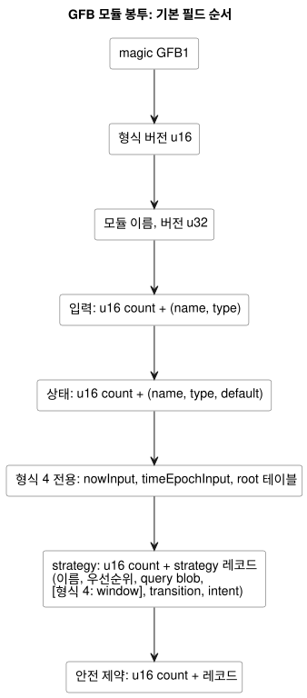
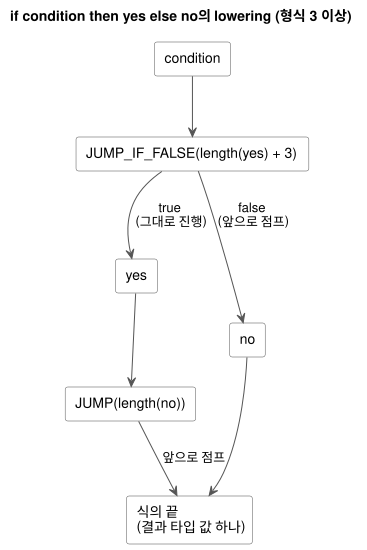

<!-- translation-source: docs/BYTECODE.md -->
[영문 원문](BYTECODE.md)

# GFB 바이트코드

GFB는 GhostFlow 컴파일러가 생성하고 native 런타임과 WASM 런타임이 로드하는 바이너리
형식입니다. 이 문서는 GFB의 봉투(envelope), 형식 버전, 식(expression) opcode와 query
opcode, 안전 레코드, 진단 레코드를 규정합니다.

절에서 따로 밝히지 않는 한 다음 일반 인코딩 규칙을 따릅니다.

- 모든 정수는 little-endian입니다.
- 문자열은 `u16 length` 뒤에 UTF-8 바이트가 오는 형태입니다.
- 값은 크기가 제한된 postfix stack을 사용합니다. 조건식은 앞으로 향하는(forward) branch만
  사용합니다.
- 공개 컴파일은 완전한 정본 `.ghost.md` 문서를 받아들입니다. `tools/gfb1.mjs`의
  S-expression 표현은 컴파일러 내부 IR이며 공개 입력이 아닙니다.

이 문서의 내용:

- 프로필 확장(최신순): [GFB25 연속 Percent 자원](#연속-percent-자원-봉투-gfb25),
  [임시 lifecycle framing과 GFB18 달력 경계](#임시-lifecycle-framing),
  [GFB13 제한된 자연 정책](#제한된-자연-정책-gfb13).
- 핵심 형식: [모듈 봉투와 형식 결정](#모듈-봉투와-형식-결정),
  [표현식 opcode](#표현식-opcode),
  [형식 4 시간 창 레코드](#형식-4-시간-창-레코드),
  [Query opcode](#query-opcode),
  [안전 레코드와 호스트 매니페스트](#안전-레코드와-호스트-매니페스트).
- 검증과 진단: [적합성 산출물](#적합성-산출물),
  [Result 소비 진단](#result-소비-진단),
  [컴파일러 단계 경계](#컴파일러-단계-경계).
- [불변 UTC Range (형식 12)](#불변-utc-range-형식-12).

## 연속 Percent 자원 봉투 (GFB25)

GFB25는 Reference §4.9의 스칼라 연속 자원 프로필을 인코딩합니다.

- 정확히 하나의 strategy를 가진 GFB1/2/3/4 base를 감쌉니다.
- temporal, schedule, objective, Bool 제약, lifecycle 프로필은 허용하지 않습니다.
- 일반 VM transition은 여전히 이전 상태를 사용합니다.
- *자원 계획(resource plan)*은 같은 입력과 이전 상태를 대상으로 전용 식 바이트코드를
  평가합니다. 그런 다음 모든 최종 Number 출력을 소유합니다.
- 요청(request)과 상한(ceiling)은 결코 액추에이터 출력으로 노출되지 않습니다.

**인코딩.** 모든 정수는 little-endian입니다. 텍스트는 `u16` UTF-8 길이 뒤에 바이트가
옵니다. identity는 1..128바이트입니다. 해시는 소문자 16진수 64자입니다. blob은
`u32 length` 뒤에 바이트가 옵니다. 봉투는 다음 필드를 순서대로 담습니다.

1. `GFB1`, 형식 `25:u16`, base blob.
2. 정본 소스 SHA-256, 검사된 descriptor SHA-256, activation blob.
3. 정책 수 `u16`, 최대 8개.
4. 각 정책: source node ID `u32`, 이름, resource alias, 출력 이름,
   selection `u8` (`0=min`, `1=max`), 작성된 safe Percent `f64`, request 목록,
   ceiling 목록.
5. 각 목록: `u16 count`, 그 뒤 항목마다 source node ID `u32`, 이름, 그리고 네 개의 식
   blob:
   - Bool known 태그
   - Number Percent 값
   - Number SensorFault 코드: 0=Disconnected, 1=Stale, 2=Invalid, 3=NotReady
   - Number origin 태그

   소유자는 항목이 known일 때만 값을 평가하고, fault일 때만 reason과 origin을
   평가합니다. 다음 상태 식은 허용하지 않습니다.

**한도.**

| 항목 | 한도 |
|---|---|
| 정책당 request | 1..16 |
| 정책당 ceiling | 0..16 |
| 모듈당 request + ceiling 항목 | 최대 32 |
| 유한 Percent 값 | 0..100 범위 |
| 모듈 크기 | 최대 1 MiB |
| activation 크기 | 최대 64 KiB |

source node ID는 0이 아니며, 이 정책들과 항목 전체에서 전역적으로 유일합니다. 런타임
identity는 `sourceHash:nodeId`입니다. 모든 출력과 바인딩된 모든 자원에는 정확히 하나의
정책이 있습니다.

**activation과 스캔 바인딩.**

- *GFRB2 activation*은 `GFRB`, 버전 `2:u16`, 설치 revision, run ID, 바인딩 SHA-256,
  소스 SHA-256, `u16` 자원 수, 자원 레코드를 담습니다. 각 레코드는 alias, 안정적인 자원 ID,
  출력 이름, Percent를 뜻하는 typed value 태그 `2:u8`을 가집니다.
- *GFRS2 스캔 바인딩*은 `GFRS`, 버전 `2:u16`, 바인딩 SHA-256, run ID, 소스 SHA-256을
  담습니다.

activation은 컴파일된 packet과 정확히 일치해야 합니다. 각 스캔은 활성화된 identity와
일치해야 합니다. 컴파일러는 정본 설치 JSON에서 바인딩 digest를 도출합니다. 설치 JSON은
identity와 mapping을 공급할 뿐, 식이나 정책 규칙은 결코 공급하지 않습니다.

**호환성.** 기존 자원 activation 및 스캔 pointer/length export가 이 새 packet 버전을
받아들입니다. GFB17과 GFRB1/GFRS1은 Bool 전용 의미를 유지합니다. 공유 Rust
`ResourceBindingRegistry`가 두 프로필에 걸쳐 안정적인 자원 ID를 예약합니다. 여러 WASM
인스턴스나 worker에 걸친 호스트는 설치 writer registry를 공유해야 합니다. 참조 bound
adapter는 자신의 JavaScript realm만 다룹니다.

**추적(trace).** `continuousResourceTrace`는 tick과 함께 확정된 Rust 소유 결정을 담습니다.

- 모든 known/fault 항목
- 선택된 값과 동률인 ID
- 작성된 fallback
- known ceiling에 의한 clamp
- 최종 값
- 소스, 바인딩, run, tick identity

`conditionsKnown=false`는 fallback 후에도 유지됩니다. 이 레코드는 논리 실행 증거입니다.
물리적 적용이나 확인을 주장하지 않습니다.

**개발자 검증.** 다음 집중 명령은 공식 릴리스 identity를 할당하지 않고 공유 소유자를
빌드합니다.

```sh
cargo build --locked --offline --release -p ghostflow-core --example resource_tape
cargo build --locked --offline --release -p ghostflow-wasm --target wasm32-unknown-unknown
node --test tests/continuous-resource-control.test.mjs
```

테스트 selector는 `GF-TEST-continuous-resource-compile`,
`GF-TEST-continuous-resource-parity`, `GF-TEST-continuous-resource-dynamic`,
`GF-TEST-continuous-resource-atomic`, `GF-TEST-continuous-resource-ceilings`,
`GF-TEST-continuous-resource-malformed`입니다.
공식 검증과 package identity는 별도의 관문으로 남아 있습니다.

## 임시 lifecycle framing

**GFB22 lifecycle 후보.** 로컬 GFB22 후보는 변경되지 않은 내부 GFB 바이트와 검사된 재시작
descriptor를 감쌉니다. [Scan frame WASM](SCAN-FRAME-WASM.ko.md)의 restart lifecycle 확장을
참고하십시오.

이 영역의 형식 번호는 혼동하기 쉽습니다.

| 형식 | 의미 |
|---|---|
| GFB19 | live Range 시작 (현재 의미) |
| GFB20 | keyed TimeSlots Range |
| 21 | 불변 IANA Range |
| GFB22 | 로컬 lifecycle wrapper 후보 |

공개된 `ghostflow-runtime-99ca1a3`은 lifecycle wrapper에 GFB19를 사용했습니다. 이는 현재의
Range 할당과 충돌하므로, 통합 로더는 이를 번역이나 fallback 없이 거부합니다. 그 과거 바이트와
소비자 고정값(pin)은 그대로 유지됩니다. 별도의 소유자 후보를 얻으려면 검토된 소스를
재컴파일하십시오. 형식 22는 이 lifecycle wrapper를 불변 IANA Range 형식 21과 구분합니다.
공개되지 않은 lifecycle21 후보는 거부됩니다. 이 중 어느 것도 릴리스를 공개하거나 물리적 실행을
검증하지 않습니다.

**GFB18 달력 경계.** GFB18은 채택된 달력 경계 프로필 `GhostFlow/control-v18`을 추가합니다.

- Prelude 태그 17은 달력으로 필터링된 불변 UTC Daily Range입니다.
- Prelude 태그 18은 보호된 Bool/Bool/fault-code 입력을 가진 typed 달력 Result입니다.

정확한 레이아웃과 변경되지 않은 GFSF5 fact는
[Context execution ABI](CONTEXT-EXECUTION-ABI.ko.md)의 GFB18 달력 경계 절에 있습니다.
Range는 자정을 넘는 근무 구간을 거부합니다. 하나는 자정에 끝나고 다른 하나는 다음 날짜에
시작하는, 명시적으로 분리된 range는 허용합니다. 기존 일반 Range와 이전 바이너리 레이아웃은
의미가 유지됩니다. 이 태그들은 GFB18 헤더를 요구하며, 이전 로더는 이를 거부합니다. 이 식별자들은
Device 릴리스나 물리적 실행을 인증하지 않습니다.

## 제한된 자연 정책 (GFB13)

확장된 Solar/Tide 정책만 GFB13과 `GhostFlow/control-v12`를 선택합니다. 레거시 프로필
바이트는 변경되지 않습니다.

- **Solar 태그 1**은 레이아웃을 유지하고, `when` 식 뒤에 `holdMs:u64`(0은 없음)와
  `fallbackAtMs:u64`(86400000은 건너뜀)를 덧붙입니다.
- **Context 레코드**는 취소(cancellation) 식 뒤에 `holdMs:u64`를 덧붙입니다.
- **Manifest 정책**은 객체입니다. clock은
  `{kind: 'hold_trusted', durationMs, terminal: 'skip'}`, fallback은
  `{kind: 'fixed_time', atMs, terminal: 'skip'}`입니다.

확장된 Solar fact는 GFSF6을 사용합니다. GFSF6은 Solar v1 행 레이아웃을 유지하고,
provider/context 문자열 뒤에 선택적 `fallbackWallMs`와 `unavailableReason:u8`(255는 없음,
0–5는 자연 context 사유 코드)을 덧붙입니다. 레거시 v1 packet과 WASM 함수 이름은 변경되지
않습니다. 고정된 이전 런타임은 activation 전에 GFB13을 거부합니다. 서명된 portable-package
config 전용 GFB11 프로필은 여전히 좁은 범위로 유지됩니다. 이 형식은 물리적 Device 증거가
아닙니다.

## 모듈 봉투와 형식 결정

모듈은 다음 필드를 순서대로 가집니다. 목록 뒤의 다이어그램도 같은 순서를 보여 줍니다.

- magic: `GFB1` (봉투 magic은 형식이 바뀌어도 그대로입니다)
- 형식 버전: `u16`
- 모듈 이름: 문자열
- 모듈 버전: `u32`
- 입력: `u16 count`, 그 뒤 `(name, type)` 레코드
- 상태: `u16 count`, 그 뒤 `(name, type, default value)` 레코드
- strategy: `u16 count`, 그 뒤 strategy 레코드
- 안전 제약: `u16 count`, 그 뒤 제약 레코드
- 형식 4 시간 헤더: 상태 뒤에 `nowInput`, `timeEpochInput`, root 테이블
- 형식 4 시간 strategy 테이블: 각 query 뒤에, transition/intent 앞에 window descriptor



컴파일러는 프로그램이 사용하는 기능에 따라 형식을 선택합니다.

| 형식 | 컴파일러 선택 조건 | 값 타입 |
|---|---|---|
| 1 | Int가 없는 직선(straight-line) 식 | `1=Bool`, `2=Number` |
| 2 | Int 선언이나 연산이 있는 직선 식 | `3=Int` 추가 |
| 3 | branch, 동적 Int/Number 변환, 명목(시간) 값 guard | Bool, Number, Int |
| 4 | 물리 root와 시간 clock 입력을 가진 시간 창(temporal window) 모듈 | 기존 형식 3 타입 + 제한된 window descriptor |
| 5 | Solar schedule prelude | 형식 4 타입 + 태그된 schedule descriptor |
| 6 | 연속 `true_for` prelude | 시간 타입 + true-for descriptor |
| 7 | PID objective | Bool, Number, Int + objective 레코드 |
| 8 | Daily schedule prelude | 시간 타입 + Daily descriptor |
| 9 | DailySlots schedule prelude | 시간 타입 + DailySlots descriptor |
| 11 | Typed 설정 stream과 context 실행 | Context prelude와 선택적 PID objective. 이전 형식 10 context 프로필을 대체 |
| 12 | 불변 UTC Range | GFB11 context 레이아웃 + UTC Range 태그 13 |

이것들은 컴파일러 출력 프로필입니다. 모든 호스트가 모든 프로필을 지원한다는 약속이 아닙니다.
레코드 레이아웃과 activation은 기능별 ABI 문서를 참고하십시오. 이후의 프로필 번호(13, 18, 22,
25 등)는 위의 절들과 해당 ABI 문서에서 설명합니다.

**2026-09-22 형식 결정.**

- Reference §2.6 평가를 위해 형식 3을 도입합니다.
- 형식 1과 2는 직선 프로그램을 위한 현재의 compact 프로필로 남습니다.
- 대체된 eager 식 opcode `11`, `12`, `18`은 **모든** 프로필에서 거부됩니다. 이 연산을 포함한
  소스는 재컴파일하십시오. 로더는 이를 결코 번역하지 않으며 eager 실행으로 fallback하지도
  않습니다.
- 지원하지 않는 형식 번호는 activation 전에 실패합니다.
- 기존 직선 golden vector는 바이트와 해시를 정확히 유지합니다.

형식 2는 Int 선언이나 instruction을 요구합니다. Int 즉치(immediate) 바이트는 opcode로 세지
않습니다. 형식 3은 Bool과 Number만 사용하는 branch를 허용합니다. 형식 3의 정수 instruction과
capability-query 타입 태그는 형식 2에서와 같은 의미입니다.

**strategy와 기본값.** 각 strategy는 이름, 부호 있는 우선순위, query blob, transition,
intent를 담습니다. blob은 `u32` 바이트 길이 접두사를 가집니다. transition은 `u16` 인덱스로
상태를 지정합니다. intent는 이름과 결과 타입을 가집니다. 기본값은 Bool을 `u8`로, Number를 유한
`f64`로, Int를 부호 있는 `i32`로 인코딩합니다.

## 표현식 opcode

| Opcode | 피연산자 | 의미 |
|---:|---|---|
| 1 | `u8` | Bool 상수, 0 또는 1 |
| 2 | `f64` | 유한 Number 상수 |
| 3 | `u16` | 입력 인덱스 |
| 4 | `u16` | 이전 상태 인덱스 |
| 5 | `u16` | 다음 상태 인덱스. intent에서만 |
| 10 | — | Boolean NOT |
| 13 | — | 같은 타입 값의 동등 비교 |
| 14–17 | — | 수치 LT, LTE, GT, GTE |
| 19–22 | — | Number ADD, SUB, MUL, DIV |
| 23 | `i32` | Int 상수. 형식 2와 3 |
| 24 | — | 검사되는 Int 부호 반전 |
| 25–29 | — | 검사되는 Int ADD, SUB, MUL, DIV, REM |
| 30 | `u16 displacement` | Bool을 pop하고 false이면 점프. 형식 3 |
| 31 | `u16 displacement` | 무조건 점프. 형식 3 |
| 32–47 | — | Number 상수 `opcode - 32` (0부터 15까지). 형식 3 |
| 48 | — | Int를 정확한 Number로. 형식 3과 4 |
| 49–53 | — | Number를 Int로: exact, floor, ceil, trunc, nearest-even. 형식 3과 4 |
| 54 | — | Duration 밀리초 검사, Number → Number. 형식 3과 4 |
| 55 | — | DateTime UTC epoch 밀리초 검사, Number → Number. 형식 3과 4 |
| 56 | `u32 site` | Result 소비 추적. `[payload:T, choice:Number, origin:Number] → [payload:T]`. 형식 3과 4 |
| 57 | `u16 slot, u8 field` | 시간 창 projection: `0=ok`, `1=value`, `2=fault`, `3=origin`, `4=admissionRevision`, `5=newestTimestamp`, `6=count`, `7=quality`. window가 있는 시간 형식 |
| 58 | `u16 slot, u8 field` | Schedule projection: `0=due`, `1=missed`, `2=active` (`active`는 context 프로필에서만). schedule이 있는 형식 5, 6, 8, 9, 11 |
| 59 | `u16 slot, u8 field` | 연속 `true_for` projection: `0=ok`, `1=value`, `2=fault`, `3=origin`, `4=start`, `5=end`, `6=covered`. 형식 6 |
| 60 | — | `0..100` 범위의 유한 Percent 검사, Number → Number. 기존 time-guard 프로필 |

**Compact Number 상수 (32–47).** 컴파일러는 branch가 있는 식에서 이 opcode를 사용하여, 유한
enum 제어 프로그램이 같은 4096바이트 식 예산 안에 들어가게 합니다. 이 값들도 여전히 Number
identity를 가지며, Int의 opcode 23이나 타입 태그 3과는 관계가 없습니다. 음의 0은 다른 모든
Number 값과 마찬가지로 일반 `NUMBER_CONST f64` 인코딩과 그 부호를 유지합니다. 형식 1과 2는
compact opcode를 거부하고 현재의 직선 바이트를 유지합니다.

**동적 변환 (48–53).** 각 변환은 타입이 있는 피연산자 하나를 소비하고 타입이 있는 결과 하나를
생성합니다.

- Number에서 Int로의 연산은 명시적 정책에 따라 반올림합니다. 그런 다음
  `-2147483648..2147483647` 범위를 벗어난 값을 `integer-conversion-out-of-range`로
  거부합니다.
- `int_exact`의 경우, 소수부가 있는 유한 값은 범위 검사 전에
  `integer-conversion-fractional`을 생성합니다. `2147483648.5`도 마찬가지입니다.
- 유한하지 않은 입력은 기존 Number 입력 경계에서 계속 무효입니다.
- 변환 fault는 tick 전체를 거부합니다.
- 선택되지 않은 branch의 변환은 실행되지 않습니다.
- 상수 변환은 컴파일 시 진단과 리터럴 lowering을 유지합니다. 그런 직선 프로그램은 여전히
  형식 1이나 2를 선택할 수 있습니다.

**Percent guard (60)와 `percent-range-v1`.** 동적 Percent 산술은 기존 time guard를 허용하는
프로필(과거의 GFB10 제외)에서 추가 opcode `60`을 사용합니다. 모듈 레이아웃과 형식 선택은
바뀌지 않습니다.

- 컴파일러 매니페스트는 `requiredRuntimeFeatures: ["percent-range-v1"]`을 선언합니다.
  호스트는 이 요구 사항을 검증하지만, 실제 instruction 집합에 대한 최종 판단은 실행 로더가
  내립니다.
- 이전 core는 로드 중, activation 전에 알 수 없는 opcode를 거부합니다. GFB 형식 번호가
  일치한다는 것만으로는 이 instruction의 지원이 성립하지 않습니다.
- guard가 없는 기존 프로그램은 바이트를 유지하고 이 요구 사항을 생략합니다.
- 소비자는 guard가 있는 프로그램을 설치하기 전에 Percent guard를 포함한 core revision을
  사용해야 합니다. 이 변경은 Device 펌웨어를 릴리스하거나 갱신하지 않습니다.

package verifier는 대상이 `percent-range-v1`을 명시적으로 허용할 것을 요구합니다. JS 옵션은
`supportedRuntimeFeatures`이고, Rust 검증 프로필은 `supported_runtime_features`를
사용합니다. 선언은 컴파일된 프로그램과 일치해야 합니다. 참조 호스트는 activation 전에 로드된
모듈을 검사합니다. 과거의 GFB10은 새 instruction을 선언하거나 포함할 수 없으며, 현재 소스는
현재 프로필로 컴파일됩니다. 기존 GFB10 프로그램은 새 기능 선언 없이도 계속 로드할 수 있습니다.

**범위 guard (54, 55, 60).** 각 guard는 유효한 Number를 그대로 두고, 그렇지 않으면 tick을
거부합니다.

| Guard | 허용 값 | tick 거부 |
|---|---|---|
| `CHECK_PERCENT` | 소수를 포함하여 닫힌 범위 `0..100` 안의 유한 Number | `percent-out-of-range` |
| `CHECK_DURATION` | `0..9007199254740991` 범위의 유한 정수 | `duration-out-of-range` |
| `CHECK_DATETIME` | `0..253402300799999` 범위의 유한 정수 UTC epoch 밀리초 | `datetime-out-of-range` |

`CHECK_PERCENT`: 컴파일러는 단항 마이너스를 포함하여 Percent 결과를 내는 각 동적 산술 연산
바로 뒤에 이를 생성합니다. 중간 식과 인라인된 함수 본문도 검사합니다. 선택되지 않은 branch는
guard를 실행하지 않습니다. Number를 반환하는 Percent 비율에는 guard가 필요 없습니다. 실패는
기존 산술 rollback 경로를 사용합니다. 출력을 clamp하거나 제약 fault를 추가하지 않으며, 마지막으로
확정된 상태와 intent는 그대로 유지됩니다.

`CHECK_DURATION`: 소스 컴파일러는 단항 마이너스를 포함하여 각 동적 Duration 산술 연산 바로
뒤에 이 guard를 생성합니다. 따라서 이후 산술이 무효한 중간 결과를 숨길 수 없습니다. 상수
Duration 오류는 계속 컴파일 진단입니다. 선택되지 않은 branch는 guard를 실행하지 않습니다. 이
opcode는 기계 Number 표현을 유지하며, 매니페스트의 명목 Duration 타입을 없애지 않습니다.

`CHECK_DATETIME`: DateTime 이동은 일반 Number 산술을 사용하고 바로 뒤에 이 guard가 오므로,
이후의 역방향 이동이 무효한 중간 시각을 숨길 수 없습니다. 이 instruction은 Date나 TimeOfDay에
대한 산술을 정의하지 않습니다.

**산술 의미.**

- 산술은 왼쪽 피연산자를 먼저, 그다음 오른쪽 피연산자를 소비합니다.
- Number 0으로 나누기와 유한하지 않은 결과는 tick을 거부합니다.
- Int 산술은 overflow와 0인 제수를 거부합니다.
- Int 나눗셈은 0 방향으로 버리며, 나머지는 피제수의 부호를 따릅니다.
- `MIN div -1`은 overflow이고, `MIN % -1`은 정확히 0입니다.

## 형식 4 시간 창 레코드

형식 4는 기존 `GFB1` 봉투를 `u16` 형식 버전 `4`와 함께 사용합니다. 컴파일러는 시간 창
(temporal window)이 하나 이상 있는 모듈에서만 이 형식을 선택합니다. window가 없는 모듈은 기존
형식 선택을 유지합니다. 형식 4는 형식 3의 모든 식 연산을 포함합니다.

**시간 헤더.** 스칼라 상태 테이블 뒤에 모듈은 `u16 nowInput`, `u16 timeEpochInput`, 그다음
`u16 rootCount`를 저장합니다. 이 인덱스들은 예약된 Number 입력 `__gf_now_ms`와
`__gf_time_epoch`를 바인딩합니다. 각 *root*(물리 입력 소스)는 다음을 저장합니다.

- 엄격하게 증가하는 양의 `u32 tag`
- 이름
- 네 개의 `u16` 입력 인덱스: present(`Bool`), 그리고 epoch, id, timestamp(`Number`)

clock 입력 바인딩과 root 입력 바인딩은 서로 달라야 합니다.

**window 레코드.** 각 strategy는 transition과 intent 앞에 `u16 windowCount`를 저장합니다.
window 레코드는 다음을 순서대로 담습니다.

1. `u32 site`와 이름
2. 연산(`0=average`, `1=min`, `2=max`, `3=rate`)과 payload 타입
3. `u64 overMs`와 `u64 maxAgeMs`
4. `u16 rootRefCount`와 정렬된 `u16` root 인덱스
5. 길이 접두사가 붙은 여섯 개의 소스 식: `ok`(Bool), `payload`(payload 타입), 그리고
   `fault`, `origin`, `quality`, `sourceTag`(Number)

지속 시간은 `1..2^53-1` 범위입니다. average와 rate는 Number payload를 사용하고, minimum과
maximum은 Number 또는 Int를 사용할 수 있습니다. 각 strategy의 스칼라 상태 수와 window 수의
합은 128로 제한됩니다.

**window 읽기 (opcode 57).** opcode 57은 window slot과 field를 읽습니다. field 0과 1은 각각
Bool과 payload 타입이고, field 2부터 7까지는 Number 타입입니다. 성공한 집계의 quality는
`3`이고, unavailable quality는 `0`입니다. 형식 1부터 3까지와 장치 query는 opcode 57을
거부합니다. 소스 식은 앞선 window slot만 읽을 수 있고, transition과 intent는 해당 strategy의
모든 slot을 읽을 수 있습니다.

verifier는 activation 전에 다음을 거부합니다.

- 무효한 root/window site
- 중복된 이름
- 정본 순서가 아닌 root 순서
- 무효한 지속 시간
- 소스 식 타입 불일치

**증거 참조.** 여섯 번째 소스 식(`sourceTag`)은 quality에 따라 해석되는 증거 참조입니다.

- quality `1`은 물리 root 태그를 선택합니다.
- quality `3`은 앞선 window site를 선택합니다.

이 둘은 서로 다른 identity namespace입니다. quality 식에서 field 7을 읽는 opcode-57 읽기는
앞선 window에 대한 증거 의존성을 선언합니다. 그 물리 root는 소비자의 root 참조에 포함되어야
합니다. 제어 조건에서만 사용되는 다른 window 읽기는 증거를 선언하지 않습니다. 상수 quality
`3`만으로는 임의의 upstream window를 승인할 수 없습니다. encoder와 native 로더 모두
activation 전에 이 바인딩을 검증합니다. 추가 opcode나 wire 필드는 사용하지 않습니다.

**매니페스트 descriptor.** 중첩 window 매니페스트 descriptor는 앞선 slot 순으로 정렬된
`{name, site, slot}`의 비어 있지 않은 `upstreamWindows` 배열을 포함합니다. 물리 전용
descriptor는 이를 생략합니다. `sources` 배열은 전이적으로 연결된 모든 물리 root를 담습니다.
정본 package 재생은 이 필드들을 고정합니다. native package verifier도 이를 디코딩된 앞선
window 의존성과 대조합니다.

`GhostFlow/control-v4` 매니페스트는 생성된 `__gf_now_ms`, `__gf_time_epoch` 입력과 window
신호 descriptor를 바인딩합니다. 밀도 fact, 대상 메모리 예산, 실행 epoch는 activation
입력입니다. 로드 과정이 이를 만들어 내지 않으며, 작성된 매니페스트 설정으로 인코딩되지도
않습니다.

**branch 규칙.** branch displacement는 displacement 즉치값의 끝에서부터 바이트를 셉니다.

- displacement는 양수여야 하며 instruction 경계나 식의 끝에 도달해야 합니다.
- 뒤로 가는 edge, 루프, 식 밖의 대상, 도달할 수 없는 instruction 바이트는 무효입니다.
- 선택되지 않은 경로를 포함하여 두 출구 경로 모두 검증합니다.
- 모든 합류 지점은 stack 높이와 타입이 같아야 합니다.
- 모든 경로는 선언된 결과 타입의 값 하나로 끝나야 합니다.
- stack 용량은 값 128개입니다.

`if condition then yes else no`의 lowering은 다음과 같습니다.

```text
condition
JUMP_IF_FALSE(length(yes) + 3)
yes
JUMP(length(no))
no
```

`+ 3`은 3바이트 `JUMP` instruction(opcode와 `u16` displacement)을 건너뜁니다. 아래
다이어그램은 앞으로 향하는 두 경로를 보여 줍니다.



`left && right`는 `if left then right else false`로 lowering됩니다.
`left || right`는 `if left then true else right`로 lowering됩니다. 조건과 선택된 branch는
native와 WASM 모두에서 Rust로 왼쪽에서 오른쪽으로 실행됩니다. 선택되지 않은 branch는 런타임
fault를 만들 수 없습니다. 컴파일 시 타입 오류와 이름 오류는 여전히 컴파일을 실패시킵니다.

입력 인덱스 0에 대해 `if guard then true else false`는 정확히 다음 바이트가 됩니다.

```text
03 00 00  1e 05 00  01 01  1f 02 00  01 00
INPUT(0)  JFALSE(5) TRUE   JUMP(2)   FALSE
```

여기서 `1e`는 opcode 30이고 `1f`는 opcode 31입니다. `JFALSE(5)`는 `TRUE`(2바이트)와
`JUMP(2)`(3바이트)를 건너뛰고, `JUMP(2)`는 `FALSE`(2바이트)를 건너뜁니다.

## Query opcode

query(strategy capability predicate)는 별도의 instruction namespace를 가집니다.

- `1 HAS kind-string name-string type-u8`
- `2 ALL u16-child-count`
- `3 ANY u16-child-count`
- `4 NOT`
- `5 BOOL_CONST u8` (0 또는 1)

이 부작용 없는 capability predicate는 postfix 평가를 유지합니다. eager 식 opcode를 폐기해도
query ALL/ANY는 바뀌지 않습니다. verifier는 모든 query 피연산자, capability 타입, stack 범위,
단일 Boolean 결과를 검사합니다.

## 안전 레코드와 호스트 매니페스트

**제약 레코드.** 제약 레코드는 `kind:u8`, `arity:u16`, 그리고 그 수만큼의 서로 다른 Boolean
intent 이름으로 이루어집니다.

| Kind | 이름 | 이름 수 |
|---|---|---|
| 1 | `requires` | 정확히 두 개 |
| 2 | `mutex` | 2–32 |
| 3 | `requires-any` | 대상 하나, 그 뒤 대안 1–31개 |

각 라운드는 후보 snapshot 하나를 읽고 false 방향으로만 작용하는 모든 차단을 함께 적용합니다.
라운드는 고정점(fixed point)에 이를 때까지 반복됩니다.

**모듈 한도.**

| 항목 | 한도 |
|---|---|
| 모듈 크기 | 1 MiB |
| 이름 | 128 UTF-8 바이트 |
| 입력, 상태, intent, 제약 | 각각 128 |
| strategy | 32 |
| blob | 4096바이트 |
| 형식 4: strategy당 스칼라 상태 + window | 128 |

런타임 fault는 상태, intent, journal을 확정하기 전에 tick을 거부합니다. 알 수 없는 식/query
opcode와 제약 kind는 activation 전에 거부됩니다.

**매니페스트와 바이트코드.** 매니페스트 스키마와 바이트코드 형식은 서로 다른 계약입니다.

- `GhostFlow/control-v4` 매니페스트는 Int를 지원하는 GFB 형식 2나 3을 바인딩할 수 있고,
  window 매니페스트는 GFB 형식 4와 짝을 이룹니다.
- branch만으로는 Int 매니페스트 스키마가 필요하지 않습니다.
- `.gfb.manifest.json`은 명목 타입과 생성된 입력을 보존하고, `.gfb.map.json`은 source
  mapping을 보존합니다.
- 매니페스트의 `bytecodeSha256`은 정확한 바이트코드 바이트를 바인딩합니다. 이는 인증이
  아닙니다.
- 생성된 입력이 없으면 런타임 오류입니다.

[구현 문서](IMPLEMENTATION.ko.md)를 참고하십시오.

## 적합성 산출물

`tests/fixtures/gfb1-golden-v1.ghost.md`와
`tests/fixtures/gfb2-int-golden-v1.ghost.md`는 대응하는 추적 대상 `.gfb` 파일과 digest
메타데이터 `.json` 파일의 권위 있는 문서형 소스(literate source)입니다.

- Node와 브라우저 컴파일은 직선 vector를 보존합니다.
- native와 WASM 로더는 무효한 버전, 잘못된 형태의 바이트코드, 폐기된 eager instruction을
  거부합니다.
- `tests/gfb2-int.test.mjs`는 형식 3 branch 바이트도 고정하고, 두 호스트 모두에서 선택된/
  선택되지 않은 런타임 fault를 실행해 봅니다.
- 핵심 Rust 테스트는 중첩 branch 실행, branch 합류, 무효한 인덱스, stack 경계를 다룹니다.

## Result 소비 진단

`TRACE_RESULT`(56)는 Result 값이 어떻게 소비되었는지(Ok인지, 어떤 fault인지)를 값을 바꾸지
않고 기록합니다. 양의 `u32` site를 요구합니다. 컴파일러 내부 형태는
`(trace-result site payload choice origin)`입니다.

- 평가는 payload, choice, origin 순으로 계산한 뒤에야 이벤트를 기록합니다. payload의 값과
  타입은 바뀌지 않습니다.
- *choice*는 `0..65535` 범위의 정확한 Number 정수입니다. 0은 Ok를 뜻하고, fault는 해당
  오류 enum 서수에 1을 더한 값을 사용합니다.
- *origin*은 `0..4294967295` 범위의 정확한 Number 정수이며, 기본값은 0입니다.
- 무효한 메타데이터는 `result-trace-out-of-range`로 tick을 거부합니다.
- 소스 메타데이터는 site와 origin 식별자를 정확한 소스 revision 및 오류 enum에 바인딩합니다.
  VM은 그 이름들을 추론하지 않습니다.

**이벤트가 기록되는 곳.** 확정된 모든 TickRecord JSON에는 `{site, choice, origin}` 이벤트를
담는 전용 `resultTrace` 배열이 있습니다.

- 이벤트는 반복되는 site를 포함하여 실행 순서를 따릅니다.
- 실행되지 않은 marker는 이벤트를 만들지 않습니다.
- 진단은 결코 요청 액추에이터 intent나 안전 액추에이터 intent에 들어가지 않습니다.
- 이후에 fault가 나면 해당 tick의 진단 버퍼 전체가 후보 상태 및 intent와 함께 폐기됩니다.
- 되감기(rewind)는 선택된 journal 레코드를 유지하고, ghost 재생은 기록된 입력에서 진단을 다시
  생성합니다.
- 별도의 변경 가능한 진단 checkpoint 상태는 없으며, 새로운 native/WASM C ABI도 없습니다.

**한도.** 로더는 모든 transition, intent, 형식 4 window 소스 식의 marker instruction을
셉니다. 앞으로만 향하는 제어 흐름은 식마다 각 instruction을 최대 한 번 실행하므로, 모듈의 식
바이트가 한 tick의 모든 이벤트 수를 제한합니다. 복사된 식은 따로 셉니다. 1 MiB 모듈 한도와
marker당 5바이트를 기준으로 하면 보수적인 상한은 `floor(1,048,576 / 5) = 209715`개 marker이며,
헤더와 다른 레코드가 이를 더 줄입니다. 이벤트당 12바이트이므로 수집 오버헤드 전 최대
2516580바이트입니다. 보존되는 진단도 기존의 제한된 journal 용량을 따릅니다.

[Portable GFB package](PORTABLE-PACKAGE.ko.md)는 정확한 바이트코드를 보존하고, 그 소스,
매니페스트, source map, 컴파일러/런타임 identity, 설치 바인딩을 바인딩합니다. 패키징은 결코
바이트코드를 다시 쓰지 않습니다.

## 컴파일러 단계 경계

컴파일은 여러 단계로 실행됩니다.

1. 위치 정보를 가진 Surface AST가 검사된 소스 lowering을 거칩니다.
2. lowering은 메모리 안의 typed Core IR을 만듭니다. 이 IR에는 해석된 입력/상태 참조, 의미상의
   식 타입과 연산자, 요청 intent, Bool 제약, 그리고 temporal, config, quality, objective
   동작을 위한 명시적 확장 descriptor가 있습니다. 앞에서 언급한 S-expression 형태는 이 단계의
   내부 lowering 입력입니다.
3. GFB emitter만이 Core IR을 숫자 opcode로 매핑하고, 형식을 선택하고, 바이트를 씁니다.

이 분리는 GFB wire 버전이나 런타임 계약을 바꾸지 않습니다.

## 불변 UTC Range (형식 12)

GFB12는 UTC Range prelude를 하나 이상 요구합니다. 그 밖에는 GFB11 context 레이아웃과 선택적
objective trailer를 사용합니다.

**인코딩.** 태그된 prelude `13`은 다음을 순서대로 인코딩합니다. `site:u32`, 이름 문자열,
`gapMs:u64`, 시간대 문자열(`UTC`만), `durationMs:u64`, `startCount:u16`, 그다음 정렬된
고유 `startMs:u64` 값들, 그리고 `when`과 `cancel_when` 식 blob.

**제약.**

- 시작 시각은 `[0,86400000)` 안에 1–96개입니다.
- 지속 시간은 `[1,86400000]` 범위입니다.
- 시작 시각 사이의 순환 일간 간격은 지속 시간 이상이어야 합니다.
- native 디코더는 이 범위와 겹치지 않음을 독립적으로 검증합니다.

**호환성.** 이전 형식의 바이트는 변경되지 않습니다. 이전 소비자는 activation 전에 형식 12를
거부합니다. 헤더를 낮춘다고 해서 태그 13이 GFB11 prelude가 될 수는 없습니다.

**매니페스트와 런타임.** 매니페스트는 `GhostFlow/control-v10`으로 유지되며 기존 context
facts ABI를 사용합니다.

- 각 Range site는 빈 발생(occurrence) 행을 요구하고 달력/provider를 갖지 않습니다. 런타임은
  신뢰된 벽시계 시간에서 UTC 계획을 도출합니다.
- 발생 identity는 site, UTC 소스 날짜, 안정적으로 정렬된 slot 키를 사용합니다.
- Range 엔진 checkpoint는 GFRG1 소비 키 ledger와 함께 GFES2를 사용하고, 이전 엔진은 GFES1을
  유지합니다.
- 새 부팅은 중복 제거를 유지하지만, 활성 타이머를 결코 재개하지 않습니다.
- 용량 소진과 잘못된 형태의 checkpoint는 명시적이고 원자적으로 실패합니다.
- 서명된 portable-package 설정 프로필은 GFB11로 유지되며 GFB12를 받아들이지 않습니다.
