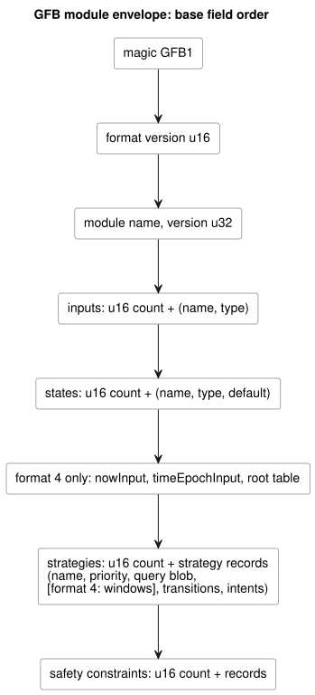
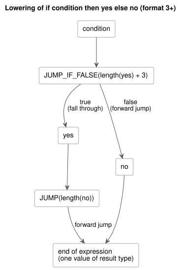

# GFB bytecode

GFB is the binary format that the GhostFlow compiler emits and that the native
and WASM runtimes load. This document specifies its envelope, format versions,
expression and query opcodes, safety records and diagnostic records.

General encoding rules, unless a section says otherwise:

- All integers are little-endian.
- Strings are a `u16 length` followed by UTF-8 bytes.
- Values use a bounded postfix stack; conditional expressions use forward
  branches only.
- Public compilation accepts a complete canonical `.ghost.md` document. The
  S-expression representation in `tools/gfb1.mjs` is internal compiler IR, not a
  public input.

In this document:

- Profile extensions, newest first: [GFB25 continuous Percent resources](#continuous-percent-resource-envelope-gfb25),
  [provisional lifecycle framing and GFB18 calendar boundaries](#provisional-lifecycle-framing),
  [GFB13 bounded natural policies](#bounded-natural-policies-gfb13).
- Core format: [module envelope and format decision](#module-envelope-and-format-decision),
  [expression opcodes](#expression-opcodes),
  [format 4 temporal window records](#format-4-temporal-window-records),
  [query opcodes](#query-opcodes),
  [safety records and host manifest](#safety-records-and-host-manifest).
- Verification and diagnostics: [conformance artifacts](#conformance-artifacts),
  [Result consumption diagnostics](#result-consumption-diagnostics),
  [compiler stage boundary](#compiler-stage-boundary).
- [Immutable UTC Range (format 12)](#immutable-utc-range-format-12).

## Continuous Percent resource envelope (GFB25)

GFB25 encodes the scalar continuous resource profile from Reference §4.9.

- It wraps a GFB1/2/3/4 base with exactly one strategy.
- It allows no temporal, schedule, objective, Bool-constraint or lifecycle
  profile.
- Ordinary VM transitions still use the previous state.
- The *resource plan* evaluates dedicated expression bytecode against the same
  inputs and previous state. It then owns every final Number output.
- Requests and ceilings are never exposed as actuator outputs.

**Encoding.** All integers are little-endian. Text is a `u16` UTF-8 length
followed by bytes. Identities contain 1..128 bytes. Hashes are 64 lowercase
hexadecimal characters. A blob is a `u32 length` followed by bytes. The envelope
contains these fields, in order:

1. `GFB1`, format `25:u16`, base blob.
2. Canonical source SHA-256, checked descriptor SHA-256, activation blob.
3. Policy count `u16`, at most eight.
4. Each policy: source node ID `u32`, name, resource alias, output name,
   selection `u8` (`0=min`, `1=max`), authored safe Percent `f64`, request list,
   and ceiling list.
5. Each list: `u16 count`, then per entry a source node ID `u32`, a name, and four
   expression blobs:
   - Bool known tag;
   - Number Percent value;
   - Number SensorFault code: 0=Disconnected, 1=Stale, 2=Invalid, 3=NotReady;
   - Number origin tag.

   The owner evaluates the value only when the entry is known, and the reason and
   origin only on fault. No next-state expression is permitted.

**Limits.**

| Item | Limit |
|---|---|
| Requests per policy | 1..16 |
| Ceilings per policy | 0..16 |
| Request + ceiling entries per module | at most 32 |
| Finite Percent values | within 0..100 |
| Module size | at most 1 MiB |
| Activation size | at most 64 KiB |

Source node IDs are nonzero and globally unique across these policies and
entries. Runtime identities are `sourceHash:nodeId`. Every output and every bound
resource has exactly one policy.

**Activation and scan binding.**

- *GFRB2 activation* contains `GFRB`, version `2:u16`, installation revision, run
  ID, binding SHA-256, source SHA-256, a `u16` resource count, and resource
  records. Each record holds an alias, a stable resource ID, an output name, and
  the typed value tag `2:u8` for Percent.
- *GFRS2 scan binding* contains `GFRS`, version `2:u16`, binding SHA-256, run ID,
  and source SHA-256.

Activation must match the compiled packet exactly. Each scan must match the
activated identity. The compiler derives the binding digest from canonical
installation JSON. Installation JSON supplies identities and mappings, never
expressions or policy rules.

**Compatibility.** The existing resource activation and scan pointer/length
exports accept these new packet versions. GFB17 and GFRB1/GFRS1 keep their
Bool-only meanings. The shared Rust `ResourceBindingRegistry` reserves stable
resource IDs across both profiles. Hosts spanning WASM instances or workers must
share the installation writer registry; the reference bound adapter covers only
its own JavaScript realm.

**Trace.** `continuousResourceTrace` contains Rust-owned decisions committed with
the tick:

- all known/fault entries;
- the selected value and tied IDs;
- the authored fallback;
- the clamp by known ceilings;
- the final value;
- the source, binding, run and tick identities.

`conditionsKnown=false` survives fallback. This record is logical execution
evidence. It makes no claim of physical application or confirmation.

**Developer verification.** These focused commands build the shared owner without
allocating an official release identity:

```sh
cargo build --locked --offline --release -p ghostflow-core --example resource_tape
cargo build --locked --offline --release -p ghostflow-wasm --target wasm32-unknown-unknown
node --test tests/continuous-resource-control.test.mjs
```

The test selectors are `GF-TEST-continuous-resource-compile`,
`GF-TEST-continuous-resource-parity`, `GF-TEST-continuous-resource-dynamic`,
`GF-TEST-continuous-resource-atomic`, `GF-TEST-continuous-resource-ceilings`, and
`GF-TEST-continuous-resource-malformed`.
Official verification and package identity remain separate gates.

## Provisional lifecycle framing

**GFB22 lifecycle candidate.** The local GFB22 candidate wraps unchanged inner GFB
bytes and the checked restart descriptor; see
[Scan frame WASM](SCAN-FRAME-WASM.md#restart-lifecycle-extension).

Format numbers in this area are easy to confuse:

| Format | Meaning |
|---|---|
| GFB19 | live Range start (current meaning) |
| GFB20 | keyed TimeSlots Range |
| 21 | immutable IANA Range |
| GFB22 | local lifecycle wrapper candidate |

The published `ghostflow-runtime-99ca1a3` used GFB19 for a lifecycle wrapper. That
collides with the current Range allocation, so the combined loader rejects it,
without translation or fallback. Its historical bytes and consumer pins remain
fixed. Recompile reviewed source to get a distinct owner candidate; format 22
separates this lifecycle wrapper from the immutable IANA Range format 21. The
unpublished lifecycle21 candidate is rejected. None of this publishes a release
or verifies physical execution.

**GFB18 calendar boundaries.** GFB18 adds the adopted calendar boundary profile
`GhostFlow/control-v18`:

- Prelude tag 17 is a calendar-filtered immutable UTC Daily Range.
- Prelude tag 18 is a typed calendar Result with protected Bool/Bool/fault-code
  inputs.

Their exact layouts and the unchanged GFSF5 facts are in
[Context execution ABI](CONTEXT-EXECUTION-ABI.md#gfb18-calendar-boundaries).
Range rejects work intervals that cross midnight. It permits explicit separate
ranges, one ending at midnight and one starting on the next date. Existing
ordinary Range and older binary layouts keep their semantics. These tags require
a GFB18 header; older loaders reject it. These identifiers do not certify a
Device release or physical execution.

## Bounded natural policies (GFB13)

Only extended Solar/Tide policies select GFB13 and `GhostFlow/control-v12`. Legacy
profile bytes remain unchanged.

- **Solar tag 1** keeps its layout and appends, after the `when` expression,
  `holdMs:u64` (0 means none) and `fallbackAtMs:u64` (86400000 means skip).
- **Context records** append `holdMs:u64` after the cancellation expression.
- **Manifest policies** are objects: clock
  `{kind: 'hold_trusted', durationMs, terminal: 'skip'}` and fallback
  `{kind: 'fixed_time', atMs, terminal: 'skip'}`.

Extended Solar facts use GFSF6. GFSF6 keeps the Solar v1 row layout and appends,
after the provider/context strings, an optional `fallbackWallMs` and
`unavailableReason:u8` (255 means none; 0–5 are natural-context reason codes).
Legacy v1 packets and WASM function names remain unchanged. Pinned older runtimes
reject GFB13 before activation. The signed portable-package config-only GFB11
profile remains narrow. This format is not physical Device evidence.

## Module envelope and format decision

A module has these fields, in order. The diagram after the list shows the same
order.

- magic: `GFB1` (the envelope magic is unchanged across formats)
- format version: `u16`
- module name: string
- module version: `u32`
- inputs: `u16 count`, then `(name, type)` records
- states: `u16 count`, then `(name, type, default value)` records
- strategies: `u16 count`, then strategy records
- safety constraints: `u16 count`, then constraint records
- format 4 temporal header: after states, `nowInput`, `timeEpochInput`, and root table
- format 4 temporal strategy table: after each query, window descriptors precede transitions/intents



The compiler selects the format from the features the program uses:

| Format | Compiler selection | Value types |
|---|---|---|
| 1 | Straight-line expressions without Int | `1=Bool`, `2=Number` |
| 2 | Straight-line expressions with Int declarations or operations | Also `3=Int` |
| 3 | Branches, dynamic Int/Number conversions, or nominal (time) value guards | Bool, Number and Int |
| 4 | Temporal window modules with physical roots and temporal clock inputs | Existing format 3 types plus bounded window descriptors |
| 5 | Solar schedule prelude | Format 4 types plus tagged schedule descriptors |
| 6 | Continuous `true_for` prelude | Temporal types plus true-for descriptors |
| 7 | PID objective | Bool, Number and Int plus objective record |
| 8 | Daily schedule prelude | Temporal types plus Daily descriptors |
| 9 | DailySlots schedule prelude | Temporal types plus DailySlots descriptors |
| 11 | Typed configuration streams and context execution | Context preludes and optional PID objective; replaces the prior format 10 context profile |
| 12 | Immutable UTC Range | GFB11 context layout plus UTC Range tag 13 |

These are compiler output profiles. They are not a promise that every host
supports every profile. See the feature-specific ABI documents for record layouts
and activation. Later profile numbers (13, 18, 22, 25 and others) are described
in the sections above and in those ABI documents.

**The 2026-09-22 format decision.**

- It introduces format 3 for Reference §2.6 evaluation.
- Formats 1 and 2 remain the current compact profiles for straight-line programs.
- Superseded eager expression opcodes `11`, `12`, and `18` are rejected in
  **every** profile. Recompile sources containing those operations; loaders never
  translate them or fall back to eager execution.
- Unsupported format numbers fail before activation.
- Existing straight-line golden vectors keep their exact bytes and hashes.

Format 2 requires an Int declaration or instruction. Int immediate bytes do not
count as opcodes. Format 3 permits branches that use only Bool and Number. Its
integer instructions and capability-query type tags mean the same as in format 2.

**Strategies and defaults.** Each strategy contains a name, a signed priority, a
query blob, transitions, and intents. A blob has a `u32` byte-length prefix. A
transition names a state by `u16` index. An intent has a name and a result type.
Defaults encode Bool as `u8`, Number as a finite `f64`, and Int as a signed `i32`.

## Expression opcodes

| Opcode | Operands | Meaning |
|---:|---|---|
| 1 | `u8` | Bool constant, 0 or 1 |
| 2 | `f64` | Finite Number constant |
| 3 | `u16` | Input index |
| 4 | `u16` | Previous state index |
| 5 | `u16` | Next state index; intents only |
| 10 | — | Boolean NOT |
| 13 | — | Equal values of the same type |
| 14–17 | — | Numeric LT, LTE, GT, GTE |
| 19–22 | — | Number ADD, SUB, MUL, DIV |
| 23 | `i32` | Int constant; formats 2 and 3 |
| 24 | — | Checked Int negation |
| 25–29 | — | Checked Int ADD, SUB, MUL, DIV, REM |
| 30 | `u16 displacement` | Pop Bool; jump if false; format 3 |
| 31 | `u16 displacement` | Unconditional jump; format 3 |
| 32–47 | — | Number constant `opcode - 32` (0 through 15); format 3 |
| 48 | — | Int to exact Number; formats 3 and 4 |
| 49–53 | — | Number to Int: exact, floor, ceil, trunc, nearest-even; formats 3 and 4 |
| 54 | — | Check Duration milliseconds, Number → Number; formats 3 and 4 |
| 55 | — | Check DateTime UTC epoch milliseconds, Number → Number; formats 3 and 4 |
| 56 | `u32 site` | Trace Result consumption; `[payload:T, choice:Number, origin:Number] → [payload:T]`; formats 3 and 4 |
| 57 | `u16 slot, u8 field` | Temporal window projection: `0=ok`, `1=value`, `2=fault`, `3=origin`, `4=admissionRevision`, `5=newestTimestamp`, `6=count`, `7=quality`; temporal formats with windows |
| 58 | `u16 slot, u8 field` | Schedule projection: `0=due`, `1=missed`, `2=active` (context profiles only for `active`); formats 5, 6, 8, 9 and 11 with schedules |
| 59 | `u16 slot, u8 field` | Continuous `true_for` projection: `0=ok`, `1=value`, `2=fault`, `3=origin`, `4=start`, `5=end`, `6=covered`; format 6 |
| 60 | — | Check finite Percent in `0..100`, Number → Number; existing time-guard profiles |

**Compact Number constants (32–47).** The compiler uses these in branched
expressions so that finite enum control programs fit the same 4096-byte
expression budget. They still have Number identity and are unrelated to Int's
opcode 23 and type tag 3. Negative zero keeps the ordinary `NUMBER_CONST f64`
encoding and its sign, as do all other Number values. Formats 1 and 2 reject the
compact opcodes and keep their current straight-line bytes.

**Dynamic conversions (48–53).** Each conversion consumes one typed operand and
produces one typed result.

- Number-to-Int operations round according to their explicit policy. They then
  reject values outside `-2147483648..2147483647` with
  `integer-conversion-out-of-range`.
- For `int_exact`, a finite fractional value produces
  `integer-conversion-fractional` before the range check, including
  `2147483648.5`.
- Non-finite input remains invalid at the existing Number input boundary.
- A conversion fault rejects the entire tick.
- Conversions in an unselected branch do not execute.
- Constant conversions keep compile-time diagnostics and literal lowering; their
  straight-line programs can still select format 1 or 2.

**The Percent guard (60) and `percent-range-v1`.** Dynamic Percent arithmetic uses
the additive opcode `60` in the profiles that admit the existing time guards,
except historical GFB10. Module layouts and format selection are unchanged.

- The compiler manifest declares `requiredRuntimeFeatures: ["percent-range-v1"]`.
  Hosts validate that requirement, but the executable loader remains
  authoritative for the actual instruction set.
- Older cores reject the unknown opcode during load, before activation. A
  matching GFB format number alone does not establish support for this
  instruction.
- Existing programs without the guard keep their bytes and omit the requirement.
- Consumers must use a core revision containing the Percent guard before
  installing guarded programs. This change does not release or update Device
  firmware.

Package verifiers require the target to explicitly allow `percent-range-v1`. The
JS option is `supportedRuntimeFeatures`; the Rust verification profile uses
`supported_runtime_features`. The declaration must match the compiled program.
The reference host checks the loaded module before activation. Historical GFB10
cannot declare or contain the new instruction; current source compiles to current
profiles. Existing GFB10 programs remain loadable without a new feature
declaration.

**Range guards (54, 55, 60).** Each guard leaves a valid Number unchanged and
rejects the tick otherwise:

| Guard | Accepted values | Tick rejection |
|---|---|---|
| `CHECK_PERCENT` | finite Number in the inclusive range `0..100`, including fractions | `percent-out-of-range` |
| `CHECK_DURATION` | finite integer in `0..9007199254740991` | `duration-out-of-range` |
| `CHECK_DATETIME` | finite integer UTC epoch milliseconds in `0..253402300799999` | `datetime-out-of-range` |

`CHECK_PERCENT`: the compiler emits it immediately after each dynamic arithmetic
operation with a Percent result, including unary minus. It also checks
intermediate expressions and inlined function bodies. Unselected branches do not
execute their guards. A Percent ratio that returns Number needs no guard. Failure
uses the existing arithmetic rollback path: it does not clamp outputs or add a
constraint fault, and the last committed state and intents remain unchanged.

`CHECK_DURATION`: the source compiler emits the guard immediately after each
dynamic Duration arithmetic operation, including unary minus. Later arithmetic
therefore cannot hide an invalid intermediate result. Constant Duration errors
remain compile diagnostics. An unselected branch does not execute its guard. The
opcode preserves the machine Number representation; it does not collapse the
manifest's nominal Duration type.

`CHECK_DATETIME`: DateTime shifts use ordinary Number arithmetic followed
immediately by this guard, so a later inverse shift cannot hide an invalid
intermediate instant. The instruction does not define arithmetic for Date or
TimeOfDay.

**Arithmetic semantics.**

- Arithmetic consumes the left operand, then the right operand.
- Number division by zero and non-finite results reject the tick.
- Int arithmetic rejects overflow and zero divisors.
- Int division truncates toward zero; the remainder has the dividend's sign.
- `MIN div -1` overflows; `MIN % -1` is exactly zero.

## Format 4 temporal window records

Format 4 uses the existing `GFB1` envelope with `u16` format version `4`. The
compiler selects it only for modules containing at least one temporal window.
Modules without windows keep their existing format selection. Format 4 includes
all format 3 expression operations.

**Temporal header.** After the scalar state table, the module stores
`u16 nowInput`, `u16 timeEpochInput`, then `u16 rootCount`. These indices bind
the reserved Number inputs `__gf_now_ms` and `__gf_time_epoch`. Each *root* (a
physical input source) stores:

- a strictly increasing positive `u32 tag`;
- a name;
- four `u16` input indices: present (`Bool`), and epoch, id and timestamp
  (`Number`).

Clock and root input bindings must be distinct.

**Window records.** Each strategy stores `u16 windowCount` before its transitions
and intents. A window record contains, in order:

1. `u32 site` and name;
2. operation (`0=average`, `1=min`, `2=max`, `3=rate`) and payload type;
3. `u64 overMs` and `u64 maxAgeMs`;
4. `u16 rootRefCount` and sorted `u16` root indices;
5. six length-prefixed source expressions: `ok` (Bool), `payload` (payload
   type), and `fault`, `origin`, `quality`, `sourceTag` (Number).

Durations are in `1..2^53-1`. Average and rate use Number payloads; minimum and
maximum may use Number or Int. Each strategy's scalar state count plus window
count is limited to 128.

**Reading windows (opcode 57).** Opcode 57 reads a window slot and field. Fields 0
and 1 have Bool and payload types respectively; fields 2 through 7 have Number
type. Successful aggregate quality is `3`; unavailable quality is `0`. Formats 1
through 3 and device queries reject opcode 57. Source expressions may read prior
window slots only; transitions and intents may read all slots in their strategy.

The verifier rejects these before activation:

- invalid root/window sites;
- duplicate names;
- noncanonical root order;
- invalid durations;
- source expression type mismatches.

**Evidence references.** The sixth source expression (`sourceTag`) is an
evidence reference interpreted by quality:

- quality `1` selects a physical root tag;
- quality `3` selects a prior window site.

These are distinct identity namespaces. Opcode-57 reads of field 7 in the quality
expression declare the prior-window evidence dependencies. Their physical roots
must be included in the consumer's root references. Other window reads used only
in control conditions do not declare evidence. A constant quality `3` alone cannot
authorize an arbitrary upstream window. Both the encoder and the native loader
validate these bindings before activation; no additional opcode or wire field is
used.

**Manifest descriptors.** Nested-window manifest descriptors include a non-empty
`upstreamWindows` array of `{name, site, slot}`, sorted by prior slot.
Physical-only descriptors omit it. The `sources` array contains all transitive
physical roots. Canonical package replay pins these fields; the native package
verifier also checks them against the decoded prior-window dependencies.

The `GhostFlow/control-v4` manifest binds the generated `__gf_now_ms` and
`__gf_time_epoch` inputs and the window signal descriptors. Density facts, target
memory budgets and the execution epoch are activation inputs. Loading does not
invent them, and they are not encoded as authored manifest settings.

**Branch rules.** Branch displacements count bytes from the end of the
displacement immediate.

- A displacement must be positive and land on an instruction boundary or the
  expression end.
- Backward edges, loops, targets outside the expression and unreachable
  instruction bytes are invalid.
- Both outgoing paths are verified, including unselected paths.
- Every join requires identical stack height and types.
- Every path must finish with one value of the declared result type.
- Stack capacity is 128 values.

For `if condition then yes else no`, lowering is:

```text
condition
JUMP_IF_FALSE(length(yes) + 3)
yes
JUMP(length(no))
no
```

The `+ 3` skips the 3-byte `JUMP` instruction (opcode plus `u16` displacement).
The diagram below shows the two forward paths.



`left && right` lowers as `if left then right else false`.
`left || right` lowers as `if left then true else right`. Conditions and selected
branches execute left to right in Rust, on both native and WASM. Unselected
branches cannot produce runtime faults. Compile-time type and name errors still
fail compilation.

For input index 0, `if guard then true else false` has these exact bytes:

```text
03 00 00  1e 05 00  01 01  1f 02 00  01 00
INPUT(0)  JFALSE(5) TRUE   JUMP(2)   FALSE
```

Here `1e` is opcode 30 and `1f` is opcode 31. `JFALSE(5)` skips `TRUE` (2 bytes)
and `JUMP(2)` (3 bytes); `JUMP(2)` skips `FALSE` (2 bytes).

## Query opcodes

Queries (strategy capability predicates) have a separate instruction namespace:

- `1 HAS kind-string name-string type-u8`
- `2 ALL u16-child-count`
- `3 ANY u16-child-count`
- `4 NOT`
- `5 BOOL_CONST u8` (0 or 1)

These effect-free capability predicates keep postfix evaluation. Retiring the
eager expression opcodes does not change query ALL/ANY. The verifier checks all
query operands, capability types, stack bounds and the single Boolean result.

## Safety records and host manifest

**Constraint records.** A constraint record is `kind:u8`, `arity:u16`, then that
many distinct Boolean intent names.

| Kind | Name | Names |
|---|---|---|
| 1 | `requires` | exactly two |
| 2 | `mutex` | 2–32 |
| 3 | `requires-any` | a target, then 1–31 alternatives |

Each round reads one candidate snapshot and applies all false-only blocks together.
Rounds repeat until a fixed point.

**Module limits.**

| Item | Limit |
|---|---|
| Module size | 1 MiB |
| Name | 128 UTF-8 bytes |
| Inputs, states, intents, constraints | 128 each |
| Strategies | 32 |
| Blob | 4096 bytes |
| Format 4: scalar states + windows per strategy | 128 |

Runtime faults reject the tick before committing state, intents or the journal.
Unknown expression/query opcodes and constraint kinds are rejected before
activation.

**Manifest versus bytecode.** The manifest schema and the bytecode format are
distinct contracts.

- A `GhostFlow/control-v4` manifest can bind Int-capable GFB format 2 or 3, and
  window manifests pair with GFB format 4.
- A branch alone does not require the Int manifest schema.
- `.gfb.manifest.json` preserves nominal types and generated inputs;
  `.gfb.map.json` preserves the source mapping.
- The manifest's `bytecodeSha256` binds the exact bytecode bytes. It is not
  authentication.
- A missing generated input is a runtime error.

See [IMPLEMENTATION.md](IMPLEMENTATION.md).

## Conformance artifacts

`tests/fixtures/gfb1-golden-v1.ghost.md` and
`tests/fixtures/gfb2-int-golden-v1.ghost.md` are the authoritative literate
sources for the corresponding tracked `.gfb` files and digest metadata `.json`
files.

- Node and browser compilation preserve the straight-line vectors.
- Native and WASM loaders reject invalid versions, malformed bytecode and retired
  eager instructions.
- `tests/gfb2-int.test.mjs` also fixes the format-3 branch bytes and exercises
  selected/unselected runtime faults through both hosts.
- Core Rust tests cover nested branch execution, branch joins, invalid indices
  and stack boundaries.

## Result consumption diagnostics

`TRACE_RESULT` (56) records how a Result value was consumed (Ok or which fault),
without changing the value. It requires a positive `u32` site. The compiler's internal
form is `(trace-result site payload choice origin)`.

- Evaluation computes payload, then choice, then origin, and only then records an
  event. The payload's value and type are unchanged.
- *Choice* is an exact Number integer in `0..65535`. Zero means Ok; a fault uses
  its error enum ordinal plus one.
- *Origin* is an exact Number integer in `0..4294967295`, with zero as the
  default.
- Invalid metadata rejects the tick with `result-trace-out-of-range`.
- Source metadata binds site and origin identifiers to the exact source revision
  and the error enum. The VM does not infer those names.

**Where events go.** Every committed TickRecord JSON has a dedicated
`resultTrace` array of `{site, choice, origin}` events.

- Events follow execution order, including repeated sites.
- An unexecuted marker produces no event.
- Diagnostics never enter requested or safe actuator intents.
- A later fault discards the tick's entire diagnostic buffer, along with its
  candidate state and intents.
- Rewind retains the selected journal record; ghost replay regenerates
  diagnostics from recorded inputs.
- There is no separate mutable diagnostic checkpoint state and no new native/WASM
  C ABI.

**Bounds.** The loader counts marker instructions in every transition, intent and
format 4 window source expression. Forward-only control flow executes each
instruction at most once per expression, so the module's expression bytes bound
all events in a tick. Copied expressions count separately. With the 1 MiB module
limit and five bytes per marker, a conservative upper bound is
`floor(1,048,576 / 5) = 209715` markers, before headers and other records reduce
it further. At 12 bytes per event, that is at most 2516580 bytes before collection
overhead. Retained diagnostics also obey the existing bounded journal capacity.

[Portable GFB packages](PORTABLE-PACKAGE.md) preserve the exact bytecode and bind
its source, manifest, source map, compiler/runtime identity and installation
binding. Packaging never rewrites bytecode.

## Compiler stage boundary

Compilation runs in stages:

1. The location-aware Surface AST passes through checked source lowering.
2. Lowering produces an in-memory typed Core IR. It has resolved input/state
   references, semantic expression types and operators, requested intents, Bool
   constraints, and explicit extension descriptors for temporal, config, quality
   and objective behavior. The S-expression form named above is the internal
   lowering input to this stage.
3. Only the GFB emitter maps the Core IR to numeric opcodes, selects a format and
   writes bytes.

This separation changes no GFB wire version or runtime contract.

## Immutable UTC Range (format 12)

GFB12 requires at least one UTC Range prelude. Otherwise it uses the GFB11 context
layout and the optional objective trailer.

**Encoding.** Tagged prelude `13` encodes, in order: `site:u32`, name string,
`gapMs:u64`, timezone string (`UTC` only), `durationMs:u64`, `startCount:u16`,
then sorted unique `startMs:u64` values, and the `when` and `cancel_when`
expression blobs.

**Constraints.**

- There are 1–96 starts in `[0,86400000)`.
- Duration is in `[1,86400000]`.
- Circular daily spacing between starts must be at least the duration.
- The native decoder independently validates these bounds and non-overlap.

**Compatibility.** Old format bytes remain unchanged. Older consumers reject
format 12 before activation. Downgrading the header cannot turn tag 13 into a
GFB11 prelude.

**Manifest and runtime.** The manifest remains `GhostFlow/control-v10` and uses
the existing context facts ABI.

- Each Range site requires empty occurrence rows and no calendar/provider; the
  runtime derives UTC plans from trusted wall time.
- Occurrence identity uses the site, the UTC source day and a stable sorted slot
  key.
- Range engine checkpoints use GFES2 with GFRG1 consumed-key ledgers; prior
  engines keep GFES1.
- A new boot keeps deduplication but never resumes an active timer.
- Capacity exhaustion and malformed checkpoints fail explicitly and atomically.
- Signed portable-package configuration profiles remain GFB11 and do not accept
  GFB12.
