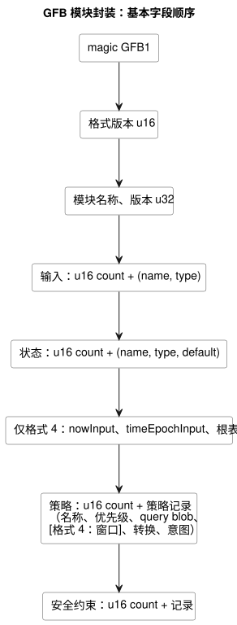
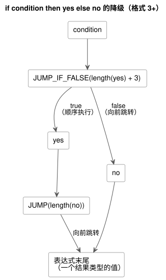

<!-- translation-source: docs/BYTECODE.md -->
[英文原文](BYTECODE.md)

# GFB 字节码

GFB 是 GhostFlow 编译器输出、并由原生和 WASM 运行时加载的二进制格式。本文档规定其封装、格式版本、表达式与查询操作码、安全记录和诊断记录。

除非某节另有说明，通用编码规则如下：

- 所有整数均为小端序。
- 字符串为 `u16 length` 后接 UTF-8 字节。
- 值使用有界的后缀栈；条件表达式只使用向前分支。
- 公开编译接受完整的规范 `.ghost.md` 文档。`tools/gfb1.mjs` 中的 S 表达式表示是编译器内部 IR，而不是公开输入。

本文档内容：

- Profile 扩展，按从新到旧排列：[GFB25 连续 Percent 资源](#连续-percent-资源包络gfb25)、
  [暂定的生命周期封装与 GFB18 日历边界](#暂定的生命周期封装)、
  [GFB13 有界自然策略](#有界自然策略gfb13)。
- 核心格式：[模块封装与格式决定](#模块封装与格式决定)、
  [表达式操作码](#表达式操作码)、
  [格式 4 时间窗口记录](#格式-4-时间窗口记录)、
  [查询操作码](#查询操作码)、
  [安全记录与宿主清单](#安全记录与宿主清单)。
- 验证与诊断：[一致性测试产物](#一致性测试产物)、
  [Result 消费诊断](#result-消费诊断)、
  [编译器阶段边界](#编译器阶段边界)。
- [不可变 UTC Range（格式 12）](#不可变-utc-range格式-12)。

## 连续 Percent 资源包络（GFB25）

GFB25 编码 Reference §4.9 中的标量连续资源 profile。

- 它包装一个 GFB1/2/3/4 基础模块，且恰好只有一个策略。
- 它不允许任何时间、调度计划、目标（objective）、Bool 约束或生命周期 profile。
- 普通的 VM 状态转换仍使用前一状态。
- *资源计划*针对相同的输入和前一状态，对专用的表达式字节码求值。随后它拥有每一个最终的 Number 输出。
- 请求值和上限从不作为执行器输出公开。

**编码。** 所有整数均为小端序。文本为 `u16` UTF-8 长度后接字节。身份标识包含 1..128 个字节。哈希为 64 个小写十六进制字符。blob 为 `u32 length` 后接字节。封装按顺序包含以下字段：

1. `GFB1`、格式 `25:u16`、基础 blob。
2. 规范源 SHA-256、已检查描述符 SHA-256、激活 blob。
3. 策略数量 `u16`，最多 8 个。
4. 每个策略：源节点 ID `u32`、名称、资源别名、输出名称、选择方式 `u8`（`0=min`、`1=max`）、编写的安全 Percent `f64`、请求列表和上限列表。
5. 每个列表：`u16 count`，然后每个条目包含一个源节点 ID `u32`、一个名称和四个表达式 blob：
   - Bool 已知标记；
   - Number Percent 值；
   - Number SensorFault 代码：0=Disconnected、1=Stale、2=Invalid、3=NotReady；
   - Number 来源标记。

   所有者只在条目已知时对值求值，只在故障时对原因和来源求值。不允许出现下一状态表达式。

**限制。**

| 项目 | 限制 |
|---|---|
| 每个策略的请求数 | 1..16 |
| 每个策略的上限数 | 0..16 |
| 每个模块的请求 + 上限条目 | 最多 32 |
| 有限 Percent 值 | 在 0..100 之内 |
| 模块大小 | 最多 1 MiB |
| 激活大小 | 最多 64 KiB |

源节点 ID 非零，且在这些策略和条目之间全局唯一。运行时身份标识为 `sourceHash:nodeId`。每个输出和每个已绑定资源都恰好只有一个策略。

**激活与扫描绑定。**

- *GFRB2 激活*包含 `GFRB`、版本 `2:u16`、安装修订版、运行 ID、绑定 SHA-256、源 SHA-256、`u16` 资源数量以及资源记录。每条记录包含别名、稳定的资源 ID、输出名称，以及表示 Percent 的类型化值标记 `2:u8`。
- *GFRS2 扫描绑定*包含 `GFRS`、版本 `2:u16`、绑定 SHA-256、运行 ID 和源 SHA-256。

激活必须与编译后的数据包完全匹配。每次扫描必须与已激活的身份标识匹配。编译器从规范的安装 JSON 推导绑定摘要。安装 JSON 提供身份标识和映射，从不提供表达式或策略规则。

**兼容性。** 现有的资源激活和扫描指针/长度导出函数接受这些新的数据包版本。GFB17 和 GFRB1/GFRS1 保持其仅限 Bool 的含义。共享的 Rust `ResourceBindingRegistry` 在两种 profile 之间保留稳定的资源 ID。跨越多个 WASM 实例或 worker 的宿主必须共享安装写入方注册表；参考绑定适配器只覆盖它自己的 JavaScript realm。

**追踪。** `continuousResourceTrace` 包含与 tick 一起提交、由 Rust 负责的判定：

- 所有已知/故障条目；
- 被选中的值和并列的 ID；
- 编写的 fallback 值；
- 按已知上限进行的钳位；
- 最终值；
- 源、绑定、运行和 tick 的身份标识。

`conditionsKnown=false` 在 fallback 之后依然保留。该记录是逻辑执行证据。它不声称已发生物理应用或确认。

**开发者验证。** 以下聚焦命令构建共享所有者，而不分配正式发布身份标识：

```sh
cargo build --locked --offline --release -p ghostflow-core --example resource_tape
cargo build --locked --offline --release -p ghostflow-wasm --target wasm32-unknown-unknown
node --test tests/continuous-resource-control.test.mjs
```

测试选择器为 `GF-TEST-continuous-resource-compile`、
`GF-TEST-continuous-resource-parity`、`GF-TEST-continuous-resource-dynamic`、
`GF-TEST-continuous-resource-atomic`、`GF-TEST-continuous-resource-ceilings` 和
`GF-TEST-continuous-resource-malformed`。
正式验证和包身份标识仍是单独的关卡。

## 暂定的生命周期封装

**GFB22 生命周期候选。** 本地 GFB22 候选包装未改动的内部 GFB 字节和已检查的重启描述符；参见 [Scan frame WASM](SCAN-FRAME-WASM.zh.md)（“restart lifecycle extension”一节）。

这一领域的格式编号容易混淆：

| 格式 | 含义 |
|---|---|
| GFB19 | 实时 Range 起点（当前含义） |
| GFB20 | 带键的 TimeSlots Range |
| 21 | 不可变 IANA Range |
| GFB22 | 本地生命周期包装候选 |

已发布的 `ghostflow-runtime-99ca1a3` 曾将 GFB19 用作生命周期包装。这与当前的 Range 分配冲突，因此组合加载器会拒绝它，既不转换也不回退（fallback）。其历史字节和消费方固定版本保持不变。重新编译经审核的源即可获得一个不同的所有者候选；格式 22 将该生命周期包装与不可变 IANA Range 格式 21 区分开来。未发布的 lifecycle21 候选会被拒绝。以上内容都不代表发布了某个版本，也不代表验证了物理执行。

**GFB18 日历边界。** GFB18 添加已采纳的日历边界 profile `GhostFlow/control-v18`：

- 前导（prelude）标记 17 是经日历过滤的不可变 UTC Daily Range。
- 前导标记 18 是类型化的日历 Result，带有受保护的 Bool/Bool/故障代码输入。

它们的确切布局以及未改变的 GFSF5 事实见 [Context execution ABI](CONTEXT-EXECUTION-ABI.zh.md)（“GFB18 calendar boundaries”一节）。Range 拒绝跨越午夜的工作区间。它允许显式的独立区间：一个在午夜结束，另一个从下一日期开始。现有的普通 Range 和较旧的二进制布局保持其语义。这些标记需要 GFB18 头部；较旧的加载器会拒绝它。这些标识符并不证明 Device 发布或物理执行。

## 有界自然策略（GFB13）

只有扩展的 Solar/Tide 策略才会选择 GFB13 和 `GhostFlow/control-v12`。旧版 profile 的字节保持不变。

- **Solar 标记 1** 保持其布局，并在 `when` 表达式之后追加 `holdMs:u64`（0 表示无）和 `fallbackAtMs:u64`（86400000 表示跳过）。
- **上下文记录**在取消表达式之后追加 `holdMs:u64`。
- **清单策略**是对象：时钟为
  `{kind: 'hold_trusted', durationMs, terminal: 'skip'}`，fallback 为
  `{kind: 'fixed_time', atMs, terminal: 'skip'}`。

扩展的 Solar 事实使用 GFSF6。GFSF6 保持 Solar v1 的行布局，并在 provider/上下文字符串之后追加可选的 `fallbackWallMs` 和 `unavailableReason:u8`（255 表示无；0–5 是自然上下文原因代码）。旧版 v1 数据包和 WASM 函数名保持不变。固定版本的较旧运行时会在激活之前拒绝 GFB13。已签名的可移植包中仅含配置的 GFB11 profile 仍然很窄。此格式不是物理 Device 证据。

## 模块封装与格式决定

一个模块按顺序包含以下字段。列表后的图展示了相同的顺序。

- magic：`GFB1`（封装 magic 在各格式之间保持不变）
- 格式版本：`u16`
- 模块名称：字符串
- 模块版本：`u32`
- 输入：`u16 count`，然后是 `(name, type)` 记录
- 状态：`u16 count`，然后是 `(name, type, default value)` 记录
- 策略：`u16 count`，然后是策略记录
- 安全约束：`u16 count`，然后是约束记录
- 格式 4 时间头部：位于状态之后，包含 `nowInput`、`timeEpochInput` 和根表
- 格式 4 时间策略表：在每个查询之后，窗口描述符位于转换/意图之前



编译器根据程序使用的功能选择格式：

| 格式 | 编译器选择条件 | 值类型 |
|---|---|---|
| 1 | 不含 Int 的直线型表达式 | `1=Bool`、`2=Number` |
| 2 | 含 Int 声明或运算的直线型表达式 | 另加 `3=Int` |
| 3 | 分支、动态 Int/Number 转换或名义（时间）值守卫 | Bool、Number 和 Int |
| 4 | 带物理根和时间时钟输入的时间窗口模块 | 现有格式 3 类型加上有界窗口描述符 |
| 5 | Solar 调度计划前导 | 格式 4 类型加上带标记的调度描述符 |
| 6 | 连续 `true_for` 前导 | 时间类型加上 true-for 描述符 |
| 7 | PID 目标 | Bool、Number 和 Int 加上目标记录 |
| 8 | Daily 调度计划前导 | 时间类型加上 Daily 描述符 |
| 9 | DailySlots 调度计划前导 | 时间类型加上 DailySlots 描述符 |
| 11 | 类型化配置流与上下文执行 | 上下文前导和可选 PID 目标；取代之前的格式 10 上下文 profile |
| 12 | 不可变 UTC Range | GFB11 上下文布局加上 UTC Range 标记 13 |

这些是编译器输出 profile。它们并不承诺每个宿主都支持每个 profile。记录布局和激活方式请参见各功能专属的 ABI 文档。后续的 profile 编号（13、18、22、25 等）在上面各节及这些 ABI 文档中说明。

**2026-09-22 格式决定。**

- 它为 Reference §2.6 的求值引入格式 3。
- 格式 1 和 2 仍是直线型程序当前的紧凑 profile。
- 已被取代的急切（eager）表达式操作码 `11`、`12` 和 `18` 在**每一个** profile 中都会被拒绝。请重新编译包含这些运算的源；加载器从不转换它们，也从不回退到急切执行。
- 不支持的格式编号会在激活之前失败。
- 现有直线型黄金向量保持其确切的字节和哈希。

格式 2 需要 Int 声明或指令。Int 立即数字节不算作操作码。格式 3 允许只使用 Bool 和 Number 的分支。其整数指令和能力查询类型标记的含义与格式 2 相同。

**策略与默认值。** 每个策略包含名称、有符号优先级、查询 blob、转换和意图。blob 带有 `u32` 字节长度前缀。转换通过 `u16` 索引指定状态。意图有名称和结果类型。默认值将 Bool 编码为 `u8`，Number 编码为有限的 `f64`，Int 编码为有符号 `i32`。

## 表达式操作码

| 操作码 | 操作数 | 含义 |
|---:|---|---|
| 1 | `u8` | Bool 常量，0 或 1 |
| 2 | `f64` | 有限 Number 常量 |
| 3 | `u16` | 输入索引 |
| 4 | `u16` | 前一状态索引 |
| 5 | `u16` | 下一状态索引；仅限意图 |
| 10 | — | Bool NOT |
| 13 | — | 同类型的值相等 |
| 14–17 | — | 数值 LT、LTE、GT、GTE |
| 19–22 | — | Number ADD、SUB、MUL、DIV |
| 23 | `i32` | Int 常量；格式 2 和 3 |
| 24 | — | 经检查的 Int 取负 |
| 25–29 | — | 经检查的 Int ADD、SUB、MUL、DIV、REM |
| 30 | `u16 displacement` | 弹出 Bool；为 false 时跳转；格式 3 |
| 31 | `u16 displacement` | 无条件跳转；格式 3 |
| 32–47 | — | Number 常量 `opcode - 32`（0 到 15）；格式 3 |
| 48 | — | Int 转为精确 Number；格式 3 和 4 |
| 49–53 | — | Number 转为 Int：exact、floor、ceil、trunc、nearest-even；格式 3 和 4 |
| 54 | — | 检查 Duration 毫秒数，Number → Number；格式 3 和 4 |
| 55 | — | 检查 DateTime UTC 纪元毫秒数，Number → Number；格式 3 和 4 |
| 56 | `u32 site` | 追踪 Result 消费；`[payload:T, choice:Number, origin:Number] → [payload:T]`；格式 3 和 4 |
| 57 | `u16 slot, u8 field` | 时间窗口投影：`0=ok`、`1=value`、`2=fault`、`3=origin`、`4=admissionRevision`、`5=newestTimestamp`、`6=count`、`7=quality`；带窗口的时间格式 |
| 58 | `u16 slot, u8 field` | 调度计划投影：`0=due`、`1=missed`、`2=active`（`active` 仅限上下文 profile）；带调度计划的格式 5、6、8、9 和 11 |
| 59 | `u16 slot, u8 field` | 连续 `true_for` 投影：`0=ok`、`1=value`、`2=fault`、`3=origin`、`4=start`、`5=end`、`6=covered`；格式 6 |
| 60 | — | 检查 `0..100` 内的有限 Percent，Number → Number；现有的时间守卫 profile |

**紧凑 Number 常量（32–47）。** 编译器在带分支的表达式中使用它们，使有限枚举控制程序能放入同样 4096 字节的表达式预算。它们仍具有 Number 身份，与 Int 的操作码 23 和类型标记 3 无关。负零与所有其他 Number 值一样，保留普通的 `NUMBER_CONST f64` 编码及其符号。格式 1 和 2 拒绝紧凑操作码，并保持其当前的直线型字节。

**动态转换（48–53）。** 每个转换消耗一个类型化操作数并产生一个类型化结果。

- Number 转 Int 的运算按其显式策略取整。随后，超出 `-2147483648..2147483647` 的值会以 `integer-conversion-out-of-range` 被拒绝。
- 对于 `int_exact`，有限的小数值会在范围检查之前产生 `integer-conversion-fractional`，包括 `2147483648.5`。
- 非有限输入在现有 Number 输入边界处仍然无效。
- 转换故障会拒绝整个 tick。
- 未被选中分支中的转换不会执行。
- 常量转换保留编译期诊断和字面量降级；其直线型程序仍可选择格式 1 或 2。

**Percent 守卫（60）与 `percent-range-v1`。** 动态 Percent 算术在接受现有时间守卫的 profile 中使用新增的操作码 `60`。模块布局和格式选择不变。

- 编译器清单声明 `requiredRuntimeFeatures: ["percent-range-v1"]`。宿主会验证该要求，但对于实际指令集，可执行加载器仍具有最终权威。
- 较旧的核心会在加载期间、激活之前拒绝该未知操作码。仅凭 GFB 格式编号匹配并不能证明支持此指令。
- 不含该守卫的现有程序保持其字节，并省略该要求。
- 在安装带守卫的程序之前，消费方必须使用包含 Percent 守卫的核心修订版。此变更不会发布或更新 Device 固件。

包验证器要求目标显式允许 `percent-range-v1`。JS 选项为 `supportedRuntimeFeatures`；Rust 验证 profile 使用 `supported_runtime_features`。声明必须与编译后的程序相符。参考宿主会在激活之前检查已加载的模块。运行时和包验证器拒绝历史 GFB10（`control-v9`）。重新编译规范源文件可生成当前格式的产物。

**范围守卫（54、55、60）。** 每个守卫让有效的 Number 保持不变，否则拒绝该 tick：

| 守卫 | 接受的值 | tick 拒绝原因 |
|---|---|---|
| `CHECK_PERCENT` | 闭区间 `0..100` 内的有限 Number，包括小数 | `percent-out-of-range` |
| `CHECK_DURATION` | `0..9007199254740991` 内的有限整数 | `duration-out-of-range` |
| `CHECK_DATETIME` | `0..253402300799999` 内的有限整数 UTC 纪元毫秒数 | `datetime-out-of-range` |

`CHECK_PERCENT`：编译器在每个结果为 Percent 的动态算术运算（包括一元负号）之后立即输出它。它也会检查中间表达式和内联的函数体。未被选中的分支不会执行其守卫。返回 Number 的 Percent 比值不需要守卫。失败时使用现有的算术回滚路径：它不会钳位输出，也不会添加约束故障，最后提交的状态和意图保持不变。

`CHECK_DURATION`：源编译器在每个动态 Duration 算术运算（包括一元负号）之后立即输出该守卫。因此后续的算术无法掩盖无效的中间结果。常量 Duration 错误仍是编译诊断。未被选中的分支不会执行其守卫。该操作码保留机器层面的 Number 表示；它不会消除清单中名义上的 Duration 类型。

`CHECK_DATETIME`：DateTime 偏移使用普通的 Number 算术，并紧跟此守卫，因此后续的反向偏移无法掩盖无效的中间时刻。该指令不为 Date 或 TimeOfDay 定义算术。

**算术语义。**

- 算术先消耗左操作数，再消耗右操作数。
- Number 除以零以及非有限结果会拒绝该 tick。
- Int 算术拒绝溢出和零除数。
- Int 除法向零截断；余数的符号与被除数相同。
- `MIN div -1` 会溢出；`MIN % -1` 恰好为零。

## 格式 4 时间窗口记录

格式 4 使用现有的 `GFB1` 封装，`u16` 格式版本为 `4`。编译器只在模块包含至少一个时间窗口时选择它。不含窗口的模块保持其现有的格式选择。格式 4 包含格式 3 的所有表达式运算。

**时间头部。** 在标量状态表之后，模块存储 `u16 nowInput`、`u16 timeEpochInput`，然后是 `u16 rootCount`。这些索引绑定保留的 Number 输入 `__gf_now_ms` 和 `__gf_time_epoch`。每个*根*（一个物理输入源）存储：

- 一个严格递增的正数 `u32 tag`；
- 一个名称；
- 四个 `u16` 输入索引：present（`Bool`），以及 epoch、id 和 timestamp（`Number`）。

时钟和根的输入绑定必须互不相同。

**窗口记录。** 每个策略在其转换和意图之前存储 `u16 windowCount`。一条窗口记录按顺序包含：

1. `u32 site` 和名称；
2. 运算（`0=average`、`1=min`、`2=max`、`3=rate`）和载荷类型；
3. `u64 overMs` 和 `u64 maxAgeMs`；
4. `u16 rootRefCount` 和已排序的 `u16` 根索引；
5. 六个带长度前缀的源表达式：`ok`（Bool）、`payload`（载荷类型），以及 `fault`、`origin`、`quality`、`sourceTag`（Number）。

持续时间位于 `1..2^53-1` 之内。平均值和变化率使用 Number 载荷；最小值和最大值可以使用 Number 或 Int。每个策略的标量状态数加窗口数限制为 128。

**读取窗口（操作码 57）。** 操作码 57 读取一个窗口槽位和字段。字段 0 和 1 分别为 Bool 类型和载荷类型；字段 2 到 7 为 Number 类型。成功聚合的质量为 `3`；不可用的质量为 `0`。格式 1 到 3 以及设备查询会拒绝操作码 57。源表达式只能读取之前的窗口槽位；转换和意图可以读取其策略中的所有槽位。

验证器会在激活之前拒绝以下情况：

- 无效的根/窗口 site；
- 重复的名称；
- 非规范的根顺序；
- 无效的持续时间；
- 源表达式类型不匹配。

**证据引用。** 第六个源表达式（`sourceTag`）是一个按质量解释的证据引用：

- 质量 `1` 选择一个物理根标记；
- 质量 `3` 选择一个之前的窗口 site。

这两者是不同的身份标识命名空间。质量表达式中对字段 7 的操作码 57 读取声明了对之前窗口的证据依赖。它们的物理根必须包含在消费者的根引用中。仅用于控制条件的其他窗口读取不声明证据。仅有常量质量 `3` 不能授权任意的上游窗口。编码器和原生加载器都会在激活之前验证这些绑定；不使用额外的操作码或线路字段。

**清单描述符。** 嵌套窗口的清单描述符包含一个非空的 `upstreamWindows` 数组，元素为 `{name, site, slot}`，按之前的槽位排序。仅含物理源的描述符省略它。`sources` 数组包含所有传递性的物理根。规范包重放会固定这些字段；原生包验证器还会将它们与解码出的之前窗口依赖进行核对。

`GhostFlow/control-v4` 清单绑定生成的 `__gf_now_ms` 和 `__gf_time_epoch` 输入以及窗口信号描述符。密度事实、目标内存预算和执行纪元是激活输入。加载时不会凭空构造它们，它们也不会被编码为编写的清单设置。

**分支规则。** 分支位移从位移立即数的末尾开始计算字节。

- 位移必须为正，并落在指令边界或表达式末尾。
- 向后边、循环、表达式外的目标以及不可达的指令字节均无效。
- 两条出口路径都会被验证，包括未被选中的路径。
- 每个汇合点要求栈高度和类型完全相同。
- 每条路径必须以一个声明结果类型的值结束。
- 栈容量为 128 个值。

对于 `if condition then yes else no`，降级结果为：

```text
condition
JUMP_IF_FALSE(length(yes) + 3)
yes
JUMP(length(no))
no
```

`+ 3` 跳过 3 字节的 `JUMP` 指令（操作码加 `u16` 位移）。下图展示了两条向前路径。



`left && right` 降级为 `if left then right else false`。
`left || right` 降级为 `if left then true else right`。在原生和 WASM 上，条件和被选中的分支都在 Rust 中从左到右执行。未被选中的分支不会产生运行时故障。编译期的类型和名称错误仍会导致编译失败。

对于输入索引 0，`if guard then true else false` 的确切字节如下：

```text
03 00 00  1e 05 00  01 01  1f 02 00  01 00
INPUT(0)  JFALSE(5) TRUE   JUMP(2)   FALSE
```

其中 `1e` 是操作码 30，`1f` 是操作码 31。`JFALSE(5)` 跳过 `TRUE`（2 字节）和 `JUMP(2)`（3 字节）；`JUMP(2)` 跳过 `FALSE`（2 字节）。

## 查询操作码

查询（策略能力谓词）拥有独立的指令命名空间：

- `1 HAS kind-string name-string type-u8`
- `2 ALL u16-child-count`
- `3 ANY u16-child-count`
- `4 NOT`
- `5 BOOL_CONST u8`（0 或 1）

这些无副作用的能力谓词保持后缀求值。退役急切表达式操作码不会改变查询的 ALL/ANY。验证器会检查所有查询操作数、能力类型、栈边界以及唯一的 Bool 结果。

## 安全记录与宿主清单

**约束记录。** 约束记录为 `kind:u8`、`arity:u16`，然后是相应数量的互不相同的 Bool 意图名称。

| 种类 | 名称 | 名称数量 |
|---|---|---|
| 1 | `requires` | 恰好两个 |
| 2 | `mutex` | 2–32 |
| 3 | `requires-any` | 一个目标，然后 1–31 个备选 |

每一轮读取一个候选快照，并同时应用所有仅限 false 的阻止。各轮重复进行，直到达到不动点。

**模块限制。**

| 项目 | 限制 |
|---|---|
| 模块大小 | 1 MiB |
| 名称 | 128 个 UTF-8 字节 |
| 输入、状态、意图、约束 | 各 128 |
| 策略 | 32 |
| Blob | 4096 字节 |
| 格式 4：每个策略的标量状态 + 窗口 | 128 |

运行时故障会在提交状态、意图或 journal 之前拒绝该 tick。未知的表达式/查询操作码和约束种类会在激活之前被拒绝。

**清单与字节码。** 清单 schema 和字节码格式是不同的契约。

- `GhostFlow/control-v4` 清单可以绑定支持 Int 的 GFB 格式 2 或 3，窗口清单与 GFB 格式 4 配对。
- 仅有分支并不需要 Int 清单 schema。
- `.gfb.manifest.json` 保留名义类型和生成的输入；`.gfb.map.json` 保留源映射。
- 清单的 `bytecodeSha256` 绑定确切的字节码字节。它不是认证。
- 缺少生成的输入是运行时错误。

参见 [IMPLEMENTATION](IMPLEMENTATION.zh.md)。

## 一致性测试产物

`tests/fixtures/gfb1-golden-v1.ghost.md` 和
`tests/fixtures/gfb2-int-golden-v1.ghost.md` 是对应的已跟踪 `.gfb` 文件和摘要元数据 `.json` 文件的权威文学式源文件（literate）。

- Node 和浏览器编译会保持直线型向量不变。
- 原生和 WASM 加载器拒绝无效版本、格式错误的字节码以及已退役的急切指令。
- `tests/gfb2-int.test.mjs` 还固定了格式 3 的分支字节，并通过两种宿主测试被选中/未被选中分支中的运行时故障。
- 核心 Rust 测试覆盖嵌套分支执行、分支汇合、无效索引和栈边界。

## Result 消费诊断

`TRACE_RESULT`（56）记录一个 Result 值是如何被消费的（Ok 或哪一种故障），而不改变该值。它需要一个正数 `u32` site。编译器的内部形式为 `(trace-result site payload choice origin)`。

- 求值依次计算 payload、choice、origin，之后才记录事件。payload 的值和类型保持不变。
- *Choice* 是 `0..65535` 内的精确 Number 整数。零表示 Ok；故障使用其错误枚举序号加一。
- *Origin* 是 `0..4294967295` 内的精确 Number 整数，默认值为零。
- 无效的元数据会以 `result-trace-out-of-range` 拒绝该 tick。
- 源元数据将 site 和 origin 标识符绑定到确切的源修订版和错误枚举。VM 不会推断这些名称。

**事件去向。** 每个已提交的 TickRecord JSON 都有一个专用的 `resultTrace` 数组，元素为 `{site, choice, origin}` 事件。

- 事件遵循执行顺序，包括重复的 site。
- 未执行的标记不产生事件。
- 诊断从不进入请求或安全的执行器意图。
- 后续的故障会丢弃该 tick 的整个诊断缓冲区，连同其候选状态和意图。
- 倒带保留所选的 journal 记录；ghost 重放会根据记录的输入重新生成诊断。
- 不存在单独的可变诊断检查点状态，也没有新的原生/WASM C ABI。

**边界。** 加载器会统计每个转换、意图和格式 4 窗口源表达式中的标记指令。仅向前的控制流使每条指令在每个表达式中最多执行一次，因此模块的表达式字节数限定了一个 tick 中的所有事件。复制的表达式单独计数。在 1 MiB 模块限制、每个标记 5 字节的条件下，保守上限为 `floor(1,048,576 / 5) = 209715` 个标记，头部和其他记录还会进一步降低它。按每个事件 12 字节计算，在集合开销之前最多为 2516580 字节。保留的诊断同样遵守现有的有界 journal 容量。

[可移植 GFB 包](PORTABLE-PACKAGE.zh.md)保留确切的字节码，并绑定其源、清单、源映射、编译器/运行时身份标识以及安装绑定。打包从不改写字节码。

## 编译器阶段边界

编译分阶段运行：

1. 带位置信息的 Surface AST 经过已检查的源降级。
2. 降级生成内存中的类型化 Core IR。它包含已解析的输入/状态引用、语义表达式类型和运算符、请求意图、Bool 约束，以及针对时间、配置、质量和目标行为的显式扩展描述符。上面提到的 S 表达式形式是这一阶段的内部降级输入。
3. 只有 GFB 发射器将 Core IR 映射为数字操作码、选择格式并写入字节。

这种分离不改变任何 GFB 线路版本或运行时契约。

## 不可变 UTC Range（格式 12）

GFB12 要求至少有一个 UTC Range 前导。除此之外，它使用 GFB11 上下文布局和可选的目标尾部。

**编码。** 带标记的前导 `13` 按顺序编码：`site:u32`、名称字符串、`gapMs:u64`、时区字符串（仅限 `UTC`）、`durationMs:u64`、`startCount:u16`，然后是已排序且唯一的 `startMs:u64` 值，以及 `when` 和 `cancel_when` 表达式 blob。

**约束。**

- 在 `[0,86400000)` 内有 1–96 个起点。
- 持续时间位于 `[1,86400000]` 之内。
- 起点之间按每日循环计算的间隔必须不小于持续时间。
- 原生解码器会独立验证这些边界以及不重叠。

**兼容性。** 旧格式的字节保持不变。较旧的消费方会在激活之前拒绝格式 12。降级头部无法把标记 13 变成 GFB11 前导。

**清单与运行时。** 清单仍为 `GhostFlow/control-v10`，并使用现有的上下文事实 ABI。

- 每个 Range site 要求触发实例行为空，且没有日历/provider；运行时根据受信任的墙钟时间推导 UTC 计划。
- 触发实例（occurrence）的身份标识使用 site、UTC 源日期和一个稳定的已排序槽位键。
- Range 引擎检查点使用带 GFRG1 已消费键账本的 GFES2；之前的引擎保持 GFES1。
- 新的启动保留去重，但从不恢复正在运行的定时器。
- 容量耗尽和格式错误的检查点会明确且原子地失败。
- 已签名的可移植包配置 profile 仍为 GFB11，不接受 GFB12。
