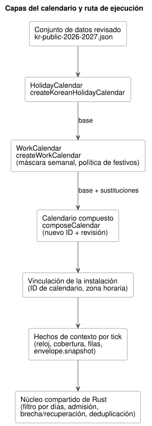
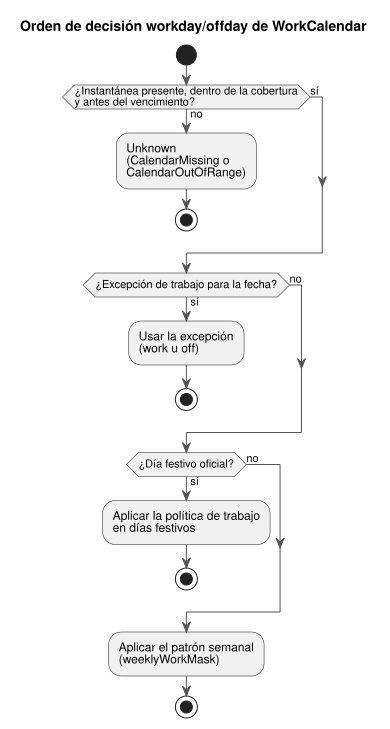

<!-- translation-source: docs/CALENDAR-PROVIDERS.md -->
[Original en inglés](CALENDAR-PROVIDERS.md)

# Días festivos de Corea y calendarios laborales agrícolas

[한국어](CALENDAR-PROVIDERS.ko.md) | [English](CALENDAR-PROVIDERS.md) | Español · [Referencia §3.8](reference/03-time-and-schedules.es.md#38-dst-medianoche-y-calendarios-laborales)

Esta guía explica cómo GhostFlow maneja los días festivos oficiales y los días
laborables de una explotación agrícola. Cubre dos partes:

- el adaptador de referencia sin conexión de `runtimes/node/calendar.mjs`, que
  construye instantáneas (snapshots) de calendario; y
- las decisiones de calendario del núcleo compartido de Rust, que deciden la
  ejecución.

**Alcance de la verificación.** La verificación cubre las comprobaciones del
compilador, las pruebas unitarias nativas de Rust, la ejecución en WASM y
ghostsim. La misma cinta de calendario no se ha ejecutado mediante un ejecutor
nativo. Esta guía no establece ningún despliegue en Device, presencia humana ni
operación física.

El diagrama siguiente muestra cómo encajan las capas del calendario, desde el
conjunto de datos revisado hasta el núcleo de Rust.



## Decisión y fundamento

**Los días festivos y los días de descanso son hechos distintos.** Un día festivo
oficial es un hecho público de fecha. Un día de descanso de la explotación es una
política de trabajo. Una explotación puede trabajar en un día festivo o cerrar un
día entre semana por mantenimiento. Por lo tanto:

- `holiday` de `HolidayCalendar` lee únicamente la pertenencia a la lista de días
  festivos.
- `workday`/`offday` de `WorkCalendar` comprueba, en orden: las excepciones de
  trabajo específicas de una fecha, después la política de trabajo en días
  festivos y después el patrón semanal.
- Una excepción `work` en un día festivo conserva el hecho de día festivo oficial.

El diagrama siguiente muestra este orden de decisión. Los datos ausentes o fuera
de rango dan Unknown antes de que se aplique cualquier regla (consulte
[Coherencia, ausencia y límites de almacenamiento](#coherencia-ausencia-y-límites-de-almacenamiento)).



**Nunca edite una base compartida; derive un calendario nuevo.** Editar una base
compartida cambiaría otras programaciones horarias y la reproducción (replay)
histórica. En su lugar, una base explícita más unas sustituciones (overrides)
produce un nuevo ID de calendario y una revisión basada en el contenido.

- No se pueden reutilizar ni el ID de la base ni un ID de linaje. El original
  permanece sin cambios.
- La zona horaria debe coincidir exactamente con la de la base.
- Se rechazan las fechas duplicadas dentro de una misma capa de superposición,
  incluso cuando su contenido coincide.
- Una capa posterior sustituye explícitamente la decisión de la capa anterior para
  esa fecha.
- Las sustituciones de días festivos y las sustituciones de trabajo son capas
  distintas y pueden aplicarse a la misma fecha.

## Datos predeterminados revisados de Corea

`createKoreanHolidayCalendar` lee el archivo
[`kr-public-2026-2027.json`](../data/calendars/kr-public-2026-2027.json) del
repositorio. Es un conjunto de datos finito:

| Propiedad | Valor |
|---|---|
| Zona horaria | solo `Asia/Seoul` |
| Cobertura | `[2026-01-01, 2028-01-01)` |
| Revisado | 2026-10-01 |
| Vencimiento predeterminado | 2028-01-01 00:00 KST |

Los llamadores pueden acortar el vencimiento, pero no ampliarlo. El vencimiento no
garantiza que la ley permanezca sin cambios hasta esa fecha. Cuando se anuncia un
día festivo temporal, una elección o una reforma, los operadores revisan las
fuentes oficiales e instalan un nuevo conjunto de datos/revisión o una sustitución
con fuente. No hay sincronización automática.

Las fuentes principales son las siguientes. Cada fecha del JSON identifica el ID
de su fuente.

- [Normas sobre días festivos del Ministerio de Gestión de Personal](https://www.mpm.go.kr/mpm/info/infoService/BizService02/): domingos, días festivos y normas limitadas de sustitución.
- [Explicación de la reforma del MPM, 2026-04-29](https://www.mpm.go.kr/mpm/comm/newsPress/newsPressRelease/?boardId=bbs_0000000000000029&category=&cntId=4250&mode=view&pageIdx=1): el Día del Trabajo, 1 de mayo, y el Día de la Constitución, 17 de julio, se aplican desde 2026.
- [Explicación del calendario 2026 del Instituto Coreano de Astronomía y Ciencias Espaciales](https://www.kasi.re.kr/kor/post/newsMaterial/32031): días festivos lunares y fechas sustitutivas existentes; es anterior a la reforma y se usa junto con la fuente de la reforma.
- [Explicación del calendario 2027 de la Administración Aeroespacial de Corea](https://www.kasa.go.kr/prog/plcyBrf/brief/kor/sub01_01_04/view.do?plcyBrfNo=431): días festivos y fechas sustitutivas de 2027.
- [Registro de las elecciones locales del Ministerio del Interior y Seguridad, 2026-06-03](https://www.mois.go.kr/video/bbs/type019/commonSelectBoardArticle.do?bbsId=BBSMSTR_000000000255&nttId=126698&searchCode1=): la fecha de las elecciones locales por fin de mandato.

**Qué contiene y qué no contiene el conjunto de datos.**

- Los domingos se expanden como hechos de día festivo oficial, pero solo dentro de
  la cobertura.
- El sábado en sí no es un día festivo oficial. Por ejemplo, no se inventa ningún
  día festivo sustitutivo para 2026-09-28 ni para 2027-06-07.
- Las fechas sustitutivas oficiales, incluidas 2027-05-03 y 2027-07-19, son hechos
  fijados.
- No se predicen fechas lunares, sustitutivas ni temporales futuras.

**Licencias.** Solo se almacenan los hechos de fecha y las citas. No se copian
documentos gubernamentales, PDF, HWPX, imágenes ni textos explicativos. El
comunicado explicativo de KASA indica la atribución KOGL Tipo 1. No se
redistribuyen los anexos de avisos con licencias independientes.

## Procedimiento para la base y las sustituciones de la explotación

Ejecute este ejemplo de Node desde la raíz del repositorio. En `weeklyWorkMask`, el
bit 0 es el domingo y el bit 6 es el sábado, por lo que `0b0111110` significa de
lunes a viernes. El adaptador no elige por usted el patrón semanal ni la política
de trabajo en días festivos de la explotación; usted proporciona ambos.

```js
import {
  createKoreanHolidayCalendar, createWorkCalendar, composeCalendar,
} from './runtimes/node/calendar.mjs';

const nowMs = Date.parse('2026-10-01T00:00:00Z');
const publicBase = createKoreanHolidayCalendar({ calendarId: 'kr-public', nowMs });
const farmBase = createWorkCalendar({
  calendarId: 'farm-weekdays', base: publicBase,
  weeklyWorkMask: 0b0111110, holidayPolicy: 'off', nowMs,
});
const farm = composeCalendar(farmBase, {
  calendarId: 'farm-harvest', timezone: 'Asia/Seoul', nowMs,
  holidayOverrides: [],
  workdayOverrides: [
    { date: '2026-10-09', class: 'work', reason: 'Approved harvest shift' },
    { date: '2026-10-12', class: 'off', reason: 'Scheduled maintenance' },
  ],
});
console.log(publicBase.snapshot.calendarId, farm.snapshot.calendarId);
console.log(farm.provenance.lineage, farm.snapshot.revision);
```

**Añadir o eliminar un día festivo oficial.** Proporcione `{ date, holiday, reason,
source }` explícitamente en `holidayOverrides`.

- `source` es una URL HTTPS de evidencia sin credenciales.
- Use `holiday: true` para un día festivo temporal recién anunciado por el
  gobierno. Los instaladores no fabrican una fecha no anunciada como hecho
  oficial.
- Una excepción de trabajo requiere su propio motivo.

**Otros países o periodos.** `createHolidayCalendar` exige una zona horaria
explícita, la cobertura, el vencimiento, los nombres de las fechas y los IDs de
fuente, las URL de las fuentes y sus fechas de publicación/revisión, y
`datasetVersion`.

**Resultados y errores.**

- El `{ snapshot, provenance }` devuelto y sus descendientes están congelados.
- La revisión es un SHA-256 sobre el contenido normalizado de la instantánea, las
  fuentes y el linaje. No depende del orden de entrada.
- La cobertura, el vencimiento y la procedencia se trasladan. La composición no
  puede ampliar la cobertura ni renovar datos vencidos.
- Trate por separado los códigos `missing-base` y `stale-base` de
  `CalendarUnavailableError`.
- Se rechazan las fechas, zonas horarias, conflictos, fuentes y revisiones
  inválidos.

## Vinculación de la instalación y ejecución

En la fuente, declare calendarios lógicos tipados y selecciónelos con los campos
`on` y `calendar` de la programación horaria Daily. Todas las políticas comunes y
las decisiones sobre DST se mantienen explícitas. Use estos archivos en conjunto:

- el [ejemplo ejecutable canónico](../examples/korean-calendar.ghost.md);
- su [proyección de lectura en inglés](../examples/korean-calendar.ghost.en.md);
- la [herramienta de cinta del host](../tools/examples/korean-calendar.mjs).

Los comandos siguientes ejecutan el ejemplo de host virtual sin E/S física.

```sh
rustup target add wasm32-unknown-unknown
cargo build --locked -p ghostflow-wasm --target wasm32-unknown-unknown --release
node tools/examples/korean-calendar.mjs
```

Un checkout nuevo necesita Rust/Cargo, Node.js y el destino WASM. Cargo puede
descargar dependencias bloqueadas durante la compilación; añada `--offline` solo
cuando estén en caché.

```ghost
calendar public_days: HolidayCalendar;
calendar farm_days: WorkCalendar;

// Daily schedule fields; complete common policies are still required.
on = day`holiday`;
calendar = public_days;
```

**Pasos.**

1. Cree la base pública, aplique la política explícita de la explotación y después
   componga las sustituciones.
2. Haga coincidir las vinculaciones de proveedor de la instalación con el ID de
   calendario y la zona horaria de cada instantánea.
3. Proporcione un reloj inmutable, la cobertura, las filas de ocurrencias civiles
   resueltas y `envelope.snapshot` como hechos de contexto para el mismo tick.
   Conserve la procedencia para la instalación y la reproducción.
4. Rust ejecuta el filtrado por días, la admisión, la brecha/recuperación y la
   deduplicación. El adaptador de Node no es un segundo motor que decida las fechas
   de ejecución ni los pulsos pendientes (due).

**Identificadores del pulso Daily de días festivos.** El pulso Daily de días
festivos se identifica mediante `holiday-daily-pulse`, GFB15 y
`GhostFlow/control-v14`.

- La disposición existente de etiquetas/bytes de días laborables/de descanso y el
  formato de transmisión de hechos GFSF5 permanecen sin cambios.
- Los cargadores más antiguos rechazan la nueva cabecera GFB.
- Estos identificadores son independientes de las versiones del paquete y del
  firmware de Device.
- Este adaptador no amplía la implementación de literales de día de la semana. La
  gramática de días de la semana del issue #155 sigue siendo un trabajo aparte.

**`calendar_is` y Range UTC de días laborables/de descanso.** El Result
`calendar_is` adoptado y el corte de Range diario UTC inmutable de días
laborables/de descanso usan GFB18/`GhostFlow/control-v18`.

- La activación requiere una vinculación de calendario UTC explícita. El ejemplo
  coreano de `Asia/Seoul` anterior sigue siendo un ejemplo de pulso Daily.
- Proporcione instantáneas identificadas en los hechos de programación horaria
  GFSF5 para cada sitio de consulta o de rango.
- Rust deriva la fecha y devuelve fallos de calendario tipados. No proporcione
  valores Bool de día laborable/de descanso calculados por el llamador.
- Las vinculaciones compartidas usan instantáneas idénticas dentro de un escaneo y
  conservan el mismo historial acotado de revisiones.

**Turnos que cruzan la medianoche.** Un Range de trabajo debe terminar a
medianoche o antes. Para un turno de `23:45` a `00:15`, escriba dos declaraciones
Daily `range(15min)` separadas, que empiecen a las `23:45` y a las `00:00`. La
segunda declaración evalúa la fecha siguiente de forma independiente; no se
infiere ninguna fecha laboral del turno.

**Fallos.** Trate explícitamente los fallos de `calendar_is` antes de negar su Bool
exitoso. Los datos ausentes, las fechas fuera de la cobertura y los datos vencidos
no permiten la admisión ni de día laborable ni de día de descanso. Esto es
semántica lógica del host de referencia, no evidencia de asistencia humana, de
salidas físicas ni de la durabilidad del medio de almacenamiento.

## Coherencia, ausencia y límites de almacenamiento

**Una instantánea por vinculación y por tick.** Las programaciones horarias que
comparten una vinculación de proveedor usan la misma instantánea de calendario en
un tick.

- La ausencia parcial, o revisiones/contenidos diferentes, rechaza el tick
  completo sin consolidar un estado parcial.
- También se rechaza reutilizar un ID/revisión de calendario con contenido
  modificado.
- Se permiten revisiones nuevas, y el contenido de las revisiones anteriores sigue
  registrado después de las revisiones posteriores.
- El núcleo compara instantáneas completas en lugar de confiar en una cadena SHA.

**Puntos de control y límites.** Los puntos de control (checkpoints) GFCXv3
conservan ese historial. El nuevo núcleo rechaza v2; los puntos de control
antiguos no se migran implícitamente.

| Elemento retenido | Límite |
|---|---|
| Instantáneas de calendario aceptadas | como máximo `min(terminalCapacity, 128)` |
| Celdas de fecha combinadas de días festivos/excepciones | como máximo 8192 |
| Carga útil almacenada | unos 144 KiB, sin contar estructuras, asignaciones y clones de transacciones |

Un registro nuevo o una restauración que supere estos límites falla de forma
cerrada (fail closed). Los hosts gestionan la vida útil de las activaciones y de
los puntos de control duraderos dentro de este límite finito de retención.

**La ausencia da Unknown.**

| Situación | Fallo |
|---|---|
| Instantánea ausente | `CalendarMissing` |
| Fecha fuera de la cobertura, o en el vencimiento o después | `CalendarOutOfRange` |

En estos casos, `holiday`, `workday` y `offday` conservan Unknown, y
`fallback = skip` no crea ninguna admisión nueva. Nunca se supone que Unknown sea
un booleano de día no festivo, de día laborable o de día de descanso (por ejemplo,
no se trata como false). Cuando se restablece el suministro, la ejecución sigue la
recuperación de referencia y no reproduce automáticamente las ocurrencias pasadas.
