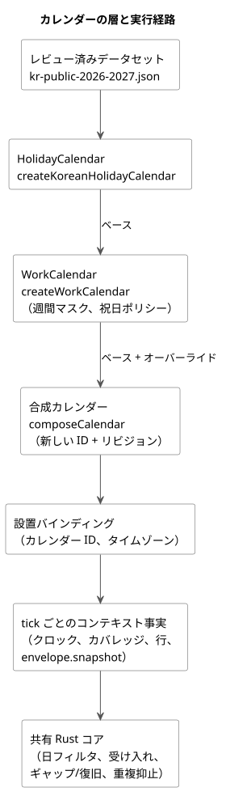
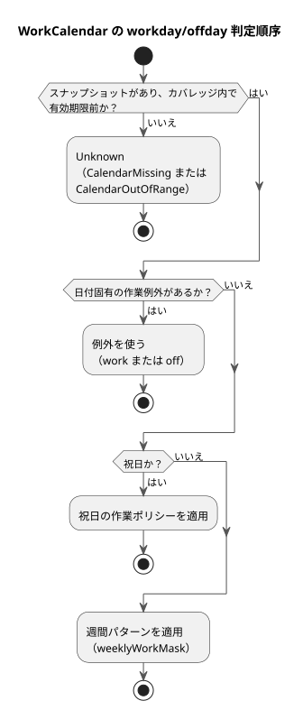

<!-- translation-source: docs/CALENDAR-PROVIDERS.md -->
[英語の原文](CALENDAR-PROVIDERS.md)

# 韓国の祝日と農場の稼働カレンダー

[リファレンス §3.8](reference/03-time-and-schedules.ja.md#38-dst深夜0時稼働カレンダー)

このガイドでは、GhostFlowが祝日と農場の稼働日をどのように扱うかを説明します。対象は次の2つです。

- カレンダースナップショットを構築する、`runtimes/node/calendar.mjs`のオフラインのリファレンスアダプタ
- 実行を決定する、共有Rustコア内のカレンダー判定

**検証の範囲。** 検証の対象は、コンパイラのチェック、ネイティブRustのユニットテスト、WASM実行、ghostsimです。同じカレンダーテープをネイティブランナーで実行したことはありません。このガイドは、Deviceへの配備、人の在席、物理的な動作のいずれも立証しません。

次の図は、レビュー済みのデータセットからRustコアまで、カレンダーの各層がどのように組み合わさるかを示します。



## 決定と根拠

**祝日と休業日は別の事実です。** 祝日は公的な日付の事実です。農場の休業日は作業ポリシーです。農場は祝日に稼働することもあれば、保守のために平日に休むこともあります。そのため、次のようになります。

- `HolidayCalendar`の`holiday`は、祝日リストへの所属だけを読みます。
- `WorkCalendar`の`workday`/`offday`は、日付固有の作業例外、祝日の作業ポリシー、週間パターンの順に確認します。
- 祝日に対する`work`例外は、祝日であるという事実をそのまま保ちます。

次の図はこの判定順序を示します。データがない場合や範囲外の場合は、どの規則よりも先にUnknownになります（[一貫性、欠落、ストレージの上限](#一貫性欠落ストレージの上限)を参照）。



**共有ベースは決して編集せず、新しいカレンダーを派生させます。** 共有ベースを編集すると、他のスケジュールや過去のリプレイが変わってしまいます。代わりに、明示的なベースとオーバーライドから、新しいカレンダーIDと内容に基づくリビジョンを生成します。

- ベースIDも系譜IDも再利用してはなりません。元のカレンダーは変わりません。
- タイムゾーンはベースと完全に一致しなければなりません。
- 1つのオーバーレイ層の中で日付が重複すると、内容が一致していても拒否されます。
- 後の層は、その日付について前の層の判定を明示的に置き換えます。
- 祝日のオーバーライドと作業のオーバーライドは別々の層であり、同じ日付に適用してもかまいません。

## レビュー済みの韓国の既定データ

`createKoreanHolidayCalendar`は、リポジトリの[`kr-public-2026-2027.json`](../data/calendars/kr-public-2026-2027.json)を読みます。これは有限のデータセットです。

| 項目 | 値 |
|---|---|
| タイムゾーン | `Asia/Seoul` のみ |
| カバレッジ | `[2026-01-01, 2028-01-01)` |
| レビュー日 | 2026-10-01 |
| 既定の有効期限 | 2028-01-01 00:00 KST |

呼び出し側は有効期限を短くできますが、延長はできません。有効期限は、その日まで法律が変わらないことを保証するものではありません。臨時休日、選挙、法改正が発表された場合は、オペレーターが公式の情報源を確認し、新しいデータセット/リビジョン、または出典付きのオーバーライドをインストールします。自動同期はありません。

主な情報源は次のとおりです。JSON内の各日付は、その情報源IDを示しています。

- [人事革新処の祝日規定](https://www.mpm.go.kr/mpm/info/infoService/BizService02/)：日曜日、祝日、限定的な振替規則。
- [人事革新処の改正説明（2026-04-29）](https://www.mpm.go.kr/mpm/comm/newsPress/newsPressRelease/?boardId=bbs_0000000000000029&category=&cntId=4250&mode=view&pageIdx=1)：勤労者の日（5月1日）と制憲節（7月17日）を2026年から適用。
- [韓国天文研究院の2026年暦の説明](https://www.kasi.re.kr/kor/post/newsMaterial/32031)：旧暦の祝日と既存の振替日。これは改正より前のものなので、改正の情報源と併せて使います。
- [宇宙航空庁の2027年暦の説明](https://www.kasa.go.kr/prog/plcyBrf/brief/kor/sub01_01_04/view.do?plcyBrfNo=431)：2027年の祝日と振替日。
- [行政安全部の地方選挙の記録（2026-06-03）](https://www.mois.go.kr/video/bbs/type019/commonSelectBoardArticle.do?bbsId=BBSMSTR_000000000255&nttId=126698&searchCode1=)：任期満了による地方選挙の日付。

**データセットに含まれるもの、含まれないもの。**

- 日曜日は祝日の事実として展開されますが、カバレッジ内に限ります。
- 土曜日そのものは祝日ではありません。たとえば、2026-09-28や2027-06-07に振替休日をでっち上げることはしません。
- 2027-05-03や2027-07-19を含む公式の振替日は、固定された事実です。
- 将来の旧暦の祝日、振替日、臨時休日は予測しません。

**ライセンス。** 保存するのは日付の事実と出典だけです。政府文書、PDF、HWPX、画像、説明文はコピーしません。KASAの説明資料は、KOGL第1類型の出典表示を示しています。別途ライセンスされた告知の添付ファイルは再配布しません。

## ベースと農場オーバーライドの手順

次のNodeの例を、リポジトリのルートから実行します。`weeklyWorkMask`では、ビット0が日曜日、ビット6が土曜日なので、`0b0111110`は月曜日〜金曜日を意味します。アダプタは、農場の週間パターンや祝日の作業ポリシーを代わりに選んではくれません。両方とも自分で指定します。

```js
import {
  createKoreanHolidayCalendar, createWorkCalendar, composeCalendar,
} from './runtimes/node/calendar.mjs';

const nowMs = Date.parse('2026-10-01T00:00:00Z');
const publicBase = createKoreanHolidayCalendar({ calendarId: 'kr-public', nowMs });
const farmBase = createWorkCalendar({
  calendarId: 'farm-weekdays', base: publicBase,
  weeklyWorkMask: 0b0111110, holidayPolicy: 'off', nowMs,
});
const farm = composeCalendar(farmBase, {
  calendarId: 'farm-harvest', timezone: 'Asia/Seoul', nowMs,
  holidayOverrides: [],
  workdayOverrides: [
    { date: '2026-10-09', class: 'work', reason: 'Approved harvest shift' },
    { date: '2026-10-12', class: 'off', reason: 'Scheduled maintenance' },
  ],
});
console.log(publicBase.snapshot.calendarId, farm.snapshot.calendarId);
console.log(farm.provenance.lineage, farm.snapshot.revision);
```

**祝日の追加または削除。** `holidayOverrides`に`{ date, holiday, reason,
source }`を明示的に指定します。

- `source`は、認証情報を含まないHTTPSの証拠URLです。
- 新たに発表された政府の臨時休日には`holiday: true`を使います。インストール担当者が、発表されていない日付を公的な事実としてでっち上げることはしません。
- 作業例外には、それ自体の理由が必要です。

**他の国や期間。** `createHolidayCalendar`には、明示的なタイムゾーン、カバレッジ、有効期限、日付の名前と情報源ID、情報源のURL/公開日/レビュー日、そして`datasetVersion`が必要です。

**結果とエラー。**

- 返される`{ snapshot, provenance }`とその子孫は凍結（freeze）されています。
- リビジョンは、正規化されたスナップショットの内容、情報源、系譜に対するSHA-256です。入力の順序には依存しません。
- カバレッジ、有効期限、来歴は引き継がれます。合成によってカバレッジを広げたり、期限切れのデータを更新したりすることはできません。
- `CalendarUnavailableError`のコード`missing-base`と`stale-base`は区別して処理してください。
- 無効な日付、タイムゾーン、競合、情報源、リビジョンは拒否されます。

## 設置バインディングと実行

ソースでは、型付きの論理カレンダーを宣言し、Dailyスケジュールのフィールド`on`と`calendar`でそれらを選択します。共通のポリシーとDSTの選択はすべて明示的なままです。次のファイルを併せて使ってください。

- [正準の実行可能な例](../examples/korean-calendar.ghost.md)
- その[英語の閲覧用プロジェクション](../examples/korean-calendar.ghost.en.md)
- [ホストテープツール](../tools/examples/korean-calendar.mjs)

次のコマンドは、物理I/Oなしで仮想ホストの例を実行します。

```sh
rustup target add wasm32-unknown-unknown
cargo build --locked -p ghostflow-wasm --target wasm32-unknown-unknown --release
node tools/examples/korean-calendar.mjs
```

新しいチェックアウトには、Rust/Cargo、Node.js、WASMターゲットが必要です。Cargoはビルド中にロックされた依存関係を取得することがあります。`--offline`は、それらがキャッシュされている場合にだけ追加してください。

```ghost
calendar public_days: HolidayCalendar;
calendar farm_days: WorkCalendar;

// Daily schedule fields; complete common policies are still required.
on = day`holiday`;
calendar = public_days;
```

**手順。**

1. 公的なベースを作成し、明示的な農場ポリシーを適用してから、オーバーライドを合成します。
2. 設置のproviderバインディングを、各スナップショットのカレンダーIDとタイムゾーンに一致させます。
3. 不変のクロック、カバレッジ、解決済みの暦上のオカレンス行、`envelope.snapshot`を、同じtickのコンテキスト事実として供給します。来歴は、設置とリプレイのために保持します。
4. 日のフィルタリング、受け入れ（admission）、ギャップ/復旧、重複抑止はRustが実行します。Nodeアダプタは、実行日やdueパルスを決める2つ目のエンジンではありません。

**祝日Dailyパルスの識別子。** 祝日Dailyパルスは、`holiday-daily-pulse`、GFB15、`GhostFlow/control-v14`で識別されます。

- 既存の稼働日/休業日のタグ/バイトレイアウトと、GFSF5の事実のワイヤ形式は変わりません。
- 古いローダーは新しいGFBヘッダを拒否します。
- これらの識別子は、パッケージやDeviceファームウェアのバージョンとは別のものです。
- このアダプタは、曜日リテラルの実装を拡張しません。issue #155の曜日文法は別の作業のままです。

**`calendar_is`とUTCの稼働日/休業日Range。** 採用された`calendar_is` Resultと、不変のUTC Daily稼働日/休業日Rangeのスライスは、GFB18/`GhostFlow/control-v18`を使います。

- アクティベーションには、明示的なUTCカレンダーバインディングが必要です。上の韓国`Asia/Seoul`の例は、引き続きDailyパルスの例です。
- 各クエリまたはRangeのsiteについて、識別されたスナップショットをGFSF5のスケジュール事実として供給します。
- 日付の導出と型付きのカレンダー故障の返却はRustが行います。呼び出し側が計算した稼働日/休業日のBool値を供給してはなりません。
- 共有バインディングは、1回のスキャン内で同一のスナップショットを使い、同じ有界なリビジョン履歴を保ちます。

**深夜0時をまたぐシフト。** 作業Rangeは深夜0時以前に終わらなければなりません。`23:45`から`00:15`までのシフトの場合は、`23:45`開始と`00:00`開始の、2つの別々の`range(15min)` Daily宣言を記述します。2つ目の宣言は翌日を独立に評価します。シフトの業務日付が推測されることはありません。

**故障。** 成功したBoolを否定する前に、`calendar_is`の故障を明示的に処理してください。データの欠落、カバレッジ外の日付、期限切れのデータでは、稼働日の受け入れも休業日の受け入れも許可されません。これらは論理的なリファレンスホストの意味論であり、人の出勤、物理的な出力、記憶媒体の耐久性の証拠ではありません。

## 一貫性、欠落、ストレージの上限

**tickごと、バインディングごとに1つのスナップショット。** providerバインディングを共有するスケジュールは、1つのtickの中で同じカレンダースナップショットを使います。

- 部分的な欠落や、リビジョン/内容の相違があると、部分的な状態を確定せずにtick全体を拒否します。
- 1つのカレンダーID/リビジョンを、内容を変えて再利用することも拒否されます。
- 新しいリビジョンは許可され、以前のリビジョンの内容は、後のリビジョンの後も記録されたまま残ります。
- コアは、SHA文字列を信頼するのではなく、スナップショット全体を比較します。

**チェックポイントと上限。** GFCXv3チェックポイントはその履歴を保持します。新しいコアはv2を拒否し、古いチェックポイントが暗黙に移行されることはありません。

| 保持する項目 | 上限 |
|---|---|
| 受け入れられたカレンダースナップショット | 最大 `min(terminalCapacity, 128)` |
| 祝日/例外の日付セルの合計 | 最大 8192 |
| 保存されるペイロード | 約 144 KiB（構造体、割り当て、トランザクションのクローンを除く） |

これらの上限を超える新しい記録や復元は、フェイルクローズで失敗します。ホストは、この有限の保持上限の範囲内で、アクティベーションと永続チェックポイントの寿命を管理します。

**欠落はUnknownになります。**

| 状況 | 故障 |
|---|---|
| スナップショットがない | `CalendarMissing` |
| 日付がカバレッジ外、または有効期限以降 | `CalendarOutOfRange` |

これらの場合、`holiday`、`workday`、`offday`はUnknownを保ち、`fallback = skip`は新しい受け入れを生成しません。Unknownが、祝日でない、稼働日、休業日のいずれかのBoolとみなされることは決してありません（たとえば、falseとして扱われることはありません）。供給が回復すると、実行はベースラインの復旧に従い、過去のオカレンスを自動的にリプレイすることはありません。
