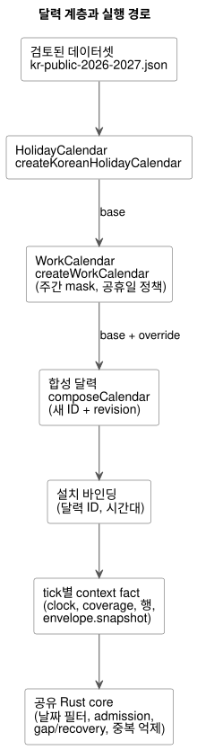
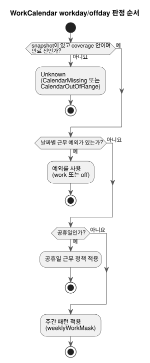

<!-- translation-source: docs/CALENDAR-PROVIDERS.md -->
[영문 원문](CALENDAR-PROVIDERS.md)

# 한국 공휴일과 농장 근무 달력

한국어 | [English](CALENDAR-PROVIDERS.md) · [Reference §3.8](reference/03-time-and-schedules.md#38-dst-자정과-work-calendar)

이 안내서는 GhostFlow가 공휴일과 농장 근무일을 다루는 방식을 설명합니다. 다음 두 부분을
다룹니다.

- 달력 snapshot을 만드는 `runtimes/node/calendar.mjs`의 오프라인 참조 adapter
- 실행을 결정하는 공유 Rust core의 달력 판정

**검증 범위.** 검증은 컴파일러 검사, native Rust 단위 테스트, WASM 실행, ghostsim을
포함합니다. 같은 달력 tape를 native runner로 실행한 적은 없습니다. 이 안내서는 Device 배포,
사람의 출근 여부, 물리적 동작을 입증하지 않습니다.

아래 다이어그램은 검토된 데이터셋부터 Rust core까지, 달력 계층이 서로 어떻게 맞물리는지
보여 줍니다.



## 결정과 근거

**공휴일과 휴무일은 서로 다른 사실입니다.** 공휴일은 공적인 날짜 사실입니다. 농장 휴무일은
근무 정책입니다. 농장은 공휴일에 일할 수도 있고, 평일에 정비를 위해 쉴 수도 있습니다. 따라서
다음과 같습니다.

- `HolidayCalendar`의 `holiday`는 공휴일 목록에 속하는지만 읽습니다.
- `WorkCalendar`의 `workday`/`offday`는 날짜별 근무 예외, 공휴일 근무 정책, 주간 패턴
  순서로 확인합니다.
- 공휴일에 `work` 예외를 두어도 공휴일이라는 사실은 유지됩니다.

아래 다이어그램은 이 판정 순서를 보여 줍니다. 데이터가 없거나 범위를 벗어나면 어떤 규칙보다도
먼저 Unknown이 됩니다([일관성, 부재, 저장 한도](#일관성-부재-저장-한도) 참고).



**공유 base를 절대 수정하지 말고 새 달력을 파생합니다.** 공유 base를 수정하면 다른 예약과
과거 재생이 바뀝니다. 대신 명시적인 base와 override로 새 달력 ID와 내용 기반 revision을
만듭니다.

- base ID나 lineage ID는 재사용할 수 없습니다. 원본은 변경되지 않습니다.
- 시간대는 base와 정확히 일치해야 합니다.
- 한 overlay 계층 안에서 날짜가 중복되면, 내용이 같더라도 거부됩니다.
- 나중 계층은 해당 날짜에 대한 이전 계층의 판정을 명시적으로 대체합니다.
- 공휴일 override와 근무 override는 서로 다른 계층이며, 같은 날짜에 함께 적용될 수 있습니다.

## 검토된 한국 기본 데이터

`createKoreanHolidayCalendar`는 저장소의
[`kr-public-2026-2027.json`](../data/calendars/kr-public-2026-2027.json)을 읽습니다.
이는 유한한 데이터셋입니다.

| 속성 | 값 |
|---|---|
| 시간대 | `Asia/Seoul`만 |
| 적용 범위(coverage) | `[2026-01-01, 2028-01-01)` |
| 검토일 | 2026-10-01 |
| 기본 만료 | 2028-01-01 00:00 KST |

호출자는 만료를 앞당길 수 있지만 늘릴 수는 없습니다. 만료일은 그날까지 법이 바뀌지 않는다는
보장이 아닙니다. 임시공휴일, 선거, 법 개정이 발표되면 운영자가 공식 출처를 검토하고 새
데이터셋/revision이나 출처가 있는 override를 설치합니다. 자동 동기화는 없습니다.

주요 출처는 다음과 같습니다. JSON의 각 날짜는 자신의 출처 ID를 가집니다.

- [인사혁신처 공휴일 규정](https://www.mpm.go.kr/mpm/info/infoService/BizService02/): 일요일, 공휴일, 제한적인 대체공휴일 규칙.
- [인사혁신처 개정 설명, 2026-04-29](https://www.mpm.go.kr/mpm/comm/newsPress/newsPressRelease/?boardId=bbs_0000000000000029&category=&cntId=4250&mode=view&pageIdx=1): 5월 1일 노동절과 7월 17일 제헌절이 2026년부터 적용됩니다.
- [한국천문연구원 2026년 월력요항 설명](https://www.kasi.re.kr/kor/post/newsMaterial/32031): 음력 공휴일과 기존 대체공휴일. 개정 이전 자료이므로 개정 출처와 함께 사용합니다.
- [우주항공청 2027년 월력요항 설명](https://www.kasa.go.kr/prog/plcyBrf/brief/kor/sub01_01_04/view.do?plcyBrfNo=431): 2027년 공휴일과 대체공휴일.
- [행정안전부 지방선거 기록, 2026-06-03](https://www.mois.go.kr/video/bbs/type019/commonSelectBoardArticle.do?bbsId=BBSMSTR_000000000255&nttId=126698&searchCode1=): 임기 만료에 따른 지방선거일.

**데이터셋에 포함되는 것과 포함되지 않는 것.**

- 일요일은 공휴일 사실로 펼쳐지지만, 적용 범위 안에서만 그렇습니다.
- 토요일 자체는 공휴일이 아닙니다. 예를 들어 2026-09-28이나 2027-06-07에 대체공휴일을
  지어내지 않습니다.
- 2027-05-03과 2027-07-19를 포함한 공식 대체공휴일은 고정된 사실입니다.
- 미래의 음력 공휴일, 대체공휴일, 임시공휴일은 예측하지 않습니다.

**라이선스.** 날짜 사실과 인용 정보만 저장합니다. 정부 문서, PDF, HWPX, 이미지, 설명 문장은
복사하지 않습니다. 우주항공청 설명 자료는 공공누리 제1유형(KOGL Type 1) 출처 표시를 명시합니다.
별도 라이선스가 적용되는 공고 첨부 파일은 재배포하지 않습니다.

## 기본 달력과 농장 override 절차

이 Node 예제는 저장소 루트에서 실행합니다. `weeklyWorkMask`에서 bit 0은 일요일, bit 6은
토요일이므로 `0b0111110`은 월요일–금요일을 뜻합니다. adapter는 농장의 주간 패턴이나 공휴일
근무 정책을 대신 정해 주지 않습니다. 두 가지 모두 직접 지정해야 합니다.

```js
import {
  createKoreanHolidayCalendar, createWorkCalendar, composeCalendar,
} from './runtimes/node/calendar.mjs';

const nowMs = Date.parse('2026-10-01T00:00:00Z');
const publicBase = createKoreanHolidayCalendar({ calendarId: 'kr-public', nowMs });
const farmBase = createWorkCalendar({
  calendarId: 'farm-weekdays', base: publicBase,
  weeklyWorkMask: 0b0111110, holidayPolicy: 'off', nowMs,
});
const farm = composeCalendar(farmBase, {
  calendarId: 'farm-harvest', timezone: 'Asia/Seoul', nowMs,
  holidayOverrides: [],
  workdayOverrides: [
    { date: '2026-10-09', class: 'work', reason: 'Approved harvest shift' },
    { date: '2026-10-12', class: 'off', reason: 'Scheduled maintenance' },
  ],
});
console.log(publicBase.snapshot.calendarId, farm.snapshot.calendarId);
console.log(farm.provenance.lineage, farm.snapshot.revision);
```

**공휴일 추가 또는 제거.** `holidayOverrides`에 `{ date, holiday, reason, source }`를
명시적으로 지정합니다.

- `source`는 자격 증명이 없는 HTTPS 증거 URL입니다.
- 새로 발표된 정부 임시공휴일에는 `holiday: true`를 사용합니다. 설치자가 발표되지 않은 날짜를
  공적 사실로 만들어 내지 않습니다.
- 근무 예외에는 그 자체의 사유가 필요합니다.

**다른 국가나 기간.** `createHolidayCalendar`는 명시적인 시간대, 적용 범위, 만료, 날짜 이름과
출처 ID, 출처 URL/발행일/검토일, `datasetVersion`을 요구합니다.

**결과와 오류.**

- 반환되는 `{ snapshot, provenance }`와 그 하위 객체는 동결(freeze)되어 있습니다.
- revision은 정규화된 snapshot 내용, 출처, lineage에 대한 SHA-256입니다. 입력 순서에
  의존하지 않습니다.
- 적용 범위, 만료, provenance는 그대로 이어집니다. 합성으로 적용 범위를 넓히거나 만료된
  데이터를 갱신할 수 없습니다.
- `CalendarUnavailableError` 코드 `missing-base`와 `stale-base`는 따로 처리하십시오.
- 무효한 날짜, 시간대, 충돌, 출처, revision은 거부됩니다.

## 설치 바인딩과 실행

소스에서는 typed 논리 달력을 선언하고, Daily 예약 필드 `on`과 `calendar`로 선택합니다. 모든
공통 정책과 DST 선택은 명시적으로 유지됩니다. 다음 파일을 함께 사용하십시오.

- [정본 실행 예제](../examples/korean-calendar.ghost.md)
- 그 [영문 읽기용 projection](../examples/korean-calendar.ghost.en.md)
- [호스트 tape 도구](../tools/examples/korean-calendar.mjs)

아래 명령은 물리 입출력 없이 가상 호스트 예제를 실행합니다.

```sh
rustup target add wasm32-unknown-unknown
cargo build --locked -p ghostflow-wasm --target wasm32-unknown-unknown --release
node tools/examples/korean-calendar.mjs
```

새로 checkout한 저장소에는 Rust/Cargo, Node.js, WASM target이 필요합니다. Cargo는 빌드 중에
잠긴(locked) 의존성을 가져올 수 있습니다. 의존성이 캐시되어 있을 때만 `--offline`을
추가하십시오.

```ghost
calendar public_days: HolidayCalendar;
calendar farm_days: WorkCalendar;

// Daily schedule fields; complete common policies are still required.
on = day`holiday`;
calendar = public_days;
```

**단계.**

1. 공휴일 base를 만들고, 명시적인 농장 정책을 적용한 다음, override를 합성합니다.
2. 설치의 provider 바인딩을 각 snapshot의 달력 ID 및 시간대와 일치시킵니다.
3. 같은 tick의 context fact로 불변 clock, 적용 범위, 해석된 civil 발생 행,
   `envelope.snapshot`을 공급합니다. 설치와 재생을 위해 provenance를 보존합니다.
4. Rust가 날짜 필터링, admission(수용), gap/recovery, 중복 억제를 실행합니다. Node adapter는
   실행 날짜나 due pulse를 결정하는 두 번째 엔진이 아닙니다.

**공휴일 Daily pulse 식별자.** 공휴일 Daily pulse는 `holiday-daily-pulse`, GFB15,
`GhostFlow/control-v14`로 식별됩니다.

- 기존 근무일/휴무일 태그/바이트 레이아웃과 GFSF5 facts wire는 변경되지 않습니다.
- 이전 로더는 새 GFB 헤더를 거부합니다.
- 이 식별자들은 package 버전이나 Device 펌웨어 버전과 별개입니다.
- 이 adapter는 요일 리터럴 구현을 확장하지 않습니다. issue #155의 요일 문법은 별도 작업으로
  남아 있습니다.

**`calendar_is`와 UTC 근무일/휴무일 Range.** 채택된 `calendar_is` Result와 불변 UTC Daily
근무일/휴무일 Range 범위는 GFB18/`GhostFlow/control-v18`을 사용합니다.

- activation에는 명시적인 UTC 달력 바인딩이 필요합니다. 위의 한국 `Asia/Seoul` 예제는
  Daily-pulse 예제로 남습니다.
- 각 query 또는 range site에 대해 GFSF5 schedule fact로 식별된 snapshot을 공급합니다.
- Rust가 날짜를 도출하고 typed 달력 fault를 반환합니다. 호출자가 계산한 근무일/휴무일 Bool
  값을 공급하지 마십시오.
- 공유 바인딩은 한 스캔 안에서 동일한 snapshot을 사용하고, 같은 제한된 revision 이력을
  유지합니다.

**자정을 넘는 근무조.** 근무 Range는 자정이나 그 이전에 끝나야 합니다. `23:45`부터 `00:15`까지의
근무조라면, `23:45`에 시작하는 것과 `00:00`에 시작하는 것, 두 개의 별도 `range(15min)` Daily
선언을 작성하십시오. 두 번째 선언은 다음 날짜를 독립적으로 평가합니다. 근무조의 업무 기준일은
추론하지 않습니다.

**fault.** `calendar_is`의 성공 Bool을 부정하기 전에 fault를 명시적으로 처리하십시오. 데이터
없음, 적용 범위 밖의 날짜, 만료된 데이터는 workday admission도 offday admission도 허용하지
않습니다. 이는 논리적인 참조 호스트 의미이며, 사람의 출근, 물리 출력, 저장 매체 내구성의
증거가 아닙니다.

## 일관성, 부재, 저장 한도

**tick마다 바인딩당 snapshot 하나.** provider 바인딩을 공유하는 예약들은 한 tick 안에서 같은
달력 snapshot을 사용합니다.

- 일부만 없거나 revision/내용이 서로 다르면 부분 상태를 확정하지 않고 tick 전체를 거부합니다.
- 같은 달력 ID/revision을 바뀐 내용으로 재사용하는 것도 거부됩니다.
- 새 revision은 허용되며, 이전 revision의 내용은 이후 revision이 생긴 뒤에도 기록으로
  남습니다.
- core는 SHA 문자열을 신뢰하지 않고 snapshot 전체를 비교합니다.

**checkpoint와 한도.** GFCXv3 checkpoint는 그 이력을 보존합니다. 새 core는 v2를 거부하며,
이전 checkpoint를 암묵적으로 마이그레이션하지 않습니다.

| 보존 항목 | 한도 |
|---|---|
| 수용된 달력 snapshot | 최대 `min(terminalCapacity, 128)` |
| 공휴일/예외 날짜 셀 합계 | 최대 8192 |
| 저장 payload | 약 144 KiB (구조체, 할당, 트랜잭션 복제본 제외) |

이 한도를 넘는 새 기록이나 복원은 닫힌 쪽으로(fail closed) 실패합니다. 호스트는 이 유한한
보존 한도 안에서 activation과 영속 checkpoint의 수명을 관리합니다.

**부재는 Unknown이 됩니다.**

| 상황 | Fault |
|---|---|
| snapshot 없음 | `CalendarMissing` |
| 적용 범위 밖의 날짜, 또는 만료 시점 이후 | `CalendarOutOfRange` |

이 경우 `holiday`, `workday`, `offday`는 Unknown을 유지하고, `fallback = skip`은 새
admission을 만들지 않습니다. Unknown을 비공휴일, workday, offday Boolean으로 간주하는 일은
결코 없습니다(예를 들어 false로 취급하지 않습니다). 공급이 복구되면 실행은 기본 recovery를
따르며, 지난 발생을 자동으로 재생하지 않습니다.
