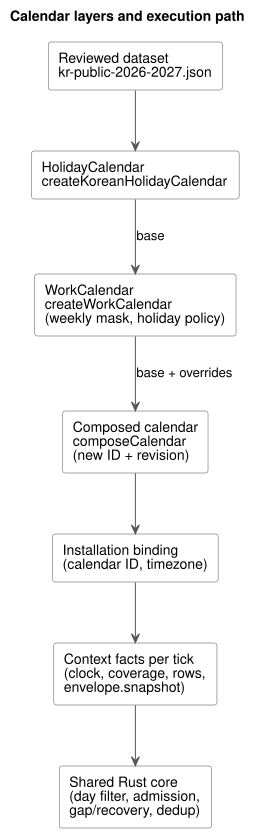
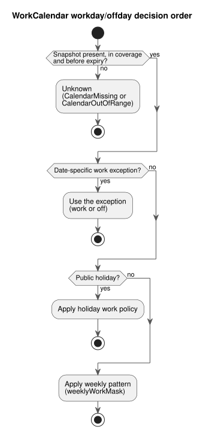

# Korean public holidays and farm work calendars

[한국어](CALENDAR-PROVIDERS.ko.md) | English · [Reference §3.8](reference/03-time-and-schedules.en.md#38-dst-midnight-and-work-calendars)

This guide explains how GhostFlow handles public holidays and farm work days. It
covers two parts:

- the offline reference adapter in `runtimes/node/calendar.mjs`, which builds
  calendar snapshots; and
- the calendar decisions in the shared Rust core, which decide execution.

**Verification scope.** Verification covers compiler checks, native Rust unit
tests, WASM execution and ghostsim. The same calendar tape has not been executed
through a native runner. This guide establishes no Device deployment, human
presence or physical operation.

The diagram below shows how the calendar layers fit together, from the reviewed
dataset to the Rust core.



## Decision and rationale

**Holidays and days off are different facts.** A public holiday is a public date
fact. A farm day off is a work policy. A farm may work on a holiday, or close on a
weekday for maintenance. Therefore:

- `HolidayCalendar`'s `holiday` reads only membership in the holiday list.
- `WorkCalendar`'s `workday`/`offday` checks, in order: date-specific work
  exceptions, then the holiday work policy, then the weekly pattern.
- A `work` exception on a holiday keeps the public holiday fact.

The diagram below shows this decision order. Missing or out-of-range data gives
Unknown before any rule applies (see
[Consistency, absence and storage bounds](#consistency-absence-and-storage-bounds)).



**Never edit a shared base; derive a new calendar.** Editing a shared base would
change other schedules and historical replay. Instead, an explicit base plus
overrides produces a new calendar ID and a content-based revision.

- Neither the base ID nor a lineage ID may be reused. The original stays
  unchanged.
- The timezone must exactly match the base.
- Duplicate dates within one overlay layer are rejected, even when their contents
  agree.
- A later layer explicitly replaces the previous layer's decision for that date.
- Holiday overrides and work overrides are distinct layers and may apply to the
  same date.

## Reviewed Korean default data

`createKoreanHolidayCalendar` reads the repository's
[`kr-public-2026-2027.json`](../data/calendars/kr-public-2026-2027.json).
This is a finite dataset:

| Property | Value |
|---|---|
| Timezone | `Asia/Seoul` only |
| Coverage | `[2026-01-01, 2028-01-01)` |
| Reviewed | 2026-10-01 |
| Default expiry | 2028-01-01 00:00 KST |

Callers may shorten the expiry but cannot extend it. The expiry does not
guarantee that the law stays unchanged until that date. When a temporary holiday,
an election or an amendment is announced, operators review official sources and
install a new dataset/revision or a sourced override. There is no automatic
synchronization.

The principal sources follow. Each date in the JSON identifies its source ID.

- [Ministry of Personnel Management holiday rules](https://www.mpm.go.kr/mpm/info/infoService/BizService02/): Sundays, holidays and limited substitution rules.
- [MPM amendment explanation, 2026-04-29](https://www.mpm.go.kr/mpm/comm/newsPress/newsPressRelease/?boardId=bbs_0000000000000029&category=&cntId=4250&mode=view&pageIdx=1): Labor Day, May 1, and Constitution Day, July 17, apply from 2026.
- [Korea Astronomy and Space Science Institute's 2026 calendar explanation](https://www.kasi.re.kr/kor/post/newsMaterial/32031): lunar holidays and existing substitute dates; this predates the amendment and is used with the amendment source.
- [Korea AeroSpace Administration's 2027 calendar explanation](https://www.kasa.go.kr/prog/plcyBrf/brief/kor/sub01_01_04/view.do?plcyBrfNo=431): 2027 holidays and substitute dates.
- [Ministry of the Interior and Safety local-election record, 2026-06-03](https://www.mois.go.kr/video/bbs/type019/commonSelectBoardArticle.do?bbsId=BBSMSTR_000000000255&nttId=126698&searchCode1=): the term-expiry local election date.

**What the dataset does and does not contain.**

- Sundays expand as public holiday facts, but only inside coverage.
- Saturday itself is not a public holiday. For example, no substitute holiday is
  invented for 2026-09-28 or 2027-06-07.
- Official substitute dates, including 2027-05-03 and 2027-07-19, are pinned
  facts.
- Future lunar, substitute or temporary dates are not predicted.

**Licensing.** Only date facts and citations are stored. Government documents,
PDF, HWPX, images and explanatory prose are not copied. The KASA explanatory
release identifies KOGL Type 1 attribution. Separately licensed notice
attachments are not redistributed.

## Procedure for base and farm overrides

Run this Node example from the repository root. In `weeklyWorkMask`, bit 0 is
Sunday and bit 6 is Saturday, so `0b0111110` means Monday–Friday. The adapter
does not choose the farm's weekly pattern or holiday work policy for you; you
supply both.

```js
import {
  createKoreanHolidayCalendar, createWorkCalendar, composeCalendar,
} from './runtimes/node/calendar.mjs';

const nowMs = Date.parse('2026-10-01T00:00:00Z');
const publicBase = createKoreanHolidayCalendar({ calendarId: 'kr-public', nowMs });
const farmBase = createWorkCalendar({
  calendarId: 'farm-weekdays', base: publicBase,
  weeklyWorkMask: 0b0111110, holidayPolicy: 'off', nowMs,
});
const farm = composeCalendar(farmBase, {
  calendarId: 'farm-harvest', timezone: 'Asia/Seoul', nowMs,
  holidayOverrides: [],
  workdayOverrides: [
    { date: '2026-10-09', class: 'work', reason: 'Approved harvest shift' },
    { date: '2026-10-12', class: 'off', reason: 'Scheduled maintenance' },
  ],
});
console.log(publicBase.snapshot.calendarId, farm.snapshot.calendarId);
console.log(farm.provenance.lineage, farm.snapshot.revision);
```

**Adding or removing a public holiday.** Supply `{ date, holiday, reason,
source }` explicitly in `holidayOverrides`.

- `source` is a credential-free HTTPS evidence URL.
- Use `holiday: true` for a newly announced government temporary holiday.
  Installers do not manufacture an unannounced date as a public fact.
- A work exception requires its own reason.

**Other countries or periods.** `createHolidayCalendar` requires an explicit
timezone, coverage, expiry, date names and source IDs, source
URLs/publication/review dates, and `datasetVersion`.

**Results and errors.**

- The returned `{ snapshot, provenance }` and its descendants are frozen.
- The revision is a SHA-256 over the normalized snapshot contents, sources and
  lineage. It does not depend on input order.
- Coverage, expiry and provenance carry forward. Composition cannot widen
  coverage or refresh expired data.
- Handle the `CalendarUnavailableError` codes `missing-base` and `stale-base`
  separately.
- Invalid dates, timezones, conflicts, sources and revisions are rejected.

## Installation binding and execution

In source, declare typed logical calendars and select them with the Daily
schedule fields `on` and `calendar`. All common policies and DST choices stay
explicit. Use these files together:

- the [canonical executable example](../examples/korean-calendar.ghost.md);
- its [English reading projection](../examples/korean-calendar.ghost.en.md);
- the [host tape tool](../tools/examples/korean-calendar.mjs).

The commands below run the virtual host example without physical I/O.

```sh
rustup target add wasm32-unknown-unknown
cargo build --locked -p ghostflow-wasm --target wasm32-unknown-unknown --release
node tools/examples/korean-calendar.mjs
```

A fresh checkout needs Rust/Cargo, Node.js and the WASM target. Cargo may fetch
locked dependencies during the build; add `--offline` only when they are cached.

```ghost
calendar public_days: HolidayCalendar;
calendar farm_days: WorkCalendar;

// Daily schedule fields; complete common policies are still required.
on = day`holiday`;
calendar = public_days;
```

**Steps.**

1. Create the public base, apply the explicit farm policy, then compose the
   overrides.
2. Match the installation's provider bindings to each snapshot's calendar ID and
   timezone.
3. Supply an immutable clock, coverage, resolved civil occurrence rows and
   `envelope.snapshot` as context facts for the same tick. Retain the
   provenance for installation and replay.
4. Rust executes day filtering, admission, gap/recovery and deduplication. The
   Node adapter is not a second engine that decides execution dates or due
   pulses.

**Holiday Daily pulse identifiers.** The holiday Daily pulse is identified by
`holiday-daily-pulse`, GFB15 and `GhostFlow/control-v14`.

- The existing work/off-day tag/byte layout and the GFSF5 facts wire stay
  unchanged.
- Older loaders reject the new GFB header.
- These identifiers are separate from package and Device firmware versions.
- This adapter does not expand the weekday-literal implementation. The weekday
  grammar of issue #155 remains separate work.

**`calendar_is` and UTC work/off-day Range.** The adopted `calendar_is` Result and
the immutable UTC Daily work/off-day Range slice use
GFB18/`GhostFlow/control-v18`.

- Activation requires an explicit UTC calendar binding. The Korean `Asia/Seoul`
  example above remains a Daily-pulse example.
- Supply identified snapshots in GFSF5 schedule facts for each query or range
  site.
- Rust derives the date and returns typed calendar faults. Do not supply
  caller-computed work/off-day Bool values.
- Shared bindings use identical snapshots within one scan and keep the same
  bounded revision history.

**Shifts across midnight.** A work Range must end at or before midnight. For a
shift from `23:45` to `00:15`, author two separate `range(15min)` Daily
declarations, starting at `23:45` and at `00:00`. The second declaration
evaluates the next date independently; no shift business date is inferred.

**Faults.** Handle `calendar_is` faults explicitly before negating its successful
Bool. Missing data, dates outside coverage and expired data permit neither
workday nor offday admission. These are logical reference-host semantics, not
evidence of human attendance, physical outputs or storage-medium durability.

## Consistency, absence and storage bounds

**One snapshot per binding per tick.** Schedules that share a provider binding use
the same calendar snapshot in one tick.

- Partial absence, or different revisions/contents, rejects the whole tick
  without committing partial state.
- Reusing one calendar ID/revision with changed contents is also rejected.
- New revisions are allowed, and the contents of previous revisions stay
  recorded after later revisions.
- The core compares full snapshots rather than trusting a SHA string.

**Checkpoints and bounds.** GFCXv3 checkpoints preserve that history. The new core
rejects v2; old checkpoints are not implicitly migrated.

| Retained item | Limit |
|---|---|
| Accepted calendar snapshots | at most `min(terminalCapacity, 128)` |
| Combined holiday/exception date cells | at most 8192 |
| Stored payload | about 144 KiB, excluding structures, allocations and transaction clones |

A new record or restore that exceeds these bounds fails closed. Hosts manage
activation and durable-checkpoint lifetimes within this finite retention bound.

**Absence gives Unknown.**

| Situation | Fault |
|---|---|
| Missing snapshot | `CalendarMissing` |
| Date outside coverage, or at/after expiry | `CalendarOutOfRange` |

In these cases `holiday`, `workday` and `offday` preserve Unknown, and
`fallback = skip` creates no new admission. Unknown is never assumed to be a
nonholiday, workday or offday Boolean (for example, it is not treated as false).
When supply is restored, execution follows baseline recovery and does not
automatically replay past occurrences.
