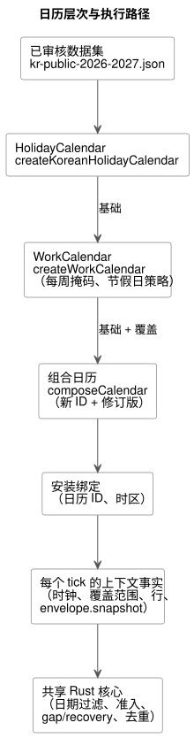
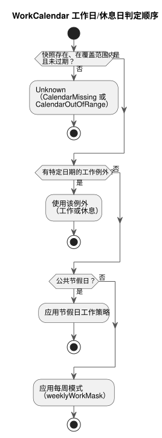

<!-- translation-source: docs/CALENDAR-PROVIDERS.md -->
[英文原文](CALENDAR-PROVIDERS.md)

# 韩国公共节假日与农场工作日历

[한국어](CALENDAR-PROVIDERS.ko.md) | [English](CALENDAR-PROVIDERS.md) | 简体中文 · [参考 §3.8](reference/03-time-and-schedules.zh.md#38-夏令时午夜与工作日历)

本指南说明 GhostFlow 如何处理公共节假日和农场工作日。它涵盖两部分：

- `runtimes/node/calendar.mjs` 中的离线参考适配器，它构建日历快照；以及
- 共享 Rust 核心中的日历判定，它决定执行。

**验证范围。** 验证涵盖编译器检查、原生 Rust 单元测试、WASM 执行和 ghostsim。同一日历带尚未通过原生运行器执行。本指南不证明任何 Device 部署、人员在场或物理操作。

下图展示了从已审核数据集到 Rust 核心，各日历层是如何组合在一起的。



## 决定与依据

**节假日和休息日是不同的事实。** 公共节假日是一项公共日期事实。农场休息日是一项工作策略。农场可能在节假日工作，也可能在工作日因维护而停工。因此：

- `HolidayCalendar` 的 `holiday` 只读取是否属于节假日列表。
- `WorkCalendar` 的 `workday`/`offday` 依次检查：特定日期的工作例外，然后是节假日工作策略，最后是每周模式。
- 节假日上的 `work` 例外会保留该公共节假日事实。

下图展示了这一判定顺序。数据缺失或超出范围时，会在应用任何规则之前给出 Unknown（参见[一致性、缺失与存储边界](#一致性缺失与存储边界)）。



**绝不编辑共享的基础日历，而是派生新日历。** 编辑共享的基础日历会改变其他调度计划和历史重放。相反，显式的基础日历加上覆盖项会产生一个新的日历 ID 和一个基于内容的修订版。

- 基础 ID 和谱系（lineage）ID 都不得复用。原始日历保持不变。
- 时区必须与基础日历完全一致。
- 同一覆盖层中的重复日期会被拒绝，即使它们的内容一致。
- 后一层会显式替换前一层对该日期的判定。
- 节假日覆盖和工作覆盖是不同的层，可以作用于同一日期。

## 已审核的韩国默认数据

`createKoreanHolidayCalendar` 读取仓库中的
[`kr-public-2026-2027.json`](../data/calendars/kr-public-2026-2027.json)。
这是一个有限的数据集：

| 属性 | 值 |
|---|---|
| 时区 | 仅 `Asia/Seoul` |
| 覆盖范围 | `[2026-01-01, 2028-01-01)` |
| 审核日期 | 2026-10-01 |
| 默认过期时间 | 2028-01-01 00:00 KST |

调用方可以缩短过期时间，但不能延长。过期时间并不保证法律在该日期之前保持不变。当临时节假日、选举或法规修订公布时，操作员应审核官方来源，并安装新的数据集/修订版或带来源的覆盖项。不存在自动同步。

主要来源如下。JSON 中的每个日期都标明了其来源 ID。

- [人事革新处节假日规定](https://www.mpm.go.kr/mpm/info/infoService/BizService02/)：星期日、节假日以及有限的替代规则。
- [人事革新处修订说明，2026-04-29](https://www.mpm.go.kr/mpm/comm/newsPress/newsPressRelease/?boardId=bbs_0000000000000029&category=&cntId=4250&mode=view&pageIdx=1)：劳动节（5 月 1 日）和制宪节（7 月 17 日）自 2026 年起适用。
- [韩国天文研究院 2026 年历书说明](https://www.kasi.re.kr/kor/post/newsMaterial/32031)：农历节假日和现有的替代日期；该说明早于法规修订，与修订来源一起使用。
- [韩国宇宙航空厅 2027 年历书说明](https://www.kasa.go.kr/prog/plcyBrf/brief/kor/sub01_01_04/view.do?plcyBrfNo=431)：2027 年节假日和替代日期。
- [行政安全部地方选举记录，2026-06-03](https://www.mois.go.kr/video/bbs/type019/commonSelectBoardArticle.do?bbsId=BBSMSTR_000000000255&nttId=126698&searchCode1=)：任期届满地方选举的日期。

**数据集包含与不包含的内容。**

- 星期日会展开为公共节假日事实，但仅限覆盖范围之内。
- 星期六本身不是公共节假日。例如，不会为 2026-09-28 或 2027-06-07 凭空创建替代节假日。
- 官方替代日期（包括 2027-05-03 和 2027-07-19）是固定的事实。
- 不预测未来的农历、替代或临时日期。

**许可。** 只存储日期事实和引用。不复制政府文件、PDF、HWPX、图片和说明性文字。KASA 的说明性发布文件标明了 KOGL 第 1 类署名要求。单独许可的公告附件不会被再分发。

## 基础日历与农场覆盖的操作步骤

从仓库根目录运行以下 Node 示例。在 `weeklyWorkMask` 中，第 0 位是星期日，第 6 位是星期六，因此 `0b0111110` 表示星期一至星期五。适配器不会替你选择农场的每周模式或节假日工作策略；两者都由你提供。

```js
import {
  createKoreanHolidayCalendar, createWorkCalendar, composeCalendar,
} from './runtimes/node/calendar.mjs';

const nowMs = Date.parse('2026-10-01T00:00:00Z');
const publicBase = createKoreanHolidayCalendar({ calendarId: 'kr-public', nowMs });
const farmBase = createWorkCalendar({
  calendarId: 'farm-weekdays', base: publicBase,
  weeklyWorkMask: 0b0111110, holidayPolicy: 'off', nowMs,
});
const farm = composeCalendar(farmBase, {
  calendarId: 'farm-harvest', timezone: 'Asia/Seoul', nowMs,
  holidayOverrides: [],
  workdayOverrides: [
    { date: '2026-10-09', class: 'work', reason: 'Approved harvest shift' },
    { date: '2026-10-12', class: 'off', reason: 'Scheduled maintenance' },
  ],
});
console.log(publicBase.snapshot.calendarId, farm.snapshot.calendarId);
console.log(farm.provenance.lineage, farm.snapshot.revision);
```

**添加或移除公共节假日。** 在 `holidayOverrides` 中显式提供 `{ date, holiday, reason,
source }`。

- `source` 是不含凭据的 HTTPS 证据 URL。
- 对新公布的政府临时节假日使用 `holiday: true`。安装者不得把尚未公布的日期制造为公共事实。
- 工作例外需要其自己的原因。

**其他国家或时期。** `createHolidayCalendar` 需要显式提供时区、覆盖范围、过期时间、日期名称和来源 ID、来源 URL/发布/审核日期，以及 `datasetVersion`。

**结果与错误。**

- 返回的 `{ snapshot, provenance }` 及其所有子对象都是冻结的。
- 修订版是对规范化后的快照内容、来源和谱系计算的 SHA-256。它不依赖于输入顺序。
- 覆盖范围、过期时间和来源会向后传递。组合不能扩大覆盖范围，也不能刷新已过期的数据。
- 请分别处理 `CalendarUnavailableError` 的代码 `missing-base` 和 `stale-base`。
- 无效的日期、时区、冲突、来源和修订版会被拒绝。

## 安装绑定与执行

在源中声明类型化的逻辑日历，并用 Daily 调度计划的字段 `on` 和 `calendar` 选择它们。所有通用策略和 DST 选择都保持显式。请结合使用以下文件：

- [规范的可执行示例](../examples/korean-calendar.ghost.md)；
- 它的[英文阅读投影](../examples/korean-calendar.ghost.en.md)；
- [宿主带工具](../tools/examples/korean-calendar.mjs)。

以下命令在没有物理 I/O 的情况下运行虚拟宿主示例。

```sh
rustup target add wasm32-unknown-unknown
cargo build --locked -p ghostflow-wasm --target wasm32-unknown-unknown --release
node tools/examples/korean-calendar.mjs
```

全新检出的仓库需要 Rust/Cargo、Node.js 和 WASM 目标。Cargo 可能在构建期间获取锁定的依赖；只有在它们已被缓存时才添加 `--offline`。

```ghost
calendar public_days: HolidayCalendar;
calendar farm_days: WorkCalendar;

// Daily schedule fields; complete common policies are still required.
on = day`holiday`;
calendar = public_days;
```

**步骤。**

1. 创建公共基础日历，应用显式的农场策略，然后组合覆盖项。
2. 使安装的 provider 绑定与每个快照的日历 ID 和时区相匹配。
3. 为同一个 tick 提供不可变的时钟、覆盖范围、已解析的民用时间触发实例行以及 `envelope.snapshot` 作为上下文事实。为安装和重放保留来源信息。
4. Rust 执行日期过滤、准入、gap/recovery 和去重。Node 适配器不是第二个决定执行日期或到期脉冲的引擎。

**节假日 Daily 脉冲标识符。** 节假日 Daily 脉冲由 `holiday-daily-pulse`、GFB15 和 `GhostFlow/control-v14` 标识。

- 现有的工作日/休息日标记/字节布局以及 GFSF5 事实线路格式保持不变。
- 较旧的加载器会拒绝新的 GFB 头部。
- 这些标识符与包和 Device 固件版本相互独立。
- 本适配器不扩展星期字面量的实现。issue #155 的星期语法仍是单独的工作。

**`calendar_is` 与 UTC 工作日/休息日 Range。** 已采纳的 `calendar_is` Result 和不可变 UTC Daily 工作日/休息日 Range 切片使用 GFB18/`GhostFlow/control-v18`。

- 激活需要显式的 UTC 日历绑定。上面的韩国 `Asia/Seoul` 示例仍是一个 Daily 脉冲示例。
- 在每个查询或 range site 的 GFSF5 调度事实中提供已标识的快照。
- Rust 推导日期并返回类型化的日历故障。不要提供由调用方计算的工作日/休息日 Bool 值。
- 共享绑定在一次扫描内使用相同的快照，并保持相同的有界修订版历史。

**跨越午夜的班次。** 工作 Range 必须在午夜或之前结束。对于从 `23:45` 到 `00:15` 的班次，请编写两个独立的 `range(15min)` Daily 声明，分别从 `23:45` 和 `00:00` 开始。第二个声明独立地评估下一日期；不会推断班次所属的营业日期。

**故障。** 在对 `calendar_is` 成功返回的 Bool 取反之前，请显式处理其故障。缺失数据、超出覆盖范围的日期和已过期的数据既不允许工作日准入，也不允许休息日准入。这些是参考宿主的逻辑语义，而不是人员出勤、物理输出或存储介质持久性的证据。

## 一致性、缺失与存储边界

**每个绑定每个 tick 一个快照。** 共享同一 provider 绑定的调度计划在一个 tick 中使用相同的日历快照。

- 部分缺失，或修订版/内容不同，会拒绝整个 tick，且不提交部分状态。
- 复用同一个日历 ID/修订版但内容已改变，也会被拒绝。
- 允许新的修订版，并且在后续修订版之后，之前修订版的内容仍保持记录。
- 核心比较完整的快照，而不是信任一个 SHA 字符串。

**检查点与边界。** GFCXv3 检查点保留该历史。新核心拒绝 v2；旧检查点不会被隐式迁移。

| 保留项 | 限制 |
|---|---|
| 已接受的日历快照 | 最多 `min(terminalCapacity, 128)` |
| 节假日/例外日期单元合计 | 最多 8192 |
| 存储的载荷 | 约 144 KiB，不含结构、分配和事务克隆 |

超出这些边界的新记录或恢复会以失败关闭（fail closed）的方式失败。宿主在这一有限的保留边界内管理激活和持久检查点的生命周期。

**缺失时给出 Unknown。**

| 情况 | 故障 |
|---|---|
| 缺少快照 | `CalendarMissing` |
| 日期超出覆盖范围，或在过期时间当时/之后 | `CalendarOutOfRange` |

在这些情况下，`holiday`、`workday` 和 `offday` 保留 Unknown，且 `fallback = skip` 不会产生新的准入。Unknown 从不被假定为非节假日、工作日或休息日的 Bool 值（例如，它不会被当作 false）。当供给恢复后，执行遵循基线恢复，不会自动重放过去的触发实例。
