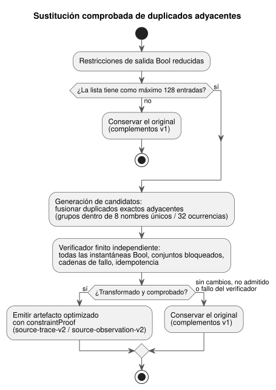

<!-- translation-source: docs/CHECKED-CONSTRAINT-REPLACEMENTS.md -->
[Original en inglés](CHECKED-CONSTRAINT-REPLACEMENTS.md)

# Sustituciones de restricciones comprobadas

[한국어](CHECKED-CONSTRAINT-REPLACEMENTS.ko.md) | [English](CHECKED-CONSTRAINT-REPLACEMENTS.md)

Estado: **contrato de implementación acotado** para la aceptación pendiente del
issue #31, bajo [OPT-42](OPTIMIZER-PASS-CONTRACT.es.md). Las comprobaciones
específicas de la implementación se superaron; esto no afirma la finalización
completa de la CI ni un despliegue.

Este documento especifica una optimización acotada e implementada: el compilador
puede eliminar un duplicado exacto adyacente de una restricción de salida Bool,
pero solo cuando un verificador independiente demuestra que el efecto ejecutable
no cambia. También especifica las comprobaciones de aceptación independientes. El
[contrato de anclas de intención](INTENT-ANCHOR-MAP.es.md) sigue siendo la
autoridad.

El diagrama siguiente resume el proceso: la generación de candidatos propone una
sustitución, el verificador independiente decide y cualquier fallo conserva el
original.

## Sustitución admisible

**Qué se sustituye.** La pasada opera sobre restricciones de salida Bool reducidas
y resueltas semánticamente, antes de la emisión final.

- Solo elimina duplicados exactos adyacentes: el mismo tipo de restricción y la
  misma secuencia ordenada de nombres de salida.
- Conserva la primera ocurrencia como sustitución.
- Los nombres se comparan exactamente: sin normalización, ordenación, reordenación
  ni reagrupación.

Por ejemplo, `mutex(a,b)` seguido inmediatamente de `mutex(a,b)` puede fusionarse.
`mutex(a,b)` seguido de `mutex(b,a)`, o dos `mutex(a,b)` separados por otra
restricción, no pueden fusionarse.

**Presupuestos.**

| Límite | Valor máximo | Si se supera |
|---|---|---|
| Entradas de toda la lista original de restricciones | como máximo 128 | se conservan el original y los metadatos v1 |
| Nombres de salida únicos por grupo de duplicados | como máximo ocho | ese grupo permanece sin cambios; otros grupos admisibles todavía pueden fusionarse |
| Ocurrencias de nombres por grupo de duplicados | como máximo 32 | ese grupo permanece sin cambios; otros grupos admisibles todavía pueden fusionarse |

Los errores obligatorios existentes de GFB/recursos siguen aplicándose, por lo que
recurrir al original no garantiza que se emita un artefacto. Una lista sin ningún
duplicado admitido también permanece sin cambios; no se requiere ningún
diagnóstico.

**Fuera del alcance.** Este corte no añade gramática de usuario, formato de fuente,
resolvedor SMT general ni motor BDD. No:

- simplifica expresiones;
- combina tipos de restricción diferentes;
- elimina duplicados de restricciones separadas;
- certifica un AST booleano de la fuente sin procesar.

La prueba se refiere al efecto ejecutable actual de las restricciones, incluida la
reducción actual de `require`.

## Obligación finita independiente

La generación de candidatos aporta una *afirmación* de sustitución; no la acepta.
Un verificador semántico finito separado decide la aceptación:

1. Reconstruye el dominio Bool de cada grupo admitido.
2. Comprueba todas las instantáneas de las como máximo ocho salidas únicas del
   grupo (como máximo 2^8 = 256 instantáneas).
3. Para cada instantánea, el original y el candidato deben producir conjuntos de
   salidas bloqueadas idénticos y cadenas de fallo idénticas.
4. También comprueba que repetir el efecto es idempotente.

Comparar solo los valores booleanos devueltos no basta.

**Por qué eliminar un duplicado es seguro.** La justificación usa `apply_safety` de
Rust:

- Cada restricción de una ronda lee la misma instantánea.
- Las salidas bloqueadas y los fallos se acumulan mediante la unión de `BTreeSet`.
- Por tanto, un efecto repetido idéntico no añade ninguna salida bloqueada ni
  ningún fallo nuevo.
- Conservar el primer duplicado preserva las uniones de cada ronda y la
  instantánea siguiente.
- Por inducción, se preservan las salidas seguras del punto fijo, las cadenas de
  fallo y el número de rondas.

Eliminar una restricción no cambia ninguna evaluación de expresiones, intención
solicitada, transición de estado, temporizador, programación horaria, reloj ni
cálculo de contabilización de uso.

**Límites del argumento.** El verificador debe validar estos supuestos frente al
modelo de efectos admitido. Los efectos no admitidos, o un fallo del verificador,
conservan el original. El argumento no se extiende a efectos secundarios
ordenados, cadenas de fallo diferentes, reescrituras arbitrarias de expresiones ni
a la aplicación física. La ejecución diferencial nativa/WASM complementa la prueba,
pero no puede sustituir su comprobación semántica exhaustiva.

## Prueba y correspondencia vinculadas a la revisión

**Qué conserva una transformación comprobada.**

- los bytes exactos del `.ghost.md` canónico, incluidos la prosa y los
  comentarios;
- la revisión de la fuente y los hashes;
- cada nodo de fuente, cada ancla y cada enlace.

Los nodos eliminados siguen disponibles en sus ubicaciones originales de Markdown
y de extracción. Las clasificaciones de las anclas se conservan sin inferir ni
confirmar la intención. Cada restricción original de la fuente, incluido cada
duplicado eliminado, se corresponde con el índice compilado de su restricción
conservada. La correspondencia es completa y ordenada.

**El registro de prueba.** `constraintProof` registra `checker`, `rule`, `scope`,
`status`, `original`, `compiled`, `sourceToCompiled`, `originalSha256`,
`compiledSha256` y `certificateSha256`.

- El verificador es `GhostFlow/adjacent-constraint-effect-checker-v1`.
- El estado es `independently-verified`.
- Los hashes de JSON canónico vinculan ambas listas y el certificado.

Los `sourceDocumentSha256` y `bytecodeSha256` externos, la reproducción completa y
canónica del mapa de fuente y la cobertura existente de paquetes firmados vinculan
la identidad exacta de la fuente/artefacto y los nodos/anclas originales. La prueba
no añade campos de revisión de Git/perfil del compilador ni un resumen de
obligación separado; eso corresponde al diseño más amplio de OPT-42. El estado
afirmado por un generador, o un resumen por sí solo, no puede establecer la
aceptación.

**Las derivaciones existentes de `require` no se promueven.** Siguen siendo
`compiler-derived` con `semanticVerification: not-proven`. En particular,
`require !(a && b && c)` se reduce actualmente a `mutex(a,b,c)`. Cuando exactamente
dos salidas son true, «no las tres» y «como máximo una» difieren. La prueba de
efecto duplicado ni promueve esa derivación ni repara o define la semántica de la
fuente con tres salidas. Solo demuestra que se pueden sustituir efectos
ejecutables actuales idénticos.

## Evidencia y compatibilidad

**Versiones de los complementos.**

| Artefacto | Complementos del host |
|---|---|
| Efectivamente transformado y comprobado de forma independiente | `GhostFlow/source-trace-v2` y `GhostFlow/source-observation-v2` |
| Sin transformar, incluidas las omisiones por presupuesto | v1 |

Estas son solo versiones de los complementos del host. El formato GFB, el ABI
nativo, `safety-trace-v1` y el manifiesto de control estricto permanecen sin
cambios. Un consumidor de metadatos del host más antiguo que no puede validar v2 la
rechaza (fail closed). El transporte nativo de paquetes firmados no interpreta
estos campos de prueba del host.

**Evidencia de ejecución.** El primer registro de restricción efectivamente
ejecutado lleva la evidencia de ejecución observada.

| Entrada | Campos |
|---|---|
| Duplicado eliminado | `evidence: derived`, `relation: checked-adjacent-duplicate`, `replacementCompiledIndex`, `checker`, `certificateSha256` |
| Entrada conservada | `evidence: executed`, `compiledIndex`, `observed` |

Nunca copie eventos de ejecución, evaluación ni cumplimiento en la comprobación de
la fuente eliminada. La sustitución derivada, la observación real, el bloqueo
final, los comandos aplicados y la retroalimentación física confirmada siguen
siendo hechos distintos. Cada identidad original de la fuente y sus anclas siguen
siendo navegables a través de su índice compilado.

**Fronteras de confianza.** Los observadores unen metadatos previamente
autenticados o recuperados con la evidencia del tiempo de ejecución; no autentican
un mapa de fuente arbitrario sin procesar.

- La reproducción canónica estricta reconstruye de forma independiente el
  candidato y la correspondencia completa.
- El verificador de pruebas independiente valida la obligación finita y el
  certificado.
- Ambos son obligatorios en las fronteras del constructor de JS, de la
  recuperación y de la verificación de paquetes de JS.
- El verificador nativo conserva su frontera de confianza existente. Comprueba la
  firma, la integridad, los perfiles y los requisitos del cargador del constructor
  de confianza, en lugar de demostrar de forma independiente el teorema del host.

Se rechaza:

- relaciones, orígenes, observaciones o certificados ausentes, sobrantes o
  manipulados;
- revisiones mezcladas;
- versiones no admitidas;
- cualquier artefacto optimizado no verificado.

La coherencia de la reproducción no se convierte en una prueba semántica.

## Evidencia de aceptación

Las pruebas deben cubrir:

- cada tipo de restricción admitido, todas las instantáneas Bool acotadas, los
  grupos adyacentes, múltiples grupos y los desplazamientos de índice del original
  al compilado;
- las salidas seguras del punto fijo, los fallos y las rondas del original frente
  al candidato, tanto en ejecuciones nativas como en WASM;
- la identidad sin cambios, los nombres ordenados exactos y los duplicados
  separados;
- la frontera de lista 128/129 y la frontera de nombres únicos ocho/nueve;
- el estado, el tiempo y las expresiones sin cambios;
- la conservación completa de la revisión de prosa/comentarios y de las anclas.

Los vectores negativos deben rechazar un estado de prueba falsificado,
orígenes ausentes/sobrantes, hashes alterados, evidencia de ejecución copiada,
revisiones mezcladas y paquetes optimizados no verificados. Un retorno al original
por el verificador o por el presupuesto debe conservar la ejecución original y los
complementos v1 cuando las comprobaciones obligatorias permiten la emisión.

Las comprobaciones específicas de la prueba y las comprobaciones de paridad
nativo/WASM respaldan este corte acotado. No establecen una CI completa, un
despliegue ni el comportamiento físico.
