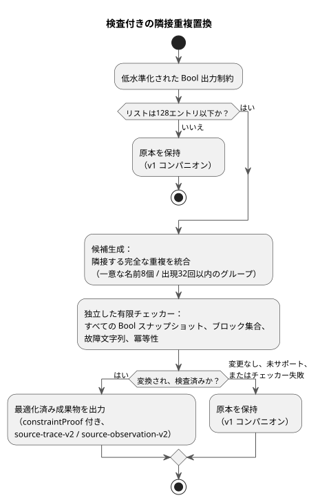

<!-- translation-source: docs/CHECKED-CONSTRAINT-REPLACEMENTS.md -->
[英語の原文](CHECKED-CONSTRAINT-REPLACEMENTS.md)

# 検査付きの制約置換

状態：[OPT-42](OPTIMIZER-PASS-CONTRACT.ja.md)の下での、issue #31の残りの受け入れのための**範囲を限定した実装契約**です。限定的な実装チェックは合格しています。これはCI全体の完了や配備を主張するものではありません。

この文書は、実装済みで範囲を限定した1つの最適化を規定します。コンパイラは、Bool出力制約の隣接する完全な重複を削除してかまいませんが、それは実行可能な効果が変わらないことを独立したチェッカーが証明した場合に限ります。あわせて、独立した受け入れチェックも規定します。[意図アンカー契約](INTENT-ANCHOR-MAP.ja.md)が引き続き正本です。

次の図はパイプラインの概要です。候補生成が置換を提案し、独立したチェッカーが判定し、何らかの失敗があれば原本を保持します。

## 対象となる置換

**何が置換されるか。** このパスは、最終出力の前に、意味的に解決され低水準化されたBool出力制約に対して動作します。

- 削除するのは隣接する完全な重複だけです。つまり、制約の種別が同じで、出力名の並びが順序まで同じものです。
- 最初の出現を置換として残します。
- 名前は厳密に比較します。正規化、ソート、並べ替え、再グループ化は行いません。

たとえば、`mutex(a,b)`の直後に`mutex(a,b)`が続く場合は統合できます。`mutex(a,b)`の後に`mutex(b,a)`が続く場合や、2つの`mutex(a,b)`の間に別の制約がある場合は統合できません。

**予算。**

| 上限 | 制限 | 超えた場合 |
|---|---|---|
| 元の制約リスト全体のエントリ | 最大 128 | 原本と v1 メタデータを保持 |
| 重複グループあたりの一意な出力名 | 最大 8 | そのグループは変更しない。他の対象グループは引き続き統合できる |
| 重複グループあたりの名前の出現数 | 最大 32 | そのグループは変更しない。他の対象グループは引き続き統合できる |

既存の必須のGFB/リソースエラーは引き続き適用されるため、フォールバックしても成果物が出力されることは保証されません。受け入れられた重複のないリストも変更されません。診断は必要ありません。

**スコープ外。** このスライスは、ユーザー向けの文法、ソースフォーマット、汎用のSMTソルバ、BDDエンジンを追加しません。次のことは行いません。

- 式の簡約
- 種別の異なる制約の結合
- 離れた位置にある制約の重複除去
- 生のソースのBool ASTの認証

証明が扱うのは、現在の`require`の低水準化を含む、現在の実行可能な制約の効果です。

## 独立した有限の証明責務

候補生成は置換の*主張*を提供しますが、それを受け入れることはしません。受け入れは、別個の有限な意味チェッカーが判定します。

1. 受け入れられた各グループのBoolドメインを再構築します。
2. グループの最大8個の一意な出力について、すべてのスナップショット（最大2^8 = 256個）を検査します。
3. すべてのスナップショットについて、原本と候補は、同一のブロックされた出力の集合と、同一の故障文字列を生成しなければなりません。
4. 効果を繰り返しても冪等であることも検査します。

返されるBool値を比較するだけでは不十分です。

**重複の削除が安全な理由。** 根拠はRustの`apply_safety`に基づきます。

- 1つのラウンド内のすべての制約は、同じスナップショットを読みます。
- ブロックされた出力と故障は、`BTreeSet`の和集合で蓄積されます。
- したがって、同一の効果を繰り返しても、新しいブロック出力や故障は加わりません。
- 最初の重複を残すことで、各ラウンドの和集合と次のスナップショットが保たれます。
- 帰納法により、不動点での安全な出力、故障文字列、ラウンド数が保たれます。

制約を削除しても、式の評価、要求意図、状態遷移、タイマー、スケジュール、クロック、使用量計上の計算は一切変わりません。

**論証の限界。** チェッカーは、これらの仮定を、サポートされる効果モデルに照らして検証しなければなりません。サポートされていない効果やチェッカーの失敗があれば、原本を保持します。この論証は、順序のある副作用、異なる故障文字列、任意の式の書き換え、物理的な適用には及びません。ネイティブ/WASMの差分実行は証明を補完しますが、その網羅的な意味チェックの代わりにはなりません。

## リビジョンに結び付いた証明とマッピング

**検査付きの変換が保つもの。**

- 散文とコメントを含む、正準`.ghost.md`の正確なバイト列
- ソースのリビジョンとハッシュ
- すべてのソースノード、すべてのアンカー、すべてのリンク

削除されたノードは、元のMarkdown上の位置と抽出後の位置で引き続き参照できます。アンカーの分類は、意図を推測したり確認したりすることなく保持されます。削除された各重複を含め、元のソース制約はすべて、残された制約のコンパイル後インデックスに対応付けられます。このマッピングは完全で、順序付きです。

**証明レコード。** `constraintProof`は、`checker`、`rule`、`scope`、`status`、`original`、`compiled`、`sourceToCompiled`、`originalSha256`、`compiledSha256`、`certificateSha256`を記録します。

- チェッカーは`GhostFlow/adjacent-constraint-effect-checker-v1`です。
- 状態は`independently-verified`です。
- 正準JSONのハッシュが、両方のリストと証明書を結び付けます。

外側の`sourceDocumentSha256`と`bytecodeSha256`、完全な正準ソースマップのリプレイ、既存の署名付きパッケージのカバレッジが、正確なソース/成果物の同一性と、元のノード/アンカーを結び付けます。証明は、コンパイラのGit/プロファイルのリビジョンフィールドや、別個の証明責務ダイジェストを追加しません。それらはより広いOPT-42の設計に属します。生成器が主張する状態やダイジェストだけでは、受け入れを成立させることはできません。

**既存の`require`の導出は格上げされません。** それらは`semanticVerification: not-proven`を伴う`compiler-derived`のままです。特に、`require !(a && b && c)`は現在`mutex(a,b,c)`に低水準化されます。ちょうど2つの出力がtrueのとき、「3つ全部ではない」と「最大1つ」は異なります。重複効果の証明は、その導出を格上げすることも、3出力のソース意味論を修正したり定義したりすることもありません。証明するのは、同一の現在の実行可能な効果を置換できることだけです。

## 証拠と互換性

**コンパニオンのバージョン。**

| 成果物 | ホストのコンパニオン |
|---|---|
| 実際に変換され、独立に検査されたもの | `GhostFlow/source-trace-v2` と `GhostFlow/source-observation-v2` |
| 変換されていないもの（予算によるスキップを含む） | v1 |

これらはホストのコンパニオンのバージョンにすぎません。GFBフォーマット、ネイティブABI、`safety-trace-v1`、厳格な制御マニフェストは変わりません。v2を検証できない古いホストのメタデータコンシューマは、それを拒否します（フェイルクローズ）。ネイティブの署名付きパッケージの転送は、これらのホストの証明フィールドを解釈しません。

**実行の証拠。** 実際に実行された最初の制約レコードが、観測された実行の証拠を持ちます。

| エントリ | フィールド |
|---|---|
| 削除された重複 | `evidence: derived`、`relation: checked-adjacent-duplicate`、`replacementCompiledIndex`、`checker`、`certificateSha256` |
| 残されたエントリ | `evidence: executed`、`compiledIndex`、`observed` |

実行イベント、評価、充足を、削除されたソースのチェックに決してコピーしてはなりません。導出された置換、実際の観測、最終的なブロック、適用済みのコマンド、確認済みの物理的フィードバックは、それぞれ別の事実のままです。元のソースの各同一性とそのアンカーは、コンパイル後インデックスを通じて引き続きたどれます。

**信頼境界。** オブザーバは、事前に認証または復元されたメタデータをランタイムの証拠と結合します。任意の生のソースマップを認証するわけではありません。

- 厳格な正準リプレイは、候補と完全なマッピングを独立に再構築します。
- 独立した証明チェッカーは、有限の証明責務と証明書を検証します。
- どちらも、JSビルダー、復元、JSパッケージ検証の各境界で必須です。
- ネイティブ検証器は既存の信頼境界を保ちます。ホストの定理を独立に証明するのではなく、信頼されたビルダーの署名、完全性、プロファイル、ローダーの要件を検査します。

次のものを拒否します。

- 欠落した、余分な、または改ざんされた関係、起源、観測、証明書
- リビジョンの混在
- サポートされていないバージョン
- 検証されていない最適化済み成果物

リプレイの一貫性が意味的な証明になることはありません。

## 受け入れの証拠

テストは次のものを扱わなければなりません。

- 受け入れられるすべての制約種別、有界なすべてのBoolスナップショット、隣接グループ、複数グループ、原本からコンパイル後へのインデックスのずれ
- ネイティブとWASMの両方の実行における、原本と候補の不動点での安全な出力、故障、ラウンド
- 何もしない場合の同一性、厳密に順序付けられた名前、離れた位置の重複
- 128/129のリスト境界と、8/9の一意な名前の境界
- 状態、時間、式が変わらないこと
- 散文/コメントのリビジョンとアンカーが完全に保持されること

否定ベクタは、偽造された証明状態、欠落した/余分な起源、改変されたハッシュ、コピーされた実行の証拠、リビジョンの混在、検証されていない最適化済みパッケージを拒否しなければなりません。必須のチェックが出力を許す場合、チェッカー/予算によるフォールバックは、元の実行とv1コンパニオンを保たなければなりません。

限定的な証明チェックとネイティブ/WASMのパリティチェックが、この範囲を限定したスライスを裏付けます。これらは、CI全体、配備、物理的な振る舞いを立証するものではありません。
