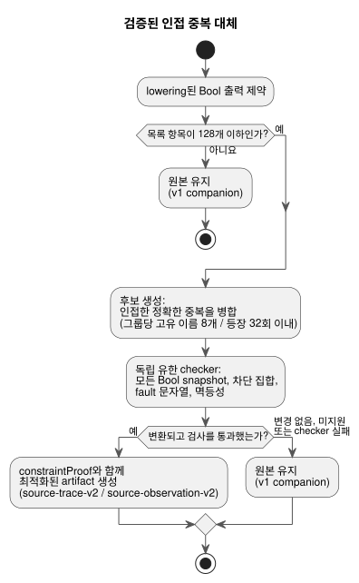

<!-- translation-source: docs/CHECKED-CONSTRAINT-REPLACEMENTS.md -->
[영문 원문](CHECKED-CONSTRAINT-REPLACEMENTS.md)

# 검증된 제약 대체

한국어 | [English](CHECKED-CONSTRAINT-REPLACEMENTS.md)

상태: [OPT-42](OPTIMIZER-PASS-CONTRACT.ko.md) 아래에서 issue #31의 남은 인수 범위를 위한
**제한된 구현 계약**입니다. 집중 구현 검사는 통과했습니다. 이는 전체 CI 완료나 배포를
주장하지 않습니다.

이 문서는 구현된 제한적 최적화 하나를 규정합니다. 컴파일러는 Bool 출력 제약의 인접한 정확한
중복을 제거할 수 있지만, 독립 checker가 실행 효과가 바뀌지 않음을 증명할 때에만 그렇게 합니다.
또한 독립적인 인수 검사도 규정합니다. [의도 앵커 계약](INTENT-ANCHOR-MAP.ko.md)이 계속 우선
기준입니다.

아래 다이어그램은 파이프라인을 요약합니다. 후보 생성이 대체를 제안하고, 독립 checker가 결정하며,
어느 단계든 실패하면 원본을 유지합니다.

## 대체 대상

**대체되는 것.** 이 pass는 최종 생성 전에, 의미 해석과 lowering을 마친 Bool 출력 제약에
작용합니다.

- 인접한 정확한 중복만 제거합니다. 즉 제약 종류가 같고 순서 있는 출력 이름 열이 같아야
  합니다.
- 첫 번째 발생을 대체 결과로 유지합니다.
- 이름은 정확히 비교합니다. 정규화, 정렬, 재배열, 재그룹화를 하지 않습니다.

예를 들어 `mutex(a,b)` 바로 뒤에 `mutex(a,b)`가 오면 병합할 수 있습니다. `mutex(a,b)` 뒤에
`mutex(b,a)`가 오거나, 두 `mutex(a,b)` 사이에 다른 제약이 있으면 병합할 수 없습니다.

**예산.**

| 한도 항목 | 한도 | 초과 시 |
|---|---|---|
| 원본 제약 목록 전체의 항목 수 | 최대 128 | 원본과 v1 메타데이터를 유지합니다 |
| 중복 그룹당 고유 출력 이름 수 | 최대 8 | 그 그룹은 그대로 유지하며, 다른 적격 그룹은 여전히 병합될 수 있습니다 |
| 중복 그룹당 이름 등장 횟수 | 최대 32 | 그 그룹은 그대로 유지하며, 다른 적격 그룹은 여전히 병합될 수 있습니다 |

기존의 필수 GFB/자원 오류는 여전히 적용되므로, fallback한다고 해서 artifact 생성이 보장되지는
않습니다. 허용된 중복이 없는 목록도 그대로 유지되며, 진단은 필요하지 않습니다.

**범위 밖.** 이 범위는 사용자 문법, 소스 형식, 범용 SMT solver나 BDD 엔진을 추가하지 않습니다.
다음도 하지 않습니다.

- 식 단순화
- 서로 다른 제약 종류의 결합
- 떨어져 있는 제약의 중복 제거
- 원시 소스 Boolean AST의 인증

proof는 현재의 `require` lowering을 포함하여, 현재 실행되는 제약 효과에 관한 것입니다.

## 독립적인 유한 의무

후보 생성은 대체 *주장(claim)*을 제공할 뿐, 이를 수용하지 않습니다. 별도의 유한 의미 checker가
수용 여부를 결정합니다.

1. 허용된 각 그룹의 Bool 정의역을 재구성합니다.
2. 그룹의 고유 출력(최대 8개)에 대한 모든 snapshot(최대 2^8 = 256개)을 검사합니다.
3. 모든 snapshot에서 원본과 후보는 동일한 차단 출력 집합과 동일한 fault 문자열을 만들어야
   합니다.
4. 효과를 반복해도 멱등(idempotent)인지도 검사합니다.

반환된 Boolean 값만 비교하는 것으로는 충분하지 않습니다.

**중복 제거가 안전한 이유.** 근거는 Rust `apply_safety`를 사용합니다.

- 한 라운드의 모든 제약은 같은 snapshot을 읽습니다.
- 차단된 출력과 fault는 `BTreeSet` 합집합으로 누적됩니다.
- 따라서 동일한 효과를 반복해도 새로운 차단 출력이나 fault가 추가되지 않습니다.
- 첫 번째 중복을 유지하면 각 라운드의 합집합과 그다음 snapshot이 보존됩니다.
- 귀납적으로, 고정점의 안전 출력, fault 문자열, 라운드 수가 보존됩니다.

제약을 제거해도 식 평가, 요청 의도, 상태 전이, 타이머, 예약, clock, accounting 계산은 바뀌지
않습니다.

**논증의 한계.** checker는 지원되는 효과 모델에 대해 이 가정들을 검증해야 합니다. 지원하지 않는
효과가 있거나 checker가 실패하면 원본을 유지합니다. 이 논증은 순서가 있는 부작용, 서로 다른
fault 문자열, 임의의 식 재작성, 물리적 적용에는 확장되지 않습니다. native/WASM 차등 실행은
proof를 보완하지만, proof의 전수 의미 검사를 대신할 수는 없습니다.

## revision에 묶인 proof와 mapping

**검사된 변환이 유지하는 것.**

- 설명 문장과 주석을 포함한 정확한 정본 `.ghost.md` 바이트
- 소스 revision과 해시
- 모든 source node, 모든 앵커, 모든 링크

제거된 node는 원래의 Markdown 위치와 추출 위치에서 계속 사용할 수 있습니다. 앵커 분류는 의도를
추론하거나 확인하지 않고 그대로 유지됩니다. 제거된 각 중복을 포함하여 모든 원본 소스 제약은
자신이 남긴 제약의 컴파일된 인덱스로 매핑됩니다. 이 매핑은 완전하고 순서가 있습니다.

**proof 레코드.** `constraintProof`는 `checker`, `rule`, `scope`, `status`, `original`,
`compiled`, `sourceToCompiled`, `originalSha256`, `compiledSha256`,
`certificateSha256`을 기록합니다.

- checker는 `GhostFlow/adjacent-constraint-effect-checker-v1`입니다.
- status는 `independently-verified`입니다.
- 정본 JSON 해시가 두 목록과 certificate를 바인딩합니다.

바깥쪽 `sourceDocumentSha256`과 `bytecodeSha256`, 완전한 정본 source-map 재생, 기존 서명
package의 적용 범위가 정확한 소스/artifact identity와 원본 node/앵커를 바인딩합니다. proof는
컴파일러 Git/프로필 revision 필드나 별도의 의무 digest를 추가하지 않습니다. 그것들은 더 넓은
OPT-42 설계에 속합니다. 생성기가 주장하는 status나 digest만으로는 수용이 성립하지 않습니다.

**기존 `require` 도출은 격상되지 않습니다.** 이들은 `semanticVerification: not-proven`과 함께
`compiler-derived`로 유지됩니다. 특히 `require !(a && b && c)`는 현재 `mutex(a,b,c)`로
lowering됩니다. 정확히 두 출력이 true일 때 "셋 모두는 아님"과 "최대 하나"는 다릅니다. 중복 효과
proof는 그 도출을 격상하지도, 세 출력 소스 의미를 고치거나 정의하지도 않습니다. 동일한 현재
실행 효과를 대체할 수 있다는 것만 증명합니다.

## 증거와 호환성

**companion 버전.**

| Artifact | 호스트 companion |
|---|---|
| 실제로 변환되고 독립적으로 검사된 경우 | `GhostFlow/source-trace-v2`와 `GhostFlow/source-observation-v2` |
| 예산 초과로 건너뛴 경우를 포함해 변환되지 않은 경우 | v1 |

이것은 호스트 companion 버전일 뿐입니다. GFB 형식, native ABI, `safety-trace-v1`, 엄격한
제어 매니페스트는 바뀌지 않습니다. v2를 검증할 수 없는 이전 호스트 메타데이터 소비자는 이를
거부합니다(fail closed). native 서명 package 전송은 이 호스트 proof 필드를 해석하지 않습니다.

**실행 증거.** 실제로 실행된 첫 번째 제약 레코드가 관측된 실행 증거를 가집니다.

| 항목 | 필드 |
|---|---|
| 제거된 중복 | `evidence: derived`, `relation: checked-adjacent-duplicate`, `replacementCompiledIndex`, `checker`, `certificateSha256` |
| 남은 항목 | `evidence: executed`, `compiledIndex`, `observed` |

실행 이벤트, 평가, 충족 여부를 제거된 소스 검사로 결코 복사하지 마십시오. 도출된 대체, 실제
관측, 최종 차단, 적용된(applied) 명령, 확인된(confirmed) 물리 피드백은 서로 다른 사실로
남습니다. 각 원본 소스 identity와 그 앵커는 컴파일된 인덱스를 통해 계속 탐색할 수 있습니다.

**신뢰 경계.** 관찰자는 이전에 인증되었거나 복구된 메타데이터를 런타임 증거와 join합니다. 임의의
원시 source map을 인증하지는 않습니다.

- 엄격한 정본 재생이 후보와 완전한 매핑을 독립적으로 재구성합니다.
- 독립 proof checker가 유한 의무와 certificate를 검증합니다.
- 두 가지 모두 JS builder, 복구, JS package 검증 경계에서 필수입니다.
- native verifier는 기존 신뢰 경계를 유지합니다. 호스트 정리(theorem)를 독립적으로 증명하는
  대신, 신뢰된 builder의 서명, 무결성, 프로필, 로더 요구 사항을 검사합니다.

다음은 거부합니다.

- 없거나, 추가되었거나, 변조된 relation, origin, 관측, certificate
- 섞인 revision
- 지원하지 않는 버전
- 검증되지 않은 모든 최적화 artifact

재생 일관성이 의미 proof가 되지는 않습니다.

## 인수 증거

테스트는 다음을 다루어야 합니다.

- 허용된 모든 제약 종류, 제한된 모든 Bool snapshot, 인접 그룹, 여러 그룹, 원본에서 컴파일된
  인덱스로의 이동
- native와 WASM 실행 모두에서 원본과 후보의 고정점 안전 출력, fault, 라운드 비교
- no-op identity, 정확한 순서의 이름, 떨어져 있는 중복
- 128/129 목록 경계와 8/9 고유 이름 경계
- 변경되지 않는 상태, 시간, 식
- 설명 문장/주석 revision과 앵커의 완전한 보존

부정 vector는 위조된 proof status, 없거나 추가된 origin, 변경된 해시, 복사된 실행 증거, 섞인
revision, 검증되지 않은 최적화 package를 거부해야 합니다. checker/예산 fallback은 필수 검사가
생성을 허용할 때 원본 실행과 v1 companion을 유지해야 합니다.

집중 proof 검사와 native/WASM parity 검사가 이 제한된 범위를 뒷받침합니다. 이것들은 전체 CI,
배포, 물리적 동작을 입증하지 않습니다.
