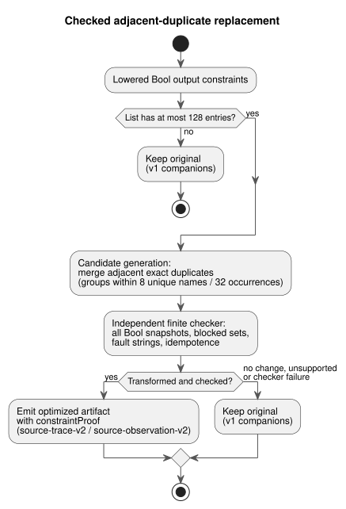

# Checked constraint replacements

[한국어](CHECKED-CONSTRAINT-REPLACEMENTS.ko.md)

Status: **bounded implementation contract** for issue #31's remaining acceptance,
under [OPT-42](OPTIMIZER-PASS-CONTRACT.md). Focused implementation checks passed;
this is not a claim of full CI completion or deployment.

This document specifies one implemented, bounded optimization: the compiler may
remove an adjacent exact duplicate of a Bool output constraint, but only when an
independent checker proves that the executable effect is unchanged. It also
specifies the independent acceptance checks. The
[intent anchor contract](INTENT-ANCHOR-MAP.md) remains authoritative.

The diagram below summarizes the pipeline: candidate generation proposes a
replacement, the independent checker decides, and any failure keeps the original.

## Eligible replacement

**What is replaced.** The pass operates on semantically resolved, lowered Bool
output constraints, before final emission.

- It removes only adjacent exact duplicates: same constraint kind and same
  ordered output-name sequence.
- It keeps the first occurrence as the replacement.
- Names are compared exactly: no normalization, sorting, reordering or
  regrouping.

For example, `mutex(a,b)` immediately followed by `mutex(a,b)` can merge.
`mutex(a,b)` followed by `mutex(b,a)`, or two `mutex(a,b)` separated by another
constraint, cannot.

**Budgets.**

| Bound | Limit | If exceeded |
|---|---|---|
| Entries in the entire original constraint list | at most 128 | the original and v1 metadata are kept |
| Unique output names per duplicate group | at most eight | that group stays unchanged; other eligible groups may still merge |
| Name occurrences per duplicate group | at most 32 | that group stays unchanged; other eligible groups may still merge |

Existing mandatory GFB/resource errors still apply, so falling back does not
guarantee that an artifact is emitted. A list with no admitted duplicate also
stays unchanged; no diagnostic is required.

**Out of scope.** This slice adds no user grammar, source format, general SMT
solver or BDD engine. It does not:

- simplify expressions;
- combine different constraint kinds;
- deduplicate separated constraints;
- certify a raw source Boolean AST.

The proof concerns the current executable constraint effect, including the
current `require` lowering.

## Independent finite obligation

Candidate generation supplies a replacement *claim*; it does not accept it. A
separate finite semantic checker decides acceptance:

1. It reconstructs each admitted group's Bool domain.
2. It checks all snapshots of the group's at most eight unique outputs (at most
   2^8 = 256 snapshots).
3. For every snapshot, the original and the candidate must produce identical
   blocked-output sets and identical fault strings.
4. It also checks that repeating the effect is idempotent.

Comparing returned Boolean values alone is not enough.

**Why removing a duplicate is safe.** The justification uses Rust `apply_safety`:

- Every constraint in a round reads the same snapshot.
- Blocked outputs and faults accumulate through `BTreeSet` union.
- An identical repeated effect therefore adds no new blocked output or fault.
- Keeping the first duplicate preserves each round's unions and the following
  snapshot.
- By induction, the fixed-point safe outputs, fault strings and round count are
  preserved.

Removing a constraint changes no expression evaluation, requested intent, state
transition, timer, schedule, clock or accounting computation.

**Limits of the argument.** The checker must validate these assumptions against
the supported effect model. Unsupported effects, or a checker failure, keep the
original. The argument does not extend to ordered side effects, different fault
strings, arbitrary expression rewrites or physical application. Native/WASM
differential execution supplements the proof but cannot replace its exhaustive
semantic check.

## Revision-bound proof and mapping

**What a checked transformation keeps.**

- the exact canonical `.ghost.md` bytes, including prose and comments;
- the source revision and hashes;
- every source node, every anchor and every link.

Removed nodes remain available at their original Markdown and extracted
locations. Anchor classifications are kept without inferring or confirming
intent. Every original source constraint, including each removed duplicate, maps
to the compiled index of its retained constraint. The mapping is complete and
ordered.

**The proof record.** `constraintProof` records `checker`, `rule`, `scope`,
`status`, `original`, `compiled`, `sourceToCompiled`, `originalSha256`,
`compiledSha256` and `certificateSha256`.

- The checker is `GhostFlow/adjacent-constraint-effect-checker-v1`.
- The status is `independently-verified`.
- Canonical JSON hashes bind both lists and the certificate.

The outer `sourceDocumentSha256` and `bytecodeSha256`, complete canonical
source-map replay, and existing signed-package coverage bind the exact
source/artifact identity and the original nodes/anchors. The proof does not add
compiler Git/profile revision fields or a separate obligation digest; those
belong to the broader OPT-42 design. A generator's asserted status, or a digest
alone, cannot establish acceptance.

**Existing `require` derivations are not upgraded.** They stay
`compiler-derived` with `semanticVerification: not-proven`. In particular,
`require !(a && b && c)` currently lowers to `mutex(a,b,c)`. When exactly two
outputs are true, "not all three" and "at most one" differ. The duplicate-effect
proof neither upgrades that derivation nor repairs or defines three-output source
semantics. It proves only that identical current executable effects can be
replaced.

## Evidence and compatibility

**Companion versions.**

| Artifact | Host companions |
|---|---|
| Actually transformed and independently checked | `GhostFlow/source-trace-v2` and `GhostFlow/source-observation-v2` |
| Untransformed, including budget skips | v1 |

These are host companion versions only. The GFB format, the native ABI,
`safety-trace-v1` and the strict control manifest stay unchanged. An older host
metadata consumer that cannot validate v2 rejects it (fail closed). Native
signed-package transport does not interpret these host proof fields.

**Execution evidence.** The first actually executed constraint record carries the
observed execution evidence.

| Entry | Fields |
|---|---|
| Removed duplicate | `evidence: derived`, `relation: checked-adjacent-duplicate`, `replacementCompiledIndex`, `checker`, `certificateSha256` |
| Retained entry | `evidence: executed`, `compiledIndex`, `observed` |

Never copy execution events, evaluation or satisfaction onto the removed source
check. Derived replacement, actual observation, final blocking, applied commands
and confirmed physical feedback remain distinct facts. Each original source
identity and its anchors stay navigable through its compiled index.

**Trust boundaries.** Observers join previously authenticated or recovered
metadata to runtime evidence; they do not authenticate an arbitrary raw source
map.

- Strict canonical replay independently reconstructs the candidate and the
  complete mapping.
- The independent proof checker validates the finite obligation and the
  certificate.
- Both are mandatory at the JS builder, recovery and JS package-verification
  boundaries.
- The native verifier keeps its existing trust boundary. It checks the trusted
  builder's signature, integrity, profiles and loader requirements, rather than
  independently proving the host theorem.

Reject:

- missing, extra or tampered relations, origins, observations or certificates;
- mixed revisions;
- unsupported versions;
- any unverified optimized artifact.

Replay consistency does not become semantic proof.

## Acceptance evidence

Tests must cover:

- every admitted constraint kind, all bounded Bool snapshots, adjacent groups,
  multiple groups and original-to-compiled index shifts;
- original versus candidate fixed-point safe outputs, faults and rounds, in both
  native and WASM runs;
- no-op identity, exact ordered names and separated duplicates;
- the 128/129 list boundary and the eight/nine unique-name boundary;
- unchanged state, time and expressions;
- complete prose/comment revision and anchor retention.

Negative vectors must reject forged proof status, missing/extra origins, altered
hashes, copied execution evidence, mixed revisions and unverified optimized
packages. A checker/budget fallback must keep the original execution and v1
companions when the mandatory checks allow emission.

Focused proof checks and native/WASM parity checks support this bounded slice.
They do not establish full CI, deployment or physical behavior.
