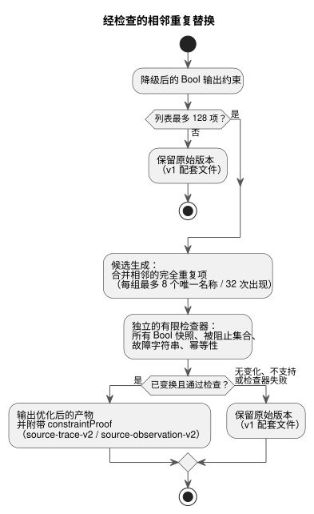

<!-- translation-source: docs/CHECKED-CONSTRAINT-REPLACEMENTS.md -->
[英文原文](CHECKED-CONSTRAINT-REPLACEMENTS.md)

# 经检查的约束替换

[한국어](CHECKED-CONSTRAINT-REPLACEMENTS.ko.md) | [English](CHECKED-CONSTRAINT-REPLACEMENTS.md) | 简体中文

状态：针对 issue #31 剩余验收项的**有界实现契约**，隶属于 [OPT-42](OPTIMIZER-PASS-CONTRACT.zh.md)。聚焦的实现检查已通过；这并不声称完整 CI 已完成或已部署。

本文档规定一项已实现的有界优化：编译器可以移除 Bool 输出约束的相邻完全重复项，但前提是独立的检查器证明可执行效果没有改变。本文档还规定了独立的验收检查。[意图锚点契约](INTENT-ANCHOR-MAP.zh.md)仍具有权威性。

下图概括了这一流水线：候选生成提出替换方案，由独立检查器做出决定，任何失败都会保留原始版本。

## 符合条件的替换

**替换什么。** 该 pass 作用于已完成语义解析、已降级的 Bool 输出约束，发生在最终发射之前。

- 它只移除相邻的完全重复项：相同的约束种类以及相同的有序输出名称序列。
- 它保留第一次出现的约束作为替换结果。
- 名称按原样精确比较：不做规范化、排序、重新排列或重新分组。

例如，`mutex(a,b)` 紧接着另一个 `mutex(a,b)` 可以合并。`mutex(a,b)` 后接 `mutex(b,a)`，或者两个 `mutex(a,b)` 之间隔着另一个约束，则不能合并。

**预算。**

| 边界 | 限制 | 超出时 |
|---|---|---|
| 整个原始约束列表中的条目 | 最多 128 | 保留原始版本和 v1 元数据 |
| 每个重复组的唯一输出名称 | 最多 8 个 | 该组保持不变；其他符合条件的组仍可合并 |
| 每个重复组的名称出现次数 | 最多 32 次 | 该组保持不变；其他符合条件的组仍可合并 |

现有的强制性 GFB/资源错误仍然适用，因此回退（fallback）并不保证会输出产物。没有被准入重复项的列表同样保持不变；不需要任何诊断。

**范围之外。** 本切片不添加任何用户语法、源格式、通用 SMT 求解器或 BDD 引擎。它不会：

- 简化表达式；
- 合并不同种类的约束；
- 对不相邻的约束去重；
- 认证原始源的 Bool AST。

该证明针对的是当前可执行的约束效果，包括当前的 `require` 降级方式。

## 独立的有限证明义务

候选生成提供一个替换*声明*；它并不接受该声明。由一个单独的有限语义检查器决定是否接受：

1. 它重建每个被准入组的 Bool 域。
2. 它检查该组最多 8 个唯一输出的所有快照（最多 2^8 = 256 个快照）。
3. 对每个快照，原始版本和候选版本必须产生完全相同的被阻止输出集合和完全相同的故障字符串。
4. 它还检查重复施加该效果是幂等的。

仅比较返回的 Bool 值是不够的。

**为什么移除重复项是安全的。** 论证基于 Rust 的 `apply_safety`：

- 一轮中的每个约束都读取同一个快照。
- 被阻止的输出和故障通过 `BTreeSet` 并集累积。
- 因此，完全相同的重复效果不会增加新的被阻止输出或故障。
- 保留第一个重复项可以保持每一轮的并集以及随后的快照。
- 通过归纳，不动点处的安全输出、故障字符串和轮数都得以保持。

移除一个约束不会改变任何表达式求值、请求意图、状态转换、定时器、调度计划、时钟或用量核算的计算。

**论证的局限。** 检查器必须根据所支持的效果模型验证这些假设。不支持的效果或检查器失败会保留原始版本。该论证不适用于有序副作用、不同的故障字符串、任意的表达式改写或物理应用。原生/WASM 差分执行可以补充证明，但不能取代其穷举的语义检查。

## 绑定修订版的证明与映射

**经检查的变换保留什么。**

- 确切的规范 `.ghost.md` 字节，包括正文和注释；
- 源修订版和哈希；
- 每个源节点、每个锚点和每个链接。

被移除的节点仍可在其原始 Markdown 位置和提取位置找到。锚点分类被保留，不会推断或确认意图。每个原始源约束（包括每个被移除的重复项）都映射到其保留约束的编译后索引。该映射是完整且有序的。

**证明记录。** `constraintProof` 记录 `checker`、`rule`、`scope`、`status`、`original`、`compiled`、`sourceToCompiled`、`originalSha256`、`compiledSha256` 和 `certificateSha256`。

- 检查器为 `GhostFlow/adjacent-constraint-effect-checker-v1`。
- 状态为 `independently-verified`。
- 规范 JSON 哈希绑定两个列表和证书。

外层的 `sourceDocumentSha256` 和 `bytecodeSha256`、完整的规范源映射重放，以及现有的已签名包覆盖范围，共同绑定确切的源/产物身份标识以及原始节点/锚点。该证明不添加编译器 Git/profile 修订版字段，也不添加单独的证明义务摘要；这些属于更广泛的 OPT-42 设计。生成器自行声明的状态，或仅凭一个摘要，都不能确立接受。

**现有的 `require` 推导不会被升级。** 它们保持 `compiler-derived`，并带有 `semanticVerification: not-proven`。特别是，`require !(a && b && c)` 目前降级为 `mutex(a,b,c)`。当恰好有两个输出为 true 时，“并非三个都为真”与“至多一个为真”是不同的。重复效果证明既不升级该推导，也不修复或定义三输出的源语义。它只证明完全相同的当前可执行效果可以被替换。

## 证据与兼容性

**配套文件版本。**

| 产物 | 宿主配套文件 |
|---|---|
| 实际已变换且经独立检查 | `GhostFlow/source-trace-v2` 和 `GhostFlow/source-observation-v2` |
| 未变换，包括因预算而跳过的情况 | v1 |

这些只是宿主配套文件的版本。GFB 格式、原生 ABI、`safety-trace-v1` 和严格控制清单保持不变。无法验证 v2 的较旧宿主元数据消费者会拒绝它（失败关闭，fail closed）。原生已签名包传输不解释这些宿主证明字段。

**执行证据。** 第一个实际执行的约束记录携带观测到的执行证据。

| 条目 | 字段 |
|---|---|
| 被移除的重复项 | `evidence: derived`、`relation: checked-adjacent-duplicate`、`replacementCompiledIndex`、`checker`、`certificateSha256` |
| 保留的条目 | `evidence: executed`、`compiledIndex`、`observed` |

绝不要把执行事件、求值或满足情况复制到被移除的源检查上。派生的替换、实际观测、最终阻止、已应用的命令以及已确认的物理反馈仍是不同的事实。每个原始源身份标识及其锚点都可以通过其编译后索引继续导航。

**信任边界。** 观察者将先前已认证或已恢复的元数据与运行时证据联接；它们不对任意的原始源映射进行认证。

- 严格的规范重放会独立重建候选版本和完整映射。
- 独立的证明检查器验证有限证明义务和证书。
- 两者在 JS 构建器、恢复以及 JS 包验证边界处都是强制的。
- 原生验证器保持其现有的信任边界。它检查受信任构建器的签名、完整性、profile 和加载器要求，而不是独立证明宿主定理。

拒绝以下情况：

- 缺失、多余或被篡改的关系、来源、观测或证书；
- 混合的修订版；
- 不支持的版本；
- 任何未经验证的优化产物。

重放一致性不会变成语义证明。

## 验收证据

测试必须覆盖：

- 每种被准入的约束种类、所有有界 Bool 快照、相邻组、多个组以及原始到编译后的索引偏移；
- 在原生和 WASM 运行中，原始版本与候选版本在不动点处的安全输出、故障和轮数；
- 无操作时的身份不变、精确的有序名称以及不相邻的重复项；
- 128/129 的列表边界以及 8/9 的唯一名称边界；
- 状态、时间和表达式保持不变；
- 完整的正文/注释修订版和锚点保留。

负面向量必须拒绝伪造的证明状态、缺失/多余的来源、被篡改的哈希、复制的执行证据、混合的修订版以及未经验证的优化包。当强制检查允许输出时，检查器/预算回退必须保留原始执行和 v1 配套文件。

聚焦的证明检查和原生/WASM 一致性检查支持这一有界切片。它们并不证明完整 CI、部署或物理行为。
