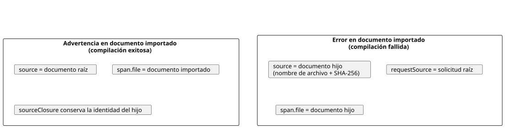
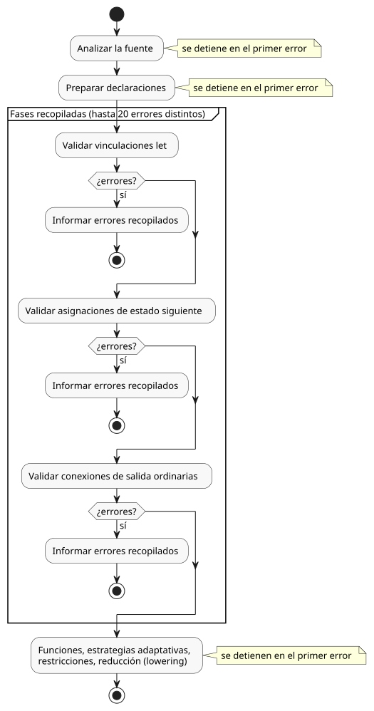

<!-- translation-source: docs/COMPILER-DIAGNOSTICS.md -->
[Original en inglés](COMPILER-DIAGNOSTICS.md)

# Diagnósticos públicos del compilador

Este documento describe los diagnósticos estructurados que el compilador de
GhostFlow devuelve a las herramientas y a los hosts.

**En este documento**

- La envoltura de diagnósticos (`GhostFlow/diagnostics-v1`), sus coordenadas y sus códigos.
- Las advertencias de cobertura de enlaces de intención en compilaciones exitosas.
- Dos diagnósticos accionables: un tipo `Celsius` no declarado y la falta de procedencia de intención del Interaction Schema.
- La recopilación acotada de errores: cuántos errores informa una compilación y cuándo se detiene.

`compileSource`, en las cadenas de herramientas del navegador y de Node, devuelve
un `diagnosticEnvelope`:

- **Éxito.** El arreglo `diagnostics` de la envoltura puede contener advertencias.
  Una compilación exitosa y limpia tiene un arreglo vacío.
- **Fallo con ubicación.** La compilación se rechaza y el error lanzado lleva la
  misma propiedad `diagnosticEnvelope`.

La clase de error, el mensaje y el texto de la CLI existentes no cambian. Hay dos
excepciones, ambas descritas más abajo: la orientación accionable para la falta
de procedencia del Interaction Schema y para un tipo `Celsius` no declarado.

El formato de la envoltura es `GhostFlow/diagnostics-v1`:

```json
{
  "format": "GhostFlow/diagnostics-v1",
  "source": {
    "filename": "farm.ghost.md",
    "sha256": "<lowercase SHA-256 of the exact UTF-8 document>",
    "documentId": "<when interactionSourceIdentity was supplied>",
    "revisionId": "<when interactionSourceIdentity was supplied>"
  },
  "diagnostics": [{
    "code": "GF_PARSE",
    "severity": "error",
    "message": "expected expression, found ;",
    "span": {
      "file": "farm.ghost.md",
      "start": { "line": 6, "column": 11 },
      "end": { "line": 6, "column": 12 }
    }
  }]
}
```

**Advertencias de cobertura de enlaces de intención**

El compilador, la CLI y la creación de paquetes informan advertencias de
cobertura de enlaces de intención en una compilación exitosa:

| Código | Significado |
| --- | --- |
| `GF_INTENT_LINK_MISSING` | Una sentencia admitida no tiene enlace de intención. |
| `GF_INTENT_LINK_COVERAGE_UNSUPPORTED` | Un propietario de comportamiento no tiene ningún destino de enlace admitido. |

Consulte las [advertencias de cobertura del comportamiento predeterminado](INTENT-ANCHOR-MAP.es.md#default-behavior-coverage-warnings)
para conocer los tipos de sentencias cubiertas, los límites, las importaciones y
los límites de interpretación.

Una advertencia y un error en un documento importado identifican sus documentos
de manera distinta:

- **Advertencia (compilación exitosa).** El `source` de la envoltura sigue siendo
  el documento raíz de la compilación. El `span.file` de la advertencia identifica
  la ubicación en la fuente importada. El `sourceClosure` conserva la identidad
  del documento hijo.
- **Error (compilación fallida).** El `source` del diagnóstico identifica el
  documento hijo y calcula su hash. `requestSource` identifica la solicitud raíz.

El siguiente diagrama contrasta los dos casos.



Dónde aparecen las advertencias:

- **La salida legible de la CLI** muestra la ubicación, el código y la pista de
  cada advertencia.
- **La salida JSON y TOON de la CLI** lleva los mismos registros.
- **El resultado de la compilación** conserva `warnings`. Contiene las cadenas de
  advertencia de la extracción y los registros estructurados de advertencias de
  enlaces de intención.
- **El `diagnostics` de la envoltura** contiene los registros estructurados.

Se trata de metadatos de API adicionales. No cambian la salida ejecutable.

`buildPortablePackage` también vuelve a reproducir (replay) la fuente después de
validar la procedencia e informa las advertencias nuevas de esa reproducción:

- Pase `onDiagnostic` para manejar cada advertencia. Sin una función de
  devolución de llamada (callback), el generador de paquetes usa `console.warn`.
- La función de devolución de llamada se ejecuta solo después de que la
  reproducción tiene éxito. Las excepciones que lanza se propagan a quien hizo la
  llamada.
- La verificación permanece silenciosa.
- Las advertencias nunca entran en la carga útil firmada ni la modifican.

**Coordenadas**

- Las líneas y las columnas empiezan en uno.
- Se refieren al documento `.ghost.md` original, incluidas las líneas de prosa y
  las líneas de los delimitadores de bloque.
- Las columnas usan las coordenadas en unidades de código UTF-16 del compilador.
- `end` es exclusivo. Solo aparece cuando el compilador tiene una posición final
  mapeada.
- `hint`, `related` y `reference` son opcionales. Están ausentes hasta que el
  compilador tiene evidencia para ellos. En particular, el compilador no adivina
  una sección de la Referencia a partir del texto del mensaje.

**Códigos e identidad de la fuente**

La envoltura usa estos códigos para los errores de compilación:

| Código | Se usa para |
| --- | --- |
| `GF_LITERATE` | Extracción del documento |
| `GF_PARSE` | Sintaxis |
| `GF_TYPE` | Discrepancias de tipo en salidas |
| `GF_IMPORT` | Validación de composición/importación |
| `GF_SEMANTIC` | Otras comprobaciones del compilador |

`GF_INTENT_PROVENANCE` se describe en
[Falta de procedencia de intención del Interaction Schema](#falta-de-procedencia-de-intención-del-interaction-schema).
La cadena de herramientas también emite `GF_HARDWARE` para el front matter de
hardware y `GF_INTENT_EVIDENCE` para las comprobaciones de evidencia de
intención.

El `message` es el detalle legible del error, sin el prefijo de nombre de
archivo y coordenadas.

Para un diagnóstico en un documento importado:

- `source` nombra ese documento importado y calcula su hash.
- `requestSource` lleva la solicitud de compilación raíz: el nombre del archivo
  raíz, su SHA-256 y los ID de documento y de revisión que se hayan
  proporcionado.
- La identidad raíz nunca se asigna al hijo.

`GF_IMPORT` está reservado para tres casos: importaciones faltantes,
discrepancias de revisión/resumen (digest) y ciclos de importación. Las
comprobaciones de tipo y semánticas dentro de una composición conservan sus
propios códigos.

La validación de entradas que no tiene una posición en el código escrito sigue
lanzando su error existente, sin un span de diagnóstico.

La envoltura son metadatos de API. No cambia los bytes de GFB, el artefacto de
mapa de fuente persistido ni el comportamiento en tiempo de ejecución. La
identidad de la fuente y la procedencia ejecutable siguen rigiéndose por
[SOURCE-MAP.es.md](SOURCE-MAP.es.md).

## Tipo Celsius no declarado

Un programa que usa `Celsius` sin declararlo se sigue rechazando con
`GF_SEMANTIC`, el mensaje `unknown type Celsius` y el span original del tipo.

El diagnóstico añade orientación:

- El `hint` explica que una medición en Celsius usa
  `input temperature: Temperature;` y un valor como `30°C`.
- El `reference` enlaza con la
  [tabla de consulta de magnitud a tipo](ProgrammingInGhostflow.es.md#quantity-type-lookup)
  que ya existe en el libro.
- La CLI legible muestra la misma orientación. JSON/TOON llevan la pista
  estructurada.

Lo que no cambia:

- No se reescribe ninguna fuente ni se añade ningún alias de tipo.
- Una enumeración (enum) definida por el usuario llamada `Celsius` se sigue
  resolviendo con normalidad.
- Los demás tipos desconocidos conservan sus diagnósticos existentes.
- Los programas válidos conservan los mismos bytes ejecutables.

## Falta de procedencia de intención del Interaction Schema

Cuando `interactionSourceIdentity` solicita un esquema, cada estado, temporizador
y ajuste (`config`) de operador escrito por el autor necesita un enlace explícito
a un ancla literaria. Un enlace faltante informa `GF_INTENT_PROVENANCE`:

- en el span de Markdown original de la declaración;
- con el hash exacto de la fuente y los ID de documento/revisión proporcionados.

El mensaje de error explica la forma requerida:

- Un ancla identifica un párrafo o una cita en bloque **fuera** de los bloques
  delimitados de código.
- Un enlace debe ir **inmediatamente antes** de la declaración, dentro de su
  bloque `ghost`.

El `hint` contiene una sintaxis válida de ancla/enlace y un ID de ejemplo que no
coincide con los ID existentes. El `reference` apunta a
[la forma escrita por el autor](INTENT-ANCHOR-MAP.es.md).

Cómo actuar a partir de la sugerencia:

1. **Prefiera** un enlace a un ancla activa existente cuyo motivo realmente
   aplique.
2. De lo contrario, use el ejemplo alternativo. Está marcado explícitamente
   `kind=assumption status=unconfirmed origin=ai` con `relation=assumes`.
3. Escriba y revise el motivo real antes de adoptarlo. Una compilación exitosa
   nunca confirma la intención.
4. La intención confirmada debe provenir de una persona y seguir el contrato de
   reclasificación existente.

Garantías:

- No se aplica automáticamente ninguna edición a la fuente.
- Se mantiene intacto el rechazo de anclas/enlaces faltantes, duplicados,
  huérfanos, incompatibles y reemplazados.
- Escribir la sugerencia en una nueva revisión de la fuente no cambia ningún
  token ejecutable ni ningún byte de GFB.

## Recopilación acotada de errores

El compilador puede informar varios errores de una sola compilación, pero solo
dentro de límites claros.

Una vez que el análisis sintáctico y la preparación de las declaraciones tienen
éxito, el compilador recopila errores dentro de **una** fase de validación. Las
fases recopiladas se ejecutan en este orden:

1. vinculaciones `let`
2. asignaciones de estado siguiente
3. conexiones de salida ordinarias

La recopilación se detiene tras la primera fase que falla. El siguiente diagrama
muestra qué etapas recopilan errores y cuáles se detienen en el primer error.



Dentro de una fase:

- Una dependencia `let` fallida reutiliza su error original. Esto evita cascadas
  engañosas de errores de definición cíclica.
- Los diagnósticos se ordenan por nombre de archivo, línea y columna.
- La excepción lanzada conserva el mensaje del primer error encontrado.
- Los bloques delimitados de Markdown y los documentos importados conservan sus
  ubicaciones de autoría.
- La identidad de la fuente de la envoltura describe el documento del primer
  diagnóstico. Cada span de diagnóstico identifica su propio archivo.

El tope es de **20 errores distintos**:

- El recopilador busca un error número 21. Si lo encuentra, informa
  `collection: { limit: 20, truncated: true }` en la envoltura de la API y en el
  resultado JSON/TOON de la CLI.
- Esta marca significa que existen más errores. No es un recuento total.
- Exactamente 20 errores no activan los metadatos de desbordamiento.
- La CLI proyecta los mismos diagnósticos que la API.
- Una compilación fallida nunca devuelve ni escribe un artefacto.

Estas etapas siguen deteniéndose en su primer error: errores del analizador
sintáctico, preparación de declaraciones, validación de funciones, estrategias
adaptativas, restricciones y la reducción (lowering) posterior. La recuperación
nunca cruza estos límites y nunca intenta reparar la sintaxis.

Los fallos internos inesperados o sin ubicación se vuelven a lanzar de
inmediato, incluso después de errores anteriores en la fuente. Por lo tanto, la
recopilación de diagnósticos no puede ocultar un fallo del compilador.

Corregir la fase informada puede revelar errores en fases posteriores. Un
informe de errores no pretende enumerar todos los errores de un documento.
