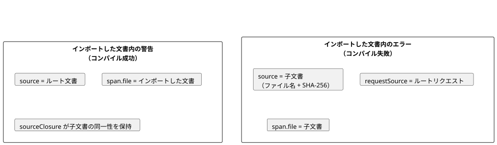
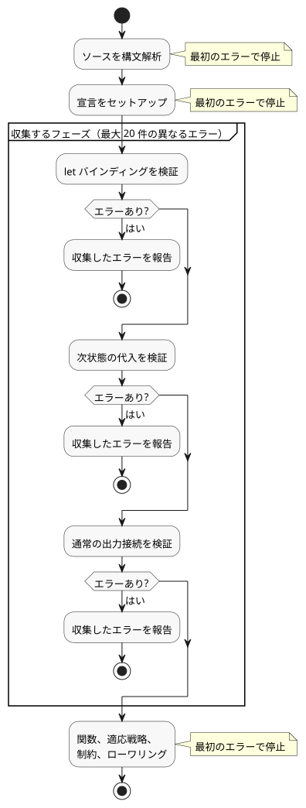

<!-- translation-source: docs/COMPILER-DIAGNOSTICS.md -->
[英語の原文](COMPILER-DIAGNOSTICS.md)

# 公開コンパイラ診断

この文書では、GhostFlow コンパイラがツールやホストに返す構造化された診断（diagnostic）について説明します。

**この文書の内容**

- 診断エンベロープ（`GhostFlow/diagnostics-v1`）、その座標、およびコード。
- コンパイル成功時の意図リンク（intent link）カバレッジ警告。
- 対処可能な 2 つの診断：宣言されていない `Celsius` 型と、Interaction Schema の意図来歴（provenance）の欠落。
- 上限付きのエラー収集：1 回のコンパイルで報告されるエラーの数と、収集が停止する条件。

ブラウザ版と Node 版のツールチェーンの `compileSource` は、`diagnosticEnvelope` を返します。

- **成功時。** エンベロープの `diagnostics` 配列には警告が含まれることがあります。問題のないコンパイル成功では空の配列になります。
- **位置情報付きの失敗時。** コンパイルは reject され、スローされたエラーが同じ `diagnosticEnvelope` プロパティを持ちます。

既存のエラークラス、メッセージ、CLI のテキストは変わりません。例外は 2 つあり、どちらも後述します。Interaction Schema の来歴が欠落している場合と、`Celsius` 型が宣言されていない場合の、対処方法を示すガイダンスです。

エンベロープの形式は `GhostFlow/diagnostics-v1` です。

```json
{
  "format": "GhostFlow/diagnostics-v1",
  "source": {
    "filename": "farm.ghost.md",
    "sha256": "<lowercase SHA-256 of the exact UTF-8 document>",
    "documentId": "<when interactionSourceIdentity was supplied>",
    "revisionId": "<when interactionSourceIdentity was supplied>"
  },
  "diagnostics": [{
    "code": "GF_PARSE",
    "severity": "error",
    "message": "expected expression, found ;",
    "span": {
      "file": "farm.ghost.md",
      "start": { "line": 6, "column": 11 },
      "end": { "line": 6, "column": 12 }
    }
  }]
}
```

**意図リンクのカバレッジ警告**

コンパイラ、CLI、およびパッケージ作成は、コンパイル成功時に意図リンクのカバレッジ警告を報告します。

| コード | 意味 |
| --- | --- |
| `GF_INTENT_LINK_MISSING` | サポート対象の文に意図リンクがありません。 |
| `GF_INTENT_LINK_COVERAGE_UNSUPPORTED` | 振る舞いの所有者に、サポートされるリンク先がありません。 |

対象となる文の種類、制限、インポート、および解釈の境界については、[既定の振る舞いカバレッジ警告](INTENT-ANCHOR-MAP.ja.md#default-behavior-coverage-warnings)を参照してください。

インポートした文書内の警告とインポートした文書内のエラーでは、文書の識別方法が異なります。

- **警告（コンパイル成功）。** エンベロープの `source` はルートのコンパイル文書のままです。警告の `span.file` はインポートしたソースの位置を示します。`sourceClosure` は子文書の同一性を保持します。
- **エラー（コンパイル失敗）。** 診断の `source` は子文書を識別し、そのハッシュを持ちます。`requestSource` はルートのリクエストを識別します。

次の図は、この 2 つの場合を対比しています。



警告が現れる場所は次のとおりです。

- **CLI の人間向け出力**には、各警告の位置、コード、ヒントが表示されます。
- **CLI の JSON 出力と TOON 出力**には、同じレコードが含まれます。
- **コンパイル結果**は `warnings` を保持します。ここには抽出時の警告文字列と、構造化された意図リンク警告レコードが含まれます。
- **エンベロープの `diagnostics`** には構造化されたレコードが含まれます。

これは追加的な API メタデータです。実行可能な出力は変わりません。

`buildPortablePackage` も、来歴の検証後にソースをリプレイし、そのリプレイで新たに得られた警告を報告します。

- 各警告を処理するには `onDiagnostic` を渡します。コールバックがない場合、パッケージビルダーは `console.warn` を使います。
- コールバックはリプレイが成功した後にのみ実行されます。コールバックがスローした例外は呼び出し元に伝播します。
- 検証（verification）では何も出力されません。
- 警告が署名済みペイロードに入ったり、ペイロードを変更したりすることは決してありません。

**座標**

- 行と列は 1 始まりです。
- 行と列は、散文の行とフェンスの行を含む元の `.ghost.md` 文書を基準とします。
- 列はコンパイラの UTF-16 コード単位の座標を使います。
- `end` は終端を含みません（exclusive）。コンパイラが対応付けられた終了位置を持っている場合にのみ現れます。
- `hint`、`related`、`reference` は任意です。コンパイラがそれらの根拠を持つまでは存在しません。特に、コンパイラはメッセージテキストから Reference のセクションを推測しません。

**コードとソースの同一性**

エンベロープは、コンパイルエラーに次のコードを使います。

| コード | 用途 |
| --- | --- |
| `GF_LITERATE` | 文書の抽出 |
| `GF_PARSE` | 構文 |
| `GF_TYPE` | 出力の型の不一致 |
| `GF_IMPORT` | 合成／インポートの検証 |
| `GF_SEMANTIC` | その他のコンパイラチェック |

`GF_INTENT_PROVENANCE` については、[Interaction Schema の意図来歴の欠落](#interaction-schema-の意図来歴の欠落)で説明します。ツールチェーンは、ハードウェアフロントマターに対して `GF_HARDWARE` を、意図の証拠（intent evidence）のチェックに対して `GF_INTENT_EVIDENCE` も出力します。

`message` は人間が読むためのエラー詳細で、ファイル名と座標の接頭辞は含みません。

インポートした文書内の診断では、次のようになります。

- `source` はそのインポートした文書を名指しし、そのハッシュを持ちます。
- `requestSource` はルートのコンパイルリクエストを保持します。内容は、ルートのファイル名、その SHA-256、および指定された文書 ID とリビジョン ID です。
- ルートの同一性が子に割り当てられることは決してありません。

`GF_IMPORT` は 3 つのケース専用です。インポートの欠落、リビジョン／ダイジェストの不一致、およびインポートの循環です。合成の内部での型チェックと意味チェックは、それぞれ独自のコードを維持します。

記述された位置を持たない入力検証は、診断の span なしで、従来どおりのエラーをスローします。

エンベロープは API メタデータです。GFB のバイト列、永続化されたソースマップ成果物、ランタイムの振る舞いは変わりません。ソースの同一性と実行可能な来歴は、引き続き [SOURCE-MAP.md](SOURCE-MAP.ja.md) が規定します。

## 宣言されていない Celsius 型

`Celsius` を宣言せずに使うプログラムは、引き続き `GF_SEMANTIC`、メッセージ `unknown type Celsius`、および元の型の span とともに拒否されます。

診断には次のガイダンスが追加されます。

- `hint` は、摂氏の測定値には `input temperature: Temperature;` と `30°C` のような値を使うことを説明します。
- `reference` は、本書の既存の[物理量から型への対応表](ProgrammingInGhostflow.ja.md#quantity-type-lookup)にリンクします。
- 人間向けの CLI にも同じガイダンスが表示されます。JSON／TOON は構造化されたヒントを含みます。

変わらない点：

- ソースは書き換えられず、型の別名も追加されません。
- ユーザー定義の `Celsius` という名前の列挙型（enum）は、引き続き通常どおり解決されます。
- その他の未知の型は、既存の診断を維持します。
- 有効なプログラムの実行可能なバイト列は同じままです。

## Interaction Schema の意図来歴の欠落

`interactionSourceIdentity` がスキーマを要求する場合、記述されたすべての state、タイマー、およびオペレーター用 config には、明示的な文芸的（literate）アンカーリンクが必要です。リンクが欠落していると、次の内容で `GF_INTENT_PROVENANCE` が報告されます。

- 宣言の元の Markdown の span で報告されます。
- 正確なソースハッシュと、指定された文書 ID／リビジョン ID が付きます。

エラーメッセージは、必要な形式を説明します。

- アンカーは、コードフェンスの**外側**にある段落または引用ブロックを識別します。
- リンクは、宣言の `ghost` フェンス内で、宣言の**直前**に置かなければなりません。

`hint` には、有効なアンカー／リンクの構文と、既存の ID と衝突しない例示用の ID が含まれます。`reference` は[記述形式](INTENT-ANCHOR-MAP.ja.md)を指します。

提案への対処方法：

1. 理由が実際に当てはまる既存の有効なアンカーへのリンクを**優先**してください。
2. そうでない場合は、代替の例を使います。この例には明示的に `relation=assumes` 付きの `kind=assumption status=unconfirmed origin=ai` が付いています。
3. 採用する前に、実際の理由を書いてレビューしてください。コンパイルが成功しても、意図が確認されることは決してありません。
4. 確認済みの意図は人が示さなければならず、既存の再分類（reclassification）の契約に従わなければなりません。

保証：

- ソースの編集が自動的に適用されることはありません。
- 欠落、重複、孤立、非互換、および置き換え済みのアンカー／リンクの拒否は、そのまま維持されます。
- 提案を新しいソースリビジョンに書き込んでも、実行可能なトークンも GFB のバイト列も変わりません。

## 上限付きのエラー収集

コンパイラは 1 回のコンパイルで複数のエラーを報告できますが、それは明確な制限の範囲内に限られます。

構文解析と宣言のセットアップが成功した後、コンパイラは**1 つ**の検証フェーズの中でエラーを収集します。収集対象のフェーズは次の順序で実行されます。

1. `let` バインディング
2. 次状態の代入
3. 通常の出力接続

収集は、最初に失敗したフェーズの後で停止します。次の図は、どの段階がエラーを収集し、どの段階が最初のエラーで停止するかを示しています。



1 つのフェーズの中では、次のようになります。

- 失敗した `let` の依存先は、元のエラーを再利用します。これにより、循環定義エラーが誤解を招く形で連鎖するのを防ぎます。
- 診断はファイル名、行、列の順に並べ替えられます。
- スローされる例外は、最初に検出されたエラーのメッセージを保持します。
- Markdown のフェンスとインポートした文書は、記述された位置を維持します。
- エンベロープのソースの同一性は、最初の診断の文書を表します。各診断の span は、それぞれ自身のファイルを識別します。

上限は**20 件の異なるエラー**です。

- コレクタは 21 件目のエラーがあるかを調べます。見つかった場合、API エンベロープと CLI の JSON／TOON の結果に `collection: { limit: 20, truncated: true }` を報告します。
- このフラグは、さらにエラーが存在することを意味します。総数ではありません。
- エラーがちょうど 20 件の場合、オーバーフローのメタデータは設定されません。
- CLI は API と同じ診断を出力します。
- 失敗したコンパイルが成果物を返したり書き込んだりすることは決してありません。

次の段階は、引き続き最初のエラーで停止します。構文解析エラー、宣言のセットアップ、関数の検証、適応戦略、制約、および後続のローワリングです。リカバリーがこれらの境界を越えることは決してなく、構文の修復を試みることもありません。

予期しない内部エラーや位置のない失敗は、それ以前にソースのエラーがあった場合でも、ただちに再スローされます。そのため、診断の収集がコンパイラの障害を隠すことはありません。

報告されたフェーズを修正すると、後続のフェーズのエラーが現れることがあります。エラーレポートは、文書内のすべての誤りを列挙しているとは主張しません。
