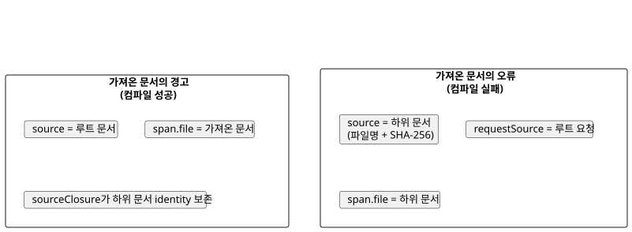
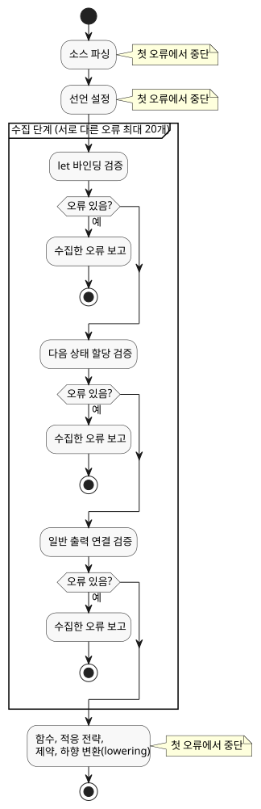

<!-- translation-source: docs/COMPILER-DIAGNOSTICS.md -->
[영문 원문](COMPILER-DIAGNOSTICS.md)

# 공개 컴파일러 진단

이 문서는 GhostFlow 컴파일러가 도구와 호스트에 반환하는 구조화된 진단을
설명합니다.

**이 문서의 내용**

- 진단 엔벌로프(`GhostFlow/diagnostics-v1`)와 그 좌표 및 코드.
- 성공한 컴파일에서 보고되는 intent-link 범위 경고.
- 조치 안내가 포함된 두 가지 진단: 선언되지 않은 `Celsius` 타입과 누락된 Interaction Schema 의도 provenance.
- 제한된 오류 수집: 한 번의 컴파일이 보고하는 오류 수와 수집을 멈추는 시점.

브라우저 및 Node 도구 체인의 `compileSource`는
`diagnosticEnvelope`를 반환합니다.

- **성공.** 엔벌로프의 `diagnostics` 배열에 경고가 들어 있을 수 있습니다. 경고가
  없는 성공 컴파일은 빈 배열을 반환합니다.
- **위치가 있는 실패.** 컴파일은 거부되며, 던져진 오류에 같은 `diagnosticEnvelope`
  속성이 담깁니다.

기존 오류 클래스, 메시지, CLI 문구는 바뀌지 않습니다. 예외는 두 가지이며 모두
아래에서 설명합니다. 누락된 Interaction Schema provenance에 대한 조치 안내와
선언되지 않은 `Celsius` 타입에 대한 조치 안내입니다.

엔벌로프 형식은 `GhostFlow/diagnostics-v1`입니다.

```json
{
  "format": "GhostFlow/diagnostics-v1",
  "source": {
    "filename": "farm.ghost.md",
    "sha256": "<lowercase SHA-256 of the exact UTF-8 document>",
    "documentId": "<when interactionSourceIdentity was supplied>",
    "revisionId": "<when interactionSourceIdentity was supplied>"
  },
  "diagnostics": [{
    "code": "GF_PARSE",
    "severity": "error",
    "message": "expected expression, found ;",
    "span": {
      "file": "farm.ghost.md",
      "start": { "line": 6, "column": 11 },
      "end": { "line": 6, "column": 12 }
    }
  }]
}
```

**Intent-link 범위 경고**

컴파일러, CLI, 패키지 생성은 성공한 컴파일에서도 intent-link 범위 경고를
보고합니다.

| 코드 | 의미 |
| --- | --- |
| `GF_INTENT_LINK_MISSING` | 지원 대상 문장에 intent link가 없습니다. |
| `GF_INTENT_LINK_COVERAGE_UNSUPPORTED` | 동작 소유자에게 지원되는 link 대상이 없습니다. |

검사 대상 문장 종류, 한도, import 처리, 해석 범위는
[기본 동작 범위 경고](INTENT-ANCHOR-MAP.ko.md#default-behavior-coverage-warnings)를
참고하세요.

가져온 문서의 경고와 가져온 문서의 오류는 문서를 서로 다르게 식별합니다.

- **경고(성공한 컴파일).** 엔벌로프의 `source`는 루트 컴파일 문서를 그대로
  가리킵니다. 경고의 `span.file`은 가져온 소스 위치를 식별합니다.
  `sourceClosure`에는 하위 문서의 identity(정체성)가 보존됩니다.
- **오류(실패한 컴파일).** 진단의 `source`는 하위 문서를 식별하고 해시합니다.
  `requestSource`는 루트 요청을 식별합니다.

아래 다이어그램은 두 경우를 비교합니다.



경고가 나타나는 곳:

- **CLI의 사람이 읽는 출력**에는 각 경고의 위치, 코드, 안내가 표시됩니다.
- **CLI JSON 및 TOON 출력**은 같은 record를 전달합니다.
- **컴파일 결과**는 `warnings`를 유지합니다. 여기에는 추출 경고 문자열과
  구조화된 intent-link 경고 record가 함께 들어 있습니다.
- **엔벌로프의 `diagnostics` 배열**에는 구조화된 record가 들어 있습니다.

이는 추가된 API 메타데이터입니다. 실행 결과는 바뀌지 않습니다.

`buildPortablePackage`도 provenance 검증 뒤에 소스를 다시 재생(replay)하고 새
replay 경고를 보고합니다.

- 각 경고를 처리하려면 `onDiagnostic`을 전달하세요. callback이 없으면 패키지
  빌더가 `console.warn`을 사용합니다.
- callback은 replay가 성공한 뒤에만 실행됩니다. callback이 던진 예외는
  호출자에게 전파됩니다.
- 검증 작업은 아무것도 출력하지 않습니다.
- 경고는 서명된 payload에 들어가거나 payload를 바꾸지 않습니다.

**좌표**

- 행과 열은 1부터 시작합니다.
- 산문 행과 펜스 행을 포함한 원본 `.ghost.md` 문서를 기준으로 합니다.
- 열은 컴파일러의 UTF-16 코드 단위 좌표를 사용합니다.
- `end`는 배타적입니다. 컴파일러가 매핑된 끝 위치를 가지고 있을 때만
  나타납니다.
- `hint`, `related`, `reference`는 선택 항목입니다. 컴파일러가 근거를 확보하기
  전에는 나타나지 않습니다. 특히 컴파일러는 메시지 문구만으로 Reference 절을
  추측하지 않습니다.

**코드와 소스 식별**

엔벌로프는 컴파일 오류에 다음 코드를 사용합니다.

| 코드 | 용도 |
| --- | --- |
| `GF_LITERATE` | 문서 추출 |
| `GF_PARSE` | 문법 |
| `GF_TYPE` | 출력 타입 불일치 |
| `GF_IMPORT` | 조합/import 검증 |
| `GF_SEMANTIC` | 그 밖의 컴파일러 검사 |

`GF_INTENT_PROVENANCE`는
[Interaction Schema 의도 provenance 누락](#interaction-schema-의도-provenance-누락)에서
설명합니다. 도구 체인은 하드웨어 front matter에 대해 `GF_HARDWARE`를,
의도 근거 검사에 대해 `GF_INTENT_EVIDENCE`를 내보내기도 합니다.

`message`는 파일명과 좌표 접두어를 제외한, 사람이 읽는 오류 상세입니다.

가져온 문서의 진단에서는 다음과 같습니다.

- `source`는 그 가져온 문서의 이름과 해시를 담습니다.
- `requestSource`는 루트 컴파일 요청을 담습니다. 루트 파일명, 그 SHA-256,
  그리고 제공된 문서 ID와 revision ID입니다.
- 루트 identity는 절대 하위 문서에 할당하지 않습니다.

`GF_IMPORT`는 세 가지 경우에만 사용합니다. 누락된 import, revision/digest
불일치, 순환 import입니다. 조합 내부의 타입 검사와 의미 검사는 각자의 코드를
유지합니다.

작성된 위치가 없는 입력 검증은 진단 span 없이 기존 오류를 그대로 던집니다.

엔벌로프는 API 메타데이터입니다. GFB 바이트, 저장된 소스 맵 산출물, 런타임
동작을 바꾸지 않습니다. 소스 식별과 실행 provenance는 계속
[SOURCE-MAP.ko.md](SOURCE-MAP.ko.md)를 따릅니다.

## 선언되지 않은 Celsius 타입

`Celsius`를 선언하지 않고 사용하는 프로그램은 여전히 `GF_SEMANTIC`, 메시지
`unknown type Celsius`, 원래 타입 span과 함께 거부됩니다.

진단에는 다음 안내가 추가됩니다.

- `hint`는 섭씨 측정값에 `input temperature: Temperature;`와 `30°C` 같은 값을
  사용한다고 설명합니다.
- `reference`는 책에 이미 있는
  [측정값에서 타입 찾기](ProgrammingInGhostflow.md#quantity-type-lookup) 표로
  연결합니다.
- 사람이 읽는 CLI에도 같은 안내가 표시됩니다. JSON/TOON은 구조화된 hint를
  전달합니다.

바뀌지 않는 점:

- 소스를 고쳐 쓰지 않으며 타입 별칭도 추가하지 않습니다.
- 사용자가 정의한 `Celsius`라는 이름의 enum은 여전히 정상적으로 해석됩니다.
- 그 밖의 알 수 없는 타입은 기존 진단을 유지합니다.
- 유효한 프로그램의 실행 바이트는 같습니다.

## Interaction Schema 의도 provenance 누락

`interactionSourceIdentity`로 스키마를 요청하면, 작성된 모든 state, timer,
operator config에 명시적인 문서형 소스 anchor 링크가 필요합니다. 링크가 없으면
`GF_INTENT_PROVENANCE`를 다음과 같이 보고합니다.

- 선언의 원본 Markdown span에서 보고합니다.
- 정확한 소스 해시와 제공된 문서/revision ID를 함께 담습니다.

오류 메시지는 필요한 형식을 설명합니다.

- anchor는 코드 펜스 **밖**의 문단이나 인용문을 식별합니다.
- link는 `ghost` 펜스 안에서 선언 **바로 앞**에 있어야 합니다.

`hint`에는 유효한 anchor/link 구문과, 기존 ID와 충돌하지 않는 예시 ID가 들어
있습니다. `reference`는
[작성 형식](INTENT-ANCHOR-MAP.md#minimal-authored-form)을 가리킵니다.

제안에 대응하는 방법:

1. 실제 이유가 들어맞는 기존 활성 anchor에 링크하는 방법을 **우선** 사용하세요.
2. 그렇지 않으면 대안 예시를 사용하세요. 이 예시는
   `relation=assumes`와 함께 `kind=assumption status=unconfirmed origin=ai`로
   명시되어 있습니다.
3. 채택하기 전에 실제 이유를 작성하고 검토하세요. 컴파일 성공이 의도를
   확인해 주지는 않습니다.
4. 확인된 의도는 사람에게서 나와야 하며 기존 재분류 계약을 따라야 합니다.

보장 사항:

- 소스 수정은 자동으로 적용되지 않습니다.
- 누락, 중복, 고아, 호환되지 않는, superseded anchor/link에 대한 거부는 그대로
  유지됩니다.
- 제안을 새 소스 revision에 작성해도 실행 토큰과 GFB 바이트는 바뀌지 않습니다.

## 제한된 오류 수집

컴파일러는 한 번의 컴파일에서 여러 오류를 보고할 수 있지만, 명확한 한도 안에서만
그렇게 합니다.

파싱과 선언 설정이 성공한 뒤, 컴파일러는 **하나의** 검증 단계 안에서 오류를
수집합니다. 수집 대상 단계는 다음 순서로 실행됩니다.

1. `let` 바인딩
2. 다음 상태 할당
3. 일반 출력 연결

실패한 첫 단계가 끝나면 수집을 멈춥니다. 아래 다이어그램은 어느 단계가 오류를
수집하고 어느 단계가 첫 오류에서 멈추는지 보여 줍니다.



한 단계 안에서는 다음이 적용됩니다.

- 실패한 `let` 의존 항목은 원래 오류를 재사용합니다. 이로써 오해를 부르는 순환
  정의 오류의 연쇄를 막습니다.
- 진단은 파일명, 행, 열 순으로 정렬됩니다.
- 던져지는 예외는 처음 발견한 오류의 메시지를 유지합니다.
- Markdown 펜스와 가져온 문서는 작성된 위치를 유지합니다.
- 엔벌로프의 소스 식별 정보는 첫 번째 진단의 문서를 설명합니다. 각 진단 span은
  자신의 파일을 식별합니다.

한도는 **서로 다른 오류 20개**입니다.

- 수집기는 21번째 오류가 있는지 확인합니다. 찾으면 API 엔벌로프와 CLI
  JSON/TOON 결과에 `collection: { limit: 20, truncated: true }`를 보고합니다.
- 이 플래그는 오류가 더 있다는 뜻입니다. 전체 개수가 아닙니다.
- 오류가 정확히 20개이면 초과 메타데이터를 설정하지 않습니다.
- CLI는 API와 같은 진단을 투영합니다.
- 실패한 컴파일은 산출물을 반환하거나 쓰지 않습니다.

다음 단계는 여전히 첫 오류에서 멈춥니다. 파서 오류, 선언 설정, 함수 검증, 적응
전략, 제약, 이후의 하향 변환(lowering)입니다. 복구는 이 경계를 넘지 않으며
문법 수정을 시도하지 않습니다.

예상하지 못한 내부 실패나 위치가 없는 실패는 앞선 소스 오류가 있더라도 즉시 다시
던져집니다. 따라서 진단 수집이 컴파일러 실패를 숨길 수 없습니다.

보고된 단계를 고치면 이후 단계의 오류가 드러날 수 있습니다. 오류 보고가 문서의
모든 실수를 나열한다고 주장하지는 않습니다.
