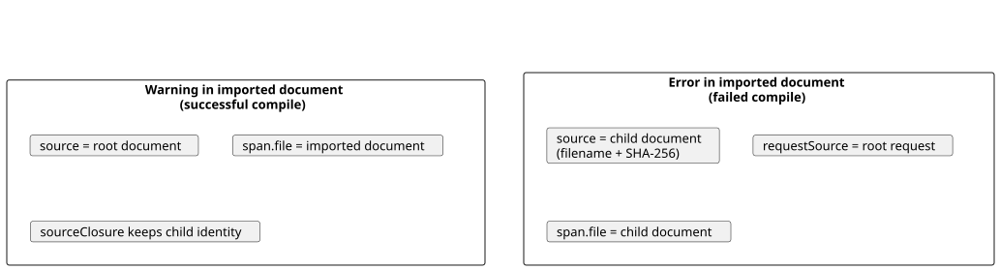
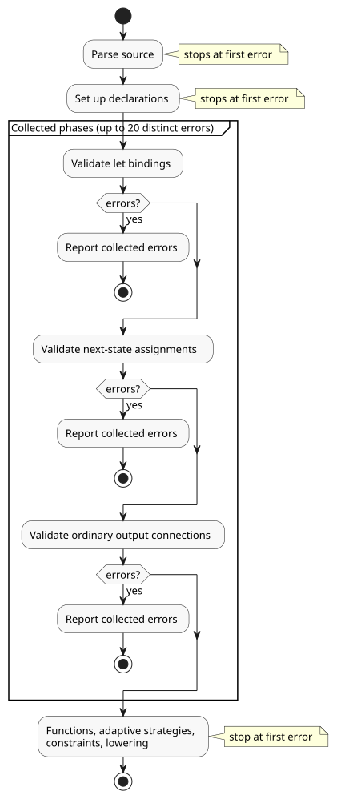

# Public compiler diagnostics

This document describes the structured diagnostics that the GhostFlow compiler
returns to tools and hosts.

**In this document**

- The diagnostic envelope (`GhostFlow/diagnostics-v1`), its coordinates, and its codes.
- Intent-link coverage warnings on successful compiles.
- Two actionable diagnostics: an undeclared `Celsius` type and missing Interaction Schema intent provenance.
- Bounded error collection: how many errors one compile reports, and when it stops.

`compileSource` in the browser and Node toolchains returns a
`diagnosticEnvelope`:

- **Success.** The envelope's `diagnostics` array may contain warnings. A clean
  successful compile has an empty array.
- **Failure with a location.** The compile rejects, and the thrown error carries
  the same `diagnosticEnvelope` property.

The existing error class, message, and CLI text do not change. There are two
exceptions, both described below: the actionable guidance for missing
Interaction Schema provenance and for an undeclared `Celsius` type.

The envelope format is `GhostFlow/diagnostics-v1`:

```json
{
  "format": "GhostFlow/diagnostics-v1",
  "source": {
    "filename": "farm.ghost.md",
    "sha256": "<lowercase SHA-256 of the exact UTF-8 document>",
    "documentId": "<when interactionSourceIdentity was supplied>",
    "revisionId": "<when interactionSourceIdentity was supplied>"
  },
  "diagnostics": [{
    "code": "GF_PARSE",
    "severity": "error",
    "message": "expected expression, found ;",
    "span": {
      "file": "farm.ghost.md",
      "start": { "line": 6, "column": 11 },
      "end": { "line": 6, "column": 12 }
    }
  }]
}
```

**Intent-link coverage warnings**

The compiler, the CLI, and package creation report intent-link coverage
warnings on a successful compile:

| Code | Meaning |
| --- | --- |
| `GF_INTENT_LINK_MISSING` | A supported statement has no intent link. |
| `GF_INTENT_LINK_COVERAGE_UNSUPPORTED` | A behavioral owner has no supported link target. |

See [default behavior coverage warnings](INTENT-ANCHOR-MAP.md#default-behavior-coverage-warnings-553)
for the covered statement kinds, limits, imports, and interpretation boundaries.

A warning in an imported document and an error in an imported document identify
their documents differently:

- **Warning (successful compile).** The envelope's `source` stays the root
  compilation document. The warning's `span.file` identifies the imported source
  location. The `sourceClosure` keeps the child document's identity.
- **Error (failed compile).** The diagnostic's `source` identifies and hashes the
  child document. `requestSource` identifies the root request.

The diagram below contrasts the two cases.



Where the warnings appear:

- **CLI human-readable output** shows each warning's location, code, and hint.
- **CLI JSON and TOON output** carry the same records.
- **The compilation result** keeps `warnings`. It contains the extraction warning
  strings and the structured intent-link warning records.
- **The envelope's `diagnostics`** contains the structured records.

This is additive API metadata. It does not change executable output.

`buildPortablePackage` also replays the source after provenance validation and
reports fresh replay warnings:

- Pass `onDiagnostic` to handle each warning. Without a callback, the package
  builder uses `console.warn`.
- The callback runs only after replay succeeds. Exceptions thrown by the callback
  propagate to the caller.
- Verification stays silent.
- Warnings never enter or change the signed payload.

**Coordinates**

- Lines and columns are one-based.
- They refer to the original `.ghost.md` document, including prose lines and
  fence lines.
- Columns use the compiler's UTF-16 code-unit coordinates.
- `end` is exclusive. It appears only when the compiler has a mapped end
  position.
- `hint`, `related`, and `reference` are optional. They are absent until the
  compiler has evidence for them. In particular, the compiler does not guess a
  Reference section from the message text.

**Codes and source identity**

The envelope uses these codes for compile errors:

| Code | Used for |
| --- | --- |
| `GF_LITERATE` | Document extraction |
| `GF_PARSE` | Syntax |
| `GF_TYPE` | Output type mismatches |
| `GF_IMPORT` | Composition/import validation |
| `GF_SEMANTIC` | Other compiler checks |

`GF_INTENT_PROVENANCE` is described in
[Missing Interaction Schema intent provenance](#missing-interaction-schema-intent-provenance).
The toolchain also emits `GF_HARDWARE` for hardware front matter and
`GF_INTENT_EVIDENCE` for intent evidence checks.

The `message` is the human-readable error detail, without the filename and
coordinate prefix.

For a diagnostic in an imported document:

- `source` names and hashes that imported document.
- `requestSource` carries the root compile request: the root filename, its
  SHA-256, and any supplied document and revision IDs.
- The root identity is never assigned to the child.

`GF_IMPORT` is reserved for three cases: missing imports, revision/digest
mismatches, and import cycles. Type and semantic checks inside a composition keep
their own codes.

Input validation that has no authored position still throws its existing error,
without a diagnostic span.

The envelope is API metadata. It does not change GFB bytes, the persisted
source-map artifact, or runtime behavior. Source identity and executable
provenance remain governed by [SOURCE-MAP.md](SOURCE-MAP.md).

## Undeclared Celsius type

A program that uses `Celsius` without declaring it is still rejected with
`GF_SEMANTIC`, the message `unknown type Celsius`, and the original type span.

The diagnostic adds guidance:

- The `hint` explains that a Celsius measurement uses
  `input temperature: Temperature;` and a value such as `30°C`.
- The `reference` links to the book's existing
  [quantity-to-type lookup](ProgrammingInGhostflow.en.md#quantity-type-lookup).
- The human-readable CLI shows the same guidance. JSON/TOON carry the structured
  hint.

What does not change:

- No source is rewritten, and no type alias is added.
- A user-defined enum named `Celsius` still resolves normally.
- Other unknown types keep their existing diagnostics.
- Valid programs keep the same executable bytes.

## Missing Interaction Schema intent provenance

When `interactionSourceIdentity` requests a schema, every authored state, timer,
and operator config needs an explicit literate anchor link. A missing link
reports `GF_INTENT_PROVENANCE`:

- at the declaration's original Markdown span;
- with the exact source hash and the supplied document/revision IDs.

The error message explains the required form:

- An anchor identifies a paragraph or block quote **outside** code fences.
- A link must come **immediately before** the declaration, inside its `ghost`
  fence.

The `hint` contains valid anchor/link syntax and an example ID that does not
collide with existing IDs. The `reference` points to
[the authored form](INTENT-ANCHOR-MAP.md#minimal-authored-form).

How to act on the suggestion:

1. **Prefer** a link to an existing active anchor whose reason actually applies.
2. Otherwise, use the alternative example. It is explicitly marked
   `kind=assumption status=unconfirmed origin=ai` with `relation=assumes`.
3. Write and review the actual reason before adopting it. A successful compile
   never confirms intent.
4. Confirmed intent must come from a person and follow the existing
   reclassification contract.

Guarantees:

- No source edit is applied automatically.
- Rejection of missing, duplicate, orphan, incompatible, and superseded
  anchors/links remains intact.
- Writing the suggestion into a new source revision changes no executable tokens
  and no GFB bytes.

## Bounded error collection

The compiler can report several errors from one compile, but only within clear
limits.

After parsing and declaration setup succeed, the compiler collects errors within
**one** validation phase. The collected phases run in this order:

1. `let` bindings
2. next-state assignments
3. ordinary output connections

Collection stops after the first phase that fails. The diagram below shows which
stages collect errors and which stop at the first error.



Within a phase:

- A failed `let` dependency reuses its original error. This prevents misleading
  cascades of cyclic-definition errors.
- Diagnostics are sorted by filename, line, and column.
- The thrown exception keeps the message of the first error encountered.
- Markdown fences and imported documents keep their authored locations.
- The envelope's source identity describes the document of the first
  diagnostic. Each diagnostic span identifies its own file.

The cap is **20 distinct errors**:

- The collector probes for a 21st error. If it finds one, it reports
  `collection: { limit: 20, truncated: true }` in the API envelope and in the CLI
  JSON/TOON result.
- This flag means more errors exist. It is not a total count.
- Exactly 20 errors do not set the overflow metadata.
- The CLI projects the same diagnostics as the API.
- A failed compile never returns or writes an artifact.

These stages still stop at their first error: parser errors, declaration setup,
function validation, adaptive strategies, constraints, and later lowering.
Recovery never crosses these boundaries and never attempts syntax repairs.

Unexpected internal or unlocated failures are rethrown immediately, even after
earlier source errors. Diagnostic collection therefore cannot hide a compiler
failure.

Fixing the reported phase can reveal errors in later phases. An error report does
not claim to list every mistake in a document.
