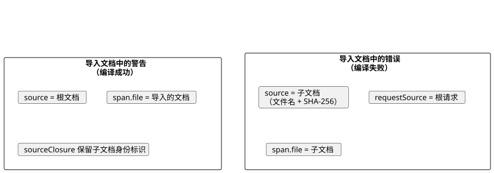
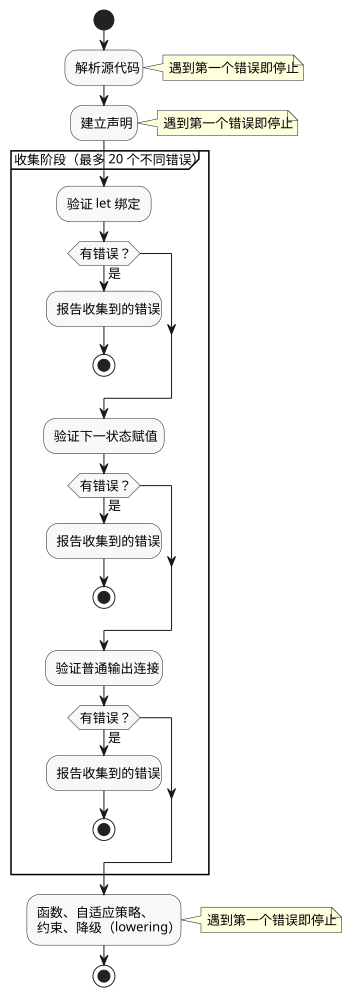

<!-- translation-source: docs/COMPILER-DIAGNOSTICS.md -->
[英文原文](COMPILER-DIAGNOSTICS.md)

# 公开的编译器诊断

本文档说明 GhostFlow 编译器返回给工具和宿主（host）的结构化诊断。

**本文档内容**

- 诊断信封（`GhostFlow/diagnostics-v1`）及其坐标和代码。
- 编译成功时的意图链接覆盖率警告。
- 两个可操作的诊断：未声明的 `Celsius` 类型，以及缺失的 Interaction Schema 意图来源。
- 有界的错误收集：一次编译报告多少个错误，以及何时停止。

浏览器和 Node 工具链中的 `compileSource` 返回一个
`diagnosticEnvelope`：

- **成功。** 信封的 `diagnostics` 数组可以包含警告。没有任何问题的成功编译返回空数组。
- **带位置的失败。** 编译被拒绝，抛出的错误带有同样的 `diagnosticEnvelope` 属性。

现有的错误类、消息和 CLI 文本不变。有两个例外，下文都会说明：针对缺失的 Interaction Schema 来源和未声明的 `Celsius` 类型给出的可操作指引。

信封格式为 `GhostFlow/diagnostics-v1`：

```json
{
  "format": "GhostFlow/diagnostics-v1",
  "source": {
    "filename": "farm.ghost.md",
    "sha256": "<lowercase SHA-256 of the exact UTF-8 document>",
    "documentId": "<when interactionSourceIdentity was supplied>",
    "revisionId": "<when interactionSourceIdentity was supplied>"
  },
  "diagnostics": [{
    "code": "GF_PARSE",
    "severity": "error",
    "message": "expected expression, found ;",
    "span": {
      "file": "farm.ghost.md",
      "start": { "line": 6, "column": 11 },
      "end": { "line": 6, "column": 12 }
    }
  }]
}
```

**意图链接覆盖率警告**

编译器、CLI 和包创建在编译成功时会报告意图链接覆盖率警告：

| 代码 | 含义 |
| --- | --- |
| `GF_INTENT_LINK_MISSING` | 某条受支持的语句没有意图链接。 |
| `GF_INTENT_LINK_COVERAGE_UNSUPPORTED` | 某个行为所有者没有受支持的链接目标。 |

关于覆盖的语句种类、限制、导入以及解释边界，请参阅[默认行为覆盖率警告](INTENT-ANCHOR-MAP.zh.md)。

导入文档中的警告和导入文档中的错误，以不同方式标识各自的文档：

- **警告（编译成功）。** 信封的 `source` 仍是根编译文档。警告的 `span.file` 标识导入源中的位置。`sourceClosure` 保留子文档的身份标识。
- **错误（编译失败）。** 诊断的 `source` 标识子文档并给出其哈希。`requestSource` 标识根请求。

下图对比了这两种情况。



警告出现的位置：

- **CLI 人类可读输出**显示每条警告的位置、代码和提示。
- **CLI JSON 和 TOON 输出**携带相同的记录。
- **编译结果**保留 `warnings`。其中包含提取警告字符串和结构化的意图链接警告记录。
- **信封的 `diagnostics`** 包含结构化记录。

这是增量式的 API 元数据，不会改变可执行输出。

`buildPortablePackage` 还会在来源验证之后重放源代码，并报告重放中新产生的警告：

- 传入 `onDiagnostic` 来处理每条警告。没有回调时，包构建器使用 `console.warn`。
- 回调只在重放成功后运行。回调抛出的异常会传播给调用方。
- 验证过程保持静默。
- 警告绝不会进入或改变已签名的载荷。

**坐标**

- 行号和列号从 1 开始。
- 它们指向原始 `.ghost.md` 文档，包括正文行和围栏行。
- 列使用编译器的 UTF-16 码元坐标。
- `end` 是开区间（不包含）。只有当编译器有映射后的结束位置时才会出现。
- `hint`、`related` 和 `reference` 是可选的。在编译器掌握相应证据之前，它们不会出现。特别是，编译器不会根据消息文本猜测 Reference 章节。

**代码与源身份标识**

信封对编译错误使用以下代码：

| 代码 | 用途 |
| --- | --- |
| `GF_LITERATE` | 文档提取 |
| `GF_PARSE` | 语法 |
| `GF_TYPE` | 输出类型不匹配 |
| `GF_IMPORT` | 组合/导入验证 |
| `GF_SEMANTIC` | 其他编译器检查 |

`GF_INTENT_PROVENANCE` 在[缺失的 Interaction Schema 意图来源](#缺失的-interaction-schema-意图来源)中说明。工具链还会对硬件 front matter 发出 `GF_HARDWARE`，对意图证据检查发出 `GF_INTENT_EVIDENCE`。

`message` 是人类可读的错误详情，不包含文件名和坐标前缀。

对于导入文档中的诊断：

- `source` 给出该导入文档的名称和哈希。
- `requestSource` 携带根编译请求：根文件名、其 SHA-256，以及所提供的任何文档 ID 和修订版 ID。
- 根身份标识绝不会被赋给子文档。

`GF_IMPORT` 保留用于三种情况：缺失的导入、修订版/摘要不匹配，以及导入循环。组合内部的类型检查和语义检查保留各自的代码。

没有作者编写位置的输入验证，仍然抛出原有的错误，不带诊断 span。

信封是 API 元数据。它不会改变 GFB 字节、持久化的源映射工件或运行时行为。源身份标识和可执行来源仍由 [SOURCE-MAP.md](SOURCE-MAP.zh.md) 规定。

## 未声明的 Celsius 类型

未声明就使用 `Celsius` 的程序仍会被拒绝，代码为 `GF_SEMANTIC`，消息为 `unknown type Celsius`，并带有原始的类型 span。

该诊断会附加指引：

- `hint` 说明摄氏温度测量应使用 `input temperature: Temperature;` 和诸如 `30°C` 的值。
- `reference` 链接到本书已有的[物理量到类型对照表](ProgrammingInGhostflow.zh.md#quantity-type-lookup)。
- 人类可读的 CLI 显示同样的指引。JSON/TOON 携带结构化的提示。

不变的部分：

- 不会改写任何源代码，也不会添加类型别名。
- 用户定义的名为 `Celsius` 的枚举仍正常解析。
- 其他未知类型保留原有诊断。
- 有效程序保持相同的可执行字节。

## 缺失的 Interaction Schema 意图来源

当 `interactionSourceIdentity` 请求 schema 时，每个作者编写的状态、定时器和操作员 config 都需要一个显式的文学式（literate）锚点链接。缺失链接时报告 `GF_INTENT_PROVENANCE`：

- 位于该声明原始的 Markdown span；
- 带有精确的源哈希以及所提供的文档/修订版 ID。

错误消息会说明所需的形式：

- 锚点标识代码围栏**之外**的段落或块引用。
- 链接必须位于声明**紧前方**，并处在该声明的 `ghost` 围栏内。

`hint` 包含有效的锚点/链接语法，以及一个不与现有 ID 冲突的示例 ID。`reference` 指向[作者编写形式](INTENT-ANCHOR-MAP.zh.md)。

如何依据建议采取行动：

1. **优先**链接到一个现有的有效锚点，前提是其理由确实适用。
2. 否则，使用备选示例。它被明确标记为 `kind=assumption status=unconfirmed origin=ai`，并带有 `relation=assumes`。
3. 在采用之前，写出并审查实际理由。编译成功绝不代表意图已确认。
4. 已确认的意图必须来自人，并遵循现有的重新分类契约。

保证：

- 不会自动应用任何源代码编辑。
- 对缺失、重复、孤立、不兼容和已被取代的锚点/链接的拒绝保持不变。
- 把建议写入新的源修订版，不会改变任何可执行 token，也不会改变 GFB 字节。

## 有界的错误收集

编译器可以在一次编译中报告多个错误，但只在明确的限制之内。

在解析和声明建立成功之后，编译器在**一个**验证阶段内收集错误。被收集的阶段按以下顺序运行：

1. `let` 绑定
2. 下一状态赋值
3. 普通输出连接

在第一个失败的阶段之后，收集即停止。下图显示哪些阶段收集错误，哪些阶段在第一个错误处停止。



在一个阶段内：

- 失败的 `let` 依赖复用其原始错误。这可以避免误导性的循环定义错误级联。
- 诊断按文件名、行号和列号排序。
- 抛出的异常保留所遇到的第一个错误的消息。
- Markdown 围栏和导入的文档保留其作者编写的位置。
- 信封的源身份标识描述第一个诊断所在的文档。每个诊断的 span 标识其自己的文件。

上限为 **20 个不同错误**：

- 收集器会探测第 21 个错误。如果找到，它会在 API 信封以及 CLI JSON/TOON 结果中报告 `collection: { limit: 20, truncated: true }`。
- 该标志表示还存在更多错误，它不是总数。
- 恰好 20 个错误不会设置溢出元数据。
- CLI 投影出与 API 相同的诊断。
- 失败的编译绝不会返回或写入工件。

以下阶段仍然在第一个错误处停止：解析器错误、声明建立、函数验证、自适应策略、约束以及后续的降级（lowering）。恢复绝不会跨越这些边界，也绝不会尝试修复语法。

意外的内部失败或无位置的失败会被立即重新抛出，即使之前已有源错误。因此，诊断收集不会掩盖编译器故障。

修复所报告阶段的错误后，可能会暴露后续阶段的错误。错误报告并不声称列出了文档中的所有错误。
