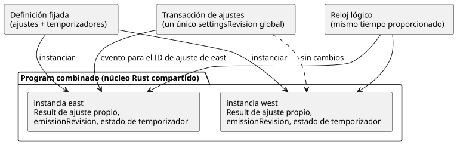

<!-- translation-source: docs/COMPOSED-CONFIG-TIMER.md -->
[Original en inglés](COMPOSED-CONFIG-TIMER.md)

# Aislamiento de ajustes y temporizadores en controles compuestos

Este documento explica cómo un control compuesto mantiene separados los ajustes
y los temporizadores cuando usa la misma definición más de una vez. También
enumera lo que esta base **todavía no** ofrece.

**Instanciación.** El compilador puede instanciar una misma definición fijada
más de una vez, incluso cuando esa definición declara flujos escalares `config`
y temporizadores `elapsed` o `continuous_true`. Una *definición fijada* es una
definición importada fijada a una revisión y un resumen (digest) exactos. El
compilador califica estos nombres con la ruta de instancia:

- cada nombre de ajuste y cada ID de ajuste;
- cada estado escrito por el autor;
- cada nombre de temporizador y su estado de temporizador generado.

El artefacto compilado conserva el texto original de la definición, su resumen,
el nodo de origen y la ruta de instancia. El núcleo compartido de Rust evalúa el
programa (Program) combinado. JavaScript no implementa un segundo evaluador de
temporizadores ni de ajustes.

**Ajustes y tiempo.** El host de referencia puede aplicar un evento de ajustes
en vivo a un único ID de ajuste calificado.

- Todos los ajustes participan en una única transacción atómica de ajustes del
  programa y comparten un único `settingsRevision` global.
- Cada ajuste conserva su propio Result más reciente, su propio
  `emissionRevision` y su propia posición de aplicación.
- Cambiar el ajuste de east no cambia el valor de west ni su revisión de
  emisión.
- Ambos temporizadores leen el mismo reloj lógico proporcionado. Sus estados y
  sus puntos de inicio permanecen separados.

El siguiente diagrama muestra dos instancias de una misma definición que
comparten la transacción de ajustes y el reloj, mientras conservan su propio
estado de ajuste y de temporizador.

Cuando conceda o dirija un ajuste, use el ID de ajuste exacto del manifiesto
compilado. Fije el cierre de fuentes (source closure) antes de la activación.

**Cobertura de pruebas.** `tests/composition-config-timer-isolation.test.mjs`
ejecuta un programa de dos instancias a través de `TemporarySettingsHost` y del
ejecutor nativo `context_tape`, con las mismas entradas completas y el mismo
evento de ajustes. Comprueba el estado, los temporizadores, los ajustes, las
salidas y la procedencia de las fuentes importadas. Estas entradas se rechazan
sin cambiar la instantánea (snapshot) aceptada del host:

- revisiones o resúmenes de importación incorrectos;
- concesiones dirigidas a otra instancia;
- valores temporales no válidos.

## Límite actual

- **Sin ID de instancia de despliegue.** Esta base no emite ID opacos de
  instancia de despliegue ni revisiones de vinculación (binding) de instalación
  por instancia. Integration v1 fija un único mapeo de instalación. Una ruta de
  instancia en el mapa de fuente identifica la procedencia del compilador. No es
  una prueba de que se haya aplicado una vinculación de Device.
- **Los descriptores de interaction-v0 solo leen la fuente raíz.** El emisor de
  descriptores rechaza los artefactos compuestos que contienen ajustes o
  temporizadores, para que esas declaraciones no desaparezcan en silencio de un
  esquema de descriptores que parezca válido. Las composiciones existentes sin
  ajustes ni temporizadores conservan su descriptor y su ruta de identidad de
  cierre. Los descriptores y las uniones de vinculación para ajustes y
  temporizadores compuestos son trabajo futuro aparte.
- **Los desplazamientos de literales importados apuntan a la definición
  importada.** Los desplazamientos de los literales de ajustes importados se
  refieren a la definición importada, no a la fuente de la composición raíz. Esta
  base expone eventos de ajustes en vivo a través del host verificado. No admite
  editar literales en fuentes importadas.
- **Rieles de sensor por instancia.** El manifiesto de contexto acepta rieles de
  sensor de instancia que tengan el mismo tipo de fuente, el mismo intervalo de
  muestreo y la misma opcionalidad. El `ControlRuntime` existente da a cada
  instancia su propio acondicionador. El perfil de contexto actual sigue
  rechazando, antes de la activación, los filtros de entrada y otros metadatos de
  acondicionamiento no admitidos. Las pruebas de cinta nativas proporcionan
  explícitamente los rieles de instancia; el host WASM los deriva de la muestra
  raíz.
- **Activar bytecode GFB11/12 requiere la fuente.** La activación directa de
  bytecode GFB11/12 en `ControlRuntime` requiere el documento fuente canónico y,
  cuando hay importaciones, el cierre completo. El encabezado del bytecode decide
  este requisito, aunque se eliminen campos del manifiesto. Antes de crear el
  runtime, la activación recompila la fuente y comprueba exactamente el bytecode,
  el cierre y el manifiesto. Como resultado, nadie puede sustituir otro sensor
  raíz del mismo tipo editando o eliminando `sensorInstances`. Los hosts que
  cargan artefactos GFB11/12 persistidos o firmados deben pasar a
  `ControlRuntime` el documento fuente y el cierre ya verificados.
- **Lo que demuestra la concordancia entre nativo y WASM.** La concordancia entre
  los ejecutores nativo y WASM establece este contrato de ejecución de
  referencia. No autentica a los actores de ajustes, los registros de
  instalación, los relojes, el despliegue de Device ni las salidas físicas.
