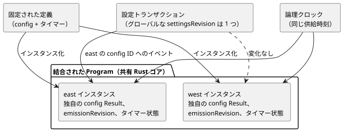

<!-- translation-source: docs/COMPOSED-CONFIG-TIMER.md -->
[英語の原文](COMPOSED-CONFIG-TIMER.md)

# 合成された control における config とタイマーの分離

この文書では、合成された control が同じ定義を複数回使うときに、設定とタイマーをどのように分離するかを説明します。また、この基盤がまだ提供して**いない**ものも挙げます。

**インスタンス化。** コンパイラは、1 つの固定された定義（pinned definition）を複数回インスタンス化できます。その定義がスカラーの `config` ストリームや、`elapsed` または `continuous_true` のタイマーを宣言している場合でも同様です。*固定された定義*とは、正確なリビジョンとダイジェストに固定されたインポート済みの定義です。コンパイラは、次の名前をインスタンスパスで修飾します。

- 各 config の名前と config ID
- 記述された各 state
- 各タイマーの名前と、生成されたタイマー状態

コンパイル済みの成果物は、元の定義テキスト、そのダイジェスト、ソースノード、およびインスタンスパスを保持します。共有 Rust コアが結合された Program を評価します。JavaScript が 2 つ目のタイマー評価器や設定評価器を実装することはありません。

**設定と時間。** リファレンスホストは、ライブ設定のイベントを 1 つの修飾済み config ID に適用できます。

- すべての config は 1 つのアトミックな Program 設定トランザクションに参加し、1 つのグローバルな `settingsRevision` を共有します。
- 各 config は、それぞれ独自の最新の Result、独自の `emissionRevision`、および独自の適用位置を保持します。
- east の config を変更しても、west の値や west の emission リビジョンは変わりません。
- 両方のタイマーは、供給された同じ論理クロックを読み取ります。それぞれの状態と開始点は分離されたままです。

次の図は、1 つの定義の 2 つのインスタンスが、設定トランザクションとクロックを共有しながら、それぞれ独自の config とタイマー状態を保持する様子を示しています。

設定を付与（grant）したり対象にしたりするときは、コンパイル済みマニフェストにある正確な config ID を使ってください。有効化の前に、ソースクロージャを固定してください。

**テストカバレッジ。** `tests/composition-config-timer-isolation.test.mjs` は、2 インスタンスの Program を `TemporarySettingsHost` とネイティブの `context_tape` ランナーの両方で、同じ完全な入力と設定イベントを使って実行します。state、タイマー、設定、出力、およびインポートしたソースの来歴をチェックします。次の入力は、受け入れ済みのホストのスナップショットを変更することなく拒否されます。

- 誤ったインポートのリビジョンまたはダイジェスト
- 別のインスタンスを対象とする付与
- 無効な一時値

## 現在の境界

- **デプロイメントのインスタンス ID はありません。** この基盤は、不透明なデプロイメントインスタンス ID や、インスタンスごとの設置バインディングのリビジョンを発行しません。Integration v1 は 1 つの設置マッピングを固定します。ソースマップ内のインスタンスパスはコンパイラの来歴を識別するものです。適用済みの Device バインディングの証明ではありません。
- **interaction-v0 のディスクリプタはルートソースのみを読み取ります。** ディスクリプタのエミッタは、config やタイマーを含む合成済み成果物を拒否します。そのため、それらの宣言が、一見有効に見えるディスクリプタスキーマから黙って消えることはありません。config やタイマーを含まない既存の合成は、ディスクリプタとクロージャの同一性パスを維持します。合成された設定とタイマーのためのディスクリプタとバインディングの結合は、別の将来の作業です。
- **インポートしたリテラルのオフセットはインポートした定義を指します。** インポートした config リテラルのオフセットは、ルートの合成ソースではなく、インポートした定義を基準とします。この基盤は、検証済みのホストを通じてライブ設定のイベントを公開します。インポートしたソース内のリテラルの編集はサポートしていません。
- **インスタンスごとのセンサレール。** コンテキストマニフェストは、ソースの型、サンプル間隔、およびオプション性が同じインスタンスのセンサレールを受け入れます。既存の `ControlRuntime` は、各インスタンスに独自のコンディショナを与えます。現在のコンテキストプロファイルは、入力フィルタやその他のサポートされていないコンディショニングのメタデータを、有効化の前に引き続き拒否します。ネイティブのテープテストはインスタンスのレールを明示的に供給し、WASM ホストはそれらをルートのサンプルから導出します。
- **GFB11/12 バイトコードの有効化にはソースが必要です。** GFB11/12 バイトコードを `ControlRuntime` で直接有効化するには、正本ソースの文書と、インポートがある場合は完全なクロージャが必要です。この要件はバイトコードのヘッダーが決定します。マニフェストのフィールドが削除されていても同じです。有効化処理は、ランタイムを作成する前にソースを再コンパイルし、バイトコード、クロージャ、マニフェストが正確に一致するかをチェックします。その結果、`sensorInstances` を編集または削除することで、同じ型の別のルートセンサに差し替えることは誰にもできません。永続化された GFB11/12 成果物や署名済みの GFB11/12 成果物を読み込むホストは、検証済みのソース文書とクロージャを `ControlRuntime` に渡さなければなりません。
- **ネイティブ／WASM の一致が証明するもの。** ネイティブランナーと WASM ランナーの一致は、このリファレンス実行契約を確立します。設定の操作主体、設置記録、クロック、Device のデプロイメント、または物理出力を認証するものではありません。
