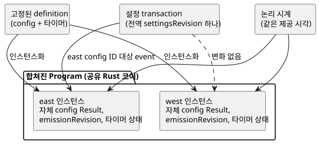

<!-- translation-source: docs/COMPOSED-CONFIG-TIMER.md -->
[영문 원문](COMPOSED-CONFIG-TIMER.md)

# 조합된 control의 config·timer 격리

이 문서는 조합된 control이 같은 definition을 여러 번 사용할 때 설정과 타이머를
어떻게 분리해 유지하는지 설명합니다. 또한 이 기반이 아직 제공하지 **않는** 것도
정리합니다.

**인스턴스화.** 컴파일러는 고정된 definition 하나를 여러 번 인스턴스화할 수
있습니다. 그 definition이 scalar `config` stream과 `elapsed` 또는
`continuous_true` 타이머를 선언하더라도 마찬가지입니다. *고정된 definition*이란
정확한 revision과 digest에 고정된, 가져온 definition을 말합니다. 컴파일러는 다음
이름을 인스턴스 경로로 한정합니다.

- 각 config 이름과 config ID
- 작성된 각 state
- 각 타이머 이름과 생성된 타이머 state

컴파일 산출물에는 원본 definition 텍스트, 그 digest, 소스 노드, 인스턴스 경로가
남습니다. 합쳐진 Program은 공유 Rust 코어가 평가합니다. JavaScript는 별도의
타이머 평가기나 설정 평가기를 구현하지 않습니다.

**설정과 시간.** 참조 호스트는 live 설정 event를 한정된 config ID 하나에 적용할
수 있습니다.

- 모든 config는 Program의 단일 원자적 설정 transaction에 참여하며 전역
  `settingsRevision` 하나를 공유합니다.
- 각 config는 자신의 최신 Result, 자신의 `emissionRevision`, 자신의 적용 위치를
  유지합니다.
- east config를 바꿔도 west의 값이나 west의 emission revision은 바뀌지 않습니다.
- 두 타이머는 제공된 같은 논리 시계를 읽습니다. 타이머의 state와 시작점은 서로
  분리되어 있습니다.

아래 다이어그램은 한 definition의 두 인스턴스가 설정 transaction과 시계를
공유하면서도 각자의 config와 타이머 state를 유지하는 모습을 보여 줍니다.

설정 권한을 부여하거나 설정 대상을 지정할 때는 컴파일된 manifest의 정확한
config ID를 사용하세요. 활성화 전에 source closure를 고정하세요.

**테스트 범위.** `tests/composition-config-timer-isolation.test.mjs`는 두
인스턴스로 된 Program을 같은 완전한 입력과 설정 event로 `TemporarySettingsHost`와
native `context_tape` 실행기 양쪽에서 실행합니다. state, 타이머, 설정, 출력,
가져온 소스의 provenance를 검사합니다. 다음 입력은 수락된 호스트 snapshot을
바꾸지 않고 거부됩니다.

- 잘못된 import revision 또는 digest
- 다른 인스턴스를 대상으로 하는 권한 부여
- 유효하지 않은 임시값

## 현재 경계

- **배포 instance ID 없음.** 이 기반은 불투명한 배포 instance ID나 인스턴스별
  설치 바인딩 revision을 발급하지 않습니다. Integration v1은 설치 매핑 하나를
  고정합니다. 소스 맵의 인스턴스 경로는 컴파일러 provenance를 식별합니다. Device에
  실제로 적용된 바인딩의 증거는 아닙니다.
- **interaction-v0 descriptor는 루트 소스만 읽습니다.** descriptor 생성기는
  config나 타이머가 있는 조합 산출물을 거부합니다. 따라서 그런 선언이 겉보기에
  유효한 descriptor schema에서 조용히 사라질 수 없습니다. config나 타이머가 없는
  기존 조합은 descriptor와 closure identity 경로를 그대로 유지합니다. 조합된
  설정과 타이머를 위한 descriptor 및 바인딩 연결은 별도의 향후 작업입니다.
- **가져온 리터럴 offset은 가져온 definition을 가리킵니다.** 가져온 config
  리터럴의 offset은 루트 조합 소스가 아니라 가져온 definition을 기준으로 합니다.
  이 기반은 검증된 호스트를 통해 live 설정 event를 제공합니다. 가져온 소스의
  리터럴 편집은 지원하지 않습니다.
- **인스턴스별 센서 rail.** context manifest는 소스 타입, 샘플 주기,
  optionality가 같은 인스턴스 센서 rail을 허용합니다. 기존 `ControlRuntime`은 각
  인스턴스에 자체 conditioner를 둡니다. 현재 context 프로필은 입력 필터와 그 밖의
  지원하지 않는 conditioning 메타데이터를 여전히 활성화 전에 거부합니다. native
  tape 테스트는 인스턴스 rail을 명시적으로 제공하고, WASM 호스트는 루트 샘플에서
  이를 도출합니다.
- **GFB11/12 바이트코드를 활성화하려면 소스가 필요합니다.** GFB11/12 바이트코드를
  `ControlRuntime`에서 직접 활성화하려면 정본 소스 문서가 필요하고, import가 있으면
  전체 closure도 필요합니다. manifest 필드를 제거하더라도 이 요건은 바이트코드
  헤더가 결정합니다. 활성화는 런타임을 만들기 전에 소스를 재컴파일하고 정확한
  바이트코드, closure, manifest를 대조합니다. 그 결과 누구도 `sensorInstances`를
  편집하거나 제거해서 같은 타입의 다른 루트 센서로 바꿔치기할 수 없습니다. 저장되거나
  서명된 GFB11/12 산출물을 불러오는 호스트는 이미 검증한 소스 문서와 closure를
  `ControlRuntime`에 전달해야 합니다.
- **native/WASM 일치가 증명하는 것.** native 실행기와 WASM 실행기의 일치는 이 참조
  실행 계약을 입증합니다. 설정 actor, 설치 기록, 시계, Device 배포, 물리 출력의
  진위를 인증하지는 않습니다.
