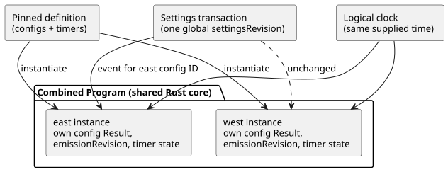

# Config and timer isolation in composed controls

This document explains how a composed control keeps settings and timers separate
when it uses the same definition more than once. It also lists what this
foundation does **not** yet provide.

**Instantiation.** The compiler can instantiate one pinned definition more than
once, even when that definition declares scalar `config` streams and `elapsed` or
`continuous_true` timers. A *pinned definition* is an imported definition fixed to
an exact revision and digest. The compiler qualifies these names by instance
path:

- each config name and config ID;
- each authored state;
- each timer name and its generated timer state.

The compiled artifact keeps the original definition text, its digest, the source
node, and the instance path. The shared Rust core evaluates the combined
Program. JavaScript does not implement a second timer or settings evaluator.

**Settings and time.** The reference host can apply a live settings event to one
qualified config ID.

- All configs take part in one atomic Program settings transaction and share one
  global `settingsRevision`.
- Each config keeps its own latest Result, its own `emissionRevision`, and its
  own application position.
- Changing the east config does not change west's value or west's emission
  revision.
- Both timers read the same supplied logical clock. Their state and starting
  points stay separate.

The diagram below shows two instances of one definition, sharing the settings
transaction and the clock while keeping their own config and timer state.

When you grant or target a setting, use the exact config ID from the compiled
manifest. Pin the source closure before activation.

**Test coverage.** `tests/composition-config-timer-isolation.test.mjs` runs a
two-instance Program through `TemporarySettingsHost` and through the native
`context_tape` runner, with the same complete inputs and settings event. It
checks state, timers, settings, outputs, and imported source provenance. These
inputs are rejected without changing the accepted host snapshot:

- wrong import revisions or digests;
- grants that target another instance;
- invalid temporary values.

## Current boundary

- **No deployment instance IDs.** This foundation does not issue opaque
  deployment instance IDs or per-instance installation binding revisions.
  Integration v1 pins one installation mapping. An instance path in the source
  map identifies compiler provenance. It is not proof of an applied Device
  binding.
- **interaction-v0 descriptors read the root source only.** The descriptor
  emitter rejects composed artifacts that contain configs or timers, so those
  declarations cannot silently disappear from a descriptor schema that looks
  valid. Existing compositions without configs or timers keep their descriptor
  and closure identity path. Descriptors and binding joins for composed settings
  and timers are separate, future work.
- **Imported literal offsets point to the imported definition.** Offsets of
  imported config literals refer to the imported definition, not to the root
  composition source. This foundation exposes live settings events through the
  verified host. It does not support editing literals in imported sources.
- **Sensor rails per instance.** The context manifest accepts instance sensor
  rails that have the same source type, sample interval, and optionality. The
  existing `ControlRuntime` gives each instance its own conditioner. The current
  context profile still rejects input filters and other unsupported conditioning
  metadata before activation. Native tape tests supply the instance rails
  explicitly; the WASM host derives them from the root sample.
- **Activating GFB11/12 bytecode needs the source.** Direct `ControlRuntime`
  activation of GFB11/12 bytecode requires the canonical source document and,
  when there are imports, the full closure. The bytecode header decides this
  requirement, even if manifest fields are removed. Before it creates the
  runtime, activation recompiles the source and checks the exact bytecode,
  closure, and manifest. As a result, nobody can substitute another root sensor
  of the same type by editing or removing `sensorInstances`. Hosts that load
  persisted or signed GFB11/12 artifacts must pass the already verified source
  document and closure to `ControlRuntime`.
- **What native/WASM agreement proves.** Agreement between the native and WASM
  runners establishes this reference execution contract. It does not
  authenticate settings actors, installation records, clocks, Device deployment,
  or physical outputs.
