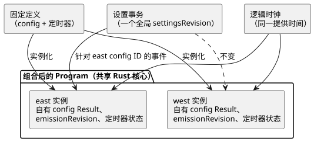

<!-- translation-source: docs/COMPOSED-CONFIG-TIMER.md -->
[英文原文](COMPOSED-CONFIG-TIMER.md)

# 组合 control 中的 config 与定时器隔离

本文档说明组合后的 control 在多次使用同一定义时，如何保持设置和定时器相互独立。同时列出这一基础**尚未**提供的功能。

**实例化。** 编译器可以将同一个固定定义实例化多次，即使该定义声明了标量 `config` 流以及 `elapsed` 或 `continuous_true` 定时器。*固定定义*（pinned definition）是指被固定到精确修订版和摘要的导入定义。编译器按实例路径限定以下名称：

- 每个 config 名称和 config ID；
- 每个作者编写的状态；
- 每个定时器名称及其生成的定时器状态。

编译产物保留原始定义文本、其摘要、源节点以及实例路径。共享的 Rust 核心对组合后的 Program 求值。JavaScript 不实现第二套定时器或设置求值器。

**设置与时间。** 参考宿主（host）可以将实时设置事件应用到某一个限定后的 config ID。

- 所有 config 参与同一个原子的 Program 设置事务，并共享一个全局 `settingsRevision`。
- 每个 config 保留自己最新的 Result、自己的 `emissionRevision` 以及自己的应用位置。
- 修改 east 的 config 不会改变 west 的值，也不会改变 west 的 emission 修订版。
- 两个定时器读取同一个提供的逻辑时钟，但各自的状态和起始点保持独立。

下图显示同一定义的两个实例：它们共享设置事务和时钟，同时各自保留自己的 config 和定时器状态。

授权或指定某个设置时，请使用编译清单（manifest）中的精确 config ID。激活之前，请固定源闭包。

**测试覆盖。** `tests/composition-config-timer-isolation.test.mjs` 以相同的完整输入和设置事件，分别通过 `TemporarySettingsHost` 和原生 `context_tape` 运行器运行一个双实例 Program。它检查状态、定时器、设置、输出以及导入源的来源。以下输入会被拒绝，且不会改变已接受的宿主快照：

- 错误的导入修订版或摘要；
- 指向另一个实例的授权；
- 无效的临时值。

## 当前边界

- **没有部署实例 ID。** 这一基础不签发不透明的部署实例 ID，也不签发每实例的安装绑定修订版。Integration v1 固定一个安装映射。源映射中的实例路径标识编译器来源，它不能证明 Device 绑定已被应用。
- **interaction-v0 描述符只读取根源文件。** 描述符生成器会拒绝包含 config 或定时器的组合产物，从而防止这些声明在一个看似有效的描述符 schema 中悄然消失。不含 config 或定时器的现有组合保留其描述符和闭包身份标识路径。面向组合设置和定时器的描述符及绑定关联是单独的后续工作。
- **导入字面量的偏移量指向导入的定义。** 导入的 config 字面量的偏移量指向导入的定义，而不是根组合源文件。这一基础通过经过验证的宿主提供实时设置事件，不支持在导入的源文件中编辑字面量。
- **每实例的传感器通道（rail）。** 上下文清单接受源类型、采样间隔和可选性都相同的实例传感器通道。现有的 `ControlRuntime` 为每个实例提供各自的调理器。当前的上下文 profile 仍会在激活前拒绝输入滤波器以及其他不受支持的调理元数据。原生 tape 测试显式提供实例通道；WASM 宿主则从根样本推导出这些通道。
- **激活 GFB11/12 字节码需要源文件。** 直接用 `ControlRuntime` 激活 GFB11/12 字节码时，需要规范源文档，若存在导入，还需要完整的闭包。这一要求由字节码头部决定，即使移除了清单字段也是如此。在创建运行时之前，激活过程会重新编译源文件，并检查精确的字节码、闭包和清单。因此，任何人都无法通过编辑或移除 `sensorInstances` 来替换另一个同类型的根传感器。加载持久化或已签名 GFB11/12 产物的宿主，必须把已经验证过的源文档和闭包传给 `ControlRuntime`。
- **原生/WASM 一致性能证明什么。** 原生运行器与 WASM 运行器之间的一致性确立了这一参考执行契约。它不对设置操作者、安装记录、时钟、Device 部署或物理输出进行认证。
