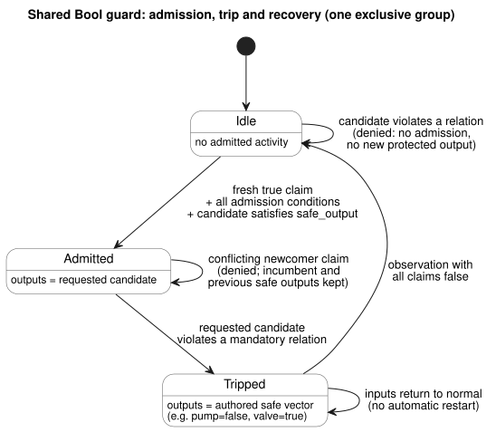
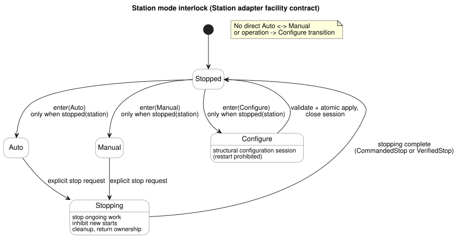
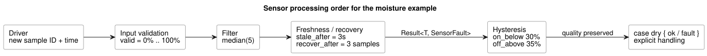

<!-- translation-source: docs/CONSTRAINTS.md -->
[Korean original](CONSTRAINTS.md)

# GhostFlow common constraints and sensor signal contract

This is the **common design contract** (2026-09-24) for constraints and sensor
signals in GhostFlow. It follows on from the [selected control syntax](LANGUAGE-SURFACE.md).

- Current syntax and semantics for operating settings are defined in
  [Reference §5.1–5.2](reference/05-settings-and-observation.en.md).
- What actually executes today is tracked in [implementation scope](IMPLEMENTATION.md)
  and [traceability](TRACEABILITY.md).
- **2026-10-05 external-input revision:** declarations that carry signal quality now
  use `input`. Existing conditioning and explicit `Result` fault branches are
  unchanged. Earlier `sensor` excerpts are kept under `tests/fixtures/history/issue531/`.

**In this document**

1. Three kinds of constraints and their boundaries (local, shared, accounting).
2. How the bound shared Bool profile executes (admission, trips, recovery).
3. Facility rules for the fixed Station adapter: shared pumps, mode interlocks,
   operating settings versus structural changes.
4. Optional device information and optional capacity analysis.
5. Theory behind constraint composition, and what runs on the MCU.
6. Sensor noise and disconnection handling, and its MCU cost.
7. Daily operation limits and duplicate-execution prevention.
8. Acceptance scenarios.

**The canonical surface.** You write constraints as named `constraints` groups
inside one `.ghost.md` control. There are three kinds:

| Kind | What it targets | How it executes |
|---|---|---|
| Local Bool output constraints | Outputs of the same control | Ordinary Bool lowering |
| Shared resource policies (`constraints Name for resource`) | A set of shared resources | Only through explicit bound compilation |
| Accounting (`limit used(...)`) | Usage of an `account` | Usage stage, basis and persistence of Reference §3.10 |

All three use named groups, but their targets and execution contracts are
distinct. Notation and operations follow
[Reference §4.8](reference/04-sensors-constraints-control.en.md#48-common-constraints-notation-and-operations).

**Station adapter examples.** The standalone `constraints Name { ... }` examples
later in this document are **Station adapter examples**, not generic canonical
syntax. That bounded `ghostrules` path is retained only for:

- the actual programming-book WASM simulation,
- `tools/station-demo.mjs`, and
- the fixed Station artifact consumed by `bindStationPolicy`.

It is neither generic canonical syntax nor arbitrary PID safety enforcement.
Historical notation alone does not justify another compatibility path.

Other ground rules:

- The CLI extracts top-level `ghost` fences and rejects plain `.ghost` input.
- `compileConstraints` is the Station adapter's internal lowerer, not a generic solver.
- Do not confuse *validating* a shared descriptor with actually *binding and
  enforcing* it.

## Canonical local, shared and accounting boundaries

Two complete canonical files show these boundaries:

- [The executable local envelope](../examples/constraint-envelope.ghost.md).
- [The checked shared contract with its complete logical mapping](../examples/shared-constraint-contract.ghost.md).

**Validating a binding.** A *binding* maps the policy's logical names to stable
resource identities and typed ports. `validateResourceConstraintBinding` checks:

- the revision,
- the exact canonical source and artifact digests,
- every required stable resource identity and typed port, and
- every finite exclusive-mode input.

It rejects missing or extra mappings, disguised duplicate resource identities or
ports, and policy fields supplied by the host. Validation returns
`executable: false`. It grants neither admission nor output authority.

**Selecting execution.** To execute, pass the validated compilation and binding
together to `compileBoundResourceControl(compilation, binding)`. This explicit path
emits a bounded Bool GFB17 module with a shared Rust guard. Compiling the canonical
source alone never silently turns the checked descriptor into an executable
artifact. This is a reference *logical* binding contract, not a physical output ABI.

**Limits on executable groups.**

- An executable group supports at most one exclusive activity set.
- Multiple `exclusive` statements remain valid checked source, but they need
  separate execution integration. They are rejected rather than flattened into
  one set, because their sets are distinct.
- The authored global safe vector must also satisfy the mandatory local constraints.

**Local constraints.** The following is a complete control with a local
constraint. Local constraints apply only to this control's outputs and execute
through ordinary Bool lowering. Existing ungrouped `require` and `mutex` keep the
same meaning.

```ghost
control LocalPump {
  state displayed_pump: Bool = false;
  displayed_pump' = if request_good && !request then false else if request_good then request else displayed_pump;
  state displayed_valve: Bool = false;
  displayed_valve' = if valve_ready_good && !valve_ready then false else if valve_ready_good then valve_ready else displayed_valve;
  // Source-local display memory is initialized here; faults remain producer unknown.
  state remembered_request: Bool = false;
  let request_good = case observed_request { ok(_) => true; fault(_) => false; };
  let request = case observed_request { ok(value) => value; fault(_) => remembered_request; };
  remembered_request' = request;
  state remembered_valve_ready: Bool = false;
  let valve_ready_good = case observed_valve_ready { ok(_) => true; fault(_) => false; };
  let valve_ready = case observed_valve_ready { ok(value) => value; fault(_) => remembered_valve_ready; };
  remembered_valve_ready' = valve_ready;
  input observed_request: Bool;
  input observed_valve_ready: Bool;
  output pump, valve: Bool;
  pump <- displayed_pump';
  valve <- displayed_valve';
  constraints LocalRules {
    require at safe_output pump => valve;
  }
}
```

**Shared resource policies.** A shared policy states its scope with
`constraints Name for resource`. The next example is **complete checked source
that produces a non-executable descriptor**:

- `ghostc` source checking validates declarations, types, finite sets and
  safe-value relations.
- `compileControl` and composition reject this policy while it has no executable binding.
- Only a separate, explicit bound compilation selects execution.

```ghost
control SharedPumpPolicy {
  state displayed_pump: Bool = false;
  displayed_pump' = if pump_request_good && !pump_request then false else if pump_request_good then pump_request else displayed_pump;
  state displayed_valve: Bool = false;
  displayed_valve' = if valve_request_good && !valve_request then false else if valve_request_good then valve_request else displayed_valve;
  // Source-local display memory is initialized here; faults remain producer unknown.
  state remembered_automatic: Bool = false;
  let automatic_good = case observed_automatic { ok(_) => true; fault(_) => false; };
  let automatic = case observed_automatic { ok(value) => value; fault(_) => remembered_automatic; };
  remembered_automatic' = automatic;
  state remembered_manual: Bool = false;
  let manual_good = case observed_manual { ok(_) => true; fault(_) => false; };
  let manual = case observed_manual { ok(value) => value; fault(_) => remembered_manual; };
  remembered_manual' = manual;
  state remembered_pump_request: Bool = false;
  let pump_request_good = case observed_pump_request { ok(_) => true; fault(_) => false; };
  let pump_request = case observed_pump_request { ok(value) => value; fault(_) => remembered_pump_request; };
  remembered_pump_request' = pump_request;
  state remembered_valve_request: Bool = false;
  let valve_request_good = case observed_valve_request { ok(_) => true; fault(_) => false; };
  let valve_request = case observed_valve_request { ok(value) => value; fault(_) => remembered_valve_request; };
  remembered_valve_request' = valve_request;
  resource station: Station;
  resource pump1: BoolActuator;
  resource valve1: BoolActuator;
  input observed_automatic: Bool;
  input observed_manual: Bool;
  input observed_pump_request: Bool;
  input observed_valve_request: Bool;
  output pump, valve: Bool;
  pump <- displayed_pump';
  valve <- displayed_valve';
  constraints SharedRules for station {
    exclusive at admission { automatic, manual };
    require at safe_output pump1.on => any_on({ valve1 });
    safe { pump1 = false; valve1 = true; }
  }
}
```

**The `safe` block.** `safe` must explicitly assign every Bool resource in the
finite set the rules reference, and it must satisfy every mandatory output
relation. Here the values are pump OFF and valve ON. There is no hidden "all OFF"
default.

Keep these points in mind:

- Do not assume the source `pump`/`valve` requests are connected to physical resources.
- The logical enforcement described below requires validated stable resource
  identities and typed port mappings, plus explicit bound activation.
- Former top-level resource-policy files also remain checked, non-control
  artifacts. They are never enforced controls.
- Do not invent `station`, `use`, `bind` or session syntax.

## Shared Bool execution

For the complete executable example, with explicit binding and recorded
inputs/results, see [bound-resource-execution](../examples/bound-resource-execution.ghost.md).
The #157 shared checking example above keeps its non-executable descriptor contract.

**What the bound profile does.** The bound profile in
[#158](https://github.com/callin2/ghostflow-language/issues/158) executes one Bool
control and a finite resource set through a shared Rust tick guard.

- Every output must be bound to a resource and have an authored, complete safe vector.
- The binding pins #157's exact canonical source/descriptor digests, revision,
  stable IDs, and Bool mode-input/output mappings.
- Supply the binding explicitly at module activation as a GFRB1 packet. Supply the
  same binding identity as a GFRS1 packet on every scan.
- Rust APIs: `activate_with_resource_binding(bytes, &ResourceBindingRegistry)`,
  `tick_with_resource_binding(bytes)` and
  `ScanDriver::scan_with_resource_binding(frame, bytes)`.
- A missing or mismatched binding **fails closed**.
- An ordinary loader may parse the module, but ordinary activate/tick/scan cannot
  bypass the guard. Execution is not a JavaScript filter that the host adds after
  outputs are published.

**What GFB17 wraps.** GFB17 wraps only existing GFB1 v1 or v3 programs in which
every input/output port is Bool, and includes the guard in their commit boundary.

- Automatic, manual and fallback source that uses short-circuit evaluation lowers to v3.
- Other inner profiles are unsupported.
- Outputs from every supported branch pass through the same Rust guard.
- Rejected as outside this bounded profile: context schedules, objectives/PID,
  import composition, and group overlaps whose safety meaning is ambiguous.

**One writer per resource.** The installation authority must make every logical
writer use the same `ResourceBindingRegistry`.

- Native activation receives a shared `Arc` registry.
- The WASM ABI shares one registry across all handles within an instance.
- Both refuse a second active writer for the same stable resource ID.
- The Node reference wrapper also checks different WASM instances through one
  module registry.
- Both Station and Bool resource IDs are covered.

Separate installation registries do not certify physical exclusion across
installations. This profile does not provide cooperative multi-VM arbitration,
session leases or a general physical output ABI. The existing Station adapter,
accounting execution paths and the nonblocking `check` are unchanged.

**Admission and denial.** *Admission* is the guard's permission for a claimed
activity (for example `automatic` or `manual`) to run. Mandatory group conditions
combine with AND.

- A new activity claim that conflicts with the current admission is denied. The
  incumbent admission and the previous safe outputs remain.
- A requested candidate that violates a mandatory output relation *before
  starting* creates neither a new admission nor a protected output.
- A denied newcomer must first be observed false, then send a fresh true claim to
  request admission again.
- The first denial has an empty output set, because no previous output exists.
  Otherwise the previously committed safe values are retained.
- Do not invent prestart replacement outputs from the descriptor's safe vector.

**Trips and recovery.** If the requested candidate of an *already admitted*
execution violates a mandatory relation, the guard *trips*: it transitions to the
authored, resource-specific safe vector.

- Preserve safe behavior that keeps some outputs ON, such as pump=false and valve=true.
- Inputs returning to normal after a trip do not restart execution automatically.
- An exclusive group needs an observation with all claims false, followed by a
  fresh claim that satisfies every admission condition.
- A require-only group establishes a recovery baseline when its requested map
  equals the authored safe map. It then checks a fresh departure from that baseline.
- Trips propagate across the transitively connected component of groups that share
  protected resources. Authored safe values must agree on shared resources.
  Unrelated groups keep their admission.
- Revalidate the final safe candidate against the AND of every mandatory shared
  and local constraint.
- Do not hide the old claim in a retry queue.
- Keep raw claims distinct from admitted activity, and requested values distinct
  from final safe values. Retain the cause, group, binding and scan evidence.

The diagram below summarizes this lifecycle for an exclusive group. A require-only
group recovers through the safe-map baseline described above instead.



**Commit and rollback.**

- A successfully evaluated denial commits ordinary VM state. Denial does not
  cancel the program's job/session, and it does not restore every state to its
  previous value.
- A binding error or VM failure rolls back VM state, guard admission and trace
  together. Protected state must not change partially, and evidence from a
  rejected scan must not be committed.
- A logical safe output is not the same as "renderer applied" or "physical
  feedback confirmed". Actual renderer sequencing, physical safety devices and
  field installation are outside this profile's validation scope.

**Accounting.** Accounting declares the existing `resource` and `account`, then
uses `constraints Budget { limit used(account, basis) <= bound { ... } }`.
Do not replace local Bool conditions or shared admission with a usage ledger.
[Reference §3.10](reference/03-time-and-schedules.en.md#310-time-based-usage-constraints)
defines the usage stage, basis and persistence.

**Constraints define a permitted region.** Constraints form the region within
which requests, including goals/PID, may move.

- Local constraints affect only their own control.
- Shared constraints apply to every automatic, manual and fallback path that uses
  the same resource.
- A violation predicted before starting denies new admission.
- During execution, follow the authored resource-specific safe behavior, rather
  than unconditionally turning everything OFF.
- This distinction does not implement a general output ABI or a physical safe sequence.
- Do not generalize the existing, narrower PID engine contract into arbitrary
  resource-policy enforcement.

**Evaluation order.** All mandatory conditions combine with AND:

1. Decide admission first.
2. Check safe_output relations on the requested candidate.
3. Let the renderer apply the result.

Arbitration priority chooses *within* the permitted region. It cannot bypass
mandatory constraints, binding, provenance or recovery requirements. Record
violation causes separately from denials and safe transitions. Normal observations
do not create new start authority; retries and recovery follow the same rules.

`check pump_capacity` is a nonblocking advisory in the Station adapter below, not
a mandatory require. `warn` and `monitor` are unsupported. Never silently promote
warnings to safety requires or commands.

## Direction established in this conversation

These are user decisions about the watering facility:

- Automatic operation, manual operation and configuration mode of the same
  watering facility are mutually exclusive.
- Automatic↔manual and operation→configuration transitions require an explicit
  stop by the user and completion of stopping.
- Structural changes follow explicit stop and Configure procedures. A limited set
  of runtime-adjustable properties follows the atomic-event contract during
  operation, described below.
- [2026-09-20 revision: the previous decision, "all application of operating conditions is allowed only in stopped configuration mode," was replaced under #110 solely for runtime-adjustable property values. Stop and Configure procedures for structural changes remain.]
- Interlocks, the limit on simultaneously open valves, facility capacity and daily
  operation time are declared as common constraints. Facility-wide constraints
  keep applying when individual controls are added.
- Sensor-noise and data-disconnection handling are provided as named signal
  operations with bounded resources.
- Duplicate prevention under clock correction and daily usage limits are each
  guaranteed separately.
- **All supplementary device information, including pressure, flow, and performance curves, is optional.** Basic watering, mode interlocks, valve-count limits and time limits must be usable without entering that information.

These decisions make the earlier proposal on automatic/manual request priority and
preemption concrete. A policy that immediately executes a manual request during
automatic operation, based on priority alone, does not apply to this facility.

## Where constraints are described

`constraints` is a named group of rules.

- Attach **local** constraints inside a control.
- Attach **shared** constraints to a facility scope defined by the device profile.
- When multiple controls reference the same pump, they share the constraints and
  usage of that one physical pump ID.

This group and the standalone groups after it are facility examples for the fixed
Station adapter. `station`, `pump1`, `settings` and `starts` connect to stable IDs
of facilities, settings and schedules. `pump1.valves` is a finite valve set whose
supply relationships were registered in advance. Never connect by discovery order
or display name.

Station adapter example — bounded standalone rules for the fixed facility adapter.

```text
constraints StationRules {
  exclusive(automatic, manual, configuring);

  allow enter(Auto, Manual, Configure)
    only when mode == Stopped && stopped(station);

  // Stop condition for applying structural configuration (lowerer rule: configureOnly); distinct from operator setting events
  allow apply(settings)
    only when mode == Configure && stopped(station);

  require count_on(pump1.valves) <= 2;
  require pump1.on => any_on(pump1.valves);

  limit on_time(pump1) <= 1h per day("Asia/Seoul");
  once starts per occurrence;
}
```

`automatic`, `manual` and `configuring` are the permitted mode/session *active
states* of the same facility. They are not the incoming request buttons. The mode
manager owns one `Stopped | Auto | Manual | Configure` value, and those names are
derived from it. `exclusive` can also be used for general groups of activities.

| Kind | Meaning | Default handling on violation |
|---|---|---|
| exclusive | Modes/activities that cannot be active at the same time | Reject the conflicting new entry |
| allow ... only when | Preconditions for entering a mode or applying configuration | Reject the request; keep the existing state |
| require | Invariant on the facility's final outputs | Permission check before starting, and safety monitoring during execution |
| limit | Upper bound on cumulative time, count or consumption | Check the remaining budget; block operation at the limit |
| once ... per occurrence | Duplicate suppression per scheduled occurrence | Never re-execute an occurrence that was already accepted |
| check | Nonblocking analysis using optional information | Pass / Violation / Unknown diagnostic; does not block execution |
| warn ... when | Future design notation; currently rejected by both parsers | Record a warning event with cause and target |

- A one-line Bool `require` in a local control and this Station adapter use
  different execution paths.
- A warning is not an exception that permits a constraint violation. Clearing a
  warning does not release a mandatory constraint.
- The host owns notification delivery. It does not resend the same violation to
  users on every tick.

**Each constraint has a checking stage, set by its target.**

| Target | Checked at |
|---|---|
| `count_on` / output relationships | Final output candidates |
| `enter` / `apply` | Request entry |
| `pump_capacity` | Permission for new work |

These stages are never mixed implicitly. A general expression without a defined
target stage gets a compilation diagnostic.

## Shared pumps across multiple controls

The session and arbitration rules in this section are the facility contract of
the fixed Station adapter below. The bound Bool profile above permits only one
active writer. It does not claim multi-VM session arbitration or physical usage rights.

**One writer.** The shared-resource manager is the only output writer for a
physical pump.

- Individual controls' outputs are *requests*, not last-writer-wins GPIO writes.
- A `false` request from an inactive control cannot interrupt watering owned by
  another control.
- If another control must be stopped, use an explicit facility-stop request.

**Session ownership.** The initial shared-pump policy is **exclusive ownership
for the entire watering session**.

- Ownership lasts through valve opening, pump operation, pump OFF between phases,
  and valve cleanup.
- Another control does not gain ownership just because the pump turns off briefly
  between those stages.
- An open valve alone does not start the pump. Follow the owner's phase outputs
  and the device's safe application sequence.

**Arbitration in one tick.**

- Arbitrate all start requests in the same tick from one snapshot.
- Permit only requests that secure both ownership and time budget.
- The renderer applies outputs after the logical permission commits. If a
  persistent reservation is needed, delay the output start until that also succeeds.
- Reuse the same request ID when a process retries.
- This does not guarantee that several GPIOs change at physically the same instant.

**Fitting new work around existing schedules.**

- Under a policy that preserves existing scheduled times, a new control is
  permitted only if its full session upper bound plus cleanup time fits into a free
  interval. Checking only whether the pump is OFF right now is not enough.
- Watering-phase timers do not start while a request waits for resources.
- Request order is set by acceptance order and stable IDs. Queue length and expiry
  are bounded.
- Shared concurrent operation or preemption is a separate opt-in policy. It does
  not release mode interlocks.

### Example: applying the same rules to two existing and two added valves

In this case the installation configuration binds the pump of both the existing
and the new control to the physical `pump1`. Their valve ports bind to
`valve1`–`valve4`. These connections are device bindings that control needs; they
are not pressure/flow metadata. The rules below attach to that facility.

Station adapter example — bounded standalone rules for the fixed facility adapter.

```ghost
constraints SharedPump {
  // pump1.valves는 두 control을 합친 네 밸브의 집합이다.
  require count_on(pump1.valves) <= 2;
  require pump1.on => any_on(pump1.valves);

  // 자동/수동과 control 수에 관계없이 물리 펌프 하나의 사용량이다.
  limit on_time(pump1) <= 1h per day("Asia/Seoul");
}
```

(The Korean comments say: `pump1.valves` is the set of four valves from both
controls; and the limit is the usage of one physical pump, regardless of
automatic/manual mode or the number of controls.)

- While the existing task owns the session, a new task cannot start, even if the
  pump turns OFF briefly.
- After the existing task finishes, the new task is permitted if its entire
  session fits before the next schedule.
- These rules alone do not implement an arbiter. Concrete syntax that connects
  session ownership and permission inputs is later scope.
- Do not substitute OR-ing the two controls' outputs, or last-writer-wins.

## Mode interlocks and completed stopping

Mode exclusivity applies to every control and every manual UI command connected
to the same facility. Several automatic controls of one pump coordinate resource
use under the same Auto mode. Do not automatically force one global mode onto
independent facilities.

The required path between modes always passes through an explicit stop:

```text
Auto or Manual
  → explicit stop request
  → stop procedure for ongoing work / inhibit new starts
  → stopping complete
  → Stopped
  → request entry into Auto, Manual, or Configure
```

The diagram below shows the same rule as a state machine.



**What `enter` checks.** `enter` rules check requests to enter any mode other than
Stopped. They do not block the stop request itself. In Auto, a pump that is
briefly off or waiting for the next schedule does not allow a direct transition
to Manual or Configure.

**Configure means structural change.** In this section, the Configure session and
`apply(settings)` mean *structural* configuration changes.

- Restarting is prohibited during that session.
- Validate and atomically apply the structural change. Close the configuration
  session and return to Stopped before accepting a separate operating-mode entry.
- Remote APIs go through the same checks. Disabling screen controls alone does not
  implement a constraint.

**Same-tick conflicts.**

- If requests to enter different modes conflict in one tick, reject them all and
  keep the existing mode.
- Retransmitting the same request ID does not process it twice.
- Stop is processed before mode entry and new-watering permission in that tick.
  It increments the *stop generation* and discards uncommitted requests from the
  previous generation.
- Even if the previous snapshot was Stopped, a new start that arrives with Stop in
  the same tick is not permitted.

**What `stopped(station)` means.** It does not simply mean "the pump request is
false". It means:

- ongoing watering and cleanup have finished,
- facility ownership has been returned, and
- the stop confirmation for that device profile is complete.

If feedback exists, check the actual stop and valve state. Without feedback, state
the limitation: confirmation rests on the commands and on the stop procedure
established at installation. Never claim that one mode enum replaces physical
interlocks or guarantees actual-state feedback.

**CommandedStop and VerifiedStop.** Record stop evidence as one of two levels:

| Evidence | Meaning |
|---|---|
| `CommandedStop` | The renderer reports safe-output application and completes configured cleanup/wait procedures |
| `VerifiedStop` | Actual feedback also confirmed the stop |

- The basic configuration permits CommandedStop and does not make feedback sensors
  mandatory. It does not display this as a verified actual stop.
- If the device does not respond, or safe-output application fails, sending the
  command alone does not establish completed stopping.
- Only user-added rules may require VerifiedStop.
- Initial safe-output sequence/wait values may use the output renderer's defaults.
  Show separately that their suitability must be checked for each installation.

**Stop cancels pending work.**

- Stop requests also cancel or invalidate pending starts.
- Do not queue a mode-change request during operation and later switch
  automatically without the user's knowledge.
- Restart requires a new explicit request.
- Editing descriptions in the source document during configuration is different
  from applying operating conditions to a physical device.

**Structural Configure is one atomic revision.** It is one facility revision that
includes the relevant control versions, port/supply relationships, constraints,
schedule structures, optional checks and relevant metadata.

- Report success only after validating the whole candidate and completing an
  atomic, persistent replacement of the active revision.
- After power loss, select only the complete previous or the complete new
  revision. Never mix parts.
- Requests carry the revision and stop generation from when they were authored. If
  these no longer match when permission is evaluated, reject the request; do not
  reinterpret it automatically with the new meaning.
- This revision is not a reset key for the actual-usage or duplicate-prevention ledgers.

### Runtime-adjustable properties and structural changes

[Reference §5.1–5.2](reference/05-settings-and-observation.en.md) defines the
syntax and application semantics of operating settings.

- `access = operator` in `config` metadata declares a setting that operators can change.
- Values marked `access = designer`, or without declared operator access, cannot
  be changed through operating-setting events.
- There is no `apply` field. The current compiler rejects both `apply = stopped`
  and `apply = live`.

**What counts as structural.** Changes to executable programs/rules, device
binding/profile, dependencies or schedule structure are structural changes.

- Explicitly exposed values, such as a schedule's start times and Duration, do not
  become structural just because they belong to a schedule.
- Making an optional check mandatory is a rule change.
- Structural changes follow explicit stop and Configure procedures, separate from
  operating-setting events.

**Operating-setting events.** Each operator action is one atomic live event
containing all settings to change together.

- Validate the whole batch. If any value is invalid, reject the entire batch.
- Rejection does not stop independent ordinary operating rules.
- New values are read from the point where a valid event applies. They do not
  wait for the next watering cycle or a new run.
- Snapshots never change during evaluation. Event and scan order follow Reference §5.2.
- Source/bytecode, program identity and run identity stay the same. Record the
  settings revision and the effective event position.
- State and timers are never reset implicitly.

Canonical Temperature values and preservation of `displayUnit` follow
[Reference §5.1](reference/05-settings-and-observation.en.md#51-config-declarations).
Settings changes to a Range in progress follow
[Reference §3.5](reference/03-time-and-schedules.en.md#35-common-schedule-semantics).

**Restart and updates.**

- Accepted ordinary operating settings survive a physical ESP restart.
- A restart creates a new run. It does not automatically restore previous program state.
- Authored rules decide how to respond to a restart. Electrical-output obligations
  before the first decision stay at the Device boundary.
- Do not impose one automatic/manual boot policy universally.
- Shared-resource arbitration, station mode transitions, usage ledgers and
  explicit stop procedures continue to apply.
- Updating an ESP's program/module or firmware stops every device task that the
  ESP controls.

### Example: operating-setting declaration and structural Configure application

The following fragment declares an operating setting inside a control body.

```ghost
config water1_time: Duration = 5min { min = 1min; max = 30min; step = 1min; access = operator; }
```

An operator change to this setting is an atomic live emission into the same
program's typed Result stream. Consumers handle the current observation with
`case water1_time { ok(value) => ...; fault(reason) => ...; }`. Delivery is
separate from the consumer's source: the same setting change does not edit a
source literal or trigger recompilation. The exact boundary is recorded in
`docs/OPERATOR-SETTINGS-STREAM.md`.

By contrast, `settings` in the constraint below is a **structural configuration
revision**. This example does *not* attach a stop condition to operator changes of
`water1_time` above. `mode` and `station` are names supplied by the facility manager.

Station adapter example — bounded standalone rules for the fixed facility adapter.

```ghost
constraints EditInterlock {
  exclusive(automatic, manual, configuring);

  allow enter(Auto, Manual, Configure)
    only when mode == Stopped && stopped(station);

  allow apply(settings)
    only when mode == Configure && stopped(station);
}
```

The `configureOnly` rule in `tools/constraints.mjs` and the station's
`apply_config` are stopped-Configure paths. A new operating request is accepted
only after a structural candidate has been validated and applied. Do not conflate
validating/applying operating-setting events with the physical meaning of
CommandedStop/VerifiedStop.

### 2026-09-20 research record and subsequent decision

The research recorded at the time in
[language #89](https://github.com/callin2/ghostflow-language/issues/89) and
[system #54](https://github.com/callin2/farm_studio_system/issues/54) discussed
live property events, starting from stopped-setting application and
source-edit/recompilation paths. From that time, the `apply = stopped` example,
the unsettled exposure syntax and the `settings.valid` design sketches are
historical records. They are not current executable syntax or replacement
contracts. Operator-setting syntax and atomic live semantics, settled since
2026-09-22, follow Reference §5.1–5.2 above.

## Device supplementary information is optional

Supplementary device information — pressure, flow, pump curves, power consumption,
pipe losses — is **not** mandatory input for basic programs. It is different from
the minimum binding that identifies devices and connects output ports. Installing
feedback sensors that report actual state is not universally mandatory either.

| Configuration | Available features | When supplementary information is absent |
|---|---|---|
| Basic control | Schedules, sequential control, automatic/manual/configuration interlocks | Still usable |
| Directly declared rules | At most 2 simultaneous valves, at most 1 hour per day | Checkable without pressure/flow |
| Optional capacity analysis `check` | Diagnoses excess capacity using the supplied device information | Only that analysis is Unknown (insufficient information); operation is not blocked |
| User-added mandatory capacity rule `require` | Permits only requests whose capacity is verified | Starts cannot be permitted for the facility under that rule; this is not the default |

**Missing values stay missing.**

- Never replace a missing value with zero, infinite capacity or a normal value.
- Optional fields are `Option`. Analysis results carry Pass / Violation / Unknown
  and a reason.
- Unknown means "insufficient information" or "outside the analysis scope". It is
  neither an error nor a pass.
- Do not send repeated fault notifications for data that was never entered.
  Instead, show unverified items on the analysis screen.

**Partial information.**

- Run only the checks whose inputs are complete; leave the others Unknown.
- A passed flow-limit check is not a complete hydraulic-safety guarantee that also
  verifies pressure. Do not display it as one.
- Invalid values or units entered directly can be diagnosed during editing and
  rejected on application. Omitting a field is not itself an error.

### Example: basic rules and optional analysis for the same facility

These basic rules work even when no pressure or flow information is entered.

Station adapter example — bounded standalone rules for the fixed facility adapter.

```ghost
constraints BasicWatering {
  require count_on(pump1.valves) <= 2;
  limit on_time(pump1) <= 1h per day("Asia/Seoul");
}
```

Add the following group only if you want capacity analysis. Both groups can apply
together.

Station adapter example — bounded standalone rules for the fixed facility adapter.

```ghost
constraints CapacityAdvice {
  check pump_capacity(pump1);
}
```

| Capacity information/request | CapacityAdvice result | New start that satisfies the basic interlocks |
|---|---|---|
| Required information not entered | Unknown: insufficient information | Not blocked by this check |
| Model and conditions sufficient; within capacity | Pass: check passed under that model | Not blocked by this check |
| Model and conditions sufficient; above capacity | Violation: excess-capacity warning | This check itself does not block |

Users who also want to block the last row choose the explicit mandatory `require`
described in the next section. Entering device information never strengthens the
basic rules automatically.

**Promoting a check to a mandatory rule.**

- Entering supplementary information or discovering a device does not
  automatically add mandatory operating conditions.
- Promotion to a mandatory rule is a structural change to the executable RULES.
  Stop explicitly, then change, verify and apply it through Configure. It is not a
  live-event target for runtime-adjustable properties.
- When you remove information that an active mandatory rule needs, also modify or
  remove that rule and validate the result.
- Never silently disable a mandatory rule because its information disappeared.

## Optional pump-capacity and water-pressure models

**Valve count.** Express a valve-count limit as a finite count constraint, such as
`count_on(...) <= 2`. Check the total of *all* valves connected to the same pump,
not just the two valves that belong to each control.

**More accurate models.** A more accurate model needs per-zone demanded flow, the
required minimum pressure/head, pipe losses and pump performance.

- Demands of parallel zones can be summed under a common pressure condition.
- Do not use a model that simply adds up "pressure consumption" and subtracts it
  from the pump's rated pressure.
- The pump's actual operating point is set by the pump curve and the system curve.
  [KSB operating-point explanation](https://www.ksb.com/en-global/centrifugal-pump-lexicon/o)

Only if desired, a profile can add conservative flow limits, or permitted valve
combinations per operating condition, verified at installation. The following is
a syntax sketch for optional analysis.

Station adapter example — bounded standalone rules for the fixed facility adapter.

```text
constraints PumpCapacity {
  check pump_capacity(pump1);
}
```

**What `pump_capacity` returns.** It compares all requests for the same pump with
the selected capacity model:

| Result | When |
|---|---|
| Violation (warning) | Excess is confirmed under verified conditions |
| Pass | Conditions and data are sufficient and demand is within capacity — valid only within that model's scope |
| Unknown | Data or conditions are insufficient |

This `check` is a warning/analysis feature, not an operation-permission rule.
Diagnostics record the supported model and its premises.

For example, a flow-budget model compares `flow_budget` under defined pressure and
pipe conditions with per-zone `demand_flow` under the same conditions. Comparing
pressure with flow (different units) is a type error. The implementation of this
optional model uses defined fields and units; it never guesses the meaning of
arbitrary metadata.

Only when users choose it as a mandatory start condition do they add the following.

```text
require pump_capacity(pump1) == Pass;
```

**Effects of the mandatory form.**

- Neither Violation nor Unknown permits new work.
- Basic control without a declared check has no such condition.
- Never require users to enter detailed device specifications first just to run
  basic control.
- This is a metadata-based *start-permission* rule. Separate output/sensor rules
  handle fault and emergency-stop monitoring during execution.

**When data is missing for a mandatory check.**

- If a newly added mandatory check lacks data, reject application of that
  candidate configuration and keep the existing configuration.
- If a previously valid, active mandatory check later becomes Unknown, block new
  starts subject to it.
- Do not automatically delete the mandatory rule and downgrade to basic operation.

**Where analysis runs.** Pump-curve/pipe-model analysis and generation of permitted
combinations can run on a PC. The MCU checks the result with bounded table lookups
or comparisons. Analysis guarantees hold only within the profile's assumptions and
the scope that was actually verified. Skipping an analysis when information is
absent is different from treating a user-declared mandatory capacity check as
successful — keep them distinct.

**Exceeding capacity.** With a mandatory capacity rule, do not close an arbitrary
valve to split the work when capacity is exceeded. Check the new task's entire
resource demand, then permit its start, or reject or queue it. For faults
confirmed during execution, apply that facility's stop procedure and output safety
constraints.

## Theory of constraint composition and implementation boundaries

An interlock can be modeled as a kind of *constraint*: a condition that must hold
together with others. The goal is behavior that satisfies all mandatory
constraints at once. Different tools address different parts of this.

| Theory/technique | Applicable problem | Proposed execution location |
|---|---|---|
| Invariants/finite state machines | Mode exclusivity, allowed transitions, output conditions | Compile-time checks + MCU monitor |
| Constraint satisfaction problems (CSP), SAT/SMT | Rule contradictions, static capacity conditions, possible combinations | PC/host analysis |
| Temporal logic/runtime verification | Confirmation within a time limit, cumulative time, ordering | Transform restricted syntax into small state machines |
| assume–guarantee contracts | Composing the conditions and guarantees of devices, controls and shared facilities | Host analysis + runtime monitoring of required assumptions |

The [Z3 logic guide](https://microsoft.github.io/z3guide/docs/logic/propositional-logic/)
is a foundation for checking logical satisfiability and contradictions.
[Kind 2/Lustre contracts](https://kind.cs.uiowa.edu/kind2_user_doc/2_input/1_lustre.html)
are a concrete reference for composing assumptions, guarantees and modes, and for
checking invariants and reachability.

**Constraints versus arbitration.** Logical constraints combine with AND. Choosing
*which* request to accept is a separate arbitration policy. Constraints define the
permitted region; arbitration selects deterministically within it. Never weaken
mandatory constraints with priority scores.

**Limits of analysis.**

- A SAT check for one tick is not proof of safety for all time.
- A model that always stops can satisfy the safety constraints while never
  watering. So also check that expected operating states are reachable.
- An analysis result of unknown or timeout is not a successful proof. Record the
  analysis scope and the failure reason.

**What runs on the MCU.** The MCU runs only supported constraints, using bounded
comparisons, counters, state machines or permitted-combination lookups. It does not
need a general-purpose SMT solver or an unbounded combination search on every tick.
Rules that cannot compile to this profile get a diagnostic.

Do not apply the existing Bool requires/mutex algorithm (iterating outputs toward
false) unchanged to general constraints. Mode entry, resource permission, time
monitoring and output blocking each need their own defined execution semantics.
Facility and local contracts apply together; a control cannot release shared
constraints.

## Sensor noise and disconnection

The following is a syntax sketch for a new sensor-processing declaration. The
internal state of each operation becomes an explicit node in the sensor graph.

```text
input moisture: Percent {
  sample = 1s;
  valid = 0% .. 100%;
  filter = median(5);
  stale_after = 3s;
  recover_after = 3 samples;
}

signal dry = hysteresis(moisture,
  on_below: 30%,
  off_above: 35%,
  initial: false);
```

**How the operations work.**

- `median(5)` is the median of the five most recent valid *new* samples.
- Hysteresis switches to true when the filtered value is below 30% and to false
  when it is above 35%. At the boundaries and between them it keeps its previous value.
- The order of input validation (before the filter), filtering, condition
  evaluation and fault handling is fixed statically.
- See the [TI explanation](https://www.ti.com/tool/CIRCUIT060078) of how separate
  upper/lower thresholds reduce repeated switching around noise.

The diagram shows the processing order for this example.



The detailed sensor-processing contract is:

- **No double counting.** Reading the same physical sample in several ticks does
  not insert it again into the filter window or the recovery counter. The driver
  supplies the new sample's identity and time.
- **Freshness.** Measure freshness from the time of the last actual valid sample.
  Recomputing a filter result does not refresh the stale timer.
- **Stale and explicit faults.** This example may use the last sample until the
  next one arrives, but it becomes Stale after 3 seconds. Explicit
  Disconnected/Invalid faults are forwarded immediately. Never smooth errors away.
- **Readiness and recovery.** At start, quality is NotReady until five valid
  samples have accumulated. After a fault, the filter window is reset. Recovery
  requires *both* 3 consecutive new valid samples *and* a ready filter. So this
  example's median window needs at least 5 samples to become ready again.
- **Hysteresis keeps quality.** Hysteresis also preserves Reading/Result quality.
  On a fault it does not emit the last true as a normal value; control logic
  handles the fault, for example with case/recover. Its initial and post-recovery
  state is false.
- **Holding the last value.** If keeping the last value through short
  disconnections is needed, make it a separate extension with an explicit timeout
  and a Held quality. Unlimited last-value retention is not the default for any sensor.
- **Per-sensor delay.** Compute each sensor's processing delay separately. Do not
  apply ordinary moisture-sensor smoothing delays to protective signals across the board.

**Result type.** The reading type is `Result<T, SensorFault>`. Here the faults are
`Disconnected | Stale | Invalid | NotReady`.

- While an actual fault persists, emit that fault.
- When new valid samples have started arriving but readiness or the
  consecutive-recovery condition is not yet met, emit `Err(NotReady)`.
- Never emit a median/moving average of a partial window as a normal value.
- `recover(default)` is a pure operation that turns this Err into a substitute
  value. It does not satisfy recovery counters and does not erase the original
  fault record.

**Filters during initialization and recovery.**

- Median and moving average start from an empty window and need N valid new samples.
- EMA seeds from the first valid sample. It emits no normal result until the
  configured consecutive-recovery samples are satisfied.
- Filter readiness and sensor recovery are separate conditions; both must hold.
- When filtering and hysteresis are composed, quality is preserved until explicit
  case/recover handling.

**Checkpoints and reboot.**

- A sensor node's checkpoint holds, for one logical tick: source ID, source epoch,
  last sample ID, sample time, time epoch, filter state, quality and recovery counter.
- A retransmitted sample with the same cursor is not applied twice. A source
  restart or time-epoch change is not treated as an ordinary new consecutive sample.
- The default policy after an actual reboot clears sensor windows and freshness
  and prepares again from NotReady. Old normal values are not restored immediately.
- Persistently resuming sensor state is a separate opt-in. If a consistent
  checkpoint and time/source continuity cannot be confirmed, the same
  initialization policy applies.
- Exact ghost replay uses the recorded sample identities, times and quality
  together with the matching checkpoint.

### Example: connecting noise/disconnection-processed values to watering decisions

This is a complete design example for a control with an installed moisture sensor.
Assume that start requests arrive only after passing the facility-mode and
resource-ownership checks. No pressure or flow information is used.

```ghost
control MoistureDemand {
  // Source-local display memory is initialized here; faults remain producer unknown.
  state remembered_start: Bool = false;
  let start_good = case observed_start { ok(_) => true; fault(_) => false; };
  let start = case observed_start { ok(value) => value; fault(_) => remembered_start; };
  remembered_start' = start;
  state remembered_stop: Bool = false;
  let stop_good = case observed_stop { ok(_) => true; fault(_) => false; };
  let stop = case observed_stop { ok(value) => value; fault(_) => remembered_stop; };
  remembered_stop' = stop;
  input observed_start: Bool;
  input observed_stop: Bool;

  input moisture: Percent {
    sample = 1s;
    valid = 0% .. 100%;
    filter = median(5);
    stale_after = 3s;
    recover_after = 3 samples;
  }

  signal dry = hysteresis(moisture,
    on_below: 30%,
    off_above: 35%,
    initial: false);

  let dry_ok = case dry {
    ok(value) => value;
    fault(_)  => false;
  };

  state watering: Bool = false;
  output pump, valve: Bool;

  watering' = if start_good && stop_good then (!stop && dry_ok && (start || watering)) else watering;
  valve <- watering';
  pump  <- watering';
  require pump => valve;
}
```

**Walkthrough.**

1. Raw new samples arrive as 28%, 29%, 90%, 28%, 29%. At the fifth sample the
   median becomes ready at 29%. Before that, the value is NotReady, so `dry_ok=false`.
2. Once `dry` is ready and true, `start` begins watering, and `watering` latches
   the watering intent. A start request that appeared and disappeared before
   readiness is not stored.
3. Afterwards, a filtered value of 32% keeps the previous true. Above 35%, `dry`
   changes to false.
4. If the stale limit is reached since the last valid sample, or an explicit fault
   arrives, `dry_ok=false` and the watering intent is released. The actual output
   cleanup follows the renderer/facility stop procedure.

After a fault, three normal samples do not make `median(5)` ready, so it stays
NotReady. Even after five samples have accumulated and the recovery conditions
hold, watering does not resume automatically if `start=false` and the latch has
been released. Sensor recovery and new operating permission are separate decisions.

## MCU resource costs

| Processing | Retained state | Form of per-sample cost |
|---|---|---|
| debounce | Stable value, candidate value, candidate-start time | Fixed number of comparisons and a time comparison |
| hysteresis | Previous decision value | Two boundary comparisons |
| Stale monitoring | Last valid time, quality | Fixed time comparison |
| EMA | Previous average and initialization state | Fixed number of arithmetic operations |
| Moving average N | N values, sum, index | Fixed number of ring-buffer updates |
| median N | N values and index | Comparisons/sorting with a fixed upper bound N |
| Daily time limit | Date, budget, counter, interval times | Fixed time accumulation and comparison |

**Sizing a window.** Data for five 32-bit samples is 20 bytes; for 64-bit samples
it is 40 bytes. This counts only sample storage. Timestamps, quality, indices,
initialization state, sorting scratch space, and any extra storage needed by the
sorting method come on top. The current core's number type is f64; the actual
representation size must be set by the compilation profile. Never claim the total
RAM is 20 bytes.

As an example of a filter with fixed-size state,
[CMSIS-DSP biquad](https://arm-software.github.io/CMSIS-DSP/main/group__BiquadCascadeDF1.html)
uses fixed state per stage. This is a design reference, not a claim that the ARM
implementation runs unchanged on ESP32.

**Compiler obligations.**

- The compiler must calculate memory and operation-cost bounds from sensor counts,
  window sizes, timer counts, fixed-set sizes, maximum requests and trace sizes.
- Coordinate bus reads with control ticks. Update filters only on new samples.
- Filter state, quality and timers also belong in ghost checkpoints.
- Measure execution time and memory on the actual target board. This does not mean
  the current MVP verifies these bounds.
- New arithmetic/unit/signal opcode support is also required.

**Resource limits.**

- Limits come from target-board/runtime profiles. Users are not asked to enter every value.
- Reject activation of a candidate that exceeds the selected configuration's RAM,
  scratch, stack, execution-cost or persistent-storage bounds, and keep the
  existing configuration.
- Do not allocate sensor-processing state for device strategies that were not selected.
- Never silently drop an advanced mandatory rule and run without it because the
  selected configuration lacks resources.
- Exact per-board figures and the maximum supported window sizes will be set after
  implementation and measurement.

**Diagnostic traces versus ledgers.**

- Optional intermediate traces are not a success condition for basic control.
- The default proposal is a fixed-length ring buffer that overwrites the oldest
  diagnostics and shows the lost counts/intervals.
- Records include logical tick, node ID, sample ID and quality; raw/filtered values
  are optional.
- Losing intermediate traces alone does not stop basic operation.
- Input journals and checkpoints for exact replay are distinct from intermediate
  traces. Mark intervals with lost input records as unreplayable.
- Persistent daily-limit and `once` ledgers are separate data needed for execution
  permission. They must never be silently overwritten.

## Daily operation limits and duplicate execution

**What `on_time(pump1)` counts.** It is the duration of the final, applied ON
commands for the same physical pump.

- Automatic/manual use and use by several controls go into one facility counter.
- Rejected requests and waiting time are not counted.
- Profiles that count physical-running feedback instead are defined separately.
- When two controls' requests overlap, the same pump's actual command interval is
  not counted twice.

**What "day" means.** Interval length is measured with monotonic time. A *day* is
a calendar date in the specified local time zone.

- Operation that crosses midnight is counted separately for each date.
- This differs from a rolling 24-hour total and from a maximum continuous-run
  duration. It does not prohibit using each date's budget just before and just
  after midnight.

**Clock correction.**

- An active counting interval has a trusted local date and a monotonic deadline
  for the next midnight.
- Clock correction must not redistribute date-specific usage of intervals that are
  already committed.
- If date boundaries become ambiguous during correction, postpone new
  schedule/budget updates. Stop the ongoing interval within its already secured
  budget and its monotonic cutoff.
- The installation profile specifies boundary-resynchronization procedures and the
  permitted correction range.
- Implementations that reset counters to zero on every tick based on the current
  wall-clock date are prohibited.

**Securing the budget.**

- Before starting, check the budget the task needs.
- Secure the time budget together with shared-pump ownership; settle it after use.
- If the facility must stop at the limit, block early enough to account for the
  next output-application interval and the stop delay.
- The target execution contract must state whether an overrun of one tick is
  allowed, or whether the renderer turns OFF at the exact limit time.

**Finite reservations.** A reserved budget needs a finite upper bound on ON time.

- Fixed sequential watering is calculated from the execution plan.
- Manual operation without an end time can receive a finite *lease* within the
  remaining budget, with a forced-stop time. So users need not always enter a
  duration for manual operation.
- A lease may be extended only after new budget has been reserved successfully.
- A fixed plan that crosses midnight must secure each date's budget according to
  verified date boundaries, or be restricted to plans that do not cross that boundary.

**Why `once` is needed.** "One hour per day" alone does not prevent duplicate
schedules: two runs of a 5-minute task still total less than one hour. `once` uses
separate occurrence IDs and acceptance records.

- Identify each occurrence by schedule ID, service date and slot ID. Never accept
  it again.
- A simple document/program revision change does not reset execution records or usage.
- When the clock moves backward, restore the usage and occurrence records of
  existing dates. Do not create new budget.
- Do not automatically treat an abnormal forward clock jump as a new daily budget.
  Postpone schedule/budget updates and diagnose the time-trust problem.
- Preserve the required occurrence records and budgets across reboots. Flash
  writes can be bounded by persistently reserving budget/occurrences before output
  permission and settling after use.
- If power loss makes usage uncertain, treat unsettled reservations as used, or
  postpone resumption. Never reset counters to zero. As a consequence some
  scheduled work may not run; do not claim physical exactly-once execution.

**Stop and occurrences.**

- An occurrence that arrives in the same tick as Stop is terminated as
  `SkippedByStop`, before any new permission.
- An already accepted occurrence that Stop cancels stays `Cancelled` and is not
  automatically reaccepted.
- Settle budgets from confirmed actual-application intervals; handle uncertain
  amounts conservatively.
- Cancellation and budget return are one persistent change. If storing the
  termination record fails, new starts are postponed.
- Selecting Auto again does not resurrect terminated occurrences.

**Bounded storage.**

- Storage can be bounded by the maximum number of schedules, daily slots and
  retention days.
- Even when old occurrence records are deleted, keep a persistent date-progress
  *watermark* and retention boundary, so past times outside retention are not
  accepted as new occurrences.
- Diagnose storage failures or insufficient capacity, and postpone new starts.
- A change to a schedule's time zone or grid/slot identity requires an explicit ID
  migration or a new schedule ID. Simple display-name/document edits do not change IDs.
- A new schedule ID does not reset the pump's shared daily usage either.

Reservation units that avoid continuous high-frequency flash writes, counter
overflow, retention days and clock-correction ranges belong to the installation
profile's resource/recovery policy. A rolling 24h limit needs separate
window/interval storage bounds; never use it interchangeably with the `day` notation.

### Example: declaring multiple scheduled times and a daily limit together

The first block is a schedule declaration inside a scheduled control. The second is
a facility rule that connects that schedule's `starts` to the physical `pump1`.
Both are fragments: actual watering phases and mode/ownership bindings are omitted.

```ghost
schedule starts: DailySlots<15min> {
  timezone = "Asia/Seoul";
  selected = [06:00, 06:15, 12:30, 18:45];
}
```

Station adapter example — bounded standalone rules for the fixed facility adapter.

```ghost
constraints DailyWatering {
  once starts per occurrence;
  limit on_time(pump1) <= 1h per day("Asia/Seoul");
}
```

If each schedule plans at most 10 minutes of pump ON, the four planned runs total
40 minutes. Actual usage counts the ON intervals from output application until
stopping; it does not simply record the number of schedules times 10 minutes. The
following independent cases illustrate the rule.

| Situation | Expected behavior |
|---|---|
| The completed 06:00 schedule is observed again after a clock correction | `once` blocks the same occurrence |
| 55 minutes already used today; new task has a 10-minute ON upper bound | The remaining 5 minutes do not permit the whole plan |
| Manual operation after 40 minutes of automatic use | Permitted only within the same pump's remaining budget |
| Power loss during watering | Recover unsettled persistent reservations; daily usage does not restart at zero |

This example's daily limit is based on local calendar dates. It is not a rolling
24-hour limit.

## Acceptance scenarios

| Situation | Expected result |
|---|---|
| Manual-entry request during automatic operation | Reject and guide the user to an explicit stop; no automatic preemption |
| Mode transition and structural-setting application arrive in the same tick | Evaluate against the previously committed mode/stop conditions; no bypass application |
| Auto and Manual entry requests arrive in the same tick | Reject all conflicting entries; keep the existing mode |
| Stop and a scheduled occurrence arrive in the same tick | Stop first; no new output; the occurrence is recorded as terminated |
| Valve cleanup still running after a stop request | Configure entry prohibited |
| Runtime-adjustable setting event during operation | Validate entirely and apply as one event; record the effective event position and the new settings revision |
| One invalid value in a runtime-adjustable batch during operation | Reject the entire event; no partial value/state/output change |
| Structural settings or program/profile changes during operation | Reject; explicit stop and Configure procedure required |
| No supplementary device information (pressure/flow) entered | Basic watering and mode/valve-count/time interlocks usable |
| Fields required by the optional capacity check are absent | Only that analysis is Unknown; no zero substitution, operation blocking or repeated fault notifications |
| Flow known for only some zones | Run only checks with sufficient information; do not display complete capacity verification as successful |
| User adds a mandatory capacity require but information is insufficient | Diagnose on configuration application / reject start; unknown values never pass |
| Different controls each request 2 valves on the same pump | Check the facility total of 4; start only permitted work |
| Inactive control requests pump=false | Does not turn off the current owner's pump |
| Pump briefly off between a control's phases | Keep watering-session ownership; do not permit another control |
| Power loss during structural Configure application | Recover only the complete old or new revision; no partial relationships/constraints |
| Contradictory mandatory constraint added | Reject the new configuration or show verification failure; no partial change to the existing configuration |
| Same sensor sample read over several ticks | No duplicate median/recovery-counter update |
| Sensor fluctuates around the threshold | Keep the decision within the configured hysteresis interval |
| Filter computation continues without new physical samples | Stale, based on the last sample |
| One normal value received after a sensor fault | Check readiness/recovery; do not permit operation immediately |
| Consecutive-recovery sample count smaller than the median window | NotReady until both hold; no normal partial-window value |
| After an actual reboot, an old normal sensor value is still stored | By default, prepare again from NotReady; old values do not permit operation |
| Intermediate diagnostic trace full | Defined overwrite and loss indication; separate from control and mandatory persistent ledgers |
| Advanced-feature resource limits exceeded | Reject candidate activation and keep the existing configuration; no automatic mandatory-rule deletion |
| Clock moved back before the same scheduled time | No re-execution of the same occurrence; no usage reduction |
| 5-minute task mistakenly requested twice | `once` blocks the duplicate; the daily limit alone is not credited with preventing it |
| New 10-minute task after 55 minutes used | Reject the start / wait for the next permitted interval, because the whole-task budget is insufficient |
| Manual 25-minute request after 40 minutes of automatic use | Check against the same pump's 20-minute remaining budget |
| Manual operation without an entered duration | Bounded by a finite lease and cutoff within the remaining budget |
| Clock moves backward during a schedule that crosses midnight | Do not redistribute committed usage; postpone the ambiguous new-date budget update |
| Clock moves back before the retained occurrence records | Watermark/retention-boundary checks postpone new acceptance |
| Reboot during watering | Recover from persistent reservations/counters; do not initialize as a new daily budget |

These scenarios are design acceptance conditions. They are not records of current
executable tests passing.
