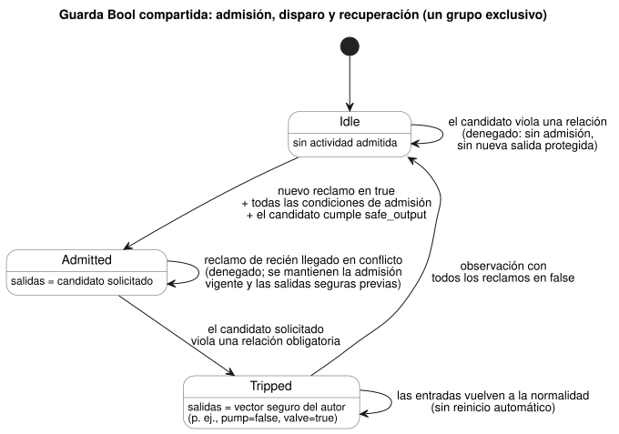
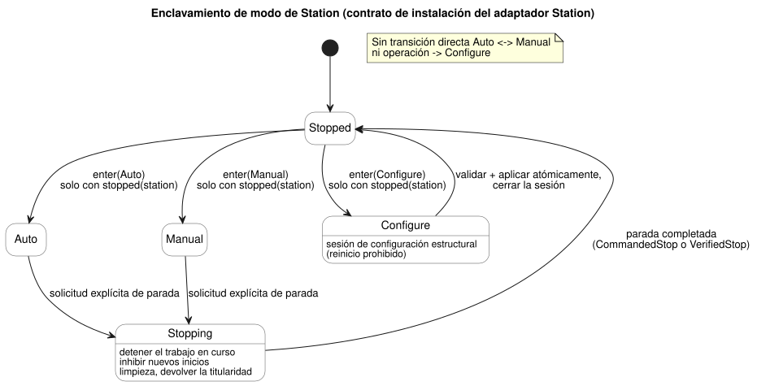
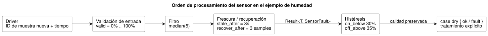

<!-- translation-source: docs/CONSTRAINTS.en.md -->
[Original en inglés](CONSTRAINTS.en.md)

# Restricciones comunes y contrato de señales de sensor en GhostFlow

Este es el **contrato de diseño común** (2026-09-24) para las restricciones y las
señales de sensor en GhostFlow. Continúa la [sintaxis de control seleccionada](LANGUAGE-SURFACE.es.md).

- La sintaxis y la semántica actuales de los ajustes operativos se definen en la
  [Referencia §5.1–5.2](reference/05-settings-and-observation.es.md).
- Lo que realmente se ejecuta hoy se registra en el [alcance de la implementación](IMPLEMENTATION.es.md)
  y en la [trazabilidad](TRACEABILITY.es.md).
- **Revisión de entradas externas del 2026-10-05:** las declaraciones que llevan la calidad
  de la señal ahora usan `input`. El acondicionamiento existente y las ramas explícitas de
  fallo de `Result` no cambian. Los fragmentos anteriores con `sensor` se conservan en
  `tests/fixtures/history/issue531/`.

**En este documento**

1. Tres tipos de restricciones y sus límites (local, compartida, contabilización de uso).
2. Cómo se ejecuta el perfil Bool compartido vinculado (admisión, disparos, recuperación).
3. Reglas de instalación para el adaptador Station fijo: bombas compartidas, enclavamientos
   de modo, ajustes operativos frente a cambios estructurales.
4. Información opcional de dispositivos y análisis opcional de capacidad.
5. Teoría de la composición de restricciones y qué se ejecuta en el MCU.
6. Tratamiento del ruido y la desconexión de sensores, y su costo en el MCU.
7. Límites diarios de operación y prevención de ejecuciones duplicadas.
8. Escenarios de aceptación.

**La superficie canónica.** Las restricciones se escriben como grupos `constraints`
con nombre dentro de un único control `.ghost.md`. Hay tres tipos:

| Tipo | A qué se aplica | Cómo se ejecuta |
|---|---|---|
| Restricciones locales de salidas Bool | Salidas del mismo control | Reducción (lowering) Bool ordinaria |
| Políticas de recursos compartidos (`constraints Name for resource`) | Un conjunto de recursos compartidos | Solo mediante una compilación vinculada explícita |
| Contabilización de uso (`limit used(...)`) | Uso de una `account` | Etapa de uso, base y persistencia de la Referencia §3.10 |

Los tres usan grupos con nombre, pero sus objetivos y contratos de ejecución son
distintos. La notación y las operaciones siguen la
[Referencia §4.8](reference/04-sensors-constraints-control.es.md).

**Ejemplos del adaptador Station.** Los ejemplos independientes `constraints Name { ... }`
que aparecen más adelante en este documento son **ejemplos del adaptador Station**, no
sintaxis canónica genérica. Esa ruta acotada de `ghostrules` se conserva únicamente para:

- la simulación WASM real del libro de programación,
- `tools/station-demo.mjs`, y
- el artefacto Station fijo que consume `bindStationPolicy`.

No es sintaxis canónica genérica ni una aplicación arbitraria de seguridad para PID.
La notación histórica por sí sola no justifica otra ruta de compatibilidad.

Otras reglas básicas:

- La CLI extrae los bloques `ghost` de nivel superior y rechaza la entrada `.ghost` simple.
- `compileConstraints` es el reductor interno del adaptador Station, no un resolvedor genérico.
- No confunda *validar* un descriptor compartido con *vincularlo y aplicarlo*
  efectivamente.

## Límites canónicos local, compartido y de contabilización de uso

Dos archivos canónicos completos muestran estos límites:

- [La envolvente local ejecutable](../examples/constraint-envelope.ghost.es.md).
- [El contrato compartido verificado con su mapeo lógico completo](../examples/shared-constraint-contract.ghost.es.md).

**Validar una vinculación.** Una *vinculación* (binding) asigna los nombres lógicos de la
política a identidades de recursos estables y a puertos tipados.
`validateResourceConstraintBinding` verifica:

- la revisión,
- los digests exactos de la fuente canónica y del artefacto,
- cada identidad de recurso estable y cada puerto tipado requeridos, y
- cada entrada finita de modo exclusivo.

Rechaza mapeos faltantes o sobrantes, identidades de recurso o puertos duplicados de forma
encubierta, y campos de política proporcionados por el host. La validación devuelve
`executable: false`. No otorga admisión ni autoridad sobre las salidas.

**Seleccionar la ejecución.** Para ejecutar, pase juntas la compilación validada y la
vinculación a `compileBoundResourceControl(compilation, binding)`. Esta ruta explícita
emite un módulo Bool GFB17 acotado con una guarda compartida en Rust. Compilar solo la
fuente canónica nunca convierte silenciosamente el descriptor verificado en un artefacto
ejecutable. Este es un contrato de vinculación *lógica* de referencia, no una ABI de
salidas físicas.

**Límites de los grupos ejecutables.**

- Un grupo ejecutable admite como máximo un conjunto de actividades exclusivas.
- Varias sentencias `exclusive` siguen siendo fuente verificada válida, pero necesitan una
  integración de ejecución por separado. Se rechazan en lugar de aplanarse en un solo
  conjunto, porque sus conjuntos son distintos.
- El vector seguro global escrito por el autor también debe satisfacer las restricciones
  locales obligatorias.

**Restricciones locales.** A continuación se muestra un control completo con una
restricción local. Las restricciones locales se aplican solo a las salidas de este control
y se ejecutan mediante la reducción Bool ordinaria. Los `require` y `mutex` existentes sin
agrupar conservan el mismo significado.

```ghost
control LocalPump {
  state displayed_pump: Bool = false;
  displayed_pump' = if request_good && !request then false else if request_good then request else displayed_pump;
  state displayed_valve: Bool = false;
  displayed_valve' = if valve_ready_good && !valve_ready then false else if valve_ready_good then valve_ready else displayed_valve;
  // Source-local display memory is initialized here; faults remain producer unknown.
  state remembered_request: Bool = false;
  let request_good = case observed_request { ok(_) => true; fault(_) => false; };
  let request = case observed_request { ok(value) => value; fault(_) => remembered_request; };
  remembered_request' = request;
  state remembered_valve_ready: Bool = false;
  let valve_ready_good = case observed_valve_ready { ok(_) => true; fault(_) => false; };
  let valve_ready = case observed_valve_ready { ok(value) => value; fault(_) => remembered_valve_ready; };
  remembered_valve_ready' = valve_ready;
  input observed_request: Bool;
  input observed_valve_ready: Bool;
  output pump, valve: Bool;
  pump <- displayed_pump';
  valve <- displayed_valve';
  constraints LocalRules {
    require at safe_output pump => valve;
  }
}
```

**Políticas de recursos compartidos.** Una política compartida declara su alcance con
`constraints Name for resource`. El siguiente ejemplo es **fuente verificada completa que
produce un descriptor no ejecutable**:

- La verificación de fuentes de `ghostc` valida declaraciones, tipos, conjuntos finitos y
  relaciones de valores seguros.
- `compileControl` y la composición rechazan esta política mientras no tenga una
  vinculación ejecutable.
- Solo una compilación vinculada, separada y explícita, selecciona la ejecución.

```ghost
control SharedPumpPolicy {
  state displayed_pump: Bool = false;
  displayed_pump' = if pump_request_good && !pump_request then false else if pump_request_good then pump_request else displayed_pump;
  state displayed_valve: Bool = false;
  displayed_valve' = if valve_request_good && !valve_request then false else if valve_request_good then valve_request else displayed_valve;
  // Source-local display memory is initialized here; faults remain producer unknown.
  state remembered_automatic: Bool = false;
  let automatic_good = case observed_automatic { ok(_) => true; fault(_) => false; };
  let automatic = case observed_automatic { ok(value) => value; fault(_) => remembered_automatic; };
  remembered_automatic' = automatic;
  state remembered_manual: Bool = false;
  let manual_good = case observed_manual { ok(_) => true; fault(_) => false; };
  let manual = case observed_manual { ok(value) => value; fault(_) => remembered_manual; };
  remembered_manual' = manual;
  state remembered_pump_request: Bool = false;
  let pump_request_good = case observed_pump_request { ok(_) => true; fault(_) => false; };
  let pump_request = case observed_pump_request { ok(value) => value; fault(_) => remembered_pump_request; };
  remembered_pump_request' = pump_request;
  state remembered_valve_request: Bool = false;
  let valve_request_good = case observed_valve_request { ok(_) => true; fault(_) => false; };
  let valve_request = case observed_valve_request { ok(value) => value; fault(_) => remembered_valve_request; };
  remembered_valve_request' = valve_request;
  resource station: Station;
  resource pump1: BoolActuator;
  resource valve1: BoolActuator;
  input observed_automatic: Bool;
  input observed_manual: Bool;
  input observed_pump_request: Bool;
  input observed_valve_request: Bool;
  output pump, valve: Bool;
  pump <- displayed_pump';
  valve <- displayed_valve';
  constraints SharedRules for station {
    exclusive at admission { automatic, manual };
    require at safe_output pump1.on => any_on({ valve1 });
    safe { pump1 = false; valve1 = true; }
  }
}
```

**El bloque `safe`.** `safe` debe asignar explícitamente cada recurso Bool del conjunto
finito al que hacen referencia las reglas, y debe satisfacer todas las relaciones
obligatorias de salida. Aquí los valores son bomba apagada (OFF) y válvula abierta (ON).
No existe un valor predeterminado oculto de "todo en OFF".

Tenga en cuenta estos puntos:

- No suponga que las solicitudes `pump`/`valve` de la fuente están conectadas a recursos
  físicos.
- La aplicación lógica que se describe a continuación requiere identidades de recurso
  estables validadas y mapeos de puertos tipados, además de una activación vinculada
  explícita.
- Los antiguos archivos de políticas de recursos de nivel superior también siguen siendo
  artefactos verificados que no son controles. Nunca son controles aplicados.
- No invente sintaxis `station`, `use`, `bind` ni de sesión.

## Ejecución Bool compartida

Para ver el ejemplo ejecutable completo, con vinculación explícita y entradas/resultados
registrados, consulte [bound-resource-execution](../examples/bound-resource-execution.ghost.es.md).
El ejemplo de verificación compartida de #157 mostrado arriba mantiene su contrato de
descriptor no ejecutable.

**Qué hace el perfil vinculado.** El perfil vinculado de
[#158](https://github.com/callin2/ghostflow-language/issues/158) ejecuta un control Bool
y un conjunto finito de recursos mediante una guarda de tick compartida en Rust.

- Cada salida debe estar vinculada a un recurso y tener un vector seguro completo escrito
  por el autor.
- La vinculación fija los digests exactos de la fuente canónica/descriptor de #157, la
  revisión, los ID estables y los mapeos Bool de entradas de modo y de salidas.
- Proporcione la vinculación explícitamente al activar el módulo como un paquete GFRB1.
  Proporcione la misma identidad de vinculación como un paquete GFRS1 en cada escaneo.
- API de Rust: `activate_with_resource_binding(bytes, &ResourceBindingRegistry)`,
  `tick_with_resource_binding(bytes)` y
  `ScanDriver::scan_with_resource_binding(frame, bytes)`.
- Una vinculación faltante o que no coincide **falla de forma cerrada** (fail closed).
- Un cargador ordinario puede analizar el módulo, pero las operaciones ordinarias de
  activación/tick/escaneo no pueden eludir la guarda. La ejecución no es un filtro de
  JavaScript que el host agrega después de publicar las salidas.

**Qué envuelve GFB17.** GFB17 envuelve únicamente programas GFB1 v1 o v3 existentes en los
que todos los puertos de entrada/salida son Bool, e incluye la guarda en su límite de
consolidación.

- La fuente automática, manual y de respaldo (fallback) que usa evaluación en cortocircuito
  se reduce a v3.
- Los demás perfiles internos no se admiten.
- Las salidas de todas las ramas admitidas pasan por la misma guarda de Rust.
- Se rechazan por estar fuera de este perfil acotado: programaciones de contexto,
  objetivos/PID, composición mediante `import` y superposiciones de grupos cuyo
  significado de seguridad es ambiguo.

**Un escritor por recurso.** La autoridad de la instalación debe hacer que todos los
escritores lógicos usen el mismo `ResourceBindingRegistry`.

- La activación nativa recibe un registro `Arc` compartido.
- La ABI de WASM comparte un registro entre todos los manejadores de una instancia.
- Ambas rechazan un segundo escritor activo para el mismo ID de recurso estable.
- El envoltorio de referencia de Node también verifica distintas instancias WASM mediante
  un registro de módulo.
- Se cubren tanto los ID de recursos Station como los Bool.

Registros de instalación separados no certifican la exclusión física entre instalaciones.
Este perfil no proporciona arbitraje cooperativo entre varias VM, arrendamientos de sesión
ni una ABI general de salidas físicas. El adaptador Station existente, las rutas de
ejecución de la contabilización de uso y el `check` no bloqueante no cambian.

**Admisión y denegación.** La *admisión* es el permiso de la guarda para que una
actividad reclamada (por ejemplo, `automatic` o `manual`) se ejecute. Las condiciones
obligatorias de los grupos se combinan con AND.

- Se deniega un nuevo reclamo de actividad que entra en conflicto con la admisión actual.
  Se mantienen la admisión vigente y las salidas seguras anteriores.
- Un candidato solicitado que viola una relación obligatoria de salida *antes de iniciar*
  no crea una nueva admisión ni una salida protegida.
- Un recién llegado denegado primero debe observarse en false y luego enviar un nuevo
  reclamo en true para volver a solicitar la admisión.
- La primera denegación tiene un conjunto de salidas vacío, porque no existe ninguna salida
  anterior. En los demás casos se conservan los valores seguros consolidados previamente.
- No invente salidas de reemplazo previas al inicio a partir del vector seguro del
  descriptor.

**Disparos y recuperación.** Si el candidato solicitado de una ejecución *ya admitida*
viola una relación obligatoria, la guarda se *dispara* (trip): pasa al vector seguro
específico del recurso escrito por el autor.

- Preserve el comportamiento seguro que mantiene algunas salidas en ON, como
  pump=false y valve=true.
- Que las entradas vuelvan a la normalidad después de un disparo no reinicia la ejecución
  automáticamente.
- Un grupo exclusivo necesita una observación con todos los reclamos en false, seguida de
  un nuevo reclamo que satisfaga todas las condiciones de admisión.
- Un grupo que solo tiene `require` establece una línea base de recuperación cuando su
  mapa solicitado es igual al mapa seguro escrito por el autor. Luego verifica una nueva
  salida desde esa línea base.
- Los disparos se propagan a través del componente transitivamente conectado de grupos
  que comparten recursos protegidos. Los valores seguros escritos por el autor deben
  coincidir en los recursos compartidos. Los grupos no relacionados conservan su admisión.
- Vuelva a validar el candidato seguro final frente al AND de todas las restricciones
  obligatorias compartidas y locales.
- No oculte el reclamo antiguo en una cola de reintentos.
- Mantenga los reclamos en bruto separados de la actividad admitida, y los valores
  solicitados separados de los valores seguros finales. Conserve la causa, el grupo, la
  vinculación y la evidencia del escaneo.

El diagrama siguiente resume este ciclo de vida para un grupo exclusivo. Un grupo que solo
tiene `require` se recupera, en cambio, mediante la línea base del mapa seguro descrita
arriba.



**Consolidación y reversión.**

- Una denegación evaluada correctamente consolida el estado ordinario de la VM. La
  denegación no cancela el trabajo/sesión del programa ni restaura todos los estados a su
  valor anterior.
- Un error de vinculación o un fallo de la VM revierte juntos el estado de la VM, la
  admisión de la guarda y la traza. El estado protegido no debe cambiar parcialmente, y la
  evidencia de un escaneo rechazado no debe consolidarse.
- Una salida segura lógica no es lo mismo que "el renderizador la aplicó" ni que "la
  retroalimentación física la confirmó". La secuencia real del renderizador, los
  dispositivos físicos de seguridad y la instalación en campo quedan fuera del alcance de
  validación de este perfil.

**Contabilización de uso.** La contabilización de uso declara el `resource` y la
`account` existentes, y luego usa
`constraints Budget { limit used(account, basis) <= bound { ... } }`.
No reemplace las condiciones Bool locales ni la admisión compartida por un libro mayor
(ledger) de uso. La
[Referencia §3.10](reference/03-time-and-schedules.es.md)
define la etapa de uso, la base y la persistencia.

**Las restricciones definen una región permitida.** Las restricciones forman la región
dentro de la cual pueden moverse las solicitudes, incluidos los objetivos/PID.

- Las restricciones locales afectan solo a su propio control.
- Las restricciones compartidas se aplican a todas las rutas automáticas, manuales y de
  respaldo que usan el mismo recurso.
- Una violación prevista antes de iniciar deniega la nueva admisión.
- Durante la ejecución, siga el comportamiento seguro específico del recurso escrito por
  el autor, en lugar de apagar todo incondicionalmente.
- Esta distinción no implementa una ABI general de salidas ni una secuencia segura física.
- No generalice el contrato existente, más limitado, del motor PID a una aplicación
  arbitraria de políticas de recursos.

**Orden de evaluación.** Todas las condiciones obligatorias se combinan con AND:

1. Decida primero la admisión.
2. Verifique las relaciones safe_output sobre el candidato solicitado.
3. Deje que el renderizador aplique el resultado.

La prioridad de arbitraje elige *dentro* de la región permitida. No puede eludir las
restricciones obligatorias, la vinculación, la procedencia ni los requisitos de
recuperación. Registre las causas de violación por separado de las denegaciones y de las
transiciones seguras. Las observaciones normales no crean una nueva autoridad de inicio;
los reintentos y la recuperación siguen las mismas reglas.

`check pump_capacity` es un aviso no bloqueante en el adaptador Station que se muestra más
abajo, no un `require` obligatorio. `warn` y `monitor` no se admiten. Nunca promueva
silenciosamente las advertencias a `require` de seguridad ni a comandos.

## Dirección establecida en esta conversación

Estas son decisiones del usuario sobre la instalación de riego:

- La operación automática, la operación manual y el modo de configuración de la misma
  instalación de riego son mutuamente excluyentes.
- Las transiciones automático↔manual y operación→configuración requieren una parada
  explícita por parte del usuario y que la parada se haya completado.
- Los cambios estructurales siguen los procedimientos de parada explícita y Configure. Un
  conjunto limitado de propiedades ajustables en tiempo de ejecución sigue, durante la
  operación, el contrato de eventos atómicos que se describe más abajo.
- [Revisión del 2026-09-20: la decisión anterior, "toda aplicación de condiciones de operación se permite solo en el modo de configuración detenido", se reemplazó en #110 únicamente para los valores de propiedades ajustables en tiempo de ejecución. Los procedimientos de parada y Configure para los cambios estructurales se mantienen.]
- Los enclavamientos, el límite de válvulas abiertas simultáneamente, la capacidad de la
  instalación y el tiempo diario de operación se declaran como restricciones comunes. Las
  restricciones de toda la instalación se siguen aplicando cuando se agregan controles
  individuales.
- El tratamiento del ruido de sensores y de la desconexión de datos se proporciona como
  operaciones de señal con nombre y con recursos acotados.
- La prevención de duplicados ante correcciones del reloj y los límites diarios de uso se
  garantizan cada uno por separado.
- **Toda la información complementaria de dispositivos, incluidas la presión, el caudal y las curvas de rendimiento, es opcional.** El riego básico, los enclavamientos de modo, los límites de número de válvulas y los límites de tiempo deben poder usarse sin introducir esa información.

Estas decisiones concretan la propuesta anterior sobre la prioridad y la apropiación
(preemption) de solicitudes automáticas/manuales. Una política que ejecuta de inmediato
una solicitud manual durante la operación automática, basándose solo en la prioridad, no
se aplica a esta instalación.

## Dónde se describen las restricciones

`constraints` es un grupo de reglas con nombre.

- Adjunte las restricciones **locales** dentro de un control.
- Adjunte las restricciones **compartidas** a un ámbito de instalación definido por el
  perfil del dispositivo.
- Cuando varios controles hacen referencia a la misma bomba, comparten las restricciones y
  el uso de ese único ID de bomba física.

Este grupo y los grupos independientes que le siguen son ejemplos de instalación para el
adaptador Station fijo. `station`, `pump1`, `settings` y `starts` se conectan a ID estables
de instalaciones, ajustes y programaciones. `pump1.valves` es un conjunto finito de
válvulas cuyas relaciones de suministro se registraron de antemano. Nunca conecte por orden
de descubrimiento ni por nombre visible.

Ejemplo del adaptador Station: reglas independientes acotadas para el adaptador de instalación fijo.

```text
constraints StationRules {
  exclusive(automatic, manual, configuring);

  allow enter(Auto, Manual, Configure)
    only when mode == Stopped && stopped(station);

  // Condición de parada para aplicar la configuración estructural (regla del reductor: configureOnly); distinta de los eventos de ajuste del operador
  allow apply(settings)
    only when mode == Configure && stopped(station);

  require count_on(pump1.valves) <= 2;
  require pump1.on => any_on(pump1.valves);

  limit on_time(pump1) <= 1h per day("Asia/Seoul");
  once starts per occurrence;
}
```

`automatic`, `manual` y `configuring` son los *estados activos* de modo/sesión permitidos
de la misma instalación. No son los botones de solicitud entrantes. El gestor de modos es
dueño de un único valor `Stopped | Auto | Manual | Configure`, y esos nombres se derivan de
él. `exclusive` también puede usarse para grupos generales de actividades.

| Tipo | Significado | Tratamiento predeterminado ante una violación |
|---|---|---|
| exclusive | Modos/actividades que no pueden estar activos al mismo tiempo | Rechazar la nueva entrada en conflicto |
| allow ... only when | Requisitos previos para entrar en un modo o aplicar la configuración | Rechazar la solicitud; mantener el estado existente |
| require | Invariante sobre las salidas finales de la instalación | Verificación de permiso antes de iniciar y supervisión de seguridad durante la ejecución |
| limit | Límite superior de tiempo, conteo o consumo acumulados | Verificar el presupuesto restante; bloquear la operación al alcanzar el límite |
| once ... per occurrence | Supresión de duplicados por ocurrencia programada | Nunca volver a ejecutar una ocurrencia que ya fue aceptada |
| check | Análisis no bloqueante con información opcional | Diagnóstico Pass / Violation / Unknown; no bloquea la ejecución |
| warn ... when | Notación de diseño futura; actualmente la rechazan ambos analizadores | Registrar un evento de advertencia con causa y objetivo |

- Un `require` Bool de una línea en un control local y este adaptador Station usan rutas
  de ejecución distintas.
- Una advertencia no es una excepción que permita violar una restricción. Borrar una
  advertencia no libera una restricción obligatoria.
- El host es responsable de entregar las notificaciones. No reenvía la misma violación a
  los usuarios en cada tick.

**Cada restricción tiene una etapa de verificación, determinada por su objetivo.**

| Objetivo | Se verifica en |
|---|---|
| `count_on` / relaciones entre salidas | Candidatos de salida finales |
| `enter` / `apply` | Entrada de la solicitud |
| `pump_capacity` | Permiso para trabajo nuevo |

Estas etapas nunca se mezclan implícitamente. Una expresión general sin una etapa de
objetivo definida recibe un diagnóstico de compilación.

## Bombas compartidas entre varios controles

Las reglas de sesión y arbitraje de esta sección son el contrato de instalación del
adaptador Station fijo que se muestra más abajo. El perfil Bool vinculado descrito arriba
permite un solo escritor activo. No pretende ofrecer arbitraje de sesiones entre varias VM
ni derechos de uso físico.

**Un escritor.** El gestor de recursos compartidos es el único escritor de salidas para
una bomba física.

- Las salidas de los controles individuales son *solicitudes*, no escrituras GPIO en las
  que gana el último escritor.
- Una solicitud `false` de un control inactivo no puede interrumpir un riego que pertenece
  a otro control.
- Si es necesario detener otro control, use una solicitud explícita de parada de la
  instalación.

**Titularidad de la sesión.** La política inicial de bomba compartida es la **titularidad
exclusiva durante toda la sesión de riego**.

- La titularidad dura desde la apertura de válvulas, el funcionamiento de la bomba y el
  apagado de la bomba entre fases, hasta la limpieza de las válvulas.
- Otro control no obtiene la titularidad solo porque la bomba se apague brevemente entre
  esas etapas.
- Una válvula abierta por sí sola no arranca la bomba. Siga las salidas de fase del
  titular y la secuencia de aplicación segura del dispositivo.

**Arbitraje en un tick.**

- Arbitre todas las solicitudes de inicio del mismo tick a partir de una sola instantánea.
- Permita solo las solicitudes que aseguran tanto la titularidad como el presupuesto de
  tiempo.
- El renderizador aplica las salidas después de que se consolida el permiso lógico. Si se
  necesita una reserva persistente, retrase el inicio de la salida hasta que esta también
  tenga éxito.
- Reutilice el mismo ID de solicitud cuando un proceso reintente.
- Esto no garantiza que varios GPIO cambien físicamente en el mismo instante.

**Encajar trabajo nuevo alrededor de las programaciones existentes.**

- Con una política que preserva los horarios programados existentes, un control nuevo se
  permite solo si el límite superior de su sesión completa más el tiempo de limpieza cabe
  en un intervalo libre. Verificar solo si la bomba está apagada en este momento no es
  suficiente.
- Los temporizadores de las fases de riego no arrancan mientras una solicitud espera
  recursos.
- El orden de las solicitudes lo determinan el orden de aceptación y los ID estables. La
  longitud de la cola y el vencimiento están acotados.
- La operación concurrente compartida o la apropiación son una política opcional aparte.
  No liberan los enclavamientos de modo.

### Ejemplo: aplicar las mismas reglas a dos válvulas existentes y dos agregadas

En este caso, la configuración de la instalación vincula la bomba tanto del control
existente como del nuevo a la `pump1` física. Sus puertos de válvula se vinculan a
`valve1`–`valve4`. Estas conexiones son vinculaciones de dispositivo que el control
necesita; no son metadatos de presión/caudal. Las reglas siguientes se adjuntan a esa
instalación.

Ejemplo del adaptador Station: reglas independientes acotadas para el adaptador de instalación fijo.

```ghost
constraints SharedPump {
  // pump1.valves는 두 control을 합친 네 밸브의 집합이다.
  require count_on(pump1.valves) <= 2;
  require pump1.on => any_on(pump1.valves);

  // 자동/수동과 control 수에 관계없이 물리 펌프 하나의 사용량이다.
  limit on_time(pump1) <= 1h per day("Asia/Seoul");
}
```

(Los comentarios en coreano dicen: `pump1.valves` es el conjunto de las cuatro válvulas de
ambos controles; y el límite es el uso de una sola bomba física, independientemente del
modo automático/manual o del número de controles).

- Mientras la tarea existente tenga la titularidad de la sesión, una tarea nueva no puede
  iniciarse, aunque la bomba se apague brevemente.
- Después de que la tarea existente termina, la tarea nueva se permite si toda su sesión
  cabe antes de la siguiente programación.
- Estas reglas por sí solas no implementan un árbitro. La sintaxis concreta que conecta
  la titularidad de la sesión con las entradas de permiso queda para un alcance posterior.
- No lo sustituya por un OR de las salidas de ambos controles ni por "gana el último
  escritor".

## Enclavamientos de modo y parada completada

La exclusividad de modos se aplica a todos los controles y a todos los comandos manuales
de la interfaz conectados a la misma instalación. Varios controles automáticos de una
bomba coordinan el uso de recursos bajo el mismo modo Auto. No imponga automáticamente un
único modo global a instalaciones independientes.

La ruta obligatoria entre modos siempre pasa por una parada explícita:

```text
Auto o Manual
  → solicitud explícita de parada
  → procedimiento de parada del trabajo en curso / inhibir nuevos inicios
  → parada completada
  → Stopped
  → solicitud de entrada en Auto, Manual o Configure
```

El diagrama siguiente muestra la misma regla como una máquina de estados.



**Qué verifica `enter`.** Las reglas `enter` verifican las solicitudes de entrada en
cualquier modo distinto de Stopped. No bloquean la propia solicitud de parada. En Auto,
una bomba que está apagada brevemente o esperando la siguiente programación no permite una
transición directa a Manual o Configure.

**Configure significa cambio estructural.** En esta sección, la sesión Configure y
`apply(settings)` se refieren a cambios de configuración *estructurales*.

- El reinicio está prohibido durante esa sesión.
- Valide y aplique atómicamente el cambio estructural. Cierre la sesión de configuración
  y vuelva a Stopped antes de aceptar una entrada separada en un modo de operación.
- Las API remotas pasan por las mismas verificaciones. Deshabilitar solo los controles de
  la pantalla no implementa una restricción.

**Conflictos en el mismo tick.**

- Si en un tick entran en conflicto solicitudes de entrada en modos distintos, recházelas
  todas y mantenga el modo existente.
- Retransmitir el mismo ID de solicitud no hace que se procese dos veces.
- La parada se procesa antes que la entrada en un modo y que el permiso de un nuevo riego
  en ese tick. Incrementa la *generación de parada* y descarta las solicitudes no
  consolidadas de la generación anterior.
- Aunque la instantánea anterior fuera Stopped, un nuevo inicio que llega junto con Stop
  en el mismo tick no se permite.

**Qué significa `stopped(station)`.** No significa simplemente "la solicitud de la bomba
es false". Significa que:

- el riego y la limpieza en curso han terminado,
- la titularidad de la instalación se ha devuelto, y
- la confirmación de parada para ese perfil de dispositivo está completa.

Si existe retroalimentación, verifique la parada real y el estado de las válvulas. Sin
retroalimentación, indique la limitación: la confirmación se basa en los comandos y en el
procedimiento de parada establecido en la instalación. Nunca afirme que una enumeración de
modo reemplaza los enclavamientos físicos o garantiza la retroalimentación del estado real.

**CommandedStop y VerifiedStop.** Registre la evidencia de parada en uno de dos niveles:

| Evidencia | Significado |
|---|---|
| `CommandedStop` | El renderizador informó que se aplicaron las salidas seguras, y los procedimientos configurados de limpieza/espera se completaron |
| `VerifiedStop` | La retroalimentación real también confirmó la parada |

- La configuración básica permite CommandedStop y no hace obligatorios los sensores de
  retroalimentación. No lo muestra como una parada real verificada.
- Si el dispositivo no responde, o si falla la aplicación de las salidas seguras, el solo
  envío del comando no establece una parada completada.
- Solo las reglas agregadas por el usuario pueden exigir VerifiedStop.
- Los valores iniciales de secuencia/espera de las salidas seguras pueden usar los valores
  predeterminados del renderizador de salidas. Indique por separado que su idoneidad debe
  verificarse en cada instalación.

**La parada cancela el trabajo pendiente.**

- Las solicitudes de parada también cancelan o invalidan los inicios pendientes.
- No ponga en cola una solicitud de cambio de modo durante la operación para luego
  cambiar automáticamente sin que el usuario lo sepa.
- El reinicio requiere una nueva solicitud explícita.
- Editar descripciones en el documento fuente durante la configuración es distinto de
  aplicar condiciones de operación a un dispositivo físico.

**Configure estructural es una revisión atómica.** Es una única revisión de la
instalación que incluye las versiones de control pertinentes, las relaciones de
puertos/suministro, las restricciones, las estructuras de programación, las
verificaciones opcionales y los metadatos pertinentes.

- Informe el éxito solo después de validar todo el candidato y de completar un reemplazo
  atómico y persistente de la revisión activa.
- Después de un corte de energía, seleccione solo la revisión anterior completa o la
  nueva revisión completa. Nunca mezcle partes.
- Las solicitudes llevan la revisión y la generación de parada del momento en que se
  crearon. Si ya no coinciden cuando se evalúa el permiso, rechace la solicitud; no la
  reinterprete automáticamente con el nuevo significado.
- Esta revisión no es una clave para reiniciar los libros mayores de uso real ni de
  prevención de duplicados.

### Propiedades ajustables en tiempo de ejecución y cambios estructurales

La [Referencia §5.1–5.2](reference/05-settings-and-observation.es.md) define la
sintaxis y la semántica de aplicación de los ajustes operativos.

- `access = operator` en los metadatos de `config` declara un ajuste que los operadores
  pueden cambiar.
- Los valores marcados con `access = designer`, o sin acceso de operador declarado, no
  pueden cambiarse mediante eventos de ajuste operativo.
- No existe un campo `apply`. El compilador actual rechaza tanto `apply = stopped` como
  `apply = live`.

**Qué se considera estructural.** Los cambios en programas/reglas ejecutables, en la
vinculación/perfil del dispositivo, en las dependencias o en la estructura de las
programaciones son cambios estructurales.

- Los valores expuestos explícitamente, como las horas de inicio y la Duration de una
  programación, no se vuelven estructurales solo por pertenecer a una programación.
- Convertir una verificación opcional en obligatoria es un cambio de reglas.
- Los cambios estructurales siguen los procedimientos de parada explícita y Configure,
  separados de los eventos de ajuste operativo.

**Eventos de ajuste operativo.** Cada acción del operador es un único evento atómico en
vivo que contiene todos los ajustes que deben cambiar juntos.

- Valide el lote completo. Si algún valor no es válido, rechace todo el lote.
- El rechazo no detiene las reglas de operación ordinarias independientes.
- Los nuevos valores se leen desde el punto en que se aplica un evento válido. No esperan
  al siguiente ciclo de riego ni a una nueva ejecución (run).
- Las instantáneas nunca cambian durante la evaluación. El orden de los eventos y de los
  escaneos sigue la Referencia §5.2.
- La fuente/bytecode, la identidad del programa y la identidad de la ejecución se
  mantienen. Registre la revisión de los ajustes y la posición efectiva del evento.
- El estado y los temporizadores nunca se reinician implícitamente.

Los valores canónicos de Temperature y la preservación de `displayUnit` siguen la
[Referencia §5.1](reference/05-settings-and-observation.es.md).
Los cambios de ajustes en un Range en curso siguen la
[Referencia §3.5](reference/03-time-and-schedules.es.md).

**Reinicio y actualizaciones.**

- Los ajustes operativos ordinarios aceptados sobreviven a un reinicio físico del ESP.
- Un reinicio crea una nueva ejecución (run). No restaura automáticamente el estado
  anterior del programa.
- Las reglas escritas por el autor deciden cómo responder a un reinicio. Las obligaciones
  de las salidas eléctricas antes de la primera decisión permanecen en el límite del
  Device.
- No imponga de forma universal una única política de arranque automático/manual.
- El arbitraje de recursos compartidos, las transiciones de modo de la estación, los
  libros mayores de uso y los procedimientos de parada explícita se siguen aplicando.
- Actualizar el programa/módulo o el firmware de un ESP detiene todas las tareas de
  dispositivo que ese ESP controla.

### Ejemplo: declaración de un ajuste operativo y aplicación estructural con Configure

El siguiente fragmento declara un ajuste operativo dentro del cuerpo de un control.

```ghost
config water1_time: Duration = 5min { min = 1min; max = 30min; step = 1min; access = operator; }
```

Un cambio de este ajuste por parte del operador es una emisión atómica en vivo dentro del
flujo tipado de Result del mismo programa. Los consumidores manejan la observación actual
con `case water1_time { ok(value) => ...; fault(reason) => ...; }`. La entrega es
independiente de la fuente del consumidor: el mismo cambio de ajuste no edita un literal
de la fuente ni provoca una recompilación. El límite exacto se registra en
`docs/OPERATOR-SETTINGS-STREAM.md`.

En cambio, `settings` en la restricción siguiente es una **revisión de configuración
estructural**. Este ejemplo *no* asocia una condición de parada a los cambios del operador
sobre el `water1_time` anterior. `mode` y `station` son nombres proporcionados por el
gestor de la instalación.

Ejemplo del adaptador Station: reglas independientes acotadas para el adaptador de instalación fijo.

```ghost
constraints EditInterlock {
  exclusive(automatic, manual, configuring);

  allow enter(Auto, Manual, Configure)
    only when mode == Stopped && stopped(station);

  allow apply(settings)
    only when mode == Configure && stopped(station);
}
```

La regla `configureOnly` de `tools/constraints.mjs` y el `apply_config` de la estación son
rutas de Configure con la instalación detenida. Una nueva solicitud de operación se acepta
solo después de que un candidato estructural se haya validado y aplicado. No confunda la
validación/aplicación de eventos de ajuste operativo con el significado físico de
CommandedStop/VerifiedStop.

### Registro de investigación del 2026-09-20 y decisión posterior

La investigación registrada en su momento en
[language #89](https://github.com/callin2/ghostflow-language/issues/89) y
[system #54](https://github.com/callin2/farm_studio_system/issues/54) analizó los eventos
de propiedades en vivo, partiendo de la aplicación de ajustes con la instalación detenida
y de las rutas de edición de la fuente/recompilación. Desde entonces, el ejemplo
`apply = stopped`, la sintaxis de exposición no resuelta y los bocetos de diseño de
`settings.valid` son registros históricos. No son sintaxis ejecutable actual ni contratos
de reemplazo. La sintaxis de ajustes del operador y la semántica atómica en vivo,
establecidas desde el 2026-09-22, siguen la Referencia §5.1–5.2 mencionada arriba.

## La información complementaria de dispositivos es opcional

La información complementaria de dispositivos —presión, caudal, curvas de bomba, consumo
de energía, pérdidas en tuberías— **no** es una entrada obligatoria para los programas
básicos. Es distinta de la vinculación mínima que identifica los dispositivos y conecta
los puertos de salida. Tampoco es universalmente obligatorio instalar sensores de
retroalimentación que informen el estado real.

| Configuración | Funciones disponibles | Cuando falta la información complementaria |
|---|---|---|
| Control básico | Programaciones, control secuencial, enclavamientos automático/manual/configuración | Sigue siendo utilizable |
| Reglas declaradas directamente | Como máximo 2 válvulas simultáneas, como máximo 1 hora por día | Verificables sin presión/caudal |
| Análisis opcional de capacidad `check` | Diagnostica el exceso de capacidad usando la información de dispositivos proporcionada | Solo ese análisis queda en Unknown (información insuficiente); la operación no se bloquea |
| Regla obligatoria de capacidad agregada por el usuario `require` | Permite solo las solicitudes cuya capacidad está verificada | No se pueden permitir inicios en la instalación sujeta a esa regla; este no es el comportamiento predeterminado |

**Los valores faltantes siguen faltando.**

- Nunca reemplace un valor faltante por cero, por capacidad infinita ni por un valor
  normal.
- Los campos opcionales son `Option`. Los resultados del análisis llevan
  Pass / Violation / Unknown y un motivo.
- Unknown significa "información insuficiente" o "fuera del alcance del análisis". No es
  un error ni un resultado aprobado.
- No envíe notificaciones de fallo repetidas por datos que nunca se introdujeron. En su
  lugar, muestre los elementos no verificados en la pantalla de análisis.

**Información parcial.**

- Ejecute solo las verificaciones cuyas entradas están completas; deje las demás en Unknown.
- Una verificación aprobada del límite de caudal no es una garantía completa de seguridad
  hidráulica que también verifique la presión. No la muestre como tal.
- Los valores o unidades no válidos introducidos directamente pueden diagnosticarse
  durante la edición y rechazarse al aplicarse. Omitir un campo no es en sí un error.

### Ejemplo: reglas básicas y análisis opcional para la misma instalación

Estas reglas básicas funcionan incluso cuando no se ha introducido información de presión
ni de caudal.

Ejemplo del adaptador Station: reglas independientes acotadas para el adaptador de instalación fijo.

```ghost
constraints BasicWatering {
  require count_on(pump1.valves) <= 2;
  limit on_time(pump1) <= 1h per day("Asia/Seoul");
}
```

Agregue el siguiente grupo solo si desea un análisis de capacidad. Ambos grupos pueden
aplicarse a la vez.

Ejemplo del adaptador Station: reglas independientes acotadas para el adaptador de instalación fijo.

```ghost
constraints CapacityAdvice {
  check pump_capacity(pump1);
}
```

| Información/solicitud de capacidad | Resultado de CapacityAdvice | Nuevo inicio que satisface los enclavamientos básicos |
|---|---|---|
| No se introdujo la información requerida | Unknown: información insuficiente | Esta verificación no lo bloquea |
| Modelo y condiciones suficientes; dentro de la capacidad | Pass: verificación aprobada bajo ese modelo | Esta verificación no lo bloquea |
| Modelo y condiciones suficientes; por encima de la capacidad | Violation: advertencia de exceso de capacidad | Esta verificación por sí misma no lo bloquea |

Los usuarios que también quieran bloquear el caso de la última fila eligen el `require`
obligatorio explícito que se describe en la sección siguiente. Introducir información de
dispositivos nunca refuerza automáticamente las reglas básicas.

**Promover una verificación a regla obligatoria.**

- Introducir información complementaria o descubrir un dispositivo no agrega
  automáticamente condiciones de operación obligatorias.
- La promoción a regla obligatoria es un cambio estructural de las REGLAS ejecutables.
  Detenga explícitamente la instalación y luego cámbiela, verifíquela y aplíquela mediante
  Configure. No es un objetivo de eventos en vivo para propiedades ajustables en tiempo de
  ejecución.
- Cuando elimine información que necesita una regla obligatoria activa, modifique o
  elimine también esa regla y valide el resultado.
- Nunca deshabilite silenciosamente una regla obligatoria porque su información
  desapareció.

## Modelos opcionales de capacidad de bomba y presión de agua

**Número de válvulas.** Exprese un límite de número de válvulas como una restricción de
conteo finita, por ejemplo `count_on(...) <= 2`. Verifique el total de *todas* las
válvulas conectadas a la misma bomba, no solo las dos válvulas que pertenecen a cada
control.

**Modelos más precisos.** Un modelo más preciso necesita el caudal demandado por zona, la
presión/altura mínima requerida, las pérdidas en tuberías y el rendimiento de la bomba.

- Las demandas de zonas en paralelo pueden sumarse bajo una condición de presión común.
- No use un modelo que simplemente sume el "consumo de presión" y lo reste de la presión
  nominal de la bomba.
- El punto de operación real de la bomba lo determinan la curva de la bomba y la curva del
  sistema.
  [Explicación de KSB sobre el punto de operación](https://www.ksb.com/en-global/centrifugal-pump-lexicon/o)

Solo si se desea, un perfil puede agregar límites de caudal conservadores, o combinaciones
de válvulas permitidas por condición de operación, verificados en la instalación. A
continuación se muestra un boceto de sintaxis para el análisis opcional.

Ejemplo del adaptador Station: reglas independientes acotadas para el adaptador de instalación fijo.

```text
constraints PumpCapacity {
  check pump_capacity(pump1);
}
```

**Qué devuelve `pump_capacity`.** Compara todas las solicitudes para la misma bomba con el
modelo de capacidad seleccionado:

| Resultado | Cuándo |
|---|---|
| Violation (advertencia) | Se confirma un exceso bajo condiciones verificadas |
| Pass | Las condiciones y los datos son suficientes y la demanda está dentro de la capacidad; válido solo dentro del alcance de ese modelo |
| Unknown | Los datos o las condiciones son insuficientes |

Este `check` es una función de advertencia/análisis, no una regla de permiso de operación.
Los diagnósticos registran el modelo admitido y sus premisas.

Por ejemplo, un modelo de presupuesto de caudal compara `flow_budget`, bajo condiciones
definidas de presión y tuberías, con el `demand_flow` por zona bajo las mismas
condiciones. Comparar presión con caudal (unidades distintas) es un error de tipo. La
implementación de este modelo opcional usa campos y unidades definidos; nunca adivina el
significado de metadatos arbitrarios.

Solo cuando los usuarios lo eligen como condición de inicio obligatoria agregan lo
siguiente.

```text
require pump_capacity(pump1) == Pass;
```

**Efectos de la forma obligatoria.**

- Ni Violation ni Unknown permiten trabajo nuevo.
- El control básico sin una verificación declarada no tiene esa condición.
- Nunca exija a los usuarios que introduzcan primero especificaciones detalladas de los
  dispositivos solo para ejecutar el control básico.
- Esta es una regla de *permiso de inicio* basada en metadatos. Reglas separadas de
  salidas/sensores se encargan de supervisar fallos y paradas de emergencia durante la
  ejecución.

**Cuando faltan datos para una verificación obligatoria.**

- Si a una verificación obligatoria recién agregada le faltan datos, rechace la aplicación
  de esa configuración candidata y mantenga la configuración existente.
- Si una verificación obligatoria activa que antes era válida pasa más tarde a Unknown,
  bloquee los nuevos inicios sujetos a ella.
- No elimine automáticamente la regla obligatoria ni degrade la instalación a la operación
  básica.

**Dónde se ejecuta el análisis.** El análisis de curvas de bomba/modelos de tuberías y la
generación de combinaciones permitidas pueden ejecutarse en un PC. El MCU verifica el
resultado con búsquedas en tablas o comparaciones acotadas. Las garantías del análisis
solo son válidas dentro de las suposiciones del perfil y del alcance que realmente se
verificó. Omitir un análisis cuando falta información es distinto de tratar como exitosa
una verificación de capacidad obligatoria declarada por el usuario: manténgalos separados.

**Exceso de capacidad.** Con una regla de capacidad obligatoria, no cierre una válvula
arbitraria para dividir el trabajo cuando se excede la capacidad. Verifique toda la
demanda de recursos de la tarea nueva y luego permita su inicio, o recházela o póngala en
cola. Para los fallos confirmados durante la ejecución, aplique el procedimiento de parada
y las restricciones de seguridad de salidas de esa instalación.

## Teoría de la composición de restricciones y límites de la implementación

Un enclavamiento puede modelarse como un tipo de *restricción*: una condición que debe
cumplirse junto con otras. El objetivo es un comportamiento que satisfaga todas las
restricciones obligatorias a la vez. Distintas herramientas abordan distintas partes de
este problema.

| Teoría/técnica | Problema aplicable | Ubicación de ejecución propuesta |
|---|---|---|
| Invariantes/máquinas de estados finitos | Exclusividad de modos, transiciones permitidas, condiciones de salida | Verificaciones en tiempo de compilación + monitor en el MCU |
| Problemas de satisfacción de restricciones (CSP), SAT/SMT | Contradicciones entre reglas, condiciones estáticas de capacidad, combinaciones posibles | Análisis en PC/host |
| Lógica temporal/verificación en tiempo de ejecución | Confirmación dentro de un plazo, tiempo acumulado, orden | Transformar una sintaxis restringida en pequeñas máquinas de estados |
| Contratos assume–guarantee | Composición de las condiciones y garantías de dispositivos, controles e instalaciones compartidas | Análisis en el host + supervisión en tiempo de ejecución de las suposiciones requeridas |

La [guía de lógica de Z3](https://microsoft.github.io/z3guide/docs/logic/propositional-logic/)
es una base para verificar la satisfacibilidad lógica y las contradicciones.
Los [contratos de Kind 2/Lustre](https://kind.cs.uiowa.edu/kind2_user_doc/2_input/1_lustre.html)
son una referencia concreta para componer suposiciones, garantías y modos, y para
verificar invariantes y alcanzabilidad.

**Restricciones frente a arbitraje.** Las restricciones lógicas se combinan con AND.
Elegir *qué* solicitud aceptar es una política de arbitraje aparte. Las restricciones
definen la región permitida; el arbitraje selecciona de forma determinista dentro de ella.
Nunca debilite las restricciones obligatorias con puntuaciones de prioridad.

**Límites del análisis.**

- Una verificación SAT para un tick no es una prueba de seguridad para todo momento.
- Un modelo que siempre se detiene puede satisfacer las restricciones de seguridad sin
  regar nunca. Por eso, verifique también que los estados de operación esperados sean
  alcanzables.
- Un resultado de análisis desconocido o con tiempo de espera agotado no es una prueba
  exitosa. Registre el alcance del análisis y el motivo del fallo.

**Qué se ejecuta en el MCU.** El MCU ejecuta solo las restricciones admitidas, usando
comparaciones, contadores, máquinas de estados o búsquedas de combinaciones permitidas,
todos acotados. No necesita un resolvedor SMT de propósito general ni una búsqueda de
combinaciones no acotada en cada tick. Las reglas que no pueden compilarse a este perfil
reciben un diagnóstico.

No aplique sin cambios el algoritmo existente de `require`/`mutex` Bool (iterar las
salidas hacia false) a restricciones generales. La entrada en modos, el permiso de
recursos, la supervisión de tiempo y el bloqueo de salidas necesitan cada uno su propia
semántica de ejecución definida. Los contratos de la instalación y los locales se aplican
juntos; un control no puede liberar las restricciones compartidas.

## Ruido y desconexión de sensores

A continuación se muestra un boceto de sintaxis para una nueva declaración de
procesamiento de sensores. El estado interno de cada operación se convierte en un nodo
explícito del grafo de sensores.

```text
input moisture: Percent {
  sample = 1s;
  valid = 0% .. 100%;
  filter = median(5);
  stale_after = 3s;
  recover_after = 3 samples;
}

signal dry = hysteresis(moisture,
  on_below: 30%,
  off_above: 35%,
  initial: false);
```

**Cómo funcionan las operaciones.**

- `median(5)` es la mediana de las cinco muestras *nuevas* válidas más recientes.
- La histéresis cambia a true cuando el valor filtrado está por debajo del 30 % y a false
  cuando está por encima del 35 %. En los límites y entre ellos conserva su valor
  anterior.
- El orden de la validación de la entrada (antes del filtro), el filtrado, la evaluación
  de condiciones y el tratamiento de fallos se fija de forma estática.
- Consulte la [explicación de TI](https://www.ti.com/tool/CIRCUIT060078) sobre cómo los
  umbrales superior/inferior separados reducen las conmutaciones repetidas causadas por el
  ruido.

El diagrama muestra el orden de procesamiento de este ejemplo.



El contrato detallado de procesamiento de sensores es el siguiente:

- **Sin doble conteo.** Leer la misma muestra física en varios ticks no la inserta de
  nuevo en la ventana del filtro ni en el contador de recuperación. El driver proporciona
  la identidad y el tiempo de la nueva muestra.
- **Frescura.** Mida la frescura desde el momento de la última muestra válida real.
  Recalcular el resultado de un filtro no renueva el temporizador de obsolescencia.
- **Obsolescencia y fallos explícitos.** Este ejemplo puede usar la última muestra hasta
  que llegue la siguiente, pero pasa a Stale después de 3 segundos. Los fallos explícitos
  Disconnected/Invalid se reenvían de inmediato. Nunca suavice los errores para
  ocultarlos.
- **Disponibilidad y recuperación.** Al inicio, la calidad es NotReady hasta que se
  acumulan cinco muestras válidas. Después de un fallo, la ventana del filtro se
  reinicia. La recuperación requiere *tanto* 3 muestras nuevas válidas consecutivas
  *como* un filtro listo. Por eso, la ventana de mediana de este ejemplo necesita al
  menos 5 muestras para volver a estar lista.
- **La histéresis conserva la calidad.** La histéresis también preserva la calidad de
  Reading/Result. Ante un fallo, no emite el último true como un valor normal; la lógica
  de control maneja el fallo, por ejemplo con case/recover. Su estado inicial y posterior
  a la recuperación es false.
- **Mantener el último valor.** Si se necesita mantener el último valor durante
  desconexiones breves, conviértalo en una extensión aparte con un tiempo de espera
  explícito y una calidad Held. La retención ilimitada del último valor no es el
  comportamiento predeterminado para ningún sensor.
- **Retardo por sensor.** Calcule por separado el retardo de procesamiento de cada
  sensor. No aplique de forma generalizada los retardos de suavizado de un sensor de
  humedad ordinario a las señales de protección.

**Tipo Result.** El tipo de lectura es `Result<T, SensorFault>`. Aquí los fallos son
`Disconnected | Stale | Invalid | NotReady`.

- Mientras persista un fallo real, emita ese fallo.
- Cuando ya han empezado a llegar muestras nuevas válidas pero todavía no se cumplen la
  disponibilidad o la condición de recuperación consecutiva, emita `Err(NotReady)`.
- Nunca emita como valor normal la mediana/media móvil de una ventana parcial.
- `recover(default)` es una operación pura que convierte este Err en un valor sustituto.
  No satisface los contadores de recuperación ni borra el registro del fallo original.

**Filtros durante la inicialización y la recuperación.**

- La mediana y la media móvil empiezan con una ventana vacía y necesitan N muestras nuevas
  válidas.
- La EMA se inicializa con la primera muestra válida. No emite ningún resultado normal
  hasta que se cumplen las muestras de recuperación consecutiva configuradas.
- La disponibilidad del filtro y la recuperación del sensor son condiciones separadas;
  ambas deben cumplirse.
- Cuando se componen el filtrado y la histéresis, la calidad se preserva hasta el
  tratamiento explícito con case/recover.

**Puntos de control (checkpoints) y reinicio.**

- El punto de control de un nodo de sensor contiene, para un tick lógico: ID de la fuente,
  época de la fuente, ID de la última muestra, tiempo de la muestra, época de tiempo,
  estado del filtro, calidad y contador de recuperación.
- Una muestra retransmitida con el mismo cursor no se aplica dos veces. Un reinicio de la
  fuente o un cambio de época de tiempo no se trata como una muestra consecutiva nueva
  ordinaria.
- La política predeterminada tras un reinicio real borra las ventanas de los sensores y
  la frescura, y vuelve a prepararse desde NotReady. Los valores normales antiguos no se
  restauran de inmediato.
- Reanudar de forma persistente el estado de los sensores es una opción aparte. Si no se
  puede confirmar un punto de control coherente y la continuidad del tiempo/fuente, se
  aplica la misma política de inicialización.
- La reproducción (replay) ghost exacta usa las identidades, los tiempos y la calidad de
  las muestras registradas, junto con el punto de control correspondiente.

### Ejemplo: conectar valores procesados contra ruido/desconexión a las decisiones de riego

Este es un ejemplo de diseño completo de un control con un sensor de humedad instalado.
Suponga que las solicitudes de inicio llegan solo después de pasar las verificaciones de
modo de la instalación y de titularidad de recursos. No se usa información de presión ni
de caudal.

```ghost
control MoistureDemand {
  // Source-local display memory is initialized here; faults remain producer unknown.
  state remembered_start: Bool = false;
  let start_good = case observed_start { ok(_) => true; fault(_) => false; };
  let start = case observed_start { ok(value) => value; fault(_) => remembered_start; };
  remembered_start' = start;
  state remembered_stop: Bool = false;
  let stop_good = case observed_stop { ok(_) => true; fault(_) => false; };
  let stop = case observed_stop { ok(value) => value; fault(_) => remembered_stop; };
  remembered_stop' = stop;
  input observed_start: Bool;
  input observed_stop: Bool;

  input moisture: Percent {
    sample = 1s;
    valid = 0% .. 100%;
    filter = median(5);
    stale_after = 3s;
    recover_after = 3 samples;
  }

  signal dry = hysteresis(moisture,
    on_below: 30%,
    off_above: 35%,
    initial: false);

  let dry_ok = case dry {
    ok(value) => value;
    fault(_)  => false;
  };

  state watering: Bool = false;
  output pump, valve: Bool;

  watering' = if start_good && stop_good then (!stop && dry_ok && (start || watering)) else watering;
  valve <- watering';
  pump  <- watering';
  require pump => valve;
}
```

**Recorrido paso a paso.**

1. Las muestras nuevas en bruto llegan como 28 %, 29 %, 90 %, 28 %, 29 %. En la quinta
   muestra, la mediana queda lista con 29 %. Antes de eso, el valor es NotReady, así que
   `dry_ok=false`.
2. Una vez que `dry` está listo y es true, `start` inicia el riego y `watering` retiene
   (latch) la intención de riego. Una solicitud de inicio que apareció y desapareció antes
   de la disponibilidad no se almacena.
3. Después, un valor filtrado de 32 % conserva el true anterior. Por encima del 35 %,
   `dry` cambia a false.
4. Si se alcanza el límite de obsolescencia desde la última muestra válida, o llega un
   fallo explícito, `dry_ok=false` y se libera la intención de riego. La limpieza real de
   las salidas sigue el procedimiento de parada del renderizador/instalación.

Después de un fallo, tres muestras normales no dejan lista a `median(5)`, por lo que
permanece en NotReady. Incluso después de acumularse cinco muestras y de cumplirse las
condiciones de recuperación, el riego no se reanuda automáticamente si `start=false` y el
latch se ha liberado. La recuperación del sensor y el nuevo permiso de operación son
decisiones separadas.

## Costos de recursos en el MCU

| Procesamiento | Estado retenido | Forma del costo por muestra |
|---|---|---|
| debounce | Valor estable, valor candidato, tiempo de inicio del candidato | Número fijo de comparaciones y una comparación de tiempo |
| hysteresis | Valor de decisión anterior | Dos comparaciones con los límites |
| Supervisión de obsolescencia | Último tiempo válido, calidad | Comparación de tiempo fija |
| EMA | Promedio anterior y estado de inicialización | Número fijo de operaciones aritméticas |
| Media móvil N | N valores, suma, índice | Número fijo de actualizaciones del búfer circular |
| median N | N valores e índice | Comparaciones/ordenamiento con un límite superior fijo N |
| Límite de tiempo diario | Fecha, presupuesto, contador, tiempos de intervalo | Acumulación y comparación de tiempo fijas |

**Dimensionar una ventana.** Los datos de cinco muestras de 32 bits ocupan 20 bytes; con
muestras de 64 bits, 40 bytes. Esto cuenta solo el almacenamiento de las muestras. Las
marcas de tiempo, la calidad, los índices, el estado de inicialización, el espacio de
trabajo para el ordenamiento y cualquier almacenamiento adicional que necesite el método
de ordenamiento se suman a eso. El tipo numérico del núcleo actual es f64; el tamaño real
de la representación debe fijarlo el perfil de compilación. Nunca afirme que la RAM total
es de 20 bytes.

Como ejemplo de un filtro con estado de tamaño fijo, el
[biquad de CMSIS-DSP](https://arm-software.github.io/CMSIS-DSP/main/group__BiquadCascadeDF1.html)
usa un estado fijo por etapa. Esta es una referencia de diseño, no una afirmación de que
la implementación de ARM se ejecute sin cambios en un ESP32.

**Obligaciones del compilador.**

- El compilador debe calcular los límites de memoria y de costo de operaciones a partir
  del número de sensores, los tamaños de ventana, el número de temporizadores, los tamaños
  de los conjuntos fijos, el máximo de solicitudes y los tamaños de las trazas.
- Coordine las lecturas del bus con los ticks de control. Actualice los filtros solo con
  muestras nuevas.
- El estado de los filtros, la calidad y los temporizadores también pertenecen a los
  puntos de control ghost.
- Mida el tiempo de ejecución y la memoria en la placa de destino real. Esto no significa
  que el MVP actual verifique estos límites.
- También se requiere admitir nuevos opcodes de aritmética/unidades/señales.

**Límites de recursos.**

- Los límites provienen de los perfiles de la placa de destino/runtime. No se pide a los
  usuarios que introduzcan todos los valores.
- Rechace la activación de un candidato que exceda los límites de RAM, espacio de trabajo,
  pila, costo de ejecución o almacenamiento persistente de la configuración seleccionada,
  y mantenga la configuración existente.
- No asigne estado de procesamiento de sensores para estrategias de dispositivo que no se
  seleccionaron.
- Nunca descarte silenciosamente una regla obligatoria avanzada y ejecute sin ella porque
  la configuración seleccionada carezca de recursos.
- Las cifras exactas por placa y los tamaños máximos de ventana admitidos se fijarán
  después de la implementación y la medición.

**Trazas de diagnóstico frente a libros mayores.**

- Las trazas intermedias opcionales no son una condición de éxito para el control básico.
- La propuesta predeterminada es un búfer circular de longitud fija que sobrescribe los
  diagnósticos más antiguos y muestra los conteos/intervalos perdidos.
- Los registros incluyen el tick lógico, el ID del nodo, el ID de la muestra y la calidad;
  los valores en bruto/filtrados son opcionales.
- La pérdida de trazas intermedias por sí sola no detiene la operación básica.
- Los registros (journal) de entradas y los puntos de control para la reproducción exacta
  son distintos de las trazas intermedias. Marque como no reproducibles los intervalos con
  registros de entrada perdidos.
- Los libros mayores persistentes del límite diario y de `once` son datos separados,
  necesarios para el permiso de ejecución. Nunca deben sobrescribirse silenciosamente.

## Límites diarios de operación y ejecución duplicada

**Qué cuenta `on_time(pump1)`.** Es la duración de los comandos ON finales aplicados a la
misma bomba física.

- El uso automático/manual y el uso por varios controles van a un único contador de la
  instalación.
- Las solicitudes rechazadas y el tiempo de espera no se cuentan.
- Los perfiles que cuentan en su lugar la retroalimentación de funcionamiento físico se
  definen por separado.
- Cuando las solicitudes de dos controles se superponen, el intervalo real de comando de
  la misma bomba no se cuenta dos veces.

**Qué significa "día".** La longitud de los intervalos se mide con tiempo monotónico. Un
*día* es una fecha de calendario en la zona horaria local especificada.

- La operación que cruza la medianoche se cuenta por separado para cada fecha.
- Esto difiere de un total móvil de 24 horas y de una duración máxima de funcionamiento
  continuo. No prohíbe usar el presupuesto de cada fecha justo antes y justo después de la
  medianoche.

**Corrección del reloj.**

- Un intervalo de conteo activo tiene una fecha local de confianza y un plazo monotónico
  para la siguiente medianoche.
- La corrección del reloj no debe redistribuir el uso por fecha de los intervalos que ya
  están consolidados.
- Si los límites de fecha se vuelven ambiguos durante la corrección, posponga las nuevas
  actualizaciones de programación/presupuesto. Detenga el intervalo en curso dentro de su
  presupuesto ya asegurado y de su corte monotónico.
- El perfil de la instalación especifica los procedimientos de resincronización de
  límites y el rango de corrección permitido.
- Se prohíben las implementaciones que reinician los contadores a cero en cada tick según
  la fecha actual del reloj de pared.

**Asegurar el presupuesto.**

- Antes de iniciar, verifique el presupuesto que necesita la tarea.
- Asegure el presupuesto de tiempo junto con la titularidad de la bomba compartida;
  liquídelo después del uso.
- Si la instalación debe detenerse al alcanzar el límite, bloquee con suficiente
  antelación para tener en cuenta el siguiente intervalo de aplicación de salidas y el
  retardo de parada.
- El contrato de ejecución de destino debe indicar si se permite un exceso de un tick o si
  el renderizador apaga (OFF) exactamente en el instante del límite.

**Reservas finitas.** Un presupuesto reservado necesita un límite superior finito del
tiempo en ON.

- El riego secuencial fijo se calcula a partir del plan de ejecución.
- La operación manual sin hora de fin puede recibir una *concesión* (lease) finita dentro
  del presupuesto restante, con una hora de parada forzada. Así, los usuarios no siempre
  necesitan introducir una duración para la operación manual.
- Una concesión puede extenderse solo después de haber reservado correctamente un nuevo
  presupuesto.
- Un plan fijo que cruza la medianoche debe asegurar el presupuesto de cada fecha según
  límites de fecha verificados, o restringirse a planes que no crucen ese límite.

**Por qué se necesita `once`.** "Una hora por día" por sí sola no evita programaciones
duplicadas: dos ejecuciones de una tarea de 5 minutos siguen sumando menos de una hora.
`once` usa ID de ocurrencia y registros de aceptación separados.

- Identifique cada ocurrencia por el ID de programación, la fecha de servicio y el ID de
  franja. Nunca la acepte de nuevo.
- Un simple cambio de revisión del documento/programa no reinicia los registros de
  ejecución ni el uso.
- Cuando el reloj retrocede, restaure los registros de uso y de ocurrencias de las fechas
  existentes. No cree un presupuesto nuevo.
- No trate automáticamente un salto anómalo del reloj hacia adelante como un nuevo
  presupuesto diario. Posponga las actualizaciones de programación/presupuesto y
  diagnostique el problema de confianza en el tiempo.
- Preserve los registros de ocurrencias y los presupuestos necesarios a través de los
  reinicios. Las escrituras en flash pueden acotarse reservando de forma persistente el
  presupuesto/las ocurrencias antes del permiso de salida y liquidando después del uso.
- Si un corte de energía deja el uso en estado incierto, trate las reservas no liquidadas
  como usadas, o posponga la reanudación. Nunca reinicie los contadores a cero. Como
  consecuencia, puede que algún trabajo programado no se ejecute; no afirme una ejecución
  física exactamente una vez.

**Parada y ocurrencias.**

- Una ocurrencia que llega en el mismo tick que Stop se termina como `SkippedByStop`,
  antes de cualquier permiso nuevo.
- Una ocurrencia ya aceptada que Stop cancela permanece como `Cancelled` y no se vuelve a
  aceptar automáticamente.
- Liquide los presupuestos a partir de los intervalos de aplicación real confirmados;
  trate las cantidades inciertas de forma conservadora.
- La cancelación y la devolución del presupuesto son un único cambio persistente. Si falla
  el almacenamiento del registro de terminación, se posponen los nuevos inicios.
- Volver a seleccionar Auto no resucita las ocurrencias terminadas.

**Almacenamiento acotado.**

- El almacenamiento puede acotarse por el número máximo de programaciones, franjas
  diarias y días de retención.
- Incluso cuando se eliminan registros de ocurrencias antiguos, mantenga una *marca de
  agua* (watermark) persistente del avance de fechas y un límite de retención, para que los
  momentos pasados fuera de la retención no se acepten como ocurrencias nuevas.
- Diagnostique los fallos de almacenamiento o la capacidad insuficiente, y posponga los
  nuevos inicios.
- Un cambio en la zona horaria de una programación o en la identidad de su cuadrícula/franja
  requiere una migración explícita de ID o un nuevo ID de programación. Las simples
  ediciones del nombre visible/documento no cambian los ID.
- Un nuevo ID de programación tampoco reinicia el uso diario compartido de la bomba.

Las unidades de reserva que evitan escrituras continuas de alta frecuencia en flash, el
desbordamiento de contadores, los días de retención y los rangos de corrección del reloj
pertenecen a la política de recursos/recuperación del perfil de la instalación. Un límite
móvil de 24 h necesita límites de almacenamiento propios de ventana/intervalo; nunca lo
use de forma intercambiable con la notación `day`.

### Ejemplo: declarar varios horarios programados y un límite diario a la vez

El primer bloque es una declaración `schedule` dentro de un control programado. El
segundo es una regla de instalación que conecta los `starts` de esa programación con la
`pump1` física. Ambos son fragmentos: se omiten las fases reales de riego y las
vinculaciones de modo/titularidad.

```ghost
schedule starts: DailySlots<15min> {
  timezone = "Asia/Seoul";
  selected = [06:00, 06:15, 12:30, 18:45];
}
```

Ejemplo del adaptador Station: reglas independientes acotadas para el adaptador de instalación fijo.

```ghost
constraints DailyWatering {
  once starts per occurrence;
  limit on_time(pump1) <= 1h per day("Asia/Seoul");
}
```

Si cada programación planifica como máximo 10 minutos de bomba en ON, las cuatro
ejecuciones planificadas suman 40 minutos. El uso real cuenta los intervalos en ON desde
la aplicación de la salida hasta la parada; no registra simplemente el número de
programaciones multiplicado por 10 minutos. Los siguientes casos independientes ilustran
la regla.

| Situación | Comportamiento esperado |
|---|---|
| La programación de las 06:00 ya completada se observa de nuevo tras una corrección del reloj | `once` bloquea la misma ocurrencia |
| Ya se usaron 55 minutos hoy; la tarea nueva tiene un límite superior de 10 minutos en ON | Los 5 minutos restantes no permiten el plan completo |
| Operación manual después de 40 minutos de uso automático | Se permite solo dentro del presupuesto restante de la misma bomba |
| Corte de energía durante el riego | Recuperar las reservas persistentes no liquidadas; el uso diario no se reinicia en cero |

El límite diario de este ejemplo se basa en fechas de calendario locales. No es un límite
móvil de 24 horas.

## Escenarios de aceptación

| Situación | Resultado esperado |
|---|---|
| Solicitud de entrada manual durante la operación automática | Rechazar y guiar al usuario hacia una parada explícita; sin apropiación automática |
| Una transición de modo y la aplicación de un ajuste estructural llegan en el mismo tick | Evaluar según las condiciones de modo/parada consolidadas previamente; sin aplicación que las eluda |
| Solicitudes de entrada en Auto y Manual llegan en el mismo tick | Rechazar todas las entradas en conflicto; mantener el modo existente |
| Una parada y una ocurrencia programada llegan en el mismo tick | Primero la parada; sin salida nueva; la ocurrencia se registra como terminada |
| La limpieza de válvulas sigue en curso después de una solicitud de parada | Entrada en Configure prohibida |
| Evento de ajuste ajustable en tiempo de ejecución durante la operación | Validar por completo y aplicar como un solo evento; registrar la posición efectiva del evento y la nueva revisión de los ajustes |
| Un valor no válido en un lote ajustable en tiempo de ejecución durante la operación | Rechazar todo el evento; sin cambios parciales de valores/estado/salidas |
| Cambios de ajustes estructurales o de programa/perfil durante la operación | Rechazar; se requiere parada explícita y procedimiento Configure |
| No se introdujo información complementaria de dispositivos (presión/caudal) | El riego básico y los enclavamientos de modo/número de válvulas/tiempo son utilizables |
| Faltan los campos que requiere la verificación opcional de capacidad | Solo ese análisis queda en Unknown; sin sustitución por cero, bloqueo de la operación ni notificaciones de fallo repetidas |
| Caudal conocido solo para algunas zonas | Ejecutar solo las verificaciones con información suficiente; no mostrar como exitosa una verificación de capacidad completa |
| El usuario agrega un `require` de capacidad obligatorio pero la información es insuficiente | Diagnosticar al aplicar la configuración / rechazar el inicio; los valores desconocidos nunca se aprueban |
| Controles distintos solicitan cada uno 2 válvulas de la misma bomba | Verificar el total de 4 de la instalación; iniciar solo el trabajo permitido |
| Un control inactivo solicita pump=false | No apaga la bomba del titular actual |
| La bomba se apaga brevemente entre las fases de un control | Mantener la titularidad de la sesión de riego; no permitir otro control |
| Corte de energía durante la aplicación estructural con Configure | Recuperar solo la revisión antigua o la nueva, completas; sin relaciones/restricciones parciales |
| Se agrega una restricción obligatoria contradictoria | Rechazar la nueva configuración o mostrar el fallo de verificación; sin cambios parciales en la configuración existente |
| La misma muestra del sensor se lee durante varios ticks | Sin actualización duplicada de la mediana/contador de recuperación |
| El sensor fluctúa alrededor del umbral | Mantener la decisión dentro del intervalo de histéresis configurado |
| El cálculo del filtro continúa sin muestras físicas nuevas | Stale, según la última muestra |
| Se recibe un valor normal después de un fallo del sensor | Verificar disponibilidad/recuperación; no permitir la operación de inmediato |
| El número de muestras de recuperación consecutiva es menor que la ventana de la mediana | NotReady hasta que se cumplan ambas; sin valor normal de ventana parcial |
| Después de un reinicio real, sigue almacenado un valor normal antiguo del sensor | De forma predeterminada, prepararse de nuevo desde NotReady; los valores antiguos no permiten la operación |
| Traza de diagnóstico intermedia llena | Sobrescritura definida e indicación de pérdida; separada del control y de los libros mayores persistentes obligatorios |
| Se exceden los límites de recursos de una función avanzada | Rechazar la activación del candidato y mantener la configuración existente; sin eliminación automática de reglas obligatorias |
| El reloj retrocede antes del mismo horario programado | Sin reejecución de la misma ocurrencia; sin reducción del uso |
| Una tarea de 5 minutos se solicita dos veces por error | `once` bloquea el duplicado; no se atribuye la prevención solo al límite diario |
| Tarea nueva de 10 minutos después de usar 55 minutos | Rechazar el inicio / esperar al siguiente intervalo permitido, porque el presupuesto para la tarea completa es insuficiente |
| Solicitud manual de 25 minutos después de 40 minutos de uso automático | Verificar contra el presupuesto restante de 20 minutos de la misma bomba |
| Operación manual sin una duración introducida | Acotada por una concesión finita y un corte dentro del presupuesto restante |
| El reloj retrocede durante una programación que cruza la medianoche | No redistribuir el uso consolidado; posponer la actualización ambigua del presupuesto de la nueva fecha |
| El reloj retrocede a antes de los registros de ocurrencias retenidos | Las verificaciones de marca de agua/límite de retención posponen la nueva aceptación |
| Reinicio durante el riego | Recuperar a partir de las reservas/contadores persistentes; no inicializar como un nuevo presupuesto diario |

Estos escenarios son condiciones de aceptación de diseño. No son registros de pruebas
ejecutables actuales que se aprueben.
