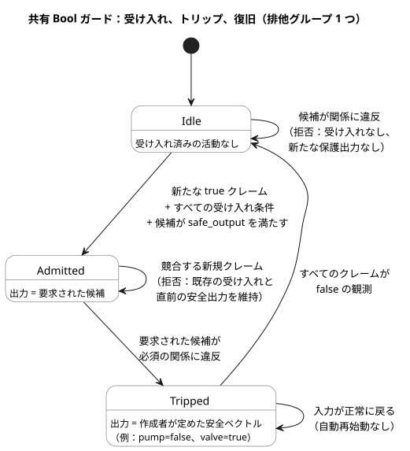
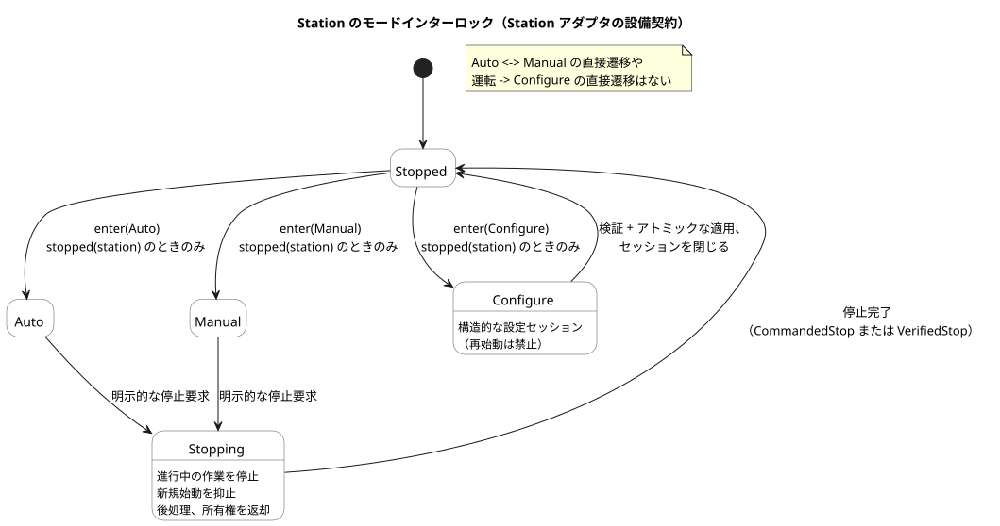
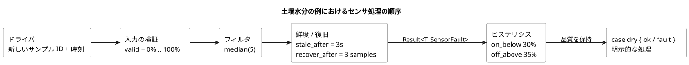

<!-- translation-source: docs/CONSTRAINTS.en.md -->
[英語の原文](CONSTRAINTS.en.md)

# GhostFlow の共通制約とセンサ信号の契約

この文書は、GhostFlow における制約とセンサ信号の**共通設計契約**（2026-09-24）です。[選定された制御構文](LANGUAGE-SURFACE.ja.md)の続きにあたります。

- 運用設定の現在の構文と意味は、[リファレンス §5.1–5.2](reference/05-settings-and-observation.ja.md) で定義されています。
- 現在実際に実行される範囲は、[実装範囲](IMPLEMENTATION.ja.md)と[トレーサビリティ](TRACEABILITY.ja.md)で管理しています。
- **2026-10-05 外部入力の改訂：** 信号品質を伴う宣言には、現在 `input` を使います。既存の信号調整（コンディショニング）と、明示的な `Result` の故障（fault）分岐は変わりません。以前の `sensor` の抜粋は `tests/fixtures/history/issue531/` に保存されています。

**この文書の内容**

1. 3 種類の制約とその境界（ローカル、共有、使用量計上）。
2. バインドされた共有 Bool プロファイルの実行方法（受け入れ、トリップ、復旧）。
3. 固定の Station アダプタ向け設備ルール：共有ポンプ、モードインターロック、運用設定と構造的変更の違い。
4. オプションのデバイス情報と、オプションの容量分析。
5. 制約の合成の理論と、MCU 上で実行されるもの。
6. センサのノイズと断線の処理、およびその MCU コスト。
7. 1 日の運転上限と重複実行の防止。
8. 受け入れシナリオ。

**正準の表面構文。** 制約は、1 つの `.ghost.md` の control の中に、名前付きの `constraints` グループとして書きます。種類は 3 つです。

| 種類 | 対象 | 実行方法 |
|---|---|---|
| ローカルの Bool 出力制約 | 同じ control の出力 | 通常の Bool ローワリング |
| 共有リソースポリシー（`constraints Name for resource`） | 共有リソースの集合 | 明示的なバインド済みコンパイルを通じてのみ |
| 使用量計上（`limit used(...)`） | `account` の使用量 | リファレンス §3.10 の使用段階、基準、永続化 |

3 つとも名前付きグループを使いますが、対象と実行契約はそれぞれ異なります。表記と操作は[リファレンス §4.8](reference/04-sensors-constraints-control.ja.md) に従います。

**Station アダプタの例。** この文書の後半にある独立した `constraints Name { ... }` の例は、汎用の正準構文ではなく、**Station アダプタの例**です。この有界な `ghostrules` 経路は、次の用途にのみ残されています。

- プログラミング本の実際の WASM シミュレーション
- `tools/station-demo.mjs`
- `bindStationPolicy` が利用する固定の Station 成果物

これは汎用の正準構文でも、任意の PID に対する安全の強制でもありません。過去の表記があるというだけでは、別の互換経路を設ける理由にはなりません。

その他の基本ルール：

- CLI はトップレベルの `ghost` フェンスを抽出し、素の `.ghost` 入力を拒否します。
- `compileConstraints` は Station アダプタ内部のローワラーであり、汎用ソルバではありません。
- 共有ディスクリプタ（descriptor）を*検証*することと、それを実際に*バインドして強制*することを混同しないでください。

## 正準のローカル・共有・使用量計上の境界

2 つの完全な正準ファイルが、これらの境界を示しています。

- [実行可能なローカル包絡](../examples/constraint-envelope.ghost.ja.md)。
- [完全な論理マッピングを備えた、チェック済みの共有契約](../examples/shared-constraint-contract.ghost.ja.md)。

**バインディングの検証。** *バインディング*は、ポリシーの論理名を、安定したリソース同一性と型付きポートに対応付けます。`validateResourceConstraintBinding` は次をチェックします。

- リビジョン
- 正準ソースと成果物の正確なダイジェスト
- 必要なすべての安定したリソース同一性と型付きポート
- すべての有限な排他モード入力

マッピングの欠落や過剰、偽装された重複リソース同一性やポート、ホストが与えたポリシーフィールドは拒否されます。検証は `executable: false` を返します。検証は受け入れも出力権限も与えません。

**実行の選択。** 実行するには、検証済みのコンパイル結果とバインディングを一緒に `compileBoundResourceControl(compilation, binding)` に渡します。この明示的な経路は、共有の Rust ガードを備えた有界の Bool GFB17 モジュールを出力します。正準ソースを単独でコンパイルしても、チェック済みのディスクリプタが暗黙のうちに実行可能な成果物になることは決してありません。これは参照用の*論理*バインディング契約であり、物理出力 ABI ではありません。

**実行可能なグループの制限。**

- 実行可能なグループは、排他的な活動集合を最大 1 つまでサポートします。
- 複数の `exclusive` 文は有効なチェック済みソースのままですが、別個の実行統合が必要です。それらの集合は互いに異なるため、1 つの集合に平坦化されるのではなく拒否されます。
- 作成者が定めたグローバルな安全ベクトルは、必須のローカル制約も満たさなければなりません。

**ローカル制約。** 次は、ローカル制約を持つ完全な control です。ローカル制約はこの control の出力にのみ適用され、通常の Bool ローワリングで実行されます。グループ化されていない既存の `require` と `mutex` は、同じ意味のままです。

```ghost
control LocalPump {
  state displayed_pump: Bool = false;
  displayed_pump' = if request_good && !request then false else if request_good then request else displayed_pump;
  state displayed_valve: Bool = false;
  displayed_valve' = if valve_ready_good && !valve_ready then false else if valve_ready_good then valve_ready else displayed_valve;
  // Source-local display memory is initialized here; faults remain producer unknown.
  state remembered_request: Bool = false;
  let request_good = case observed_request { ok(_) => true; fault(_) => false; };
  let request = case observed_request { ok(value) => value; fault(_) => remembered_request; };
  remembered_request' = request;
  state remembered_valve_ready: Bool = false;
  let valve_ready_good = case observed_valve_ready { ok(_) => true; fault(_) => false; };
  let valve_ready = case observed_valve_ready { ok(value) => value; fault(_) => remembered_valve_ready; };
  remembered_valve_ready' = valve_ready;
  input observed_request: Bool;
  input observed_valve_ready: Bool;
  output pump, valve: Bool;
  pump <- displayed_pump';
  valve <- displayed_valve';
  constraints LocalRules {
    require at safe_output pump => valve;
  }
}
```

**共有リソースポリシー。** 共有ポリシーは `constraints Name for resource` でスコープを示します。次の例は、**実行不可能なディスクリプタを生成する、完全なチェック済みソース**です。

- `ghostc` のソースチェックは、宣言、型、有限集合、安全値の関係を検証します。
- 実行可能なバインディングがない間、`compileControl` と合成はこのポリシーを拒否します。
- 実行を選択するのは、別個の明示的なバインド済みコンパイルだけです。

```ghost
control SharedPumpPolicy {
  state displayed_pump: Bool = false;
  displayed_pump' = if pump_request_good && !pump_request then false else if pump_request_good then pump_request else displayed_pump;
  state displayed_valve: Bool = false;
  displayed_valve' = if valve_request_good && !valve_request then false else if valve_request_good then valve_request else displayed_valve;
  // Source-local display memory is initialized here; faults remain producer unknown.
  state remembered_automatic: Bool = false;
  let automatic_good = case observed_automatic { ok(_) => true; fault(_) => false; };
  let automatic = case observed_automatic { ok(value) => value; fault(_) => remembered_automatic; };
  remembered_automatic' = automatic;
  state remembered_manual: Bool = false;
  let manual_good = case observed_manual { ok(_) => true; fault(_) => false; };
  let manual = case observed_manual { ok(value) => value; fault(_) => remembered_manual; };
  remembered_manual' = manual;
  state remembered_pump_request: Bool = false;
  let pump_request_good = case observed_pump_request { ok(_) => true; fault(_) => false; };
  let pump_request = case observed_pump_request { ok(value) => value; fault(_) => remembered_pump_request; };
  remembered_pump_request' = pump_request;
  state remembered_valve_request: Bool = false;
  let valve_request_good = case observed_valve_request { ok(_) => true; fault(_) => false; };
  let valve_request = case observed_valve_request { ok(value) => value; fault(_) => remembered_valve_request; };
  remembered_valve_request' = valve_request;
  resource station: Station;
  resource pump1: BoolActuator;
  resource valve1: BoolActuator;
  input observed_automatic: Bool;
  input observed_manual: Bool;
  input observed_pump_request: Bool;
  input observed_valve_request: Bool;
  output pump, valve: Bool;
  pump <- displayed_pump';
  valve <- displayed_valve';
  constraints SharedRules for station {
    exclusive at admission { automatic, manual };
    require at safe_output pump1.on => any_on({ valve1 });
    safe { pump1 = false; valve1 = true; }
  }
}
```

**`safe` ブロック。** `safe` は、ルールが参照する有限集合内のすべての Bool リソースに明示的に値を割り当てなければならず、すべての必須の出力関係を満たさなければなりません。ここでの値は、ポンプ OFF、バルブ ON です。隠れた「すべて OFF」の既定値はありません。

次の点に留意してください。

- ソースの `pump`/`valve` 要求が物理リソースに接続されていると仮定しないでください。
- 後述の論理的な強制には、検証済みの安定したリソース同一性と型付きポートのマッピング、そして明示的なバインド済みの有効化が必要です。
- 以前のトップレベルのリソースポリシーファイルも、チェック済みの非 control 成果物のままです。強制される control になることは決してありません。
- `station`、`use`、`bind`、セッションの構文を勝手に作らないでください。

## 共有 Bool の実行

明示的なバインディングと、記録された入力/結果を含む完全な実行可能な例は、[bound-resource-execution](../examples/bound-resource-execution.ghost.ja.md) を参照してください。上の #157 の共有チェックの例は、実行不可能なディスクリプタの契約を維持します。

**バインド済みプロファイルが行うこと。** [#158](https://github.com/callin2/ghostflow-language/issues/158) のバインド済みプロファイルは、1 つの Bool control と有限のリソース集合を、共有の Rust tick ガードを通じて実行します。

- すべての出力はリソースにバインドされ、作成者が定めた完全な安全ベクトルを持たなければなりません。
- バインディングは、#157 の正確な正準ソース/ディスクリプタのダイジェスト、リビジョン、安定 ID、Bool のモード入力/出力マッピングを固定します。
- バインディングは、モジュールの有効化時に GFRB1 パケットとして明示的に与えます。同じバインディング同一性を、毎スキャン GFRS1 パケットとして与えます。
- Rust API：`activate_with_resource_binding(bytes, &ResourceBindingRegistry)`、`tick_with_resource_binding(bytes)`、`ScanDriver::scan_with_resource_binding(frame, bytes)`。
- バインディングが欠落または不一致の場合は、**フェイルクローズ**（安全側で失敗）します。
- 通常のローダーがモジュールを解析することはできますが、通常の activate/tick/scan でガードを迂回することはできません。実行は、出力の公開後にホストが追加する JavaScript フィルタではありません。

**GFB17 がラップするもの。** GFB17 は、すべての入出力ポートが Bool である既存の GFB1 v1 または v3 プログラムだけをラップし、それらのコミット境界にガードを組み込みます。

- 短絡評価を使う自動、手動、フォールバック（fallback）のソースは v3 にローワリングされます。
- それ以外の内部プロファイルはサポートされていません。
- サポートされるすべての分岐からの出力は、同じ Rust ガードを通ります。
- この有界プロファイルの範囲外として拒否されるもの：コンテキストスケジュール、目標/PID、import による合成、安全上の意味があいまいになるグループの重なり。

**リソースごとに書き込み主体は 1 つ。** 設置の権限者は、すべての論理的な書き込み主体が同じ `ResourceBindingRegistry` を使うようにしなければなりません。

- ネイティブの有効化は、共有の `Arc` レジストリを受け取ります。
- WASM ABI は、1 つのインスタンス内のすべてのハンドルで 1 つのレジストリを共有します。
- どちらも、同じ安定リソース ID に対する 2 つ目のアクティブな書き込み主体を拒否します。
- Node の参照ラッパーは、1 つのモジュールレジストリを通じて、異なる WASM インスタンス間もチェックします。
- Station と Bool の両方のリソース ID が対象です。

設置ごとに別々のレジストリがある場合、設置をまたいだ物理的な排他は保証されません。このプロファイルは、協調的なマルチ VM 調停、セッションリース、汎用の物理出力 ABI を提供しません。既存の Station アダプタ、使用量計上の実行経路、ノンブロッキングの `check` は変わりません。

**受け入れと拒否。** *受け入れ（admission）*とは、主張された活動（例：`automatic` や `manual`）の実行に対するガードの許可です。必須のグループ条件は AND で結合されます。

- 現在の受け入れと競合する新しい活動クレームは拒否されます。既存の受け入れと直前の安全出力は維持されます。
- *開始前に*必須の出力関係に違反する要求候補は、新しい受け入れも保護された出力も生成しません。
- 拒否された新規参加者は、まず false が観測され、その後に新たな true のクレームを送ってから、再び受け入れを要求しなければなりません。
- 最初の拒否では、直前の出力が存在しないため、出力集合は空になります。それ以外の場合は、直前に確定した安全値が維持されます。
- ディスクリプタの安全ベクトルから、開始前の代替出力を勝手に作らないでください。

**トリップと復旧。** *すでに受け入れられた*実行の要求候補が必須の関係に違反すると、ガードは*トリップ*します。つまり、作成者が定めたリソースごとの安全ベクトルに遷移します。

- pump=false、valve=true のように、一部の出力を ON に保つ安全動作を維持してください。
- トリップ後に入力が正常に戻っても、実行は自動的には再開しません。
- 排他グループでは、すべてのクレームが false である観測の後に、すべての受け入れ条件を満たす新たなクレームが必要です。
- require だけのグループは、要求マップが作成者の定めた安全マップと等しくなったときに復旧の基準点を確立します。その後、その基準点からの新たな離脱をチェックします。
- トリップは、保護されたリソースを共有するグループの推移的に連結された成分全体に伝播します。作成者が定めた安全値は、共有リソースについて一致していなければなりません。無関係なグループは受け入れを維持します。
- 最終的な安全候補を、すべての必須の共有制約とローカル制約の AND に対して再検証してください。
- 古いクレームをリトライキューに隠さないでください。
- 生のクレームと受け入れ済みの活動、要求値と最終的な安全値を区別してください。原因、グループ、バインディング、スキャンの証拠を保持してください。

下図は、排他グループにおけるこのライフサイクルをまとめたものです。require だけのグループは、代わりに上で述べた安全マップの基準点を通じて復旧します。



**確定とロールバック。**

- 正常に評価された拒否は、通常の VM 状態を確定します。拒否はプログラムのジョブ/セッションを取り消さず、すべての状態を前の値に戻すこともしません。
- バインディングエラーや VM の失敗が起きると、VM 状態、ガードの受け入れ、トレースがまとめてロールバックされます。保護された状態が部分的に変化してはならず、拒否されたスキャンの証拠を確定してはなりません。
- 論理的な安全出力は、「レンダラーが適用した」や「物理的なフィードバックで確認された」と同じではありません。実際のレンダラーの順序付け、物理的な安全装置、現場での設置は、このプロファイルの検証範囲外です。

**使用量計上。** 使用量計上（アカウンティング）では、既存の `resource` と `account` を宣言し、`constraints Budget { limit used(account, basis) <= bound { ... } }` を使います。ローカルの Bool 条件や共有の受け入れを、使用量台帳で置き換えないでください。使用段階、基準、永続化は[リファレンス §3.10](reference/03-time-and-schedules.ja.md) で定義されています。

**制約は許可領域を定めます。** 制約は、目標/PID を含む要求が動ける領域を形成します。

- ローカル制約は、それ自身の control にだけ影響します。
- 共有制約は、同じリソースを使うすべての自動、手動、フォールバックの経路に適用されます。
- 開始前に予測された違反は、新しい受け入れを拒否します。
- 実行中は、無条件にすべてを OFF にするのではなく、作成者が定めたリソースごとの安全動作に従ってください。
- この区別は、汎用の出力 ABI や物理的な安全シーケンスを実装するものではありません。
- 既存の、より限定的な PID エンジンの契約を、任意のリソースポリシーの強制へと一般化しないでください。

**評価順序。** すべての必須条件は AND で結合されます。

1. まず受け入れを決定します。
2. 要求候補に対して safe_output の関係をチェックします。
3. レンダラーに結果を適用させます。

調停の優先度は、許可領域の*内側で*選択を行います。必須の制約、バインディング、来歴（provenance）、復旧の要件を迂回することはできません。違反の原因は、拒否や安全遷移とは別に記録してください。通常の観測は新しい開始権限を生みません。リトライと復旧も同じルールに従います。

`check pump_capacity` は、後述の Station アダプタにおけるノンブロッキングの助言であり、必須の require ではありません。`warn` と `monitor` はサポートされていません。警告を、安全上の require やコマンドへ暗黙に格上げしては決してなりません。

## この対話で確立された方針

以下は、灌水設備に関するユーザーの決定です。

- 同じ灌水設備の自動運転、手動運転、設定モードは相互に排他的です。
- 自動↔手動の遷移と、運転→設定の遷移には、ユーザーによる明示的な停止と、停止の完了が必要です。
- 構造的変更は、明示的な停止と Configure の手順に従います。運転中に調整できる限られたプロパティは、後述するアトミックなイベントの契約に従います。
- [2026-09-20 改訂：以前の決定「運転条件の適用はすべて、停止した設定モードでのみ許可する」は、#110 により、運転中に調整可能なプロパティ値についてのみ置き換えられました。構造的変更のための停止と Configure の手順は残ります。]
- インターロック、同時に開くバルブ数の上限、設備容量、1 日の運転時間は、共通制約として宣言します。個々の control を追加しても、設備全体の制約は引き続き適用されます。
- センサのノイズとデータ断線の処理は、有界のリソースを持つ名前付きの信号操作として提供します。
- 時計補正下での重複防止と 1 日の使用量上限は、それぞれ別々に保証します。
- **圧力、流量、性能曲線を含むすべての補足的なデバイス情報はオプションです。** 基本的な灌水、モードインターロック、バルブ数の上限、時間の上限は、その情報を入力しなくても使えなければなりません。

これらの決定は、自動/手動の要求の優先度とプリエンプションに関する以前の提案を具体化したものです。自動運転中に、優先度だけを根拠に手動要求を即座に実行するポリシーは、この設備には適用されません。

## 制約を記述する場所

`constraints` は、ルールの名前付きグループです。

- **ローカル**制約は control の中に付けます。
- **共有**制約は、デバイスプロファイルで定義された設備スコープに付けます。
- 複数の control が同じポンプを参照する場合、それらはその 1 つの物理ポンプ ID の制約と使用量を共有します。

このグループと、その後に続く独立したグループは、固定の Station アダプタ向けの設備の例です。`station`、`pump1`、`settings`、`starts` は、設備、設定、スケジュールの安定 ID に接続されます。`pump1.valves` は、供給関係があらかじめ登録された有限のバルブ集合です。発見順や表示名で接続しては決してなりません。

Station アダプタの例 — 固定の設備アダプタ向けの、有界で独立したルール。

```text
constraints StationRules {
  exclusive(automatic, manual, configuring);

  allow enter(Auto, Manual, Configure)
    only when mode == Stopped && stopped(station);

  // 構造的な設定を適用するための停止条件（ローワラーのルール：configureOnly）。オペレーターの設定イベントとは別物
  allow apply(settings)
    only when mode == Configure && stopped(station);

  require count_on(pump1.valves) <= 2;
  require pump1.on => any_on(pump1.valves);

  limit on_time(pump1) <= 1h per day("Asia/Seoul");
  once starts per occurrence;
}
```

`automatic`、`manual`、`configuring` は、同じ設備に許可されたモード/セッションの*アクティブ状態*です。入力される要求ボタンではありません。モードマネージャーは `Stopped | Auto | Manual | Configure` の値を 1 つだけ所有し、これらの名前はそこから導出されます。`exclusive` は、一般的な活動のグループにも使えます。

| 種類 | 意味 | 違反時の既定の扱い |
|---|---|---|
| exclusive | 同時にアクティブになれないモード/活動 | 競合する新規エントリを拒否 |
| allow ... only when | モードへの進入や設定の適用の前提条件 | 要求を拒否し、既存の状態を維持 |
| require | 設備の最終出力に対する不変条件 | 開始前の許可チェックと、実行中の安全監視 |
| limit | 累積時間、回数、消費量の上限 | 残り予算をチェックし、上限で運転をブロック |
| once ... per occurrence | スケジュールの発生（オカレンス）ごとの重複抑止 | すでに受け入れた発生を再実行しない |
| check | オプション情報を使うノンブロッキングの分析 | Pass / Violation / Unknown の診断。実行はブロックしない |
| warn ... when | 将来の設計表記。現在は両方のパーサが拒否 | 原因と対象を含む警告イベントを記録 |

- ローカル control の 1 行の Bool `require` と、この Station アダプタは、異なる実行経路を使います。
- 警告は、制約違反を許可する例外ではありません。警告を解除しても、必須の制約は解除されません。
- 通知の配信はホストが担います。同じ違反を tick ごとにユーザーへ再送することはありません。

**各制約には、対象によって決まるチェック段階があります。**

| 対象 | チェックされる段階 |
|---|---|
| `count_on` / 出力の関係 | 最終出力の候補 |
| `enter` / `apply` | 要求の受付 |
| `pump_capacity` | 新しい作業の許可 |

これらの段階が暗黙に混ざることは決してありません。対象段階が定義されていない一般的な式には、コンパイル診断が出ます。

## 複数の control 間での共有ポンプ

この節のセッションと調停のルールは、後述の固定 Station アダプタの設備契約です。上のバインド済み Bool プロファイルは、アクティブな書き込み主体を 1 つしか許可しません。マルチ VM のセッション調停や物理的な使用権は主張しません。

**書き込み主体は 1 つ。** 物理ポンプに対する唯一の出力書き込み主体は、共有リソースマネージャーです。

- 個々の control の出力は*要求*であり、最後に書いたものが勝つ GPIO 書き込みではありません。
- 非アクティブな control からの `false` 要求は、別の control が所有している灌水を中断できません。
- 別の control を停止する必要がある場合は、明示的な設備停止要求を使ってください。

**セッションの所有権。** 最初の共有ポンプのポリシーは、**灌水セッション全体にわたる排他的所有権**です。

- 所有権は、バルブの開放、ポンプの運転、フェーズ間のポンプ OFF、バルブの後処理まで続きます。
- それらの段階の間でポンプが一時的に OFF になったというだけで、別の control が所有権を得ることはありません。
- バルブが開いているだけではポンプは始動しません。所有者のフェーズ出力と、デバイスの安全な適用シーケンスに従ってください。

**1 tick 内での調停。**

- 同じ tick 内のすべての開始要求を、1 つのスナップショットから調停します。
- 所有権と時間予算の両方を確保できた要求だけを許可します。
- レンダラーは、論理的な許可が確定した後に出力を適用します。永続的な予約が必要な場合は、それも成功するまで出力の開始を遅らせます。
- プロセスがリトライするときは、同じ要求 ID を再利用します。
- これは、複数の GPIO が物理的に同じ瞬間に変化することを保証するものではありません。

**既存のスケジュールの合間に新しい作業を入れる。**

- 既存のスケジュール時刻を維持するポリシーでは、新しい control は、セッション全体の上限に後処理時間を加えたものが空き区間に収まる場合にのみ許可されます。今この瞬間にポンプが OFF かどうかを確認するだけでは不十分です。
- 要求がリソースを待っている間、灌水フェーズのタイマーは開始しません。
- 要求の順序は、受付順と安定 ID で決まります。キューの長さと期限は有界です。
- 共有の同時運転やプリエンプションは、別のオプトインのポリシーです。モードインターロックを解除するものではありません。

### 例：既存の 2 つのバルブと追加した 2 つのバルブに同じルールを適用する

この例では、設置構成によって、既存の control と新しい control の両方のポンプが物理的な `pump1` にバインドされます。バルブのポートは `valve1`–`valve4` にバインドされます。これらの接続は、制御に必要なデバイスバインディングであり、圧力/流量のメタデータではありません。以下のルールは、その設備に付けられます。

Station アダプタの例 — 固定の設備アダプタ向けの、有界で独立したルール。

```ghost
constraints SharedPump {
  // pump1.valves는 두 control을 합친 네 밸브의 집합이다.
  require count_on(pump1.valves) <= 2;
  require pump1.on => any_on(pump1.valves);

  // 자동/수동과 control 수에 관계없이 물리 펌프 하나의 사용량이다.
  limit on_time(pump1) <= 1h per day("Asia/Seoul");
}
```

（韓国語のコメントの意味：`pump1.valves` は 2 つの control のバルブを合わせた 4 つのバルブの集合です。また、上限は自動/手動のモードや control の数に関係なく、1 つの物理ポンプの使用量です。）

- 既存のタスクがセッションを所有している間は、ポンプが一時的に OFF になっても、新しいタスクは開始できません。
- 既存のタスクが終了した後、セッション全体が次のスケジュールの前に収まれば、新しいタスクは許可されます。
- これらのルールだけでは調停器は実装されません。セッションの所有権と許可入力をつなぐ具体的な構文は、今後の範囲です。
- 2 つの control の出力の OR や、最後に書いたものが勝つ方式で代用しないでください。

## モードインターロックと停止の完了

モードの排他性は、同じ設備に接続されたすべての control と、すべての手動 UI コマンドに適用されます。1 つのポンプの複数の自動 control は、同じ Auto モードのもとでリソースの使用を調整します。独立した設備に、1 つのグローバルなモードを自動的に強制しないでください。

モード間の必須の経路は、常に明示的な停止を経由します。

```text
Auto または Manual
  → 明示的な停止要求
  → 進行中の作業の停止手順 / 新規始動の抑止
  → 停止完了
  → Stopped
  → Auto、Manual、Configure への進入を要求
```

下図は、同じルールを状態機械として示したものです。



**`enter` がチェックするもの。** `enter` ルールは、Stopped 以外のモードへの進入要求をチェックします。停止要求そのものはブロックしません。Auto では、ポンプが一時的に OFF であったり、次のスケジュールを待っていたりしても、Manual や Configure へ直接遷移することは許されません。

**Configure は構造的変更を意味します。** この節では、Configure セッションと `apply(settings)` は*構造的な*設定変更を意味します。

- そのセッション中は再始動が禁止されます。
- 構造的変更を検証し、アトミックに適用します。別の運転モードへの進入を受け付ける前に、設定セッションを閉じて Stopped に戻ります。
- リモート API も同じチェックを通ります。画面上の操作を無効化するだけでは、制約を実装したことになりません。

**同一 tick 内の競合。**

- 1 つの tick 内で、異なるモードへの進入要求が競合した場合は、それらをすべて拒否し、既存のモードを維持します。
- 同じ要求 ID を再送しても、二重に処理されることはありません。
- その tick では、停止がモードへの進入や新しい灌水の許可よりも先に処理されます。停止は*停止世代*をインクリメントし、前の世代の確定していない要求を破棄します。
- 直前のスナップショットが Stopped であっても、同じ tick に停止と一緒に届いた新しい開始は許可されません。

**`stopped(station)` の意味。** これは単に「ポンプ要求が false である」という意味ではありません。次のことを意味します。

- 進行中の灌水と後処理が終了している。
- 設備の所有権が返却されている。
- そのデバイスプロファイルの停止確認が完了している。

フィードバックがある場合は、実際の停止とバルブの状態を確認します。フィードバックがない場合は、その限界を明示します。つまり、確認はコマンドと、設置時に確立された停止手順に基づいています。1 つのモード列挙型が物理的なインターロックを置き換えるとか、実際の状態のフィードバックを保証するとか主張しては決してなりません。

**CommandedStop と VerifiedStop。** 停止の証拠は、次の 2 つのレベルのいずれかとして記録します。

| 証拠 | 意味 |
|---|---|
| `CommandedStop` | 安全出力が適用されたことをレンダラーが報告し、設定された後処理/待機の手順が完了した |
| `VerifiedStop` | 実際のフィードバックによっても停止が確認された |

- 基本構成では CommandedStop を許可し、フィードバック用センサを必須にはしません。これを、検証済みの実際の停止として表示することはありません。
- デバイスが応答しない場合や、安全出力の適用に失敗した場合は、コマンドを送っただけでは停止の完了は成立しません。
- VerifiedStop を要求できるのは、ユーザーが追加したルールだけです。
- 初期の安全出力のシーケンス/待機の値には、出力レンダラーの既定値を使ってもかまいません。それらが適切かどうかは設置ごとに確認しなければならないことを、別途示してください。

**停止は保留中の作業を取り消します。**

- 停止要求は、保留中の開始も取り消すか無効にします。
- 運転中にモード変更要求をキューに入れておき、後でユーザーが知らないうちに自動的に切り替えることはしないでください。
- 再始動には、新たな明示的要求が必要です。
- 設定中にソース文書の説明を編集することは、物理デバイスに運転条件を適用することとは異なります。

**構造的な Configure は 1 つのアトミックなリビジョンです。** これは、関係する control のバージョン、ポート/供給の関係、制約、スケジュール構造、オプションのチェック、関連するメタデータを含む、1 つの設備リビジョンです。

- 候補全体を検証し、アクティブなリビジョンのアトミックかつ永続的な置換を完了してから、初めて成功を報告します。
- 停電の後は、完全な以前のリビジョンか、完全な新しいリビジョンのどちらかだけを選びます。一部を混在させることは決してありません。
- 要求は、作成された時点のリビジョンと停止世代を保持します。許可を評価する時点でそれらが一致しなくなっていたら、要求を拒否します。新しい意味で自動的に再解釈しないでください。
- このリビジョンは、実際の使用量や重複防止の台帳をリセットするキーではありません。

### 運転中に調整可能なプロパティと構造的変更

[リファレンス §5.1–5.2](reference/05-settings-and-observation.ja.md) は、運用設定の構文と適用の意味を定義しています。

- `config` メタデータの `access = operator` は、オペレーターが変更できる設定を宣言します。
- `access = designer` が付いた値や、オペレーターのアクセスが宣言されていない値は、運用設定イベントを通じて変更できません。
- `apply` フィールドはありません。現在のコンパイラは `apply = stopped` と `apply = live` の両方を拒否します。

**何が構造的変更か。** 実行可能なプログラム/ルール、デバイスのバインディング/プロファイル、依存関係、スケジュール構造の変更は、構造的変更です。

- スケジュールの開始時刻や Duration のように明示的に公開された値は、スケジュールに属しているというだけで構造的になるわけではありません。
- オプションのチェックを必須にすることは、ルールの変更です。
- 構造的変更は、運用設定イベントとは別に、明示的な停止と Configure の手順に従います。

**運用設定イベント。** オペレーターの各操作は、一緒に変更するすべての設定を含む、1 つのアトミックなライブイベントです。

- バッチ全体を検証します。1 つでも無効な値があれば、バッチ全体を拒否します。
- 拒否されても、独立した通常の運転ルールは停止しません。
- 新しい値は、有効なイベントが適用された時点から読まれます。次の灌水サイクルや新しい実行（run）を待つことはありません。
- 評価中にスナップショットが変わることは決してありません。イベントとスキャンの順序はリファレンス §5.2 に従います。
- ソース/バイトコード、プログラムの同一性、実行の同一性は変わりません。設定リビジョンと、有効になったイベント位置を記録します。
- 状態とタイマーが暗黙にリセットされることは決してありません。

Temperature の正準値と `displayUnit` の保持は[リファレンス §5.1](reference/05-settings-and-observation.ja.md) に従います。進行中の Range に対する設定変更は[リファレンス §3.5](reference/03-time-and-schedules.ja.md) に従います。

**再起動と更新。**

- 受け付けられた通常の運用設定は、ESP の物理的な再起動後も保持されます。
- 再起動は新しい実行を作ります。以前のプログラムの状態を自動的に復元することはありません。
- 再起動への対応は、作成者が書いたルールが決めます。最初の判断より前の電気的な出力の義務は、Device 境界にとどまります。
- 自動/手動の起動ポリシーを一律に課さないでください。
- 共有リソースの調停、ステーションのモード遷移、使用量台帳、明示的な停止手順は引き続き適用されます。
- ESP のプログラム/モジュールやファームウェアを更新すると、その ESP が制御するすべてのデバイスタスクが停止します。

### 例：運用設定の宣言と構造的な Configure の適用

次の断片は、control 本体の中で運用設定を宣言します。

```ghost
config water1_time: Duration = 5min { min = 1min; max = 30min; step = 1min; access = operator; }
```

この設定に対するオペレーターの変更は、同じプログラムの型付き Result ストリームへのアトミックなライブ発行です。利用側は、`case water1_time { ok(value) => ...; fault(reason) => ...; }` で現在の観測を処理します。配信は利用側のソースとは別です。同じ設定変更が、ソースのリテラルを編集したり、再コンパイルを引き起こしたりすることはありません。正確な境界は `docs/OPERATOR-SETTINGS-STREAM.md` に記録されています。

これに対して、下の制約の `settings` は**構造的な設定リビジョン**です。この例は、上の `water1_time` のオペレーターによる変更に停止条件を付けるもの*ではありません*。`mode` と `station` は、設備マネージャーが提供する名前です。

Station アダプタの例 — 固定の設備アダプタ向けの、有界で独立したルール。

```ghost
constraints EditInterlock {
  exclusive(automatic, manual, configuring);

  allow enter(Auto, Manual, Configure)
    only when mode == Stopped && stopped(station);

  allow apply(settings)
    only when mode == Configure && stopped(station);
}
```

`tools/constraints.mjs` の `configureOnly` ルールと、ステーションの `apply_config` は、停止した Configure の経路です。新しい運転要求は、構造的な候補が検証・適用された後にのみ受け付けられます。運用設定イベントの検証/適用と、CommandedStop/VerifiedStop の物理的な意味を混同しないでください。

### 2026-09-20 の調査記録とその後の決定

当時 [language #89](https://github.com/callin2/ghostflow-language/issues/89) と [system #54](https://github.com/callin2/farm_studio_system/issues/54) に記録された調査では、停止中の設定適用と、ソース編集/再コンパイルの経路を出発点として、ライブのプロパティイベントについて議論しました。その時点の `apply = stopped` の例、未確定だった公開構文、`settings.valid` の設計スケッチは、歴史的な記録です。現在の実行可能な構文でも、置き換えとなる契約でもありません。2026-09-22 以降に確定したオペレーター設定の構文とアトミックなライブの意味は、上のリファレンス §5.1–5.2 に従います。

## デバイスの補足情報はオプション

圧力、流量、ポンプ曲線、消費電力、配管損失といったデバイスの補足情報は、基本的なプログラムの必須入力では**ありません**。これは、デバイスを識別して出力ポートを接続する最小限のバインディングとは異なります。実際の状態を報告するフィードバック用センサの設置も、一律に必須ではありません。

| 構成 | 利用できる機能 | 補足情報がない場合 |
|---|---|---|
| 基本制御 | スケジュール、シーケンス制御、自動/手動/設定のインターロック | そのまま使える |
| 直接宣言したルール | 同時に開くバルブは最大 2 つ、1 日最大 1 時間 | 圧力/流量なしでチェックできる |
| オプションの容量分析 `check` | 与えられたデバイス情報を使って容量超過を診断 | その分析だけが Unknown（情報不足）。運転はブロックされない |
| ユーザーが追加した必須の容量ルール `require` | 容量が検証された要求だけを許可 | そのルールの下にある設備では開始を許可できない。これは既定ではない |

**欠落した値は欠落したままです。**

- 欠落した値を、ゼロ、無限の容量、正常値で置き換えては決してなりません。
- オプションのフィールドは `Option` です。分析結果は Pass / Violation / Unknown と理由を持ちます。
- Unknown は「情報不足」または「分析範囲外」を意味します。エラーでも合格でもありません。
- 一度も入力されていないデータについて、故障通知を繰り返し送らないでください。代わりに、未検証の項目を分析画面に表示します。

**部分的な情報。**

- 入力が揃っているチェックだけを実行し、それ以外は Unknown のままにします。
- 流量上限のチェックに合格しても、それは圧力まで検証した完全な水理的安全の保証ではありません。そのように表示しないでください。
- 直接入力された無効な値や単位は、編集中に診断し、適用時に拒否できます。フィールドの省略それ自体はエラーではありません。

### 例：同じ設備に対する基本ルールとオプションの分析

これらの基本ルールは、圧力や流量の情報がまったく入力されていなくても動作します。

Station アダプタの例 — 固定の設備アダプタ向けの、有界で独立したルール。

```ghost
constraints BasicWatering {
  require count_on(pump1.valves) <= 2;
  limit on_time(pump1) <= 1h per day("Asia/Seoul");
}
```

容量分析が必要な場合にのみ、次のグループを追加します。両方のグループを同時に適用できます。

Station アダプタの例 — 固定の設備アダプタ向けの、有界で独立したルール。

```ghost
constraints CapacityAdvice {
  check pump_capacity(pump1);
}
```

| 容量の情報/要求 | CapacityAdvice の結果 | 基本インターロックを満たす新しい開始 |
|---|---|---|
| 必要な情報が未入力 | Unknown：情報不足 | このチェックではブロックされない |
| モデルと条件が十分、容量内 | Pass：そのモデルのもとでチェック合格 | このチェックではブロックされない |
| モデルと条件が十分、容量超過 | Violation：容量超過の警告 | このチェック自体はブロックしない |

最後の行もブロックしたいユーザーは、次の節で説明する明示的な必須の `require` を選びます。デバイス情報を入力しても、基本ルールが自動的に強化されることは決してありません。

**チェックを必須ルールに格上げする。**

- 補足情報の入力やデバイスの発見によって、必須の運転条件が自動的に追加されることはありません。
- 必須ルールへの格上げは、実行可能なルールに対する構造的変更です。明示的に停止し、その後 Configure を通じて変更・検証・適用します。運転中に調整可能なプロパティのライブイベントの対象ではありません。
- アクティブな必須ルールが必要とする情報を削除するときは、そのルールも修正または削除し、結果を検証してください。
- 情報がなくなったという理由で、必須ルールを暗黙に無効化しては決してなりません。

## オプションのポンプ容量と水圧のモデル

**バルブの数。** バルブ数の上限は、`count_on(...) <= 2` のような有限の個数制約として表現します。各 control に属する 2 つのバルブだけでなく、同じポンプに接続された*すべての*バルブの合計をチェックします。

**より正確なモデル。** より正確なモデルには、区画（ゾーン）ごとの必要流量、必要な最小圧力/揚程、配管損失、ポンプ性能が必要です。

- 並列する区画の需要は、共通の圧力条件のもとで合計できます。
- 「圧力消費」を単純に足し合わせて、ポンプの定格圧力から差し引くモデルは使わないでください。
- ポンプの実際の運転点は、ポンプ曲線とシステム曲線によって決まります。
  [KSB の運転点の解説](https://www.ksb.com/en-global/centrifugal-pump-lexicon/o)

必要な場合に限り、プロファイルに、設置時に検証した保守的な流量上限や、運転条件ごとに許可されるバルブの組み合わせを追加できます。次は、オプションの分析のための構文スケッチです。

Station アダプタの例 — 固定の設備アダプタ向けの、有界で独立したルール。

```text
constraints PumpCapacity {
  check pump_capacity(pump1);
}
```

**`pump_capacity` が返すもの。** 同じポンプに対するすべての要求を、選択された容量モデルと比較します。

| 結果 | 条件 |
|---|---|
| Violation（警告） | 検証済みの条件のもとで超過が確認された |
| Pass | 条件とデータが十分で、需要が容量内にある — そのモデルの範囲内でのみ有効 |
| Unknown | データまたは条件が不十分 |

この `check` は警告/分析の機能であり、運転許可のルールではありません。診断には、サポートされたモデルとその前提を記録します。

たとえば、流量予算モデルは、定義された圧力と配管の条件のもとでの `flow_budget` と、同じ条件のもとでの区画ごとの `demand_flow` を比較します。圧力と流量（異なる単位）を比較すると型エラーになります。このオプションのモデルの実装は、定義されたフィールドと単位を使い、任意のメタデータの意味を推測することは決してありません。

ユーザーがこれを必須の開始条件として選んだ場合にのみ、次を追加します。

```text
require pump_capacity(pump1) == Pass;
```

**必須形式の効果。**

- Violation も Unknown も、新しい作業を許可しません。
- チェックを宣言していない基本制御には、このような条件はありません。
- 基本制御を動かすためだけに、詳細なデバイス仕様の事前入力をユーザーに要求しては決してなりません。
- これはメタデータに基づく*開始許可*のルールです。実行中の故障監視や非常停止の監視は、別の出力/センサのルールが扱います。

**必須チェックのデータが欠落している場合。**

- 新たに追加した必須チェックにデータが不足している場合は、その候補構成の適用を拒否し、既存の構成を維持します。
- 以前は有効だったアクティブな必須チェックが後で Unknown になった場合は、その対象となる新規開始をブロックします。
- 必須ルールを自動的に削除して、基本運転に格下げしないでください。

**分析を実行する場所。** ポンプ曲線/配管モデルの分析と、許可される組み合わせの生成は、PC 上で実行できます。MCU は、有界なテーブル参照や比較で結果をチェックします。分析の保証は、プロファイルの仮定と、実際に検証された範囲の中でのみ成り立ちます。情報がないときに分析を省略することと、ユーザーが宣言した必須の容量チェックを成功として扱うことは異なります。両者を区別してください。

**容量の超過。** 必須の容量ルールがある場合、容量を超えたときに任意のバルブを閉じて作業を分割しないでください。新しいタスクのリソース需要全体をチェックしたうえで、その開始を許可するか、拒否またはキューに入れます。実行中に確認された故障には、その設備の停止手順と出力の安全制約を適用します。

## 制約の合成の理論と実装の境界

インターロックは、一種の*制約*、つまり他の条件と同時に成り立たなければならない条件としてモデル化できます。目標は、すべての必須制約を同時に満たす振る舞いです。それぞれの部分を、異なる道具が扱います。

| 理論/手法 | 適用できる問題 | 提案する実行場所 |
|---|---|---|
| 不変条件/有限状態機械 | モードの排他性、許可される遷移、出力条件 | コンパイル時チェック + MCU モニタ |
| 制約充足問題（CSP）、SAT/SMT | ルールの矛盾、静的な容量条件、可能な組み合わせ | PC/ホストでの分析 |
| 時相論理/ランタイム検証 | 制限時間内の確認、累積時間、順序 | 制限された構文を小さな状態機械に変換 |
| assume–guarantee 契約 | デバイス、control、共有設備の条件と保証の合成 | ホストでの分析 + 必要な仮定のランタイム監視 |

[Z3 の論理ガイド](https://microsoft.github.io/z3guide/docs/logic/propositional-logic/)は、論理的な充足可能性と矛盾をチェックするための基礎です。[Kind 2/Lustre の契約](https://kind.cs.uiowa.edu/kind2_user_doc/2_input/1_lustre.html)は、仮定、保証、モードを合成し、不変条件と到達可能性をチェックするための具体的な参考資料です。

**制約と調停。** 論理的な制約は AND で結合されます。*どの*要求を受け付けるかを選ぶのは、別の調停ポリシーです。制約は許可領域を定め、調停はその中で決定的に選択します。優先度スコアで必須制約を弱めては決してなりません。

**分析の限界。**

- 1 tick に対する SAT チェックは、全時間にわたる安全の証明ではありません。
- 常に停止しているモデルは、一度も灌水しなくても安全制約を満たせてしまいます。そのため、期待される運転状態に到達可能であることもチェックしてください。
- 分析結果が unknown やタイムアウトであることは、証明の成功ではありません。分析範囲と失敗の理由を記録してください。

**MCU 上で実行されるもの。** MCU は、サポートされた制約だけを、有界な比較、カウンタ、状態機械、許可された組み合わせの参照を使って実行します。汎用の SMT ソルバや、無制限の組み合わせ探索を毎 tick 実行する必要はありません。このプロファイルにコンパイルできないルールには診断が出ます。

既存の Bool の requires/mutex アルゴリズム（出力を false に向けて反復する）を、そのまま一般の制約に適用しないでください。モードへの進入、リソースの許可、時間の監視、出力のブロックには、それぞれ定義された実行の意味が必要です。設備の契約とローカルの契約は一緒に適用されます。control が共有制約を解除することはできません。

## センサのノイズと断線

次は、新しいセンサ処理宣言の構文スケッチです。各操作の内部状態は、センサグラフ内の明示的なノードになります。

```text
input moisture: Percent {
  sample = 1s;
  valid = 0% .. 100%;
  filter = median(5);
  stale_after = 3s;
  recover_after = 3 samples;
}

signal dry = hysteresis(moisture,
  on_below: 30%,
  off_above: 35%,
  initial: false);
```

**操作の仕組み。**

- `median(5)` は、直近 5 つの有効な*新しい*サンプルの中央値です。
- ヒステリシスは、フィルタ後の値が 30% を下回ると true に、35% を上回ると false に切り替わります。境界上とその間では、直前の値を維持します。
- 入力の検証（フィルタの前）、フィルタ処理、条件の評価、故障処理の順序は、静的に固定されています。
- 上側/下側の別々のしきい値が、ノイズ付近での繰り返しの切り替えをどのように減らすかについては、[TI の解説](https://www.ti.com/tool/CIRCUIT060078)を参照してください。

下図は、この例の処理順序を示しています。



センサ処理の詳細な契約は次のとおりです。

- **二重カウントしない。** 同じ物理サンプルを複数の tick で読んでも、フィルタのウィンドウや復旧カウンタに再び挿入されることはありません。新しいサンプルの同一性と時刻はドライバが提供します。
- **鮮度。** 鮮度は、最後の実際の有効サンプルの時刻から測ります。フィルタ結果を再計算しても、古さ（stale）のタイマーは更新されません。
- **Stale と明示的な故障。** この例では、次のサンプルが届くまで最後のサンプルを使ってもかまいませんが、3 秒後には Stale になります。明示的な Disconnected/Invalid の故障は、ただちに転送されます。エラーを平滑化して消しては決してなりません。
- **準備完了と復旧。** 開始時、有効なサンプルが 5 つ蓄積されるまで、品質は NotReady です。故障の後は、フィルタのウィンドウがリセットされます。復旧には、連続する 3 つの新しい有効サンプル*と*、準備完了のフィルタの*両方*が必要です。そのため、この例の中央値ウィンドウが再び準備完了になるには、少なくとも 5 つのサンプルが必要です。
- **ヒステリシスは品質を保持します。** ヒステリシスも Reading/Result の品質を保持します。故障時に、最後の true を正常値として出力することはありません。制御ロジックが、たとえば case/recover で故障を処理します。初期状態と復旧後の状態は false です。
- **最後の値の保持。** 短い断線の間、最後の値を保持する必要がある場合は、明示的なタイムアウトと Held 品質を持つ別の拡張にしてください。最後の値を無制限に保持することは、どのセンサでも既定ではありません。
- **センサごとの遅延。** 各センサの処理遅延は、個別に計算します。通常の土壌水分センサの平滑化による遅延を、保護用の信号に一律に適用しないでください。

**Result 型。** 読み取りの型は `Result<T, SensorFault>` です。ここでの故障は `Disconnected | Stale | Invalid | NotReady` です。

- 実際の故障が続いている間は、その故障を出力します。
- 新しい有効サンプルが届き始めたものの、準備完了や連続復旧の条件がまだ満たされていない場合は、`Err(NotReady)` を出力します。
- 部分的なウィンドウの中央値/移動平均を、正常値として出力しては決してなりません。
- `recover(default)` は、この Err を代替値に変える純粋な操作です。復旧カウンタを満たすことはなく、元の故障の記録を消すこともありません。

**初期化中と復旧中のフィルタ。**

- 中央値と移動平均は空のウィンドウから始まり、N 個の有効な新しいサンプルが必要です。
- EMA は最初の有効サンプルを初期値にします。設定された連続復旧サンプル数が満たされるまで、正常な結果は出力しません。
- フィルタの準備完了とセンサの復旧は別々の条件であり、両方が成り立たなければなりません。
- フィルタとヒステリシスを合成した場合、品質は明示的な case/recover の処理まで保持されます。

**チェックポイントと再起動。**

- センサノードのチェックポイントは、1 つの論理 tick について、ソース ID、ソースエポック、最後のサンプル ID、サンプル時刻、時刻エポック、フィルタの状態、品質、復旧カウンタを保持します。
- 同じカーソルを持つ再送されたサンプルが、二重に適用されることはありません。ソースの再起動や時刻エポックの変化は、通常の新しい連続サンプルとしては扱われません。
- 実際の再起動後の既定のポリシーでは、センサのウィンドウと鮮度をクリアし、NotReady から再び準備します。古い正常値がすぐに復元されることはありません。
- センサの状態を永続的に再開することは、別のオプトインです。一貫したチェックポイントと、時刻/ソースの連続性を確認できない場合は、同じ初期化ポリシーが適用されます。
- 正確なゴーストリプレイでは、記録されたサンプルの同一性、時刻、品質を、対応するチェックポイントと一緒に使います。

### 例：ノイズ/断線処理済みの値を灌水の判断につなげる

これは、土壌水分センサが設置された control の完全な設計例です。開始要求は、設備モードとリソース所有権のチェックを通過した後にのみ届くものと仮定します。圧力や流量の情報は使いません。

```ghost
control MoistureDemand {
  // Source-local display memory is initialized here; faults remain producer unknown.
  state remembered_start: Bool = false;
  let start_good = case observed_start { ok(_) => true; fault(_) => false; };
  let start = case observed_start { ok(value) => value; fault(_) => remembered_start; };
  remembered_start' = start;
  state remembered_stop: Bool = false;
  let stop_good = case observed_stop { ok(_) => true; fault(_) => false; };
  let stop = case observed_stop { ok(value) => value; fault(_) => remembered_stop; };
  remembered_stop' = stop;
  input observed_start: Bool;
  input observed_stop: Bool;

  input moisture: Percent {
    sample = 1s;
    valid = 0% .. 100%;
    filter = median(5);
    stale_after = 3s;
    recover_after = 3 samples;
  }

  signal dry = hysteresis(moisture,
    on_below: 30%,
    off_above: 35%,
    initial: false);

  let dry_ok = case dry {
    ok(value) => value;
    fault(_)  => false;
  };

  state watering: Bool = false;
  output pump, valve: Bool;

  watering' = if start_good && stop_good then (!stop && dry_ok && (start || watering)) else watering;
  valve <- watering';
  pump  <- watering';
  require pump => valve;
}
```

**動作の追跡。**

1. 生の新しいサンプルが 28%、29%、90%、28%、29% の順に届きます。5 つ目のサンプルで、中央値は 29% として準備完了になります。それまでは値が NotReady なので、`dry_ok=false` です。
2. `dry` が準備完了かつ true になると、`start` で灌水が始まり、`watering` が灌水の意図をラッチします。準備完了の前に現れて消えた開始要求は保存されません。
3. その後、フィルタ後の値が 32% であれば、直前の true が維持されます。35% を上回ると、`dry` は false に変わります。
4. 最後の有効サンプルから古さの上限に達した場合や、明示的な故障が届いた場合は、`dry_ok=false` となり、灌水の意図が解除されます。実際の出力の後処理は、レンダラー/設備の停止手順に従います。

故障の後、正常なサンプルが 3 つ届いても `median(5)` は準備完了にならないため、NotReady のままです。5 つのサンプルが蓄積されて復旧条件が成り立った後でも、`start=false` でラッチが解除されていれば、灌水が自動的に再開することはありません。センサの復旧と新しい運転許可は、別々の判断です。

## MCU のリソースコスト

| 処理 | 保持する状態 | サンプルごとのコストの形 |
|---|---|---|
| debounce | 安定値、候補値、候補の開始時刻 | 固定回数の比較と時刻比較 |
| hysteresis | 直前の判断値 | 境界の比較 2 回 |
| Stale の監視 | 最後の有効時刻、品質 | 固定の時刻比較 |
| EMA | 直前の平均と初期化状態 | 固定回数の算術演算 |
| 移動平均 N | N 個の値、合計、インデックス | 固定回数のリングバッファ更新 |
| median N | N 個の値とインデックス | 上限 N が固定された比較/ソート |
| 1 日の時間上限 | 日付、予算、カウンタ、区間の時刻 | 固定の時間の累積と比較 |

**ウィンドウのサイズ見積もり。** 32 ビットのサンプル 5 つ分のデータは 20 バイト、64 ビットのサンプルでは 40 バイトです。これはサンプルの格納分だけを数えたものです。タイムスタンプ、品質、インデックス、初期化状態、ソート用の作業領域、およびソート方式が必要とする追加の格納領域は、これに加わります。現在のコアの数値型は f64 です。実際の表現サイズは、コンパイルプロファイルで決めなければなりません。RAM の合計が 20 バイトだと主張しては決してなりません。

固定サイズの状態を持つフィルタの例として、[CMSIS-DSP の biquad](https://arm-software.github.io/CMSIS-DSP/main/group__BiquadCascadeDF1.html) は段ごとに固定の状態を使います。これは設計上の参考であり、ARM の実装が ESP32 上でそのまま動くという主張ではありません。

**コンパイラの義務。**

- コンパイラは、センサ数、ウィンドウサイズ、タイマー数、固定集合のサイズ、最大要求数、トレースサイズから、メモリと演算コストの上限を計算しなければなりません。
- バスの読み取りを制御の tick と協調させます。フィルタは新しいサンプルのときだけ更新します。
- フィルタの状態、品質、タイマーもゴーストのチェックポイントに含めます。
- 実行時間とメモリは、実際のターゲットボードで測定します。これは、現在の MVP がこれらの上限を検証するという意味ではありません。
- 新しい算術/単位/信号のオペコードのサポートも必要です。

**リソースの上限。**

- 上限は、ターゲットボード/ランタイムのプロファイルから来ます。ユーザーにすべての値の入力を求めることはしません。
- 選択した構成の RAM、作業領域、スタック、実行コスト、永続ストレージの上限を超える候補の有効化は拒否し、既存の構成を維持します。
- 選択されていないデバイス戦略のために、センサ処理の状態を割り当てないでください。
- 選択した構成のリソースが足りないからといって、高度な必須ルールを暗黙に外して、それなしで実行しては決してなりません。
- ボードごとの正確な数値と、サポートされる最大ウィンドウサイズは、実装と測定の後に決定します。

**診断トレースと台帳の違い。**

- オプションの中間トレースは、基本制御の成功条件ではありません。
- 既定の提案は、最も古い診断を上書きし、失われた件数/区間を示す固定長のリングバッファです。
- 記録には論理 tick、ノード ID、サンプル ID、品質を含めます。生の値/フィルタ後の値はオプションです。
- 中間トレースが失われただけでは、基本運転は停止しません。
- 正確なリプレイのための入力ジャーナルとチェックポイントは、中間トレースとは別物です。入力記録が失われた区間は、リプレイ不能として印を付けます。
- 永続的な 1 日の上限と `once` の台帳は、実行許可に必要な別のデータです。暗黙に上書きしては決してなりません。

## 1 日の運転上限と重複実行

**`on_time(pump1)` が数えるもの。** 同じ物理ポンプに対する、最終的に適用された ON コマンドの継続時間です。

- 自動/手動での使用と、複数の control による使用は、1 つの設備カウンタに入ります。
- 拒否された要求と待ち時間は数えません。
- 代わりに物理的な運転のフィードバックを数えるプロファイルは、別途定義します。
- 2 つの control の要求が重なった場合でも、同じポンプの実際のコマンド区間が二重に数えられることはありません。

**「日」の意味。** 区間の長さは単調時間で測ります。*日*とは、指定されたローカルタイムゾーンにおける暦の日付です。

- 午前 0 時をまたぐ運転は、日付ごとに別々に数えます。
- これは、ローリング 24 時間の合計とも、最大連続運転時間とも異なります。午前 0 時の直前と直後に、それぞれの日付の予算を使うことは禁止されません。

**時計の補正。**

- アクティブな計数区間は、信頼できるローカルの日付と、次の午前 0 時に対する単調な期限を持ちます。
- 時計の補正によって、すでに確定した区間の日付別の使用量を再配分してはなりません。
- 補正中に日付の境界があいまいになった場合は、新しいスケジュール/予算の更新を延期します。進行中の区間は、すでに確保した予算とその単調なカットオフの範囲内で停止します。
- 設置プロファイルで、境界の再同期手順と、許容される補正範囲を指定します。
- 現在の壁時計の日付に基づいて、毎 tick カウンタをゼロにリセットする実装は禁止です。

**予算の確保。**

- 開始前に、タスクが必要とする予算をチェックします。
- 時間予算は共有ポンプの所有権と一緒に確保し、使用後に精算します。
- 設備が上限で停止しなければならない場合は、次の出力適用までの間隔と停止遅延を考慮して、十分早めにブロックします。
- ターゲットの実行契約には、1 tick 分の超過を許容するのか、それともレンダラーが上限時刻ちょうどに OFF にするのかを明記しなければなりません。

**有限の予約。** 予約された予算には、ON 時間の有限な上限が必要です。

- 固定の順次灌水は、実行計画から計算します。
- 終了時刻のない手動運転には、残り予算の範囲内で、強制停止時刻付きの有限の*リース*を与えることができます。そのため、ユーザーが手動運転のたびに継続時間を入力する必要はありません。
- リースの延長は、新しい予算の予約に成功した後にのみ行えます。
- 午前 0 時をまたぐ固定計画は、検証済みの日付境界に従って各日付の予算を確保するか、その境界をまたがない計画に制限しなければなりません。

**`once` が必要な理由。** 「1 日 1 時間」だけでは、スケジュールの重複は防げません。5 分のタスクを 2 回実行しても、合計は 1 時間に満たないからです。`once` は、別の発生 ID と受付記録を使います。

- 各発生を、スケジュール ID、サービス日付、スロット ID で識別します。再び受け付けることは決してありません。
- 単なる文書/プログラムのリビジョン変更で、実行記録や使用量がリセットされることはありません。
- 時計が逆戻りしたときは、既存の日付の使用量と発生の記録を復元します。新しい予算は作りません。
- 異常な時計の前方へのジャンプを、自動的に新しい 1 日の予算として扱わないでください。スケジュール/予算の更新を延期し、時刻の信頼性の問題を診断します。
- 必要な発生記録と予算は、再起動をまたいで保持します。出力許可の前に予算/発生を永続的に予約し、使用後に精算することで、フラッシュへの書き込み回数を有界にできます。
- 停電によって使用量が不確実になった場合は、精算されていない予約を使用済みとして扱うか、再開を延期します。カウンタをゼロにリセットしては決してなりません。その結果、一部のスケジュールされた作業が実行されないことがあります。物理的な厳密に 1 回の実行（exactly-once）を主張しないでください。

**停止と発生。**

- 停止と同じ tick に届いた発生は、新しい許可より前に、`SkippedByStop` として終了します。
- すでに受け付けられた発生が停止によって取り消された場合は、`Cancelled` のままとなり、自動的に再受付されることはありません。
- 予算は、確認された実際の適用区間から精算します。不確実な量は保守的に扱います。
- 取り消しと予算の返却は、1 つの永続的な変更です。終了記録の保存に失敗した場合、新しい開始は延期されます。
- Auto を再び選択しても、終了した発生が復活することはありません。

**有界なストレージ。**

- ストレージは、スケジュールの最大数、1 日のスロット数、保持日数によって有界にできます。
- 古い発生記録を削除した場合でも、永続的な日付進行の*ウォーターマーク*と保持境界を維持し、保持期間外の過去の時刻が新しい発生として受け付けられないようにします。
- ストレージの失敗や容量不足を診断し、新しい開始を延期します。
- スケジュールのタイムゾーンやグリッド/スロットの同一性を変更するには、明示的な ID の移行か、新しいスケジュール ID が必要です。単なる表示名/文書の編集では ID は変わりません。
- 新しいスケジュール ID でも、ポンプの共有の 1 日の使用量はリセットされません。

高頻度の連続的なフラッシュ書き込みを避ける予約の単位、カウンタのオーバーフロー、保持日数、時計の補正範囲は、設置プロファイルのリソース/復旧ポリシーに属します。ローリング 24 時間の上限には、別のウィンドウ/区間のストレージ上限が必要です。`day` 表記と取り替えて使っては決してなりません。

### 例：複数のスケジュール時刻と 1 日の上限を一緒に宣言する

最初のブロックは、スケジュールを持つ control の中のスケジュール宣言です。2 つ目は、そのスケジュールの `starts` を物理的な `pump1` に接続する設備ルールです。どちらも断片であり、実際の灌水フェーズとモード/所有権のバインディングは省略しています。

```ghost
schedule starts: DailySlots<15min> {
  timezone = "Asia/Seoul";
  selected = [06:00, 06:15, 12:30, 18:45];
}
```

Station アダプタの例 — 固定の設備アダプタ向けの、有界で独立したルール。

```ghost
constraints DailyWatering {
  once starts per occurrence;
  limit on_time(pump1) <= 1h per day("Asia/Seoul");
}
```

各スケジュールがポンプ ON を最大 10 分計画する場合、計画された 4 回の実行の合計は 40 分です。実際の使用量は、出力の適用から停止までの ON 区間を数えます。単にスケジュール数 × 10 分を記録するわけではありません。次の独立したケースが、このルールを示しています。

| 状況 | 期待される動作 |
|---|---|
| 完了した 06:00 のスケジュールが、時計の補正後に再び観測される | `once` が同じ発生をブロックする |
| 今日すでに 55 分使用済み。新しいタスクの ON 上限は 10 分 | 残りの 5 分では計画全体は許可されない |
| 自動で 40 分使用した後の手動運転 | 同じポンプの残り予算の範囲内でのみ許可される |
| 灌水中の停電 | 精算されていない永続的な予約を復元する。1 日の使用量がゼロから再開することはない |

この例の 1 日の上限は、ローカルの暦の日付に基づいています。ローリング 24 時間の上限ではありません。

## 受け入れシナリオ

| 状況 | 期待される結果 |
|---|---|
| 自動運転中の手動進入要求 | 拒否し、明示的な停止へ案内する。自動的なプリエンプションはしない |
| モード遷移と構造的な設定の適用が同じ tick に届く | 直前に確定したモード/停止条件に照らして評価する。迂回した適用はしない |
| Auto と Manual の進入要求が同じ tick に届く | 競合するすべての進入を拒否し、既存のモードを維持する |
| 停止とスケジュールの発生が同じ tick に届く | 停止が先。新しい出力はなく、発生は終了として記録される |
| 停止要求の後もバルブの後処理が続いている | Configure への進入は禁止 |
| 運転中に、運転中に調整可能な設定のイベントが届く | 全体を検証し、1 つのイベントとして適用する。有効になったイベント位置と新しい設定リビジョンを記録する |
| 運転中に、運転中に調整可能なバッチに無効な値が 1 つある | イベント全体を拒否する。値/状態/出力の部分的な変化はない |
| 運転中の構造的な設定やプログラム/プロファイルの変更 | 拒否する。明示的な停止と Configure の手順が必要 |
| デバイスの補足情報（圧力/流量）が未入力 | 基本的な灌水と、モード/バルブ数/時間のインターロックが使える |
| オプションの容量チェックに必要なフィールドがない | その分析だけが Unknown。ゼロでの代用、運転のブロック、故障通知の繰り返しはしない |
| 一部の区画の流量しか分かっていない | 情報が十分なチェックだけを実行する。完全な容量検証を成功として表示しない |
| ユーザーが必須の容量 require を追加したが、情報が不十分 | 構成の適用時に診断する / 開始を拒否する。不明な値が合格することは決してない |
| 異なる control が同じポンプでそれぞれ 2 つのバルブを要求する | 設備合計の 4 をチェックし、許可された作業だけを開始する |
| 非アクティブな control が pump=false を要求する | 現在の所有者のポンプを止めない |
| control のフェーズ間でポンプが一時的に OFF | 灌水セッションの所有権を維持し、別の control を許可しない |
| 構造的な Configure の適用中に停電 | 完全な古いリビジョンか新しいリビジョンだけを復元する。関係/制約が部分的になることはない |
| 矛盾する必須制約が追加された | 新しい構成を拒否するか、検証の失敗を表示する。既存の構成に部分的な変更はない |
| 同じセンササンプルが複数の tick で読まれる | 中央値/復旧カウンタの重複更新はしない |
| センサがしきい値付近で変動する | 設定されたヒステリシス区間内では判断を維持する |
| 新しい物理サンプルがないままフィルタ計算が続く | 最後のサンプルに基づいて Stale |
| センサの故障後に正常値を 1 つ受信 | 準備完了/復旧をチェックする。すぐには運転を許可しない |
| 連続復旧サンプル数が中央値のウィンドウより小さい | 両方が成り立つまで NotReady。部分的なウィンドウの正常値はない |
| 実際の再起動後に、古い正常なセンサ値がまだ保存されている | 既定では NotReady から再び準備する。古い値で運転は許可されない |
| 中間の診断トレースが満杯 | 定義された上書きと損失の表示。制御や必須の永続台帳とは別 |
| 高度な機能のリソース上限を超える | 候補の有効化を拒否し、既存の構成を維持する。必須ルールの自動削除はしない |
| 同じスケジュール時刻の前に時計が戻る | 同じ発生を再実行しない。使用量も減らさない |
| 5 分のタスクが誤って 2 回要求される | `once` が重複をブロックする。重複防止を 1 日の上限だけの手柄にしない |
| 55 分使用済みの後に新しい 10 分のタスク | タスク全体の予算が不足するため、開始を拒否する / 次の許可区間を待つ |
| 自動で 40 分使用した後に手動で 25 分の要求 | 同じポンプの残り 20 分の予算に照らしてチェックする |
| 継続時間を入力しない手動運転 | 残り予算内の有限のリースとカットオフで制限される |
| 午前 0 時をまたぐスケジュールの途中で時計が戻る | 確定した使用量を再配分しない。あいまいな新しい日付の予算更新は延期する |
| 保持されている発生記録より前に時計が戻る | ウォーターマーク/保持境界のチェックにより、新しい受付を延期する |
| 灌水中の再起動 | 永続的な予約/カウンタから復旧する。新しい 1 日の予算として初期化しない |

これらのシナリオは、設計上の受け入れ条件です。現在の実行可能なテストが合格したことの記録ではありません。
