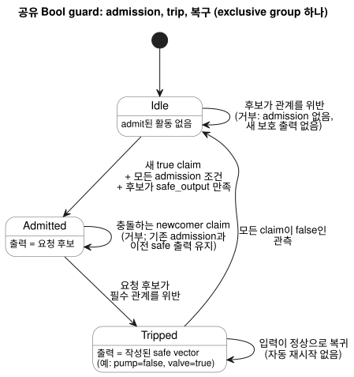
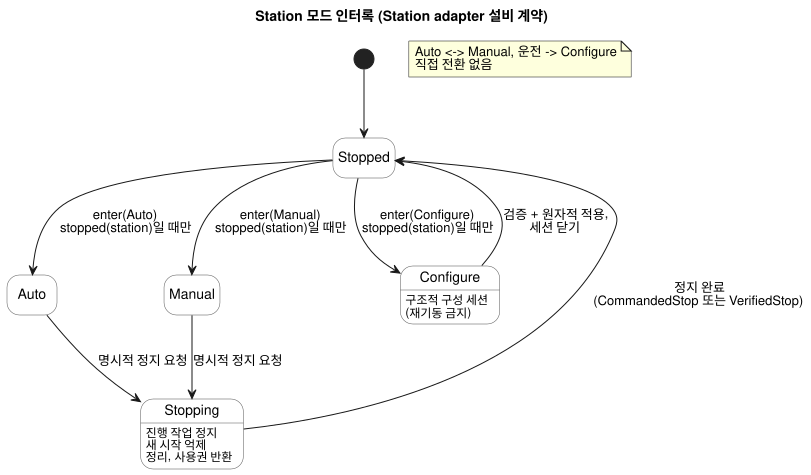
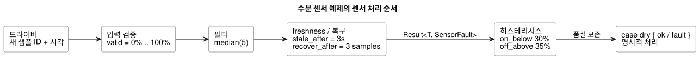

<!-- translation-source: docs/CONSTRAINTS.en.md -->
[영문 원문](CONSTRAINTS.en.md)

# GhostFlow 공통 제약과 센서 신호 계약

이 문서는 GhostFlow의 제약과 센서 신호에 관한 **공통 설계 계약**(2026-09-24)입니다.
[선택한 control 문법](LANGUAGE-SURFACE.md)에 이어지는 후속 계약입니다.

- 운영 설정의 현재 문법과 의미는
  [Reference §5.1–5.2](reference/05-settings-and-observation.md)에서 정의합니다.
- 현재 실제로 실행되는 범위는 [구현 범위](IMPLEMENTATION.ko.md)와
  [추적성](TRACEABILITY.ko.md)에서 관리합니다.
- **2026-10-05 외부 입력 개정:** 신호 품질 정보를 갖는 선언은 이제 `input`을
  사용합니다. 기존 조건화와 명시적인 `Result` 고장 분기는 그대로 유지합니다. 이전
  `sensor` 발췌는 `tests/fixtures/history/issue531/`에 보존합니다.

**이 문서의 내용**

1. 세 가지 제약의 종류와 그 경계(지역, 공유, accounting).
2. bound 공유 Bool 프로필의 실행 방식(admission, trip, 복구).
3. 고정 Station adapter의 설비 규칙: 공유 펌프, 모드 인터록, 운영 설정과 구조적 변경.
4. 선택적인 장치 정보와 선택적인 용량 분석.
5. 제약 합성의 이론과 MCU에서 실행되는 범위.
6. 센서 노이즈와 끊김 처리, 그리고 MCU 비용.
7. 일일 운전 한도와 중복 실행 방지.
8. 수용 시나리오.

**정본 작성 표면.** 제약은 하나의 `.ghost.md` control 안에 이름 있는
`constraints` 묶음으로 작성합니다. 종류는 세 가지입니다.

| 종류 | 대상 | 실행 방식 |
|---|---|---|
| 지역 Bool 출력 제약 | 같은 control의 출력 | 일반 Bool lowering |
| 공유 resource policy (`constraints Name for resource`) | 공유 자원의 집합 | 명시적인 bound compilation을 통해서만 |
| accounting (`limit used(...)`) | `account`의 사용량 | Reference §3.10의 사용량 stage, basis, persistence |

세 종류 모두 이름 있는 묶음을 사용하지만 대상과 실행 계약은 서로 다릅니다.
표기와 연산은
[Reference §4.8](reference/04-sensors-constraints-control.md)을 따릅니다.

**Station adapter 예제.** 이 문서 뒤쪽의 독립 `constraints Name { ... }` 예제는
범용 정본 문법이 아니라 **Station adapter 예제**입니다. 제한된 `ghostrules` 경로는
다음 용도로만 유지합니다.

- 실제 programming-book WASM 시뮬레이션,
- `tools/station-demo.mjs`,
- `bindStationPolicy`가 사용하는 고정 Station artifact.

이 경로는 범용 정본 문법도 아니고 임의 PID 안전 강제(safety enforcement)도
아닙니다. 역사적 표기라는 이유만으로 또 다른 호환 경로를 두지 않습니다.

그 밖의 기본 규칙은 다음과 같습니다.

- CLI는 최상위 `ghost` fence를 추출하며 plain `.ghost` 입력은 거부합니다.
- `compileConstraints`는 Station adapter의 내부 lowerer이며 범용 solver가 아닙니다.
- 공유 descriptor를 *검증*하는 것과 실제로 *binding하고 강제*하는 것을 혼동하지
  않습니다.

## 정본 지역·공유·accounting 경계

다음 두 정본 파일이 이 경계를 완전하게 보여 줍니다.

- [실행 가능한 지역 허용 범위](../examples/constraint-envelope.ghost.ko.md).
- [논리 mapping 전체를 보이는 공유 검사 계약](../examples/shared-constraint-contract.ghost.ko.md).

**binding 검증.** *binding*은 policy의 논리 이름을 안정적인 resource identity와
typed port에 대응시킵니다. `validateResourceConstraintBinding`은 다음을 검사합니다.

- revision,
- 정본 source와 artifact의 정확한 digest,
- 필요한 모든 안정 resource identity와 typed port,
- 모든 유한 exclusive-mode 입력.

누락되거나 추가된 mapping, 위장된 중복 resource identity나 port, 호스트가 넣은
policy 필드는 거부합니다. 검증 결과는 `executable: false`이며, admission이나 출력
권한을 부여하지 않습니다.

**실행 선택.** 실행하려면 검증한 compilation과 binding을 함께
`compileBoundResourceControl(compilation, binding)`에 전달합니다. 이 명시 경로는
공유 Rust guard를 갖춘 제한된 Bool GFB17 module을 만듭니다. 정본 source만
컴파일해서는 checked descriptor가 몰래 실행 artifact로 바뀌지 않습니다. 이는 참조용
*논리* binding 계약이며 물리 출력 ABI가 아닙니다.

**실행 그룹의 제한.**

- 하나의 실행 그룹은 exclusive 활동 집합을 최대 하나까지 지원합니다.
- 여러 `exclusive` 문장은 검사 가능한 source로는 유효하지만, 별도의 실행 연결이
  필요합니다. 각 집합은 서로 다르므로 하나로 합쳐 해석하지 않고 거부합니다.
- 작성한 전역 안전 벡터는 필수 지역 제약도 만족해야 합니다.

**지역 제약.** 다음은 지역 제약이 있는 완전한 control입니다. 지역 제약은 이
control의 출력에만 적용되며 일반 Bool lowering으로 실행됩니다. 이름 없는 기존
`require`와 `mutex`도 같은 의미를 유지합니다.

```ghost
control LocalPump {
  state displayed_pump: Bool = false;
  displayed_pump' = if request_good && !request then false else if request_good then request else displayed_pump;
  state displayed_valve: Bool = false;
  displayed_valve' = if valve_ready_good && !valve_ready then false else if valve_ready_good then valve_ready else displayed_valve;
  // Source-local display memory is initialized here; faults remain producer unknown.
  state remembered_request: Bool = false;
  let request_good = case observed_request { ok(_) => true; fault(_) => false; };
  let request = case observed_request { ok(value) => value; fault(_) => remembered_request; };
  remembered_request' = request;
  state remembered_valve_ready: Bool = false;
  let valve_ready_good = case observed_valve_ready { ok(_) => true; fault(_) => false; };
  let valve_ready = case observed_valve_ready { ok(value) => value; fault(_) => remembered_valve_ready; };
  remembered_valve_ready' = valve_ready;
  input observed_request: Bool;
  input observed_valve_ready: Bool;
  output pump, valve: Bool;
  pump <- displayed_pump';
  valve <- displayed_valve';
  constraints LocalRules {
    require at safe_output pump => valve;
  }
}
```

**공유 resource policy.** 공유 policy는 `constraints Name for resource`로 적용
범위를 명시합니다. 다음 예제는 **비실행 descriptor를 만드는 완전한 checked
source**입니다.

- `ghostc`의 source 검사는 선언, 타입, 유한 집합, 안전 값 관계를 검증합니다.
- `compileControl`과 composition은 실행 binding이 없는 이 policy를 거부합니다.
- 별도의 명시적인 bound compilation만이 실행을 선택합니다.

```ghost
control SharedPumpPolicy {
  state displayed_pump: Bool = false;
  displayed_pump' = if pump_request_good && !pump_request then false else if pump_request_good then pump_request else displayed_pump;
  state displayed_valve: Bool = false;
  displayed_valve' = if valve_request_good && !valve_request then false else if valve_request_good then valve_request else displayed_valve;
  // Source-local display memory is initialized here; faults remain producer unknown.
  state remembered_automatic: Bool = false;
  let automatic_good = case observed_automatic { ok(_) => true; fault(_) => false; };
  let automatic = case observed_automatic { ok(value) => value; fault(_) => remembered_automatic; };
  remembered_automatic' = automatic;
  state remembered_manual: Bool = false;
  let manual_good = case observed_manual { ok(_) => true; fault(_) => false; };
  let manual = case observed_manual { ok(value) => value; fault(_) => remembered_manual; };
  remembered_manual' = manual;
  state remembered_pump_request: Bool = false;
  let pump_request_good = case observed_pump_request { ok(_) => true; fault(_) => false; };
  let pump_request = case observed_pump_request { ok(value) => value; fault(_) => remembered_pump_request; };
  remembered_pump_request' = pump_request;
  state remembered_valve_request: Bool = false;
  let valve_request_good = case observed_valve_request { ok(_) => true; fault(_) => false; };
  let valve_request = case observed_valve_request { ok(value) => value; fault(_) => remembered_valve_request; };
  remembered_valve_request' = valve_request;
  resource station: Station;
  resource pump1: BoolActuator;
  resource valve1: BoolActuator;
  input observed_automatic: Bool;
  input observed_manual: Bool;
  input observed_pump_request: Bool;
  input observed_valve_request: Bool;
  output pump, valve: Bool;
  pump <- displayed_pump';
  valve <- displayed_valve';
  constraints SharedRules for station {
    exclusive at admission { automatic, manual };
    require at safe_output pump1.on => any_on({ valve1 });
    safe { pump1 = false; valve1 = true; }
  }
}
```

**`safe` 블록.** `safe`는 규칙이 참조하는 유한 집합의 모든 Bool resource에 값을
명시적으로 지정해야 하며, 모든 필수 출력 관계를 만족해야 합니다. 이 예제의 값은
pump OFF, valve ON입니다. "모두 OFF"라는 숨은 기본값은 없습니다.

다음 사항에 유의합니다.

- source의 `pump`/`valve` 요청이 물리 resource에 연결되어 있다고 가정하지 않습니다.
- 아래에서 설명하는 논리 강제에는 검증된 안정 resource identity와 typed port
  mapping, 그리고 명시적인 bound 활성화가 필요합니다.
- 종전의 최상위 resource policy 파일도 검사 대상인 non-control artifact로 남습니다.
  이 파일은 결코 강제되는 control이 아닙니다.
- `station`, `use`, `bind`, session 문법을 새로 만들어 내지 않습니다.

## 공유 Bool 실행

명시적 binding과 기록된 입력·결과를 포함한 완전한 실행 예제는
[bound-resource-execution](../examples/bound-resource-execution.ghost.ko.md)을 참고합니다.
앞의 #157 공유 검사 예제는 기존 비실행 descriptor 계약을 그대로 유지합니다.

**bound 프로필이 하는 일.**
[#158](https://github.com/callin2/ghostflow-language/issues/158)의 bound 프로필은
하나의 Bool control과 유한 resource 집합을 공유 Rust tick guard를 통해 실행합니다.

- 모든 출력은 resource에 binding되어야 하고, 작성된 완전한 safe vector를 가져야 합니다.
- binding은 #157의 정확한 정본 source/descriptor digest, revision, 안정 ID,
  Bool mode-input/output mapping을 고정합니다.
- module 활성화 시점에 binding을 GFRB1 packet으로 명시적으로 제공합니다. 매 scan에는
  같은 binding identity를 GFRS1 packet으로 제공합니다.
- Rust API: `activate_with_resource_binding(bytes, &ResourceBindingRegistry)`,
  `tick_with_resource_binding(bytes)`,
  `ScanDriver::scan_with_resource_binding(frame, bytes)`.
- binding이 누락되거나 일치하지 않으면 **fail closed**로 실패합니다.
- 일반 loader가 module을 파싱할 수는 있지만, 일반 activate/tick/scan으로 guard를
  우회할 수는 없습니다. 실행은 출력이 게시된 뒤 호스트가 덧붙이는 JavaScript
  filter가 아닙니다.

**GFB17이 감싸는 대상.** GFB17은 모든 input/output port가 Bool인 기존 GFB1 v1
또는 v3 프로그램만 감싸며, guard를 그 프로그램의 commit 경계에 포함합니다.

- 단락 평가를 사용하는 자동·수동·fallback source는 v3으로 lowering됩니다.
- 그 밖의 내부 프로필은 지원하지 않습니다.
- 지원하는 모든 분기의 출력이 같은 Rust guard를 거칩니다.
- 이 제한된 프로필 밖이라 거부되는 것: context schedule, objective/PID, import
  composition, 안전 의미가 모호한 group 중첩.

**resource당 writer 하나.** 설치 권한 주체(installation authority)는 모든 논리
writer가 같은 `ResourceBindingRegistry`를 사용하도록 해야 합니다.

- native 활성화는 공유 `Arc` registry를 받습니다.
- WASM ABI는 한 instance 안의 모든 handle이 하나의 registry를 공유합니다.
- 두 경우 모두 같은 안정 resource ID에 대한 두 번째 활성 writer를 거부합니다.
- Node 참조 wrapper는 서로 다른 WASM instance도 하나의 module registry로 검사합니다.
- Station resource ID와 Bool resource ID 모두 대상입니다.

서로 다른 설치 registry는 설치 간 물리적 배타성을 인증하지 않습니다. 이 프로필은
여러 VM의 협력 중재, session lease, 범용 물리 출력 ABI를 제공하지 않습니다. 기존
Station adapter, accounting 실행 경로, 비차단 `check`는 바뀌지 않습니다.

**admission과 거부.** *admission*은 주장된 활동(예: `automatic` 또는 `manual`)의
실행을 guard가 허가하는 것입니다. group의 필수 조건은 AND로 결합합니다.

- 현재 admission과 충돌하는 새 활동 claim은 거부합니다. 기존(incumbent)
  admission과 이전 safe 출력은 유지됩니다.
- *시작 전* 요청 후보가 필수 출력 관계를 위반하면 새 admission도, 보호 출력도
  만들지 않습니다.
- 거부된 newcomer는 먼저 false로 관측된 뒤, 새로운 true claim을 보내야 다시
  admission을 요청할 수 있습니다.
- 첫 거부에서는 이전 출력이 없으므로 출력 집합이 비어 있습니다. 그 외에는 이전에
  확정한 safe 값을 유지합니다.
- descriptor의 safe vector로 시작 전 대체 출력을 임의로 만들어 내지 않습니다.

**trip과 복구.** *이미 admit된* 실행의 요청 후보가 필수 관계를 위반하면 guard가
*trip*합니다. 즉, 작성된 resource별 safe vector로 전이합니다.

- pump=false, valve=true처럼 일부 출력을 ON으로 유지하는 안전 동작도 그대로 보존합니다.
- trip 뒤 입력이 정상으로 돌아와도 실행을 자동으로 재시작하지 않습니다.
- exclusive group은 모든 claim이 false인 관측이 있은 뒤, 모든 admission 조건을
  만족하는 새 claim이 있어야 합니다.
- require-only group은 요청 map이 작성된 safe map과 같아질 때 복구 기준선을
  세웁니다. 그 뒤 그 기준선에서 새로 벗어나는 것을 검사합니다.
- trip은 보호 resource를 공유하는 group들이 전이적으로 연결된 component 전체로
  전파됩니다. 작성된 safe 값은 공유 resource에 대해 일치해야 합니다. 관련 없는
  group은 admission을 유지합니다.
- 최종 safe 후보는 모든 필수 공유·지역 제약의 AND로 다시 검증합니다.
- 이전 claim을 재시도 대기열에 숨기지 않습니다.
- 원시 claim과 admit된 활동을, 요청 값과 최종 safe 값을 구분해 둡니다. 원인,
  group, binding, scan 증거를 남깁니다.

아래 다이어그램은 exclusive group의 이 수명 주기를 요약합니다. require-only
group은 대신 위에서 설명한 safe map 기준선으로 복구합니다.



**commit과 rollback.**

- 정상적으로 평가된 거부는 일반 VM state를 commit합니다. 거부는 프로그램의
  job/session을 취소하지 않으며, 모든 state를 이전 값으로 되돌리지도 않습니다.
- binding 오류나 VM 실패는 VM state, guard admission, trace를 함께 rollback합니다.
  보호 상태가 부분적으로만 바뀌어서는 안 되며, 거부된 scan의 증거가 commit되어서도
  안 됩니다.
- 논리 safe 출력은 "renderer가 적용함"이나 "물리 피드백으로 확인됨"과 같지 않습니다.
  실제 renderer 순서, 물리 안전 장치, 현장 설치는 이 프로필의 검증 범위 밖입니다.

**accounting.** accounting은 기존 `resource`와 `account`를 선언한 뒤
`constraints Budget { limit used(account, basis) <= bound { ... } }`를 사용합니다.
지역 Bool 조건이나 공유 admission을 사용량 ledger(원장)로 대체하지 않습니다.
사용량 stage, basis, persistence는
[Reference §3.10](reference/03-time-and-schedules.md)에서 정의합니다.

**제약은 허용 영역을 정의합니다.** 제약은 goal/PID를 포함한 요청이 움직일 수 있는
영역을 만듭니다.

- 지역 제약은 자기 control에만 영향을 줍니다.
- 공유 제약은 같은 resource를 쓰는 자동·수동·fallback의 모든 경로에 적용됩니다.
- 시작 전에 예측된 위반은 새 admission을 거부합니다.
- 실행 중에는 무조건 모두 OFF로 바꾸지 않고, 작성된 resource별 안전 동작을 따릅니다.
- 이 구분이 범용 출력 ABI나 물리 안전 순서를 구현한다는 뜻은 아닙니다.
- 기존의 더 좁은 PID engine 계약을 임의 resource policy 강제로 일반화하지 않습니다.

**평가 순서.** 모든 필수 조건은 AND로 결합합니다.

1. 먼저 admission을 결정합니다.
2. 요청 후보에 대해 safe_output 관계를 검사합니다.
3. renderer가 결과를 적용합니다.

중재(arbitration) 우선순위는 허용 영역 *안에서* 선택할 뿐입니다. 필수 제약,
binding, provenance(출처), 복구 조건을 우회할 수 없습니다. 위반 원인은 거부 및 안전
전이와 구분해 기록합니다. 정상 관측이 새 시작 권한을 만들지는 않으며, 재시도와
복구도 같은 규칙을 따릅니다.

`check pump_capacity`는 아래 Station adapter의 비차단 권고(advisory)이며 필수
require가 아닙니다. `warn`과 `monitor`는 지원하지 않습니다. 경고를 안전 require나
명령으로 몰래 승격해서는 안 됩니다.

## 이번 대화에서 정한 방향

관수 설비에 대한 사용자 결정은 다음과 같습니다.

- 같은 관수 설비의 자동 운전, 수동 운전, 설정 모드는 서로 배타적입니다.
- 자동↔수동, 운전→설정 전환에는 사용자의 명시적 정지와 정지 완료가 필요합니다.
- 구조적 변경은 명시적 정지와 Configure 절차를 따릅니다. 운전 중 조정 가능한
  (runtime-adjustable) 제한된 속성은 아래에서 설명하는 원자적 이벤트 계약을 따릅니다.
- [2026-09-20 개정: 「모든 운전 조건 적용은 정지한 설정 모드에서만 허용한다」는 기존 결정을 #110에 따라 runtime-adjustable 속성 값에 한해서만 교체했습니다. 구조적 변경의 정지 및 Configure 절차는 유지합니다.]
- 인터록, 동시에 열 수 있는 밸브 수의 상한, 설비 용량, 일일 운전 시간은 공통
  제약으로 선언합니다. 개별 control을 추가해도 설비 전체 제약은 계속 적용됩니다.
- 센서 노이즈와 데이터 끊김 처리는 자원이 제한된, 이름 있는 신호 연산으로 제공합니다.
- 시계 보정 상황의 중복 방지와 일일 사용량 제한은 각각 따로 보장합니다.
- **압력, 유량, 성능 곡선을 포함한 장치의 모든 부가정보는 선택 사항(optional)입니다.** 이 정보를 입력하지 않아도 기본 관수, 모드 인터록, 밸브 수 제한, 시간 제한을 사용할 수 있어야 합니다.

이 결정들은 자동/수동 요청의 우선순위와 선점에 관한 앞선 제안을 구체화합니다.
자동 운전 중 수동 요청을 우선순위만으로 즉시 실행하는 정책은 이 설비에 적용하지
않습니다.

## 제약을 기술하는 위치

`constraints`는 이름 있는 규칙 묶음입니다.

- **지역** 제약은 control 안에 붙입니다.
- **공유** 제약은 장치 프로필이 정의한 설비 범위에 붙입니다.
- 여러 control이 같은 펌프를 참조하면, 그 물리 펌프 ID 하나의 제약과 사용량을
  공유합니다.

이 묶음과 이후의 독립 묶음은 고정 Station adapter를 위한 설비 예제입니다.
`station`, `pump1`, `settings`, `starts`는 설비, 설정, 시간표의 안정적인 ID에
연결됩니다. `pump1.valves`는 미리 등록된 공급 관계를 갖는 유한한 밸브 집합입니다.
발견 순서나 표시 이름으로 연결해서는 안 됩니다.

Station adapter 예제 — 고정 설비 adapter를 위한 제한된 독립 규칙입니다.

```text
constraints StationRules {
  exclusive(automatic, manual, configuring);

  allow enter(Auto, Manual, Configure)
    only when mode == Stopped && stopped(station);

  // 구조적 구성 적용의 정지 조건 (lowerer 규칙: configureOnly); operator 설정 event와 구분
  allow apply(settings)
    only when mode == Configure && stopped(station);

  require count_on(pump1.valves) <= 2;
  require pump1.on => any_on(pump1.valves);

  limit on_time(pump1) <= 1h per day("Asia/Seoul");
  once starts per occurrence;
}
```

`automatic`, `manual`, `configuring`은 같은 설비에서 허가된 모드/세션의 *활성
상태*입니다. 들어오는 요청 버튼이 아닙니다. 모드 관리자는 하나의
`Stopped | Auto | Manual | Configure` 값을 소유하며, 위 이름들은 그 값에서 파생됩니다.
`exclusive`는 일반적인 활동 그룹에도 사용할 수 있습니다.

| 종류 | 의미 | 위반 시 기본 처리 |
|---|---|---|
| exclusive | 동시에 활성화할 수 없는 모드/활동 | 충돌하는 새 진입 거부 |
| allow ... only when | 모드 진입이나 구성 적용의 전제 조건 | 해당 요청 거부, 기존 상태 유지 |
| require | 설비 최종 출력의 불변 조건 | 시작 전 허가 검사와 실행 중 안전 감시 |
| limit | 누적 시간·횟수·소비량의 상한 | 남은 예산 검사, 한도에서 동작 차단 |
| once ... per occurrence | 예약 발생 단위의 중복 억제 | 이미 접수한 발생은 절대 재실행하지 않음 |
| check | 선택 정보를 사용하는 비차단 분석 | Pass / Violation / Unknown 진단; 실행을 차단하지 않음 |
| warn ... when | 향후 설계 표기; 현재 두 parser 모두 거부 | 원인과 대상을 담은 경고 이벤트 기록 |

- 지역 control의 한 줄 Bool `require`와 이 Station adapter는 실행 경로가 다릅니다.
- 경고는 제약 위반을 허용하는 예외가 아닙니다. 경고를 지워도 필수 제약은 해제되지
  않습니다.
- 알림 전달은 호스트가 담당합니다. 같은 위반을 매 tick마다 사용자에게 다시 보내지
  않습니다.

**각 제약은 대상에 따라 정해진 검사 단계를 가집니다.**

| 대상 | 검사 시점 |
|---|---|
| `count_on` / 출력 관계 | 최종 출력 후보 |
| `enter` / `apply` | 요청 진입 |
| `pump_capacity` | 새 작업 허가 |

이 단계들은 결코 암묵적으로 섞이지 않습니다. 대상 단계가 정해지지 않은 일반식은
컴파일 진단을 받습니다.

## 여러 control의 공유 펌프

이 절의 세션·중재 규칙은 아래 고정 Station adapter의 설비 계약입니다. 앞의 bound
Bool 프로필은 활성 writer를 하나만 허용합니다. 이 프로필은 여러 VM의 세션 중재나
물리 사용권을 제공한다고 주장하지 않습니다.

**writer는 하나.** 공유 자원 관리자가 물리 펌프의 유일한 출력 writer입니다.

- 개별 control의 출력은 *요청*이며, 마지막 writer가 이기는 GPIO 쓰기가 아닙니다.
- 활동하지 않는 control의 `false` 요청은 다른 control이 소유한 급수를 중단할 수
  없습니다.
- 다른 control을 멈춰야 한다면 명시적인 설비 정지 요청을 사용합니다.

**세션 사용권.** 초기 공유 펌프 정책은 **급수 세션 전체에 대한 배타적 사용권**입니다.

- 사용권은 밸브 열기, 펌프 가동, 단계 사이의 펌프 OFF, 밸브 정리까지 유지됩니다.
- 이 단계들 사이에 펌프가 잠깐 꺼졌다는 이유만으로 다른 control이 사용권을 얻지
  않습니다.
- 밸브가 열려 있다는 것만으로 펌프를 켜지 않습니다. 소유자의 단계별 출력과 장치의
  안전 적용 순서를 따릅니다.

**한 tick 안의 중재.**

- 같은 tick의 모든 시작 요청을 하나의 snapshot에서 중재합니다.
- 사용권과 시간 예산을 모두 확보한 요청만 허가합니다.
- renderer는 논리적 허가가 확정된 뒤 출력을 적용합니다. 영속 예약이 필요하면 그것도
  성공할 때까지 출력 시작을 늦춥니다.
- 프로세스가 재시도할 때는 같은 요청 ID를 재사용합니다.
- 이 과정이 여러 GPIO가 물리적으로 정확히 같은 순간에 바뀐다는 것을 보장하지는
  않습니다.

**기존 예약 사이에 새 작업 맞추기.**

- 기존 예약 시각을 보존하는 정책에서는, 새 control의 세션 전체 상한과 정리 시간이
  비어 있는 구간에 들어갈 때만 허가합니다. 지금 펌프가 OFF인지만 확인하는 것으로는
  부족합니다.
- 요청이 자원을 기다리는 동안에는 관수 단계 타이머가 시작되지 않습니다.
- 요청 순서는 접수 순서와 안정적인 ID로 정합니다. 대기열 길이와 만료는 제한됩니다.
- 공유 동시 운전이나 선점은 별도의 opt-in 정책입니다. 이 정책이 모드 인터록을
  해제하지는 않습니다.

### 예제: 기존 두 밸브와 추가한 두 밸브에 같은 규칙 적용

이 경우 설치 구성은 기존 control과 새 control의 펌프를 모두 물리 `pump1`에
binding합니다. 각 밸브 포트는 `valve1`–`valve4`에 binding됩니다. 이 연결은 제어에
필요한 장치 바인딩이며, 압력·유량 메타데이터가 아닙니다. 아래 규칙은 그 설비에
붙입니다.

Station adapter 예제 — 고정 설비 adapter를 위한 제한된 독립 규칙입니다.

```ghost
constraints SharedPump {
  // pump1.valves는 두 control을 합친 네 밸브의 집합이다.
  require count_on(pump1.valves) <= 2;
  require pump1.on => any_on(pump1.valves);

  // 자동/수동과 control 수에 관계없이 물리 펌프 하나의 사용량이다.
  limit on_time(pump1) <= 1h per day("Asia/Seoul");
}
```

(주석의 뜻: `pump1.valves`는 두 control의 밸브를 합친 네 개의 집합이며, limit은
자동/수동 모드나 control 수와 관계없이 물리 펌프 하나의 사용량입니다.)

- 기존 작업이 세션을 소유하는 동안에는 펌프가 잠깐 OFF가 되더라도 새 작업을 시작할
  수 없습니다.
- 기존 작업이 끝난 뒤, 다음 예약 전에 새 작업의 세션 전체가 들어가면 허가합니다.
- 이 규칙만으로 중재기를 구현하는 것은 아닙니다. 세션 사용권과 허가 입력을 연결하는
  구체적인 문법은 후속 범위입니다.
- 두 control 출력의 OR나 last-writer-wins로 대신하지 않습니다.

## 모드 인터록과 정지 완료

모드 배타성은 같은 설비에 연결된 모든 control과 모든 수동 UI 명령에 적용됩니다.
한 펌프의 여러 자동 control은 같은 Auto 모드 아래에서 자원 사용을 조정합니다.
서로 독립된 설비에 하나의 전역 모드를 자동으로 강제하지 않습니다.

모드 사이의 필수 경로는 항상 명시적 정지를 거칩니다.

```text
Auto 또는 Manual
  → 명시적 정지 요청
  → 진행 작업의 정지 절차 / 새 시작 억제
  → 정지 완료
  → Stopped
  → Auto, Manual 또는 Configure 진입 요청
```

아래 다이어그램은 같은 규칙을 상태 기계로 보여 줍니다.



**`enter`가 검사하는 것.** `enter` 규칙은 Stopped 이외의 모드로 들어가려는 요청을
검사합니다. 정지 요청 자체는 막지 않습니다. Auto 상태에서 펌프가 잠깐 꺼져 있거나
다음 예약을 기다리는 중이라고 해서 Manual이나 Configure로 바로 넘어갈 수 있는 것은
아닙니다.

**Configure는 구조적 변경을 뜻합니다.** 이 절에서 Configure 세션과
`apply(settings)`는 *구조적* 구성 변경을 뜻합니다.

- 그 세션 동안에는 재기동이 금지됩니다.
- 구조적 변경을 검증하고 원자적으로 적용합니다. 별도의 운전 모드 진입을 받기 전에
  설정 세션을 닫고 Stopped로 돌아옵니다.
- 원격 API도 같은 검사를 거칩니다. 화면 조작을 비활성화하는 것만으로는 제약을
  구현한 것이 아닙니다.

**같은 tick의 충돌.**

- 한 tick 안에서 서로 다른 모드로 들어가려는 요청이 충돌하면 모두 거부하고 기존
  모드를 유지합니다.
- 같은 요청 ID를 재전송해도 두 번 처리하지 않습니다.
- 그 tick에서 Stop은 모드 진입과 새 급수 허가보다 먼저 처리됩니다. Stop은 *정지
  세대*를 증가시키고 이전 세대의 확정되지 않은 요청을 폐기합니다.
- 이전 snapshot이 Stopped였더라도, Stop과 같은 tick에 도착한 새 시작은 허가하지
  않습니다.

**`stopped(station)`의 뜻.** 단순히 "pump 요청이 false"라는 뜻이 아닙니다. 다음을
뜻합니다.

- 진행 중인 급수와 정리 단계가 끝났고,
- 설비 사용권이 반환되었으며,
- 해당 장치 프로필의 정지 확인이 완료되었습니다.

피드백이 있으면 실제 정지 상태와 밸브 상태를 검사합니다. 피드백이 없으면 그 한계,
즉 확인이 명령과 설치 시 정한 정지 절차에 근거한다는 점을 명시합니다. 모드 enum
하나가 물리 인터록을 대신하거나 실제 상태 피드백을 보장한다고 주장해서는 안 됩니다.

**CommandedStop과 VerifiedStop.** 정지 근거는 두 수준 중 하나로 기록합니다.

| 근거 | 의미 |
|---|---|
| `CommandedStop` | renderer가 안전 출력 적용을 보고했고, 설정된 정리/대기 절차가 완료됨 |
| `VerifiedStop` | 실제 피드백으로도 정지를 확인함 |

- 기본 구성은 CommandedStop을 허용하며 피드백 센서를 필수로 만들지 않습니다. 이를
  실제 정지를 확인한 것으로 표시하지는 않습니다.
- 장치가 응답하지 않거나 안전 출력 적용이 실패하면, 명령을 보냈다는 사실만으로
  정지 완료가 성립하지 않습니다.
- VerifiedStop은 사용자가 추가한 규칙에서만 요구할 수 있습니다.
- 초기 안전 출력 순서·대기 값은 출력 renderer의 기본값을 쓸 수 있습니다. 그 적합성을
  설치마다 확인해야 한다는 점은 별도로 표시합니다.

**Stop은 대기 중인 작업을 취소합니다.**

- 정지 요청은 대기 중인 시작도 취소하거나 무효화합니다.
- 운전 중에 모드 변경 요청을 대기열에 넣어 두었다가 나중에 사용자 모르게 자동으로
  전환하지 않습니다.
- 재기동에는 새로운 명시적 요청이 필요합니다.
- 설정 중에 소스 문서의 설명을 편집하는 것은 운전 조건을 물리 장치에 적용하는 것과
  다릅니다.

**구조적 Configure는 하나의 원자적 revision입니다.** 관련 control 버전, 포트/공급
관계, 제약, 시간표 구조, 선택 검사, 관련 메타데이터를 포함하는 하나의 설비
revision입니다.

- 후보 전체를 검증하고 활성 revision의 원자적·영속적 교체를 완료한 뒤에만 성공을
  알립니다.
- 전원이 끊긴 뒤에는 완전한 이전 revision이나 완전한 새 revision 중 하나만
  선택합니다. 일부를 섞어서는 안 됩니다.
- 요청은 작성 시점의 revision과 정지 세대를 담고 있습니다. 허가를 평가할 때 이 값이
  더 이상 맞지 않으면 요청을 거부합니다. 새 의미로 자동 재해석하지 않습니다.
- 이 revision은 실제 사용량 원장이나 중복 방지 원장의 초기화 키가 아닙니다.

### 운전 중 조정 가능한 속성과 구조적 변경

운영 설정의 문법과 적용 의미는
[Reference §5.1–5.2](reference/05-settings-and-observation.md)에서 정의합니다.

- `config` metadata의 `access = operator`는 운영자가 바꿀 수 있는 설정을 선언합니다.
- `access = designer`로 표시했거나 운영자 접근을 선언하지 않은 값은 운영 설정
  event로 바꿀 수 없습니다.
- `apply` 필드는 없습니다. 현재 컴파일러는 `apply = stopped`와 `apply = live`를
  모두 거부합니다.

**무엇이 구조적 변경인가.** 실행 가능한 program/rules, 장치 binding/profile,
dependency, schedule 구조의 변경은 구조적 변경입니다.

- 일정의 시작 시각이나 Duration처럼 명시적으로 노출한 값은 일정에 속한다는 이유만으로
  구조적 변경이 되지 않습니다.
- 선택적 검사를 필수로 바꾸는 것은 규칙 변경입니다.
- 구조적 변경은 운영 설정 event와 구분되며, 명시적 정지와 Configure 절차를 따릅니다.

**운영 설정 event.** 각 운영자 작업은 함께 바꿀 모든 설정을 담은 하나의 원자적
live event입니다.

- 묶음 전체를 검증합니다. 값 하나라도 무효이면 묶음 전체를 거부합니다.
- 거부가 독립된 일반 운전 규칙을 멈추지는 않습니다.
- 새 값은 유효한 event가 적용된 지점부터 읽습니다. 다음 급수 주기나 새 run을
  기다리지 않습니다.
- 평가 도중에는 snapshot이 결코 바뀌지 않습니다. event와 scan의 순서는 Reference
  §5.2를 따릅니다.
- source/bytecode, program identity, run identity는 그대로 유지합니다. settings
  revision과 유효 event 위치를 기록합니다.
- state와 timer는 결코 암묵적으로 초기화되지 않습니다.

Temperature의 정본 값과 `displayUnit` 보존은
[Reference §5.1](reference/05-settings-and-observation.md)을 따릅니다.
진행 중인 Range에 대한 설정 변경은
[Reference §3.5](reference/03-time-and-schedules.md)를 따릅니다.

**재시작과 갱신.**

- 받아들인 일반 운영 설정은 물리 ESP 재시작 뒤에도 유지됩니다.
- 재시작은 새 run을 만듭니다. 이전 program state를 자동으로 복원하지 않습니다.
- 재시작에 어떻게 반응할지는 작성된 규칙이 정합니다. 첫 판단 전의 전기적 출력
  의무는 Device 경계에 남습니다.
- 하나의 자동/수동 부팅 정책을 일괄적으로 강제하지 않습니다.
- 공유 자원 중재, station 모드 전이, 사용량 원장, 명시적 정지 절차는 계속 적용됩니다.
- ESP의 program/module이나 펌웨어를 갱신하면 그 ESP가 제어하는 모든 장치 작업이
  정지합니다.

### 예제: 운영 설정 선언과 구조적 Configure 적용

다음 단편은 control 본문 안에서 운영 설정을 선언합니다.

```ghost
config water1_time: Duration = 5min { min = 1min; max = 30min; step = 1min; access = operator; }
```

이 설정에 대한 운영자 변경은 같은 program의 typed Result stream으로 보내는 원자적
live emission입니다. 소비자는 현재 관측값을
`case water1_time { ok(value) => ...; fault(reason) => ...; }`로 처리합니다. 전달은
소비자의 source와 분리되어 있습니다. 같은 설정 변경이 source literal을 편집하거나
재컴파일을 일으키지 않습니다. 정확한 경계는 `docs/OPERATOR-SETTINGS-STREAM.md`에
기록되어 있습니다.

반면 아래 제약의 `settings`는 **구조적 구성 revision**입니다. 이 예제는 위
`water1_time`의 운영자 변경에 정지 조건을 붙이지 *않습니다*. `mode`와 `station`은
설비 관리자가 제공하는 이름입니다.

Station adapter 예제 — 고정 설비 adapter를 위한 제한된 독립 규칙입니다.

```ghost
constraints EditInterlock {
  exclusive(automatic, manual, configuring);

  allow enter(Auto, Manual, Configure)
    only when mode == Stopped && stopped(station);

  allow apply(settings)
    only when mode == Configure && stopped(station);
}
```

`tools/constraints.mjs`의 `configureOnly` 규칙과 station의 `apply_config`는 정지한
상태의 Configure 경로입니다. 구조적 후보를 검증하고 적용한 뒤에만 새 운전 요청을
받습니다. 운영 설정 event의 검증·적용과 CommandedStop/VerifiedStop의 물리적 의미를
혼동하지 않습니다.

### 2026-09-20 연구 기록과 후속 결정

당시 [language #89](https://github.com/callin2/ghostflow-language/issues/89)와
[system #54](https://github.com/callin2/farm_studio_system/issues/54)에 기록된 연구는
정지 상태 설정 적용과 소스 편집·재컴파일 경로를 출발점으로 live 속성 이벤트를
논의했습니다. 그 시점의 `apply = stopped` 예제, 확정되지 않은 노출 문법,
`settings.valid` 설계 스케치는 역사 기록입니다. 현재 실행 문법이나 대체 계약이
아닙니다. 2026-09-22 이후 확정된 운영자 설정 문법과 원자적 live 의미는 위의
Reference §5.1–5.2를 따릅니다.

## 장치 부가정보는 선택 사항

압력, 유량, 펌프 곡선, 소비 전력, 배관 손실 같은 장치 부가정보는 기본 프로그램의
필수 입력이 **아닙니다**. 이는 장치를 식별하고 출력 포트를 연결하는 최소 바인딩과
다릅니다. 실제 상태를 알려 주는 피드백 센서의 설치도 일괄적으로 필수는 아닙니다.

| 구성 | 사용할 수 있는 기능 | 부가정보가 없을 때 |
|---|---|---|
| 기본 제어 | 예약, 순차 제어, 자동·수동·설정 인터록 | 그대로 사용 가능 |
| 직접 선언한 규칙 | 동시에 밸브 최대 2개, 하루 최대 1시간 | 압력·유량 없이 검사 가능 |
| 선택적 용량 분석 `check` | 제공된 장치 정보로 용량 초과를 진단 | 해당 분석만 Unknown(정보 부족); 운전은 차단되지 않음 |
| 사용자가 추가한 필수 용량 규칙 `require` | 용량이 검증된 요청만 허가 | 그 규칙이 걸린 설비는 시작을 허가할 수 없음; 기본값이 아님 |

**누락값은 누락값으로 남습니다.**

- 누락값을 0, 무한 용량, 정상값으로 대체해서는 안 됩니다.
- 선택 필드는 `Option`입니다. 분석 결과는 Pass / Violation / Unknown과 그 이유를
  담습니다.
- Unknown은 "정보 부족" 또는 "분석 범위 밖"이라는 뜻입니다. 오류도 아니고 통과도
  아닙니다.
- 한 번도 입력하지 않은 데이터에 대해 고장 알림을 반복해서 보내지 않습니다. 대신
  분석 화면에 검증되지 않은 항목을 표시합니다.

**일부 정보만 있을 때.**

- 입력이 완전한 검사만 실행하고, 나머지는 Unknown으로 남깁니다.
- 유량 한도 검사를 통과했다고 해서 압력까지 확인한 완전한 수력 안전 보장이 되는
  것은 아닙니다. 그렇게 표시하지 않습니다.
- 직접 입력한 잘못된 값이나 단위는 편집 중에 진단하고 적용 시 거부할 수 있습니다.
  필드를 생략하는 것 자체는 오류가 아닙니다.

### 예제: 같은 설비의 기본 규칙과 선택적 분석

다음 기본 규칙은 압력이나 유량 정보를 전혀 입력하지 않아도 동작합니다.

Station adapter 예제 — 고정 설비 adapter를 위한 제한된 독립 규칙입니다.

```ghost
constraints BasicWatering {
  require count_on(pump1.valves) <= 2;
  limit on_time(pump1) <= 1h per day("Asia/Seoul");
}
```

용량 분석을 원할 때만 다음 묶음을 추가합니다. 두 묶음은 함께 적용할 수 있습니다.

Station adapter 예제 — 고정 설비 adapter를 위한 제한된 독립 규칙입니다.

```ghost
constraints CapacityAdvice {
  check pump_capacity(pump1);
}
```

| 용량 정보/요청 | CapacityAdvice 결과 | 기본 인터록을 만족하는 새 시작 |
|---|---|---|
| 필요한 정보 미입력 | Unknown: 정보 부족 | 이 check 때문에 차단되지 않음 |
| 모델과 조건이 충분하고 용량 이내 | Pass: 해당 모델에서 검사 통과 | 이 check 때문에 차단되지 않음 |
| 모델과 조건이 충분하고 용량 초과 | Violation: 용량 초과 경고 | 이 check 자체는 차단하지 않음 |

마지막 행까지 차단하려는 사용자는 다음 절에서 설명하는 명시적인 필수 `require`를
선택합니다. 장치 정보를 입력한다고 해서 기본 규칙이 자동으로 강화되는 일은 결코
없습니다.

**check를 필수 규칙으로 승격하기.**

- 부가정보를 입력하거나 장치를 발견해도 필수 운전 조건이 자동으로 추가되지 않습니다.
- 필수 규칙으로 승격하는 것은 실행 가능한 RULES의 구조적 변경입니다. 명시적으로
  정지한 뒤 Configure 절차에서 변경·검증·적용합니다. runtime-adjustable 속성의
  live event 대상이 아닙니다.
- 활성 필수 규칙이 필요로 하는 정보를 제거할 때는 그 규칙도 함께 수정하거나
  제거하고 결과를 검증합니다.
- 정보가 사라졌다는 이유로 필수 규칙을 몰래 비활성화해서는 안 됩니다.

## 선택적 펌프 용량과 수압 모델

**밸브 수.** 밸브 수 제한은 `count_on(...) <= 2` 같은 유한 개수 제약으로
표현합니다. 각 control에 속한 밸브 두 개만이 아니라, 같은 펌프에 연결된 *전체*
밸브의 합계를 검사합니다.

**더 정확한 모델.** 더 정확한 모델에는 구역별 요구 유량, 필요한 최소 압력/양정,
배관 손실, 펌프 성능이 필요합니다.

- 병렬 구역의 요구 유량은 공통 압력 조건에서 합산할 수 있습니다.
- "압력 소모량"을 단순히 더해서 펌프 정격 압력에서 빼는 모델은 사용하지 않습니다.
- 펌프의 실제 운전점은 펌프 곡선과 시스템 곡선에 의해 정해집니다.
  [KSB 운전점 설명](https://www.ksb.com/en-global/centrifugal-pump-lexicon/o)

원하는 경우에만, 설치 시 검증한 보수적인 유량 한도나 운전 조건별 허용 밸브 조합을
프로필에 추가할 수 있습니다. 다음은 선택적 분석의 구문 스케치입니다.

Station adapter 예제 — 고정 설비 adapter를 위한 제한된 독립 규칙입니다.

```text
constraints PumpCapacity {
  check pump_capacity(pump1);
}
```

**`pump_capacity`가 돌려주는 것.** 같은 펌프에 대한 모든 요청을 선택한 용량 모델과
비교합니다.

| 결과 | 조건 |
|---|---|
| Violation (경고) | 검증된 조건에서 초과가 확인됨 |
| Pass | 조건과 데이터가 충분하고 수요가 용량 이내임 — 해당 모델의 범위 안에서만 유효 |
| Unknown | 데이터나 조건이 부족함 |

이 `check`는 경고·분석 기능이며 운전 허가 규칙이 아닙니다. 진단에는 지원하는
모델과 그 전제를 기록합니다.

예를 들어 유량 예산 모델은 정해진 압력·배관 조건에서의 `flow_budget`을 같은
조건에서의 구역별 `demand_flow`와 비교합니다. 압력과 유량(서로 다른 단위)을
비교하는 것은 타입 오류입니다. 이 선택 모델의 구현은 정의된 필드와 단위를
사용하며, 임의 메타데이터의 의미를 결코 추측하지 않습니다.

사용자가 이를 필수 시작 조건으로 선택한 경우에만 다음을 추가합니다.

```text
require pump_capacity(pump1) == Pass;
```

**필수 형태의 효과.**

- Violation도 Unknown도 새 작업을 허가하지 않습니다.
- check를 선언하지 않은 기본 제어에는 이런 조건이 없습니다.
- 기본 제어를 실행하려고 사용자에게 상세 장치 사양을 먼저 입력하도록 요구해서는
  안 됩니다.
- 이는 메타데이터 기반의 *시작 허가* 규칙입니다. 실행 중 고장과 비상정지 감시는
  별도의 출력/센서 규칙이 담당합니다.

**필수 검사에 필요한 데이터가 없을 때.**

- 새로 추가한 필수 검사에 데이터가 부족하면 그 후보 구성의 적용을 거부하고 기존
  구성을 유지합니다.
- 이전에 유효하게 활성화된 필수 검사가 나중에 Unknown이 되면, 그 검사의 대상인 새
  시작을 차단합니다.
- 필수 규칙을 자동으로 삭제해 기본 운전으로 강등하지 않습니다.

**분석이 실행되는 위치.** 펌프 곡선/배관 모델 분석과 허용 조합 생성은 PC에서
실행할 수 있습니다. MCU는 그 결과를 제한된 테이블 조회나 비교로 검사합니다. 분석
보장은 프로필의 가정과 실제로 검증한 범위 안에서만 성립합니다. 정보가 없어서 분석을
건너뛰는 것과, 사용자가 선언한 필수 용량 검사를 성공으로 처리하는 것은 다릅니다 —
둘을 구분합니다.

**용량 초과.** 필수 용량 규칙이 있을 때 용량이 초과되면, 임의의 밸브를 닫아 작업을
쪼개지 않습니다. 새 작업의 자원 수요 전체를 검사한 뒤 시작을 허가하거나, 거부하거나,
대기시킵니다. 실행 중에 확인된 고장에는 해당 설비의 정지 절차와 출력 안전 제약을
적용합니다.

## 제약 합성의 이론과 구현 경계

인터록은 일종의 *제약*, 즉 다른 조건들과 함께 성립해야 하는 조건으로 모델링할 수
있습니다. 목표는 모든 필수 제약을 동시에 만족하는 동작입니다. 도구마다 다루는
부분이 다릅니다.

| 이론/기법 | 적용할 문제 | 제안하는 실행 위치 |
|---|---|---|
| 불변 조건·유한 상태 기계 | 모드 배타성, 허용 전이, 출력 조건 | 컴파일 시점 검사 + MCU 감시기 |
| 제약 충족 문제(CSP), SAT/SMT | 규칙 모순, 정적 용량 조건, 가능한 조합 | PC/호스트 분석 |
| 시간 논리·런타임 검증 | 제한 시간 내 확인, 누적 시간, 순서 | 제한된 문법을 작은 상태 기계로 변환 |
| assume–guarantee 계약 | 장치·control·공유 설비의 조건과 보장의 합성 | 호스트 분석 + 필요한 가정의 런타임 감시 |

[Z3 논리 가이드](https://microsoft.github.io/z3guide/docs/logic/propositional-logic/)는
논리적 충족 가능성과 모순 검사의 기반입니다.
[Kind 2/Lustre 계약](https://kind.cs.uiowa.edu/kind2_user_doc/2_input/1_lustre.html)은
가정·보장·모드를 합성하고 불변 조건과 도달 가능성을 검사하는 구체적인 참고
자료입니다.

**제약과 중재.** 논리 제약은 AND로 결합합니다. *어떤* 요청을 받아들일지 고르는
것은 별도의 중재 정책입니다. 제약은 허용 영역을 정의하고, 중재는 그 안에서
결정적으로 선택합니다. 우선순위 점수로 필수 제약을 완화해서는 안 됩니다.

**분석의 한계.**

- 한 tick에 대한 SAT 검사는 모든 시간에 대한 안전성의 증명이 아닙니다.
- 항상 정지하는 모델은 안전 제약을 만족하면서도 전혀 관수하지 않을 수 있습니다.
  그러므로 예상 운전 상태에 도달할 수 있는지도 검사합니다.
- 분석 결과가 unknown이거나 timeout이면 증명에 성공한 것이 아닙니다. 분석 범위와
  실패 이유를 기록합니다.

**MCU에서 실행되는 것.** MCU는 지원되는 제약만, 제한된 비교, 카운터, 상태 기계,
허용 조합 조회로 실행합니다. 매 tick마다 범용 SMT solver나 무제한 조합 탐색을
수행할 필요가 없습니다. 이 프로필로 컴파일할 수 없는 규칙은 진단을 받습니다.

기존 Bool requires/mutex 알고리즘(출력을 false 방향으로 반복 조정)을 일반 제약에
그대로 적용하지 않습니다. 모드 진입, 자원 허가, 시간 감시, 출력 차단은 각각 정의된
실행 의미가 필요합니다. 설비 계약과 지역 계약은 함께 적용되며, control이 공유
제약을 해제할 수는 없습니다.

## 센서 노이즈와 끊김

다음은 새로운 센서 처리 선언의 구문 스케치입니다. 각 연산의 내부 상태는 센서
그래프의 명시적인 노드가 됩니다.

```text
input moisture: Percent {
  sample = 1s;
  valid = 0% .. 100%;
  filter = median(5);
  stale_after = 3s;
  recover_after = 3 samples;
}

signal dry = hysteresis(moisture,
  on_below: 30%,
  off_above: 35%,
  initial: false);
```

**연산의 동작 방식.**

- `median(5)`는 최근 유효한 *새* 샘플 다섯 개의 중앙값입니다.
- 히스테리시스는 필터링된 값이 30% 미만이면 true로, 35% 초과이면 false로 바뀝니다.
  경계값과 그 사이에서는 이전 값을 유지합니다.
- 입력 검증(필터 전), 필터링, 조건 평가, fault 처리의 순서는 정적으로 고정됩니다.
- 상한/하한 임계값을 나누면 노이즈 근처의 반복 전환이 어떻게 줄어드는지는
  [TI 설명](https://www.ti.com/tool/CIRCUIT060078)을 참고합니다.

다이어그램은 이 예제의 처리 순서를 보여 줍니다.



센서 처리의 세부 계약은 다음과 같습니다.

- **이중 계수 금지.** 같은 물리 샘플을 여러 tick에서 읽어도 필터 창이나 복구
  카운터에 다시 넣지 않습니다. 새 샘플의 식별자와 시각은 드라이버가 제공합니다.
- **freshness.** freshness는 마지막 실제 유효 샘플의 시각부터 측정합니다. 필터
  결과를 다시 계산한다고 stale 타이머가 갱신되지 않습니다.
- **stale과 명시적 fault.** 이 예제는 다음 샘플이 올 때까지 마지막 샘플을 사용할 수
  있지만, 3초가 지나면 Stale이 됩니다. 명시적인 Disconnected/Invalid fault는 즉시
  전달합니다. 오류를 평활화해 숨겨서는 안 됩니다.
- **준비와 복구.** 시작 시에는 유효 샘플 다섯 개가 모일 때까지 품질이 NotReady입니다.
  fault 뒤에는 필터 창을 초기화합니다. 복구하려면 새 유효 샘플 3개 연속과 필터 준비
  *두 조건을 모두* 만족해야 합니다. 따라서 이 예제의 median 창이 다시 준비되려면 최소
  5개 샘플이 필요합니다.
- **히스테리시스는 품질을 유지합니다.** 히스테리시스도 Reading/Result 품질을
  보존합니다. fault일 때 마지막 true를 정상값으로 내보내지 않으며, 제어 로직이
  case/recover 등으로 fault를 처리합니다. 초기 상태와 복구 뒤 상태는 false입니다.
- **마지막 값 유지.** 짧은 끊김 동안 마지막 값을 유지해야 한다면, 명시적인 제한
  시간과 Held 품질을 갖는 별도 확장으로 만듭니다. 무제한 마지막 값 유지는 어떤
  센서에도 기본값이 아닙니다.
- **센서별 지연.** 각 센서의 처리 지연은 따로 계산합니다. 일반 수분 센서용 평활화
  지연을 보호 신호에 일괄 적용하지 않습니다.

**Result 타입.** 읽기 타입은 `Result<T, SensorFault>`입니다. 여기서 fault는
`Disconnected | Stale | Invalid | NotReady`입니다.

- 실제 fault가 지속되는 동안에는 그 fault를 내보냅니다.
- 새 유효 샘플이 들어오기 시작했지만 준비 조건이나 연속 복구 조건을 아직 만족하지
  못했다면 `Err(NotReady)`를 내보냅니다.
- 부분 창의 median/이동평균을 정상값으로 내보내서는 안 됩니다.
- `recover(default)`는 이 Err를 대체값으로 바꾸는 순수 연산입니다. 복구 카운터를
  충족시키지 않으며 원래 fault 기록을 지우지도 않습니다.

**초기화와 복구 중의 필터.**

- median과 이동평균은 빈 창에서 시작하며 N개의 유효한 새 샘플이 필요합니다.
- EMA는 첫 유효 샘플을 seed로 사용합니다. 설정한 연속 복구 샘플 조건을 만족할
  때까지 정상 결과를 내보내지 않습니다.
- 필터 준비와 센서 복구는 별개의 조건이며, 둘 다 성립해야 합니다.
- 필터와 히스테리시스를 합성하면, 품질은 명시적인 case/recover 처리 전까지
  보존됩니다.

**checkpoint와 재부팅.**

- 센서 노드의 checkpoint는 하나의 논리 tick에 대해 source ID, source epoch,
  마지막 sample ID, 샘플 시각, 시간 epoch, 필터 상태, 품질, 복구 카운터를 담습니다.
- 같은 cursor로 재전송된 샘플은 두 번 적용하지 않습니다. source 재시작이나 시간
  epoch 변경은 일반적인 새 연속 샘플로 취급하지 않습니다.
- 실제 재부팅 뒤의 기본 정책은 센서 창과 freshness를 비우고 NotReady부터 다시
  준비하는 것입니다. 오래된 정상값을 즉시 복원하지 않습니다.
- 센서 상태를 영속적으로 재개하는 것은 별도의 opt-in입니다. 일관된 checkpoint와
  시간/source 연속성을 확인할 수 없으면 같은 초기화 정책을 적용합니다.
- 정확한 고스트 재생은 기록된 샘플 식별자, 시각, 품질과 해당 checkpoint를 함께
  사용합니다.

### 예제: 노이즈·끊김을 처리한 값을 급수 판단에 연결

다음은 수분 센서를 설치한 control의 완전한 설계 예제입니다. 시작 요청은 설비
모드와 자원 사용권 검사를 통과한 뒤에만 도착한다고 가정합니다. 압력이나 유량
정보는 사용하지 않습니다.

```ghost
control MoistureDemand {
  // Source-local display memory is initialized here; faults remain producer unknown.
  state remembered_start: Bool = false;
  let start_good = case observed_start { ok(_) => true; fault(_) => false; };
  let start = case observed_start { ok(value) => value; fault(_) => remembered_start; };
  remembered_start' = start;
  state remembered_stop: Bool = false;
  let stop_good = case observed_stop { ok(_) => true; fault(_) => false; };
  let stop = case observed_stop { ok(value) => value; fault(_) => remembered_stop; };
  remembered_stop' = stop;
  input observed_start: Bool;
  input observed_stop: Bool;

  input moisture: Percent {
    sample = 1s;
    valid = 0% .. 100%;
    filter = median(5);
    stale_after = 3s;
    recover_after = 3 samples;
  }

  signal dry = hysteresis(moisture,
    on_below: 30%,
    off_above: 35%,
    initial: false);

  let dry_ok = case dry {
    ok(value) => value;
    fault(_)  => false;
  };

  state watering: Bool = false;
  output pump, valve: Bool;

  watering' = if start_good && stop_good then (!stop && dry_ok && (start || watering)) else watering;
  valve <- watering';
  pump  <- watering';
  require pump => valve;
}
```

**동작 따라가기.**

1. 원시 새 샘플이 28%, 29%, 90%, 28%, 29% 순서로 도착합니다. 다섯 번째 샘플에서
   median이 29%로 준비됩니다. 그 전에는 값이 NotReady이므로 `dry_ok=false`입니다.
2. `dry`가 준비되고 true가 되면 `start`가 급수를 시작하고, `watering`이 급수 의도를
   자기유지합니다. 준비 전에 나타났다 사라진 시작 요청은 저장되지 않습니다.
3. 그 뒤 필터링된 값이 32%이면 이전의 true를 유지합니다. 35%를 넘으면 `dry`가
   false로 바뀝니다.
4. 마지막 유효 샘플 이후 stale 한계에 도달하거나 명시적인 fault가 도착하면
   `dry_ok=false`가 되어 급수 의도가 해제됩니다. 실제 출력 정리는 renderer/설비
   정지 절차를 따릅니다.

fault 뒤에는 정상 샘플 세 개로 `median(5)`가 준비되지 않으므로 NotReady로 남습니다.
샘플 다섯 개가 모이고 복구 조건이 성립한 뒤에도, `start=false`이고 자기유지가
해제되었다면 급수는 자동으로 재개되지 않습니다. 센서 복구와 새 운전 허가는 별개의
판단입니다.

## MCU 자원 비용

| 처리 | 유지할 상태 | 샘플당 비용의 형태 |
|---|---|---|
| debounce | 안정값, 후보값, 후보 시작 시각 | 고정 개수의 비교와 시간 비교 |
| 히스테리시스 | 이전 판정값 | 두 경계 비교 |
| stale 감시 | 마지막 유효 시각, 품질 | 고정 시간 비교 |
| EMA | 이전 평균과 초기화 상태 | 고정 개수의 산술 연산 |
| 이동평균 N | N개 값, 합계, 인덱스 | 고정 개수의 ring buffer 갱신 |
| median N | N개 값과 인덱스 | 상한 N이 고정된 비교/정렬 |
| 일일 시간 제한 | 날짜, 예산, 카운터, 구간 시각 | 고정 시간 누적과 비교 |

**창 크기 산정.** 32비트 샘플 다섯 개의 데이터는 20바이트이고, 64비트 샘플이면
40바이트입니다. 이는 샘플 저장분만 센 것입니다. timestamp, 품질, 인덱스, 초기화
상태, 정렬용 scratch 공간, 정렬 방식에 따라 필요한 추가 저장 공간은 별도입니다.
현재 코어의 number 타입은 f64이며, 실제 표현 크기는 컴파일 프로필이 정해야 합니다.
전체 RAM이 20바이트라고 주장해서는 안 됩니다.

상태 크기가 고정된 필터의 예로
[CMSIS-DSP biquad](https://arm-software.github.io/CMSIS-DSP/main/group__BiquadCascadeDF1.html)는
단계마다 고정된 상태를 사용합니다. 이는 설계 참고 자료이며, ARM 구현이 ESP32에서
그대로 동작한다는 주장이 아닙니다.

**컴파일러의 의무.**

- 컴파일러는 센서 수, 창 크기, 타이머 수, 고정 집합 크기, 최대 요청 수, trace
  크기로부터 메모리와 연산 비용의 상한을 계산해야 합니다.
- 버스 읽기를 제어 tick과 조율합니다. 필터는 새 샘플에서만 갱신합니다.
- 필터 상태, 품질, 타이머도 고스트 checkpoint에 포함됩니다.
- 실행 시간과 메모리는 실제 목표 보드에서 측정합니다. 현재 MVP가 이 상한을
  검증한다는 뜻은 아닙니다.
- 새로운 산술/단위/신호 opcode 지원도 필요합니다.

**자원 한도.**

- 한도는 목표 보드/런타임 프로필에서 옵니다. 사용자에게 모든 값을 입력하라고
  요구하지 않습니다.
- 선택된 구성의 RAM, scratch, 스택, 실행 비용, 영속 저장 공간 상한을 넘는 후보는
  활성화를 거부하고 기존 구성을 유지합니다.
- 선택되지 않은 장치 전략에 대해서는 센서 처리 상태를 할당하지 않습니다.
- 선택된 구성의 자원이 부족하다는 이유로 고급 필수 규칙을 몰래 빼고 실행해서는
  안 됩니다.
- 보드별 정확한 수치와 지원하는 최대 창 크기는 구현과 측정 뒤에 정합니다.

**진단 trace와 원장.**

- 선택적인 중간 trace는 기본 제어의 성공 조건이 아닙니다.
- 기본 제안은 가장 오래된 진단을 덮어쓰고 유실 건수/구간을 보여 주는 고정 길이
  ring buffer입니다.
- 기록에는 논리 tick, 노드 ID, 샘플 ID, 품질이 들어가며, raw/필터링된 값은
  선택입니다.
- 중간 trace의 유실만으로 기본 운전이 멈추지는 않습니다.
- 정확한 재생을 위한 입력 journal과 checkpoint는 중간 trace와 구분됩니다. 입력
  기록이 유실된 구간은 재생 불가로 표시합니다.
- 영속적인 일일 한도 원장과 `once` 원장은 실행 허가에 필요한 별도 데이터입니다.
  이들을 몰래 덮어써서는 안 됩니다.

## 일일 운전 한도와 중복 실행

**`on_time(pump1)`이 세는 것.** 같은 물리 펌프에 대해 최종적으로 적용된 ON 명령의
지속 시간입니다.

- 자동/수동 사용과 여러 control의 사용은 하나의 설비 카운터로 합산합니다.
- 거부된 요청과 대기 시간은 세지 않습니다.
- 물리 가동 피드백을 대신 세는 프로필은 별도로 정의합니다.
- 두 control의 요청이 겹치더라도 같은 펌프의 실제 명령 구간을 두 번 세지 않습니다.

**"day"의 의미.** 구간 길이는 단조 시간으로 측정합니다. *day*는 지정한 지역
시간대의 달력 날짜입니다.

- 자정을 넘는 운전은 날짜별로 나누어 셉니다.
- 이는 최근 24시간 합계와도, 최대 연속 운전 시간과도 다릅니다. 자정 직전과 직후에
  각 날짜의 예산을 쓰는 것을 금지하지 않습니다.

**시계 보정.**

- 활성 계수 구간은 신뢰된 지역 날짜와 다음 자정까지의 단조 deadline을 가집니다.
- 시계 보정이 이미 확정된 구간의 날짜별 사용량을 재배분해서는 안 됩니다.
- 보정 중에 날짜 경계가 모호해지면 새 예약/예산 갱신을 보류합니다. 진행 중인 구간은
  이미 확보한 예산과 단조 cutoff 안에서 정지합니다.
- 경계 재동기화 절차와 허용 보정 범위는 설치 프로필에 명시합니다.
- 매 tick 현재 벽시계 날짜를 기준으로 카운터를 0으로 초기화하는 구현은 금지됩니다.

**예산 확보.**

- 시작하기 전에 작업에 필요한 예산을 확인합니다.
- 공유 펌프 사용권과 함께 시간 예산을 확보하고, 사용 후 정산합니다.
- 한도에서 설비가 반드시 멈춰야 한다면, 다음 출력 적용 구간과 정지 지연을 고려해
  충분히 일찍 차단합니다.
- 한 tick만큼의 초과를 허용하는지, 아니면 정확한 한도 시각에 renderer가 OFF로
  바꾸는지를 목표 실행 계약에 명시해야 합니다.

**유한한 예약.** 예약한 예산에는 ON 시간의 유한한 상한이 필요합니다.

- 고정된 순차 관수는 실행 계획에서 계산합니다.
- 종료 시각이 없는 수동 운전은 남은 예산 안에서 강제 정지 시각을 갖는 유한한
  *lease*를 받을 수 있습니다. 따라서 사용자가 수동 운전마다 항상 지속 시간을 입력할
  필요는 없습니다.
- lease는 새 예산을 성공적으로 예약한 뒤에만 연장할 수 있습니다.
- 자정을 넘는 고정 계획은 검증된 날짜 경계에 따라 각 날짜의 예산을 확보하거나, 그
  경계를 넘지 않는 계획으로 제한해야 합니다.

**`once`가 필요한 이유.** "하루 1시간"만으로는 중복 예약을 막지 못합니다. 5분
작업이 두 번 실행되어도 합계는 1시간보다 작습니다. `once`는 별도의 발생 ID와 접수
기록을 사용합니다.

- 각 발생은 예약 ID, 서비스 날짜, 슬롯 ID로 식별합니다. 이를 다시 접수해서는 안
  됩니다.
- 단순한 문서/프로그램 revision 변경은 실행 기록이나 사용량을 초기화하지 않습니다.
- 시계가 뒤로 가면 기존 날짜의 사용량과 발생 기록을 복원합니다. 새 예산을 만들지
  않습니다.
- 비정상적으로 시계가 앞으로 뛴 것을 자동으로 새 일일 예산으로 취급하지 않습니다.
  예약/예산 갱신을 보류하고 시간 신뢰 문제를 진단합니다.
- 필요한 발생 기록과 예산은 재부팅 뒤에도 보존합니다. 출력 허가 전에 예산/발생을
  영속적으로 예약하고 사용 후 정산하면 flash 쓰기 횟수를 제한할 수 있습니다.
- 정전으로 사용량이 불확실해지면 정산되지 않은 예약을 사용한 것으로 처리하거나
  재개를 보류합니다. 카운터를 0으로 초기화해서는 안 됩니다. 그 결과 일부 예약
  작업이 실행되지 못할 수 있습니다. 물리적으로 정확히 한 번(exactly-once)
  실행된다고 주장하지 않습니다.

**Stop과 발생.**

- Stop과 같은 tick에 도착한 발생은 어떤 새 허가보다도 먼저 `SkippedByStop`으로
  종결됩니다.
- 이미 접수된 발생을 Stop이 취소하면 `Cancelled`로 남으며 자동으로 다시 접수되지
  않습니다.
- 예산은 확인된 실제 적용 구간으로 정산합니다. 불확실한 양은 보수적으로 처리합니다.
- 취소와 예산 반환은 하나의 영속 변경입니다. 종결 기록 저장에 실패하면 새 시작을
  보류합니다.
- Auto를 다시 선택해도 종결된 발생이 되살아나지 않습니다.

**제한된 저장 공간.**

- 저장 공간은 최대 예약 수, 일일 슬롯 수, 보존 일수로 제한할 수 있습니다.
- 오래된 발생 기록을 지우더라도 영속적인 날짜 진행 *watermark*와 보존 경계를 남겨,
  보존 범위 밖의 과거 시각이 새 발생으로 접수되지 않게 합니다.
- 저장 실패나 용량 부족은 진단하고 새 시작을 보류합니다.
- 예약의 시간대나 격자/슬롯 정체성을 바꾸려면 명시적인 ID 이전이나 새 예약 ID가
  필요합니다. 단순한 표시 이름/문서 편집은 ID를 바꾸지 않습니다.
- 새 예약 ID도 펌프의 공유 일일 사용량을 초기화하지 않습니다.

연속적인 고빈도 flash 쓰기를 피하는 예약 단위, 카운터 overflow, 보존 일수, 시계 보정
범위는 설치 프로필의 자원/복구 정책에 속합니다. rolling 24h 제한에는 별도의
창/구간 저장 상한이 필요하며, `day` 표기와 바꾸어 써서는 안 됩니다.

### 예제: 여러 예약 시각과 일일 한도를 함께 선언

첫 번째 블록은 예약 control 안의 schedule 선언입니다. 두 번째 블록은 그 schedule의
`starts`를 물리 `pump1`에 연결하는 설비 규칙입니다. 둘 다 단편이며, 실제 급수 단계와
모드/사용권 바인딩은 생략했습니다.

```ghost
schedule starts: DailySlots<15min> {
  timezone = "Asia/Seoul";
  selected = [06:00, 06:15, 12:30, 18:45];
}
```

Station adapter 예제 — 고정 설비 adapter를 위한 제한된 독립 규칙입니다.

```ghost
constraints DailyWatering {
  once starts per occurrence;
  limit on_time(pump1) <= 1h per day("Asia/Seoul");
}
```

각 예약이 펌프 ON을 최대 10분으로 계획한다면 네 번의 계획 실행은 합계 40분입니다.
실제 사용량은 출력 적용부터 정지까지의 ON 구간을 세며, 단순히 예약 수에 10분을 곱해
기록하지 않습니다. 다음 독립적인 사례들이 이 규칙을 보여 줍니다.

| 상황 | 기대 동작 |
|---|---|
| 완료된 06:00 예약이 시계 보정 뒤 다시 관측됨 | `once`가 같은 발생을 차단 |
| 오늘 이미 55분 사용; 새 작업의 ON 상한은 10분 | 남은 5분으로는 전체 계획을 허가하지 않음 |
| 자동 운전으로 40분 사용한 뒤 수동 운전 | 같은 펌프의 남은 예산 안에서만 허가 |
| 급수 도중 정전 | 정산되지 않은 영속 예약을 복구; 일일 사용량이 0부터 다시 시작하지 않음 |

이 예제의 일일 한도는 지역 달력 날짜 기준입니다. 최근 24시간 제한이 아닙니다.

## 수용 시나리오

| 상황 | 기대 결과 |
|---|---|
| 자동 운전 중 수동 진입 요청 | 거부하고 명시적 정지를 안내; 자동 선점 없음 |
| 모드 전환과 구조적 설정 적용이 같은 tick에 도착 | 이전에 확정된 모드/정지 조건으로 평가; 우회 적용 없음 |
| Auto와 Manual 진입 요청이 같은 tick에 도착 | 충돌하는 진입을 모두 거부; 기존 모드 유지 |
| Stop과 예약 발생이 같은 tick에 도착 | Stop 우선; 새 출력 없음; 발생은 종결로 기록 |
| 정지 요청 후 밸브 정리 단계가 아직 진행 중 | Configure 진입 금지 |
| 운전 중 runtime-adjustable 설정 event | 전체를 검증하고 하나의 event로 적용; 유효 event 위치와 새 settings revision 기록 |
| 운전 중 runtime-adjustable 묶음에 무효 값이 하나 있음 | event 전체 거부; 값·상태·출력의 부분 변경 없음 |
| 운전 중 구조적 설정 또는 program/profile 변경 | 거부; 명시적 정지와 Configure 절차 필요 |
| 장치 부가정보(압력/유량)를 입력하지 않음 | 기본 관수와 모드·밸브 수·시간 인터록 사용 가능 |
| 선택적 용량 check에 필요한 필드가 없음 | 해당 분석만 Unknown; 0 대체·운전 차단·반복 고장 알림 없음 |
| 일부 구역의 유량만 알려져 있음 | 정보가 충분한 검사만 실행; 완전한 용량 검증 성공으로 표시하지 않음 |
| 사용자가 필수 용량 require를 추가했으나 정보가 부족함 | 구성 적용 시 진단 / 시작 거부; 알 수 없는 값은 절대 통과하지 않음 |
| 서로 다른 control이 같은 펌프에서 각각 밸브 2개를 요청 | 설비 합계 4개로 검사; 허가된 작업만 시작 |
| 비활성 control이 pump=false를 요청 | 현재 소유자의 펌프를 끄지 않음 |
| control의 단계 사이에 펌프가 잠깐 꺼짐 | 급수 세션 사용권 유지; 다른 control에 허가하지 않음 |
| 구조적 Configure 적용 중 정전 | 완전한 이전 revision 또는 새 revision만 복구; 관계·제약의 부분 적용 없음 |
| 모순되는 필수 제약 추가 | 새 구성 거부 또는 검증 실패 표시; 기존 구성의 부분 변경 없음 |
| 같은 센서 샘플을 여러 tick에서 읽음 | median/복구 카운터 중복 갱신 없음 |
| 센서가 임계값 주변에서 흔들림 | 설정한 히스테리시스 구간 안에서는 판정 유지 |
| 새 물리 샘플 없이 필터 계산만 계속됨 | 마지막 샘플 기준으로 Stale |
| 센서 fault 후 정상값을 한 번 수신 | 준비/복구 조건 검사; 즉시 운전을 허가하지 않음 |
| 연속 복구 샘플 수가 median 창보다 작음 | 두 조건이 모두 성립할 때까지 NotReady; 부분 창 정상값 없음 |
| 실제 재부팅 뒤 오래된 센서 정상값이 아직 저장되어 있음 | 기본적으로 NotReady부터 다시 준비; 오래된 값으로 운전을 허가하지 않음 |
| 중간 진단 trace가 가득 참 | 정해진 덮어쓰기와 유실 표시; 제어 및 필수 영속 원장과 분리 |
| 고급 기능의 자원 한도 초과 | 후보 활성화를 거부하고 기존 구성 유지; 필수 규칙 자동 삭제 없음 |
| 시계를 같은 예약 시각 이전으로 되돌림 | 같은 발생 재실행 없음; 사용량 감소 없음 |
| 5분 작업이 실수로 두 번 요청됨 | `once`가 중복을 차단; 일일 한도만으로 막았다고 보지 않음 |
| 55분 사용 후 새 10분 작업 | 전체 작업 예산이 부족하므로 시작 거부 / 다음 허용 구간까지 대기 |
| 자동으로 40분 사용 후 수동 25분 요청 | 같은 펌프의 남은 예산 20분을 기준으로 검사 |
| 지속 시간을 입력하지 않은 수동 운전 | 남은 예산 안의 유한한 lease와 cutoff로 제한 |
| 자정을 넘는 예약 도중 시계가 뒤로 감 | 확정된 사용량을 재배분하지 않음; 모호한 새 날짜 예산 갱신 보류 |
| 보존 중인 발생 기록보다 이전으로 시계가 돌아감 | watermark/보존 경계 검사로 새 접수 보류 |
| 급수 중 재부팅 | 영속 예약/카운터로 복구; 새 일일 예산으로 초기화하지 않음 |

이 시나리오들은 설계상의 수용 조건입니다. 현재 실행 테스트의 통과 기록이 아닙니다.
