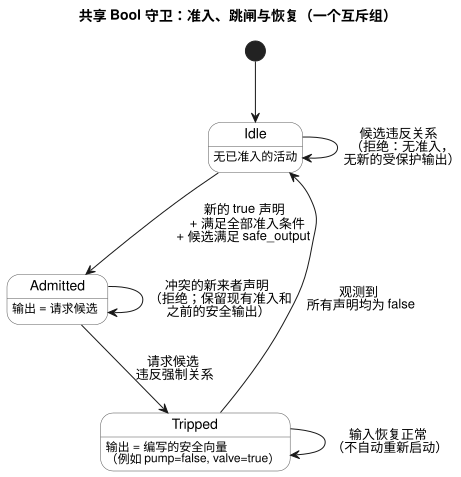
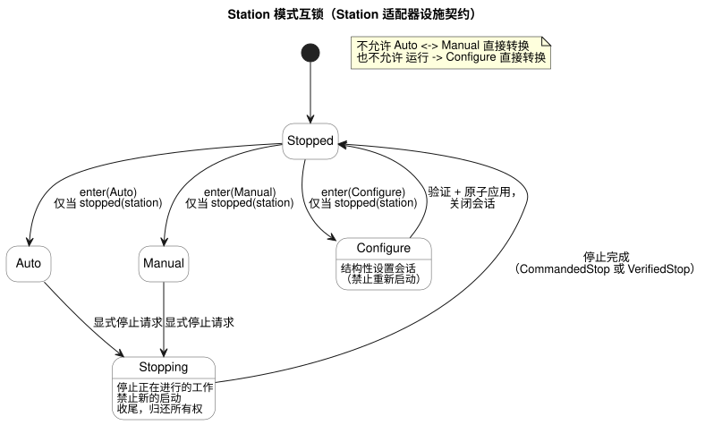
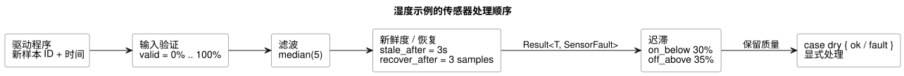

<!-- translation-source: docs/CONSTRAINTS.en.md -->
[英文原文](CONSTRAINTS.en.md)

# GhostFlow 通用约束与传感器信号契约

本文是 GhostFlow 中关于约束与传感器信号的**通用设计契约**（2026-09-24），承接[已选定的控制语法](LANGUAGE-SURFACE.zh.md)。

- 运行设置的现行语法与语义定义见
  [参考手册 §5.1–5.2](reference/05-settings-and-observation.zh.md)。
- 目前实际可执行的范围记录在[实现范围](IMPLEMENTATION.zh.md)
  和[可追溯性](TRACEABILITY.zh.md)中。
- **2026-10-05 外部输入修订：** 携带信号质量的声明现在使用 `input`。
  现有的信号调理和显式 `Result` 故障分支保持不变。早期的 `sensor` 片段保存在
  `tests/fixtures/history/issue531/` 下。

**本文内容**

1. 三类约束及其边界（局部、共享、用量核算）。
2. 绑定式共享 Bool profile 的执行方式（准入、跳闸、恢复）。
3. 固定 Station 适配器的设施规则：共享泵、模式互锁、
   运行设置与结构变更的区分。
4. 可选的设备信息与可选的容量分析。
5. 约束组合的理论基础，以及在 MCU 上运行的部分。
6. 传感器噪声与断线处理及其 MCU 开销。
7. 每日运行上限与重复执行防止。
8. 验收场景。

**规范写法。** 约束以命名的 `constraints` 组的形式写在一个 `.ghost.md` 的 `control` 块内。共有三类：

| 类别 | 作用对象 | 执行方式 |
|---|---|---|
| 局部 Bool 输出约束 | 同一 `control` 的输出 | 普通 Bool 降级（lowering） |
| 共享资源策略（`constraints Name for resource`） | 一组共享资源 | 仅通过显式的绑定编译 |
| 用量核算（`limit used(...)`） | 某个 `account` 的用量 | 参考手册 §3.10 的用量阶段、基准与持久化 |

三者都使用命名组，但其作用对象和执行契约各不相同。写法与运算遵循
[参考手册 §4.8](reference/04-sensors-constraints-control.zh.md)。

**Station 适配器示例。** 本文后面独立出现的 `constraints Name { ... }` 示例是
**Station 适配器示例**，而不是通用的规范语法。该有界的 `ghostrules` 路径仅为以下用途保留：

- 编程手册中的实际 WASM 模拟，
- `tools/station-demo.mjs`，以及
- `bindStationPolicy` 所使用的固定 Station 产物。

它既不是通用的规范语法，也不是任意 PID 安全强制机制。仅凭历史写法，不足以成为再增加一条兼容路径的理由。

其他基本规则：

- CLI 提取顶层 `ghost` 围栏，并拒绝纯 `.ghost` 输入。
- `compileConstraints` 是 Station 适配器内部的降级器，而不是通用求解器。
- 不要把对共享描述符的*验证*与实际的*绑定并强制执行*混为一谈。

## 规范的局部、共享与用量核算边界

以下两个完整的规范文件展示了这些边界：

- [可执行的局部包络](../examples/constraint-envelope.ghost.zh.md)。
- [带完整逻辑映射的已检查共享契约](../examples/shared-constraint-contract.ghost.zh.md)。

**验证绑定。** *绑定*将策略中的逻辑名称映射到稳定的资源身份标识和带类型的端口。`validateResourceConstraintBinding` 检查：

- 修订版，
- 规范源与产物的精确摘要（digest），
- 每个必需的稳定资源身份标识和带类型端口，以及
- 每个有限的互斥模式输入。

它会拒绝缺失或多余的映射、伪装成不同项的重复资源身份标识或端口，以及由宿主（host）提供的策略字段。验证返回
`executable: false`，既不授予准入，也不授予输出权限。

**选择执行。** 要执行，需将已验证的编译结果与绑定一起传给 `compileBoundResourceControl(compilation, binding)`。这一显式路径会生成一个带共享 Rust 守卫（guard）的有界 Bool GFB17 模块。仅编译规范源，绝不会悄然把已检查的描述符变成可执行产物。这是一个参考性的*逻辑*绑定契约，而不是物理输出 ABI。

**可执行组的限制。**

- 一个可执行组最多支持一个互斥活动集。
- 多条 `exclusive` 语句仍是有效的已检查源，但需要单独的执行集成。由于它们的集合各不相同，这种情况会被拒绝，而不是被合并成一个集合。
- 编写的全局安全向量还必须满足强制的局部约束。

**局部约束。** 下面是一个带局部约束的完整 `control`。局部约束只作用于本 `control` 的输出，并通过普通 Bool 降级执行。原有的未分组 `require` 和 `mutex` 含义不变。

```ghost
control LocalPump {
  state displayed_pump: Bool = false;
  displayed_pump' = if request_good && !request then false else if request_good then request else displayed_pump;
  state displayed_valve: Bool = false;
  displayed_valve' = if valve_ready_good && !valve_ready then false else if valve_ready_good then valve_ready else displayed_valve;
  // Source-local display memory is initialized here; faults remain producer unknown.
  state remembered_request: Bool = false;
  let request_good = case observed_request { ok(_) => true; fault(_) => false; };
  let request = case observed_request { ok(value) => value; fault(_) => remembered_request; };
  remembered_request' = request;
  state remembered_valve_ready: Bool = false;
  let valve_ready_good = case observed_valve_ready { ok(_) => true; fault(_) => false; };
  let valve_ready = case observed_valve_ready { ok(value) => value; fault(_) => remembered_valve_ready; };
  remembered_valve_ready' = valve_ready;
  input observed_request: Bool;
  input observed_valve_ready: Bool;
  output pump, valve: Bool;
  pump <- displayed_pump';
  valve <- displayed_valve';
  constraints LocalRules {
    require at safe_output pump => valve;
  }
}
```

**共享资源策略。** 共享策略用 `constraints Name for resource` 声明其作用范围。下一个示例是**生成不可执行描述符的完整已检查源**：

- `ghostc` 源检查会验证声明、类型、有限集合和安全值关系。
- 在没有可执行绑定时，`compileControl` 和组合都会拒绝此策略。
- 只有单独的、显式的绑定编译才会选择执行。

```ghost
control SharedPumpPolicy {
  state displayed_pump: Bool = false;
  displayed_pump' = if pump_request_good && !pump_request then false else if pump_request_good then pump_request else displayed_pump;
  state displayed_valve: Bool = false;
  displayed_valve' = if valve_request_good && !valve_request then false else if valve_request_good then valve_request else displayed_valve;
  // Source-local display memory is initialized here; faults remain producer unknown.
  state remembered_automatic: Bool = false;
  let automatic_good = case observed_automatic { ok(_) => true; fault(_) => false; };
  let automatic = case observed_automatic { ok(value) => value; fault(_) => remembered_automatic; };
  remembered_automatic' = automatic;
  state remembered_manual: Bool = false;
  let manual_good = case observed_manual { ok(_) => true; fault(_) => false; };
  let manual = case observed_manual { ok(value) => value; fault(_) => remembered_manual; };
  remembered_manual' = manual;
  state remembered_pump_request: Bool = false;
  let pump_request_good = case observed_pump_request { ok(_) => true; fault(_) => false; };
  let pump_request = case observed_pump_request { ok(value) => value; fault(_) => remembered_pump_request; };
  remembered_pump_request' = pump_request;
  state remembered_valve_request: Bool = false;
  let valve_request_good = case observed_valve_request { ok(_) => true; fault(_) => false; };
  let valve_request = case observed_valve_request { ok(value) => value; fault(_) => remembered_valve_request; };
  remembered_valve_request' = valve_request;
  resource station: Station;
  resource pump1: BoolActuator;
  resource valve1: BoolActuator;
  input observed_automatic: Bool;
  input observed_manual: Bool;
  input observed_pump_request: Bool;
  input observed_valve_request: Bool;
  output pump, valve: Bool;
  pump <- displayed_pump';
  valve <- displayed_valve';
  constraints SharedRules for station {
    exclusive at admission { automatic, manual };
    require at safe_output pump1.on => any_on({ valve1 });
    safe { pump1 = false; valve1 = true; }
  }
}
```

**`safe` 块。** `safe` 必须显式地为规则所引用的有限集合中的每个 Bool 资源赋值，并且必须满足每一个强制的输出关系。这里的取值是泵 OFF、阀门 ON。不存在隐含的“全部 OFF”默认值。

请注意以下几点：

- 不要假定源中的 `pump`/`valve` 请求已连接到物理资源。
- 下文所述的逻辑强制执行需要经过验证的稳定资源身份标识和带类型端口映射，以及显式的绑定激活。
- 以前的顶层资源策略文件同样仍是已检查的、非 `control` 的产物，绝不是被强制执行的 `control`。
- 不要自创 `station`、`use`、`bind` 或会话语法。

## 共享 Bool 执行

关于带显式绑定以及已记录输入/结果的完整可执行示例，请参见 [bound-resource-execution](../examples/bound-resource-execution.ghost.zh.md)。
上面 #157 的共享检查示例保持其不可执行描述符契约。

**绑定 profile 的作用。** [#158](https://github.com/callin2/ghostflow-language/issues/158) 中的绑定 profile 通过一个共享的 Rust tick 守卫，执行一个 Bool `control` 和一个有限资源集。

- 每个输出都必须绑定到资源，并具有编写好的、完整的安全向量。
- 绑定固定了 #157 的精确规范源/描述符摘要、修订版、稳定 ID，以及 Bool 模式输入/输出映射。
- 在模块激活时以 GFRB1 数据包显式提供绑定；在每次扫描时以 GFRS1 数据包提供相同的绑定身份标识。
- Rust API：`activate_with_resource_binding(bytes, &ResourceBindingRegistry)`、
  `tick_with_resource_binding(bytes)` 和
  `ScanDriver::scan_with_resource_binding(frame, bytes)`。
- 绑定缺失或不匹配时**以关闭方式失败（fail closed）**。
- 普通加载器可以解析该模块，但普通的 activate/tick/scan 无法绕过守卫。执行并不是宿主在输出发布之后附加的 JavaScript 过滤器。

**GFB17 包装的内容。** GFB17 只包装所有输入/输出端口均为 Bool 的现有 GFB1 v1 或 v3 程序，并把守卫纳入其提交边界。

- 使用短路求值的自动、手动和 fallback 源会降级为 v3。
- 其他内部 profile 不支持。
- 所有受支持分支的输出都经过同一个 Rust 守卫。
- 以下内容超出此有界 profile，会被拒绝：上下文调度计划、目标/PID、`import` 组合，以及安全含义不明确的组重叠。

**每个资源一个写入者。** 安装方（installation authority）必须让每个逻辑写入者使用同一个 `ResourceBindingRegistry`。

- 原生激活接收一个共享的 `Arc` 注册表。
- WASM ABI 在一个实例内的所有句柄之间共享一个注册表。
- 两者都会拒绝同一稳定资源 ID 的第二个活动写入者。
- Node 参考封装还通过一个模块注册表检查不同的 WASM 实例。
- Station 和 Bool 资源 ID 都在覆盖范围内。

彼此独立的安装注册表并不能证明跨安装的物理互斥。此 profile 不提供协作式多 VM 仲裁、会话租约或通用的物理输出 ABI。现有的 Station 适配器、用量核算执行路径以及非阻塞的 `check` 保持不变。

**准入与拒绝。** *准入*是守卫对所声明活动（例如 `automatic` 或 `manual`）运行的许可。强制的组条件以 AND 组合。

- 与当前准入冲突的新活动声明会被拒绝。现有准入和之前的安全输出保持不变。
- 在*启动之前*就违反强制输出关系的请求候选，既不会产生新的准入，也不会产生受保护的输出。
- 被拒绝的新来者必须先被观测为 false，再发出新的 true 声明，才能再次请求准入。
- 第一次拒绝的输出集为空，因为此前没有任何输出；其他情况下保留之前已提交的安全值。
- 不要根据描述符的安全向量自创启动前的替代输出。

**跳闸与恢复。** 如果*已被准入*的执行的请求候选违反了强制关系，守卫会*跳闸*：转入编写好的、按资源设定的安全向量。

- 保留让部分输出保持 ON 的安全行为，例如 pump=false 且 valve=true。
- 跳闸后输入恢复正常，并不会自动重新开始执行。
- 互斥组需要一次所有声明均为 false 的观测，之后还需要一个满足全部准入条件的新声明。
- 仅含 `require` 的组在其请求映射等于编写的安全映射时建立恢复基线，然后检查相对于该基线的新的偏离。
- 跳闸会在共享受保护资源的组所构成的传递连通分量中传播。编写的安全值在共享资源上必须一致。无关的组保持其准入。
- 用所有强制的共享约束与局部约束的 AND 重新验证最终的安全候选。
- 不要把旧声明藏进重试队列。
- 区分原始声明与已准入的活动，区分请求值与最终安全值。保留原因、组、绑定和扫描证据。

下图概括了互斥组的这一生命周期。仅含 `require` 的组则通过上述安全映射基线恢复。



**提交与回滚。**

- 成功求值的拒绝会提交普通 VM 状态。拒绝不会取消程序的作业/会话，也不会把所有状态恢复到之前的值。
- 绑定错误或 VM 故障会将 VM 状态、守卫准入和追踪一并回滚。受保护状态不得部分变化，被拒绝扫描的证据不得提交。
- 逻辑上的安全输出不等于“渲染器已应用”或“物理反馈已确认”。实际的渲染器时序、物理安全装置和现场安装不在此 profile 的验证范围之内。

**用量核算。** 用量核算声明现有的 `resource` 和 `account`，然后使用
`constraints Budget { limit used(account, basis) <= bound { ... } }`。
不要用用量账本取代局部 Bool 条件或共享准入。
[参考手册 §3.10](reference/03-time-and-schedules.zh.md)
定义了用量阶段、基准与持久化。

**约束定义允许区域。** 约束构成一个区域，请求（包括目标/PID）只能在其中变化。

- 局部约束只影响其所在的 `control`。
- 共享约束适用于使用同一资源的所有自动、手动和 fallback 路径。
- 启动前预测到的违反会拒绝新的准入。
- 执行期间，应遵循编写好的、按资源设定的安全行为，而不是无条件地全部 OFF。
- 这一区分并未实现通用输出 ABI 或物理安全时序。
- 不要把现有的、范围更窄的 PID 引擎契约推广为任意资源策略的强制执行。

**求值顺序。** 所有强制条件以 AND 组合：

1. 先决定准入。
2. 对请求候选检查 safe_output 关系。
3. 由渲染器应用结果。

仲裁优先级只在允许区域*之内*进行选择，无法绕过强制约束、绑定、来源（provenance）或恢复要求。违反原因应与拒绝和安全转移分开记录。正常的观测不会产生新的启动权限；重试与恢复遵循相同的规则。

在下文的 Station 适配器中，`check pump_capacity` 是非阻塞的提示，而不是强制的 `require`。`warn` 和 `monitor` 不支持。绝不能悄然把警告提升为安全 `require` 或命令。

## 本次讨论确定的方向

以下是用户关于浇水设施的决定：

- 同一浇水设施的自动运行、手动运行和设置模式相互排斥。
- 自动↔手动以及运行→设置的转换，需要用户显式停止并且停止完成。
- 结构变更遵循显式停止和 Configure 流程。有限的一组可在运行时调整的属性，在运行期间遵循下文所述的原子事件契约。
- [2026-09-20 修订：之前的决定“所有运行条件只能在已停止的设置模式下应用”，已在 #110 中仅针对运行时可调整的属性值被取代。结构变更的停止与 Configure 流程仍然保留。]
- 互锁、同时打开阀门的数量上限、设施容量和每日运行时间都声明为通用约束。增加单个 `control` 时，设施范围的约束继续生效。
- 传感器噪声和数据断线的处理，以资源有界的命名信号运算提供。
- 时钟校正下的重复防止和每日用量上限分别单独保证。
- **所有补充设备信息，包括压力、流量和性能曲线，都是可选的。** 基本浇水、模式互锁、阀门数量上限和时间上限，必须在不输入这些信息的情况下也能使用。

这些决定使早先关于自动/手动请求优先级与抢占的提案具体化。仅凭优先级就在自动运行期间立即执行手动请求的策略，不适用于本设施。

## 约束的描述位置

`constraints` 是一个命名的规则组。

- **局部**约束附加在 `control` 内部。
- **共享**约束附加到由设备 profile 定义的设施范围。
- 多个 `control` 引用同一台泵时，它们共享该物理泵 ID 的约束和用量。

本组以及其后的独立组，都是固定 Station 适配器的设施示例。`station`、`pump1`、`settings` 和 `starts` 连接到设施、设置和调度计划的稳定 ID。`pump1.valves` 是一个事先登记了供水关系的有限阀门集合。绝不能按发现顺序或显示名称进行连接。

Station 适配器示例——面向固定设施适配器的有界独立规则。

```text
constraints StationRules {
  exclusive(automatic, manual, configuring);

  allow enter(Auto, Manual, Configure)
    only when mode == Stopped && stopped(station);

  // 应用结构设置的停止条件（降级器规则：configureOnly）；不同于操作员设置事件
  allow apply(settings)
    only when mode == Configure && stopped(station);

  require count_on(pump1.valves) <= 2;
  require pump1.on => any_on(pump1.valves);

  limit on_time(pump1) <= 1h per day("Asia/Seoul");
  once starts per occurrence;
}
```

`automatic`、`manual` 和 `configuring` 是同一设施被允许的模式/会话*活动状态*，而不是传入的请求按钮。模式管理器持有一个 `Stopped | Auto | Manual | Configure` 值，这些名称由它派生。`exclusive` 也可用于一般的活动组。

| 类别 | 含义 | 违反时的默认处理 |
|---|---|---|
| exclusive | 不能同时处于活动状态的模式/活动 | 拒绝发生冲突的新进入 |
| allow ... only when | 进入模式或应用设置的前提条件 | 拒绝请求；保持现有状态 |
| require | 设施最终输出上的不变式 | 启动前的许可检查，以及执行期间的安全监视 |
| limit | 累计时间、次数或消耗量的上限 | 检查剩余预算；达到上限时阻止运行 |
| once ... per occurrence | 按调度触发实例（occurrence）的重复抑制 | 绝不重新执行已被接受的触发实例 |
| check | 使用可选信息的非阻塞分析 | Pass / Violation / Unknown 诊断；不阻止执行 |
| warn ... when | 未来的设计写法；目前两个解析器都会拒绝 | 记录带原因和对象的警告事件 |

- 局部 `control` 中的单行 Bool `require` 与此 Station 适配器使用不同的执行路径。
- 警告并不是允许违反约束的例外。清除警告并不会解除强制约束。
- 通知的投递由宿主负责。它不会在每个 tick 都向用户重复发送同一违反。

**每条约束都有一个检查阶段，由其作用对象决定。**

| 作用对象 | 检查时机 |
|---|---|
| `count_on` / 输出关系 | 最终输出候选 |
| `enter` / `apply` | 请求进入 |
| `pump_capacity` | 新工作的许可 |

这些阶段绝不会被隐式混用。没有确定作用阶段的一般表达式会得到编译诊断。

## 多个 control 共享泵

本节的会话与仲裁规则是下文固定 Station 适配器的设施契约。上文的绑定 Bool profile 只允许一个活动写入者，并不声称提供多 VM 会话仲裁或物理使用权。

**唯一写入者。** 共享资源管理器是物理泵唯一的输出写入者。

- 各 `control` 的输出是*请求*，而不是“最后写入者获胜”的 GPIO 写入。
- 未处于活动状态的 `control` 发出的 `false` 请求，不能中断由另一个 `control` 拥有的浇水。
- 如果必须停止另一个 `control`，应使用显式的设施停止请求。

**会话所有权。** 初始的共享泵策略是**在整个浇水会话期间独占所有权**。

- 所有权覆盖阀门打开、泵运行、各阶段之间的泵 OFF 以及阀门收尾。
- 另一个 `control` 不会仅因泵在这些阶段之间短暂关闭而获得所有权。
- 仅打开阀门不会启动泵。应遵循所有者的阶段输出以及设备的安全应用时序。

**同一 tick 内的仲裁。**

- 基于一个快照，对同一 tick 内的所有启动请求进行仲裁。
- 只允许同时取得所有权和时间预算的请求。
- 渲染器在逻辑许可提交之后应用输出。如果需要持久化预留，则将输出启动推迟到预留也成功之后。
- 进程重试时复用同一个请求 ID。
- 这并不保证多个 GPIO 在物理上同一瞬间变化。

**让新工作避开现有调度计划。**

- 在保留现有调度时间的策略下，只有当新 `control` 的完整会话上限加上收尾时间能放进一个空闲区间时，才允许它。仅检查泵此刻是否为 OFF 是不够的。
- 请求等待资源期间，浇水阶段的定时器不会启动。
- 请求顺序由接受顺序和稳定 ID 决定。队列长度和过期时间都是有界的。
- 共享并发运行或抢占是单独的可选（opt-in）策略，并不会解除模式互锁。

### 示例：对两个现有阀门和两个新增阀门应用相同规则

在这种情况下，安装配置把现有 `control` 和新 `control` 的泵都绑定到物理 `pump1`，它们的阀门端口绑定到 `valve1`–`valve4`。这些连接是 `control` 所需的设备绑定，而不是压力/流量元数据。下面的规则附加到该设施上。

Station 适配器示例——面向固定设施适配器的有界独立规则。

```ghost
constraints SharedPump {
  // pump1.valves는 두 control을 합친 네 밸브의 집합이다.
  require count_on(pump1.valves) <= 2;
  require pump1.on => any_on(pump1.valves);

  // 자동/수동과 control 수에 관계없이 물리 펌프 하나의 사용량이다.
  limit on_time(pump1) <= 1h per day("Asia/Seoul");
}
```

（韩语注释的意思是：`pump1.valves` 是两个 `control` 合起来的四个阀门的集合；该上限是一台物理泵的用量，与自动/手动模式或 `control` 的数量无关。）

- 在现有任务拥有会话期间，即使泵短暂 OFF，新任务也不能启动。
- 现有任务结束后，如果新任务的整个会话能在下一个调度之前完成，则允许它。
- 仅凭这些规则并不能实现仲裁器。连接会话所有权与许可输入的具体语法属于后续范围。
- 不要用两个 `control` 输出的 OR 或“最后写入者获胜”来代替。

## 模式互锁与停止完成

模式互斥适用于连接到同一设施的每个 `control` 和每条手动 UI 命令。同一台泵的多个自动 `control` 在同一 Auto 模式下协调资源使用。不要把一个全局模式自动强加给相互独立的设施。

模式之间的必经路径总是经过一次显式停止：

```text
Auto 或 Manual
  → 显式停止请求
  → 正在进行的工作的停止流程 / 禁止新的启动
  → 停止完成
  → Stopped
  → 请求进入 Auto、Manual 或 Configure
```

下图以状态机的形式展示了同一规则。



**`enter` 检查的内容。** `enter` 规则检查进入 Stopped 以外任何模式的请求，并不阻止停止请求本身。在 Auto 中，泵短暂关闭或等待下一个调度，并不允许直接转换到 Manual 或 Configure。

**Configure 指结构变更。** 在本节中，Configure 会话和 `apply(settings)` 指*结构性*设置变更。

- 在该会话期间禁止重新启动。
- 验证结构变更并原子地应用。关闭设置会话并返回 Stopped 之后，才接受另一个运行模式的进入。
- 远程 API 经过相同的检查。仅禁用界面控件并不能实现约束。

**同一 tick 内的冲突。**

- 如果进入不同模式的请求在同一 tick 内冲突，则全部拒绝并保持现有模式。
- 重新发送同一请求 ID 不会被处理两次。
- 在该 tick 中，停止先于模式进入和新浇水许可处理。它会递增*停止代次*（stop generation），并丢弃上一代次中尚未提交的请求。
- 即使上一个快照是 Stopped，与 Stop 在同一 tick 到达的新启动也不被允许。

**`stopped(station)` 的含义。** 它并不只是表示“泵请求为 false”，而是表示：

- 正在进行的浇水和收尾已经结束，
- 设施所有权已经归还，并且
- 该设备 profile 的停止确认已经完成。

如果有反馈，就检查实际的停止状态和阀门状态。没有反馈时，应说明其局限：确认依据的是命令以及安装时确定的停止流程。绝不能声称一个模式枚举可以取代物理互锁或保证实际状态反馈。

**CommandedStop 与 VerifiedStop。** 停止证据记录为以下两个级别之一：

| 证据 | 含义 |
|---|---|
| `CommandedStop` | 渲染器报告已应用安全输出，且所配置的收尾/等待流程已完成 |
| `VerifiedStop` | 实际反馈也确认了停止 |

- 基本配置允许 CommandedStop，不强制要求反馈传感器，也不会把它显示为已验证的实际停止。
- 如果设备没有响应，或安全输出的应用失败，仅发送命令并不能确立停止完成。
- 只有用户添加的规则才可以要求 VerifiedStop。
- 初始的安全输出时序/等待值可以使用输出渲染器的默认值。需另行注明：其适用性必须针对每次安装进行检查。

**停止会取消待处理的工作。**

- 停止请求也会取消待处理的启动或使其失效。
- 不要在运行期间把模式变更请求放进队列，之后在用户不知情的情况下自动切换。
- 重新启动需要新的显式请求。
- 在设置期间编辑源文档中的描述，不同于把运行条件应用到物理设备。

**结构性 Configure 是一个原子修订版。** 它是一个设施修订版，包含相关的 `control` 版本、端口/供水关系、约束、调度结构、可选检查和相关元数据。

- 只有在验证了整个候选并完成对当前修订版的原子、持久替换之后，才报告成功。
- 断电之后，只选择完整的旧修订版或完整的新修订版，绝不混用部分内容。
- 请求携带其编写时的修订版和停止代次。如果在评估许可时两者已不再匹配，则拒绝该请求；不要自动以新的含义重新解释它。
- 此修订版不是实际用量账本或重复防止账本的重置键。

### 运行时可调整的属性与结构变更

[参考手册 §5.1–5.2](reference/05-settings-and-observation.zh.md) 定义了运行设置的语法和应用语义。

- `config` 元数据中的 `access = operator` 声明操作员可以更改的设置。
- 标记为 `access = designer` 或未声明操作员访问权限的值，不能通过运行设置事件更改。
- 不存在 `apply` 字段。当前编译器对 `apply = stopped` 和 `apply = live` 都会拒绝。

**什么算结构性变更。** 对可执行程序/规则、设备绑定/profile、依赖或调度结构的更改属于结构变更。

- 显式公开的值，例如调度计划的开始时间和 Duration，并不会仅因属于调度计划而变成结构性的。
- 把可选检查改为强制是一种规则变更。
- 结构变更遵循显式停止和 Configure 流程，与运行设置事件分开。

**运行设置事件。** 每次操作员动作都是一个原子的实时事件，包含所有需要一起更改的设置。

- 验证整个批次。只要有任何值无效，就拒绝整个批次。
- 拒绝不会停止独立的普通运行规则。
- 新值从有效事件应用的位置开始读取，不必等待下一个浇水周期或新的运行（run）。
- 快照在求值期间绝不改变。事件与扫描的顺序遵循参考手册 §5.2。
- 源码/字节码、程序身份标识和运行身份标识保持不变。记录设置修订版和生效的事件位置。
- 状态和定时器绝不会被隐式重置。

规范的 Temperature 值以及 `displayUnit` 的保留遵循
[参考手册 §5.1](reference/05-settings-and-observation.zh.md)。
对进行中的 Range 的设置更改遵循
[参考手册 §3.5](reference/03-time-and-schedules.zh.md)。

**重启与更新。**

- 已接受的普通运行设置在 ESP 物理重启后仍然保留。
- 重启会产生新的运行，不会自动恢复之前的程序状态。
- 如何响应重启由编写的规则决定。第一次判定之前的电气输出义务仍属于 Device 边界。
- 不要普遍强加一种自动/手动启动策略。
- 共享资源仲裁、站点模式转换、用量账本和显式停止流程继续适用。
- 更新 ESP 的程序/模块或固件，会停止该 ESP 控制的所有设备任务。

### 示例：运行设置声明与结构性 Configure 应用

以下片段在 `control` 主体中声明一个运行设置。

```ghost
config water1_time: Duration = 5min { min = 1min; max = 30min; step = 1min; access = operator; }
```

操作员对此设置的更改，是向同一程序的带类型 Result 流进行的一次原子实时发送。使用方用
`case water1_time { ok(value) => ...; fault(reason) => ...; }` 处理当前观测值。投递与使用方的源码是分开的：同一次设置更改既不会编辑源码字面量，也不会触发重新编译。确切的边界记录在
`docs/OPERATOR-SETTINGS-STREAM.md` 中。

与此相对，下面约束中的 `settings` 是一个**结构性设置修订版**。此示例*不会*给上面 `water1_time` 的操作员更改附加停止条件。`mode` 和 `station` 是由设施管理器提供的名称。

Station 适配器示例——面向固定设施适配器的有界独立规则。

```ghost
constraints EditInterlock {
  exclusive(automatic, manual, configuring);

  allow enter(Auto, Manual, Configure)
    only when mode == Stopped && stopped(station);

  allow apply(settings)
    only when mode == Configure && stopped(station);
}
```

`tools/constraints.mjs` 中的 `configureOnly` 规则和站点的 `apply_config` 是已停止 Configure 的路径。只有在结构候选经过验证并应用之后，才接受新的运行请求。不要把运行设置事件的验证/应用与 CommandedStop/VerifiedStop 的物理含义混为一谈。

### 2026-09-20 研究记录及后续决定

当时记录在
[language #89](https://github.com/callin2/ghostflow-language/issues/89) 和
[system #54](https://github.com/callin2/farm_studio_system/issues/54) 中的研究，以已停止状态下的设置应用和源码编辑/重新编译路径为起点，讨论了实时属性事件。自那时起，`apply = stopped` 示例、尚未确定的公开语法以及 `settings.valid` 设计草图都属于历史记录，不是当前的可执行语法或替代契约。自 2026-09-22 起确定的操作员设置语法和原子实时语义，遵循上文的参考手册 §5.1–5.2。

## 设备补充信息是可选的

补充设备信息——压力、流量、泵曲线、功耗、管路损失——**不是**基本程序的必需输入。它不同于用于识别设备并连接输出端口的最小绑定。安装报告实际状态的反馈传感器也并非普遍必需。

| 配置 | 可用功能 | 缺少补充信息时 |
|---|---|---|
| 基本控制 | 调度计划、顺序控制、自动/手动/设置互锁 | 仍可使用 |
| 直接声明的规则 | 同时最多 2 个阀门，每天最多 1 小时 | 无需压力/流量即可检查 |
| 可选的容量分析 `check` | 使用所提供的设备信息诊断容量超限 | 仅该分析为 Unknown（信息不足）；不阻止运行 |
| 用户添加的强制容量规则 `require` | 只允许容量经过验证的请求 | 在该规则下设施无法获得启动许可；这不是默认行为 |

**缺失的值保持缺失。**

- 绝不能用零、无限容量或正常值替代缺失的值。
- 可选字段是 `Option`。分析结果带有 Pass / Violation / Unknown 及原因。
- Unknown 表示“信息不足”或“超出分析范围”，既不是错误，也不是通过。
- 不要为从未输入的数据重复发送故障通知，而应在分析界面上显示未验证的项目。

**部分信息。**

- 只运行输入完整的检查；其余保持 Unknown。
- 通过了流量上限检查，并不是同时验证了压力的完整水力安全保证，不要如此显示。
- 直接输入的无效值或单位可以在编辑时诊断，并在应用时拒绝。省略某个字段本身不是错误。

### 示例：同一设施的基本规则与可选分析

即使没有输入任何压力或流量信息，这些基本规则也能工作。

Station 适配器示例——面向固定设施适配器的有界独立规则。

```ghost
constraints BasicWatering {
  require count_on(pump1.valves) <= 2;
  limit on_time(pump1) <= 1h per day("Asia/Seoul");
}
```

只有在需要容量分析时才添加下面的组。两个组可以同时生效。

Station 适配器示例——面向固定设施适配器的有界独立规则。

```ghost
constraints CapacityAdvice {
  check pump_capacity(pump1);
}
```

| 容量信息/请求 | CapacityAdvice 结果 | 满足基本互锁的新启动 |
|---|---|---|
| 未输入所需信息 | Unknown：信息不足 | 不会被此检查阻止 |
| 模型与条件充分；在容量之内 | Pass：在该模型下检查通过 | 不会被此检查阻止 |
| 模型与条件充分；超出容量 | Violation：容量超限警告 | 此检查本身不阻止 |

还希望阻止最后一行情况的用户，可以选择下一节所述的显式强制 `require`。输入设备信息绝不会自动加强基本规则。

**把检查提升为强制规则。**

- 输入补充信息或发现设备，不会自动添加强制运行条件。
- 提升为强制规则是对可执行规则的结构变更。应先显式停止，再通过 Configure 进行更改、验证和应用。它不是运行时可调整属性的实时事件对象。
- 删除某个生效中的强制规则所需的信息时，也要修改或删除该规则并验证结果。
- 绝不能因为信息消失就悄然停用强制规则。

## 可选的泵容量与水压模型

**阀门数量。** 阀门数量上限用有限计数约束表示，例如
`count_on(...) <= 2`。检查连接到同一台泵的*所有*阀门的总数，而不只是每个 `control` 各自的两个阀门。

**更精确的模型。** 更精确的模型需要各区域的需求流量、所需的最低压力/扬程、管路损失和泵性能。

- 并联区域的需求可以在共同的压力条件下相加。
- 不要使用把“压力消耗”简单相加、再从泵的额定压力中减去的模型。
- 泵的实际工作点由泵曲线和系统曲线决定。
  [KSB 工作点说明](https://www.ksb.com/en-global/centrifugal-pump-lexicon/o)

仅在需要时，profile 可以添加保守的流量上限，或按运行条件列出在安装时验证过的允许阀门组合。下面是可选分析的语法草图。

Station 适配器示例——面向固定设施适配器的有界独立规则。

```text
constraints PumpCapacity {
  check pump_capacity(pump1);
}
```

**`pump_capacity` 的返回值。** 它把同一台泵的所有请求与所选的容量模型进行比较：

| 结果 | 何时 |
|---|---|
| Violation（警告） | 在已验证的条件下确认超限 |
| Pass | 条件和数据充分且需求在容量之内——仅在该模型的范围内有效 |
| Unknown | 数据或条件不足 |

此 `check` 是警告/分析功能，而不是运行许可规则。诊断会记录所支持的模型及其前提。

例如，流量预算模型会把在确定的压力和管路条件下的 `flow_budget`，与相同条件下各区域的 `demand_flow` 进行比较。把压力与流量（不同单位）比较是类型错误。此可选模型的实现使用已定义的字段和单位，绝不猜测任意元数据的含义。

只有当用户选择将其作为强制启动条件时，才添加下面的内容。

```text
require pump_capacity(pump1) == Pass;
```

**强制形式的效果。**

- Violation 和 Unknown 都不允许新工作。
- 未声明检查的基本控制没有此条件。
- 绝不能要求用户为了运行基本控制而先输入详细的设备规格。
- 这是一条基于元数据的*启动许可*规则。执行期间的故障和急停监视由单独的输出/传感器规则处理。

**强制检查缺少数据时。**

- 如果新添加的强制检查缺少数据，则拒绝应用该候选配置，并保留现有配置。
- 如果之前有效且生效中的强制检查后来变为 Unknown，则阻止受其约束的新启动。
- 不要自动删除强制规则并降级为基本运行。

**分析的运行位置。** 泵曲线/管路模型分析以及允许组合的生成可以在 PC 上运行。MCU 通过有界的查表或比较来检查结果。分析保证只在 profile 的假设和实际验证过的范围内成立。信息缺失时跳过分析，与把用户声明的强制容量检查视为成功是两回事——要加以区分。

**超出容量。** 有强制容量规则时，容量超限后不要随意关闭某个阀门来拆分工作。应检查新任务的全部资源需求，然后允许其启动，或者拒绝或排队。对于执行期间确认的故障，应用该设施的停止流程和输出安全约束。

## 约束组合理论与实现边界

互锁可以被建模为一种*约束*：一个必须与其他条件同时成立的条件。目标是同时满足所有强制约束的行为。不同的工具处理其中的不同部分。

| 理论/技术 | 适用问题 | 建议的执行位置 |
|---|---|---|
| 不变式/有限状态机 | 模式互斥、允许的转换、输出条件 | 编译时检查 + MCU 监视器 |
| 约束满足问题（CSP）、SAT/SMT | 规则矛盾、静态容量条件、可能的组合 | PC/宿主分析 |
| 时序逻辑/运行时验证 | 时限内确认、累计时间、顺序 | 将受限语法转换为小型状态机 |
| assume–guarantee 契约 | 组合设备、`control` 和共享设施的条件与保证 | 宿主分析 + 对所需假设的运行时监视 |

[Z3 逻辑指南](https://microsoft.github.io/z3guide/docs/logic/propositional-logic/)
是检查逻辑可满足性与矛盾的基础。
[Kind 2/Lustre 契约](https://kind.cs.uiowa.edu/kind2_user_doc/2_input/1_lustre.html)
是组合假设、保证与模式，以及检查不变式和可达性的具体参考。

**约束与仲裁。** 逻辑约束以 AND 组合。选择接受*哪个*请求是单独的仲裁策略。约束定义允许区域；仲裁在其中进行确定性的选择。绝不能用优先级分数削弱强制约束。

**分析的局限。**

- 单个 tick 的 SAT 检查并不能证明在所有时间内都安全。
- 一个总是停止的模型可以满足安全约束，却永远不浇水。因此还要检查预期的运行状态是否可达。
- 分析结果为 unknown 或超时并不是成功的证明。应记录分析范围和失败原因。

**在 MCU 上运行的内容。** MCU 只运行受支持的约束，使用有界的比较、计数器、状态机或允许组合查表。它不需要通用的 SMT 求解器，也不需要在每个 tick 上进行无界的组合搜索。无法编译为此 profile 的规则会得到诊断。

不要把现有的 Bool requires/mutex 算法（将输出向 false 方向迭代）原样应用于一般约束。模式进入、资源许可、时间监视和输出阻止各自需要定义好的执行语义。设施契约与局部契约同时适用；`control` 不能解除共享约束。

## 传感器噪声与断线

下面是新的传感器处理声明的语法草图。每个运算的内部状态都会成为传感器图中的一个显式节点。

```text
input moisture: Percent {
  sample = 1s;
  valid = 0% .. 100%;
  filter = median(5);
  stale_after = 3s;
  recover_after = 3 samples;
}

signal dry = hysteresis(moisture,
  on_below: 30%,
  off_above: 35%,
  initial: false);
```

**运算的工作方式。**

- `median(5)` 是最近五个有效*新*样本的中值。
- 迟滞在滤波值低于 30% 时切换为 true，高于 35% 时切换为 false。在边界上及两者之间保持之前的值。
- 输入验证（在滤波之前）、滤波、条件求值和故障处理的顺序是静态固定的。
- 关于分离的上/下阈值如何减少噪声附近的反复切换，请参见 [TI 的说明](https://www.ti.com/tool/CIRCUIT060078)。

下图展示了本例的处理顺序。



详细的传感器处理契约如下：

- **不重复计数。** 在多个 tick 中读取同一个物理样本，不会把它再次插入滤波窗口或恢复计数器。驱动程序提供新样本的身份标识和时间。
- **新鲜度。** 新鲜度从最后一个实际有效样本的时间开始计算。重新计算滤波结果不会刷新陈旧（stale）定时器。
- **陈旧与显式故障。** 本例可以在下一个样本到达之前使用最后的样本，但 3 秒后变为 Stale。显式的 Disconnected/Invalid 故障会立即传递。绝不能把错误平滑掉。
- **就绪与恢复。** 启动时，在累积五个有效样本之前，质量为 NotReady。故障之后，滤波窗口被重置。恢复*同时*需要连续 3 个新的有效样本*和*一个就绪的滤波器。因此本例的中值窗口至少需要 5 个样本才能再次就绪。
- **迟滞保留质量。** 迟滞同样保留 Reading/Result 的质量。发生故障时，它不会把最后的 true 作为正常值输出；控制逻辑负责处理故障，例如用 case/recover。其初始状态和恢复后的状态为 false。
- **保持最后的值。** 如果需要在短暂断线期间保持最后的值，应将其做成带有显式超时和 Held 质量的单独扩展。对任何传感器，无限期保留最后的值都不是默认行为。
- **按传感器的延迟。** 分别计算每个传感器的处理延迟。不要把普通湿度传感器的平滑延迟一律套用到保护信号上。

**Result 类型。** 读数类型是 `Result<T, SensorFault>`。这里的故障是
`Disconnected | Stale | Invalid | NotReady`。

- 实际故障持续期间，输出该故障。
- 新的有效样本已开始到达，但就绪条件或连续恢复条件尚未满足时，输出 `Err(NotReady)`。
- 绝不能把部分窗口的中值/移动平均作为正常值输出。
- `recover(default)` 是把此 Err 转换为替代值的纯运算。它不满足恢复计数器，也不会抹去原始故障记录。

**初始化与恢复期间的滤波器。**

- 中值和移动平均从空窗口开始，需要 N 个有效新样本。
- EMA 以第一个有效样本作为初值。在满足配置的连续恢复样本数之前，它不输出正常结果。
- 滤波器就绪与传感器恢复是两个独立的条件，必须同时成立。
- 组合滤波与迟滞时，质量会一直保留到显式的 case/recover 处理为止。

**检查点与重启。**

- 传感器节点的检查点针对一个逻辑 tick 保存：源 ID、源 epoch、最后样本 ID、样本时间、时间 epoch、滤波器状态、质量和恢复计数器。
- 具有相同游标的重传样本不会被应用两次。源重启或时间 epoch 变化不会被当作普通的新连续样本。
- 实际重启之后的默认策略是清空传感器窗口和新鲜度，并从 NotReady 重新准备。旧的正常值不会被立即恢复。
- 持久地恢复传感器状态是单独的可选功能。如果无法确认一致的检查点以及时间/源的连续性，则适用相同的初始化策略。
- 精确的 ghost（影子运行）重放会使用已记录的样本身份标识、时间和质量，以及匹配的检查点。

### 示例：将经过噪声/断线处理的值连接到浇水判定

这是一个安装了湿度传感器的 `control` 的完整设计示例。假设启动请求只有在通过设施模式检查和资源所有权检查之后才会到达。不使用任何压力或流量信息。

```ghost
control MoistureDemand {
  // Source-local display memory is initialized here; faults remain producer unknown.
  state remembered_start: Bool = false;
  let start_good = case observed_start { ok(_) => true; fault(_) => false; };
  let start = case observed_start { ok(value) => value; fault(_) => remembered_start; };
  remembered_start' = start;
  state remembered_stop: Bool = false;
  let stop_good = case observed_stop { ok(_) => true; fault(_) => false; };
  let stop = case observed_stop { ok(value) => value; fault(_) => remembered_stop; };
  remembered_stop' = stop;
  input observed_start: Bool;
  input observed_stop: Bool;

  input moisture: Percent {
    sample = 1s;
    valid = 0% .. 100%;
    filter = median(5);
    stale_after = 3s;
    recover_after = 3 samples;
  }

  signal dry = hysteresis(moisture,
    on_below: 30%,
    off_above: 35%,
    initial: false);

  let dry_ok = case dry {
    ok(value) => value;
    fault(_)  => false;
  };

  state watering: Bool = false;
  output pump, valve: Bool;

  watering' = if start_good && stop_good then (!stop && dry_ok && (start || watering)) else watering;
  valve <- watering';
  pump  <- watering';
  require pump => valve;
}
```

**逐步说明。**

1. 原始新样本依次为 28%、29%、90%、28%、29%。在第五个样本时，中值就绪，值为 29%。在此之前，值为 NotReady，因此 `dry_ok=false`。
2. 一旦 `dry` 就绪且为 true，`start` 开始浇水，`watering` 锁存浇水意图。在就绪之前出现又消失的启动请求不会被保存。
3. 此后，32% 的滤波值保持之前的 true。高于 35% 时，`dry` 变为 false。
4. 如果自最后一个有效样本起达到陈旧时限，或者到达显式故障，则 `dry_ok=false`，浇水意图被释放。实际的输出收尾遵循渲染器/设施的停止流程。

故障之后，三个正常样本并不能使 `median(5)` 就绪，因此它仍为 NotReady。即使累积了五个样本且满足恢复条件，如果 `start=false` 并且锁存已被释放，浇水也不会自动恢复。传感器恢复与新的运行许可是两个独立的判定。

## MCU 资源开销

| 处理 | 保留的状态 | 每个样本开销的形式 |
|---|---|---|
| debounce | 稳定值、候选值、候选开始时间 | 固定次数的比较和一次时间比较 |
| hysteresis | 上一次的判定值 | 两次边界比较 |
| 陈旧监视 | 最后有效时间、质量 | 固定的时间比较 |
| EMA | 上一次的平均值和初始化状态 | 固定次数的算术运算 |
| 移动平均 N | N 个值、总和、索引 | 固定次数的环形缓冲区更新 |
| median N | N 个值和索引 | 上限固定为 N 的比较/排序 |
| 每日时间上限 | 日期、预算、计数器、区间时间 | 固定的时间累加与比较 |

**窗口大小估算。** 五个 32 位样本的数据为 20 字节；64 位样本为 40 字节。这只计算了样本存储。时间戳、质量、索引、初始化状态、排序暂存空间，以及排序方法所需的额外存储都要另外计算。当前内核的数值类型是 f64；实际的表示大小必须由编译 profile 确定。绝不能声称 RAM 总量为 20 字节。

作为具有固定大小状态的滤波器示例，
[CMSIS-DSP biquad](https://arm-software.github.io/CMSIS-DSP/main/group__BiquadCascadeDF1.html)
每一级使用固定的状态。这是设计参考，并不表示 ARM 的实现可以原样在 ESP32 上运行。

**编译器的义务。**

- 编译器必须根据传感器数量、窗口大小、定时器数量、固定集合大小、最大请求数和追踪大小，计算内存和运算开销的上界。
- 将总线读取与控制 tick 相协调。只在有新样本时更新滤波器。
- 滤波器状态、质量和定时器也属于 ghost 检查点。
- 在实际目标板上测量执行时间和内存。这并不意味着当前的 MVP 会验证这些上界。
- 还需要支持新的算术/单位/信号操作码。

**资源上限。**

- 上限来自目标板/运行时 profile。不会要求用户输入每一个值。
- 对超出所选配置的 RAM、暂存、栈、执行开销或持久存储上界的候选，拒绝其激活，并保留现有配置。
- 不要为未被选中的设备策略分配传感器处理状态。
- 绝不能因为所选配置资源不足，就悄然丢弃高级强制规则并在没有它的情况下运行。
- 各开发板的确切数值以及所支持的最大窗口大小，将在实现和测量之后确定。

**诊断追踪与账本。**

- 可选的中间追踪不是基本控制成功的条件。
- 默认方案是固定长度的环形缓冲区，覆盖最旧的诊断信息，并显示丢失的数量/区间。
- 记录包括逻辑 tick、节点 ID、样本 ID 和质量；原始值/滤波值是可选的。
- 仅丢失中间追踪不会停止基本运行。
- 用于精确重放的输入日志（journal）和检查点不同于中间追踪。输入记录有丢失的区间应标记为不可重放。
- 持久化的每日上限账本和 `once` 账本是执行许可所需的独立数据，绝不能被悄然覆盖。

## 每日运行上限与重复执行

**`on_time(pump1)` 计算的内容。** 它是同一台物理泵最终已应用的 ON 命令的持续时间。

- 自动/手动使用以及多个 `control` 的使用都计入同一个设施计数器。
- 被拒绝的请求和等待时间不计入。
- 改为计算物理运行反馈的 profile 另行定义。
- 两个 `control` 的请求重叠时，同一台泵的实际命令区间不会被重复计算。

**“天”的含义。** 区间长度用单调时间测量。*天*是指定本地时区中的日历日期。

- 跨越午夜的运行按每个日期分别计算。
- 这不同于滚动 24 小时总量，也不同于最长连续运行时间。它并不禁止在午夜之前和之后紧接着使用各自日期的预算。

**时钟校正。**

- 一个正在计数的区间具有可信的本地日期，以及到下一个午夜的单调截止时间。
- 时钟校正不得重新分配已提交区间按日期的用量。
- 如果在校正期间日期边界变得不明确，则推迟新的调度/预算更新。在已确保的预算及其单调截止时间之内停止正在进行的区间。
- 安装 profile 规定边界重新同步的流程和允许的校正范围。
- 禁止在每个 tick 都根据当前墙钟日期将计数器重置为零的实现。

**确保预算。**

- 启动之前，检查任务所需的预算。
- 将时间预算与共享泵所有权一起确保；使用之后进行结算。
- 如果设施必须在达到上限时停止，应考虑下一个输出应用区间和停止延迟，提前足够的时间进行阻止。
- 目标执行契约必须说明是否允许超出一个 tick，还是渲染器在精确的上限时刻转为 OFF。

**有限的预留。** 预留的预算需要一个有限的 ON 时间上限。

- 固定的顺序浇水根据执行计划计算。
- 没有结束时间的手动运行，可以在剩余预算内获得一个带强制停止时间的有限*租约*。因此用户不必每次都为手动运行输入持续时间。
- 只有在成功预留新的预算之后，才可以延长租约。
- 跨越午夜的固定计划，必须按照已验证的日期边界确保每个日期的预算，或者被限制为不跨越该边界的计划。

**为什么需要 `once`。** 仅有“每天一小时”并不能防止重复的调度：一个 5 分钟的任务运行两次，合计仍少于一小时。`once` 使用单独的触发实例 ID 和接受记录。

- 用调度 ID、服务日期和时段 ID 标识每个触发实例，绝不再次接受它。
- 仅仅是文档/程序修订版的变更，并不会重置执行记录或用量。
- 时钟回拨时，恢复已有日期的用量和触发实例记录，不要产生新的预算。
- 不要把异常的时钟向前跳变自动当作新的每日预算。应推迟调度/预算更新，并诊断时间可信性问题。
- 在重启后保留所需的触发实例记录和预算。通过在输出许可之前持久地预留预算/触发实例、并在使用之后结算，可以使闪存写入次数有界。
- 如果断电使用量变得不确定，应将未结算的预留视为已使用，或推迟恢复运行。绝不能把计数器重置为零。其结果是某些调度工作可能不会运行；不要声称物理上恰好执行一次。

**停止与触发实例。**

- 与 Stop 在同一 tick 到达的触发实例，在任何新的许可之前以 `SkippedByStop` 终止。
- 已被接受、随后被 Stop 取消的触发实例保持 `Cancelled`，不会被自动重新接受。
- 根据已确认的实际应用区间结算预算；对不确定的量采取保守处理。
- 取消和预算归还是一次持久化变更。如果存储终止记录失败，新的启动将被推迟。
- 再次选择 Auto 不会使已终止的触发实例复活。

**有界存储。**

- 存储可以通过调度的最大数量、每日时段数和保留天数加以限定。
- 即使删除了旧的触发实例记录，也要保留持久的日期进度*水位线*（watermark）和保留边界，以免超出保留范围的过去时间被当作新的触发实例接受。
- 对存储故障或容量不足进行诊断，并推迟新的启动。
- 更改调度计划的时区或网格/时段身份标识，需要显式的 ID 迁移或新的调度 ID。仅仅编辑显示名称/文档不会改变 ID。
- 新的调度 ID 同样不会重置泵的共享每日用量。

避免持续高频闪存写入的预留单位、计数器溢出、保留天数以及时钟校正范围，属于安装 profile 的资源/恢复策略。滚动 24h 上限需要单独的窗口/区间存储上界；绝不能把它与 `day` 写法混用。

### 示例：同时声明多个调度时间和每日上限

第一个块是定时 `control` 中的调度计划声明。第二个是把该调度计划的 `starts` 连接到物理 `pump1` 的设施规则。两者都是片段：省略了实际的浇水阶段以及模式/所有权绑定。

```ghost
schedule starts: DailySlots<15min> {
  timezone = "Asia/Seoul";
  selected = [06:00, 06:15, 12:30, 18:45];
}
```

Station 适配器示例——面向固定设施适配器的有界独立规则。

```ghost
constraints DailyWatering {
  once starts per occurrence;
  limit on_time(pump1) <= 1h per day("Asia/Seoul");
}
```

如果每次调度计划最多 10 分钟的泵 ON，四次计划运行合计 40 分钟。实际用量计算的是从输出应用到停止为止的 ON 区间，而不是简单地记录调度次数乘以 10 分钟。以下相互独立的情形说明了这一规则。

| 情形 | 预期行为 |
|---|---|
| 已完成的 06:00 调度在时钟校正后再次被观测到 | `once` 阻止同一触发实例 |
| 今天已使用 55 分钟；新任务的 ON 上限为 10 分钟 | 剩余的 5 分钟不足以允许整个计划 |
| 自动使用 40 分钟之后的手动运行 | 仅在同一台泵的剩余预算内允许 |
| 浇水期间断电 | 恢复未结算的持久化预留；每日用量不会从零重新开始 |

本例的每日上限基于本地日历日期，而不是滚动 24 小时上限。

## 验收场景

| 情形 | 预期结果 |
|---|---|
| 自动运行期间的手动进入请求 | 拒绝，并引导用户进行显式停止；不自动抢占 |
| 模式转换与结构设置应用在同一 tick 到达 | 依据之前已提交的模式/停止条件进行评估；不允许绕过式应用 |
| Auto 与 Manual 的进入请求在同一 tick 到达 | 拒绝所有冲突的进入；保持现有模式 |
| Stop 与一个调度触发实例在同一 tick 到达 | Stop 优先；无新输出；该触发实例记录为已终止 |
| 停止请求之后阀门收尾仍在进行 | 禁止进入 Configure |
| 运行期间的运行时可调整设置事件 | 整体验证并作为一个事件应用；记录生效的事件位置和新的设置修订版 |
| 运行期间运行时可调整批次中有一个无效值 | 拒绝整个事件；值/状态/输出均无部分变化 |
| 运行期间的结构设置或程序/profile 变更 | 拒绝；需要显式停止和 Configure 流程 |
| 未输入补充设备信息（压力/流量） | 基本浇水以及模式/阀门数量/时间互锁可用 |
| 可选容量检查所需的字段缺失 | 仅该分析为 Unknown；不以零替代、不阻止运行、不重复发送故障通知 |
| 只有部分区域的流量已知 | 只运行信息充分的检查；不要把完整的容量验证显示为成功 |
| 用户添加强制容量 `require` 但信息不足 | 在应用设置时诊断 / 拒绝启动；未知值绝不通过 |
| 不同的 `control` 在同一台泵上各请求 2 个阀门 | 检查设施总数 4；只启动被允许的工作 |
| 未处于活动状态的 `control` 请求 pump=false | 不会关闭当前所有者的泵 |
| 泵在某个 `control` 的阶段之间短暂关闭 | 保持浇水会话所有权；不允许另一个 `control` |
| 结构性 Configure 应用期间断电 | 只恢复完整的旧修订版或新修订版；无部分关系/约束 |
| 添加了相互矛盾的强制约束 | 拒绝新配置或显示验证失败；现有配置无部分变化 |
| 在多个 tick 中读取同一个传感器样本 | 不重复更新中值/恢复计数器 |
| 传感器在阈值附近波动 | 在配置的迟滞区间内保持判定 |
| 没有新的物理样本，但滤波计算仍在继续 | 基于最后一个样本判定为 Stale |
| 传感器故障后收到一个正常值 | 检查就绪/恢复；不立即允许运行 |
| 连续恢复样本数小于中值窗口 | 在两者都满足之前为 NotReady；没有部分窗口的正常值 |
| 实际重启后仍存有旧的正常传感器值 | 默认从 NotReady 重新准备；旧值不允许运行 |
| 中间诊断追踪已满 | 按定义覆盖并标示丢失；与控制及强制持久账本相互独立 |
| 超出高级功能的资源上限 | 拒绝候选激活并保留现有配置；不自动删除强制规则 |
| 在同一调度时间之前时钟回拨 | 不重新执行同一触发实例；不减少用量 |
| 5 分钟任务被误请求两次 | `once` 阻止重复；这并非仅靠每日上限就能防止 |
| 已使用 55 分钟后的新 10 分钟任务 | 因整个任务的预算不足而拒绝启动 / 等待下一个允许区间 |
| 自动使用 40 分钟后的手动 25 分钟请求 | 按同一台泵剩余的 20 分钟预算进行检查 |
| 未输入持续时间的手动运行 | 由剩余预算内的有限租约和截止时间限定 |
| 跨越午夜的调度期间时钟回拨 | 不重新分配已提交的用量；推迟不明确的新日期预算更新 |
| 时钟回拨到已保留的触发实例记录之前 | 水位线/保留边界检查会推迟新的接受 |
| 浇水期间重启 | 从持久化的预留/计数器恢复；不作为新的每日预算初始化 |

这些场景是设计上的验收条件，并不是当前可执行测试通过的记录。
