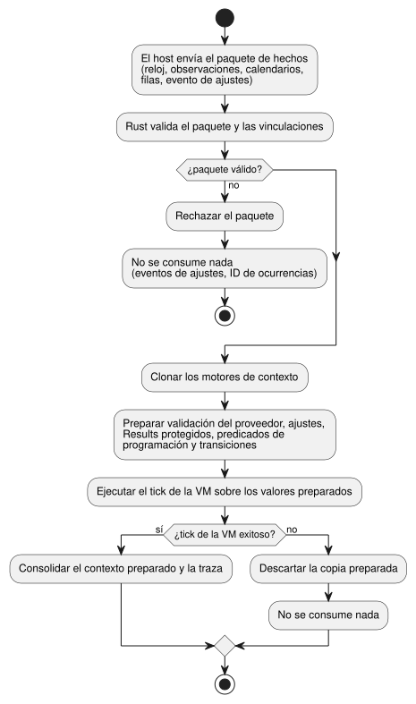
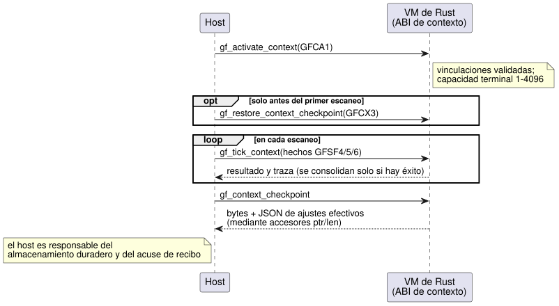

<!-- translation-source: docs/CONTEXT-EXECUTION-ABI.md -->
[Original en inglés](CONTEXT-EXECUTION-ABI.md)

# ABI de ejecución de contexto

Este documento define el contrato binario entre un host y la VM portable de
Rust para las programaciones y los Results *impulsados por contexto*. GFB11
(`control-v10`) ejecuta estas formas en la VM de Rust:

- programaciones Periodic
- programaciones Cron
- programaciones Daily con WorkCalendar
- programaciones Run de marea (Tide)
- DailySlots respaldados por config
- Results naturales y de contabilización de uso

El entorno de ejecución y los verificadores de paquetes rechazan el GFB10 histórico (`control-v9`). Vuelve a compilar el código fuente canónico para generar un artefacto actual.

Perfiles posteriores amplían la misma ABI con límites de calendario (GFB18),
Holiday Daily (GFB15) y Solar con config compartida (GFB16).

La fuente pública sigue siendo un único documento `.ghost.md` completo. Las
formas binarias y de reducción interna que se describen a continuación son
contratos de transporte. No son una fuente de producto alternativa.

En este documento:

- quién es responsable de cada decisión y cuándo se consolida un tick;
- la disposición de los descriptores (etiquetas del preludio) en el programa
  compilado;
- el paquete de activación (GFCA1) y el paquete de hechos por tick (GFSF4);
- los puntos de control (checkpoints) de contexto duraderos (GFCX3);
- la extensión Solar compartida (GFB16, GFSF6);
- la evidencia de pruebas y el origen de retorno de ajustes temporales.

Todos los enteros son little endian. Una notación de campos como `u64 a/b/c`
significa tres campos `u64` consecutivos llamados `a`, `b` y `c`.

## Responsabilidades y límite de consolidación

El host solo suministra hechos en bruto:

- instantáneas de reloj;
- observaciones del proveedor;
- instantáneas de calendario;
- filas de ocurrencias civiles ya resueltas;
- eventos explícitos de ajustes.

Rust valida las vinculaciones (bindings) y toma todas las decisiones:

- identidad de la ocurrencia;
- due, missed y active;
- el Result natural;
- aceptación de los ajustes;
- estado terminal;
- duración del Run.

Las proyecciones suministradas por el host están prohibidas. Las entradas
naturales usan las entradas protegidas `__gf_natural_SITE_ok/value/fault`. La
contabilización de uso usa `__gf_accounting_SITE_ok/value/fault`.

Un tick de contexto trabaja sobre una copia. Clona los motores de contexto y
*prepara* (stage) la validación del proveedor, los cambios de ajustes, los
Results protegidos, los predicados de programación y las transiciones. Solo un
tick de VM exitoso consolida el contexto preparado y la traza. Un paquete
rechazado o un error de la VM no consume ni eventos de ajustes ni identidades
de ocurrencias.

El siguiente diagrama muestra este límite de preparar y luego consolidar.



Hay una excepción relativa al libro mayor (ledger) de contabilización. Las
observaciones de contabilización viven en un libro mayor de Rust independiente.
Las observaciones que ya se consolidaron de forma duradera allí permanecen
consolidadas aunque falle un escaneo posterior. La ABI de contabilización
construye los valores Result a partir de ese libro mayor. GFSF4 no puede
transportar proyecciones de contabilización.

**Vinculaciones de proveedor.** Una vinculación de proveedor fija estos campos:
proveedor lógico, tipo, espacio de nombres, estación, revisión de la
vinculación, ubicación, zona horaria, criterios de clasificación y umbral de
incertidumbre. Dentro de un mismo tick, todas las vistas de un proveedor deben
compartir la misma revisión, cobertura, vencimiento, incertidumbre y fallo.

**Etiquetas y filas.** Las etiquetas de clasificación y las filas de
ocurrencias son cargas útiles separadas. Las etiquetas vacías significan cosas
distintas según el lado:

- En una observación del lado de las ocurrencias, las etiquetas vacías omiten la
  carga útil de etiquetas.
- En una observación natural, las etiquetas vacías certifican un conjunto vacío.

Si ambas vistas suministran etiquetas, sus conjuntos de etiquetas deben
coincidir.

**Revisiones.** Tres tipos de revisión identifican cosas distintas:

- La revisión de proveedor del sobre identifica la instantánea completa.
- La revisión de proveedor de cada fila Tide identifica esa predicción de
  evento. Puede diferir de la revisión del sobre.
- La revisión de contexto de una fila identifica el contexto que la resolvió.

Un Run admitido conserva su hora planificada original y las revisiones de su
fila hasta que finaliza.

**Ventanas de tiempo.** La cobertura es el intervalo semiabierto
`[start,end)`. Una observación está vencida, y por tanto no es válida, cuando
`now >= expiry`. La incertidumbre es un umbral de certificación. No es
aritmética sobre los intervalos de admisión. Una observación ausente produce un
Unknown tipado, nunca evidencia fabricada.

## Descriptores ejecutables

Cada programación o Result de un programa compilado se describe mediante un
*preludio de estrategia etiquetado* en la cabecera GFB. GFB11 conserva la
cabecera temporal de GFB y los preludios de estrategia etiquetados:

- Las etiquetas existentes 0–4 conservan su disposición.
- Las etiquetas 5–9 comienzan con el prefijo común
  `u32 site, string name, u64 gapMs` y terminan con los blobs de expresión Bool
  `when, cancel`.
- Las etiquetas 10 y 11 describen Results. Sus filas enumeran los campos a
  partir de `u32 site`.

| Etiqueta | Cuerpo entre el prefijo común y las expresiones |
| --- | --- |
| 5 Periodic | string epochId, u64 anchorMs, u32 configId (0 → u64 intervalMs) |
| 6 Cron | string timezone, u8 dstMissing/dstRepeated, cinco listas de u8 count seguido de valores de campo u8 |
| 7 Calendar Daily | string timezone, u64 atMs, string calendar, u8 offday/dstMissing/dstRepeated |
| 8 Tide Run | string timezone/provider, u8 high, i64 offsetMs, u64 runMs/withinMs |
| 9 Config DailySlots | string timezone, u32 configId, u8 dstMissing/dstRepeated |
| 10 Natural Result | u32 site, string name, u8 kind, string provider/classification, u16 índices de entrada ok/value/fault |
| 11 Accounting Result | u32 site, string name/account/event/timezone, u16 índices de entrada ok/value/fault |

Las proyecciones de Result tienen estos tipos:

- natural: Bool/Bool/Number;
- contabilización: Bool/Int/Number.

Un Number de fallo transporta un código de enumeración finito. El opcode 58 lee
los campos de programación 0/1/2, que son due/missed/active.

Los ajustes conservan sus identidades de origen incluso cuando las ediciones
del operador están deshabilitadas. Omitir una concesión de acceso no autoriza
ediciones.

**Reglas de codificación:**

- Todos los enteros son little endian.
- Las cadenas usan una longitud en bytes u16 seguida de bytes UTF-8.
- Los blobs de expresión usan una longitud en bytes u32.
- Las cadenas de identidad del proveedor no están vacías y tienen como máximo
  128 bytes.
- Los valores numéricos exactos de transporte son como máximo
  9007199254740991.
- Las huellas (fingerprints) de programa transportan los 64 bits completos.

### Límites de calendario de GFB18

`GhostFlow/control-v18` usa GFB18 para dos formas de calendario: los Results de
calendario ordinarios y los rangos Daily UTC inmutables de días laborables/no
laborables. GFB18 añade estas etiquetas de preludio:

| Etiqueta | Cuerpo |
| --- | --- |
| 17 Calendar Range | u32 site, string name, u64 gapMs, string timezone (`UTC`), u64 durationMs, u16 startCount seguido de u64 startsMs, string calendar, u8 selector, blobs de expresión Bool when/cancel |
| 18 Calendar Result | u32 site, string name/calendar, u8 selector, string timezone (`UTC`), u16 índices de entrada protegida ok/value/fault |

Selectores:

| Selector | Range | Result |
| --- | --- | --- |
| 0 workday | permitido | permitido |
| 1 offday | permitido | permitido |
| 2 holiday | no permitido | permitido |

Reglas de Range:

- El fragmento Range de origen es un Daily UTC inmutable.
- Su intervalo semiabierto debe terminar a medianoche o antes.
- Un intervalo de trabajo que cruza la medianoche se rechaza. En su lugar,
  represéntelo como declaraciones separadas y explícitas.
- Un Range UTC ordinario conserva su semántica existente.
- La elegibilidad de calendario se comprueba antes de una nueva admisión. Un
  Range ya admitido conserva su plazo monotónico.

Ambos descriptores consumen los hechos `schedule` de GFSF5 existentes, indexados
por site. Esos hechos transportan la instantánea de calendario opcional. Result
y Range no necesitan ninguna observación del proveedor ni filas de ocurrencias
civiles.

Rust deriva la fecha UTC a partir de evidencia de reloj de confianza y evalúa
el calendario. Conserva los fallos de ausencia, fuera de cobertura y
vencimiento. La proyección del Result es Bool/Bool/Number, con un código
CalendarFault finito. Estas entradas están protegidas, por lo que el host no
puede suministrar proyecciones de elegibilidad.

La activación requiere una vinculación de calendario UTC explícita y
coincidente. Cuando los consumidores Result, Range y de pulso Daily comparten
una vinculación, estas garantías se aplican a todos ellos:

- igualdad de instantáneas;
- historial de revisiones;
- retención acotada;
- atomicidad de un escaneo rechazado.

Los formatos de hechos y de puntos de control existentes no cambian. Los
cargadores anteriores rechazan la nueva cabecera GFB.

## Activación y hechos

El host llama a dos puntos de entrada. Activa el contexto una vez y luego envía
un paquete de hechos en cada tick. Un punto de control solo puede restaurarse
entre la activación y el primer escaneo (consulte
[Contexto duradero](#contexto-duradero)).



`gf_activate_context(handle, ptr, len)` consume GFCA1:

```text
"GFCA", u16 1, u64 bootEpoch, u32 terminalCapacity,
u16 bindingCount, binding[]
binding := u8 kind, string provider/namespace/station/bindingRevision/
           location/timezone/criteria, u64 maxUncertaintyMs
```

Reglas de activación:

- Los tipos de vinculación son Tide 0, Moon 1 y Calendar 2.
- La capacidad terminal es de 1–4096.
- Se permiten como máximo 128 vinculaciones de activación.
- Una vinculación no usada, duplicada o no coincidente rechaza la activación.
- La capacidad de ajustes y la capacidad de filas del paquete son
  independientes de la capacidad del libro mayor terminal.

`gf_tick_context(handle, ptr, len)` consume GFSF4:

```text
"GFSF", u16 4,
u64 monotonicMs/bootEpoch, optional wallMs/uncertaintyMs,
u8 trusted, string reason/sourceRevision,
u16 naturalCount, observation[], u16 scheduleCount, schedule[],
u8 settingsPresent, [settings]

observation := binding, string providerRevision,
               u64 coverageStartMs/coverageEndMs/expiresAtMs/uncertaintyMs,
               u8 fault, u8 classificationCount, string classifications[]
schedule := u32 site, u64 coverageStartMs/coverageEndMs,
            u8 providerPresent, [observation], u8 calendarPresent, [calendar],
            u16 rowCount, row[]
row := u32 sourceDay, u64 slotKey, u16 minuteOfDay, u8 fold,
       string eventId, u8 eventKind, optional instantMs, u8 withdrawn,
       string providerRevision/contextRevision
calendar := string id/revision/timezone, u32 fromDate/toDateExclusive,
            u64 expiresAtMs, u8 weeklyWorkMask/holidayWork,
            u16 holidayCount, u32 holidays[],
            u16 exceptionCount, (u32 date, u8 work) exceptions[]
settings := u64 programFingerprint, string eventId,
            u64 baseRevision/position, u16 changeCount, change[]
change := u32 site, u8 kind,
          (u64 durationMs | u16 slotCount, (u64 key, u16 minuteOfDay) slots[])
```

Valores de los campos:

| Campo | Codificación |
| --- | --- |
| tiempo opcional | `u8 present, u64 value`; el valor es cero cuando está ausente |
| `eventKind` | civil 0, high 1, low 2 |
| `fault` del proveedor | 255 significa ausente; 0–5 corresponden a la enumeración finita de fallos naturales |
| `kind` de ajustes | 0 Duration, 1 TimeSlots |
| `key` de franja | 0 solicita una asignación; una clave distinta de cero ya debe pertenecer al ajuste |

Reglas de ajustes:

- El valor completo con claves reemplaza al valor anterior.
- La posición del evento es el número del siguiente escaneo exitoso.
- La revisión base debe ser igual a la revisión actual de los ajustes.
- Los ajustes y su escaneo se consolidan de forma atómica.

Límites:

- Los paquetes de activación y de hechos tienen como máximo 65536 bytes.
- Los recuentos de secciones son como máximo 128.
- Las filas de ocurrencias son como máximo 4096.
- Los decodificadores rechazan bytes sobrantes y etiquetas mal formadas.
- Los puntos de entrada nativos también validan los límites de la carga útil y
  la compatibilidad de los descriptores.

## Contexto duradero

`gf_context_checkpoint` captura los bytes del punto de control y el JSON de los
ajustes efectivos. El host los lee mediante `gf_context_checkpoint_ptr/len` y
`gf_context_state_ptr/len`.

`gf_restore_context_checkpoint(handle, ptr, len)` solo se permite antes del
primer escaneo de una ejecución activada. El host es responsable del
almacenamiento duradero y del acuse de recibo.

Un punto de control GFCX3 contiene:

- número mágico y versión;
- la huella exacta del Program;
- los bytes canónicos de las vinculaciones;
- la revisión de los ajustes;
- las identidades de eventos aceptados;
- las instantáneas de los motores, indexadas por site;
- el contenido completo de los calendarios aceptados, indexado por ID y
  revisión;
- un CRC32.

Límites y reglas de rechazo:

- Los calendarios almacenados están acotados a `min(terminalCapacity, 128)`
  instantáneas y 8192 celdas de fecha de festivos/excepciones.
- La restauración rechaza una revisión cuyo contenido haya cambiado, así como
  cualquier violación de límites.
- GFCX1 y GFCX2 se rechazan explícitamente.
- El envoltorio tiene como máximo 4 MiB; cada instantánea de motor tiene como
  máximo 1 MiB.
- Una discrepancia de identidad, una corrupción, unos ajustes restaurados no
  válidos o un desbordamiento de capacidad rechazan la restauración completa.

CRC32 detecta corrupción accidental. No es un mecanismo de autenticación.

Qué sobrevive a un reinicio:

| Sobrevive | No sobrevive |
| --- | --- |
| fase e intervalo Periodic efectivos | observaciones de reloj |
| franjas con claves y el asignador de franjas | Runs activos |
| identidades de ocurrencias terminales | |

Una ejecución restaurada establece una línea base nueva y no puede reproducir
ocurrencias pasadas. Este es un punto de control de contexto. No es un libro
mayor de contabilización ni una imagen general del estado de la VM.

## Extensión de contexto Solar compartida

Las disposiciones anteriores describen el perfil de contexto original. Dos
adiciones posteriores se basan en él:

- Los ajustes tipados usan el sobre GFSF5 descrito en
  [flujos de configuración](OPERATOR-SETTINGS-STREAM.es.md).
- Calendar Holiday Daily añade la tag15 de GFB15.

Solar con config compartida usa GFB16/control-v15. Conserva la activación GFCA1
existente y los descriptores de config compartida de GFB11. La tag16 tiene el
prefijo común `u32 site, string name, u64 gapMs`, seguido de:

```text
string timezone, f64 latitude, f64 longitude, u8 event,
i64 offsetMs, u64 fallbackAtMs,
u16 configDependencyCount, u32 configIds[],
expression when, expression cancel, u64 holdMs
```

Reglas de la tag16:

- `event` es rise 0 o set 1.
- `fallbackAtMs` 86400000 significa ausente; `holdMs` 0 significa ausente.
- Los ID de config están ordenados y son únicos.
- Rust verifica las dependencias exactas a partir de las lecturas protegidas de
  `when`. Cualquier config referenciada con un fallo actual impide la admisión.
- Los campos de la vinculación son inmutables y deben coincidir exactamente con
  los hechos.

GFSF6 conserva GFSF5 hasta su sección opcional de ajustes inclusive, y luego
añade:

```text
u16 solarCount, solar[]
solar := u32 site, string timezone, f64 latitude, f64 longitude,
         u8 event, i64 offsetMs, u64 coverageStartMs/coverageEndMs,
         u16 rowCount, solarRow[]
solarRow := u32 sourceDay, u8 availability,
            optional scheduledWallMs, optional fallbackWallMs,
            u8 unavailableReason, string providerRevision/contextRevision
```

Reglas de GFSF6:

- `availability` es available 0 o unavailable 1.
- `unavailableReason` 255 significa ausente; 0–5 son códigos tipados de fallo
  natural.
- Los tiempos opcionales conservan la forma `u8 present, u64 value`, con cero
  cuando están ausentes.
- Las filas Solar no aceptan campos civiles de franja/fold. Rust fija esos
  componentes de identidad en cero.
- `solarContextEvidence(descriptor, providerSchedule)` en
  `runtimes/wasm/context-abi.mjs` proyecta los hechos del proveedor en este
  paquete. No calcula la admisión.
- Un contexto Solar requiere GFSF6. Los perfiles existentes que no son Solar
  conservan GFSF5 por una decisión explícita de compatibilidad.

Consolidación y recuperación:

- Solar, el vector de config compartida y la VM se consolidan juntos.
- Una evaluación fallida no consume ni eventos ni ocurrencias.
- Una recuperación exitosa establece una línea base, sin ponerse al día con
  ocurrencias pasadas.
- GFCX3 incrusta el estado del motor Solar de GFES subtype3. Con el
  Program/las vinculaciones exactos, conserva las identidades terminales por día
  de origen y los Results de config actuales. Descarta las observaciones de
  reloj para que la ejecución restaurada comience desde una línea base nueva.
- Los cargadores GFB anteriores rechazan format16.
- Los consumidores Solar independientes conservan su perfil existente. No hay
  ningún respaldo (fallback) implícito entre ambos.

Consulte la [guía de ejecución](SOLAR-CONFIG-EXECUTION.es.md) para conocer el
alcance y los pasos de reproducción.

## Evidencia

**Perfil de prueba nativo.** El perfil nativo `context_tape`, solo para
pruebas, `context-tide-v1` acepta vinculaciones Tide acotadas y observaciones
finitas del proveedor con ID de evento high/low explícitos. Las demás
protecciones de perfil siguen siendo independientes. Este perfil no acepta
vinculaciones Moon/calendar ni canales de proveedores naturales. El núcleo
compartido es responsable de la admisión. Los registros nativos exponen
resultados completos, el estado de origen/ajustes y los puntos de control de
contexto. Tras hechos rechazados, conservan la evidencia existente de
registro (journal)/punto de control para un reintento.

**REF-03-029.** Este caso compila la misma fuente Tide de dos sites y compara la
ejecución nativa con la ejecución WASM enmarcada:

1. El evento E se admite a los 1000ms.
2. Se corrigen las revisiones de proveedor/contexto y la hora planificada de E
   se mueve a 2000ms. Mientras el Run monotónico existente está Active,
   conserva el ID de la ocurrencia realmente admitida, las revisiones
   originales y la hora planificada de 1000ms. Ninguna de las programaciones
   emite otro Due.
3. Después de que termina ese Run, un escaneo de E corregido a los 2500ms deja
   ambos contadores de ejecución en uno. El núcleo actual omite los ID Tide
   terminales de las observaciones de contexto posteriores. Esta evidencia no
   inventa una disposición literal `AlreadyAdmitted` ni `AlreadyTerminal`.
4. Un E2 nuevo a los 3000ms se admite de forma independiente en ambos sites de
   programación de origen distintos.

La prueba también comprueba la paridad completa de resultados/estado y de
puntos de control, la reproducción del punto de control con un programa
coincidente, el rechazo de una vinculación falsificada y un reintento válido.

Límites de esta evidencia:

- La restauración del contexto no restaura el estado general de la VM ni los
  Runs activos.
- Los hechos del proveedor los suministra el llamador.
- No se afirma nada sobre la autenticidad del proveedor, la salida física, el
  transporte en producción ni ninguna nueva política genérica de Run.

**Conjuntos de pruebas.**

| Conjunto | Cubre |
| --- | --- |
| `context_runtime_tests` | entradas protegidas, coherencia del proveedor compartido, reversión ante fallo de la VM, reintento de ajustes y restauración duradera protegida por identidad |
| `context_abi` | rechazo de paquetes |
| `context_schedule`, `natural_context`, `work_calendar`, `cron_schedule` | límites específicos de cada tipo |

Los fixtures de Reference de extremo a extremo ejercitan la compilación
canónica y el mismo runtime WASM, no una implementación de programación del
lado del host.

## Origen de retorno de ajustes temporales

En los ajustes tipados de GFSF5/GFSF6, la etiqueta de origen 2 es
`temporaryReturn`. Se usa para un retorno registrado y validado por el Host de
un ajuste temporal.

- Conserva las comprobaciones de destino editable por el operador y las
  comprobaciones tipadas de rango, rejilla y capacidad.
- Además, permite claves de fila TimeSlots asignadas previamente que estén por
  debajo del límite del asignador del flujo.
- El origen ordinario 0 y el origen de productor 1 conservan sus reglas
  existentes.
- Los runtimes anteriores rechazan el origen adicional.
- El origen no es un token de autenticación.

Consulte [host de ajustes temporales](TEMPORARY-SETTINGS-HOST.es.md) para conocer
la procedencia vinculada a la fuente y las entradas de confianza del Host.
