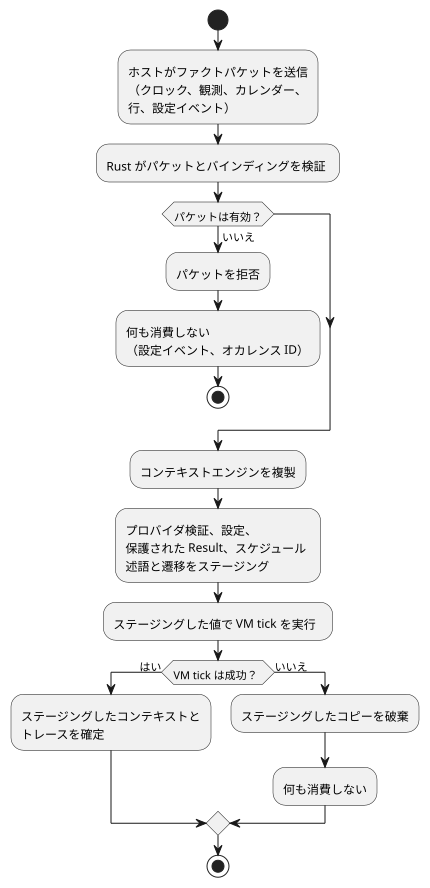
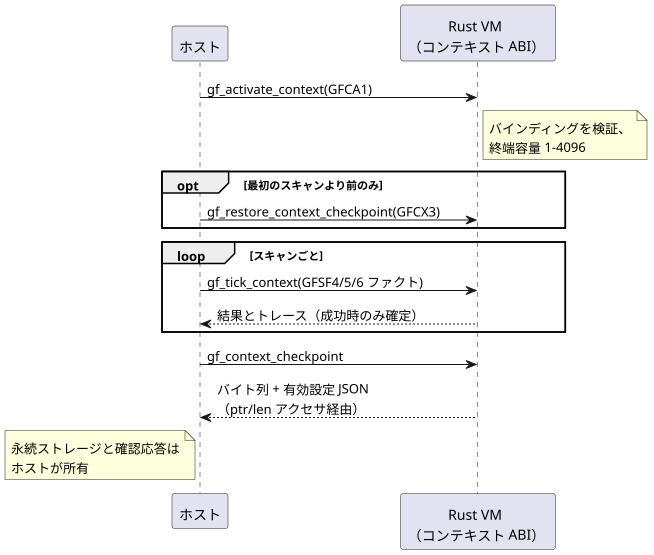

<!-- translation-source: docs/CONTEXT-EXECUTION-ABI.md -->
[英語の原文](CONTEXT-EXECUTION-ABI.md)

# コンテキスト実行 ABI

この文書は、*コンテキスト駆動*のスケジュールと Result について、ホストとポータブルな
Rust VM の間のバイナリ契約を定義します。GFB10（`control-v9`）は、次の形式を
Rust VM で実行します。

- Periodic スケジュール
- Cron スケジュール
- WorkCalendar Daily スケジュール
- Tide Run スケジュール
- config に基づく DailySlots
- natural Result と accounting Result

後続のプロファイルは、同じ ABI をカレンダー境界（GFB18）、Holiday Daily（GFB15）、
共有 config の Solar（GFB16）で拡張しています。

公開されるソースは、引き続き 1 つの完全な `.ghost.md` 文書です。以下のバイナリ形式と
内部の lowering 形式はトランスポート契約です。製品ソースの代替ではありません。

この文書の内容:

- どの判断を誰が所有し、tick がいつ確定するか
- コンパイル済みプログラム内のディスクリプタ（prelude タグ）のレイアウト
- アクティベーションパケット（GFCA1）と tick ごとのファクトパケット（GFSF4）
- 永続的なコンテキストチェックポイント（GFCX3）
- 共有 Solar 拡張（GFB16、GFSF6）
- テストの証拠と、一時設定の復帰オリジン

すべての整数はリトルエンディアンです。`u64 a/b/c` のようなフィールド表記は、
`a`、`b`、`c` という名前の 3 つの連続した `u64` フィールドを意味します。

## 所有権と確定の境界

ホストが提供するのは、次の生のファクトだけです。

- クロックのスナップショット
- プロバイダの観測
- カレンダーのスナップショット
- 解決済みの暦（civil）オカレンス行
- 明示的な設定イベント

Rust はバインディングを検証し、次のすべての判断を行います。

- オカレンスの同一性
- due、missed、active
- natural Result
- 設定の受け入れ
- 終端状態
- Run の継続時間

ホストが提供する射影（projection）は禁止されています。natural の入力は保護された入力
`__gf_natural_SITE_ok/value/fault` を使います。accounting は
`__gf_accounting_SITE_ok/value/fault` を使います。

コンテキスト tick はコピーに対して動作します。コンテキストエンジンを複製し、
プロバイダ検証、設定変更、保護された Result、スケジュール述語、遷移を*ステージング*
します。ステージングしたコンテキストとトレースを確定するのは、成功した VM tick だけです。
拒否されたパケットや VM エラーは、設定イベントもオカレンスの同一性も消費しません。

次の図は、このステージングしてから確定する境界を示しています。



例外が 1 つあり、それは使用量計上の台帳に関するものです。使用量計上の観測は、別個の
Rust 台帳に保持されます。そこですでに永続的に確定した観測は、後のスキャンが失敗しても
確定したままです。accounting ABI は、その台帳から Result の値を構築します。GFSF4 は
accounting の射影を運ぶことができません。

**プロバイダのバインディング。** プロバイダのバインディングは、次のフィールドを固定します。
論理プロバイダ、種類、名前空間、ステーション、バインディングのリビジョン、場所、
タイムゾーン、分類基準、不確実性のしきい値です。1 つの tick の中では、1 つのプロバイダの
すべてのビューが、同じリビジョン、カバー範囲、有効期限、不確実性、故障を共有しなければ
なりません。

**ラベルと行。** 分類ラベルとオカレンス行は別々のペイロードです。空のラベルの意味は
側によって異なります。

- オカレンス側の観測では、空のラベルはラベルペイロードの省略を意味します。
- natural の観測では、空のラベルは空集合であることを証明します。

両方のビューがラベルを提供する場合、それらのラベル集合は一致しなければなりません。

**リビジョン。** 3 種類のリビジョンが、それぞれ異なるものを識別します。

- エンベロープのプロバイダリビジョンは、スナップショット全体を識別します。
- 各 Tide 行のプロバイダリビジョンは、そのイベント予測を識別します。これはエンベロープの
  リビジョンと異なってもかまいません。
- 行のコンテキストリビジョンは、その行を解決したコンテキストを識別します。

受け入れられた Run は、完了するまで元の計画時刻と行リビジョンを保持します。

**時間ウィンドウ。** カバー範囲は半開区間 `[start,end)` です。`now >= expiry` のとき、
観測は期限切れであり、したがって無効です。不確実性は証明のためのしきい値です。
受け入れ区間に対する演算ではありません。観測が欠落すると、型付きの Unknown が生じます。
証拠が捏造されることは決してありません。

## 実行可能なディスクリプタ

コンパイル済みプログラム内の各スケジュールまたは Result は、GFB ヘッダ内の*タグ付き
ストラテジ prelude* によって記述されます。GFB10 は GFB の時間ヘッダとタグ付き
ストラテジ prelude を保持します。

- 既存のタグ 0–4 はレイアウトを維持します。
- タグ 5–9 は共通プレフィックス `u32 site, string name, u64 gapMs` で始まり、
  Bool 式の blob `when, cancel` で終わります。
- タグ 10 と 11 は Result を記述します。それらの行には `u32 site` から始まるフィールドを
  記載しています。

| タグ | 共通プレフィックスと式の間の本体 |
| --- | --- |
| 5 Periodic | string epochId, u64 anchorMs, string setting, u8 operatorEditable, u64 initialMs/minMs/maxMs/stepMs |
| 6 Cron | string timezone, u8 dstMissing/dstRepeated, u8 の個数とそれに続く u8 フィールド値からなる 5 つのリスト |
| 7 Calendar Daily | string timezone, u64 atMs, string calendar, u8 offday/dstMissing/dstRepeated |
| 8 Tide Run | string timezone/provider, u8 high, i64 offsetMs, u64 runMs/withinMs |
| 9 Config DailySlots | string timezone/setting, u8 operatorEditable, u64 gridMs, u16 capacity, u16 initialCount, u16 minutes, u8 dstMissing/dstRepeated |
| 10 Natural Result | u32 site, string name, u8 kind, string provider/classification, u16 ok/value/fault の入力インデックス |
| 11 Accounting Result | u32 site, string name/account/event/timezone, u16 ok/value/fault の入力インデックス |

Result の射影の型は次のとおりです。

- natural: Bool/Bool/Number
- accounting: Bool/Int/Number

故障の Number は有限の列挙型コードを運びます。オペコード 58 はスケジュールのフィールド
0/1/2、すなわち due/missed/active を読み取ります。

オペレーターによる編集が無効な場合でも、設定はソース上の同一性を保持します。アクセス権の
付与が省略されている場合、編集は許可されません。

**エンコード規則:**

- すべての整数はリトルエンディアンです。
- 文字列は u16 のバイト長に続けて UTF-8 バイト列を置きます。
- 式の blob は u32 のバイト長を使います。
- プロバイダの同一性文字列は空でなく、最大 128 バイトです。
- 厳密な数値のトランスポート値は最大 9007199254740991 です。
- プログラムのフィンガープリントは 64 ビットすべてを運びます。

### GFB18 カレンダー境界

`GhostFlow/control-v18` は、2 つのカレンダー形式に GFB18 を使います。通常のカレンダー
Result と、不変の UTC Daily の稼働日/非稼働日の Range です。GFB18 は次の prelude タグを
追加します。

| タグ | 本体 |
| --- | --- |
| 17 Calendar Range | u32 site, string name, u64 gapMs, string timezone（`UTC`）, u64 durationMs, u16 startCount とそれに続く u64 startsMs, string calendar, u8 selector, Bool 式の blob when/cancel |
| 18 Calendar Result | u32 site, string name/calendar, u8 selector, string timezone（`UTC`）, u16 ok/value/fault の保護された入力インデックス |

セレクタ:

| セレクタ | Range | Result |
| --- | --- | --- |
| 0 workday | 可 | 可 |
| 1 offday | 可 | 可 |
| 2 holiday | 不可 | 可 |

Range の規則:

- ソースの Range スライスは不変の UTC Daily です。
- その半開区間は午前 0 時以前に終わらなければなりません。
- 午前 0 時をまたぐ稼働区間は拒否されます。代わりに、別々の明示的な宣言として表して
  ください。
- 通常の UTC Range は既存のセマンティクスを維持します。
- カレンダーの適格性は、新しい受け入れの前に確認されます。すでに受け入れられた Range は、
  その単調な期限を保持します。

どちらのディスクリプタも、サイトをキーとする既存の GFSF5 `schedule` ファクトを
消費します。それらのファクトは任意のカレンダースナップショットを運びます。Result と
Range には、プロバイダの観測も暦オカレンス行も必要ありません。

Rust は信頼できるクロックの証拠から UTC の日付を導出し、カレンダーを評価します。
missing、カバー範囲外、期限切れの各故障を保持します。Result の射影は Bool/Bool/Number で、
有限の CalendarFault コードを伴います。これらの入力は保護されているため、ホストは適格性の
射影を提供できません。

アクティベーションには、明示的で一致する UTC カレンダーバインディングが必要です。
Result、Range、Daily パルスの利用側がバインディングを共有する場合、次の保証はそのすべてに
またがって適用されます。

- スナップショットの等価性
- リビジョン履歴
- 上限付きの保持
- 拒否されたスキャンのアトミック性

既存のファクトとチェックポイントの形式は変わりません。古いローダーは新しい GFB ヘッダを
拒否します。

## アクティベーションとファクト

ホストは 2 つのエントリポイントを呼び出します。コンテキストを一度アクティベートし、
その後 tick ごとにファクトパケットを送ります。チェックポイントの復元は、アクティベーションと
最初のスキャンの間でのみ行えます（[永続コンテキスト](#永続コンテキスト)を参照）。



`gf_activate_context(handle, ptr, len)` は GFCA1 を消費します。

```text
"GFCA", u16 1, u64 bootEpoch, u32 terminalCapacity,
u16 bindingCount, binding[]
binding := u8 kind, string provider/namespace/station/bindingRevision/
           location/timezone/criteria, u64 maxUncertaintyMs
```

アクティベーションの規則:

- バインディングの種類は Tide 0、Moon 1、Calendar 2 です。
- 終端容量は 1–4096 です。
- アクティベーションバインディングは最大 128 個です。
- 未使用、重複、または不一致のバインディングがあると、アクティベーションは拒否されます。
- 設定の容量とパケット行の容量は、終端台帳の容量とは別です。

`gf_tick_context(handle, ptr, len)` は GFSF4 を消費します。

```text
"GFSF", u16 4,
u64 monotonicMs/bootEpoch, optional wallMs/uncertaintyMs,
u8 trusted, string reason/sourceRevision,
u16 naturalCount, observation[], u16 scheduleCount, schedule[],
u8 settingsPresent, [settings]

observation := binding, string providerRevision,
               u64 coverageStartMs/coverageEndMs/expiresAtMs/uncertaintyMs,
               u8 fault, u8 classificationCount, string classifications[]
schedule := u32 site, u64 coverageStartMs/coverageEndMs,
            u8 providerPresent, [observation], u8 calendarPresent, [calendar],
            u16 rowCount, row[]
row := u32 sourceDay, u64 slotKey, u16 minuteOfDay, u8 fold,
       string eventId, u8 eventKind, optional instantMs, u8 withdrawn,
       string providerRevision/contextRevision
calendar := string id/revision/timezone, u32 fromDate/toDateExclusive,
            u64 expiresAtMs, u8 weeklyWorkMask/holidayWork,
            u16 holidayCount, u32 holidays[],
            u16 exceptionCount, (u32 date, u8 work) exceptions[]
settings := u64 programFingerprint, string eventId,
            u64 baseRevision/position, u16 changeCount, change[]
change := u32 site, u8 kind,
          (u64 durationMs | u16 slotCount, (u64 key, u16 minuteOfDay) slots[])
```

フィールドの値:

| フィールド | エンコード |
| --- | --- |
| 任意の時刻 | `u8 present, u64 value`。存在しない場合、値は 0 |
| `eventKind` | civil 0、high 1、low 2 |
| プロバイダの `fault` | 255 は存在しないことを意味し、0–5 は有限の natural 故障列挙型に対応 |
| 設定の `kind` | 0 Duration、1 TimeSlots |
| スロットの `key` | 0 は割り当てを要求する。0 以外のキーはすでにその設定に属していなければならない |

設定の規則:

- キー付きの値全体が古い値を置き換えます。
- イベントの位置は、次に成功するスキャンの番号です。
- ベースリビジョンは現在の設定リビジョンと等しくなければなりません。
- 設定とそのスキャンはアトミックに確定します。

上限:

- アクティベーションパケットとファクトパケットは最大 65536 バイトです。
- セクションの個数は最大 128 です。
- オカレンス行は最大 4096 です。
- デコーダは末尾の余分なバイトと不正なタグを拒否します。
- ネイティブのエントリポイントも、ペイロードの上限とディスクリプタの互換性を検証します。

## 永続コンテキスト

`gf_context_checkpoint` は、チェックポイントのバイト列と有効設定の JSON を取得します。
ホストはそれらを `gf_context_checkpoint_ptr/len` と `gf_context_state_ptr/len` を通じて
読み取ります。

`gf_restore_context_checkpoint(handle, ptr, len)` は、アクティベートされた実行（run）の
最初のスキャンの前にのみ許可されます。永続ストレージと確認応答はホストが所有します。

GFCX3 チェックポイントには次のものが含まれます。

- マジックとバージョン
- 厳密なプログラムのフィンガープリント
- 正規のバインディングのバイト列
- 設定リビジョン
- 受け入れ済みのイベントの同一性
- サイトをキーとするエンジンのスナップショット
- 受け入れ済みカレンダーの全内容（ID とリビジョンをキーとする）
- CRC32

上限と拒否の規則:

- 保存されるカレンダーは、`min(terminalCapacity, 128)` 個のスナップショットと
  8192 個の祝日/例外の日付セルに制限されます。
- 復元は、内容が変更されたリビジョンと、あらゆる上限違反を拒否します。
- GFCX1 と GFCX2 は明示的に拒否されます。
- ラッパーは最大 4 MiB、各エンジンのスナップショットは最大 1 MiB です。
- 同一性の不一致、破損、復元された設定の不正、または容量のオーバーフローがあると、
  復元全体が拒否されます。

CRC32 は偶発的な破損を検出します。認証の仕組みではありません。

再起動後に残るもの:

| 残るもの | 残らないもの |
| --- | --- |
| 有効な Periodic の位相と間隔 | クロックの観測 |
| キー付きスロットとスロットアロケータ | アクティブな Run |
| 終端オカレンスの同一性 | |

復元された実行は新しいベースラインを確立し、過去のオカレンスをリプレイできません。
これはコンテキストのチェックポイントです。使用量計上の台帳でも、汎用の VM 状態の
イメージでもありません。

## 共有 Solar コンテキスト拡張

上記のレイアウトは、元のコンテキストプロファイルを記述しています。その上に後から
2 つの追加があります。

- 型付き設定は、[設定ストリーム](OPERATOR-SETTINGS-STREAM.ja.md)で説明している
  GFSF5 エンベロープを使います。
- Calendar Holiday Daily は GFB15 tag15 を追加します。

共有 config を使う Solar は GFB16/control-v15 を使います。既存の GFCA1 アクティベーションと
GFB11 の共有 config ディスクリプタを保持します。Tag16 は共通の
`u32 site, string name, u64 gapMs` プレフィックスを持ち、その後に次が続きます。

```text
string timezone, f64 latitude, f64 longitude, u8 event,
i64 offsetMs, u64 fallbackAtMs,
u16 configDependencyCount, u32 configIds[],
expression when, expression cancel, u64 holdMs
```

Tag16 の規則:

- `event` は rise 0 または set 1 です。
- `fallbackAtMs` が 86400000 の場合は存在しないことを意味し、`holdMs` が 0 の場合は
  存在しないことを意味します。
- config ID はソート済みで一意です。
- Rust は保護された `when` の読み取りから厳密な依存関係を検証します。参照される config の
  いずれかに現在の故障があると、受け入れは行われません。
- バインディングのフィールドは不変であり、ファクトと厳密に一致しなければなりません。

GFSF6 は、任意の設定セクションまでを含めて GFSF5 をそのまま保持し、その後に次を
追加します。

```text
u16 solarCount, solar[]
solar := u32 site, string timezone, f64 latitude, f64 longitude,
         u8 event, i64 offsetMs, u64 coverageStartMs/coverageEndMs,
         u16 rowCount, solarRow[]
solarRow := u32 sourceDay, u8 availability,
            optional scheduledWallMs, optional fallbackWallMs,
            u8 unavailableReason, string providerRevision/contextRevision
```

GFSF6 の規則:

- `availability` は available 0 または unavailable 1 です。
- `unavailableReason` が 255 の場合は存在しないことを意味し、0–5 は型付きの natural
  故障コードです。
- 任意の時刻は `u8 present, u64 value` の形式を保ち、存在しない場合は 0 です。
- Solar の行は暦の slot/fold フィールドを受け付けません。Rust はそれらの同一性の構成要素を
  0 に固定します。
- `runtimes/wasm/context-abi.mjs` の `solarContextEvidence(descriptor, providerSchedule)` は、
  プロバイダのファクトをこのパケットに射影します。受け入れの計算は行いません。
- Solar コンテキストには GFSF6 が必要です。既存の Solar 以外のプロファイルは、明示的な
  互換性の判断により GFSF5 を維持します。

確定と復旧:

- Solar、共有 config ベクトル、VM はまとめて確定します。
- 評価に失敗した場合、イベントもオカレンスも消費されません。
- 復旧に成功するとベースラインが確立され、過去のオカレンスの追いつき実行は行われません。
- GFCX3 は GFES subtype3 の Solar エンジン状態を埋め込みます。厳密なプログラム/
  バインディングのもとで、ソース日の終端の同一性と現在の config Result を保持します。
  クロックの観測は破棄し、復元された実行が新しいベースラインから始まるようにします。
- 古い GFB ローダーは format16 を拒否します。
- 単独の Solar の利用側は既存のプロファイルを維持します。両者の間に暗黙のフォールバックは
  ありません。

範囲と再現手順については、[実行ガイド](SOLAR-CONFIG-EXECUTION.ja.md)を参照してください。

## 証拠

**ネイティブのテストプロファイル。** テスト専用のネイティブ `context_tape` プロファイル
`context-tide-v1` は、上限付きの Tide バインディングと、明示的な high/low イベント ID を持つ
有限のプロバイダ観測を受け付けます。ほかのプロファイルのガードは別個のままです。この
プロファイルは、Moon/カレンダーのバインディングも natural プロバイダのレールも受け付けません。
受け入れは共有コアが所有します。ネイティブの記録は、完全な結果、ソース/設定の状態、
コンテキストのチェックポイントを公開します。ファクトが拒否された後も、再試行のために既存の
ジャーナル/チェックポイントの証拠を保持します。

**REF-03-029。** このケースは、同じ 2 サイトの Tide ソースをコンパイルし、ネイティブと
フレーム化された WASM の実行を比較します。

1. イベント E が 1000ms に受け入れられます。
2. プロバイダ/コンテキストのリビジョンが修正され、E の計画時刻が 2000ms に移ります。
   既存の単調な Run が Active の間、その Run は実際に受け入れられたオカレンス ID、元の
   リビジョン、1000ms の計画時刻を保持します。どちらのスケジュールも新たな Due を発行
   しません。
3. その Run が終了した後、2500ms の修正済み E のスキャンでは、両方の実行カウンタは 1 の
   ままです。現在のコアは、後続のコンテキスト観測から終端の Tide ID を除外します。この証拠は、
   文字どおりの `AlreadyAdmitted` や `AlreadyTerminal` という処理結果を作り出すものでは
   ありません。
4. 3000ms の新しい E2 は、2 つの異なるソーススケジュールのサイトの両方で独立に受け入れられ
   ます。

このテストは、結果/状態全体とチェックポイントのパリティ、一致するプログラムでの
チェックポイントのリプレイ、偽造されたバインディングの拒否、有効な再試行も確認します。

この証拠の限界:

- コンテキストの復元は、汎用の VM 状態やアクティブな Run を復元しません。
- プロバイダのファクトは呼び出し側が提供します。
- プロバイダの真正性、物理出力、本番のトランスポート、新しい汎用の Run ポリシーについては、
  何も主張しません。

**テストスイート。**

| スイート | 対象 |
| --- | --- |
| `context_runtime_tests` | 保護された入力、共有プロバイダの一貫性、VM 失敗時のロールバック、設定の再試行、同一性で隔離された永続的な復元 |
| `context_abi` | パケットの拒否 |
| `context_schedule`、`natural_context`、`work_calendar`、`cron_schedule` | 種類ごとの境界 |

エンドツーエンドの Reference フィクスチャは、正規のコンパイルと同じ WASM ランタイムを
検証します。ホスト側のスケジューリング実装ではありません。

## 一時設定の復帰オリジン

GFSF5/GFSF6 の型付き設定では、オリジンタグ 2 は `temporaryReturn` です。これは、
Host が検証し記録した一時設定の復帰に使われます。

- オペレーターが編集可能な対象のチェックと、型付きの範囲、グリッド、容量のチェックを
  維持します。
- さらに、ストリームアロケータの上限を下回る、以前に割り当てられた TimeSlots の行キーも
  許可します。
- 通常のオリジン 0 と producer オリジン 1 は既存の規則を維持します。
- 古いランタイムは追加のオリジンを拒否します。
- このオリジンは認証トークンではありません。

ソースに結び付いた来歴と、信頼される Host の入力については、
[一時設定ホスト](TEMPORARY-SETTINGS-HOST.ja.md)を参照してください。
